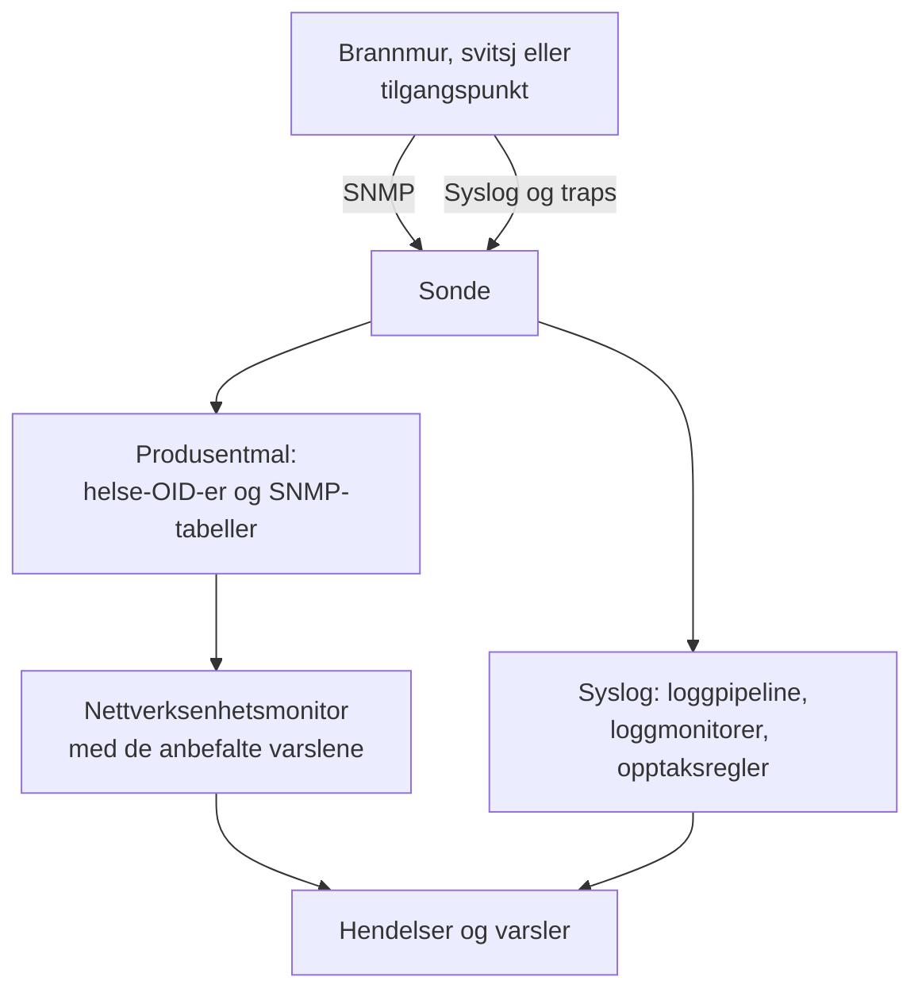

# Guider per nettverksleverandør (Sophos, Extreme, Cambium)

Slik overvåker du tre vanlige miljøer fra start til slutt med OneUptime: en Sophos Firewall (XGS, SFOS) med IPsec-tunnelene, WAN-lenkene og SD-WAN; Extreme Networks-svitsjer (EXOS / Switch Engine og Fabric Engine / VOSS) med fabricen sin; og Cambium Networks cnMatrix-svitsjer og Enterprise Wi-Fi-tilgangspunkter, helt ned til hver radios kanal og sendeeffekt.

:::cards
- [Sophos Firewall](#sophos-firewall-xgs-sfos): Tunneler, WAN-lenker, gatewayer og SD-WAN.
- [Extreme Networks](#extreme-networks-exos-switch-engine-og-fabric-engine-voss): Svitsjer, fabricen og maskinvaren dens.
- [Cambium Networks](#cambium-networks-enterprise-wi-fi-og-cnmatrix): Tilgangspunkter ned til hver radio, og cnMatrix-svitsjer.
:::

## Slik fungerer det

Hver guide bruker de samme delene:

- En [nettverksenhet](/docs/monitor/network-device-monitor) per boks, pollet av en sonde som kan nå den, med en produsentmal som tar med de riktige helse-OID-ene og [SNMP-tabellene](/docs/monitor/network-device-monitor#snmp-tabeller).
- En nettverksenhetsmonitor per enhet for varsling. Opprett den fra enhetens side, slik at de [anbefalte varslene](/docs/monitor/network-device-monitor#anbefalt-varslingspakke), inkludert ett varsel per rad for hver tabell som vet hvordan friskt ser ut, fylles ut for deg. For en flåte holder en [varslingspolicy](/docs/monitor/network-device-monitor#varslingspolicyer) en på hver enhet.
- For det en produsent bare rapporterer i loggene sine: syslog til sonden, en [loggpipeline](/docs/telemetry/log-pipelines) for å gjøre hver linje om til attributter, [loggmonitorer med Group By](/docs/monitor/logs-monitor#varsler-per-gruppe-group-by) for å varsle én gang per tunnel eller gateway, og [opptaksregler for logger](/docs/telemetry/log-recording-rules) for å vise tallene i de loggene i diagrammer.

## Sophos Firewall (XGS / SFOS)

| Hva du vil se | Hvor det kommer fra |
| --- | --- |
| Brannmurens helse: minne, disk, swap, HA-tilstand, IPsec-tjeneste, CPU per kjerne | SNMP, med produsentmalen **Sophos Firewall (SFOS / XGS)** |
| Statusen til hver IPsec-tunnel, etter navn | SNMP-tabellen `ipsec_tunnels` (SFOS v20 og nyere) |
| Status, gjennomstrømning, utnyttelse og feil for hver WAN-lenke | Grensesnittwalket av WAN-portene |
| Latens, pakketap og jitter for hver WAN-lenke | Ping-monitorer og enhetspollinger fra OneUptime-sonder |
| Gateway oppe og nede, SD-WAN-SLA oppfylt eller ikke, endringer i SD-WAN-ruter | Brannmurens syslog |
| SD-WAN-latens, -jitter og -pakketap per gateway, som diagrammer | Opptaksregler for logger over SD-WAN-SLA-loggene |

Sophos rapporterer ikke helsen til gatewayer eller SD-WAN via SNMP, i noen SFOS-versjon: den finnes bare i brannmurens logger og i Sophos Centrals varsler, og derfor går de tre siste radene gjennom syslog.

### Registrer brannmuren

:::steps
1. Slå på SNMP på brannmuren under **Administration → SNMP**: legg til en SNMPv3-bruker, eller en v2c-community, og tillat sondens adresse å spørre den.
2. Gå til **Nettverk → Devices** i OneUptime og klikk på **Add Device**. Skriv brannmurens administrasjonsadresse, velg en sonde som kan nå den, og legg til SNMP-påloggingsinformasjonen under **SNMP**.
3. På enhetens side **Innstillinger**, under **Polling & Data Collection**, bruker du malen **Sophos Firewall (SFOS / XGS)** fra **Vendor Health Template** og legger til tabellene dens fra **Add a Vendor's Tables**. Eller slå på **Auto-Apply Vendor Health Template**, så gjør første polling begge deler.
:::

Etter neste polling viser enhetens side **SNMP Tables** hver IPsec-tilkobling med statusen (active, inactive, partially active), og CPU-kjernene. SFOS nummererer kjernene sine fra 196608, og derfor kommer CPU-en fra en tabell i stedet for fra én enkelt `hrProcessorLoad.1`.

### Varsle om hver IPsec-tunnel

Klikk på **Opprett monitor** på enhetens side. De anbefalte varslene inkluderer **IPsec Tunnels: row unhealthy**, et kriterium **SNMP Table Row Is Unhealthy** på tabellen `ipsec_tunnels` med Row `*`: det oppretter én hendelse per tunnel som ikke er aktiv, med navn etter tunnelen, og løser hver av dem når tunnelen kommer tilbake.

En tunnel som Sophos rapporterer som aktiv, har bare security associations oppe. For å bevise at trafikk går gjennom den, legger du til en [Ping-monitor](/docs/monitor/ping-monitor) fra en sonde på én lokasjon til en vert på den andre siden av hver tunnel, og tegner tunnelen som en lokasjonslenke under **Nettverk → Topologi → Site Links** mellom de to [lokasjonene](/docs/monitor/network-sites), bundet til den monitoren: lenken på kartet får da monitorens farge.

### WAN-lenker

- **Porthelse.** Grensesnittwalket måler allerede status, bits inn og ut, utnyttelse og feil for hver WAN-port. På brannmurens monitor varsler et kriterium **SNMP Interface Is Down** eller **SNMP Interface Utilization (in %)** med **Grensesnitt** satt til WAN-portens navn, eller `*` for hver port, per lenke.
- **Banens kvalitet.** Latens, pakketap og jitter for hver lenke måles utenfor brannmuren: en Ping-monitor fra OneUptimes skysonder til den offentlige adressen til hver WAN-lenke, og en Ping-monitor fra en sonde på lokasjonen til hver leverandørs gateway. Kriterier for pakketap og jitter på de monitorene varsler per lenke, og **Nettverk → Topologi → Latency Matrix** viser hver sonde mot hver monitor med ett blikk.
- **Trafikk.** SFOS eksporterer NetFlow v5. Send det til sonden på UDP 2055, der sondens flytinnsamler lytter som standard, så viser enhetens side **Traffic** hvem som snakker med hvem over hver WAN-lenke; [Nettverkstrafikk](/docs/monitor/network-traffic) har detaljene.

### Gatewayer og SD-WAN fra syslog

:::steps
1. Slå på sondens syslog-mottaker: sett `PROBE_SYSLOG_RECEIVER_ENABLED=true` på sonden. Den lytter på UDP 5140 som standard (`PROBE_SYSLOG_RECEIVER_PORT` endrer det); publiser porten hvis sonden kjører i Docker. Meldinger matches mot nettverksenheten der vertsnavnet, eller en av **Andre adresser**, er avsenderens adresse, og vises på enhetens side **Logger**.
2. Legg til en syslog-server på brannmuren, under **System services → Log settings**, som peker på sonden og den porten, og kryss av for loggtypene **Event** for IPsec og gatewayer og loggtypen **SD-WAN**: SLA-loggene forblir slått av til den er krysset av.
3. Opprett en pipeline under **Logger → Innstillinger → Pipelines** der filteret passer brannmurens logger, for eksempel `attributes.networkDevice.name = 'hq-firewall'`, og legg til en **Key=Value Parser** med **Target Prefix** `sophos`. Lim inn en linje fra brannmuren i testeren for å se nøyaktig hvilke attributtnavn SFOS-versjonen din produserer; [Sophos-eksempelet](/docs/telemetry/log-pipelines#eksempel-sophos-xgs-brannmur) går gjennom det.
4. Opprett [loggmonitorer](/docs/monitor/logs-monitor) på brannmurens logger, hver med **Group by Attributes** slik at hver tunnel eller gateway varsler for seg, og kriteriet **Log Count** **Greater Than** `0` over noen minutter. Radene nedenfor er de tre å starte med.
5. Vis SD-WAN-kvaliteten i diagrammer: med SD-WAN-logging slått på skriver brannmuren en SLA-oppsummering per profil og gateway (`latency`, `jitter`, `packet_loss`). Opprett én regel per tall under **Logger → Innstillinger → Opptaksregler**, for eksempel gjennomsnittet av `sophos.latency` gruppert etter `sophos.gw_name` og `sophos.profile_name`, og vis deretter resultatene i diagrammer, eller varsle om dem med en [målingsmonitor](/docs/monitor/metrics-monitor) som grupperer etter gateway. [Opptaksregler for logger](/docs/telemetry/log-recording-rules) går gjennom dette eksempelet.
:::

| Varsel | Logger som skal telles | Grupper etter |
| --- | --- | --- |
| IPsec-tunnel avsluttet | Attributt `sophos.log_component` = `IPSec`, brødteksten inneholder `terminated` | `sophos.con_name` |
| Gateway nede | Attributt `sophos.log_component` = `Gateway`, brødteksten inneholder `is Down` | `sophos.gatewayname` |
| SD-WAN-SLA ikke oppfylt | Attributt `sophos.log_type` = `SD-WAN`, brødteksten inneholder `SLA not met` | `sophos.gw_name` |

Syslog-hendelsene utfyller SNMP-tabellen: de kommer i det øyeblikket en tunnel faller, mens tabellen også fanger en tunnel som aldri kom opp.

### Traps

Hver Sophos-melding er den samme trapen, `sfosNotification` (`1.3.6.1.4.1.2604.5.1.8.1.1`), med hendelsen som tekst i `sfosTrapMessage` (`1.3.6.1.4.1.2604.5.1.8.1.2`). For å varsle om én type hendelse kombinerer du **SNMP Trap Received (Trap OID)** Equal To `1.3.6.1.4.1.2604.5.1.8.1.1` med **SNMP Trap Varbind Value** på den varbinden, Contains `IPSec` for eksempel. Sett brannmurens trapdestinasjon til SNMP v2c: sondens trapmottaker tar imot v1- og v2c-traps.

## Extreme Networks (EXOS / Switch Engine og Fabric Engine / VOSS)

| Hva du vil se | Hvor det kommer fra |
| --- | --- |
| EXOS: CPU, temperatur og alarmen for den, strømtilstand, strømforsyninger, vifter, minne per spor, stabelmedlemmer | Malen **Extreme Networks EXOS / Switch Engine** |
| Fabric Engine: CPU og minne per spor, temperatursensorer, vifter, strømforsyninger, vIST-økt, antall I-SID-er | Malen **Extreme Networks Fabric Engine / VOSS** |
| Hver Fabric Connect-adjacency (IS-IS), med navn etter naboen | Fabric Engine-malens tabell `isis_adjacencies` |
| Porter, LLDP-naboer, nettverkskartet | Grensesnittwalket, på begge |

### Hvilken mal

Fabric Engine på Extremes universelle maskinvare (5000- og 7000-seriene) rapporterer det samme enterprisenummeret som EXOS: bare systembeskrivelsen (`7520-48Y-8C-FabricEngine (9.0.4.0)`) sier hvilket operativsystem som kjører. OneUptime leser begge, så automatisk bruk og forslaget på enhetssiden velger riktig mal, og eldre VSP-svitsjer rapporterer Avaya/Nortel-grenen og gjenkjennes direkte som Fabric Engine.

### Varsler for fabric og maskinvare

De anbefalte varslene på en Fabric Engine-svitsj inkluderer **Fabric Adjacencies (IS-IS): row unhealthy**, en hendelse per nabo der adjacencyen ikke er oppe. Fabric Engine sender også en trap når en adjacency endres, `rcnIsisPlsbAdjStateTrap` (`1.3.6.1.4.1.2272.1.21.0.281`), og et kriterium **SNMP Trap Received (Trap OID)** på den varsler i løpet av sekunder, før neste polling.

Strømforsyninger, vifter, temperatursensorer og stabelmedlemmer er tabeller som oppgir de friske verdiene sine, så hver av dem får et varsel per rad i de anbefalte varslene.

### Flyter og Wi-Fi

EXOS og Fabric Engine eksporterer flyter som sFlow og IPFIX. Send sFlow til sonden på UDP 6343, eller IPFIX på UDP 4739, så viser enhetens side **Traffic** trafikken; se [Nettverkstrafikk](/docs/monitor/network-traffic).

IQ Engine-tilgangspunkter (HiveOS) og ExtremeCloud IQ Controller har egne produsentmaler, som fyller enhetens side **Wi-Fi**. [Støttede Wi-Fi-produsenter](/docs/monitor/network-device-monitor#støttede-wi-fi-produsenter) dekker dem, sammen med Ubiquiti UniFi, HPE Aruba, TP-Link Omada og Juniper Mist.

## Cambium Networks (Enterprise Wi-Fi og cnMatrix)

### Tilgangspunkter

:::steps
1. Slå på SNMP på tilgangspunktene. I cnMaestro settes SNMP per AP-gruppe: **Configuration → Wi-Fi Profiles → AP Groups → Management → SNMP**. Slå det på med en v2c-lesecommunity eller en SNMPv3-bruker.
2. Legg til hvert tilgangspunkt med administrasjonsadressen og den påloggingsinformasjonen, og bruk malen **Cambium Networks Enterprise Wi-Fi (cnPilot, XV, XE, XH)**, eller slå på automatisk bruk.
3. Åpne enhetens side **Wi-Fi**. Den viser hvor mange radioer som er på, klientene og SSID-ene, deretter hver radios bånd, kanal, frekvens, kanalbredde, sendeeffekt, klienter, støygulv og airtime, og hver SSID med klientene. Frekvensen regnes ut fra båndet og kanalen; tilgangspunktet rapporterer den ikke.
:::

Nyttige varsler, alle på tabellen `wifi_radios` med Row `*`, slik at hver radio varsler for seg:

| Varsel | Kriterium |
| --- | --- |
| En radio slått av | **SNMP Table Row Is Unhealthy**, en del av de anbefalte varslene |
| Sendeeffekten endret | **SNMP Table Value**, kolonnen TX Power, Not Equal To den planlagte effekten din |
| En overfylt radio | **SNMP Table Value**, kolonnen Clients, Greater Than grensen din |
| En støyende kanal | **SNMP Table Value**, kolonnen Noise Floor, Greater Than `-80` |

Hver numerisk radioverdi er også en måling (`oneuptime.monitor.snmp.table.value`, én serie per radio og kolonne), så kanal, effekt og klienter kan vises i diagrammer over tid på et dashbord; en kanal som stadig endres, er DFS i arbeid.

Cambium rapporterer det totale antallet klienter først fra fastvare 6.5.3; eldre fastvare returnerer 0.

### cnMatrix-svitsjer

Malen **Cambium Networks cnMatrix** samler inn CPU, RAM, flash, temperatur og forsyningsspenning, og som tabeller viftene, den redundante strømforsyningen og hver ports PoE-forbruk. Porter og LLDP-naboer kommer fra grensesnittwalket, som på enhver svitsj.

### cnMaestro-alarmer

cnMaestro kan sende alarmene sine, som et tilgangspunkt som går offline, til en HTTPS-webhook. Pek den mot en [monitor for innkommende forespørsler](/docs/monitor/incoming-request-monitor) for å gjøre de alarmene om til OneUptime-hendelser ved siden av SNMP-dataene.

## Feilsøking

:::details Tabellen IPsec Tunnels har ingen status
Tunnelstatus krever SFOS v20 eller nyere. Sjekk også at SNMP-visningen for påloggingsinformasjonen din inkluderer Sophos' enterprise-tre (`1.3.6.1.4.1.2604`): en begrenset v3-bruker ser ofte bare systemgruppen og IF-MIB.
:::

:::details Det kommer ingen syslog fra brannmuren
Sondens syslog-mottaker er slått av som standard: sett `PROBE_SYSLOG_RECEIVER_ENABLED=true` og publiser UDP 5140, eller din `PROBE_SYSLOG_RECEIVER_PORT`, til sonden. Meldinger matches mot en enhet etter avsenderens adresse, så brannmurens vertsnavn i OneUptime, eller en av **Andre adresser**, må være adressen den sender syslog fra.
:::

:::details En Fabric Engine-svitsj fikk EXOS-malen
Malen velges ut fra svitsjens systembeskrivelse. Sjekk at enhetens oversikt viser en beskrivelse som nevner Fabric Engine (for eksempel `7520-48Y-8C-FabricEngine (9.0.4.0)`); hvis den gjør det, fjern EXOS-OID-ene og -tabellene og bruk **Extreme Networks Fabric Engine / VOSS** fra **Vendor Health Template**.
:::

:::details Cambium-tilgangspunkter rapporterer 0 klienter
Det totale antallet klienter krever fastvare 6.5.3 eller nyere. På eldre fastvare rapporterer radioene fortsatt kanal, effekt og støygulv.
:::

## Neste steg

:::cards
- [Nettverksenhets-overvåking](/docs/monitor/network-device-monitor): Alt en enhet samler inn, og hvert kriterium den kan varsle om.
- [Loggpipelines](/docs/telemetry/log-pipelines): Del opp brannmurlogger i attributter.
- [Logg-overvåking](/docs/monitor/logs-monitor): Varsle én gang per tunnel eller gateway.
:::
