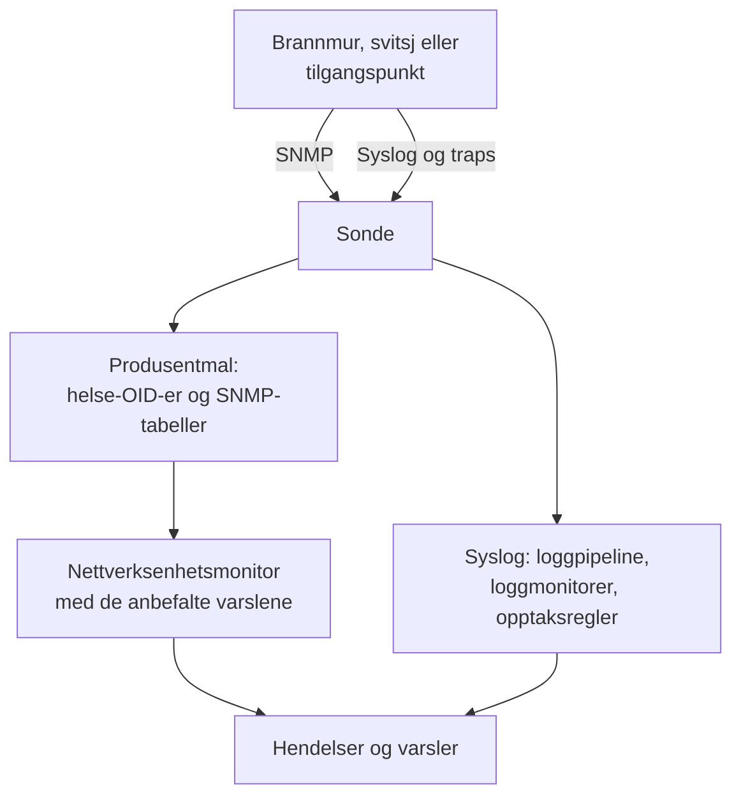

# Guider per nettverksleverandør (Sophos, Extreme, Cambium)

Slik overvåker du tre vanlige miljøer fra start til slutt med OneUptime: en Sophos Firewall (XGS, SFOS) med IPsec-tunnelene, WAN-lenkene og SD-WAN; Extreme Networks-svitsjer (EXOS / Switch Engine og Fabric Engine / VOSS) med fabricen sin; og Cambium Networks cnMatrix-svitsjer og Enterprise Wi-Fi-tilgangspunkter, helt ned til hver radios kanal og sendeeffekt. De dekker også SAN-svitsjer, Brocade Fabric OS og Cisco MDS 9000, helt ned til feilene på hver Fibre Channel-port.

:::cards
- [Sophos Firewall](#sophos-firewall-xgs-sfos): Tunneler, WAN-lenker, gatewayer og SD-WAN.
- [Extreme Networks](#extreme-networks-exos-switch-engine-og-fabric-engine-voss): Svitsjer, fabricen og maskinvaren dens.
- [Cambium Networks](#cambium-networks-enterprise-wi-fi-og-cnmatrix): Tilgangspunkter ned til hver radio, og cnMatrix-svitsjer.
- [Brocade Fabric OS](#brocade-fabric-os): Fibre Channel-porter, optikk, sensorer og fabric-hendelser.
- [Cisco MDS 9000](#cisco-mds-9000): Fibre Channel-grensesnitt, VSAN-er, slow drain og port-monitor-alarmer.
:::

## Slik fungerer det

Hver guide bruker de samme delene:



- En [nettverksenhet](/docs/monitor/network-device-monitor) per boks, pollet av en sonde som kan nå den, med en produsentmal som tar med de riktige helse-OID-ene og [SNMP-tabellene](/docs/monitor/network-device-monitor#snmp-tabeller).
- En nettverksenhetsmonitor per enhet for varsling. Opprett den fra enhetens side, slik at de [anbefalte varslene](/docs/monitor/network-device-monitor#anbefalt-varslingspakke), inkludert ett varsel per rad for hver tabell som vet hvordan friskt ser ut, fylles ut for deg. For en flåte holder en [varslingspolicy](/docs/monitor/network-device-monitor#varslingspolicyer) en på hver enhet.
- For det en produsent bare rapporterer i loggene sine: syslog til sonden, som OneUptime selv leser som [nettverkshendelser](/docs/monitor/network-events), [loggmonitorer med Group By](/docs/monitor/logs-monitor#varsler-per-gruppe-group-by) for å varsle én gang per tunnel eller gateway, og [opptaksregler for logger](/docs/telemetry/log-recording-rules) for å vise tallene i de loggene i diagrammer.

## Sophos Firewall (XGS / SFOS)

| Hva du vil se | Hvor det kommer fra |
| --- | --- |
| Brannmurens helse: minne, disk, swap, HA-tilstand, IPsec-tjeneste, CPU per kjerne | SNMP, med produsentmalen **Sophos Firewall (SFOS / XGS)** |
| Statusen til hver IPsec-tunnel, etter navn | SNMP-tabellen `ipsec_tunnels` (SFOS v20 og nyere) |
| Status, gjennomstrømning, utnyttelse og feil for hver WAN-lenke | Grensesnittwalket av WAN-portene |
| Latens, pakketap og jitter for hver WAN-lenke | Ping-monitorer og enhetspollinger fra OneUptime-sonder |
| Gateway oppe og nede, SD-WAN-SLA oppfylt eller ikke, endringer i SD-WAN-ruter | Brannmurens syslog |
| SD-WAN-latens, -jitter og -pakketap per gateway, som diagrammer | Opptaksregler for logger over SD-WAN-SLA-loggene |

Sophos rapporterer ikke helsen til gatewayer eller SD-WAN via SNMP, i noen SFOS-versjon: den finnes bare i brannmurens logger og i Sophos Centrals varsler, og derfor går de tre siste radene gjennom syslog.

### Registrer brannmuren

:::steps
1. Slå på SNMP på brannmuren under **Administration → SNMP**: legg til en SNMPv3-bruker, eller en v2c-community, og tillat sondens adresse å spørre den.
2. Gå til **Nettverk → Enheter** i OneUptime og klikk på **Legg til enhet**. Skriv brannmurens administrasjonsadresse, velg en sonde som kan nå den, og legg til SNMP-påloggingsinformasjonen under **SNMP**.
3. På enhetens side **Innstillinger**, under **Polling & Data Collection**, bruker du malen **Sophos Firewall (SFOS / XGS)** fra **Vendor Health Template** og legger til tabellene dens fra **Add a Vendor's Tables**. Eller slå på **Auto-Apply Vendor Health Template**, så gjør første polling begge deler.
:::

Etter neste polling viser enhetens side **SNMP-tabeller** hver IPsec-tilkobling med statusen (active, inactive, partially active), og CPU-kjernene. SFOS nummererer kjernene sine fra 196608, og derfor kommer CPU-en fra en tabell i stedet for fra én enkelt `hrProcessorLoad.1`.

### Varsle om hver IPsec-tunnel

Klikk på **Opprett monitor** på enhetens side. De anbefalte varslene inkluderer **IPsec Tunnels: row unhealthy**, et kriterium **SNMP-tabellrad er ikke feilfri** på tabellen `ipsec_tunnels` med Row `*`: det oppretter én hendelse per tunnel som ikke er aktiv, med navn etter tunnelen, og løser hver av dem når tunnelen kommer tilbake.

En tunnel som Sophos rapporterer som aktiv, har bare security associations oppe. For å bevise at trafikk går gjennom den, legger du til en [Ping-monitor](/docs/monitor/ping-monitor) fra en sonde på én lokasjon til en vert på den andre siden av hver tunnel, og tegner tunnelen som en lokasjonslenke under **Nettverk → Topologi → Lokasjonslenker** mellom de to [lokasjonene](/docs/monitor/network-sites), bundet til den monitoren: lenken på kartet får da monitorens farge.

### WAN-lenker

- **Porthelse.** Grensesnittwalket måler allerede status, bits inn og ut, utnyttelse og feil for hver WAN-port. På brannmurens monitor varsler et kriterium **SNMP-grensesnitt er nede** eller **SNMP-grensesnittutnyttelse (i %)** med **Grensesnitt** satt til WAN-portens navn, eller `*` for hver port, per lenke.
- **Banens kvalitet.** Latens, pakketap og jitter for hver lenke måles utenfor brannmuren: en Ping-monitor fra OneUptimes skysonder til den offentlige adressen til hver WAN-lenke, og en Ping-monitor fra en sonde på lokasjonen til hver leverandørs gateway. Kriterier for pakketap og jitter på de monitorene varsler per lenke, og **Nettverk → Topologi → Latensmatrise** viser hver sonde mot hver monitor med ett blikk.
- **Trafikk.** SFOS eksporterer NetFlow v5. Send det til sonden på UDP 2055, der sondens flytinnsamler lytter som standard, så viser enhetens side **Trafikk** hvem som snakker med hvem over hver WAN-lenke; [Nettverkstrafikk](/docs/monitor/network-traffic) har detaljene.

### Gatewayer og SD-WAN fra syslog

:::steps
1. Sondens syslog-mottaker er slått på som standard. Den lytter på port 5140, over UDP og TCP (`PROBE_SYSLOG_RECEIVER_PORT` endrer det); publiser porten hvis sonden kjører i Docker. Meldinger matches mot nettverksenheten der vertsnavnet, eller en av **Andre adresser**, er avsenderens adresse, og vises på enhetens sider **Hendelser** og **Logger**.
2. Legg til en syslog-server på brannmuren, under **System services → Log settings**, som peker på sonden og den porten, og kryss av for loggtypene **Event** for IPsec og gatewayer og loggtypen **SD-WAN**: SLA-loggene forblir slått av til den er krysset av.
3. Det er ingenting å tolke. OneUptime leser brannmurens `key=value`-felt som `sophos.*`-attributter, og leser tunneler, gatewayer, SD-WAN-SLA-endringer, failovere og pålogginger ut av dem som [nettverkshendelser](/docs/monitor/network-events). Åpne en logg på enhetens side **Logger** for å se nøyaktig hvilke attributtnavn SFOS-versjonen din produserer.
4. Klikk på **Opprett varsel** på enhetens side **Hendelser**, og velg et varsel. Det åpner en ferdig utfylt [loggmonitor](/docs/monitor/logs-monitor), med **Grupper etter attributter** slik at hver tunnel eller gateway varsler for seg, og **Løst av attributter** slik at hvert varsel lukkes når brannmuren melder den tilbake. Radene nedenfor er de tre å starte med.
5. Vis SD-WAN-kvaliteten i diagrammer: med SD-WAN-logging slått på skriver brannmuren en SLA-oppsummering per profil og gateway (`latency`, `jitter`, `packet_loss`). Opprett én regel per tall under **Logger → Innstillinger → Opptaksregler**, for eksempel gjennomsnittet av `sophos.latency` gruppert etter `sophos.gw_name` og `sophos.profile_name`, og vis deretter resultatene i diagrammer, eller varsle om dem med en [målingsmonitor](/docs/monitor/metrics-monitor) som grupperer etter gateway. [Opptaksregler for logger](/docs/telemetry/log-recording-rules) går gjennom dette eksempelet.
:::

| Varsel | Hendelsen som telles | Ett varsel per | Lukkes av |
| --- | --- | --- | --- |
| En VPN-tunnel går ned | `vpn.tunnel_down` | `vpn.tunnel.name` | `vpn.tunnel_up` |
| En WAN-lenke går ned | `gateway.down` | `network.gateway.name` | `gateway.up` |
| SD-WAN-lenke under SLA-en | `sdwan.sla_not_met` | `network.gateway.name` | `sdwan.sla_met` |

De to første står på listen under **Opprett varsel**; for det tredje åpner du en av hendelsene og klikker på **Opprett varsel for denne hendelsen**. Syslog-hendelsene utfyller SNMP-tabellen: de kommer i det øyeblikket en tunnel faller, mens tabellen også fanger en tunnel som aldri kom opp.

### Traps

Hver Sophos-melding er den samme trapen, `sfosNotification` (`1.3.6.1.4.1.2604.5.1.8.1.1`), med hendelsen som tekst i `sfosTrapMessage` (`1.3.6.1.4.1.2604.5.1.8.1.2`). For å varsle om én type hendelse kombinerer du **SNMP-trap mottatt (trap-OID)** Lik `1.3.6.1.4.1.2604.5.1.8.1.1` med **Varbind-verdi i SNMP-trap** på den varbinden, Inneholder `IPSec` for eksempel. Sett brannmurens trapdestinasjon til SNMP v2c: sondens trapmottaker tar imot v1- og v2c-traps.

## Extreme Networks (EXOS / Switch Engine og Fabric Engine / VOSS)

| Hva du vil se | Hvor det kommer fra |
| --- | --- |
| EXOS: CPU, temperatur og alarmen for den, strømtilstand, strømforsyninger, vifter, minne per spor, stabelmedlemmer | Malen **Extreme Networks EXOS / Switch Engine** |
| Fabric Engine: CPU og minne per spor, temperatursensorer, vifter, strømforsyninger, vIST-økt, antall I-SID-er | Malen **Extreme Networks Fabric Engine / VOSS** |
| Hver Fabric Connect-adjacency (IS-IS), med navn etter naboen | Fabric Engine-malens tabell `isis_adjacencies` |
| Porter, LLDP-naboer, nettverkskartet | Grensesnittwalket, på begge |

### Hvilken mal

Fabric Engine på Extremes universelle maskinvare (5000- og 7000-seriene) rapporterer det samme enterprisenummeret som EXOS: bare systembeskrivelsen (`7520-48Y-8C-FabricEngine (9.0.4.0)`) sier hvilket operativsystem som kjører. OneUptime leser begge, så automatisk bruk og forslaget på enhetssiden velger riktig mal, og eldre VSP-svitsjer rapporterer Avaya/Nortel-grenen og gjenkjennes direkte som Fabric Engine.

### Varsler for fabric og maskinvare

De anbefalte varslene på en Fabric Engine-svitsj inkluderer **Fabric Adjacencies (IS-IS): row unhealthy**, en hendelse per nabo der adjacencyen ikke er oppe. Fabric Engine sender også en trap når en adjacency endres, `rcnIsisPlsbAdjStateTrap` (`1.3.6.1.4.1.2272.1.21.0.281`), og et kriterium **SNMP-trap mottatt (trap-OID)** på den varsler i løpet av sekunder, før neste polling.

Strømforsyninger, vifter, temperatursensorer og stabelmedlemmer er tabeller som oppgir de friske verdiene sine, så hver av dem får et varsel per rad i de anbefalte varslene.

### Flyter og Wi-Fi

EXOS og Fabric Engine eksporterer flyter som sFlow og IPFIX. Send sFlow til sonden på UDP 6343, eller IPFIX på UDP 4739, så viser enhetens side **Trafikk** trafikken; se [Nettverkstrafikk](/docs/monitor/network-traffic).

IQ Engine-tilgangspunkter (HiveOS) og ExtremeCloud IQ Controller har egne produsentmaler, som fyller enhetens side **Wi-Fi**. [Støttede Wi-Fi-produsenter](/docs/monitor/network-device-monitor#støttede-wi-fi-produsenter) dekker dem, sammen med Ubiquiti UniFi, HPE Aruba, TP-Link Omada og Juniper Mist.

## Cambium Networks (Enterprise Wi-Fi og cnMatrix)

### Tilgangspunkter

:::steps
1. Slå på SNMP på tilgangspunktene. I cnMaestro settes SNMP per AP-gruppe: **Configuration → Wi-Fi Profiles → AP Groups → Management → SNMP**. Slå det på med en v2c-lesecommunity eller en SNMPv3-bruker.
2. Legg til hvert tilgangspunkt med administrasjonsadressen og den påloggingsinformasjonen, og bruk malen **Cambium Networks Enterprise Wi-Fi (cnPilot, XV, XE, XH)**, eller slå på automatisk bruk.
3. Åpne enhetens side **Wi-Fi**. Den viser hvor mange radioer som er på, klientene og SSID-ene, deretter hver radios bånd, kanal, frekvens, kanalbredde, sendeeffekt, klienter, støygulv og airtime, og hver SSID med klientene. Frekvensen regnes ut fra båndet og kanalen; tilgangspunktet rapporterer den ikke.
:::

Nyttige varsler, alle på tabellen `wifi_radios` med Row `*`, slik at hver radio varsler for seg:

| Varsel | Kriterium |
| --- | --- |
| En radio slått av | **SNMP-tabellrad er ikke feilfri**, en del av de anbefalte varslene |
| Sendeeffekten endret | **SNMP-tabellverdi**, kolonnen TX Power, Ikke lik den planlagte effekten din |
| En overfylt radio | **SNMP-tabellverdi**, kolonnen Clients, Større enn grensen din |
| En støyende kanal | **SNMP-tabellverdi**, kolonnen Noise Floor, Større enn `-80` |

Hver numerisk radioverdi er også en måling (`oneuptime.monitor.snmp.table.value`, én serie per radio og kolonne), så kanal, effekt og klienter kan vises i diagrammer over tid på et dashbord; en kanal som stadig endres, er DFS i arbeid.

Cambium rapporterer det totale antallet klienter først fra fastvare 6.5.3; eldre fastvare returnerer 0.

### cnMatrix-svitsjer

Malen **Cambium Networks cnMatrix** samler inn CPU, RAM, flash, temperatur og forsyningsspenning, og som tabeller viftene, den redundante strømforsyningen og hver ports PoE-forbruk. Porter og LLDP-naboer kommer fra grensesnittwalket, som på enhver svitsj.

### cnMaestro-alarmer

cnMaestro kan sende alarmene sine, som et tilgangspunkt som går offline, til en HTTPS-webhook. Pek den mot en [monitor for innkommende forespørsler](/docs/monitor/incoming-request-monitor) for å gjøre de alarmene om til OneUptime-hendelser ved siden av SNMP-dataene.

## Brocade Fabric OS

| Hva du vil se | Hvor det kommer fra |
| --- | --- |
| Svitsjens tilstand, fastvare, CPU og minne | SNMP, med leverandørmalen **Brocade Fabric OS (SAN switches)** |
| Svitsjens status, sensorene og de utskiftbare enhetene (FRU-er), rad for rad | Malens tabeller `switch_status`, `sensors` og `frus` |
| Hver Fibre Channel-ports type, hvorfor en nede port er nede, og feilene, forkastede rammer og kredittventetider per sekund | SW-MIB og FCMGMT-MIB, på enhetens side **Grensesnitt** |
| Hver optikks mottatte og sendte effekt, temperatur, spenning og biasstrøm | FA-EXT-MIB, på kortet **Transceivere** |
| En nede forbindelse mellom svitsjer, en delt eller omkonfigurert fabric, en zoning-endring, et MAPS-varsel, en endret FRU | SNMPv3-traps |

Hver svitsj og director med Fabric OS rapporterer en systemobjekt-ID under `1.3.6.1.4.1.1588.2.1.1`, så malen gjelder for alle og for ingenting annet fra Brocade: VDX- og SLX-svitsjer beholder malen sin.

### Sett opp SNMP på Fabric OS

:::steps
1. Legg til en SNMPv3-bruker med autentisering og kryptering, SHA og AES: `snmpconfig --set snmpv3` spør om brukeren, protokollene og passfrasene.
2. Slå på FA-MIB med `snmpconfig --set mibCapability`. Den inneholder hver ports 64-biters feiltellere og optikken; uten den rapporterer en port bare CRC-feil, kodingsfeil, forkastede klasse 3-rammer og kredittventetider, som 32-biters tellere.
3. Legg til svitsjen i OneUptime med administrasjonsadressen og den brukeren. Med **Auto-Apply Vendor Health Template** på bruker den første avspørringen malen **Brocade Fabric OS (SAN switches)**; ellers bruker du den fra **Vendor Health Template** på enhetens side **Innstillinger**.
:::

Enhetens side **Grensesnitt** merker deretter hver Fibre Channel-port med typen, som E-Port eller F-Port, og sier hvorfor en nede port er nede, slik `switchshow` sier det: No light, No module, Disabled. Kortet **Fibre Channel-porter** viser per sekund hver ports feil, forkastede rammer og kreditt-tellere.

En ports CRC-feil, ugyldige overføringsord, forbindelsesfeil og tap av synkronisering og av signal er feilene dens: **SNMP-grensesnittfeil (per sekund)** varsler om dem, og de anbefalte varslene inkluderer **Fibre Channel port errors**, ved mer enn én feil på ti sekunder. Forkastede rammer og kredittventetider er ikke feil; varsle om en av dem med **SNMP Fibre Channel-teller (per sekund)**.

### Virtual Fabrics

Et chassis med Virtual Fabrics svarer for hver logisk svitsj i sin egen SNMPv3-kontekst: `VF:` og den logiske svitsjens fabric-ID. Legg til én enhet per logisk svitsj, alle på chassisets administrasjonsadresse, og sett for hver sin **SNMP v3-kontekst** (`VF:128`, `VF:20`); en enhet uten kontekst leser den logiske standardsvitsjen.

### Brocade-traps

Fabric OS sender trapsene sine over SNMPv3. Legg med `snmpconfig --set snmpv3` til proben som trap-mottaker for brukeren OneUptime spør med, på UDP-port 162: proben tar imot SNMPv3-traps fra brukerne av enhetene den spør (se [SNMPv3-traps og informs](/docs/monitor/network-device-monitor#snmpv3-traps-og-informs)), og hver logisk svitsjs traps nevner konteksten, så de bare utløses på enheten dens. En oppgradering av Fabric OS kan slå av enkelte traps igjen: sjekk dem med `snmpconfig --show mibCapability` etter en oppgradering, og slå en på igjen med `snmpconfig --enable mibCapability -mib_name SW-MIB -trap_name swFCPortScn`.

De anbefalte varslene på en Brocade-svitsj inkluderer ett for hver fabric-hendelse som betyr noe: **Inter-switch link down** (en E-Port som går frakoblet), **Fabric segmented**, **Fabric reconfigured**, **Zone configuration changed**, **MAPS alert** og **Field-replaceable unit changed**.

## Cisco MDS 9000

| Hva du vil se | Hvor det kommer fra |
| --- | --- |
| CPU og minne | SNMP, med leverandørmalen **Cisco MDS 9000 (SAN switches)** |
| Strømforsyninger, moduler og vifteskuffer, rad for rad | Malens tabeller `power_supplies`, `modules` og `fan_trays` |
| Hvert VSAN, med tilstanden | Malens tabell `vsans` |
| Hvert fc-grensesnitts type, hvorfor et nede grensesnitt er nede, og feilene, forkastede rammer, kredittap og kredittventetider per sekund | CISCO-FC-FE-MIB, på enhetens side **Grensesnitt** |
| Hver optikks måleverdier og alarmterskler | CISCO-ENTITY-SENSOR-MIB, på kortet **Transceivere** |
| Port-monitor-alarmer, nede forbindelser, endringer i soner, VSAN-er, fabric og FRU-er | Traps |

En MDS deler Ciscos enterprise-nummer med alle andre Cisco-enheter, så OneUptime gjenkjenner den på modellen eller på en systembeskrivelse som begynner med `Cisco NX-OS(tm) m9`: IOS-, IOS-XE- og Nexus-svitsjer beholder Cisco-malen sin.

### Sett opp SNMP på NX-OS

:::steps
1. Legg til en SNMPv3-bruker med bare lesetilgang: `snmp-server user oneuptime network-operator auth sha <auth-passphrase> priv aes-128 <priv-passphrase>`. Rollen `network-operator` leser og kan ikke endre noe.
2. Send traps til proben som den brukeren: `snmp-server host <probe-address> traps version 3 priv oneuptime`.
3. Slå på trapsene som er av som standard: `snmp-server enable traps zone`, `snmp-server enable traps vsan`, `snmp-server enable traps fcdomain`, `snmp-server enable traps fspf` og, for optikken, `snmp-server enable traps link cisco-xcvr-mon-status-chg`.
4. Legg til svitsjen i OneUptime med administrasjonsadressen og den brukeren: malen **Cisco MDS 9000 (SAN switches)** brukes på samme måte.
:::

De anbefalte varslene på en MDS inkluderer **Credit loss (slow drain)** og **Timeout discards (slow drain)**, én gang per grensesnitt: en vert eller et array som slutter å returnere bufferkreditt, bremser hver flyt bak seg, og disse tellerne viser det først.

### Port-monitor-alarmer

En port-monitor-policy på en MDS utløser en RMON-alarm når en ports teller krysser terskelen sin. De anbefalte varslene inkluderer **Port monitor alarm**, der varselet nevner telleren og grensesnittet, som "Port monitor: Credit loss rising on fc1/5". En policy som følger med på slow drain:

```text
port-monitor name slow-drain
  logical-type edge
  counter credit-loss-reco poll-interval 1 delta rising-threshold 1 event 4 falling-threshold 0 event 4
  counter timeout-discards poll-interval 60 delta rising-threshold 200 event 4 falling-threshold 10 event 4
port-monitor activate slow-drain
```

## Feilsøking

:::details Tabellen IPsec Tunnels har ingen status
Tunnelstatus krever SFOS v20 eller nyere. Sjekk også at SNMP-visningen for påloggingsinformasjonen din inkluderer Sophos' enterprise-tre (`1.3.6.1.4.1.2604`): en begrenset v3-bruker ser ofte bare systemgruppen og IF-MIB.
:::

:::details Det kommer ingen syslog fra brannmuren
Sonden lytter etter syslog på port 5140, over UDP og TCP, med mindre den er startet med `PROBE_SYSLOG_RECEIVER_ENABLED=false`: publiser den porten, eller din `PROBE_SYSLOG_RECEIVER_PORT`, hvis sonden kjører i Docker. Meldinger matches mot en enhet etter avsenderens adresse, så brannmurens vertsnavn i OneUptime, eller en av **Andre adresser**, må være adressen den sender syslog fra; inntil da står de på nettverkets side **Hendelser** som **Ennå ikke en enhet**.
:::

:::details En Fabric Engine-svitsj fikk EXOS-malen
Malen velges ut fra svitsjens systembeskrivelse. Sjekk at enhetens oversikt viser en beskrivelse som nevner Fabric Engine (for eksempel `7520-48Y-8C-FabricEngine (9.0.4.0)`); hvis den gjør det, fjern EXOS-OID-ene og -tabellene og bruk **Extreme Networks Fabric Engine / VOSS** fra **Vendor Health Template**.
:::

:::details Cambium-tilgangspunkter rapporterer 0 klienter
Det totale antallet klienter krever fastvare 6.5.3 eller nyere. På eldre fastvare rapporterer radioene fortsatt kanal, effekt og støygulv.
:::

## Neste steg

:::cards
- [Monitor for nettverksenhet](/docs/monitor/network-device-monitor): Alt en enhet samler inn, og hvert kriterium den kan varsle om.
- [Nettverkshendelser](/docs/monitor/network-events): Hva sysloggen til hver produsent sier, som hendelser og varsler.
- [Loggpipelines](/docs/telemetry/log-pipelines): Del opp brannmurlogger i attributter.
- [Logg-monitor](/docs/monitor/logs-monitor): Varsle én gang per tunnel eller gateway.
:::
