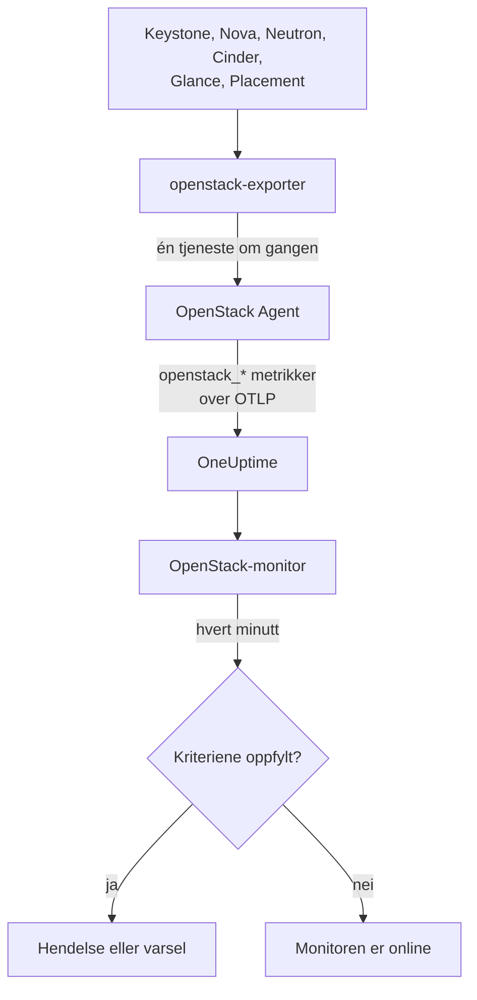

# OpenStack-overvåking

En OpenStack-monitor overvåker én sky - API-ene, arbeiderne bak dem, hypervisorer, instanser, nettverk, lagringspooler og prosjektkvoter - og varsler deg når et API slutter å svare, en arbeider går ned, en hypervisor ikke har mer å gi eller en pool fylles opp. Den leser `openstack_*`-seriene som OneUptime OpenStack Agent samler inn fra openstack-exporter, eller en sonde samler inn fra skyens API-er.

:::cards
- [Opprett monitoren](#opprett-en-openstack-monitor): Seks steg i dashbordet.
- [Maler](#ferdige-varselmaler): Ferdige varsler, én hendelse per arbeider, instans, nettverk eller region.
- [Sjekker utenfra](#sjekker-utenfra): Om noen faktisk kan starte en instans, fra en probe utenfor skyen.
- [Identitetsattributter](#identitetsattributter): Hvordan du retter deg mot én region, vert eller ett prosjekt.
- [Metrikker](#innsamlede-metrikker): Alle serier monitoren kan varsle på.
:::

## Slik fungerer det

Agenten er en OpenTelemetry Collector og en openstack-exporter som du kjører på en maskin som når skyens API-er. Den leser hver OpenStack-tjeneste i sin egen innsamling, slik at en Nova som feiler bare koster Novas serier, og den leser skånsomt: compute, network, volume og placement hvert 2. minutt, identity og image hvert 5.

Hver serie er merket med skyens navn, `openstack.cloud.name`, og hvert datapunkt med `openstack.region.name` og `openstack_service`. En sky er én Keystone, og en OpenStack-monitor er knyttet til én sky. Hvert minutt kjører den spørringen sin over skyens metrikker og sammenligner resultatet med kriteriene sine.



## Før du begynner

- **Samle inn skyens metrikker** med OpenStack Agent, eller [en sonde](/docs/telemetry/openstack-agentless). **Dokumentasjon**, under **Produkter → Infrastruktur → OpenStack**, veileder deg gjennom installasjonen av agenten.
- **Sjekk at skyen er registrert.** Den vises under **Produkter → Infrastruktur → OpenStack**, oppkalt etter agentens `OPENSTACK_CLOUD_NAME`, etter første innsamling.

## Opprett en OpenStack-monitor

:::steps
### Start en ny monitor

Gå til **Monitorer** og klikk **Opprett monitor**.

### Velg OpenStack

Under **Monitortype** klikker du **Flere monitortyper** og velger **OpenStack** under **Infrastruktur**, eller skriver `openstack` i søkefeltet. Skriv inn et **Navn** - det brukes i titlene på hendelser og varsler - og klikk **Neste**.

### Velg skyen

Under **OpenStack Monitor Configuration** velger du skyen fra **OpenStack-sky**. Alle skyer som har sendt data, står i listen. Når du har valgt, sier en linje under feltet om data kommer inn.

### Velg hva som skal overvåkes

En ny monitor starter på **Cloud Stopped Reporting**, under **Hva det skal varsles om**. For å overvåke noe annet:

- **Endre** - velg en annen [mal](#ferdige-varselmaler). Den setter metrikken, attributtfiltrene, aggregeringen, tidsintervallet, grupperingen og tersklene, og erstatter kriteriene nedenfor med sine egne. Du kan fortsatt endre **Tidsintervall**.
- **Custom Metric** (under **Flere felt**) - velg én metrikk fra **OpenStack-metrikk**, sett deretter **Aggregering** og **Tidsintervall**, og avgrens med [filtrene](#monitorinnstillinger).
- **Avansert** (under **Flere felt**) - bygg spørringer og formler selv under **Velg målinger**, med filtre på attributter som `status`, `adminState` eller `resourcetype`. Bruk **Grupper etter** et [identitetsattributt](#identitetsattributter) for å vurdere hver del for seg.

### Sjekk kriteriene

Åpne hvert kriterium under **Kriterier** og sjekk **Metrikk**, **Aggregering**, **Betingelse** og **Terskel**. En mal fyller ut disse. Med **Custom Metric** eller **Avansert** starter monitoren med standardkriteriene, som bare merker at metrikken ikke sender data, så sett din egen terskel.

### Opprett monitoren

Klikk **Opprett monitor**. OneUptime åpner monitorens side og evaluerer den hvert minutt. Hendelser og varsler den utløser, vises også på skyens **Hendelser**- og **Varsler**-sider.
:::

> [!TIP]
> For å sette opp flere maler på én gang åpner du skyen fra **Produkter → Infrastruktur → OpenStack** og går til **Anbefalinger**. Velg malene du vil ha, velg hvem som varsles, og OneUptime oppretter én monitor per mal.

## Monitorinnstillinger

| Felt | Fane | Hva det gjør |
| --- | --- | --- |
| **OpenStack-sky** | Alle | Påkrevd. Avgrenser hver spørring til `resource.openstack.cloud.name`. |
| **Region** | Custom Metric, Avansert | Valgfritt. Én region: `openstack.region.name`. Alle serier har den. |
| **Tilgjengelighetssone** | Custom Metric, Avansert | Valgfritt. Én sone: `availability_zone` på hypervisorer, instanser, volumer og Neutron-agenter, `zone` på Novas og Cinders arbeidere. |
| **Hypervisor** | Custom Metric, Avansert | Valgfritt. Én vert: `hostname` på arbeidere, hypervisorer og Placement, `hypervisor_hostname` på instanser. Novas arbeidere oppgir vertens korte navn, og hypervisorer, Placement og instanser det fulle navnet, så bruk det serien oppgir. |
| **Tjeneste** | Custom Metric, Avansert | Valgfritt. Én arbeiders binærfil, for eksempel `nova-compute`: `service`. |
| **Prosjekt-ID** | Custom Metric, Avansert | Valgfritt. Ett prosjekt: `tenant_id` på Novas og Cinders serier og på nettverk og subnett, `project_id` på flytende IP-er, rutere og adressetilgjengelighet. |
| **OpenStack-metrikk** | Custom Metric | Én metrikk fra [katalogen](#innsamlede-metrikker). |
| **Aggregering** | Custom Metric | Hvordan prøver kombineres: **Gjennomsnitt**, **Maksimum**, **Minimum**, **Sum** eller **Antall**. Starter på metrikkens vanlige aggregering. |
| **Tidsintervall** | Alle | Det rullerende vinduet spørringen leser, fra **Past 1 Minute** til **Past 365 Days**. En ny monitor starter på **Siste 15 minutter**; maler setter sitt eget. |
| **Velg målinger** | Avansert | Spørringsbyggeren: **Metrikk**, **Aggregate by**, **Filter by attributes**, **Grupper etter**, pluss **Legg til metrikk** og **Legg til formel** for å kombinere spørringer. |

Et filter avgrenser bare en serie som har etiketten sin: `openstack_nova_up` har ikke noe prosjekt, så et prosjektfilter lar den være som den er.

Hold vinduet på minst tre innsamlinger av det du leser: 6 minutter for compute, network, volume og placement, 15 for identity og image. Et kortere vindu rommer ikke nok innsamlinger til at **Alle verdier** kan bety en varighet.

## Identitetsattributter

Hver serie har `openstack.cloud.name` som et **ressursattributt**, og `openstack.region.name` og `openstack_service` som datapunktattributter. Exporterens egne etiketter oppgir resten:

| Del | Serier | Etiketter som identifiserer den |
| --- | --- | --- |
| API | `openstack_*_up` | `openstack.region.name`, `openstack_service` |
| Arbeider | `openstack_nova_agent_state`, `openstack_neutron_agent_state`, `openstack_cinder_agent_state` | `hostname`, `service`. `adminState` sier om en operatør lot den stå på. Grupper aldri etter `uuid` på Cinders: exporteren finner på en ny ved hver innsamling |
| Hypervisor | `openstack_placement_resource_*`, `openstack_nova_vcpus_*` | `hostname` (det fulle navnet), `resourcetype` på Placements |
| Instans | `openstack_nova_server_status` | `uuid`, `name`, `tenant_id`, `hypervisor_hostname`, `status`. Verdien er en kode: filtrer på `status`-ordet |
| Volum | `openstack_cinder_volume_gb` | `id`, `name`, `tenant_id`, `status` |
| Lagringspool | `openstack_cinder_pool_capacity_*` | `name`, `volume_backend_name` |
| Nettverk | `openstack_neutron_network_ip_availabilities_*` | `network_id`, `network_name`, `cidr`, `ip_version` |
| Ruter | `openstack_neutron_l3_agent_of_router` | `router_id`, `agent_host`, `ha_state`, `agent_alive`, `agent_admin_up` |
| Prosjekt | `openstack_nova_limits_*`, `openstack_cinder_limits_*` | `tenant_id`, `tenant` |

I monitorfiltre og grupperingsnøkler starter et ressursattributt med `resource.` (`resource.openstack.cloud.name`), og et datapunktattributt gjør ikke det (`openstack.region.name`, `hostname`, `status`). En tom etikett når ikke OneUptime, så `disabledReason` finnes bare på en arbeider som noen har deaktivert.

## Ferdige varselmaler

OneUptime leveres med 120 maler for vanlige OpenStack-problemer, og listen **Hva det skal varsles om** tilbyr dem. En skys Recommendations-side tilbyr bare en mal for Heat, Magnum, Ironic, Manila, Octavia, Trove, Designate, Gnocchi eller Swift til en sky som kjører den, en over en serie som bare en probe sender til en sky som en probe samler inn fra, og en over en [sjekk utenfra](#sjekker-utenfra) til en sky som har den sjekken på: på enhver annen sky finnes ikke seriene, så malen kunne aldri utløses. Hver mal bygger en komplett monitor: metrikkspørringen, attributtfiltrene, en gruppering på det én hendelse handler om, et kriterium som utløser og ett som gjenoppretter. Tersklene er de samme linjene som skyens egne sider tegner, og er utgangspunkter du kan redigere.

Hver mal leser minst tre innsamlinger av det den overvåker, og utløses bare når betingelsen holder i hele vinduet. En terskel på en andel gjenopprettes 10 % forbi linjen, så en verdi som svever der ikke flakker.

| Mal | Kategori | Alvorlighetsgrad | Overvåker | Utløses når | Gjenopprettes når |
| --- | --- | --- | --- | --- | --- |
| Cloud Stopped Reporting | Tilgjengelighet | Kritisk | `openstack_identity_up`, Antall over hele skyen, **siste 15 minutter** | Ingen data i hele vinduet: agenten stoppet eller når ikke OneUptime, eller exporteren kan ikke logge inn på Keystone | Data kommer inn igjen |
| Identity API Down | Tilgjengelighet | Kritisk | `openstack_identity_up` og `scrape_samples_scraped` for `identity`, Min per region, **siste 15 minutter** | Alle kall feilet, eller innsamlingen kom tilbake tom fordi exporteren ikke kunne logge inn | Begge leser 1 eller mer |
| Compute API Down | Tilgjengelighet | Kritisk | `openstack_nova_up` og `scrape_samples_scraped` for `compute`, Min per region, **siste 10 minutter** | Alle kall feilet, eller innsamlingen kom tilbake tom fordi exporteren ikke nådde Novas API | Begge leser 1 eller mer |
| Network API Down | Tilgjengelighet | Kritisk | `openstack_neutron_up` og `up` for `network`, Min per region, **siste 10 minutter** | Alle kall feilet, eller exporteren svarte ikke | Begge leser 1 |
| Block Storage API Down | Tilgjengelighet | Kritisk | `openstack_cinder_up` og `up` for `volume`, Min per region, **siste 10 minutter** | Alle kall feilet, eller exporteren svarte ikke | Begge leser 1 |
| Image API Down | Tilgjengelighet | Kritisk | `openstack_glance_up` og `up` for `image`, Min per region, **siste 15 minutter** | Alle kall feilet, eller exporteren svarte ikke | Begge leser 1 |
| Placement API Down | Tilgjengelighet | Kritisk | `openstack_placement_up` og `up` for `placement`, Min per region, **siste 10 minutter** | Alle kall feilet, eller exporteren svarte ikke | Begge leser 1 |
| Compute Service Down | Kontrollplan | Kritisk | `openstack_nova_agent_state` filtrert til `service = nova-compute` og `adminState = enabled`, Min per vert, **siste 10 minutter** | Under 1: en aktivert nova-compute er nede. En som noen har deaktivert, utløser aldri | Oppe, eller deaktivert |
| Compute Service Disabled | Kontrollplan | Advarsel | `openstack_nova_agent_state` filtrert til `service = nova-compute` og `adminState = disabled`, et Antall per vert, **siste 10 minutter** | Over 0: en `nova-compute` ble deaktivert, og ingen pågående vedlikeholdshendelse dekker verten, tilgjengelighetssonen eller skyen. En som deaktiverte seg selv fordi libvirt gikk ned (årsaken starter med `AUTO:`), holder seg stille mens libvirt Service Down er åpen. Prosjekter får ikke beskjed om den | Den er aktivert igjen, eller en hendelse dekker den |
| Scheduler or Conductor Down | Kontrollplan | Advarsel | `openstack_nova_agent_state` filtrert til `nova-scheduler` eller `nova-conductor` og `adminState = enabled`, Min per vert og binærfil, **siste 10 minutter** | Under 1. De andre fortsetter så lenge noen er igjen | Oppe, eller deaktivert |
| Every Scheduler or Conductor Down | Kontrollplan | Kritisk | Det samme, Maks per region og binærfil, **siste 10 minutter** | Under 1: ingen er i live, så ingenting nytt kan startes | En er oppe |
| Network Agent Down | Kontrollplan | Kritisk | `openstack_neutron_agent_state` filtrert til `adminState = up`, Min per vert og binærfil, **siste 10 minutter** | Under 1: en agent som er satt opp, er ikke i live. En som noen har satt ned, utløser aldri | I live, eller satt ned |
| Block Storage Service Down | Kontrollplan | Kritisk | `openstack_cinder_agent_state` filtrert til `adminState = enabled`, Min per vert og binærfil, **siste 10 minutter** | Under 1: en aktivert Cinder-tjeneste er nede. En som noen har deaktivert, utløser aldri | Oppe, eller deaktivert |
| vCPU Allocation High | Compute | Advarsel | `openstack_placement_resource_*` filtrert til `resourcetype = VCPU`, bruk / ((total - reservert) x forhold), per hypervisor, **siste 10 minutter** | Over 90 %: allokering, ikke belastning | På eller under 81 % |
| Memory Allocation High | Compute | Advarsel | Det samme, `resourcetype = MEMORY_MB` | Over 90 % | På eller under 81 % |
| Local Disk Allocation High | Compute | Advarsel | Det samme, `resourcetype = DISK_GB` | Over 90 % | På eller under 81 % |
| Hypervisor CPU Saturated | Compute | Advarsel | `openstack.hypervisor.instances.cpu.utilization`, per hypervisor, **siste 15 minutter**. Trenger libvirts eller Ceilometers exporter | Over 90 % av CPU-trådene: belastning, ikke allokering. Siden navngir instansene som er ansvarlige | På eller under 81 % |
| Hypervisor Memory Pressure | Compute | Advarsel | `openstack.hypervisor.instances.memory.utilization`, per hypervisor, **siste 15 minutter**. Trenger libvirts exporter, eller Ceilometers polling av `memory.resident` | Over 90 % av minnet: i bruk, ikke lovet bort | På eller under 81 % |
| Instance CPU Saturated | Compute | Advarsel | `openstack.instance.cpu.utilization`, Maks per instans, **siste 15 minutter**. Trenger libvirts eller Ceilometers exporter | Over 95 % av vCPU-ene | På eller under 85,5 % |
| Instance Disk Latency High | Compute | Advarsel | `openstack.instance.disk.read.latency` og `openstack.instance.disk.write.latency`, Maks per instans og disk, **siste 15 minutter**. Trenger libvirts exporter, eller Ceilometers polling av `disk.device.read.latency` og `disk.device.write.latency` | Over 50 ms per forespørsel. En disk uten forespørsler har ingen latens, så en uvirksom disk utløser aldri | På eller under 45 ms, eller den slutter å brukes |
| Instances in Error | Compute | Advarsel | `openstack_nova_server_status` filtrert til `status = ERROR`, Antall per region, **siste 10 minutter** | Over 0 | Ingen igjen |
| Instance Stuck Building | Compute | Advarsel | `openstack_nova_server_status` filtrert til `status = BUILD` eller `BUILD(spawning)`, Maks per instans, **siste 1 time** | I den statusen ved hver innsamling i en time | Forlot den |
| Instance Stuck Transitioning | Compute | Advarsel | Det samme for `REBUILD`, `RESIZE`, `REVERT_RESIZE`, `MIGRATING`, `REBOOT`, `HARD_REBOOT` og `PASSWORD`, **siste 1 time** | I en av dem ved hver innsamling i en time | Forlot den |
| Instance Stuck in Verify Resize | Compute | Advarsel | Det samme for `VERIFY_RESIZE`, **siste 1 time** | Venter på at noen skal bekrefte eller reversere i en time | Bekreftet eller reversert |
| Router Not Active | Nettverk | Advarsel | `openstack_neutron_routers_not_active`, Maks per region, **siste 10 minutter** | Over 0 | På 0 |
| Floating IP Not Active | Nettverk | Advarsel | `openstack_neutron_floating_ips_associated_not_active`, Maks per region, **siste 10 minutter** | Over 0: en som er i bruk, er ikke ACTIVE. En reserve skal være nede | På 0 |
| External IP Pool Nearly Full | Nettverk | Advarsel | `openstack_neutron_network_ip_availabilities_*` for `ip_version = 4`, ved siden av `is_external = true` på `openstack_neutron_network`, per nettverk, **siste 10 minutter** | Over 90 % av et eksternt nettverks IPv4-adresser. Et tenant-nettverk utløser aldri | På eller under 81 % |
| Network Out of IPs | Nettverk | Kritisk | Det samme | På 100 %: ingen adresse igjen | Under 90 % |
| Router Without Active Agent | Nettverk | Kritisk | `openstack_neutron_l3_agent_of_router` filtrert til `agent_admin_up = true`, Maks per ruter, **siste 10 minutter** | Under 1: ingen agent som holder den, er i live. Stille på OVN, som ikke har slike agenter | En er i live |
| Router With Two Active Agents | Nettverk | Kritisk | Det samme filtrert til `ha_state = active` og `agent_alive = true`, Antall per ruter, **siste 10 minutter** | Over 1: en split brain. Stille på OVN | På eller under 1 |
| Storage Pool Warning | Lagring | Advarsel | `openstack_cinder_pool_capacity_*`, (total - ledig) / total, per pool, **siste 10 minutter** | Over 85 % | På eller under 76,5 % |
| Storage Pool Critical | Lagring | Kritisk | Det samme | Over 95 % | På eller under 85,5 % |
| Volumes in Error | Lagring | Advarsel | `openstack_cinder_volume_status_counter` for hvert feilord, Maks per region og ord, **siste 10 minutter** | Over 0 | På 0 |
| Volume Stuck | Lagring | Advarsel | `openstack_cinder_volume_gb` for hvert ord for en normal status, Maks per volum, **siste 30 minutter** | I den statusen ved hver innsamling i 30 minutter | Forlot den |
| Image Stuck | Lagring | Advarsel | `openstack_glance_image_created_at` for hvert ord for en normal status, Maks per image, **siste 1 time** | I den statusen ved hver innsamling i en time | Forlot den, eller ble slettet |
| Orchestration API Down | Tilgjengelighet | Kritisk | `openstack_heat_up` og `up` for `orchestration`, Min per region, **siste 15 minutter** | Alle kall feilet, noe en stoppet `heat-engine` også leses som, eller exporteren svarte ikke | Begge leser 1 |
| Kubernetes Clusters API Down | Tilgjengelighet | Kritisk | `openstack_container_infra_up` og `up` for `container-infra`, Min per region, **siste 15 minutter** | Alle kall feilet, eller exporteren svarte ikke | Begge leser 1 |
| Rating API Down | Tilgjengelighet | Kritisk | `openstack_cloudkitty_up` og `up` for `rating`, Min per region, **siste 15 minutter**. Bare en probe sender dette | CloudKittys API svarer ikke, så det hvert prosjekt er priset til, slutter å bevege seg | Begge leser 1 |
| Heat Engine Down | Kontrollplan | Advarsel | `openstack_heat_agent_state`, Min per vert, **siste 15 minutter**. Bare en probe sender dette | Heat lister en `heat-engine` som nede. Når alle motorer er stoppet, kan ikke Heat liste dem, og Orchestration API Down utløses i stedet | Den leser 1, eller Heat fjerner oppføringen | 
| Magnum Conductor Down | Kontrollplan | Kritisk | `openstack_container_infra_agent_state` med `adminState=enabled`, Min per vert, **siste 15 minutter**. Bare en probe sender dette | Magnum lister en aktivert `magnum-conductor` som nede. Magnums API fortsetter å svare, så ingenting annet sier dette | Den leser 1, eller noen deaktiverer den |
| Stack Failed | Orkestrering | Advarsel | `openstack_heat_stack_status` med hver `*_FAILED`-status, per stack, **siste 15 minutter** | En stack har en feilstatus i hele vinduet | Den oppdateres eller slettes |
| Stack Stuck In Progress | Orkestrering | Advarsel | `openstack_heat_stack_status` med hver `*_IN_PROGRESS`-status, per stack, **siste 2 timer** | En stack har en pågående status i hele vinduet, forbi timen Heat gir en med mindre noen valgte lenger | Den når neste status, eller slettes |
| Kubernetes Cluster Failed | Orkestrering | Advarsel | `openstack_container_infra_cluster_status` med hver `*_FAILED`-status, per klynge, **siste 15 minutter** | En klynge har en feilstatus i hele vinduet | Den oppdateres eller slettes |
| Kubernetes Cluster Stuck | Orkestrering | Advarsel | `openstack_container_infra_cluster_status` med hver `*_IN_PROGRESS`-status, per klynge, **siste 2 timer** | En klynge har en pågående status i hele vinduet. Bare Magnums conductor flytter en videre | Den når neste status, eller slettes |
| Shared File Systems API Down | Tilgjengelighet | Kritisk | `openstack_sharev2_up` og `up` for `sharev2`, Min per region, **siste 15 minutter** | Alle kall feilet, eller exporteren svarte ikke. Hver legitimasjon som kan logge inn, leser 1, så dette kan ikke være at en legitimasjon blir avvist | Begge leser 1 |
| Manila Service Down | Kontrollplan | Advarsel | `openstack_sharev2_agent_state` med `adminState=enabled`, Min per vert og tjeneste, **siste 15 minutter**. Bare en probe sender dette | Manila lister en aktivert tjeneste som stoppet eller nede. API-et fortsetter å svare, så ingenting annet sier dette | Den leser 1, eller noen deaktiverer den |
| Share in Error | Lagring | Advarsel | `openstack_sharev2_share_gb` med hver feilstatus, per share, **siste 15 minutter** | En share har en feilstatus i hele vinduet | Den rettes eller slettes |
| Share Stuck | Lagring | Advarsel | `openstack_sharev2_share_gb` med hver normale status, per share, **siste 1 time** | En share har en normal status i hele vinduet. Manila har ingen egen tidsavbrudd for en treg backend. En som migreres eller sikkerhetskopieres, overvåkes ikke | Den når neste status, eller slettes |
| Load Balancers API Down | Lastbalansering | Kritisk | `openstack_loadbalancer_up`, Min per region, **siste 15 minutter** | Under 1. Et stoppet Octavia-API gir agentens exporter et tomt svar i stedet for en 0, akkurat som en sky uten Octavia, så på en agentsky forblir dette stille, og skyens sider sier når det sist ble hørt fra Octavia | Leser 1, eller er borte |
| Load Balancer in Error | Lastbalansering | Kritisk | `openstack_loadbalancer_loadbalancer_status` med `provisioning_status=ERROR`, Antall per lastbalanserer, **siste 15 minutter** | En lastbalanserer har provisioning ERROR i hele vinduet. Octavia prøver ingen av disse på nytt | Den er tilbake til ACTIVE, eller slettet |
| Load Balancer Stuck Pending | Lastbalansering | Advarsel | `openstack_loadbalancer_loadbalancer_status` med hver `PENDING_*`-provisioning-status, Antall per lastbalanserer, **siste 1 time** | En lastbalanserer har en PENDING-status i hele vinduet: Octavias arbeider er stoppet, eller mistet forespørselen | Den når ACTIVE eller ERROR, eller slettes |
| Load Balancer With Two Masters | Lastbalansering | Kritisk | `openstack_loadbalancer_amphora_status` med `role=MASTER` og `status=ALLOCATED`, Antall per lastbalanserer, **siste 15 minutter**. Trenger en legitimasjon som kan liste amphoraer | Mer enn én allokert amphora sier MASTER for én lastbalanserer | Bare én gjør det |
| Amphora in Error | Lastbalansering | Kritisk | `openstack_loadbalancer_amphora_status` med `status=ERROR`, Antall per amphora, **siste 15 minutter**. Trenger en legitimasjon som kan liste amphoraer | En amphora har ERROR i hele vinduet: health manager kunne ikke erstatte den | Den erstattes |
| Pool Has No Healthy Members | Lastbalansering | Kritisk | `openstack_loadbalancer_pool_status` med `operating_status=ERROR`, Antall per pool, **siste 15 minutter** | Alle medlemmer av en pool feiler helsesjekken, mens poolen og lastbalansereren fortsatt er provisjonert som ACTIVE | Et medlem er friskt igjen |
| DNS API Down | Tilgjengelighet | Kritisk | `openstack_designate_up`, Min per region, **siste 15 minutter**. Bare en probe tilbyr dette | Under 1. En stoppet Designate gir agentens exporter et tomt svar, akkurat som en sky uten Designate, så en sky agenten samler inn fra, kan bare si at den ble stille | Leser 1 |
| DNS Zone in Error | Nettverk | Advarsel | Et antall av `openstack_designate_zone_status` med `status=ERROR`, per sone, **siste 15 minutter** | En sone leser `ERROR` i hele vinduet: arbeideren ga opp å skrive den til en DNS-server | Den leser noe annet |
| DNS Zone Stuck Pending | Nettverk | Advarsel | Et antall av `openstack_designate_zone_status` med `status=PENDING`, per sone, **siste 30 minutter** | En sone leser `PENDING` i hele vinduet. Arbeideren gir opp etter noen få minutter, så ingenting jobber med den | Den leser noe annet |
| DNS Recordset in Error | Nettverk | Advarsel | Et antall av `openstack_designate_recordsets_status` med `status=ERROR` og hver type noen ber om, per sone, **siste 15 minutter** | Et recordset som ikke er sonens egen SOA og NS, leser `ERROR`. Disse to leser `ERROR` sammen med sonen, så DNS Zone in Error sier fra om det | Det leser noe annet |
| Metrics API Down | Tilgjengelighet | Kritisk | `openstack_gnocchi_up` og `up` for `gnocchi`, Min per region, **siste 15 minutter** | Exporterens lesing av Gnocchi feilet, eller exporteren svarte ikke. En legitimasjon Gnocchi avviser, leses likt, så en sky hvis legitimasjon aldri har lest Gnocchi, får ikke tilbudt dette | Begge leser 1 |
| Gnocchi No Processors | Metrikker | Kritisk | `openstack_gnocchi_status_metricd_processors`, Maks per region, **siste 15 minutter** | Gnocchis status navngir ingen prosessor. API-et fortsetter å svare og ta imot målinger, så **Metrics API Down** sier ingenting om dette | Den navngir en |
| Gnocchi Backlog Growing | Metrikker | Advarsel | `openstack_gnocchi_status_measures_to_process`, en linje gjennom de **siste 2 timene** | Linjen passerer 10 000 målinger i løpet av den neste timen. En etterslep som er over det og synker, utløser ikke | Linjen når ikke lenger 9 000 |
| Object Storage API Down | Tilgjengelighet | Kritisk | `openstack_object_store_up` og `up` for `object-store`, Min per region, **siste 15 minutter** | Exporterens lesing av Swift feilet, eller exporteren svarte ikke. En legitimasjon Swift avviser, leses likt, så en sky hvis legitimasjon aldri har lest Swift, får ikke tilbudt dette | Begge leser 1 |
| Object Container Growth Forecast | Lagring | Advarsel | `openstack_object_store_bytes`, en linje gjennom de **siste 7 dagene**, per container | Linjen passerer 1 TiB i løpet av den neste uken. Endre den til det skyen din bør få høre om | Linjen når ikke lenger 90 % av det |
| Key Manager API Down | Tilgjengelighet | Kritisk | `openstack_barbican_up`, Min per region, **siste 15 minutter**. Bare en probe tilbyr dette | Under 1. Exporteren har ingen leser for Barbican i det hele tatt | Leser 1 |
| Swift Storage Server Not Answering | Lagring | Advarsel | `openstack_object_store_recon_up`, Min per server, **siste 15 minutter**. Bare en probe tilbyr dette, der skyens innstillinger navngir lagringsserverne | Serveren svarer ikke på `/recon`. Swifts proxy fortsetter å svare uten den | Den svarer |
| Swift Rings Differ | Lagring | Advarsel | `openstack_object_store_recon_rings_differ`, Min per ring, **siste 15 minutter**. Bare en probe tilbyr dette | De navngitte serverne rapporterer ulike sjekksummer for en ring | De er enige |
| Swift Replication Stale | Lagring | Advarsel | `openstack_object_store_recon_replication_age_seconds`, Min per server og ring, **siste 15 minutter**. Bare en probe tilbyr dette | En server fullførte sist en runde for mer enn 6 timer siden | En fullfører |
| Databases API Down | Tilgjengelighet | Kritisk | `openstack_trove_up` og `up` for `database`, Min per region, **siste 15 minutter** | Exporterens lesing av Trove feilet, eller exporteren svarte ikke. Den leser Troves mgmt-API, så en avvist legitimasjon leses likt som et stoppet API, og en sky hvis legitimasjon aldri har lest Trove, får ikke tilbudt dette | Begge leser 1 |
| Database Instance in Error | Databaser | Advarsel | Et antall av `openstack_trove_instance_status` med hver feilstatus, per instans, **siste 15 minutter** | En instans har en feilstatus i hele vinduet | Den rettes eller slettes |
| Database Instance Stuck | Databaser | Advarsel | Et antall av `openstack_trove_instance_status` med hver normale status, per instans, **siste 1 time** | En instans har en normal status i hele vinduet. Trove har ingen liste over arbeiderne sine, så dette er det som sier at `trove-taskmanager` stoppet | Den når neste status, eller slettes |
| Database Volume Nearly Full | Databaser | Advarsel | `openstack_trove_instance_volume_used_gb` over `openstack_trove_instance_volume_size_gb`, per instans, **siste 15 minutter** | På eller over 85 %. En instans som ikke kjører, leser 0 brukt. Ingen opptak holder en som kjører | Den endres i størrelse, eller krymper |
| Bare Metal API Down | Bare Metal | Kritisk | `openstack_ironic_up`, Min per region, **siste 15 minutter** | Under 1. Snakker bare der en lesing av Ironic kan si det: en probe, eller exporter 1.7.0. En stoppet Ironic gir agentens exporter ingenting å lese, akkurat som en sky uten Ironic, så der forblir den stille, og skyens sider sier når det sist ble hørt fra Ironic | Leser 1, eller er borte |
| Bare Metal Conductor Down | Bare Metal | Advarsel | `openstack_ironic_agent_state`, Min per vert, **siste 15 minutter**. Bare en probe sender dette, og bare der skyens policy lar legitimasjonen lese Ironics conductorer: som standard avviser den et prosjekts | Ironic lister en conductor som ikke i live. API-et fortsetter å svare, og hver node leses som før, så ingenting annet sier dette | Den leser 1, eller Ironic fjerner oppføringen |
| Bare Metal Node in Error | Bare Metal | Advarsel | `openstack_ironic_node` for hver feilet `provision_state`, Maks per node, **siste 15 minutter** | I den tilstanden ved hver innsamling i 15 minutter, i vedlikehold eller ikke | Forlot den, eller ble slettet |
| Bare Metal Node Stuck Transitioning | Bare Metal | Advarsel | `openstack_ironic_node` for hver normale `provision_state` med `maintenance = false`, Maks per node, **siste 2 timer** | I den tilstanden ved hver innsamling i 2 timer. En lang diskopprydding kan med rette ta så lang tid, noe en nodes side kan si og dette ikke kan | Forlot den, eller ble slettet |
| Bare Metal Node in Maintenance Too Long | Bare Metal | Advarsel | `openstack_ironic_node` med `maintenance = true`, Maks per node, **siste 7 dagene** | I vedlikehold ved hver innsamling i 7 dager. Trenger at metrikkene dine beholdes så lenge | Ute av vedlikehold, eller ble slettet |
| Bare Metal Power State Unexpected | Bare Metal | Advarsel | `openstack_ironic_node` med `provision_state = active`, `power_state = power off` og `maintenance = false`, Maks per node, **siste 15 minutter** | Ved hver innsamling i 15 minutter. En instans eieren stoppet, leses likt, noe en nodes side kan si og dette ikke kan | Slått på, eller ikke lenger utrullet |
| Project Quota Nearly Reached | Prosjekter | Advarsel | `openstack_nova_limits_*` og `openstack_cinder_limits_volume_*`, brukt / maks per prosjekt, **siste 3 timer** | Over 90 % av vCPU-, minne-, instans- eller volumkvoten. Trenger at [limits-seriene er slått på](#slå-på-limits-seriene) | På eller under 81 % |
| Token Issue Failing | Tilgjengelighet | Kritisk | `openstack_check_token_success`, Min per region, **siste 5 minutter**. Trenger API-sjekker på | Under 1: Keystone ga proben ingen token | Et token utstedes |
| Service API Check Failing | Tilgjengelighet | Kritisk | `openstack_check_api_success`, Min per region og `service_type`, **siste 5 minutter**. Trenger API-sjekker på | Under 1: tjenesten svarte ikke, for enhver tjeneste i katalogen | Den svarer, eller forlater katalogen |
| Public Certificate Expiring in 30 Days | Tilgjengelighet | Advarsel | `openstack_check_certificate_expiry_days`, Min per region, vert og port, **siste 5 minutter**. Trenger API-sjekker på | Under 30 dager igjen | 33 dager eller mer igjen, eller endepunktet forlater katalogen |
| Public Certificate Expiring in 7 Days | Tilgjengelighet | Kritisk | Det samme | Under 7 dager igjen | 7,7 dager eller mer igjen, eller endepunktet forlater katalogen |
| Instance Boot Failing | Compute | Kritisk | `openstack_check_lifecycle_phase_success` filtrert til `phase = boot`, Min per region, **siste 5 minutter**. Trenger livssyklussjekken på | Under 1: den siste kjøringen kunne ikke starte en instans | En kjøring starter en |
| Instance Boot Slow | Compute | Advarsel | `openstack_check_lifecycle_step_duration_seconds` filtrert til `step = server_active`, Maks per region, **siste 5 minutter**. Trenger livssyklussjekken på | Over 300 sekunder, Tempests egen `build_timeout` | På eller under 270 sekunder, eller en kjøring som ikke startet, noe Instance Boot Failing tar seg av |
| Volume Attach Failing | Lagring | Kritisk | `openstack_check_lifecycle_phase_success` filtrert til `phase = volume`, Min per region, **siste 5 minutter**. Trenger sjekkens volumdel på | Under 1: den siste kjøringen kunne ikke opprette eller koble til et volum | En kjøring kobler til et |
| Floating IP Unreachable | Nettverk | Kritisk | `openstack_check_lifecycle_phase_success` filtrert til `phase = floating_ip`, Min per region, **siste 5 minutter**. Trenger sjekkens del for flytende IP på | Under 1: den siste kjøringen kunne ikke nå serveren sin gjennom en flytende IP | En kjøring når en |
| Flavor Can No Longer Be Placed | Kapasitet | Advarsel | `openstack_capacity_flavor_fits`, **per flavor per region** | Ingen vert har plass til én til, i 10 minutter. Bare flavors noen kan be om, og aldri en som er for stor for alle verter, eller der eneste plass er på en vert noen har deaktivert | En vert har plass, eller flavoren overvåkes ikke lenger |
| Capacity Forecast Under 14 Days | Kapasitet | Advarsel | `openstack_capacity_days_until_full`, **per sone og ressursklasse, eksternt nettverk eller lagringspool** | Under 14 dager til full ved veksten den siste uken, i 10 minutter. Stille med under en dags historikk, eller når den ikke vokser | Over 15,4 dager, eller ingen prognose lenger |
| Reserved Headroom Gone | Kapasitet | Advarsel | `openstack_capacity_can_lose_a_host`, **per sone** | Den kunne ikke miste sin største vert og fortsatt romme det som kjører på den, i 10 minutter. Stille på en sone med én vert, eller med en vert noen har deaktivert | Den kunne, eller sonen vurderes ikke lenger |

**Alvorlighetsgrad** er etiketten velgeren viser. Hendelsen og varselet en mal oppretter, starter på prosjektets mest alvorlige hendelses- og varselsgrad; endre dem i kriteriene.

- **Serier for oppe, i live og tilstand bruker Min**, så hvilken som helst som er nede, leser 0. **Antall- og info-serier bruker Maks.** Ingenting bruker Sum, fordi en monitor leser minuttbøtter på tvers av serier og innsamlinger, og en Sum legger dem sammen.
- **Hver mal unntatt Cloud Stopped Reporting grupperer etter det én hendelse handler om:** en arbeiders vert og binærfil, et API-s region, en instans, en ruter, et nettverk, en pool, et prosjekt. Hendelsen navngir det, sammen med [kommandoene du kjører videre](#kommandoer-å-kjøre-videre).
- **Verdien i en statusserie er en kode**, ikke et antall: `openstack_nova_server_status` leser 4 for en instans i ERROR. Maler filtrerer på `status`-ordet.
- **En serie som nettopp har dukket opp, venter et helt vindu**, så en instans, et volum eller en image som er sett én gang på vei til noe annet, utløser ingenting. Hver mal vet hvor ofte tjenesten samles inn fra tjenestens egen `_up`-serie.
- **En serie som forsvinner, regnes som gjenopprettet:** en arbeider noen deaktiverte, den siste instansen i ERROR som ble slettet, en pool som ble fjernet. Hver mal leser tjenestens egen `_up`-serie ved siden av sin egen, så den kan skille en del som forsvant fra en sky som ble stille. Når ingenting kommer inn i det hele tatt, forblir hendelsene åpne, og **Cloud Stopped Reporting** tar over.
- **Når et API er nede, forsvinner også seriene det har**, så den tjenestens andre maler løses, og utløses igjen et vindu etter at det er tilbake hvis feilen fortsatt er der. Hvis alle API-er leser nede samtidig, se først på exporteren.
- **En sky som ikke har en slik tjeneste, forblir stille.** Exporteren svarer med ingenting for en tjeneste som ikke står i skyens katalog, og **Nettverk**, **Block Storage**, **Bilde** og **Placement API Down** leser ikke det som et utfall. **Identitet** og **Compute API Down** gjør det, fordi det også er slik exporteren melder at Keystone eller Novas API stoppet helt, og alle skyer har dem.

### Når en utløses

Når `nova-compute` er stoppet, går raden på skyens **Tjenester**-side ned i løpet av minutter:


Når det har vart i malens hele vindu, åpner **Compute Service Down** én hendelse, som navngir verten og løses av seg selv når tjenesten er tilbake:


### Hva tjenestene sier

Sju maler til leser en skys logger i stedet for metrikkene, så de er Logs-monitorer, og de trenger agentens [logs-profil](/docs/telemetry/openstack#tjenestelogger). Hver leser bare denne skyens logger, teller det den leter etter, og løses av seg selv når tallet synker.

| Mal | Kategori | Alvorlighetsgrad | Leser | Utløses når | Gjenopprettes når |
| --- | --- | --- | --- | --- | --- |
| No Valid Host | Tjenestelogger | Advarsel | Linjer en tjeneste skrev på `WARNING` eller verre som inneholder `No valid host was found`, **siste 15 minutter** | En eller flere | Ingen igjen i vinduet |
| RabbitMQ Connection Lost | Tjenestelogger | Kritisk | `AMQP server on <host> is unreachable`, `Unable to connect to AMQP server`, oslo.messagings `Connection failed` eller `MessagingTimeout`, **siste 5 minutter** | 5 eller flere | Færre enn 5 |
| Database Connection Lost | Tjenestelogger | Kritisk | `DBConnectionError`, `SQL connection failed`, eller MySQLs `Lost connection` og `Can't connect`, **siste 5 minutter** | 5 eller flere | Færre enn 5 |
| Too Many Errors from a Service | Tjenestelogger | Advarsel | `ERROR`- og `CRITICAL`-linjer, per tjeneste og maskin, **siste 5 minutter** | 50 eller flere | Færre enn 50 |
| Token Validation Failing | Tjenestelogger | Kritisk | En tjenestes `Authorization failed for token`, **siste 5 minutter** | 10 eller flere. Én er noens gamle økt. En kontroller hvis Fernet-nøkler avviker fra de andres, leses som dette, og ingen linje sier mer, så sammenlign `/etc/keystone/fernet-keys` på hver | Færre enn 10 |
| Instance Action Failed | Hendelser | Advarsel | `compute.exception` og enhver `instance.*.error`, per instans, hendelse og årsak, **siste 15 minutter**. Trenger [varsler](/docs/telemetry/openstack#slå-på-varsler) eller en probe | En eller flere | Ingen igjen i vinduet |
| Scheduling Failed | Hendelser | Advarsel | En compute-oppgaves feil som navngir `NoValidHost`, som `compute_task.build_instances.error`, som er det Nova sender. Cinders `scheduler.create_volume` også, og `scheduler.select_destinations.error`, som Novas dokumentasjon navngir og testskyene våre aldri sendte. Per instans, hendelse og årsak, **siste 15 minutter**. Trenger det samme | En eller flere | Ingen igjen i vinduet |

### Hva skyen hviler på

Disse leser det [agenten leser under skyen](/docs/telemetry/openstack#hva-skyen-står-på), når du har navngitt det. Et vindu leser minst tre innsamlinger. Ingenting bruker Sum, og en serie som forsvinner, regnes som gjenopprettet. Hver ble skrevet ut fra det ekte klynger sa da de med vilje ble ødelagt.

| Mal | Alvorlighetsgrad | Overvåker | Utløses når | Én hendelse per |
| --- | --- | --- | --- | --- |
| RabbitMQ Down | Kritisk | `up`, **siste 5 minutter** | Ingen node svarer | Region |
| RabbitMQ Node Down | Advarsel | `up`, **siste 10 minutter** | En node svarer ikke | Maskin |
| RabbitMQ Partition Detected | Kritisk | `erlang_vm_dist_node_state`, **siste 5 minutter** | Alle noder svarer, og en forbindelse mellom to er ikke oppe | Region |
| RabbitMQ Memory Alarm | Kritisk | `rabbitmq_alarms_memory_used_watermark`, **siste 5 minutter** | Over 0: den har sluttet å ta imot meldinger | Maskin |
| RabbitMQ Disk Alarm | Kritisk | `rabbitmq_alarms_free_disk_space_watermark`, **siste 5 minutter** | Over 0: den har sluttet å ta imot meldinger | Maskin |
| RabbitMQ File Descriptors High | Advarsel | Åpne mot tillatt, **siste 5 minutter** | Over 90 % | Maskin |
| RabbitMQ Messages Unacknowledged | Advarsel | `rabbitmq_queue_messages_unacked`, **siste 10 minutter** | Over 1000 | Maskin |
| RabbitMQ Queue Without Consumers | Advarsel | Hver kø fra `/metrics/detailed`, **siste 10 minutter** | Meldinger klare og ingen som leser. En svar- eller fanout-kø utelates | Kø |
| MariaDB Cluster Down | Kritisk | `up`, `mysql_up` og `wsrep_cluster_status`, **siste 5 minutter** | Ingen node svarer, eller ingen node er i Primary-komponenten | Region |
| Galera Cluster Size Dropped | Advarsel | Noder lest mot `wsrep_cluster_size`, **siste 10 minutter** | Galera teller færre noder enn du har oppgitt | Region |
| Galera Node Not Ready | Advarsel | `wsrep_ready`, **siste 10 minutter** | Under 1 med Galera på | Maskin |
| Galera Node Out of Sync | Advarsel | `wsrep_local_state`, **siste 10 minutter** | Ikke Synced, med mindre `wsrep_desync` sier at noen ba om det, som en sikkerhetskopi gjør | Maskin |
| MariaDB Too Many Connections | Advarsel | Tilkoblet mot tillatt, **siste 5 minutter** | Over 80 % | Maskin |
| MariaDB Slow Queries | Advarsel | `mysql_slow_queries_increase`, **siste 10 minutter** | Over 10 i minuttet | Maskin |
| Memcached Cluster Down | Advarsel | `memcached_up`, **siste 5 minutter** | Ingen svarer. Ingenting stopper, og API-ene går tregere | Region |
| Memcached No Connections | Advarsel | `memcached_current_connections` og kommandoer, **siste 15 minutter** | Under 10 tilkoblinger og ingen som spør. Den leser aldri 0: egne lyttere og exporteren holder noen få | Region |
| Memcached Evictions High | Advarsel | `memcached_items_evicted_increase`, **siste 10 minutter** | Over 100 i minuttet | Maskin |
| HAProxy Down | Kritisk | `up`, **siste 5 minutter** | Ingen svarer | Region |
| HAProxy Backend Down | Kritisk | `haproxy_backend_status` for `DOWN`, **siste 5 minutter** | Nede på hver lastbalanserer som svarer | Backend |
| HAProxy Server Down | Advarsel | `haproxy_server_status` for `DOWN`, **siste 10 minutter** | En server er nede og backenden har andre | Backend |
| API 5xx Rate High | Kritisk | `haproxy_backend_http_responses_increase`, **siste 5 minutter** | Over 5 %, med servere igjen til å svare | Backend |
| API 4xx Rate High | Advarsel | Det samme, **siste 5 minutter** | Over 25 %. HAProxy teller etter klasse, så det er her en byge av 401-er vises | Backend |
| OVN Controller Not Running | Kritisk | `ovnc_encap_ip` og `ovnc_rconn_queued`, **siste 5 minutter** | En chassis som hadde en, har ingen | Maskin |
| Northbound or Southbound Database Without a Leader | Kritisk | `ovn_raft_cluster_leader`, **siste 5 minutter** | Ingen medlem sier at det leder | Database |
| OVN Northd Not Active | Kritisk | `ovn_northd_status`, **siste 10 minutter** | Ingen er aktiv, noe det også leses som når alle OVNs databaser stopper | Region |
| Geneve Transmit Errors | Advarsel | `ovs_interface_tx_errors_increase` for `type = geneve`, **siste 10 minutter** | Feil hvert minutt | Maskin |
| Open vSwitch Service Down | Kritisk | `ovs_memory_rules_total`, **siste 5 minutter** | Borte fra en maskin som hadde den, mens exporteren svarer | Maskin |
| Exporter Lost Open vSwitch's Database | Advarsel | `ovs_build_info`, **siste 10 minutter** | Borte fra en maskin som hadde den, mens Open vSwitch svarer. Start exporteren på nytt | Maskin |
| Network Exporter Target Down | Advarsel | `up`, **siste 10 minutter** | openstack-network-exporter svarer ikke | Maskin |
| libvirt Service Down | Kritisk | `libvirt_up`, **siste 5 minutter** | Under 1. nova-compute deaktiverer seg selv, så Compute Service Down og Compute Service Disabled forblir stille | Maskin |
| libvirt Exporter Target Down | Advarsel | `up`, **siste 10 minutter** | prometheus-libvirt-exporter svarer ikke | Maskin |

**Én feil åpner én hendelse.** En stoppet RabbitMQ tar `nova-compute` og, på ML2/OVS, Neutrons agenter med seg, hver med en egen mal. Så alt som går ned sammen med noe, venter lenger enn det, og monitoren er knyttet til den det venter på: en monitoravhengighet, som opprettes for deg når begge kommer fra disse malene, uansett hvilken du oppretter først. Mens RabbitMQ Down er åpen i en region, åpner det som avhenger av den, ingenting der, og leser som nede på sin egen side. Det fortsetter å vente i 10 minutter etter at RabbitMQ Down er løst, fordi agenten leser disse arbeiderne hvert 2. til 5. minutt, og en arbeider som fortsatt er nede etter det, har noe annet galt.

| Det som går ned | Det som venter på det |
| --- | --- |
| RabbitMQ Down | RabbitMQ Node Down, alle arbeider- og API-maler, og loggenes RabbitMQ Connection Lost og Too Many Errors from a Service |
| MariaDB Cluster Down | Galeras node- og størrelsesmaler, alle arbeider- og API-maler, Cloud Stopped Reporting, og loggenes Database Connection Lost, Token Validation Failing og Too Many Errors from a Service |
| HAProxy Down | HAProxys andre maler, alle API-maler og Cloud Stopped Reporting |
| OVN Controller Not Running, Open vSwitch Service Down | Network Agent Down, for `ovn-controller`, `neutron-ovn-agent` og `neutron-openvswitch-agent` og ingen andre, i den regionen |
| Northbound or Southbound Database Without a Leader | OVN Northd Not Active |

En exporter navngir en maskin etter adressen den når den på, og Neutron etter vertsnavnet, så de to kan ikke matches etter maskin. Mens én maskins ovn-controller er nede, venter en `ovn-controller`-agent som er nede på en annen maskin i regionen, sammen med den.

Hendelsen sier hva den tar ned, og et varsel på en arbeider mens avhengigheten er nede, sier hva det sannsynligvis skyldes.

### Slå på limits-seriene

De tre **Kapasitet**-malene leser serier OneUptime selv skriver fra skyens inventar, hvert andre minutt så lenge skyen rapporterer. Ingen exporter-serie har en sone eller en flavors antall i seg. Se [Kapasitet](/docs/telemetry/openstack#kapasitet) for hva de betyr. Alle tre handler om allokering, det som er lovet bort, og ingen handler om belastning.

**Project Quota Nearly Reached** leser `openstack_nova_limits_*` og `openstack_cinder_limits_*`, som er av som standard, fordi de koster API-kall per prosjekt. Malen forblir stille til du slår dem på: kjør agentens `install.sh` på nytt med `OPENSTACK_COLLECT_QUOTAS=true`. En andre exporter leser dem da én gang i timen, og malen venter på tre av de avlesningene. På en sky en probe leser, slår du på **Prosjektgrenser** under **Datainnsamling** på dens **Innstillinger**-side.

### Kommandoer å kjøre videre

En hendelse en mal åpner, sier hva du bør kjøre for delen den navngir, alltid skrivebeskyttet og for sin egen region. For eksempel:

| Hendelsen navngir | Den foreslår |
| --- | --- |
| En nova-compute | `openstack compute service list --host <host> --service nova-compute --long`, `openstack server list --all-projects --host <host>` |
| En Neutron-agent | `openstack network agent list --host <host> --long` |
| En Cinder-tjeneste | `openstack volume service list --host <host> --service <binary> --long` |
| En hypervisor | `openstack hypervisor show <hypervisor>` |
| En instans | `openstack server show <instance>`, `openstack server event list <instance> --long` |
| En ruter | `openstack router show <router>`, `openstack network agent list --router <router> --long` |
| Et nettverk | `openstack ip availability show <network>`, `openstack floating ip list --network <network> --long` |
| Et prosjekt | `openstack limits show --absolute --project <project>` |
| En bare metal-node | `openstack baremetal node show <node>`, `openstack baremetal node maintenance unset <node>` når du er ferdig med den |

## Innsamlede metrikker

Metrikkene nedenfor er katalogen monitorskjemaet tilbyr. **Lesinger** er metrikkens vanlige aggregering, som et skjema starter på. Størrelser i GiB og MiB er det OpenStacks egne `_gb`- og `_mb`-felt inneholder.

### Tilgjengelighet

| Metrikk | Enhet | Lesinger | Beskrivelse |
| --- | --- | --- | --- |
| `up` | - | Min | Om exporteren svarte på denne innsamlingen i det hele tatt (1) eller ikke (0): den var stoppet, fikk tidsavbrudd eller svarte med en feil. 1 sier ingenting om selve API-et, fordi exporteren svarer selv når den ikke nådde det. Rapportert av agentens collector, én serie per tjeneste per region. |
| `scrape_samples_scraped` | `count` | Min | Hvor mange serier exporteren svarte på en innsamling med. 0 betyr at den ikke hadde noe å si: den kunne ikke logge inn på Keystone, eller nådde ikke Novas API for å bli enig om en microversion, og slike feil etterlater ingen serier fra exporteren i det hele tatt. Rapportert av agentens collector, én serie per tjeneste per region. |
| `openstack_identity_up` | - | Min | Om Keystones API svarte på exporterens kall (1) eller alle feilet (0). Når det ikke går an å logge inn på Keystone i det hele tatt, svarer exporteren med ingenting, så denne serien forsvinner i stedet for å lese 0. |
| `openstack_nova_up` | - | Min | Om Novas API svarte på exporterens kall (1) eller alle feilet (0). Når Novas API ikke kan nås i det hele tatt, svarer exporteren med ingenting, så denne serien forsvinner i stedet for å lese 0. |
| `openstack_neutron_up` | - | Min | Om Neutrons API svarte på exporterens kall (1) eller alle feilet (0). |
| `openstack_cinder_up` | - | Min | Om Cinders API svarte på exporterens kall (1) eller alle feilet (0). |
| `openstack_glance_up` | - | Min | Om Glances API svarte på exporterens kall (1) eller alle feilet (0). |
| `openstack_placement_up` | - | Min | Om Placements API svarte på exporterens kall (1) eller alle feilet (0). |

### Kontrollplan

| Metrikk | Enhet | Lesinger | Beskrivelse |
| --- | --- | --- | --- |
| `openstack_nova_agent_state` | - | Min | Om en Nova-arbeider (nova-compute, nova-scheduler, nova-conductor) er oppe (1) eller nede (0), én serie per arbeider. adminState sier aktivert eller deaktivert, og en deaktivert er planlagt arbeid, med årsaken i disabledReason. hostname er Novas korte vertsnavn, der hypervisor- og Placement-serier oppgir det fulle navnet. forced_down sier at en operatør har fortalt Nova at den er nede: bare en probe sender den. |
| `openstack_neutron_agent_state` | - | Min | Om en Neutron-agent er i live (1) eller ikke (0), én serie per vert og binærfil. adminState sier oppe eller nede, og en som er satt ned, er planlagt arbeid. dhcp_network_count sier hvor mange nettverk en DHCP-agent betjener: bare en probe sender den. |
| `openstack_cinder_agent_state` | - | Min | Om en Cinder-tjeneste (cinder-volume, cinder-scheduler, cinder-backup) er oppe (1) eller nede (0), én serie per vert og binærfil. adminState sier aktivert eller deaktivert, og en deaktivert er planlagt arbeid. Etiketten uuid lages på nytt ved hver innsamling, så grupper aldri etter den. |

### RabbitMQ

| Metrikk | Enhet | Lesinger | Beskrivelse |
| --- | --- | --- | --- |
| `erlang_vm_dist_node_state` | - | Min | Tilstanden til denne nodens forbindelse til en annen: 3 er oppe, 1 er ventende, som er det en peer avskåret av en partisjon leser. En peer som stoppet, har ingen serie i det hele tatt. |
| `rabbitmq_alarms_memory_used_watermark` | - | Max | 1 mens denne noden har passert minnegrensen sin. RabbitMQ stopper alle utgivere i klyngen mens den varer. |
| `rabbitmq_alarms_free_disk_space_watermark` | - | Max | 1 mens denne noden har mindre ledig disk enn grensen sin. RabbitMQ stopper alle utgivere i klyngen mens den varer. |
| `rabbitmq_process_open_fds` | `count` | Max | Filbeskrivere denne noden har åpne. Hver tilkobling holder en. |
| `rabbitmq_process_max_fds` | `count` | Max | Hvor mange filbeskrivere denne noden kan åpne. |
| `rabbitmq_queue_messages_unacked` | `count` | Max | Meldinger denne nodens køer har levert og ikke fått bekreftet. Et tall som bare stiger, er en konsument som har sluttet å virke uten å slippe taket. |
| `rabbitmq_queue_messages` | `count` | Max | Meldinger i denne nodens køer, klare eller ubekreftet. |
| `rabbitmq_connections` | `count` | Max | Tilkoblinger denne noden holder. |
| `rabbitmq_detailed_queue_messages_ready` | `count` | Max | Meldinger som venter i én kø, fra RabbitMQs detaljerte endepunkt. Svar- og fanout-køer utelates. |
| `rabbitmq_detailed_queue_consumers` | `count` | Max | Konsumenter på én kø, fra RabbitMQs detaljerte endepunkt. Svar- og fanout-køer utelates. |

### MariaDB og Galera

| Metrikk | Enhet | Lesinger | Beskrivelse |
| --- | --- | --- | --- |
| `mysql_up` | - | Min | Om MariaDB svarte på exporteren sin (1) eller ikke (0). Exporteren sitter ved siden av, så en stoppet MariaDB lar denne lese 0 i stedet for å forsvinne. |
| `mysql_global_status_wsrep_cluster_status` | - | Max | 1 mens denne noden er i Primary-komponenten, ellers 0. En MariaDB ingen har klynget, leser også 0, så les den sammen med Galera On. |
| `mysql_global_variables_wsrep_on` | - | Max | 1 der Galera er på. MariaDBs pakker bygger Galera inn, så en server ingen har klynget, rapporterer også resten av disse seriene, med denne på 0. |
| `mysql_global_status_wsrep_cluster_size` | `count` | Min | Hvor mange noder denne noden sier klyngen har. |
| `mysql_global_status_wsrep_ready` | - | Min | 1 mens denne noden tar imot spørringer, 0 mens den avviser dem. |
| `mysql_global_status_wsrep_local_state` | - | Min | Hvor denne noden står, som en kode i stedet for en mengde: 4 er Synced, 3 Joined, 2 Donor eller Desynced, 1 Joining, og 0 utenfor Primary-komponenten. |
| `mysql_global_variables_wsrep_desync` | - | Max | 1 mens noen har bedt denne noden om å falle ut av takt, vanligvis for en sikkerhetskopi. Det er planlagt arbeid, og ingen varsler utløses av det. |
| `mysql_global_status_threads_connected` | `count` | Max | Tilkoblinger denne noden holder. |
| `mysql_global_variables_max_connections` | `count` | Max | Hvor mange tilkoblinger denne noden tar imot. |
| `mysql_slow_queries_increase` | `count` | Max | Hvor mange spørringer over long_query_time denne noden talte siden forrige innsamling: hvor mye mysql_global_status_slow_queries vokste. |

### Memcached

| Metrikk | Enhet | Lesinger | Beskrivelse |
| --- | --- | --- | --- |
| `memcached_up` | - | Min | Om Memcached svarte på exporteren sin (1) eller ikke (0). Exporteren sitter ved siden av, så en stoppet Memcached lar denne lese 0 i stedet for å forsvinne. |
| `memcached_current_connections` | `count` | Max | Tilkoblinger denne Memcached holder. Den leser aldri 0, fordi egne lyttere og exporteren holder noen få. |
| `memcached_commands_increase` | `count` | Max | Hvor mange ganger denne Memcached ble bedt om hver ting siden forrige innsamling: hvor mye memcached_commands_total vokste. |
| `memcached_items_evicted_increase` | `count` | Max | Hvor mange elementer denne Memcached kastet ut for tidlig for å gjøre plass siden forrige innsamling: hvor mye memcached_items_evicted_total vokste. |

### HAProxy

| Metrikk | Enhet | Lesinger | Beskrivelse |
| --- | --- | --- | --- |
| `haproxy_backend_status` | - | Max | Én serie per tilstand en backend kan være i, med 1 på tilstanden den er i. Etiketten state er ordet. |
| `haproxy_server_status` | - | Max | Én serie per tilstand en backends server kan være i, med 1 på tilstanden den er i. Etiketten state er ordet. Vedlikehold leses som verken oppe eller nede. |
| `haproxy_backend_active_servers` | `count` | Min | Hvor mange servere hver backend har oppe. En seksjon uten servere leser 0 for alltid, så denne alene sier aldri at en backend er nede. |
| `haproxy_backend_http_responses_increase` | `count` | Max | Hvor mange svar hver backend ga siden forrige innsamling, etter klasse: 2xx, 3xx, 4xx og 5xx. HAProxy teller dem ikke finere, så en 401 er en 4xx. |

### OVN og Open vSwitch

| Metrikk | Enhet | Lesinger | Beskrivelse |
| --- | --- | --- | --- |
| `ovnc_encap_ip` | - | Min | 1 på en maskin satt opp som OVN-chassis, merket med tunneladressen sin. Den leses fra Open vSwitch, så den blir stående mens ovn-controller er stoppet og forsvinner sammen med Open vSwitch. |
| `ovnc_rconn_queued` | `count` | Max | Hvor mange OpenFlow-meldinger ovn-controller har satt i kø siden den startet. Bare en kjørende ovn-controller har denne serien, og det er det den leses for her. |
| `ovn_raft_cluster_leader` | - | Max | 1 på medlemmet av en OVN-database som leder den, og 0 på de andre. openstack-network-exporter leser Southbound på en maskin med begge databasers sockets, så Northbound vises bare der en maskin ikke har noen Southbound å lese. |
| `ovn_northd_status` | - | Max | 1 på den ovn-northd som er aktiv, og 0 på en standby. Den leser 0 overalt når OVNs databaser er stoppet. |
| `ovs_memory_rules_total` | `count` | Max | Hvor mange OpenFlow-regler ovs-vswitchd holder. Den spørres over ovs-vswitchds egen socket, så denne forsvinner når den stopper og kommer rett tilbake når den starter. |
| `ovs_build_info` | - | Max | 1 mens openstack-network-exporter kan lese Open vSwitchs database, merket med versjonen. Versjon 0.3.0 kobler til den databasen én gang, så etter at Open vSwitch starter på nytt, forblir denne borte til exporteren også starter på nytt. |
| `ovs_interface_tx_errors_increase` | `count` | Max | Hvor mange sendefeil en maskins Geneve-tunneler rapporterte siden forrige innsamling. Agenten beholder Geneves grensesnitt og ingen av de andre, fordi en maskin har ett grensesnitt per port. |

### libvirt

| Metrikk | Enhet | Lesinger | Beskrivelse |
| --- | --- | --- | --- |
| `libvirt_up` | - | Min | Om libvirt svarte på exporteren sin (1) eller ikke (0). Exporteren sitter ved siden av, så en stoppet libvirt lar den svare med denne på 0. |

### Compute

| Metrikk | Enhet | Lesinger | Beskrivelse |
| --- | --- | --- | --- |
| `openstack_placement_resource_total` | - | Max | Hvor mye av en ressurs en hypervisor har, før noe allokeringsforhold: vCPU-er for VCPU, MiB for MEMORY_MB, GiB for DISK_GB, etter etiketten resourcetype. hostname er hypervisorens fulle navn. |
| `openstack_placement_resource_reserved` | - | Max | Hvor mye av en ressurs Placement holder tilbake fra instanser på en hypervisor, i samme enheter som Placement Capacity. |
| `openstack_placement_resource_allocation_ratio` | `ratio` | Max | Hvor mange ganger over Placement vil love bort en hypervisors ressurs. Det den vil love bort, er (kapasitet - reservert) x dette forholdet. |
| `openstack_placement_resource_usage` | - | Max | Hvor mye av en ressurs Placement har lovet bort til instanser på en hypervisor. Dette er allokering, ikke belastning: en uvirksom instans holder alt. |
| `openstack_placement_resource_generation` | `count` | Max | Hvor mange ganger en hypervisors inventar har endret seg, slik Placement teller det. Den stiger ved hver endring, så den sier at noe endret seg, ikke hva. |
| `openstack_placement_resource_provider_allocations` | - | Max | Hvor mye av en ressurs én forbruker, dens uuid, holder på en hypervisor. |
| `openstack_placement_flavor_fits` | `count` | Max | Hvor mange til av en flavor Placement sier ville få plass, talt vert for vert, fra `GET /allocation_candidates`: én serie for regionen og én for hver sone og aggregat. Leses etter tur, noen få flavors per innsamling, og sendes som sist lest imellom. Bare en probe spør om dette. |
| `openstack_nova_vcpus_available` | `count` | Max | vCPU-ene en hypervisor har, uansett hva navnet sier, før noe allokeringsforhold. Nova sluttet å rapportere dette ved microversion 2.88, så Placements serier er de å stole på. |
| `openstack_nova_vcpus_used` | `count` | Max | vCPU-ene Nova har lovet bort til instanser på en hypervisor. Allokering, ikke belastning. |
| `openstack_nova_memory_available_bytes` | `bytes` | Max | Minnet en hypervisor har, uansett hva navnet sier, før noe allokeringsforhold. |
| `openstack_nova_memory_used_bytes` | `bytes` | Max | Minnet Nova har lovet bort til instanser på en hypervisor. Allokering, ikke belastning. |
| `openstack_nova_local_storage_available_bytes` | `bytes` | Max | Den lokale disken en hypervisor har, uansett hva navnet sier, før noe allokeringsforhold. |
| `openstack_nova_local_storage_used_bytes` | `bytes` | Max | Den lokale disken Nova har lovet bort til instanser på en hypervisor. Allokering, ikke bruk. |
| `openstack_nova_free_disk_bytes` | `bytes` | Min | Den lokale disken Nova regner som ledig på en hypervisor. Den kan bli negativ når en hypervisor har lovet bort mer enn den har. |
| `openstack_nova_current_workload` | `count` | Max | Hvor mange bygge-, endrings-, snapshot-, migrerings- og rescue-operasjoner som kjører på en hypervisor. Det er ikke CPU-belastning. |
| `openstack_nova_running_vms` | `count` | Max | Hvor mange ACTIVE-instanser en hypervisor har. hostname er hypervisorens fulle navn. |
| `openstack_nova_server_status` | - | Max | Én serie per instans, hvis verdi er en numerisk kode for statusen: ACTIVE er 0, BUILD er 1, ERROR er 4. Les ordet fra etiketten status, og filtrer på det: koden er ikke et antall og ikke en alvorlighetsgrad. Agentens exporter lar address_ipv4 og address_ipv6 stå tomme på en ekte sky, og en probe fyller dem ut fra adressene Nova lister. hypervisor_hostname, host_id og availability_zone er tomme til instansen er planlagt. image_id navngir imaget den startet fra: bare en probe sender den, og ikke for en instans startet fra et volum. network_names lister nettverkene den har en adresse på, som en JSON-matrise av navnene deres: bare en probe sender den. |
| `openstack_nova_server_local_gb` | `GiB` | Max | Den lokale disken én instans holder. _Av som standard:_ slett `--disable-metric=nova-server_local_gb` fra exporteren. |
| `openstack_nova_total_vms` | `count` | Max | Hvor mange instanser regionen har, i enhver status. |
| `openstack_nova_instances_by_status` | `count` | Max | Hvor mange instanser som er i hver status, én serie per status i hver region. En sky over sammendragsstørrelsen beholder denne i stedet for en serie per instans. Andre skyer sender den ikke. |
| `openstack_nova_instances_by_project` | `count` | Max | Hvor mange instanser hvert prosjekt holder, én serie per prosjekt i hver region. En sky over sammendragsstørrelsen beholder denne i stedet for en serie per instans. Andre skyer sender den ikke. |
| `openstack_nova_flavors` | `count` | Max | Hvor mange flavors regionen har. |
| `openstack_nova_flavor` | `count` | Max | Én serie per flavor, alltid 1, med størrelsen i etikettene vcpus, ram (MiB) og disk (GiB). |
| `openstack_nova_availability_zones` | `count` | Max | Hvor mange tilgjengelighetssoner Nova har i regionen. |
| `openstack_nova_security_groups` | `count` | Max | Hvor mange sikkerhetsgrupper Nova rapporterer i regionen. Agenten utelater den med `--disable-metric=nova-security_groups`, fordi Nova ikke lenger har denne ruten. |
| `openstack.instance.cpu.usage` | `{cpu}` | Max | Hvor mange av hypervisorens CPU-tråder denne instansen bruker, regnet ut fra den kumulative CPU-tiden. Rapporteres bare der libvirts eller Ceilometers exporter leses. |
| `openstack.instance.cpu.utilization` | `%` | Max | Den CPU-en som en andel av instansens egne vCPU-er. 100 er alle vCPU-er opptatt, og den kan lese over 100 mens QEMUs egne tråder arbeider for den. Rapporteres bare der libvirts eller Ceilometers exporter leses. |
| `openstack.instance.cpu.contention` | `%` | Max | Hvor stor del av tiden instansens vCPU-er ville kjøre og hypervisoren lot dem vente, som en andel av vCPU-ene: gjesten kaller dette steal. Den sier at en nabo er problemet, ikke instansen. Fra libvirts exporter. Ingen utgitt Ceilometer har måleren `cpu.delay` ennå, og den leses når en får det. |
| `openstack.instance.memory.usage` | `By` | Max | Det gjesten sier at den bruker, fra balloon-driveren. En gjest uten en slik har ingen slik avlesning. Rapporteres bare der libvirts eller Ceilometers exporter leses. |
| `openstack.instance.memory.resident` | `By` | Max | Det instansen faktisk holder av hypervisorens minne, uansett hva gjesten sier den bruker, som er mer enn flavorens størrelse fordi QEMU selv er med i det. Rapporteres der libvirts exporter leses, eller Ceilometer poller `memory.resident`. |
| `openstack.instance.disk.read.rate` | `By/s` | Max | Byte per sekund denne instansen leser fra én disk, dens `device`. Rapporteres bare der libvirts eller Ceilometers exporter leses. |
| `openstack.instance.disk.write.rate` | `By/s` | Max | Byte per sekund denne instansen skriver til én disk. Rapporteres bare der libvirts eller Ceilometers exporter leses. |
| `openstack.instance.disk.read.operations` | `{operation}/s` | Max | Leseforespørsler per sekund på én disk i denne instansen. Rapporteres bare der libvirts eller Ceilometers exporter leses. |
| `openstack.instance.disk.write.operations` | `{operation}/s` | Max | Skriveforespørsler per sekund på én disk i denne instansen. Rapporteres bare der libvirts eller Ceilometers exporter leses. |
| `openstack.instance.disk.read.latency` | `ms` | Max | Hvor lang tid en lesing tok på én disk i denne instansen, i gjennomsnitt. En disk uten lesinger har ingen avlesning, i stedet for å lese 0. Rapporteres bare der libvirts eller Ceilometers exporter leses. |
| `openstack.instance.disk.write.latency` | `ms` | Max | Hvor lang tid en skriving tok på én disk i denne instansen, i gjennomsnitt. En disk uten skrivinger har ingen avlesning, i stedet for å lese 0. Rapporteres bare der libvirts eller Ceilometers exporter leses. |
| `openstack.instance.network.receive.rate` | `By/s` | Max | Byte per sekund som når denne instansen på ett nettverksgrensesnitt, dens `device`. Rapporteres bare der libvirts eller Ceilometers exporter leses. |
| `openstack.instance.network.transmit.rate` | `By/s` | Max | Byte per sekund som forlater denne instansen på ett nettverksgrensesnitt. Rapporteres bare der libvirts eller Ceilometers exporter leses. |
| `openstack.hypervisor.instances.cpu.usage` | `{cpu}` | Max | Hvor mange av hypervisorens CPU-tråder instansene bruker til sammen. Vertens egne prosesser er ikke med her: Host-produktet har dem, der OneUptimes agent kjører på den. Rapporteres bare der libvirts eller Ceilometers exporter leses. |
| `openstack.hypervisor.instances.cpu.utilization` | `%` | Max | Det som en andel av CPU-trådene hypervisoren har, før noe allokeringsforhold. 100 er alle tråder opptatt. Rapporteres bare der libvirts eller Ceilometers exporter leses, og når inventaret vet hva hypervisoren har. |
| `openstack.hypervisor.instances.memory.resident` | `By` | Max | Det hypervisorens instanser faktisk holder av minnet til sammen, uansett hva de er lovet. Rapporteres bare der libvirts eller Ceilometers exporter leses. |
| `openstack.hypervisor.instances.memory.utilization` | `%` | Max | Det som en andel av minnet hypervisoren har, før noe allokeringsforhold. Rapporteres bare der libvirts eller Ceilometers exporter leses, og når inventaret vet hva hypervisoren har. |
| `openstack.hypervisor.instances.reporting` | `{instance}` | Max | Hvor mange instanser disse seriene summerer seg til, så en sum kan skilles fra en sum der noen mangler. Rapporteres bare der libvirts eller Ceilometers exporter leses. |

### Nettverk

| Metrikk | Enhet | Lesinger | Beskrivelse |
| --- | --- | --- | --- |
| `openstack_neutron_routers_not_active` | `count` | Max | Hvor mange rutere i regionen som har en annen status enn ACTIVE. Leser 0 når alt er bra. |
| `openstack_neutron_floating_ips_associated_not_active` | `count` | Max | Hvor mange flytende IP-er i regionen som er koblet til noe og ikke ACTIVE. En reserve skal være nede, så den teller ikke her. Leser 0 når alt er bra. |
| `openstack_neutron_l3_agent_of_router` | - | Max | Én serie per ruter og L3-agent som holder den: 1 mens agenten er i live, 0 når den ikke er det, med etikettene ha_state (active eller standby) og agent_admin_up. En ruter er i orden så lenge en agent er i live, så les den med Max per ruter. En sky på OVN har ingen slike agenter, og dermed ingen slik serie. |
| `openstack_neutron_network_ip_availabilities_total` | `count` | Max | Hvor mange adresser et subnett har, én serie per subnett i hvert nettverk. |
| `openstack_neutron_network_ip_availabilities_used` | `count` | Max | Hvor mange av et subnetts adresser som er tatt, én serie per subnett i hvert nettverk. |
| `openstack_neutron_network` | - | Max | Én serie per nettverk, hvis verdi er en numerisk kode for statusen: ACTIVE er 0, BUILD er 1, DOWN er 2, ERROR er 3. Om det er eksternt, står i etiketten is_external. |
| `openstack_neutron_networks` | `count` | Max | Hvor mange nettverk regionen har. |
| `openstack_neutron_subnet` | `count` | Max | Én serie per subnett, alltid 1, med detaljene i etiketter. |
| `openstack_neutron_subnets` | `count` | Max | Hvor mange subnett regionen har. |
| `openstack_neutron_subnets_total` | `count` | Max | Hvor mange subnett med en prefikslengde en subnett-pool til sammen kunne rommet. _Av som standard:_ slett `--disable-metric=neutron-subnets_total` fra exporteren. |
| `openstack_neutron_subnets_used` | `count` | Max | Hvor mange subnett med en prefikslengde en subnett-pool har delt ut. _Av som standard:_ slett `--disable-metric=neutron-subnets_total` fra exporteren. |
| `openstack_neutron_subnets_free` | `count` | Min | Hvor mange subnett med en prefikslengde en subnett-pool har igjen å dele ut. _Av som standard:_ slett `--disable-metric=neutron-subnets_total` fra exporteren. |
| `openstack_neutron_router` | `count` | Max | Én serie per ruter, alltid 1, med etikettene status og admin_state_up. |
| `openstack_neutron_routers` | `count` | Max | Hvor mange rutere regionen har. |
| `openstack_neutron_floating_ip` | `count` | Max | Én serie per flytende IP, alltid 1, med statusen og ruteren den går gjennom i etiketter. En reserve leser DOWN uten router_id. |
| `openstack_neutron_floating_ips` | `count` | Max | Hvor mange flytende IP-er regionen har. |
| `openstack_neutron_security_groups` | `count` | Max | Hvor mange sikkerhetsgrupper Neutron har i regionen. |
| `openstack_neutron_port` | `count` | Max | Én serie per port, alltid 1, med etikettene status og binding_vif_type. Agenten holder den av, fordi å liste alle porter med en admin-legitimasjon kan overbelaste Neutron på en stor sky. _Av som standard:_ slett `--disable-metric=neutron-port` fra exporteren. |
| `openstack_neutron_ports` | `count` | Max | Hvor mange porter regionen har. Agenten holder den av, fordi å liste alle porter med en admin-legitimasjon kan overbelaste Neutron på en stor sky. _Av som standard:_ slett `--disable-metric=neutron-ports` fra exporteren. |
| `openstack_neutron_ports_no_ips` | `count` | Max | Hvor mange ACTIVE-porter som ikke har noen adresse. Agenten holder den av, sammen med de andre portseriene. _Av som standard:_ slett `--disable-metric=neutron-ports_no_ips` fra exporteren. |
| `openstack_neutron_ports_lb_not_active` | `count` | Max | Hvor mange lastbalanserer-porter som ikke er ACTIVE. Agenten holder den av, sammen med de andre portseriene. _Av som standard:_ slett `--disable-metric=neutron-ports_lb_not_active` fra exporteren. |
| `openstack_neutron_vpn_endpoint_groups` | `count` | Max | Hvor mange VPN-endepunktgrupper regionen har. |
| `openstack_neutron_vpn_ike_policies` | `count` | Max | Hvor mange VPN IKE-policyer regionen har. |
| `openstack_neutron_vpn_ipsec_policies` | `count` | Max | Hvor mange VPN IPsec-policyer regionen har. |
| `openstack_neutron_vpn_services` | `count` | Max | Hvor mange VPN-tjenester regionen har. |
| `openstack_neutron_vpn_service` | - | Max | Én serie per VPN-tjeneste, hvis verdi er en numerisk kode for statusen: ACTIVE er 0, DOWN er 1, BUILD er 2, ERROR er 3. |
| `openstack_neutron_vpn_siteconnections` | `count` | Max | Hvor mange VPN-sitetilkoblinger regionen har. |
| `openstack_neutron_vpn_siteconnection` | - | Max | Én serie per VPN-sitetilkobling, hvis verdi er en numerisk kode for statusen: ACTIVE er 0, DOWN er 1, BUILD er 2, ERROR er 3. |

### Lagring

| Metrikk | Enhet | Lesinger | Beskrivelse |
| --- | --- | --- | --- |
| `openstack_cinder_pool_capacity_total_gb` | `GiB` | Max | Hvor mye en Cinder-lagringspool rommer, slik backenden sier. |
| `openstack_cinder_pool_capacity_free_gb` | `GiB` | Min | Hvor mye av en Cinder-lagringspool som er ledig, slik backenden sier. |
| `openstack_cinder_volume_status_counter` | `count` | Max | Hvor mange volumer som er i hver status, én serie per statusord i etiketten status. En kjent status uten volumer leser 0. |
| `openstack_cinder_volume_gb` | `GiB` | Max | Én serie per volum, hvis verdi er størrelsen, med statusordet i etiketten status. På en sky en probe samler inn fra, sier etiketten pool hvilken pool som holder det, for en legitimasjon Cinder behandler som admin. |
| `openstack_cinder_volume_status` | - | Max | Én serie per volum, hvis verdi er en numerisk kode for statusen. Exporteren har utfaset den: les etiketten status på Volume Size, eller Volumes by Status. |
| `openstack_cinder_volumes` | `count` | Max | Hvor mange volumer regionen har. |
| `openstack_cinder_snapshots` | `count` | Max | Hvor mange volum-snapshots regionen har. |
| `openstack_cinder_snapshot_gb` | `GiB` | Max | Én serie per volum-snapshot, hvis verdi er størrelsen, med statusordet i etiketten status. Bare en probe sender denne: agentens exporter teller bare snapshots. |
| `openstack_cinder_backup_gb` | `GiB` | Max | Én serie per volumsikkerhetskopi, hvis verdi er størrelsen, med statusordet i etiketten status, så en sikkerhetskopi som stadig feiler, kan sees. Bare en probe sender denne: agentens exporter har ingen sikkerhetskopier. |

### Kapasitet

OneUptime skriver disse selv, fra skyens inventar, hvert andre minutt så lenge skyen rapporterer. Ingenting samler dem inn. Hver er allokering, det som er lovet bort, og ingen av dem er belastning.

| Metrikk | Enhet | Lesinger | Hva den inneholder |
| --- | --- | --- | --- |
| `openstack_capacity_allocated` | - | Max | Hva som er allokert av noe som fylles opp: en sones ressursklasse, et eksternt nettverks IPv4-adresser eller en lagringspools byte. `capacity_scope`, `capacity_name` og `resourcetype` sier hvilken. Teller det tapte og deaktiverte verter holder, fordi disse instansene finnes. |
| `openstack_capacity_total` | - | Max | Hva som kan allokeres av det, fra vertene som kan gi: (total - reservert) x allokeringsforhold, for en sone. |
| `openstack_capacity_days_until_full` | `d` | Max | Hvor mange dager til den er full, ved veksten den siste uken, og 0 når den er det. Ingen serie med under en dags historikk, eller når den ikke vokser. |
| `openstack_capacity_flavor_fits` | `count` | Max | Hvor mange til av en flavor som får plass, talt vert for vert, i hver region. `source` sier om Placement svarte eller inventar ble summert. Bare flavors noen kan be om, og ingen som er for store for alle verter. |
| `openstack_capacity_can_lose_a_host` | - | Min | 1 når en sone kunne miste sin største vert og fortsatt romme det som kjører på den, og 0 når den ikke kunne, per ressursklasse. Ingen serie for en sone med én vert, eller med en vert noen har deaktivert. |

### Images

| Metrikk | Enhet | Lesinger | Beskrivelse |
| --- | --- | --- | --- |
| `openstack_glance_images` | `count` | Max | Hvor mange images regionen har. |
| `openstack_glance_image_bytes` | `bytes` | Max | Én serie per image, hvis verdi er størrelsen. |
| `openstack_glance_image_created_at` | `seconds` | Max | Én serie per image, hvis verdi er når det ble opprettet, som Unix-tid. |

### Identitet

| Metrikk | Enhet | Lesinger | Beskrivelse |
| --- | --- | --- | --- |
| `openstack_identity_project_info` | `count` | Max | Én serie per prosjekt, alltid 1, med etikettene name, domain og enabled. |
| `openstack_identity_projects` | `count` | Max | Hvor mange prosjekter skyen har. |
| `openstack_identity_domain_info` | `count` | Max | Én serie per domene, alltid 1, med etikettene name og enabled. |
| `openstack_identity_domains` | `count` | Max | Hvor mange domener skyen har. |
| `openstack_identity_users` | `count` | Max | Hvor mange brukere skyen har. |
| `openstack_identity_groups` | `count` | Max | Hvor mange grupper skyen har. |
| `openstack_identity_regions` | `count` | Max | Hvor mange regioner Keystone kjenner. |

### Orkestrering

En sky som kjører Heat eller Magnum har disse. En sky som ikke gjør det, har ingen av dem, og ingen av sidene eller anbefalingene nevner dem.

| Metrikk | Enhet | Lesinger | Beskrivelse |
| --- | --- | --- | --- |
| `openstack_heat_up` | | Min | Om Heats API svarte. En stoppet `heat-engine` leser også 0, fordi Heats API ber en motor om listene sine. |
| `openstack_heat_stack_status` | | Max | Én serie per stack, med `id`, `name`, `project_id` og `status`. Verdien er en kode, så les etiketten `status`. `project_id` er tom for alt under en admin. |
| `openstack_heat_stack_status_counter` | `count` | Max | Hvor mange stacker som har hver status, per region. |
| `openstack_heat_agent_state` | | Min | Om Heat lister hver `heat-engine` som oppe. Bare en probe sender denne. |
| `openstack_container_infra_up` | | Min | Om Magnums API svarte. En stoppet `magnum-conductor` lar den stå på 1. |
| `openstack_cloudkitty_up` | | Min | Om CloudKittys API svarte, på en sky som kjører den. Bare en probe sender denne. |
| `openstack_cloudkitty_rated` | | Max | Hva CloudKitty priset et prosjekt til for en måned, én gang i timen, per prosjekt og måned. Et tall, i hva enn prisene er i. Bare en probe sender denne. |
| `openstack_container_infra_total_clusters` | `count` | Max | Hvor mange klynger Magnum listet for denne legitimasjonen. |
| `openstack_container_infra_cluster_status` | | Max | Én serie per klynge, med `uuid`, `name`, `stack_id`, `status`, `node_count`, `master_count` og `project_id`. Verdien er en kode, så les etiketten `status`. `project_id` er tom fra exporteren. |
| `openstack_container_infra_cluster_masters` | `count` | Max | Hvor mange kontrollplannoder hver klynge ble bedt om. |
| `openstack_container_infra_cluster_nodes` | `count` | Max | Hvor mange arbeidernoder hver klynge ble bedt om. |
| `openstack_container_infra_agent_state` | | Min | Om Magnum lister hver `magnum-conductor` som oppe. Bare en probe sender denne. |

### Delte filsystemer

Bare en sky som kjører Manila sender disse, og en sky uten den viser ingen spor av dem.

| Metrikk | Enhet | Lesinger | Beskrivelse |
| --- | --- | --- | --- |
| `openstack_sharev2_up` | | Min | Om Manilas API svarte. Et stoppet API leser 0, og hver legitimasjon som kan logge inn, leser 1. En stoppet `manila-share` lar denne stå på 1. |
| `openstack_sharev2_share_gb` | `GiB` | Max | Én serie per share, med `id`, `name`, `project_id`, `availability_zone`, `share_proto`, `share_type` og `status`. Verdien er aldri 0, så den sier at en share har holdt en status en stund. |
| `openstack_sharev2_share_status` | | Max | Én serie per share. Verdien er en kode, og `creating` er 0, så les etiketten `status`. |
| `openstack_sharev2_share_status_counter` | `count` | Max | Hvor mange shares som har hver status, per region. |
| `openstack_sharev2_shares_counter` | `count` | Max | Hvor mange shares Manila listet for denne legitimasjonen, per region. |
| `openstack_sharev2_agent_state` | | Min | Om Manila lister hver tjeneste som oppe, med `state` som sier `stopped` for en som ble stengt rent og `down` for en som døde. Bare en probe sender denne. |

### Lastbalansering

Bare en sky som kjører Octavia sender disse, og en sky uten den viser ingen spor av dem. Octavias serier bærer statusen i etiketter og en kode i verdien, og en frisks kode er 0, så en mal leser hvilke serier som finnes og aldri verdien.

| Metrikk | Enhet | Lesinger | Beskrivelse |
| --- | --- | --- | --- |
| `openstack_loadbalancer_up` | | Min | Om en lesing av Octavia kom langt nok til å si noe. Et stoppet API gir ingen 0, bare et tomt svar. |
| `openstack_loadbalancer_loadbalancer_status` | | Max | Én serie per lastbalanserer, med `provisioning_status`, `operating_status`, `provider`, `vip_address` og `project_id`. Verdien er en kode for driftsstatusen: les ordene. |
| `openstack_loadbalancer_pool_status` | | Max | Én serie per pool, med `provisioning_status`, `operating_status`, `protocol` og `lb_algorithm`. En pool der alle medlemmer er nede, leser fortsatt 0: les `operating_status`. |
| `openstack_loadbalancer_amphora_status` | | Max | Én serie per amphora, med `status`, `role`, `compute_id`, `loadbalancer_id` og `cert_expiration`, en tekst og ikke et tall. Bare en admin kan liste amphoraer. |
| `openstack_loadbalancer_listener_status` | | Max | Én serie per lytter, alltid 1, med `provisioning_status`, `operating_status`, `protocol`, `protocol_port` og `loadbalancer_id`. Bare en probe sender denne. |
| `openstack_loadbalancer_member_status` | | Max | Én serie per poolmedlem, alltid 1, med `operating_status` først og fremst, `pool_id`, `address`, `protocol_port` og `weight`. Bare en probe sender denne. |
| `openstack_loadbalancer_stats_active_connections` | `{connection}` | Max | Tilkoblinger åpne i øyeblikket for avlesningen, per lastbalanserer. Bare en probe sender denne: den leser Octavias API. |
| `openstack_loadbalancer_stats_connections_per_second` | `{connection}/s` | Max | Tilkoblinger åpnet hvert sekund, per lastbalanserer, mellom to avlesninger. Bare en probe sender denne. |
| `openstack_loadbalancer_stats_bytes_in_per_second` | `By/s` | Max | Byte som kom inn hvert sekund, per lastbalanserer. Bare en probe sender denne. |
| `openstack_loadbalancer_stats_bytes_out_per_second` | `By/s` | Max | Byte sendt hvert sekund, per lastbalanserer. Bare en probe sender denne. |
| `openstack_loadbalancer_stats_request_errors_per_second` | `{request}/s` | Max | Forespørsler som feilet hvert sekund, per lastbalanserer. Bare en probe sender denne. |
| `openstack_loadbalancer_listener_stats_active_connections` | `{connection}` | Max | Det samme, per lytter. Bare en probe sender denne. |
| `openstack_loadbalancer_listener_stats_connections_per_second` | `{connection}/s` | Max | Det samme, per lytter. Bare en probe sender denne. |
| `openstack_loadbalancer_listener_stats_bytes_in_per_second` | `By/s` | Max | Det samme, per lytter. Bare en probe sender denne. |
| `openstack_loadbalancer_listener_stats_bytes_out_per_second` | `By/s` | Max | Det samme, per lytter. Bare en probe sender denne. |
| `openstack_loadbalancer_listener_stats_request_errors_per_second` | `{request}/s` | Max | Det samme, per lytter. Bare en probe sender denne. |
| `openstack_loadbalancer_total_loadbalancers` | `count` | Max | Hvor mange lastbalanserere Octavia listet for denne legitimasjonen, per region. |
| `openstack_loadbalancer_total_pools` | `count` | Max | Hvor mange pooler Octavia listet for denne legitimasjonen, per region. |
| `openstack_loadbalancer_total_amphorae` | `count` | Max | Hvor mange amphoraer Octavia listet for denne legitimasjonen, per region. |

### DNS

Bare en sky som kjører Designate sender disse, og en sky uten den viser ingen spor av dem.

| Metrikk | Enhet | Lesinger | Beskrivelse |
| --- | --- | --- | --- |
| `openstack_designate_up` | | Min | 1 når exporteren leste Designates soner. Et stoppet API sier ingenting i det hele tatt, så denne blir stille i stedet for å lese 0. Så 0 betyr at Designate svarte og avviste sonene, som er det enhver legitimasjon under en admins får. |
| `openstack_designate_zones` | `count` | Max | Hvor mange soner Designate listet, per region. |
| `openstack_designate_zone_status` | | Max | Én serie per sone, med `id`, `name`, `tenant_id`, `type` og `status`. Verdien er en kode, og `PENDING` er 0, så les etiketten `status`. |
| `openstack_designate_recordsets` | `count` | Max | Hvor mange recordsets hver sone holder. Exporteren gjør ett kall per sone for å si dette, ved hver innsamling. |
| `openstack_designate_recordsets_status` | | Max | Én serie per recordset, med `id`, `name`, `type`, `zone_id`, `zone_name` og `status`. Verdien er en kode, og `PENDING` er 0, så les etiketten `status`. |
| `openstack_designate_agent_state` | | Min | Om Designate lister hver av tjenestene sine som oppe. Bare en probe sender denne. |

### Metrikker

Bare en sky som kjører Gnocchi sender disse, og en sky uten den viser ingen spor av dem.

| Metrikk | Enhet | Lesinger | Beskrivelse |
| --- | --- | --- | --- |
| `openstack_gnocchi_up` | | Min | Om exporterens lesing av Gnocchi svarte. Den leser Gnocchis status, som bare en admin kan, så enhver legitimasjon under det leser 0 akkurat som et stoppet API. |
| `openstack_gnocchi_status_measures_to_process` | `count` | Max | Hvor mange målinger `gnocchi-metricd` ennå ikke har behandlet. |
| `openstack_gnocchi_status_metric_having_measures_to_process` | `count` | Max | Hvor mange metrikker som har målinger som venter. |
| `openstack_gnocchi_status_metricd_processors` | `count` | Max | Hvor mange prosessorer Gnocchis status navngir. |

### Objektlagring

Bare en sky som kjører Swift sender disse, og en sky uten den viser ingen spor av dem.

| Metrikk | Enhet | Lesinger | Beskrivelse |
| --- | --- | --- | --- |
| `openstack_object_store_up` | | Min | Om exporterens lesing av Swift svarte. En legitimasjon Swift avviser, leser 0 akkurat som en stoppet proxy. |
| `openstack_object_store_bytes` | `bytes` | Max | Hvor mye en container holder, med `container_name`. Bare legitimasjonens eget prosjekts, uten prosjektetikett. |
| `openstack_object_store_recon_servers` | `count` | Max | Hvor mange av Swifts lagringsservere skyens innstillinger navngir for `/recon`. Bare en probe sender denne. |
| `openstack_object_store_recon_up` | | Min | Om en navngitt server svarte på `/recon`, med `address`. Bare en probe sender denne. |
| `openstack_object_store_recon_servers_not_answering` | `count` | Max | Hvor mange av de navngitte serverne som ikke svarer. Bare en probe sender denne. |
| `openstack_object_store_recon_replication_age_seconds` | `s` | Min | Hvor lenge siden en server sist fullførte en replikeringsrunde, med `address` og `ring`. Bare en probe sender denne. |
| `openstack_object_store_recon_replication_failures` | `count` | Max | Hvor mange av rundens forsøk som feilet, med `address` og `ring`. Bare en probe sender denne. |
| `openstack_object_store_recon_oldest_replication_seconds` | `s` | Max | Den lengste ventetiden av alle disse. Bare en probe sender denne. |
| `openstack_object_store_recon_unmounted_drives` | `count` | Max | Hvor mange disker en server sier ikke er montert, med `address`. Bare en probe sender denne. |
| `openstack_object_store_recon_rings_differ` | | Min | Om de navngitte serverne rapporterer ulike sjekksummer for en ring, med `ring`. Bare en probe sender denne. |
| `openstack_object_store_recon_rings_differing` | `count` | Max | Hvor mange ringer de gjør det for. Bare en probe sender denne. |
| `openstack_object_store_objects` | `count` | Max | Hvor mange objekter en container holder, med `container_name`. Bare legitimasjonens eget prosjekts, uten prosjektetikett. |

### Nøkkelbehandler

Bare en probe sender disse, på en sky hvis katalog navngir Barbican: exporteren har ingen leser for den. En sky uten den viser ingen spor av dem, og det gjør heller ikke en sky agenten samler inn fra.

| Metrikk | Enhet | Lesinger | Beskrivelse |
| --- | --- | --- | --- |
| `openstack_barbican_up` | | Min | Om Barbicans API svarte. En legitimasjon det avviser, leser 1, fordi det svarte. Bare en probe sender denne. |
| `openstack_barbican_secrets` | `count` | Max | Hvor mange hemmeligheter denne legitimasjonens eget prosjekt holder. Bare en probe sender denne. |
| `openstack_barbican_orders` | `count` | Max | Hvor mange bestillinger denne legitimasjonens eget prosjekt holder. Bare en probe sender denne. |
| `openstack_barbican_containers` | `count` | Max | Hvor mange hemmelighetscontainere denne legitimasjonens eget prosjekt holder. Bare en probe sender denne. |

### Databaser

Bare en sky som kjører Trove sender disse, og en sky uten den viser ingen spor av dem.

| Metrikk | Enhet | Lesinger | Beskrivelse |
| --- | --- | --- | --- |
| `openstack_trove_up` | | Min | Om exporterens lesing av Trove svarte. Den leser Troves mgmt-API, som bare en admin kan, så enhver legitimasjon under det leser 0 akkurat som et stoppet API. En stoppet `trove-taskmanager` lar denne stå på 1. |
| `openstack_trove_total_instances` | `count` | Max | Hvor mange databaseinstanser Trove listet, per region. |
| `openstack_trove_instance_status` | | Max | Én serie per instans, med `id`, `name`, `tenant_id`, `datastore_type`, `datastore_version` og `status`. Verdien er en kode, så les etiketten `status`. |
| `openstack_trove_instance_volume_size_gb` | `GiB` | Max | Hvor mange GiB hver instans' volum rommer. |
| `openstack_trove_instance_volume_used_gb` | `GiB` | Max | Hvor mange GiB av hver instans' volum databasen har brukt. En instans som ikke kjører, leser 0, uansett hva den holder. |

### Bare Metal

Bare en sky som kjører Ironic sender disse, og en sky uten den viser ingen spor av dem.

| Metrikk | Enhet | Lesinger | Beskrivelse |
| --- | --- | --- | --- |
| `openstack_ironic_up` | | Min | 1 når en lesing av Ironic kom langt nok til å si noe. Når den er stoppet, svarer exporteren OpenStack Agent kjører, med et tomt 200, som for en sky uten Ironic, så denne serien blir stille i stedet for å lese 0: en probe og exporter 1.7.0 kan si 0. |
| `openstack_ironic_node` | | Max | Én serie per node Ironic viser denne legitimasjonen, alltid 1: det den sier, står i etikettene, med provisjoneringstilstand, strømtilstand og om den er i vedlikehold. Ironic viser et prosjekt bare nodene det eier. |
| `openstack_ironic_node_provision_updated_at` | `seconds` | Max | Når Ironic sist så at denne nodens provisjoneringstilstand endret seg, som Unix-tid. En deploy-agents heartbeats flytter den også, så en lang sletting er ikke en node som sitter fast. En node som aldri har endret seg, har ingen slik serie. |
| `openstack_ironic_node_updated_at` | `seconds` | Max | Når denne nodens oppføring sist endret seg, som Unix-tid. En node som aldri har endret seg, har ingen slik serie. |
| `openstack_ironic_agent_state` | | Min | 1 mens Ironic kaller en conductor i live, 0 når heartbeaten har blitt for gammel. Bare en probe sender denne: exporteren har ingen slik serie, og en legitimasjon avgrenset til et prosjekt nektes listen. |

### Prosjekter

| Metrikk | Enhet | Lesinger | Beskrivelse |
| --- | --- | --- | --- |
| `openstack_nova_limits_vcpus_max` | `count` | Max | Hvor mange vCPU-er et prosjekt kan bruke, og -1 for ingen grense. _Av som standard:_ kjør agentens `install.sh` med `OPENSTACK_COLLECT_QUOTAS=true` for å lese den én gang i timen. |
| `openstack_nova_limits_vcpus_used` | `count` | Max | Hvor mange vCPU-er et prosjekts instanser holder. _Av som standard:_ kjør agentens `install.sh` med `OPENSTACK_COLLECT_QUOTAS=true` for å lese den én gang i timen. |
| `openstack_nova_limits_memory_max` | `MiB` | Max | Hvor mye minne, i MiB, et prosjekt kan bruke, og -1 for ingen grense. _Av som standard:_ kjør agentens `install.sh` med `OPENSTACK_COLLECT_QUOTAS=true` for å lese den én gang i timen. |
| `openstack_nova_limits_memory_used` | `MiB` | Max | Hvor mye minne, i MiB, et prosjekts instanser holder. _Av som standard:_ kjør agentens `install.sh` med `OPENSTACK_COLLECT_QUOTAS=true` for å lese den én gang i timen. |
| `openstack_nova_limits_instances_max` | `count` | Max | Hvor mange instanser et prosjekt kan ha, og -1 for ingen grense. _Av som standard:_ kjør agentens `install.sh` med `OPENSTACK_COLLECT_QUOTAS=true` for å lese den én gang i timen. |
| `openstack_nova_limits_instances_used` | `count` | Max | Hvor mange instanser et prosjekt har. _Av som standard:_ kjør agentens `install.sh` med `OPENSTACK_COLLECT_QUOTAS=true` for å lese den én gang i timen. |
| `openstack_cinder_limits_volume_max_gb` | `GiB` | Max | Hvor mye volumplass et prosjekt kan bruke, og -1 for ingen grense. _Av som standard:_ kjør agentens `install.sh` med `OPENSTACK_COLLECT_QUOTAS=true` for å lese den én gang i timen. |
| `openstack_cinder_limits_volume_used_gb` | `GiB` | Max | Hvor mye volumplass et prosjekt holder. _Av som standard:_ kjør agentens `install.sh` med `OPENSTACK_COLLECT_QUOTAS=true` for å lese den én gang i timen. |
| `openstack_cinder_limits_backup_max_gb` | `GiB` | Max | Hvor mye sikkerhetskopiplass et prosjekt kan bruke, og -1 for ingen grense. _Av som standard:_ kjør agentens `install.sh` med `OPENSTACK_COLLECT_QUOTAS=true` for å lese den én gang i timen. |
| `openstack_cinder_limits_backup_used_gb` | `GiB` | Max | Hvor mye sikkerhetskopiplass et prosjekt holder. _Av som standard:_ kjør agentens `install.sh` med `OPENSTACK_COLLECT_QUOTAS=true` for å lese den én gang i timen. |
| `openstack_cinder_volume_type_quota_gigabytes` | `GiB` | Max | Hvor mye av én volumtype et prosjekt kan bruke. _Av som standard:_ kjør agentens `install.sh` med `OPENSTACK_COLLECT_QUOTAS=true` for å lese den én gang i timen. |
| `openstack_nova_quota_cores` | `count` | Max | Et prosjekts vCPU-kvote. Etiketten type sier hvilket tall dette er: in_use, reserved eller limit. _Av som standard:_ slett `--disable-metric=nova-quota_cores` fra exporteren. |
| `openstack_nova_quota_instances` | `count` | Max | Et prosjekts instanskvote. Etiketten type sier hvilket tall dette er: in_use, reserved eller limit. _Av som standard:_ slett `--disable-metric=nova-quota_cores` fra exporteren. |
| `openstack_nova_quota_ram` | `MiB` | Max | Et prosjekts minnekvote i MiB. Etiketten type sier hvilket tall dette er: in_use, reserved eller limit. _Av som standard:_ slett `--disable-metric=nova-quota_cores` fra exporteren. |
| `openstack_nova_quota_key_pairs` | `count` | Max | Et prosjekts kvote for nøkkelpar. Etiketten type sier hvilket tall dette er: in_use, reserved eller limit. _Av som standard:_ slett `--disable-metric=nova-quota_cores` fra exporteren. |
| `openstack_nova_quota_metadata_items` | `count` | Max | Et prosjekts kvote for metadataelementer per instans. Etiketten type sier hvilket tall dette er: in_use, reserved eller limit. _Av som standard:_ slett `--disable-metric=nova-quota_cores` fra exporteren. |
| `openstack_nova_quota_server_groups` | `count` | Max | Et prosjekts kvote for servergrupper. Etiketten type sier hvilket tall dette er: in_use, reserved eller limit. _Av som standard:_ slett `--disable-metric=nova-quota_cores` fra exporteren. |
| `openstack_nova_quota_server_group_members` | `count` | Max | Et prosjekts kvote for medlemmer per servergruppe. Etiketten type sier hvilket tall dette er: in_use, reserved eller limit. _Av som standard:_ slett `--disable-metric=nova-quota_cores` fra exporteren. |
| `openstack_nova_quota_fixed_ips` | `count` | Max | Et prosjekts kvote for faste IP-er i Nova, som moderne skyer overlater til Neutron. Etiketten type sier hvilket tall dette er: in_use, reserved eller limit. _Av som standard:_ slett `--disable-metric=nova-quota_cores` fra exporteren. |
| `openstack_nova_quota_floating_ips` | `count` | Max | Et prosjekts kvote for flytende IP-er i Nova, som moderne skyer overlater til Neutron. Etiketten type sier hvilket tall dette er: in_use, reserved eller limit. _Av som standard:_ slett `--disable-metric=nova-quota_cores` fra exporteren. |
| `openstack_nova_quota_security_groups` | `count` | Max | Et prosjekts kvote for sikkerhetsgrupper i Nova, som moderne skyer overlater til Neutron. Etiketten type sier hvilket tall dette er: in_use, reserved eller limit. _Av som standard:_ slett `--disable-metric=nova-quota_cores` fra exporteren. |
| `openstack_nova_quota_security_group_rules` | `count` | Max | Et prosjekts kvote for sikkerhetsgrupperegler i Nova, som moderne skyer overlater til Neutron. Etiketten type sier hvilket tall dette er: in_use, reserved eller limit. _Av som standard:_ slett `--disable-metric=nova-quota_cores` fra exporteren. |
| `openstack_nova_quota_injected_files` | `count` | Max | Et prosjekts kvote for filer injisert per instans. Etiketten type sier hvilket tall dette er: in_use, reserved eller limit. _Av som standard:_ slett `--disable-metric=nova-quota_cores` fra exporteren. |
| `openstack_nova_quota_injected_file_content_bytes` | `bytes` | Max | Et prosjekts kvote for størrelsen på en injisert fil. Etiketten type sier hvilket tall dette er: in_use, reserved eller limit. _Av som standard:_ slett `--disable-metric=nova-quota_cores` fra exporteren. |
| `openstack_nova_quota_injected_file_path_bytes` | `bytes` | Max | Et prosjekts kvote for lengden på en injisert fils sti. Etiketten type sier hvilket tall dette er: in_use, reserved eller limit. _Av som standard:_ slett `--disable-metric=nova-quota_cores` fra exporteren. |
| `openstack_neutron_quota_network` | `count` | Max | Et prosjekts nettverkskvote. Etiketten type sier hvilket tall dette er: used, reserved eller limit. _Av som standard:_ kjør agentens `install.sh` med `OPENSTACK_COLLECT_QUOTAS=true` for å lese den én gang i timen. |
| `openstack_neutron_quota_subnet` | `count` | Max | Et prosjekts subnettkvote. Etiketten type sier hvilket tall dette er: used, reserved eller limit. _Av som standard:_ kjør agentens `install.sh` med `OPENSTACK_COLLECT_QUOTAS=true` for å lese den én gang i timen. |
| `openstack_neutron_quota_subnetpool` | `count` | Max | Et prosjekts kvote for subnett-pooler. Etiketten type sier hvilket tall dette er: used, reserved eller limit. _Av som standard:_ kjør agentens `install.sh` med `OPENSTACK_COLLECT_QUOTAS=true` for å lese den én gang i timen. |
| `openstack_neutron_quota_port` | `count` | Max | Et prosjekts portkvote. Etiketten type sier hvilket tall dette er: used, reserved eller limit. _Av som standard:_ kjør agentens `install.sh` med `OPENSTACK_COLLECT_QUOTAS=true` for å lese den én gang i timen. |
| `openstack_neutron_quota_router` | `count` | Max | Et prosjekts ruterkvote. Etiketten type sier hvilket tall dette er: used, reserved eller limit. _Av som standard:_ kjør agentens `install.sh` med `OPENSTACK_COLLECT_QUOTAS=true` for å lese den én gang i timen. |
| `openstack_neutron_quota_floatingip` | `count` | Max | Et prosjekts kvote for flytende IP-er. Etiketten type sier hvilket tall dette er: used, reserved eller limit. _Av som standard:_ kjør agentens `install.sh` med `OPENSTACK_COLLECT_QUOTAS=true` for å lese den én gang i timen. |
| `openstack_neutron_quota_security_group` | `count` | Max | Et prosjekts kvote for sikkerhetsgrupper. Etiketten type sier hvilket tall dette er: used, reserved eller limit. _Av som standard:_ kjør agentens `install.sh` med `OPENSTACK_COLLECT_QUOTAS=true` for å lese den én gang i timen. |
| `openstack_neutron_quota_security_group_rule` | `count` | Max | Et prosjekts kvote for sikkerhetsgrupperegler. Etiketten type sier hvilket tall dette er: used, reserved eller limit. _Av som standard:_ kjør agentens `install.sh` med `OPENSTACK_COLLECT_QUOTAS=true` for å lese den én gang i timen. |
| `openstack_neutron_quota_rbac_policy` | `count` | Max | Et prosjekts kvote for RBAC-policyer. Etiketten type sier hvilket tall dette er: used, reserved eller limit. _Av som standard:_ kjør agentens `install.sh` med `OPENSTACK_COLLECT_QUOTAS=true` for å lese den én gang i timen. |

### Sjekker

Det en probe finner utenfra skyen: se [Sjekker utenfra](#sjekker-utenfra). Ingenting samler inn disse, så de er tomme til noen slår sjekkene på. Alle har `openstack.region.name`.

| Metrikk | Enhet | Lesinger | Beskrivelse |
| --- | --- | --- | --- |
| `openstack_check_token_success` | - | Min | Om Keystone utstedte et token til proben som sjekker denne skyen utenfra: 1 når den gjorde det, 0 når den ikke gjorde det. |
| `openstack_check_token_duration_seconds` | `s` | Max | Hvor lang tid Keystone brukte på å utstede det tokenet. |
| `openstack_check_api_success` | - | Min | Om en tjeneste i katalogen svarte på en lesing av én rad: 1 når den svarte, eller avviste denne legitimasjonen, for da virker API-et, og 0 når den feilet, fikk tidsavbrudd eller ikke kunne nås. Etiketter `service_type`, `service_name`, `outcome`. |
| `openstack_check_api_duration_seconds` | `s` | Max | Hvor lang tid den tjenesten brukte på å svare. Etiketter `service_type`, `service_name`. |
| `openstack_check_certificate_expiry_days` | `d` | Min | Dager til sertifikatet på et endepunkt katalogen navngir, utløper, negativt når det har gjort det. Etiketter `host`, `port`. |
| `openstack_check_lifecycle_success` | - | Min | Om den siste livssykluskjøringen som ble ferdig i en region, besto alle steg: 1 eller 0. Sagt på nytt hvert minutt til neste kjøring er ferdig, så gjennomsnittet over en måned er hvor stor del av måneden noen kunne ha startet en instans. |
| `openstack_check_lifecycle_phase_success` | - | Min | Hva hver del av livssyklussjekken sist endte med: etikett `phase`, en av `credential`, `boot`, `floating_ip`, `volume` og `cleanup`. En del en kjøring ikke nådde, beholder det den sist endte med. |
| `openstack_check_lifecycle_step_success` | - | Min | Om hvert steg i den siste kjøringen besto: etikett `step`. Steg den ikke nådde, har ingen serie. |
| `openstack_check_lifecycle_step_duration_seconds` | `s` | Max | Hvor lang tid hvert steg i den siste kjøringen tok, for stegene som besto: etikett `step`. `server_active` er selve oppstarten. |
| `openstack_check_lifecycle_run_duration_seconds` | `s` | Max | Hvor lang tid den siste kjøringen tok, fra første forespørsel til siste. |
| `openstack_check_lifecycle_run_age_seconds` | `s` | Max | Hvor lenge siden den siste kjøringen ble ferdig. |
| `openstack_check_lifecycle_leftovers` | `count` | Max | Hvor mange ting den siste kjøringen ikke kunne slette. |
| `openstack_check_lifecycle_janitor_removed` | `count` | Max | Hvor mange ting janitor fjernet i starten av den siste kjøringen: det en kjøring som døde, etterlot. |
| `openstack_check_lifecycle_refused` | - | Max | 1 mens sjekken nekter å skrive med legitimasjonen sin, så ingen kjøring har en dom. |

## Sjekker utenfra

Hver tjeneste kan rapportere frisk mens ingen kan starte en instans. `oslo.middleware`s `/healthcheck` viser bare at en tjeneste kan nås, så den sannferdigste testen er å gjøre det brukerne gjør. En probe gjør det utenfra skyen, fordi en sjekk inne i en sky som har sviktet, sier ingenting. Slå dem på fra skyens **Sjekker**-side. [Veiledningen](/docs/telemetry/openstack#sjekk-skyen-utenfra) sier hvordan, og nøyaktig hva livssyklussjekken oppretter og kan røre.

- **API-sjekker** kjører hvert minutt som standard og leser bare. Keystone utsteder et token, hver tjeneste i katalogen svarer på en autentisert lesing av én rad, og hvert endepunkts sertifikat leses for å se når det utløper. Det er ingen liste å vedlikeholde: en tjeneste noen legger til i katalogen, sjekkes fra da av.
- **Livssyklussjekken** kjører hvert 30. minutt som standard, og bare hvis du velger det. I et prosjekt den har for seg selv: opprett en server, vent på `ACTIVE`, koble eventuelt til en flytende IP og ping den, opprett og koble eventuelt til et volum, og slett deretter alt. Hvert stegs varighet er en serie.

### Én hendelse per region, fra en mislykket kjøring til en vellykket

En livssyklus-kjøring rapporterer én gang hvert 30. minutt, og en mal leser flere innsamlinger. Så det den siste kjøringen fant, sies på nytt med hvert minutts API-sjekk, så lenge den er den siste. En hendelse åpnes i løpet av minutter etter en mislykket kjøring, og lukkes i løpet av minutter etter neste kjøring som består, uansett intervall. En mislykket kjørings hendelse navngir steget og feilen Nova eller Cinder ga, lest fra det kjøringen rapporterte. En feil er fri tekst, så den er ikke en etikett: en oppstart som feiler på en annen måte neste gang, er fortsatt den samme hendelsen.

Stillhet er ikke gjenoppretting. En dom som er eldre enn to og et halvt intervall, sies ikke lenger, og det samme gjelder alt når proben stopper, så en åpen hendelse forblir åpen i stedet for å leses som løst.

### Å bygge videre på disse seriene

Disse navnene og etikettene er stabile, og SLO-er og statussider kan bygge på dem.

- `openstack_check_lifecycle_success` er det sannferdigste signalet på at en region virker. Til enhver tid leser den om den siste kjøringen besto, så gjennomsnittet over en måned er andelen av måneden noen kunne ha startet en instans.
- `openstack_check_api_success` og `openstack_check_token_success` svarer det samme for hvert API, én gang i minuttet.
- En sjekk som nekter sin egen legitimasjon, eller ble hoppet over fordi en annen kjøring kanskje pågår, sier ingenting om skyen, og lar disse seriene stå som de var.

## Overvåkingskriterier

Et kriterium sammenligner en av monitorens spørringer eller formler med en terskel. En OpenStack-monitors kriterier har ingen **Filtertype**: hver regel sjekker metrikkverdien, med disse feltene.

| Felt | Hva det gjør |
| --- | --- |
| **Metrikk** | Spørringen eller formelen som skal sjekkes, etter variabelnavnet. |
| **Aggregering** | Hvordan verdiene i vinduet blir ett svar: **Gjennomsnitt**, **Sum**, **Maksimumsverdi**, **Minimumsverdi**, **Alle verdier** (hver verdi må passe, over hele vinduet) eller **Minst én verdi** (én er nok). |
| **Betingelse** | **Større enn**, **Mindre enn**, **Større enn eller lik**, **Mindre enn eller lik** eller **Lik** — eller en anomalibetingelse: **Unormalt høy**, **Unormalt lav** eller **Avvikende**. **Ingen data** passer når spørringen ikke sendte noe i vinduet, **Har data** når den sendte noe. **Ventes å stige over** og **Ventes å falle under** passer når metrikkens trend over vinduet vil være forbi terskelen ved slutten av **Tidshorisont**. |
| **Terskel** | Verdien det sammenlignes med. En enhetsliste står ved siden av når metrikken har en enhet. Vises ikke for anomalibetingelser. |
| **Følsomhet** | Bare anomalibetingelser. **Lav** (4σ), **Middels** (3σ, standard) eller **Høy** (2σ). |
| **Grunnlinjevindu** | Bare anomalibetingelser. 14 dager (standard), 28, 60 eller 90 dagers historikk. |
| **Hvis ingen data** | Under **Flere felt**. Hva som skjer når vinduet ikke har noen prøver: **Ignore** (standard), **Treat As Zero** eller **Utløser**. |

Anomalibetingelser sammenligner hver verdi med samme time i uken i grunnlinjen. De blir i tilstanden «Learning», og utløser ingenting, til grunnlinjevinduet har nok historikk. Denne monitoren filtrerer spørringene sine etter attributter, så hver spørring, og hver serie i en gruppert en, sammenlignes med sin egen historikk, så langt tilbake som metrikkene dine beholdes. Hvis det er under to uker, blir en Sum, en Antall eller en spørring på et histogram i den tilstanden for godt, og alt annet sammenlignes med alle serier av metrikken. En persentil av et histogram blir alltid i den tilstanden.

Noen kriterier å starte fra:

- **En sones nova-compute er nede:** `openstack_nova_agent_state` filtrert til `service = nova-compute`, `adminState = enabled` og `zone = nova`, Minimum, gruppert etter `hostname`, **Mindre enn** `1`, over de siste 10 minuttene.
- **En vert bærer for mange instanser:** `openstack_nova_running_vms`, Maksimum, gruppert etter `hostname`, **Større enn** antallet en vert bør bære.
- **En lagringspool har lite plass igjen:** `openstack_cinder_pool_capacity_free_gb`, Minimum, gruppert etter `name`, **Mindre enn** `100`.
- **For mange instanser bygges samtidig:** `openstack_nova_server_status` filtrert til `status = BUILD`, Antall, gruppert etter `openstack.region.name`, **Større enn** `20`.

### Standardkriterier

En monitor du ikke bygger fra en mal, starter med to kriterier:

| Rekkefølge | Kriterium | Passer når | Deretter |
| --- | --- | --- | --- |
| 1 | Check if _monitor name_ is offline | Den første spørringen har ingen data i hele vinduet | Setter monitoren til **Frakoblet** og oppretter hendelsen «_monitor name_ is offline», som løses av seg selv når monitoren gjenopprettes. |
| 2 | Check if _monitor name_ is online | Den første spørringen har data | Setter monitoren til **I drift**. |

> [!IMPORTANT]
> En verdi på `0` er data, så en metrikk som ofte er null, som omstarter eller feil, gjør ikke monitoren frakoblet. For å varsle på en verdi starter du fra en mal eller legger til et kriterium med en terskel. Når ingen data kommer inn i det hele tatt og ingen kriterier passer, beholder monitoren statusen sin og åpne hendelser forblir åpne: stillhet er ikke gjenoppretting. Tid da OneUptime selv ikke mottok data, er aldri ingen data: en sjekk hvis vindu inneholder den, venter i stedet, slik [Når OneUptime ikke mottar data](/docs/monitor/when-oneuptime-is-not-receiving) forklarer.

## Terraform

[OneUptime Terraform-leverandøren](/docs/terraform/monitor-steps) bærer konfigurasjonen til et OpenStack-monitorsteg i attributtet `openstack_monitor`: den rå JSON-en til `openstackMonitor`-konfigurasjonen (`cloudIdentifier`, `resourceFilters`, `metricViewConfig`, `rollingTime`).

```hcl title="main.tf"
monitor_steps = [{
  openstack_monitor = jsonencode({
    cloudIdentifier = "production"
    resourceFilters = { regionName = "RegionOne" }
    rollingTime     = "Past 10 Minutes"
    metricViewConfig = {
      queryConfigs = [{
        metricAliasData = { metricVariable = "compute_service_up", title = "Compute Service", description = "", legend = "" }
        metricQueryData = {
          filterData = {
            metricName     = "openstack_nova_agent_state"
            attributes     = { service = "nova-compute", adminState = "enabled" }
            aggegationType = "Min"
            aggregateBy    = {}
          }
          groupByAttributeKeys = ["openstack.region.name", "hostname", "service"]
        }
      }]
      formulaConfigs = []
    }
  })
  criteria = [ /* ... */ ]
}]
```

`cloudIdentifier` er skyens `openstack.cloud.name` - `OPENSTACK_CLOUD_NAME` agenten ble startet med - ikke dens OneUptime-ID.

## Feilsøking

:::details Skyen står ikke i skylisten
En sky registrerer seg selv fra agentens data. Sjekk at agentens containere kjører, og at den når OneUptime med tokenet sitt.
:::

:::details Project Quota Nearly Reached utløses aldri
Seriene er av som standard. Se [Slå på limits-seriene](#slå-på-limits-seriene).
:::

:::details Router Without Active Agent utløses aldri
En sky på OVN har ingen L3-agenter, så `openstack_neutron_l3_agent_of_router` finnes ikke der, og de to ruteragent-malene forblir stille.
:::

:::details Block Storage API Down utløstes ikke da Keystone gikk ned
Uten Keystone kan exporteren ikke lese noe, for noen tjeneste, og svarer på hver innsamling med ingenting. **Identity API Down** og **Cloud Stopped Reporting** er de som utløses.
:::

:::details En arbeider jeg deaktiverte, vises fortsatt i et diagram
Maler filtrerer en arbeider på `adminState`, så en noen har deaktivert, utløser aldri, men et diagram uten filter tegner den fortsatt. `disabledReason` sier hvorfor den ble deaktivert.
:::

:::details Et filter på en vert matcher ingenting
Novas arbeidere oppgir vertens korte navn i `hostname`, mens hypervisorer, Placement og instanser oppgir det fulle navnet. Bruk navnet serien oppgir.
:::

## Neste steg

:::cards
- [Proxmox-monitor](/docs/monitor/proxmox-monitor): Samme type monitor for Proxmox VE.
- [VMware-monitor](/docs/monitor/vmware-monitor): Samme type monitor for vCenter.
- [Hendelser](/docs/incidents/index): Hva som skjer etter at et kriterium oppretter en hendelse.
:::
