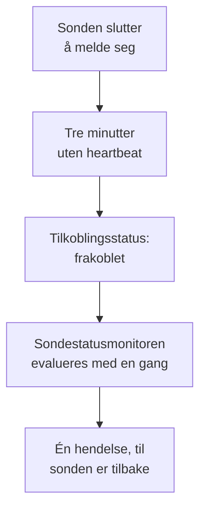

# Sondestatusmonitor

En sondestatusmonitor gir deg beskjed når en sonde slutter å melde seg: én hendelse når den mister forbindelsen, som løser seg selv når den er tilbake. Rett den mot dine egendefinerte sonder eller, på en selvdriftet OneUptime, mot den globale sonden som alle monitorer kjører på, så en sonde som blir stille aldri lar monitorene sine stå usjekket uten at noen vet det. En ny monitor utløser også et varsel når en av sondene kommer på etterskudd, så monitorene sjekkes, eller nettverksenhetene polles, sjeldnere enn innstilt.

:::cards
- [Opprett en](#opprett-en-sondestatusmonitor): Velg sondene og behold standardkriteriene.
- [Kriterier](#kriterier): Tell de tilkoblede, frakoblede eller etterslepende sondene, nå eller over et tidsvindu.
- [Målinger](#målinger): Hvor mange sonder som var tilkoblet, minutt for minutt.
:::

## Slik fungerer det

OneUptime evaluerer hver sondestatusmonitor én gang i minuttet, og igjen i det øyeblikket en av sondene kobler seg til eller fra. Den leser tilkoblingsstatusen til hver sonde, den samme som sondens side viser: en sonde er frakoblet når det ikke er hørt fra den på tre minutter. Etter at OneUptime selv har vært nede eller ikke har mottatt data, venter den tre hele minutter før den kaller noen sonde frakoblet, så en oppgradering av OneUptime åpner aldri en hendelse. Den leser også om hver tilkoblede sonde er på etterskudd, slik sondens side sier det ([En sonde er på etterskudd](/docs/probe/custom-probe#en-sonde-er-på-etterskudd)), og evaluerer monitoren på nytt i det øyeblikket en kommer på etterskudd eller tar igjen etterslepet.

En sonde som blir værende nede, er én hendelse, ikke én i minuttet. Monitoren blir værende offline, med hendelsen åpen, til alle sondene den overvåker er tilkoblet igjen; da løser hendelsen seg selv.

En monitor kan overvåke sondene i sitt eget prosjekt og de globale sondene. En slettet sonde telles ikke med noen vei. Når ingen av sondene en monitor overvåker er igjen, beholder den statusen sin, og oversikten sier fra om det etter en dag.

## Opprett en sondestatusmonitor

:::steps
### Start en ny monitor

Gå til **Monitorer** og klikk på **Opprett monitor**.

### Velg sondestatus

Under **Monitortype** klikker du på **Flere monitortyper** og velger **Sondestatus** under **Annet**. Fyll inn **Navn** og klikk på **Neste**.

### Velg sondene

Under **Sonder som skal overvåkes** velger du sondene. En ny monitor starter med prosjektets egne sonder. En selvdriftet OneUptime uten egne sonder starter med de globale sondene sine; på OneUptime Cloud driftes de globale sondene av OneUptime, så et prosjekt velger dem selv hvis det vil overvåke dem.

### Opprett monitoren

Behold standardkriteriene, som er beskrevet nedenfor, og klikk på **Opprett monitor**. Monitoren evalueres med en gang, og oversikten viser hver sonde den overvåker, med de frakoblede først.
:::

> [!TIP]
> **Overvåk denne sonden**, på siden til en sonde og i menyen på raden dens under **Monitorer → Innstillinger → Sonder**, åpner **Opprett monitor** med en sondestatusmonitor som overvåker den sonden og er oppkalt etter den.

## Kriterier

Filtrene til en sondestatusmonitor teller sonder:

| Filter | Hva det teller |
| --- | --- |
| **Frakoblede sonder** | De overvåkede sondene som er frakoblet. |
| **Tilkoblede sonder** | De overvåkede sondene som er tilkoblet. |
| **Sonder på etterskudd** | De overvåkede sondene som er tilkoblet, men på etterskudd: monitorene deres sjekkes, eller nettverksenhetene deres polles, sjeldnere enn innstilt. |

Alle tre er heltall, som sammenlignes med **Større enn**, **Mindre enn**, **Lik** og de andre sammenligningene. En ny monitor starter med tre kriterier:

| Kriterium | Filter | Hva det gjør |
| --- | --- | --- |
| Sjekk om en sonde er frakoblet | **Frakoblede sonder** større enn `0` | Setter monitoren offline og erklærer en hendelse med tittelen "Sonde frakoblet: {{disconnectedProbeNames}}", som løser seg selv. |
| Sjekk om en sonde er på etterskudd | **Sonder på etterskudd** større enn `0` | Utløser et varsel med tittelen "Sonde på etterskudd: {{behindProbeNames}}", som løser seg selv. Det endrer ikke monitorens status og erklærer ingen hendelse: Sonden melder seg fortsatt. |
| Sjekk om alle sonder er tilkoblet | **Frakoblede sonder** lik `0` | Setter monitoren til operasjonell. |

En monitor som ble opprettet før **Sonder på etterskudd** fantes, beholder kriteriene sine, og får derfor ikke beskjed når en sonde kommer på etterskudd før du legger sjekken til kriteriene.

Filteret **Tilkoblede sonder** passer for en monitor som overvåker flere sonder og kan klare seg uten én: **Tilkoblede sonder** mindre enn `2` erklærer en hendelse først når det er færre enn to igjen.

### Vente lenger før en hendelse

En sonde er først frakoblet etter tre minutter med stillhet, så en rask omstart åpner ingenting. For å vente lenger krysser du av for **Evaluer disse kriteriene over en tidsperiode** under filteret, velger **Alle verdier** under **Evaluer** og et vindu under **For de siste (i minutter)**. Med fem minutter må en sonde være frakoblet i fem minutter til før hendelsen erklæres.

## Målinger

Hver evaluering registrerer tre serier på monitoren: `oneuptime.monitor.probes.connected`, `oneuptime.monitor.probes.disconnected` og `oneuptime.monitor.probes.behind`, antallet overvåkede sonder som var tilkoblet, frakoblet og på etterskudd. De vises i grafer på monitorens side **Målinger**, og et dashbord eller en målingsmonitor leser dem som enhver annen serie.

## Malvariabler

Hendelses- og varselmalene til en sondestatusmonitor kan bruke disse variablene i tillegg til dem alle monitorer har:

| Variabel | Verdi |
| --- | --- |
| `{{disconnectedProbeNames}}` | Navnene på de frakoblede sondene, skilt med komma. |
| `{{disconnectedProbeCount}}` | Hvor mange av sondene som er frakoblet. |
| `{{connectedProbeNames}}` | Navnene på de tilkoblede sondene, skilt med komma. |
| `{{connectedProbeCount}}` | Hvor mange av sondene som er tilkoblet. |
| `{{behindProbeNames}}` | Navnene på de tilkoblede sondene som er på etterskudd, skilt med komma. |
| `{{behindProbeCount}}` | Hvor mange av sondene som er på etterskudd. |
| `{{probeStatusSummary}}` | Én setning som nevner de frakoblede sondene, som `1 of 3 probes is disconnected: EU Probe.`, ellers de som er på etterskudd, eller sier at alle sondene er tilkoblet. |
| `{{probes}}` | Hver sonde, med `probeName`, `isConnected`, `isBehind`, `isGlobalProbe` og `lastAliveAt`. |

## Feilsøking

:::details Monitoren sier at den venter på data
En ny monitor viser sin første evaluering innen et minutt eller to. Hvis den ikke overvåker noen sonde, viser den i stedet **Ikke satt opp**: velg sondene under **Kriterier**.
:::

:::details En sonde gikk ned, og ingen hendelse ble erklært
En sonde er frakoblet etter tre minutter uten heartbeat, og enda senere etter at OneUptime selv har vært nede. Sjekk at monitoren ikke er deaktivert eller i et vedlikeholdsvindu, og at kriteriene fortsatt erklærer en hendelse.
:::

## Neste steg

:::cards
- [Egendefinerte sonder](/docs/probe/custom-probe): Kjør en sonde i ditt eget nettverk.
- [Monitorkriterier og -statuser](/docs/monitor/criteria-and-statuses): Hvordan kriterier avgjør en monitors status.
- [Maler for hendelser og varsler](/docs/monitor/incident-alert-templating): Formuler hendelsen en monitor erklærer.
:::
