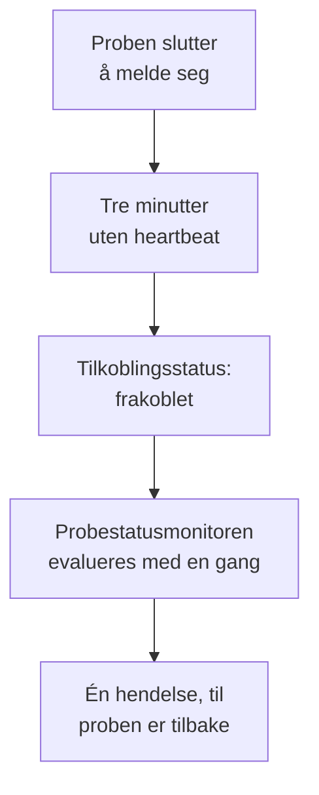

# Probestatusmonitor

En probestatusmonitor gir deg beskjed når en probe slutter å melde seg: én hendelse når den mister forbindelsen, som løser seg selv når den er tilbake. Rett den mot dine egendefinerte prober eller, på en selvdriftet OneUptime, mot den globale proben som alle monitorer kjører på, så en probe som blir stille aldri lar monitorene sine stå usjekket uten at noen vet det.

:::cards
- [Opprett en](#opprett-en-probestatusmonitor): Velg probene og behold standardkriteriene.
- [Kriterier](#kriterier): Tell de tilkoblede eller frakoblede probene, nå eller over et tidsvindu.
- [Målinger](#målinger): Hvor mange prober som var tilkoblet, minutt for minutt.
:::

## Slik fungerer det

OneUptime evaluerer hver probestatusmonitor én gang i minuttet, og igjen i det øyeblikket en av probene kobler seg til eller fra. Den leser tilkoblingsstatusen til hver probe, den samme som probens side viser: en probe er frakoblet når det ikke er hørt fra den på tre minutter. Etter at OneUptime selv har vært nede eller ikke har mottatt data, venter den tre hele minutter før den kaller noen probe frakoblet, så en oppgradering av OneUptime åpner aldri en hendelse.

En probe som blir værende nede, er én hendelse, ikke én i minuttet. Monitoren blir værende offline, med hendelsen åpen, til alle probene den overvåker er tilkoblet igjen; da løser hendelsen seg selv.

En monitor kan overvåke probene i sitt eget prosjekt og de globale probene. En slettet probe telles ikke med noen vei. Når ingen av probene en monitor overvåker er igjen, beholder den statusen sin, og oversikten sier fra om det etter en dag.

## Opprett en probestatusmonitor

:::steps
### Start en ny monitor

Gå til **Monitorer** og klikk på **Opprett monitor**.

### Velg probestatus

Under **Monitortype** klikker du på **Flere monitortyper** og velger **Sondestatus** under **Annet**. Fyll inn **Navn** og klikk på **Neste**.

### Velg probene

Under **Prober som skal overvåkes** velger du probene. En ny monitor starter med prosjektets egne prober. En selvdriftet OneUptime uten egne prober starter med de globale probene sine; på OneUptime Cloud driftes de globale probene av OneUptime, så et prosjekt velger dem selv hvis det vil overvåke dem.

### Opprett monitoren

Behold standardkriteriene, som er beskrevet nedenfor, og klikk på **Opprett monitor**. Monitoren evalueres med en gang, og oversikten viser hver probe den overvåker, med de frakoblede først.
:::

> [!TIP]
> **Overvåk denne proben**, på siden til en probe og i menyen på raden dens under **Monitorer → Innstillinger → Sonder**, åpner **Opprett monitor** med en probestatusmonitor som overvåker den proben og er oppkalt etter den.

## Kriterier

Filtrene til en probestatusmonitor teller prober:

| Filter | Hva det teller |
| --- | --- |
| **Disconnected Probes** | De overvåkede probene som er frakoblet. |
| **Connected Probes** | De overvåkede probene som er tilkoblet. |

Begge er heltall, som sammenlignes med **Større enn**, **Mindre enn**, **Lik** og de andre sammenligningene. En ny monitor starter med to kriterier:

| Kriterium | Filter | Hva det gjør |
| --- | --- | --- |
| Check if a probe is disconnected | **Disconnected Probes** større enn `0` | Setter monitoren offline og erklærer en hendelse med tittelen `Probe disconnected: {{disconnectedProbeNames}}`, som løser seg selv. |
| Check if every probe is connected | **Disconnected Probes** lik `0` | Setter monitoren til operasjonell. |

**Connected Probes** passer for en monitor som overvåker flere prober og kan klare seg uten én: **Connected Probes** mindre enn `2` erklærer en hendelse først når det er færre enn to igjen.

### Vente lenger før en hendelse

En probe er først frakoblet etter tre minutter med stillhet, så en rask omstart åpner ingenting. For å vente lenger krysser du av for **Evaluer disse kriteriene over en tidsperiode** under filteret, velger **All Values** under **Evaluer** og et vindu under **For de siste (i minutter)**. Med fem minutter må en probe være frakoblet i fem minutter til før hendelsen erklæres.

## Målinger

Hver evaluering registrerer to serier på monitoren: `oneuptime.monitor.probes.connected` og `oneuptime.monitor.probes.disconnected`, antallet overvåkede prober som var tilkoblet og frakoblet. De vises i grafer på monitorens side **Målinger**, og et dashbord eller en målingsmonitor leser dem som enhver annen serie.

## Malvariabler

Hendelses- og varselmalene til en probestatusmonitor kan bruke disse variablene i tillegg til dem alle monitorer har:

| Variabel | Verdi |
| --- | --- |
| `{{disconnectedProbeNames}}` | Navnene på de frakoblede probene, skilt med komma. |
| `{{disconnectedProbeCount}}` | Hvor mange av probene som er frakoblet. |
| `{{connectedProbeNames}}` | Navnene på de tilkoblede probene, skilt med komma. |
| `{{connectedProbeCount}}` | Hvor mange av probene som er tilkoblet. |
| `{{probeStatusSummary}}` | Én setning som nevner de frakoblede probene, som `1 of 3 probes is disconnected: EU Probe.`, eller sier at alle probene er tilkoblet. |
| `{{probes}}` | Hver probe, med `probeName`, `isConnected`, `isGlobalProbe` og `lastAliveAt`. |

## Feilsøking

:::details Monitoren sier at den venter på data
En ny monitor viser sin første evaluering innen et minutt eller to. Hvis den ikke overvåker noen probe, viser den i stedet **Not set up**: velg probene under **Kriterier**.
:::

:::details En probe gikk ned, og ingen hendelse ble erklært
En probe er frakoblet etter tre minutter uten heartbeat, og enda senere etter at OneUptime selv har vært nede. Sjekk at monitoren ikke er deaktivert eller i et vedlikeholdsvindu, og at kriteriene fortsatt erklærer en hendelse.
:::

## Neste steg

:::cards
- [Egendefinerte prober](/docs/probe/custom-probe): Kjør en probe i ditt eget nettverk.
- [Monitorkriterier og -statuser](/docs/monitor/criteria-and-statuses): Hvordan kriterier avgjør en monitors status.
- [Maler for hendelser og varsler](/docs/monitor/incident-alert-templating): Formuler hendelsen en monitor erklærer.
:::
