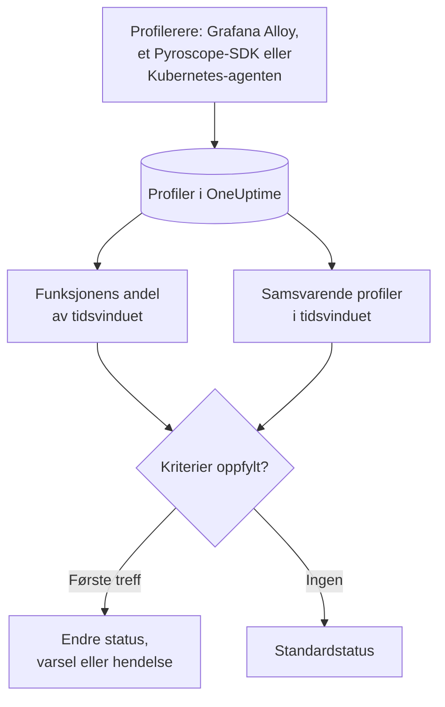

# Profil-overvåking

En profilmonitor leser de kontinuerlige profilene som tjenestene dine sender til OneUptime, og varsler om to ting: en funksjon som tar en større andel av tiden enn den burde, som en parser som ble tyngre etter en utrulling, og profiler som slutter å komme fra en tjeneste. Hvert minutt måler den hvor mye av tidsvinduet som gikk gjennom funksjonen du oppgir, teller profilene som samsvarer med filtrene, og endrer monitorens status, oppretter et varsel eller erklærer en hendelse når kriteriene dine er oppfylt.

:::cards
- [Opprett monitoren](#opprett-en-profilmonitor): Fra en funksjon i profilereren eller fra Opprett monitor.
- [Hva den spør etter](#hva-den-spør-etter): Funksjonen, profiltypen, tjenestene og vinduet.
- [Kriterier](#kriterier): En funksjons andel av vinduet eller antallet profiler.
- [En funksjon blir tyngre](#gjennomgått-eksempel-en-funksjon-blir-tyngre): Bli varslet når en funksjons andel hopper opp.
:::

## Slik fungerer det



Hvert minutt leser OneUptime profilene som samsvarer med monitorens filtre og startet innenfor tidsvinduet. Det teller dem og måler, når monitoren oppgir en funksjon, andelen av vinduets tid som gikk gjennom funksjonen. Det holder disse tallene opp mot monitorens kriterier fra topp til bunn, og det første kriteriet som samsvarer, avgjør hva som skjer. Når ingen samsvarer, går monitoren tilbake til standardstatusen.

## Før du begynner

- Tjenestene dine sender kontinuerlige profileringsdata til OneUptime via Grafana Alloy (eBPF), et Pyroscope-SDK eller OneUptime-agenten for Kubernetes. Se [Kontinuerlig profilering](/docs/telemetry/profiles).
- For å følge med på en funksjon kjenner du navnet, eller en del av fil- eller pakkestien, slik profilereren viser den.

## Opprett en profilmonitor

:::steps
### Start fra profilereren eller fra Opprett monitor

Det raskeste er å starte fra selve funksjonen: Åpne funksjonen i **Ytelsesprofiler**, og klikk på lenken som tilbyr et varsel om andelen dens. **Opprett monitor** åpnes med monitoren utfylt for funksjonen og tjenesten dens, med en terskel over det den tar i dag, som beskrevet i [Gjennomgått eksempel: en funksjon blir tyngre](#gjennomgått-eksempel-en-funksjon-blir-tyngre). Ellers går du til **Monitorer** og klikker på **Opprett monitor**.

### Velg Profiles

Under **Monitortype** klikker du på **Flere monitortyper** og velger **Profiler** under **Telemetri**, eller du skriver `profiles` i søkefeltet. Skriv inn et **Navn**, og klikk deretter på **Neste**.

### Velg hva den leser

I **Konfigurasjon av profilmonitor** setter du **Funksjon** til funksjonen som skal følges, **Hva som skal analyseres** til profiltypen og **Overvåk profiler for (tid)** til vinduet. En ny monitor leser **CPU-tid** over de **Siste 5 minutter**. **Hva denne monitoren leser nå** under feltene viser hvor mange profiler som samsvarer og hvor mye av vinduet funksjonen tar i dag, slik at du kan sette terskelen over det. Åpne **Flere felt** for å filtrere etter telemetritjeneste eller infrastrukturenhet.

### Angi kriteriene

En monitor som er startet fra **Opprett monitor**, har to kriterier: frakoblet, med en hendelse, når **Antall profiler** er 0, og tilkoblet når det er over 0. For å bli varslet om funksjonen legger du til et filter **Funksjonsandel (i %)**: se [Kriterier](#kriterier).

### Opprett monitoren

Klikk på **Opprett monitor**. Monitoren åpnes på siden **Oversikt**, og den første evalueringen kjører innen et minutt.
:::

### Opprett den via API-et eller Terraform

Trinnet til en monitor inneholder de samme innstillingene som konfigurasjonen `profileMonitor`. Denne følger med på `parseOrder` i CPU-profilene til én tjeneste over de siste fem minuttene:

```json
{
  "profileMonitor": {
    "telemetryServiceIds": [],
    "profileTypes": ["cpu"],
    "profileType": "",
    "functionName": "parseOrder",
    "attributes": {},
    "lastXSecondsOfProfiles": 300
  }
}
```

Legg ID-en til tjenesten i `telemetryServiceIds`, eller la listen være tom for å lese profiler fra alle tjenester, og la `functionName` være tom for bare å telle profiler. Opprett en monitor med monitortypen `Profiles` og et trinn som inneholder denne konfigurasjonen og minst ett kriterium, via [API-et](/docs/api-reference/api-reference) eller [Terraform](/docs/terraform/monitor-steps). I Terraform sender du konfigurasjonen som trinnets attributt `profile_monitor`, skrevet med `jsonencode()`.

## Hva den spør etter

| Felt | Hva det samsvarer med | Standard |
| --- | --- | --- |
| `profileTypes` | Profiler av en av disse typene, sammenlignet nøyaktig, som `cpu`. | Tom: alle typer |
| `profileType` | Profiler der typen inneholder denne teksten, uten hensyn til store og små bokstaver. Når den er satt, ignoreres `profileTypes`. | Tom |
| `functionName` | Koden som **Funksjonsandel (i %)** måler andelen til: stack-rammer der funksjonsnavnet eller filstien inneholder denne teksten, uten hensyn til store og små bokstaver. | Tom: ingen andel måles |
| `telemetryServiceIds` | Profiler fra en av disse telemetritjenestene. | Tom: alle tjenester |
| `entityKeys` | Profiler fra en av disse vertene, podene, containerne og andre infrastrukturenheter. | Tom: alle enheter |
| `attributes` | Profiler der attributtene har disse verdiene. | Tom: ingen betingelse |
| `lastXSecondsOfProfiles` | Profiler som startet innenfor dette antallet sekunder før evalueringen. | Ingen: sett den alltid, ellers telles hver lagrede profil, og antallet faller aldri til 0 |

Alle filtrene du setter, må samsvare for at en profil skal leses. I skjemaet setter **Funksjon** `functionName`, **Hva som skal analyseres** setter `profileTypes` (**Alle typer profiler** lar den være tom), **Overvåk profiler for (tid)** setter `lastXSecondsOfProfiles`, og **Filtrer etter telemetritjeneste** og **Filtrer etter infrastrukturenhet** setter `telemetryServiceIds` og `entityKeys`.

## Slik evalueres den

- **Hvert minutt.** En profilmonitor sjekkes ikke av sonder, så den har ikke noe intervall å angi og ingen side **Sonder og intervall**.
- **To tall per evaluering.** Monitoren teller profilene som samsvarer med alle filtre og startet innenfor `lastXSecondsOfProfiles`, og måler funksjonens andel av de samme profilene. En profilerer laster opp med et fast intervall, så gi vinduet plass til flere opplastinger.
- **Én enhet om gangen.** En andel legger sammen samples av én enhet: Når typene den leser, blander enheter, som CPU-tid i nanosekunder fra et SDK og antall samples fra eBPF, leser den enheten med flest samples i vinduet.
- **Ingen profiler er et antall på 0 og ingen andel.** En tjeneste der profilereren slutter å laste opp, gir et antall på 0, og et kriterium **Funksjonsandel (i %)** samsvarer ikke med et tomt vindu: Bli varslet om **Antall profiler** for å vite at profileringen har stoppet.
- **OneUptimes eget nedetid er ikke stillhet.** Så lenge tidsvinduet inneholder tid da OneUptime selv ikke mottok data (det startet på nytt, ble oppgradert eller tok igjen et etterslep), venter sjekken: statusen endres ikke, og ingen hendelse eller varsel åpnes eller løses. Se [Når OneUptime ikke mottar data](/docs/monitor/when-oneuptime-is-not-receiving).
- **Kriterier fra topp til bunn.** Det første kriteriet som samsvarer, avgjør, så legg det mest alvorlige øverst.

Hver statusendring registreres med årsaken på monitorens **Statustidslinje**.

## Kriterier

Kriteriene til en profilmonitor sammenligner ett av to tall med en verdi.

**Funksjonsandel (i %)** er andelen av vinduets tid, fra 0 til 100, som gikk gjennom monitorens funksjon: Hver stack med en ramme som samsvarer med `functionName`, teller én gang, uansett dybde, slik at både funksjonens egen kode og alt den kaller, er med.

| Filtervilkår | Samsvarer når funksjonens andel er… |
| --- | --- |
| **Større enn** | over verdien |
| **Større enn eller lik** | verdien eller høyere |
| **Mindre enn** | under verdien |
| **Mindre enn eller lik** | verdien eller lavere |

**Antall profiler** er antallet profiler som samsvarte i vinduet:

| Filtervilkår | Samsvarer når antallet profiler er… |
| --- | --- |
| **Større enn** | over verdien |
| **Større enn eller lik** | verdien eller høyere |
| **Mindre enn** | under verdien |
| **Mindre enn eller lik** | verdien eller lavere |
| **Lik** | nøyaktig verdien |
| **Ikke lik** | alt annet enn verdien |

Antall profiler har ingen avviksvilkår: det finnes ingen grunnlinje å sammenligne dem med.

## Gjennomgått eksempel: en funksjon blir tyngre

I checkout-tjenesten tar `parseOrder` 18 % av CPU-tiden. En utrulling som parser en større nyttelast, skal ikke gå ubemerket hen:

1. Velg checkout-tjenesten i **Ytelsesprofiler**, og åpne `parseOrder`.
2. Klikk på lenken som tilbyr et varsel om andelen dens. Profilereren foreslår 30 %: halvparten over dagens andel, minst 10 poeng mer, rundet opp til et multiplum av 5.
3. **Opprett monitor** åpnes med en profilmonitor for checkout-tjenesten som leser **CPU-tid** over de **Siste 5 minutter**, med to kriterier: **Funksjonsandel (i %)** **Større enn** `30` utløser et varsel, som løser seg selv, og markerer monitoren som redusert; **Mindre enn eller lik** `30` markerer den som i drift. Hendelsen er fylt ut, men slått av: Slå den på for å tilkalle noen.
4. Klikk på **Opprett monitor**.

Når utrullingen får `parseOrder` til å ta 45 % av CPU-tiden, utløser neste evaluering varselet. Når en retting bringer den under 30 % igjen, løser varselet seg selv.

## Gjennomgått eksempel: profiler slutter å komme

Checkout-tjenesten kjører et Pyroscope-SDK som laster opp CPU-profiler. Du vil ha en hendelse når de uteblir i fem minutter:

- `profileTypes`: `["cpu"]`, `telemetryServiceIds`: checkout-tjenesten, `lastXSecondsOfProfiles`: `300`
- Kriterium 1: **Antall profiler** **Lik** `0`: sett monitoren som frakoblet og erklær en hendelse
- Kriterium 2: **Antall profiler** **Større enn** `0`: sett monitoren som tilkoblet

Mens SDK-et laster opp, teller hver evaluering noen profiler, og kriterium 2 holder monitoren tilkoblet. Når tjenesten rulles ut uten SDK-et, faller antallet til 0 fem minutter etter den siste opplastingen, kriterium 1 samsvarer, og hendelsen erklæres. Den første opplastingen etter rettingen bringer antallet over 0 igjen, og hendelsen løser seg selv hvis **Løs hendelse automatisk** er slått på for den.

## Feilsøking

:::details Monitoren teller 0, men profiler vises i OneUptime
Sammenlign filtrene med profilene du ser: `profileTypes` må samsvare nøyaktig med typen, og `telemetryServiceIds` må inneholde de riktige tjeneste-ID-ene. En kort `lastXSecondsOfProfiles` kan også falle mellom to opplastinger.
:::

:::details Funksjonens andel blir stående på 0 %
Ingen ramme i vinduet inneholder funksjonsteksten. Åpne funksjonen i profilereren og kopier navnet slik det står der; en del av navnet fungerer, og store og små bokstaver spiller ingen rolle. Sjekk deretter at tjenesten sender profiltypen som **Hva som skal analyseres** leser.
:::

## Neste steg

:::cards
- [Kontinuerlig profilering](/docs/telemetry/profiles): Send profiler, og les dem i profilereren.
- [Monitortrinn](/docs/terraform/monitor-steps): Send trinnets konfigurasjon fra Terraform.
- [Trase-overvåking](/docs/monitor/traces-monitor): Bli varslet om mislykkede spans.
- [Metrikk-overvåking](/docs/monitor/metrics-monitor): Bli varslet om CPU, minne og andre metrikker.
:::
