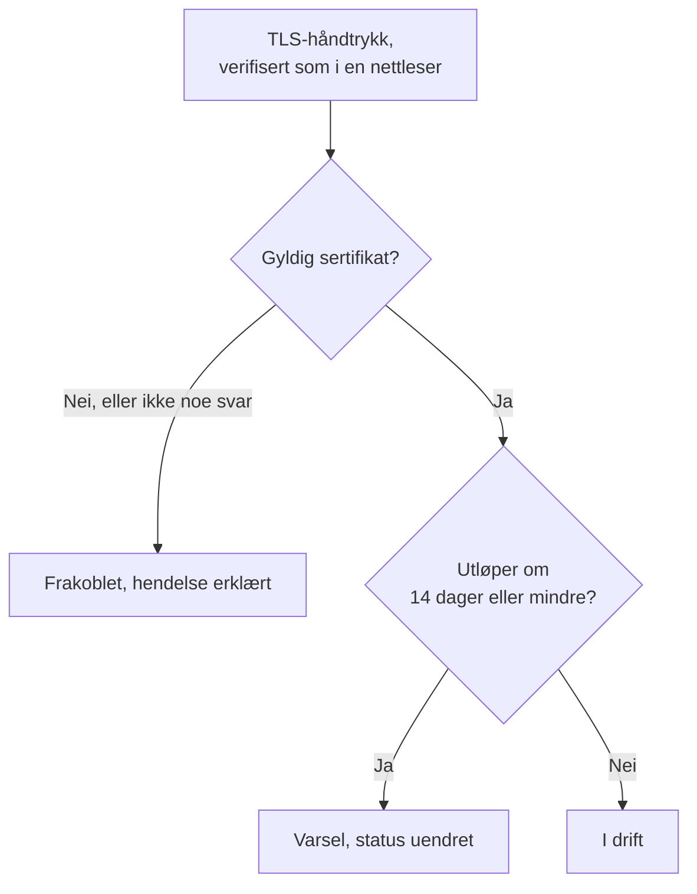

# SSL-sertifikat-overvåking

En SSL-sertifikatmonitor sjekker TLS-sertifikatene som nettstedene og tjenestene dine presenterer, slik en nettleser gjør, og varsler deg før de utløper. Den tar også monitoren frakoblet når et sertifikat ikke lenger er gyldig: utløpt, tilbakekalt av utstederen, selvsignert, utstedt for et annet vertsnavn eller fra en utsteder som nettlesere ikke stoler på.

:::cards
- [Opprett monitoren](#opprett-en-ssl-sertifikatmonitor): Seks trinn i dashbordet.
- [Standardkriterier](#standardkriterier): Et utløpsvarsel 14 dager i forveien, uten oppsett.
- [Overvåkingskriterier](#overvåkingskriterier): Gyldighet, utløp, tilbakekalling og selvsignerte sertifikater.
- [Feilsøking](#feilsøking): Selvsignerte og interne sertifikater, og sjekk av tilbakekalling.
:::

## Slik fungerer det

Ved hver sjekk åpner en sonde en TLS-tilkobling til verten og porten i URL-en, port `443` med mindre URL-en angir en annen, og verifiserer sertifikatet slik en nettleser ville gjort: en utsteder det er tillit til, et vertsnavn som stemmer, og en gyldighetsperiode som omfatter i dag. Hvis sertifikatet ikke består verifiseringen, leser sonden det likevel, så utløpsdatoen, utstederen og fingeravtrykkene registreres uansett. En tilkobling som feiler, får tidsavbrudd eller presenterer et ugyldig sertifikat, prøves på nytt, opptil antallet nye forsøk du tillater. Deretter kjører OneUptime resultatet gjennom monitorens kriterier.

Et sertifikat som består disse sjekkene, sjekkes også for tilbakekalling, slik en nettleser gjør. Sonden leser OCSP-svaret serveren sender med sertifikatet sitt, hvis det finnes et, spør deretter utstederens OCSP-responder som sertifikatet nevner, og leser, bare hvis den ikke gir noe svar, utstederens liste over tilbakekalte sertifikater (CRL). Den stoler bare på et gjeldende svar som er signert av utstederen eller av en responder utstederen har autorisert, og den sjekker serverens eget sertifikat, ikke mellomsertifikatene. Et tilbakekalt sertifikat er ikke gyldig. Når det ikke går an å få et signert svar, er tilbakekallingsstatusen ukjent, og som i en nettleser behandles sertifikatet ikke som tilbakekalt.

Et svar beholdes til utstederens neste oppdatering, i høyst en time, og et oppslag som mislyktes, prøves igjen etter 5 minutter. Et nytt sertifikat sjekkes altså med en gang, og et sertifikat som tilbakekalles mens det er i bruk, oppdages innen en time.

En sonde som har mistet sin egen nettverkstilkobling, rapporterer ikke noe resultat, så den kan ikke merke sertifikatet ditt som ugyldig.

## Før du starter

- **En rolle som kan opprette monitorer**: Project Owner, Project Admin, Project Member, Monitor Admin eller Monitor Member, eller en egendefinert rolle med tillatelsen Create Monitor.
- **En sonde som når verten og porten.** Prosjektets standardsonder velges for hver nye monitor. En tjeneste på et privat nettverk trenger en [egendefinert sonde](/docs/probe/custom-probe) i det nettverket.

## Opprett en SSL-sertifikatmonitor

:::steps
### Start en ny monitor

Gå til **Monitorer**, og klikk på **Opprett monitor**. Velg **SSL-sertifikat** under **Monitortype**.

### Gi den et navn

Angi et **Navn**, som `example.com certificate`, og klikk så på **Neste**.

### Angi URL-en

Angi nettstedet som skal få sertifikatet sitt sjekket, i **Nettsted-URL**, som `https://example.com`. For en tjeneste på en annen port tar du med porten: `https://example.com:8443`.

### Test den

Klikk på **Test monitor**, velg en sonde under **Velg sonde**, og klikk på **Kjør test**. **Resultat av overvåkingstest** viser sertifikatet sonden fikk, med utstederen og utløpsdatoen.

### Gå gjennom kriteriene

**Kriterier** starter med [standardkriteriene](#standardkriterier): frakoblet når sertifikatet ikke er gyldig, et varsel når det utløper om 14 dager eller mindre. Endre dem ved behov, og klikk så på **Neste**.

### Velg sonder og opprett

Behold eller endre **Sonder** og **Overvåkingsintervall** (det starter på **Hvert 5. minutt**; SSL-sertifikatmonitorer tilbys 5 minutter eller lenger), og klikk så på **Opprett monitor**. Monitorens side åpnes.
:::

## Konfigurasjonsalternativer

| Felt | Standard | Hva du angir |
| --- | --- | --- |
| **Nettsted-URL** | Ingen | Nettstedet som skal få sertifikatet sitt sjekket, som `https://example.com` eller `https://example.com:8443`. Bare verten og porten brukes; stien ignoreres. |
| **Tidsavbrudd for forespørsel (sekunder)** (under **Flere felt**) | `60` | Hvor lenge det ventes på TLS-håndtrykket ved hvert forsøk. Maksimum er 60 sekunder. |
| **Nye forsøk ved feil** (under **Flere felt**) | Sondens standard, vanligvis `3` | Hvor mange ganger et mislykket forsøk gjentas. Maksimum er 3. |

**Nye forsøk ved feil** teller nye forsøk _etter_ det første forsøket, så `0` kjører sjekken én gang, og `2` kjører den opptil tre ganger. Står feltet tomt, brukes sondens standard: 3, med mindre sondens `PROBE_MONITOR_RETRY_LIMIT` sier noe annet. Tilkoblingsfeil, mislykkede sertifikatverifiseringer og tidsavbrudd prøves alle på nytt, med en pause på ett sekund mellom forsøkene.

## Overvåkingskriterier

Kriterier avgjør når sertifikatet regnes som i orden, redusert eller feil, og om det erklærer en hendelse eller oppretter et varsel. Hvert kriterium sjekker ett eller flere filtre:

| Filter | Betingelser | Hva det sjekker |
| --- | --- | --- |
| **Er gyldig sertifikat** | **Sann**, **Usann** | Sertifikatet består en nettlesers sjekker: en utsteder det er tillit til, et vertsnavn som stemmer, en gyldighetsperiode som omfatter i dag, og ingen tilbakekalling fra utstederen. **Usann** når endepunktet ikke svarte. |
| **Er ikke et gyldig sertifikat** | **Sann**, **Usann** | Det motsatte av **Er gyldig sertifikat**: **Sann** når sertifikatet ikke består de sjekkene eller ikke kunne sjekkes. |
| **Er utløpt sertifikat** | **Sann**, **Usann** | Sertifikatets utløpsdato er passert. |
| **Er tilbakekalt sertifikat** | **Sann**, **Usann** | Utstederen av sertifikatet har tilbakekalt det. **Usann** når utstederen sier at det ikke er tilbakekalt, og når det ikke kunne sjekkes. |
| **Er selvsignert sertifikat** | **Sann**, **Usann** | Sertifikatet, eller ett i kjeden, er selvsignert. |
| **Dager til utløp** | **Større enn**, **Mindre enn**, **Større enn eller lik**, **Mindre enn eller lik** | Dager til sertifikatet utløper. |
| **Timer til utløp** | **Større enn**, **Mindre enn**, **Større enn eller lik**, **Mindre enn eller lik** | Timer til sertifikatet utløper. |

**Dager til utløp** teller hele dager: et sertifikat som utløper om 14 dager og 20 timer, har 14 dager igjen. **Timer til utløp** teller hele timer på samme måte.

Med to eller flere filtre avgjør **Samsvarsbetingelse** om **Alle** må samsvare, eller om **Hvilken som helst** av dem holder. Et kriteriums **Handlinger** avgjør hva det gjør: endrer monitorstatusen, oppretter et varsel, erklærer en hendelse, eller flere av disse.

### Standardkriterier

En ny SSL-sertifikatmonitor starter med tre kriterier, så den varsler deg før et sertifikat utløper, helt uten oppsett:

1. **Sertifikatet er ikke gyldig** — sertifikatet er utløpt, tilbakekalt av utstederen, selvsignert, utstedt for et annet vertsnavn eller av en utsteder det ikke er tillit til, eller kunne ikke sjekkes fordi endepunktet ikke svarte. Monitoren merkes som **Frakoblet**, og det opprettes en hendelse med navnet "_monitor name_ certificate is not valid". Rotårsaken forteller hvilket av disse tilfellene det var, og for et tilbakekalt sertifikat, når og hvorfor utstederen tilbakekalte det. Hendelsen løser seg selv når sertifikatet er gyldig igjen.
2. **Sertifikatet utløper snart** — sertifikatet er gyldig, men utløper om 14 dager eller mindre. Det opprettes et **varsel** med navnet "_monitor name_ certificate expires soon".
3. **Sertifikatet er gyldig** — monitoren merkes som **I drift**.

Varselet "utløper snart" er et varsel, ikke en hendelse: det vises ikke på statussidene dine, det tilkaller ingen med mindre du legger til en vaktretningslinje på det, og det endrer ikke monitorens status. Det bruker prosjektets andre varselalvorlighetsgrad, **Lav** i et nytt prosjekt. Når det fornyede sertifikatet blir plukket opp, er monitoren tilbake på "Sertifikatet er gyldig", og varselet løser seg selv.

Kriterier sjekkes fra topp til bunn, og det første som samsvarer, avgjør hva som skjer. Derfor står "utløper snart" over "er gyldig": et sertifikat som er i ferd med å utløpe, er fortsatt gyldig, så det ville samsvare med begge.

For å bli varslet tidligere endrer du verdien til filteret **Dager til utløp** i kriteriet "utløper snart", for eksempel til `30`. For å få noen tilkalt i stedet åpner du kriteriets **Handlinger**: slå på **Når filtre samsvarer, erklær en hendelse.**, eller behold varselet og legg til en vaktretningslinje på det under **Vaktretningslinjer**.

:::details Legg til varselet på en monitor som ble opprettet før det fantes
Monitorer som ble opprettet før OneUptime innførte dette varselet, har ikke noe kriterium "utløper snart". Slik legger du det til:

1. Åpne **Konfigurasjon → Kriterier** på monitoren, og klikk på **Rediger kriterier**.
2. Klikk på **Legg til kriterier**. Sett filteret til **Er gyldig sertifikat** / **Sann**, klikk på **Legg til filter**, og sett det andre til **Dager til utløp** / **Mindre enn eller lik** / `14`. La **Samsvarsbetingelse** stå på **Alle** (den vises under filtrene så snart det er to).
3. Slå på **Når filtre samsvarer, opprett et varsel.** under **Handlinger**, og la **Når filtre samsvarer, endre overvåkerstatus.** være slått av, så det oppretter et varsel og ikke endrer monitorens status.
4. Dra det nye kriteriet over kriteriet som merker monitoren som tilkoblet, og lagre så.
:::

### Eksempelkriterier

| Mål | Filter | Betingelse | Verdi |
| --- | --- | --- | --- |
| Varsle en måned i forveien | **Dager til utløp** | **Mindre enn eller lik** | `30` |
| Tilkall noen den siste dagen | **Timer til utløp** | **Mindre enn** | `24` |
| Frakoblet først når sertifikatet er utløpt | **Er utløpt sertifikat** | **Sann** | — |
| Marker et selvsignert sertifikat | **Er selvsignert sertifikat** | **Sann** | — |
| Tilkall sikkerhetsteamet når utstederen tilbakekaller sertifikatet | **Er tilbakekalt sertifikat** | **Sann** | — |

Et kriterium om utløp må stå over kriteriet som merker sertifikatet som gyldig: et sertifikat som snart utløper, er fortsatt gyldig, og det første kriteriet som samsvarer, vinner. På samme måte er et tilbakekalt sertifikat heller ikke gyldig, så et kriterium med **Er tilbakekalt sertifikat** må stå over kriteriet "ikke gyldig".

## Beste praksis

1. **Gi deg selv tid til å fornye** — Standardvarselet kommer 14 dager før utløp, noe som passer for sertifikater som fornyer seg selv. Hvis fornyelsen tar lenger tid hos deg (et sertifikat du kjøper, eller en endringsprosess), øker du det til 30 dager.
2. **Overvåk hvert endepunkt** — Hvis du har flere domener eller underdomener, oppretter du en monitor for hvert av dem. Hvert av dem kan ha sitt eget sertifikat.
3. **Ta med andre porter** — Tjenester som leverer TLS på en annen port enn `443`, som `8443`, har også sertifikater. Angi porten i URL-en.
4. **Sjekk etter fornyelse** — Når du har fornyet et sertifikat, sjekker du monitorens neste resultat: utløpsdatoen den viser, skal være den nye.

## Feilsøking

:::details Sertifikatet er i orden i nettleseren min, men monitoren sier at det ikke er gyldig
Hendelsens rotårsak forteller hvorfor. En vanlig årsak er en server som sender sertifikatet sitt uten mellomsertifikatene: nettlesere fyller ofte inn hullet selv, sonden gjør det ikke. Konfigurer serveren til å sende hele kjeden. En annen er en URL der vertsnavnet ikke står på sertifikatet.
:::

:::details Jeg overvåker en intern tjeneste med et selvsignert sertifikat
Et selvsignert sertifikat er aldri gyldig, så standardkriteriene holder monitoren frakoblet. **Er selvsignert sertifikat**, **Er utløpt sertifikat** og **Dager til utløp** fungerer fortsatt for det, så bygg kriteriene på dem. På **Konfigurasjon → Kriterier**:

1. Klikk på **Legg til filter** i kriteriet "ikke gyldig", sett det nye filteret til **Er selvsignert sertifikat** / **Usann**, og sett **Samsvarsbetingelse** til **Alle**. Kriteriet tar fortsatt monitoren frakoblet når endepunktet ikke svarer, eller sertifikatet er feil på en annen måte.
2. Legg til et kriterium med **Er utløpt sertifikat** / **Sann** som merker monitoren som **Frakoblet** og erklærer en hendelse, og dra det helt øverst.
3. Erstatt **Er gyldig sertifikat** / **Sann** med **Er utløpt sertifikat** / **Usann** i kriteriet "utløper snart", så varselet også dekker det selvsignerte sertifikatet.

Så lenge sertifikatet er gjeldende, samsvarer ingen kriterier, og monitoren viser standardstatusen sin, **I drift**.
:::

:::details Monitoren er frakoblet med "could not be checked because the endpoint is not reachable"
Sonden kunne ikke åpne en TLS-tilkobling til verten og porten. Sjekk porten i URL-en, og at en brannmur slipper sondene gjennom. En vert på et privat nettverk trenger en [egendefinert sonde](/docs/probe/custom-probe).
:::

:::details Sertifikatets tilbakekallingsstatus kunne ikke sjekkes
Når sonden ikke får et signert svar fra utstederen av sertifikatet, viser monitorens sammendrag **Tilbakekallingsstatus** som **Kunne ikke kontrolleres**, og **Problem med kontroll av tilbakekalling**, under **Vis flere detaljer**, forteller hvorfor: sertifikatet nevner ingen OCSP-responder eller CRL, utstederen svarte ikke i tide, eller svaret kunne ikke verifiseres. Som i en nettleser behandles et slikt sertifikat ikke som tilbakekalt, og sonden spør igjen etter 5 minutter.

En [egendefinert sonde](/docs/probe/custom-probe) uten internettilgang kan ikke nå noen utsteder. Den sjekker likevel sertifikater: den venter noen sekunder på hver responder den ikke når, omtrent én gang hvert 5. minutt. For at den skal slutte å spørre, sett `PROBE_CERTIFICATE_REVOCATION_CHECK_ENABLED` til `false` på sonden og start den på nytt.
:::

## Neste steg

:::cards
- [Nettsted-overvåking](/docs/monitor/website-monitor): Sjekk at selve nettstedet svarer.
- [Domene-overvåking](/docs/monitor/domain-monitor): Bli varslet før domenets registrering utløper.
- [Eskaleringsregler](/docs/on-call/escalation-rules): Bestem hvem som blir tilkalt av varslene og hendelsene.
- [Hendelser – Oversikt](/docs/incidents/index): Hva som skjer etter at monitoren har erklært en.
:::
