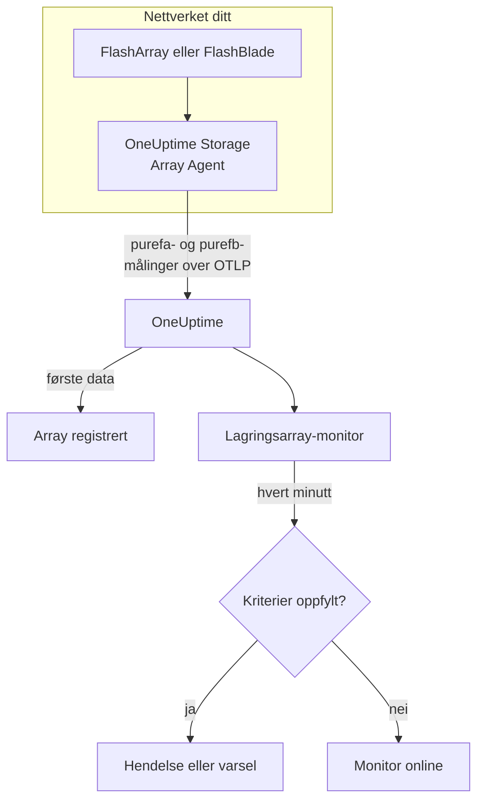

# Lagringsarray-monitor

En lagringsarray-monitor følger med på ett lagringsarray og sier fra når arrayet selv sender ut et varsel, går tom for plass, blir tregt, mister maskinvare eller en vertssti, eller henger etter med replikering. Den virker med Pure Storage FlashArray og Pure Storage FlashBlade, der OneUptime Storage Array Agent samler inn de egne seriene `purefa_*` og `purefb_*`, og med Dell PowerMax, der en OneUptime-sonde leser seriene `powermax_*` fra Unisphere for PowerMax.

Den fungerer også med Dell PowerStore (`dell.powerstore`), ut fra Dells serier `powerstore_*`.

:::cards
- [Opprett monitoren](#opprett-en-lagringsarray-monitor): Seks trinn i dashbordet.
- [Maler](#ferdige-varslingsmaler): Ferdige varsler, én hendelse per volum, vert, appliance eller komponent.
- [Slik fungerer Pures serier](#slik-er-pures-serier-bygd-opp): Ett målingsnavn, mange verdier.
- [Målinger](#innsamlede-målinger): Hver serie monitoren kan varsle på.
:::

## Slik fungerer det

OneUptime Storage Array Agent kjører på en maskin som kan nå arrayets administrasjonsgrensesnitt. Den leser arrayets målinger med et skrivebeskyttet API-token, merker dem med arrayets navn, `storage.array.name`, og plattformen, `storage.system`, og sender dem til OneUptime over OTLP. De første dataene registrerer arrayet.

En Dell PowerMax trenger ingen agent: en OneUptime-sonde logger seg på Unisphere for PowerMax med en skrivebeskyttet konto hvert 5. minutt og sender hvert array den administrerer på samme måte, oppkalt etter sin Symmetrix ID til du gir det nytt navn ([Dell PowerMax](/docs/telemetry/storage-arrays#dell-powermax)).

En lagringsarray-monitor er knyttet til ett array. Hvert minutt kjører den spørringen sin på det arrayets målinger og sammenligner resultatet med kriteriene sine.



## Før du begynner

- **Installer Storage Array Agent** et sted der den kan nå arrayet over HTTPS, med API-tokenet til en bruker som har arrayets rolle **readonly**. [Veiledningen for Storage Array Agent](/docs/telemetry/storage-arrays) dekker brukeren, tokenet og installasjonen, gjennom `ONEUPTIME_URL`, `ONEUPTIME_TELEMETRY_INGESTION_KEY`, `STORAGE_ARRAY_NAME` og arrayets adresse og token (`PURE_FA_ENDPOINT` og `PURE_FA_API_TOKEN`, eller `PURE_FB_ENDPOINT` og `PURE_FB_API_TOKEN`).
- **Sjekk at arrayet er registrert.** Det vises under **Produkter → Infrastruktur → Lagringsarrayer → Alle lagringsarrayer**, oppkalt etter agentens `STORAGE_ARRAY_NAME`, rundt et minutt etter den første avlesningen.
- **For en Dell PowerMax** kobler du i stedet til den Unisphere for PowerMax som administrerer den, under **Produkter → Infrastruktur → Lagringsarrayer → Tilkoblinger**, som [Dell PowerMax](/docs/telemetry/storage-arrays#dell-powermax) forklarer.

## Opprett en lagringsarray-monitor

:::steps
### Start en ny monitor

Gå til **Monitorer**, og klikk på **Opprett monitor**.

### Velg Lagringsarray

Klikk på **Flere monitortyper** under **Monitortype**, og velg **Lagringsarray** under **Infrastruktur**, eller skriv `storage` i søkefeltet. Skriv inn et **Navn** - det brukes i titlene på hendelser og varsler - og klikk på **Neste**.

### Velg arrayet

Velg arrayet i **Lagringsarray** under **Storage Array Monitor Configuration**. Hvert array som har sendt data, står i listen. Plattformen avgjør hvilke målinger og maler skjemaet tilbyr. Når du har valgt, viser en linje under feltet om det kommer data. **Legg til lagringsarray** åpner oppsettstrinn med nøklene dine fylt inn, som venter på de første dataene.

### Velg hva som skal overvåkes

En ny monitor starter med **Array Stopped Reporting** under **Hva det skal varsles om**. Slik overvåker du noe annet:

- **Endre** - velg en annen [mal](#ferdige-varslingsmaler). Den setter målingen, etikettfiltrene, aggregeringen, tidsintervallet og tersklene og erstatter kriteriene nedenfor med sine egne. Du kan fortsatt endre **Tidsintervall**.
- **Custom Metric** (under **Flere felt**) - velg én måling i **Storage Array Metric**, og sett deretter **Aggregering** og **Tidsintervall**. [Filtrene](#monitorinnstillinger) snevrer den inn til ett volum, én vert, én pod, én komponent, ett filsystem eller én bucket.
- **Avansert** (under **Flere felt**) - bygg spørringer og formler selv under **Velg målinger**, for eksempel brukt kapasitet som `purefa_array_space_bytes` filtrert til `space=capacity` minus den samme målingen filtrert til `space=empty`. Bruk **Grupper etter** med et objekts etikett for å vurdere hvert objekt for seg.

### Sjekk kriteriene

Åpne hvert kriterium under **Kriterier**, og sjekk **Måling**, **Aggregering**, **Betingelse** og **Terskel**. En mal fyller dem ut. Med **Custom Metric** eller **Avansert** starter monitoren med [standardkriteriene](#standardkriterier), som bare oppdager at målingen ikke sender data, så sett din egen terskel.

### Opprett monitoren

Klikk på **Opprett monitor**. OneUptime åpner monitorens side og evaluerer den hvert minutt. Hendelser og varsler den sender ut, vises også på arrayets sider **Hendelser** og **Varsler**.
:::

> [!TIP]
> For å sette opp flere maler på én gang åpner du arrayet fra **Produkter → Infrastruktur → Lagringsarrayer** og går til **Anbefalinger**. Velg malene du vil ha, velg hvem som skal tilkalles, og OneUptime oppretter én monitor per mal.

## Monitorinnstillinger

| Felt | Fane | Hva det gjør |
| --- | --- | --- |
| **Lagringsarray** | Alle | Påkrevd. Begrenser hver spørring til `resource.storage.array.name`, så to arrays som begge har et volum som heter `vol-01`, aldri blandes. |
| **Volum** | Custom Metric, Avansert | Bare FlashArray og PowerMax. Ett volum: via etiketten `name` på et FlashArray, som `vol-db-01` (et volum i en pod eller en volumgruppe heter `pod::volume` eller `group/volume`), og via etiketten `volume` på en PowerMax, enhets-ID-en, som `00847`. |
| **Vert** | Custom Metric, Avansert | Bare FlashArray. Én vert slik arrayet kjenner den, via etiketten `host`, som `esxi-01`. |
| **Pod** | Custom Metric, Avansert | Bare FlashArray. Én ActiveCluster- eller ActiveDR-pod, via etiketten `name`, eller `local_pod` på serier for replikalenker. |
| **Maskinvarekomponent** | Custom Metric, Avansert | Én maskinvarekomponent, som `CH0.BAY1` eller `CT0`: etiketten `component_name` på et FlashArray, `name` på et FlashBlade og `component` på en PowerMax, en director som `FA-1D` eller en port som `FA-1D:4`. |
| **Filsystem** | Custom Metric, Avansert | Bare FlashBlade. Ett filsystem, via etiketten `name`. |
| **Bucket** | Custom Metric, Avansert | Bare FlashBlade. Én bucket for objektlagring, via etiketten `name`. |
| **Storage Array Metric** | Custom Metric | Én måling fra [katalogen](#innsamlede-målinger). Skjemaet legger til etikettfilteret som gir den betydningen sin, og grupperer den etter objektet den beskriver, så hvert volum, hver vert eller hver komponent vurderes for seg. |
| **Aggregering** | Custom Metric | Hvordan prøver kombineres: **Gjennomsnitt**, **Maksimum**, **Minimum**, **Sum** eller **Antall**. Starter på målingens vanlige aggregering. |
| **Tidsintervall** | Alle | Det glidende vinduet spørringen leser, fra **Past 1 Minute** til **Past 365 Days**. En ny monitor starter på **Siste 5 minutter**; en egendefinert måling for et filsystem eller en bucket på **Siste 15 minutter**; maler setter sitt eget. |
| **Velg målinger** | Avansert | Spørringsbyggeren: **Måling**, **Aggreger etter**, **Filtrer etter attributter**, **Grupper etter**, pluss **Legg til måling** og **Legg til formel** for å kombinere spørringer. |

Agenten leser arrayets endepunkt hvert 60. sekund, og volumer, verter og pods hvert 2. minutt, så et vindu på 5 minutter alltid inneholder en prøve. Filsystemene og bucketene til et FlashBlade leser den hvert 5. minutt, derav 15, og FlashArray-kataloger hvert 30. minutt: gi en katalogmonitor et vindu på 60 minutter. En sonde leser en PowerMax hvert 5. minutt, like ofte som Unisphere beregner ytelsen: gi en PowerMax-monitor et vindu på 10 minutter eller mer.

Den leser en PowerStore hvert 5. minutt, og klyngens tilstand hvert 60. sekund: gi en PowerStore-monitor et vindu på 15 minutter.

## Slik er Pures serier bygd opp

Pure legger flere verdier på **ett** målingsnavn og skiller dem med en etikett:

- **`dimension`** på ytelsesseriene. `purefa_array_performance_latency_usec` bærer leselatensen (`usec_per_read_op`), skrivelatensen (`usec_per_write_op`), latensen for speilede skrivinger og SAN-, kø-, QoS- og tjenestetiden for hver av dem. Filtrer alltid på én `dimension`: et gjennomsnitt på tvers av dem blander en leselatens på 200 µs med en køverdi.
- **`space`** på kapasitetsseriene: `capacity`, `empty`, `snapshots`, `total_provisioned`, `total_physical`, `available_ratio` og flere.

Flere serier bærer tilstanden sin i en **etikett**, med en verdi som alltid er 1:

| Serie | Tilstandsetikett | Én serie per |
| --- | --- | --- |
| `purefa_alerts_open` | `severity`, med `summary`, `code` og `component_type` | Åpent varsel |
| `purefa_hw_component_status` | `component_status` | Maskinvarekomponent |
| `purefa_host_connectivity_info` | `status`, med `details` | Vert |
| `purefa_drive_capacity_bytes` | `component_status` (verdien er diskens kapasitet) | Disk |

En serie som er filtrert til en dårlig tilstand, finnes bare så lenge noe er i den tilstanden, så ingen serie betyr sunt. Derfor er **Max over 0 utløser og 0 gjenoppretter** den riktige formen for dem, og slik er malene bygd: gjenopprettingskriteriene deres teller en manglende serie som null. Når det ikke er noen serier igjen i det hele tatt, gjenoppretter en slik mal bare hvis `purefa_info`, `purefb_info` eller `powermax_array_info` kom i samme vindu, så et array som har sluttet å rapportere, lukker ingenting.

En PowerMax' serier har én verdi hver og er oppkalt etter den: `powermax_array_response_time_usec` skiller lesinger fra skrivinger med `operation`. Tilstandsseriene finnes på samme måte bare mens noe er galt: `powermax_alert_open` mens Unisphere har et varsel åpent, `powermax_director_offline` mens en director ikke er online, `powermax_port_offline` mens en port noen er avhengig av, er nede, og `powermax_srdf_group_not_healthy` mens en SRDF-gruppe er suspendert eller frakoblet.

I monitorfiltre og grupperingsnøkler begynner agentens attributter med `resource.` (`resource.storage.array.name`, `resource.storage.system`), mens Pures egne etiketter ikke gjør det (`name`, `host`, `component_name`, `dimension`, `space`, `severity`), og det gjør heller ikke etikettene til PowerMax (`storage_group`, `volume`, `director`, `port_id`, `srdf_group`).

## Slik er seriene til PowerStore bygd opp

Dells eksportør skriver én verdi per målingsnavn, så en PowerStore-serie trenger ikke etikettfilter. Etikettene navngir objektet: `appliance_id` en appliance, `name` en del, et volum eller et filsystem, og `volume_id`, `fc_port_id`, `eth_port_id`, `nas_id` eller `volume_group_id` objektet til en ytelsesserie. Tilstandsseriene er 1 mens alt er sunt og ellers 0, så malene utløses under 1. De egne varslene kommer via syslog, og malene deres, loggmonitorer, står etter tabellen nedenfor.

## Ferdige varslingsmaler

OneUptime leverer 49 maler — 12 for FlashArray, 8 for FlashBlade, 16 for PowerStore og 13 for PowerMax — og listen under **Hva det skal varsles om** tilbyr dem for arrayets plattform. Hver bygger en komplett monitor: målingsspørringen, etikettfiltrene, en gruppering på objektets egen etikett, et kriterium som utløser og et som gjenoppretter. Terskler er utgangspunkter du kan redigere.

Et kriterium utløser bare når betingelsen gjelder for **hver** verdi i vinduet. En monitor som utløste på en terskel for kapasitet, latens, etterslep eller forhold, gjenoppretter først 10 % forbi den, så en verdi som svinger rundt terskelen, ikke skifter fram og tilbake. Malene for varsler, maskinvare og tilkobling utløses når en tilstand har vist seg i hele vinduet på 5 minutter, og gjenoppretter omtrent 5 minutter etter at den er borte. Malene for PowerMax bruker vinduer på 10 og 15 minutter: to og tre av dens 5-minutters innsamlinger.

### FlashArray

| Mal                            | Kategori     | Alvorlighetsgrad | Overvåker                                                                                       | Utløser når                                                                                                                                      |
| ------------------------------ | ------------ | ---------------- | ----------------------------------------------------------------------------------------------- | ------------------------------------------------------------------------------------------------------------------------------------------------ |
| Array Stopped Reporting        | Tilgjengelighet | Kritisk          | `purefa_info`, Count, siste 10 minutter                                                         | Ingen data i hele vinduet — Storage Array Agent har stoppet, mistet ruten sin til OneUptime eller fått tokenet sitt tilbakekalt, eller arrayet sluttet å svare den; gjenoppretter når data kommer inn igjen |
| Critical Array Alert           | Arrayets helse | Kritisk          | `purefa_alerts_open` filtrert til `severity=critical`, Max per `summary`, siste 5 minutter      | > 0 — arrayet har et åpent kritisk varsel (en defekt komponent, en kapasitetskrise, en replikeringsfeil). Én hendelse per varsel; gjenoppretter når varselet lukkes |
| Warning Array Alert            | Arrayets helse | Advarsel          | `purefa_alerts_open` filtrert til `severity=warning`, Max per `summary`, siste 5 minutter       | > 0 — arrayet har et åpent varsel på nivå warning. Én hendelse per varsel; gjenoppretter når varselet lukkes                                    |
| Capacity Above 80%             | Kapasitet    | Advarsel          | `purefa_array_space_utilization`, Max, siste 15 minutter                                        | > 80 — Pures egen første kapasitetsterskel; gjenoppretter ved ≤ 72                                                                               |
| Capacity Above 90%             | Kapasitet    | Kritisk          | `purefa_array_space_utilization`, Max, siste 5 minutter                                         | > 90 — arrayet er nær ved å avvise skrivinger; gjenoppretter ved ≤ 81                                                                            |
| High Read Latency              | Ytelse       | Advarsel          | `purefa_array_performance_latency_usec` filtrert til `dimension=usec_per_read_op`, Avg, siste 10 minutter  | > 5000 µs (5 ms) — lesinger på et FlashArray tar normalt godt under 1 ms; gjenoppretter ved ≤ 4500                                   |
| High Write Latency             | Ytelse       | Advarsel          | `purefa_array_performance_latency_usec` filtrert til `dimension=usec_per_write_op`, Avg, siste 10 minutter | > 5000 µs (5 ms); gjenoppretter ved ≤ 4500                                                                                          |
| Hardware Component Failed      | Maskinvare     | Kritisk          | `purefa_hw_component_status` filtrert til `component_status=critical`, Max per `component_name`, siste 5 minutter | > 0 — en kontroller, strømforsyning, vifte, bay eller port er kritisk, og redundansen er borte. Én hendelse per komponent; gjenoppretter når den melder ok |
| Hardware Component Degraded    | Maskinvare     | Advarsel          | `purefa_hw_component_status` filtrert til `component_status=degraded`, Max per `component_name`, siste 5 minutter | > 0 — en komponent er degradert. Én hendelse per komponent; gjenoppretter når den melder ok                             |
| Drive Failed                   | Maskinvare     | Kritisk          | `purefa_drive_capacity_bytes` filtrert til `component_status=failed`, Max per `component_name`, siste 5 minutter | > 0 — en DirectFlash-modul eller en SSD har sviktet, og arrayet bygger opp igjen på de andre. Én hendelse per disk; gjenoppretter når den er byttet |
| Host Lost Redundant Paths      | Verter       | Advarsel          | `purefa_host_connectivity_info` filtrert til `status=critical`, Max per `host`, siste 5 minutter | > 0 — verten når arrayet gjennom én kontroller eller ingen; en kontroller-failover ville tatt lagringen dens offline. Én hendelse per vert; gjenoppretter når stiene er tilbake |
| Replication Lag Above 1 Minute | Replikering  | Advarsel          | `purefa_pod_replica_links_lag_max_msec`, Max per `local_pod`, siste 10 minutter                 | > 60000 ms (60 s) — en failover nå ville miste flere nylige skrivinger enn planlagt. Én hendelse per pod; gjenoppretter ved ≤ 54000              |

### FlashBlade

| Mal                          | Kategori     | Alvorlighetsgrad | Overvåker                                                                                                      | Utløser når                                                                                                         |
| ---------------------------- | ------------ | ---------------- | -------------------------------------------------------------------------------------------------------------- | ------------------------------------------------------------------------------------------------------------------- |
| Array Stopped Reporting      | Tilgjengelighet | Kritisk          | `purefb_info`, Count, siste 10 minutter                                                                        | Ingen data i hele vinduet — agenten, exporteren dens eller FlashBladen sluttet å svare; gjenoppretter når data kommer inn igjen |
| Critical Array Alert         | Arrayets helse | Kritisk          | `purefb_alerts_open` filtrert til `severity=critical`, Max per `summary`, siste 5 minutter                     | > 0 — FlashBladen har et åpent kritisk varsel. Én hendelse per varsel; gjenoppretter når varselet lukkes           |
| Warning Array Alert          | Arrayets helse | Advarsel          | `purefb_alerts_open` filtrert til `severity=warning`, Max per `summary`, siste 5 minutter                      | > 0 — FlashBladen har et åpent varsel på nivå warning. Én hendelse per varsel; gjenoppretter når varselet lukkes   |
| Capacity Above 80%           | Kapasitet    | Advarsel          | `purefb_array_space_utilization` filtrert til `type=array`, Max, siste 15 minutter                             | > 80; gjenoppretter ved ≤ 72                                                                                        |
| Capacity Above 90%           | Kapasitet    | Kritisk          | `purefb_array_space_utilization` filtrert til `type=array`, Max, siste 5 minutter                              | > 90 — skrivinger feiler for hver klient når den blir full; gjenoppretter ved ≤ 81                                  |
| Hardware Component Unhealthy | Maskinvare     | Kritisk          | `purefb_hardware_health`, Min per `name`, siste 5 minutter                                                     | < 1 — et blad, en fabric-modul, en strømforsyning eller en vifte er ikke sunn (en ubrukt plass melder 2). Én hendelse per komponent; gjenoppretter ved ≥ 1 |
| High Read Latency            | Ytelse       | Advarsel          | `purefb_array_performance_latency_usec` filtrert til `dimension=usec_per_read_op` og `protocol=all`, Avg, siste 10 minutter | > 10000 µs (10 ms) på tvers av alle protokoller; gjenoppretter ved ≤ 9000                             |
| File System Near Full        | Filsystemer | Advarsel          | `purefb_file_systems_space_bytes` filtrert til `space=available_ratio`, Min per `name`, siste 15 minutter      | < 0.1 — det er mindre enn 10 % igjen av et filsystems tildelte størrelse. Én hendelse per filsystem; gjenoppretter ved ≥ 0.11 |

### PowerStore

| Mal                          | Kategori     | Alvorlighetsgrad | Overvåker                                                                                                      | Utløser når                                                                                                         |
| --- | --- | --- | --- | --- |
| Array Stopped Reporting | Tilgjengelighet | Kritisk | `powerstore_cluster`, Count, siste 10 minutter | Ingen data i hele vinduet — agenten, Dells eksportør eller klyngen sluttet å svare; gjenopprettes når data kommer igjen |
| Capacity Above 80% | Kapasitet | Advarsel | `powerstore_cap_physical_used_percent`, Max per `appliance_id`, siste 15 minutter | > 80 — kapasiteten til en appliance fylles opp; gjenopprettes ved ≤ 72 |
| Capacity Above 90% | Kapasitet | Kritisk | `powerstore_cap_physical_used_percent`, Max per `appliance_id`, siste 15 minutter | > 90 — en appliance er nær ved å avvise skrivinger; gjenopprettes ved ≤ 81 |
| High Read Latency | Ytelse | Advarsel | `powerstore_perf_avg_read_latency`, Avg per `appliance_id`, siste 15 minutter | > 5000 µs (5 ms); gjenopprettes ved ≤ 4500 |
| High Write Latency | Ytelse | Advarsel | `powerstore_perf_avg_write_latency`, Avg per `appliance_id`, siste 15 minutter | > 5000 µs (5 ms); gjenopprettes ved ≤ 4500 |
| Drive Failed | Maskinvare | Kritisk | `powerstore_hardware_Drive_state`, Min per `name`, siste 10 minutter | < 1 — en disk har feilet eller er fjernet; gjenopprettes ved ≥ 1 |
| Node Unhealthy | Maskinvare | Kritisk | `powerstore_hardware_node_state`, Min per `name`, siste 10 minutter | < 1 — en node er ikke Healthy; gjenopprettes ved ≥ 1 |
| Power Supply Unhealthy | Maskinvare | Advarsel | `powerstore_hardware_Power_Supply_state`, Min per `name`, siste 10 minutter | < 1 — en strømforsyning har feilet eller mistet strøm; gjenopprettes ved ≥ 1 |
| Fan Unhealthy | Maskinvare | Advarsel | `powerstore_hardware_Fan_state`, Min per `name`, siste 10 minutter | < 1 — en vifte har feilet; gjenopprettes ved ≥ 1 |
| Battery Unhealthy | Maskinvare | Advarsel | `powerstore_hardware_Battery_state`, Min per `name`, siste 10 minutter | < 1 — en batteribackupmodul har feil; gjenopprettes ved ≥ 1 |
| Drive Wearing Out | Maskinvare | Advarsel | `powerstore_wear_metrics_by_drive`, Min per `name`, siste 15 minutter | < 10 — en disk har under 10 % av utholdenheten igjen; gjenopprettes ved ≥ 11 |
| NAS Server Not Started | Filsystemer | Advarsel | `powerstore_nas_server_operational_status`, Max per `name`, siste 10 minutter | < 1 — en NAS-server er stoppet eller svekket; gjenopprettes ved ≥ 1 |
| Volume Not Ready | Arrayets helse | Advarsel | `powerstore_volume_state`, Max per `name`, siste 15 minutter | < 1 — et volum er frakoblet; gjenopprettes ved ≥ 1 |
| File System Near Full | Filsystemer | Advarsel | `powerstore_filesystem_logical_used_percent`, Max per `name`, siste 15 minutter | > 90 — et filsystem er nesten fullt; gjenopprettes ved ≤ 81 |
| Cluster Not Configured | Arrayets helse | Advarsel | `powerstore_cluster`, Max, siste 10 minutter | < 1 — klyngen er ikke Configured; gjenopprettes ved ≥ 1 |
| Metro Witness Not Connected | Replikering | Advarsel | `powerstore_metro_witness_status`, Min per `name`, siste 10 minutter | > 0 — et Metro-vitne er ikke tilkoblet; gjenopprettes når det er OK igjen |

### PowerStore-varsler via syslog

De egne varslene til en PowerStore kommer som logger, så malene deres er monitorer av typen **Logger**, som tilbys på arrayets side **Anbefalinger** under **Arrayvarsler**. Hver åpner ett varsel per PowerStore-varsel, gruppert etter `powerstore.resource.name` og `powerstore.alert.id`, og løser det når PowerStore fjerner varselet:

| Mal | Alvorlighetsgrad | Åpnes på en linje med | Løses av |
| --- | --- | --- | --- |
| Critical Array Alert | Kritisk | `powerstore.alert.severity=Critical` | `powerstore.alert.state=Cleared` |
| Major Array Alert | Advarsel | `powerstore.alert.severity=Major` | `powerstore.alert.state=Cleared` |
| Port Link Down | Advarsel | `powerstore.event.code=0x00307404` | `powerstore.alert.state=Cleared` |

### PowerMax

| Mal | Kategori | Alvorlighetsgrad | Overvåker | Utløser når |
| --- | --- | --- | --- | --- |
| Array Stopped Reporting | Tilgjengelighet | Kritisk | `powermax_array_info`, Count, siste 10 minutter | Ingen data i hele vinduet — sonden har sluttet å samle inn arrayet: tilkoblingen feiler (siden for den under **Tilkoblinger** sier hvorfor), sonden er frakoblet, eller Unisphere administrerer ikke lenger arrayet; gjenoppretter når data kommer inn igjen |
| Critical Unisphere Alert | Arrayets helse | Kritisk | `powermax_alert_open` filtrert til `severity=critical`, Max per `description`, siste 10 minutter | > 0 — Unisphere har et åpent varsel med alvorlighetsgrad Critical eller Fatal for arrayet. Én hendelse per varsel; gjenoppretter når varselet bekreftes eller fjernes i Unisphere |
| Warning Unisphere Alert | Arrayets helse | Advarsel | `powermax_alert_open` filtrert til `severity=warning`, Max per `description`, siste 10 minutter | > 0 — Unisphere har et åpent varsel med alvorlighetsgrad Warning eller Minor. Én hendelse per varsel; gjenoppretter når varselet bekreftes eller fjernes |
| Performance Collection Off | Arrayets helse | Advarsel | `powermax_array_performance_collection`, Min, siste 15 minutter | < 1 — Unisphere samler ikke inn arrayets 5-minutters ytelsesdata, så ingen svartid, IOPS eller gjennomstrømning vises i grafer eller varsles på; gjenoppretter ved ≥ 1 |
| Storage Resource Pool Above 80% | Kapasitet | Advarsel | `powermax_srp_capacity_used_percent`, Max per `srp`, siste 15 minutter | > 80 — poolens lagringsgrupper slutter å ta imot nye skrivinger når den blir full. Én hendelse per pool; gjenoppretter ved ≤ 72 |
| Storage Resource Pool Above 90% | Kapasitet | Kritisk | `powermax_srp_capacity_used_percent`, Max per `srp`, siste 15 minutter | > 90 — skrivinger til lagringsgruppene feiler så snart den er full. Én hendelse per pool; gjenoppretter ved ≤ 81 |
| Storage Group Response Time Above 5 ms | Ytelse | Advarsel | `powermax_storage_group_response_time_usec`, Avg per `storage_group`, siste 15 minutter | > 5000 µs (5 ms) — en PowerMax svarer normalt på godt under et millisekund. Én hendelse per lagringsgruppe; gjenoppretter ved ≤ 4500 |
| High Read Response Time | Ytelse | Advarsel | `powermax_array_response_time_usec` filtrert til `operation=read`, Avg, siste 15 minutter | > 3000 µs (3 ms); gjenoppretter ved ≤ 2700 |
| High Write Response Time | Ytelse | Advarsel | `powermax_array_response_time_usec` filtrert til `operation=write`, Avg, siste 15 minutter | > 3000 µs (3 ms) — synkron SRDF legger rundturen til det eksterne arrayet til hver skriving; gjenoppretter ved ≤ 2700 |
| Director Not Online | Maskinvare | Kritisk | `powermax_director_offline`, Max per `component`, siste 10 minutter | > 0 — en director er ikke online, og arrayet kjører på de andre. Én hendelse per director; gjenoppretter når den er online igjen |
| Port Down | Maskinvare | Advarsel | `powermax_port_offline`, Max per `component`, siste 10 minutter | > 0 — en port i en port group, masking view eller SRDF-gruppe er ikke oppe. Én hendelse per port; gjenoppretter når den er oppe igjen |
| SRDF Group Suspended or Offline | Replikering | Kritisk | `powermax_srdf_group_not_healthy`, Max per `srdf_group`, siste 10 minutter | > 0 — gruppens kobling er frakoblet, eller parene er suspendert, splittet eller i failover, så den eksterne kopien holdes ikke oppdatert. Én hendelse per gruppe; gjenoppretter når den er synkron igjen |
| SRDF/A Lag Above 2 Minutes | Replikering | Advarsel | `powermax_srdf_group_lag_seconds`, Avg per `srdf_group`, siste 15 minutter | > 120 (2 minutter) — en failover nå ville miste flere nylige skrivinger enn planlagt. Én hendelse per gruppe; gjenoppretter ved ≤ 108 |

**Alvorlighetsgrad** er etiketten velgeren viser. Hendelsen og varselet en mal oppretter, starter på prosjektets mest alvorlige hendelses- og varslingsgrad; endre dem i kriteriet.

- **Array Stopped Reporting** teller plattformens identitetsserie (`purefa_info` eller `purefb_info`, som hvert endepunkt agenten leser, eksporterer ved hver avlesning, eller `powermax_array_info`, som hver PowerMax-innsamling skriver). Når data stopper, har de andre malene ingenting å sammenligne og beholder sin siste status, så det er denne som sier fra.
- **Åpne varsler og maskinvaretilstander bruker Max** av en serie som bare finnes så lenge varselet er åpent eller komponenten er i den tilstanden, så tilstanden krysser terskelen når den har vist seg i hele vinduet på 5 minutter.
- **Hver mal per objekt grupperer på objektets egen etikett** (`summary`, `component_name`, `host`, `local_pod`, `name` og på en PowerMax `description`, `component`, `srp`, `srdf_group` og `storage_group`), så det utløses én hendelse per berørt objekt, og hendelsen nevner det.
- **Latensmaler bruker Avg** av arrayets eget gjennomsnitt per operasjon, og kapasitetsmaler **Maks.** av dets egen utnyttelsesprosent. Latenser er låst i mikrosekunder og kapasitet i prosent.
- **Hardware Component Unhealthy bruker Min** per komponent: helsen er 1 når den er sunn, og faller til 0 når den ikke er det.

Det finnes ingen mal for latensen til hvert volum, fordi den riktige terskelen avhenger av arbeidsbelastningen: bygg den fra katalogen med en gruppering på `name`. Kapasitetsprognoser trenger en vekstkurve heller enn en terskel, og slitasje på disker har ingen serie å varsle på.

## Innsamlede målinger

Agenten sender alt arrayet eksporterer, og en sonde alt den leser fra en PowerMax, i de samme enhetene (Unispheres millisekunder som mikrosekunder, MB per sekund som byte per sekund); seriene nedenfor er katalogen monitorskjemaet tilbyr. Hver verdi er en gauge som arrayet selv beregner - latenser er mikrosekunder per operasjon, og gjennomstrømning er per sekund -, så det trengs ingen rateberegning. **Filter** er etikettfilteret som gir serien betydningen raden angir; skjemaet bruker det for deg.

### Arrayets helse

| Måling              | Filter | Plattform  | Enhet   | Beskrivelse                                                                                                                                                       |
| -------------------- | ------ | ---------- | ------- | ----------------------------------------------------------------------------------------------------------------------------------------------------------------- |
| `purefa_alerts_open` | —      | FlashArray | `count` | Én serie per åpent varsel på arrayet (verdi 1), med etikettene `severity` (`critical`, `warning`, `info`, `hidden`), `category`, `code`, `component_type` og `summary` |
| `purefb_alerts_open` | —      | FlashBlade | `count` | Én serie per åpent varsel på FlashBladen (verdi 1), med etikettene `severity` (`info`, `warning`, `critical`), `code`, `component_name`, `component_type`, `summary` og `kburl` (Pures artikkel i kunnskapsbasen) |
| `powerstore_cluster` | — | PowerStore | `count` | 1 mens PowerStore-klyngen er Configured (dannet og i drift), 0 i enhver annen tilstand: Configuring, Expanding, Removing, Clustering_Failed eller Unconfigured. |
| `powermax_alert_open` | — | PowerMax | `count` | Én serie per varsel Unisphere har åpent for arrayet (verdi 1): ikke bekreftet, ikke fjernet og Minor eller verre. Etiketten severity er critical (Critical og Fatal) eller warning (Warning og Minor); etikettene alert_type, object og description forteller hva det gjelder. Bekreft varselet i Unisphere, så forsvinner serien |
| `powermax_array_health_score` | — | PowerMax | `score` | Unispheres helsescore for arrayet, fra 0 til 100, per health_metric: samlet og for hvert område den vurderer (kapasitet, konfigurasjon, ytelse, samsvar med tjenestenivå) |
| `powermax_array_performance_collection` | — | PowerMax | `count` | 1 mens Unisphere samler inn 5-minutters ytelsesdata for arrayet, 0 mens det ikke skjer. Når det er slått av, viser OneUptime fortsatt arrayets inventar og varsler, men tegner ingen ytelsesgrafer. Slå det på i Unisphere under Settings > Performance > System Registrations |

### Kapasitet

| Måling                                   | Filter                       | Plattform  | Enhet   | Beskrivelse                                                                                                                           |
| ----------------------------------------- | ---------------------------- | ---------- | ------- | ------------------------------------------------------------------------------------------------------------------------------------- |
| `purefa_array_space_utilization`          | —                            | FlashArray | `%`     | Andelen av arrayets brukbare kapasitet som er i bruk. Pure sender selv ut kapasitetsvarsler ved 80 %, 90 % og 100 %                   |
| `purefa_array_space_bytes`                | `space=capacity`             | FlashArray | `bytes` | Arrayets brukbare kapasitet                                                                                                           |
| `purefa_array_space_bytes`                | `space=empty`                | FlashArray | `bytes` | Ubrukt kapasitet — følg trenden for å forutsi når arrayet blir fullt                                                                 |
| `purefa_array_space_bytes`                | `space=snapshots`            | FlashArray | `bytes` | Fysisk plass som bare snapshots opptar; en rask økning betyr som regel at en beskyttelsesgruppe beholder flere snapshots enn planlagt  |
| `purefa_array_space_data_reduction_ratio` | —                            | FlashArray | `ratio` | Deduplisering og komprimering på tvers av arrayet, f.eks. 4.2 for 4.2:1. Et vedvarende fall betyr at nye data reduseres dårlig         |
| `purefb_array_space_utilization`          | `type=array`                 | FlashBlade | `%`     | Andelen av FlashBladens brukbare kapasitet som er i bruk                                                                              |
| `purefb_array_space_bytes`                | `type=array`, `space=empty`  | FlashBlade | `bytes` | FlashBladens ubrukte kapasitet                                                                                                        |
| `purefb_array_space_data_reduction_ratio` | `type=array`                 | FlashBlade | `ratio` | Datareduksjon på tvers av FlashBladen                                                                                                 |
| `powerstore_cap_physical_used_percent` | — | PowerStore | `%` | Andelen av hver appliances fysiske kapasitet som er i bruk, i prosent: fysisk brukt plass delt på fysisk totalkapasitet, fra PowerStores daglige plassoppsummering. PowerStore utløser egne kapasitetsvarsler fra 70 %. Grupper etter appliance_id. |
| `powerstore_cap_last_physical_total` | — | PowerStore | `bytes` | Brukbar fysisk kapasitet for hver appliance i byte. |
| `powerstore_cap_last_physical_used` | — | PowerStore | `bytes` | Fysisk kapasitet hver appliance bruker, i byte, etter deduplisering og komprimering. Følg trenden for å forutsi når en appliance blir full. |
| `powerstore_cap_last_logical_provisioned` | — | PowerStore | `bytes` | Logisk kapasitet tildelt på hver appliance i byte: størrelsen på hvert volum, filsystem og vVol den inneholder, som kan ligge langt over den fysiske kapasiteten. |
| `powerstore_cap_last_logical_used` | — | PowerStore | `bytes` | Data verter har skrevet til hver appliance i byte, før deduplisering og komprimering. |
| `powerstore_cap_last_data_reduction` | — | PowerStore | `ratio` | Deduplisering og komprimering på hver appliance, for eksempel 3.4 for 3.4:1. Et vedvarende fall betyr at nyskrevne data reduseres dårlig: krypterte eller allerede komprimerte data. |
| `powerstore_cap_last_efficiency_ratio` | — | PowerStore | `ratio` | Samlet effektivitet for hver appliance: datareduksjonen sammen med besparelsene fra snapshots og tynn klargjøring. |
| `powermax_array_capacity_used_percent` | — | PowerMax | `%` | Andelen av arrayets brukbare kapasitet som er i bruk, i prosent, på tvers av lagringsressurspoolene |
| `powermax_array_capacity_usable_bytes` | — | PowerMax | `bytes` | Arrayets brukbare kapasitet, i byte, slik Unisphere rapporterer den |
| `powermax_array_capacity_used_bytes` | — | PowerMax | `bytes` | Den delen av arrayets brukbare kapasitet som er i bruk, i byte |
| `powermax_array_capacity_subscribed_bytes` | — | PowerMax | `bytes` | Kapasiteten til alle thin-volumer på arrayet, i byte: det vertene har fått lovet, som kan overstige den brukbare kapasiteten |
| `powermax_array_data_reduction_ratio` | — | PowerMax | `ratio` | Hvor mange ganger større dataene vertene skrev er enn plassen de tar etter komprimering og deduplisering, slik Unisphere rapporterer det |
| `powermax_srp_capacity_used_percent` | — | PowerMax | `%` | Andelen av hver lagringsressurspools brukbare kapasitet som er i bruk, i prosent, etter etiketten srp. En pool som blir full, slutter å ta imot nye skrivinger for alle lagringsgruppene i den |
| `powermax_srp_capacity_used_bytes` | — | PowerMax | `bytes` | Den delen av hver lagringsressurspools brukbare kapasitet som er i bruk, i byte, etter etiketten srp |

### Ytelse

| Måling                                    | Filter                                         | Plattform  | Enhet     | Beskrivelse                                                                                                  |
| ------------------------------------------ | ---------------------------------------------- | ---------- | --------- | ------------------------------------------------------------------------------------------------------------ |
| `purefa_array_performance_latency_usec`    | `dimension=usec_per_read_op`                   | FlashArray | `µs`      | Gjennomsnittlig latens for en lesing slik vertene ser den; lesinger på et FlashArray tar typisk godt under 1 ms |
| `purefa_array_performance_latency_usec`    | `dimension=usec_per_write_op`                  | FlashArray | `µs`      | Gjennomsnittlig latens for en skriving slik vertene ser den                                                  |
| `purefa_array_performance_latency_usec`    | `dimension=usec_per_mirrored_write_op`         | FlashArray | `µs`      | Gjennomsnittlig latens for en skriving til en utstrakt ActiveCluster-pod, inkludert rundturen til partnerarrayet |
| `purefa_array_performance_latency_usec`    | `dimension=san_usec_per_read_op`               | FlashArray | `µs`      | Tiden en lesing bruker i SAN-et; høy SAN-latens med lav tjenestelatens peker mot fabricen eller verten       |
| `purefa_array_performance_throughput_iops` | `dimension=reads_per_sec`                      | FlashArray | `ops/s`   | Leseoperasjoner per sekund                                                                                   |
| `purefa_array_performance_throughput_iops` | `dimension=writes_per_sec`                     | FlashArray | `ops/s`   | Skriveoperasjoner per sekund                                                                                 |
| `purefa_array_performance_bandwidth_bytes` | `dimension=read_bytes_per_sec`                 | FlashArray | `bytes/s` | Leste byte per sekund                                                                                        |
| `purefa_array_performance_bandwidth_bytes` | `dimension=write_bytes_per_sec`                | FlashArray | `bytes/s` | Skrevne byte per sekund                                                                                      |
| `purefa_array_performance_queue_depth_ops` | —                                              | FlashArray | `ops`     | Operasjoner i kø på arrayet; en voksende kø med økende latens betyr at vertene sender mer enn det kan betjene |
| `purefa_array_performance_average_bytes`   | `dimension=bytes_per_op`                       | FlashArray | `bytes`   | Gjennomsnittlig størrelse på en operasjon — stor I/O øker latensen uten at noe er galt                       |
| `purefb_array_performance_latency_usec`    | `dimension=usec_per_read_op`, `protocol=all`   | FlashBlade | `µs`      | Gjennomsnittlig leselatens på tvers av alle protokoller                                                      |
| `purefb_array_performance_latency_usec`    | `dimension=usec_per_write_op`, `protocol=all`  | FlashBlade | `µs`      | Gjennomsnittlig skrivelatens på tvers av alle protokoller                                                    |
| `purefb_array_performance_throughput_iops` | `dimension=reads_per_sec`, `protocol=all`      | FlashBlade | `ops/s`   | Leseoperasjoner per sekund på tvers av alle protokoller                                                      |
| `purefb_array_performance_throughput_iops` | `dimension=writes_per_sec`, `protocol=all`     | FlashBlade | `ops/s`   | Skriveoperasjoner per sekund på tvers av alle protokoller                                                    |
| `purefb_array_performance_bandwidth_bytes` | `dimension=read_bytes_per_sec`, `protocol=all` | FlashBlade | `bytes/s` | Leste byte per sekund på tvers av alle protokoller                                                           |
| `purefb_array_performance_bandwidth_bytes` | `dimension=write_bytes_per_sec`, `protocol=all` | FlashBlade | `bytes/s` | Skrevne byte per sekund på tvers av alle protokoller                                                        |
| `powerstore_perf_avg_read_latency` | — | PowerStore | `µs` | Gjennomsnittlig forsinkelse for en lesing på hver appliance, i mikrosekunder, over PowerStores siste femminuttersprøve. Lesinger på PowerStore er vanligvis ferdige godt under 1 ms. |
| `powerstore_perf_avg_write_latency` | — | PowerStore | `µs` | Gjennomsnittlig forsinkelse for en skriving på hver appliance, i mikrosekunder. |
| `powerstore_perf_avg_read_iops` | — | PowerStore | `ops/s` | Leseoperasjoner per sekund på hver appliance. |
| `powerstore_perf_avg_write_iops` | — | PowerStore | `ops/s` | Skriveoperasjoner per sekund på hver appliance. |
| `powerstore_perf_avg_read_bandwidth` | — | PowerStore | `bytes/s` | Byte lest per sekund på hver appliance. |
| `powerstore_perf_avg_write_bandwidth` | — | PowerStore | `bytes/s` | Byte skrevet per sekund på hver appliance. |
| `powerstore_perf_avg_io_workload_cpu_utilization` | — | PowerStore | `%` | Andelen av CPU-kjernene hver appliance setter av til lagrings-I/O som er opptatt, i prosent. Vedvarende høye verdier betyr at appliancen er nær lasten den kan betjene. |
| `powermax_array_response_time_usec` | `operation=read` | PowerMax | `µs` | Gjennomsnittlig tid for en vertslesing på arrayet i mikrosekunder over Unispheres siste 5-minuttersintervall (operation read) |
| `powermax_array_response_time_usec` | `operation=write` | PowerMax | `µs` | Gjennomsnittlig tid for en vertsskriving på arrayet i mikrosekunder over Unispheres siste 5-minuttersintervall (operation write) |
| `powermax_array_read_iops` | — | PowerMax | `ops/s` | Vertslesinger per sekund på arrayet: Unispheres verts-IO-er ganger andelen lesinger |
| `powermax_array_write_iops` | — | PowerMax | `ops/s` | Vertsskrivinger per sekund på arrayet: Unispheres verts-IO-er ganger andelen skrivinger |
| `powermax_array_read_throughput_bytes` | — | PowerMax | `bytes/s` | Byte per sekund som verter leser fra arrayet |
| `powermax_array_write_throughput_bytes` | — | PowerMax | `bytes/s` | Byte per sekund som verter skriver til arrayet |
| `powermax_array_cache_hit_percent` | — | PowerMax | `%` | Andelen av verts-I/O som arrayet besvarte fra hurtigbufferen, i prosent |
| `powermax_array_write_pending_percent` | — | PowerMax | `%` | Andelen av arrayets hurtigbuffer som holder skrivinger som ennå ikke er skrevet til stasjonene, i prosent. Nær grensen sin gjør arrayet vertsskrivinger tregere |
| `powermax_array_frontend_busy_percent` | — | PowerMax | `%` | Hvor belastet directorene som betjener verter er, i prosent |
| `powermax_array_backend_busy_percent` | — | PowerMax | `%` | Hvor belastet directorene som betjener stasjonene er, i prosent |
| `powermax_array_srdf_busy_percent` | — | PowerMax | `%` | Hvor belastet directorene som replikerer til andre arrayer er, i prosent |
| `powermax_srp_response_time_usec` | — | PowerMax | `µs` | Gjennomsnittlig tid for en I/O i hver lagringsressurspool i mikrosekunder etter etiketten srp |

### Volumer

| Måling                                     | Filter                           | Plattform  | Enhet     | Beskrivelse                                                   |
| ------------------------------------------- | -------------------------------- | ---------- | --------- | ------------------------------------------------------------- |
| `purefa_volume_performance_latency_usec`    | `dimension=usec_per_read_op`     | FlashArray | `µs`      | Gjennomsnittlig leselatens for hvert volum — grupper etter `name` |
| `purefa_volume_performance_latency_usec`    | `dimension=usec_per_write_op`    | FlashArray | `µs`      | Gjennomsnittlig skrivelatens for hvert volum                  |
| `purefa_volume_performance_throughput_iops` | `dimension=reads_per_sec`        | FlashArray | `ops/s`   | Leseoperasjoner per sekund for hvert volum                    |
| `purefa_volume_performance_throughput_iops` | `dimension=writes_per_sec`       | FlashArray | `ops/s`   | Skriveoperasjoner per sekund for hvert volum                  |
| `purefa_volume_performance_bandwidth_bytes` | `dimension=read_bytes_per_sec`   | FlashArray | `bytes/s` | Byte per sekund lest fra hvert volum                          |
| `purefa_volume_performance_bandwidth_bytes` | `dimension=write_bytes_per_sec`  | FlashArray | `bytes/s` | Byte per sekund skrevet til hvert volum                       |
| `purefa_volume_space_bytes`                 | `space=total_provisioned`        | FlashArray | `bytes`   | Størrelsen på hvert volum slik vertene ser den                |
| `purefa_volume_space_bytes`                 | `space=total_physical`           | FlashArray | `bytes`   | Fysisk plass hvert volum bruker etter datareduksjon           |
| `purefa_volume_space_data_reduction_ratio`  | —                                | FlashArray | `ratio`   | Hvert volums datareduksjonsforhold                            |
| `powerstore_volume_state` | — | PowerStore | `count` | 1 mens et volum er Ready, 0 mens det er Initializing, Offline eller i ferd med å slettes. Grupper etter name for å finne volumet verter ikke når. |
| `powerstore_volume_size` | — | PowerStore | `bytes` | Størrelsen på hvert volum slik vertene ser den, i byte. |
| `powerstore_volume_logical_used` | — | PowerStore | `bytes` | Data verter har skrevet til hvert volum i byte, før deduplisering og komprimering. |
| `powerstore_metricVolume_avg_read_latency` | — | PowerStore | `µs` | Gjennomsnittlig leseforsinkelse for hvert volum i mikrosekunder. Grupper etter volume_id, som inneholder volumets navn, for å finne det trege volumet. |
| `powerstore_metricVolume_avg_write_latency` | — | PowerStore | `µs` | Gjennomsnittlig skriveforsinkelse for hvert volum i mikrosekunder. |
| `powerstore_metricVolume_avg_read_iops` | — | PowerStore | `ops/s` | Leseoperasjoner per sekund for hvert volum. |
| `powerstore_metricVolume_avg_write_iops` | — | PowerStore | `ops/s` | Skriveoperasjoner per sekund for hvert volum. |
| `powerstore_metricVolume_avg_read_bandwidth` | — | PowerStore | `bytes/s` | Byte lest per sekund fra hvert volum. |
| `powerstore_metricVolume_avg_write_bandwidth` | — | PowerStore | `bytes/s` | Byte skrevet per sekund til hvert volum. |
| `powerstore_volumegroup_logical_provisioned` | — | PowerStore | `bytes` | Kapasitet tildelt volumene i hver volumgruppe, i byte. Grupper etter name. |
| `powerstore_volumegroup_logical_used` | — | PowerStore | `bytes` | Data verter har skrevet til volumene i hver volumgruppe i byte, før deduplisering og komprimering. |
| `powerstore_metricVg_avg_read_latency` | — | PowerStore | `µs` | Gjennomsnittlig leseforsinkelse over volumene i hver volumgruppe, i mikrosekunder. Grupper etter volume_group_id, som inneholder gruppens navn. |
| `powerstore_metricVg_avg_write_latency` | — | PowerStore | `µs` | Gjennomsnittlig skriveforsinkelse over volumene i hver volumgruppe, i mikrosekunder. |
| `powerstore_metricVg_avg_total_iops` | — | PowerStore | `ops/s` | Lese- og skriveoperasjoner per sekund over volumene i hver volumgruppe. |
| `powermax_storage_group_response_time_usec` | — | PowerMax | `µs` | Gjennomsnittlig tid for en I/O for hver lagringsgruppe i mikrosekunder etter etiketten storage_group, over Unispheres siste 5-minuttersintervall |
| `powermax_storage_group_read_response_time_usec` | — | PowerMax | `µs` | Gjennomsnittlig tid for en lesing for hver lagringsgruppe i mikrosekunder etter etiketten storage_group |
| `powermax_storage_group_write_response_time_usec` | — | PowerMax | `µs` | Gjennomsnittlig tid for en skriving for hver lagringsgruppe i mikrosekunder etter etiketten storage_group |
| `powermax_storage_group_iops` | — | PowerMax | `ops/s` | Verts-I/O-er per sekund for hver lagringsgruppe etter etiketten storage_group |
| `powermax_storage_group_throughput_bytes` | — | PowerMax | `bytes/s` | Byte per sekund som verter leser og skriver for hver lagringsgruppe, etter etiketten storage_group |
| `powermax_storage_group_used_bytes` | — | PowerMax | `bytes` | Kapasiteten volumene i hver lagringsgruppe bruker, i byte, etter etiketten storage_group |
| `powermax_storage_group_host_io_limit_exceeded_percent` | — | PowerMax | `%` | Andelen av intervallet der hver lagringsgruppe ble holdt tilbake av verts-I/O-grensen sin, i prosent. Bare lagringsgrupper med en angitt grense rapporterer den |
| `powermax_storage_group_realtime_read_response_time_usec` | — | PowerMax | `µs` | Svartid for lesinger for lagringsgruppene som er registrert for innsamling i sanntid i Unisphere, i mikrosekunder, hvert 5. sekund. Opptil 100 lagringsgrupper per array kan registreres |
| `powermax_storage_group_realtime_write_response_time_usec` | — | PowerMax | `µs` | Svartid for skrivinger for lagringsgruppene som er registrert for innsamling i sanntid i Unisphere, i mikrosekunder, hvert 5. sekund |
| `powermax_storage_group_realtime_iops` | — | PowerMax | `ops/s` | Verts-I/O-er per sekund for lagringsgruppene som er registrert for innsamling i sanntid, hvert 5. sekund |
| `powermax_storage_group_realtime_throughput_bytes` | — | PowerMax | `bytes/s` | Byte per sekund for lagringsgruppene som er registrert for innsamling i sanntid, hvert 5. sekund |
| `powermax_volume_response_time_usec` | — | PowerMax | `µs` | Gjennomsnittlig tid for en I/O for hvert volum i mikrosekunder etter etiketten volume. Unisphere rapporterer den bare for volumer i lagringsgrupper som er registrert for innsamling i sanntid |
| `powermax_volume_iops` | — | PowerMax | `ops/s` | Verts-I/O-er per sekund for hvert volum etter etiketten volume, for volumer i lagringsgrupper som er registrert for innsamling i sanntid |
| `powermax_volume_used_bytes` | — | PowerMax | `bytes` | Kapasiteten hvert volum bruker, i byte, etter etiketten volume |

### Verter

| Måling                                   | Filter                        | Plattform  | Enhet   | Beskrivelse                                                                                                                                    |
| ----------------------------------------- | ----------------------------- | ---------- | ------- | ---------------------------------------------------------------------------------------------------------------------------------------------- |
| `purefa_host_connectivity_info`           | —                             | FlashArray | `count` | Én serie per vert (verdi 1) med etiketten for tilkoblingen `status` (`healthy`, `critical`, `unused`) og `details` (`Redundant`, `Single Controller`, `None`, ...) |
| `purefa_host_performance_latency_usec`    | `dimension=usec_per_read_op`  | FlashArray | `µs`    | Gjennomsnittlig leselatens hver vert ser — grupper etter `host`                                                                                |
| `purefa_host_performance_latency_usec`    | `dimension=usec_per_write_op` | FlashArray | `µs`    | Gjennomsnittlig skrivelatens hver vert ser                                                                                                     |
| `purefa_host_performance_throughput_iops` | `dimension=reads_per_sec`     | FlashArray | `ops/s` | Leseoperasjoner per sekund for hver vert                                                                                                       |
| `purefa_host_performance_throughput_iops` | `dimension=writes_per_sec`    | FlashArray | `ops/s` | Skriveoperasjoner per sekund for hver vert                                                                                                     |

### Replikering

| Måling                                              | Filter                                 | Plattform  | Enhet     | Beskrivelse                                                                                                                                                  |
| ---------------------------------------------------- | -------------------------------------- | ---------- | --------- | ------------------------------------------------------------------------------------------------------------------------------------------------------------ |
| `purefa_pod_replica_links_lag_max_msec`              | —                                      | FlashArray | `ms`      | Største replikeringsetterslep for hver pod-replikalenke (ActiveDR / asynkron), med etikettene `local_pod`, `remote_pod`, `remote`, `direction` og `status` — grupper etter `local_pod` |
| `purefa_pod_replica_links_lag_average_msec`          | —                                      | FlashArray | `ms`      | Gjennomsnittlig replikeringsetterslep for hver pod-replikalenke                                                                                              |
| `purefa_pod_performance_replication_bandwidth_bytes` | `direction=total`                      | FlashArray | `bytes/s` | Replikeringstrafikken til hver pod, med etikettene `direction` og `dimension`                                                                                |
| `purefa_pod_performance_latency_usec`                | `dimension=usec_per_mirrored_write_op` | FlashArray | `µs`      | Gjennomsnittlig latens for speilede skrivinger for hver ActiveCluster-pod                                                                                    |
| `powerstore_metro_witness_status` | — | PowerStore | `count` | Tilstanden til hvert Metro-vitne: 0 OK, 1 delvis tilkoblet, 2 frakoblet, 3 slettes, 4 initialiseres. Over 0 kan det hende en Metro-økt ikke bytter over av seg selv. |
| `powermax_srdf_group_not_healthy` | — | PowerMax | `count` | Én serie per SRDF-gruppe der koblingen er frakoblet eller parene er suspendert, partisjonert, splittet, i failover eller ugyldige (verdi 1), med etikettene srdf_group, state og remote_symmetrix_id. Serien finnes ikke så lenge gruppen replikerer |
| `powermax_srdf_group_lag_seconds` | — | PowerMax | `s` | Hvor langt den eksterne kopien av hver asynkrone SRDF-gruppe ligger etter, i sekunder, etter etiketten srdf_group. En failover nå ville miste skrivingene fra så lang tid |
| `powermax_srdf_group_throughput_bytes` | — | PowerMax | `bytes/s` | Byte per sekund som hver SRDF-gruppe sender til sitt eksterne array, etter etiketten srdf_group |
| `powermax_srdf_group_response_time_usec` | — | PowerMax | `µs` | Gjennomsnittlig tid før en replikert skriving når det eksterne arrayet, for hver SRDF-gruppe i mikrosekunder etter etiketten srdf_group |

### Maskinvare

| Måling                                       | Filter                           | Plattform  | Enhet      | Beskrivelse                                                                                                                                                                                                  |
| --------------------------------------------- | -------------------------------- | ---------- | ---------- | ------------------------------------------------------------------------------------------------------------------------------------------------------------------------------------------------------------ |
| `purefa_hw_component_status`                  | —                                | FlashArray | `count`    | Én serie per maskinvarekomponent (verdi 1) — chassis, kontrollere, disk- og NVRAM-bayer, strømforsyninger, vifter, temperatursensorer, Ethernet- og Fibre Channel-porter — med etiketten `component_status` (`ok`, `critical`, `degraded`, `device_off`, `identifying`, `not_installed`, `unknown`) |
| `purefa_hw_component_temperature_celsius`     | —                                | FlashArray | `°C`       | Temperaturen til hver sensor — grupper etter `component_name`                                                                                                                                                |
| `purefa_drive_capacity_bytes`                 | —                                | FlashArray | `bytes`    | Rå kapasitet for hver disk, med etiketten for dens `component_status` (`healthy`, `failed`, `missing`, `recovering`, `unhealthy`, `empty`, ...) og type                                                      |
| `purefa_network_interface_performance_errors` | `dimension=total_errors_per_sec` | FlashArray | `errors/s` | Feil per sekund på hvert Ethernet- og Fibre Channel-grensesnitt — vedvarende feil betyr som regel en dårlig kabel, optikk eller switchport                                                                   |
| `purefb_hardware_health`                      | —                                | FlashBlade | —          | Helsen til hver maskinvarekomponent (blader, fabric-moduler, strømforsyninger, vifter, ...): 1 = sunn, 2 = ubrukt, 0 = usunn. Ta minimum per `name`                                                           |
| `powerstore_hardware_node_state` | — | PowerStore | `count` | 1 mens en node i en appliance er Healthy, 0 i enhver annen tilstand, som etiketten state navngir (Failed, Disconnected, Initializing...). Grupper etter name og appliance_id. |
| `powerstore_hardware_Drive_state` | — | PowerStore | `count` | 1 mens en disk er Healthy, 0 når den har feilet, er fjernet eller ikke er klar. Grupper etter name for å utløse én hendelse per disk. |
| `powerstore_wear_metrics_by_drive` | — | PowerStore | `%` | Andelen av hver disks skriveutholdenhet som er igjen, i prosent. En disk nær 0 er nær slutten av levetiden: planlegg utskiftingen. |
| `powerstore_hardware_Fan_state` | — | PowerStore | `count` | 1 mens viftemodulen til en node er Healthy, 0 når den har feilet eller er fjernet. |
| `powerstore_hardware_Power_Supply_state` | — | PowerStore | `count` | 1 mens strømforsyningen til en node er Healthy, 0 når den har feilet, mistet inngangsstrøm eller er frakoblet. |
| `powerstore_hardware_Battery_state` | — | PowerStore | `count` | 1 mens batteribackupmodulen til en node er Healthy, 0 når den har feil eller er frakoblet. |
| `powerstore_fc_port_is_link_up` | — | PowerStore | `count` | 1 mens koblingen på en Fibre Channel-port er oppe, 0 mens den er nede, noe en port uten kabel alltid er. Grupper etter fc_port_id, som inneholder portens navn. |
| `powerstore_eth_port_is_link_up` | — | PowerStore | `count` | 1 mens koblingen på en Ethernet-port er oppe, 0 mens den er nede. Grupper etter eth_port_id, som inneholder portens navn. |
| `powerstore_metricFcPort_avg_read_latency` | — | PowerStore | `µs` | Gjennomsnittlig forsinkelse for en lesing gjennom hver Fibre Channel-port, i mikrosekunder. |
| `powerstore_metricFcPort_avg_write_latency` | — | PowerStore | `µs` | Gjennomsnittlig forsinkelse for en skriving gjennom hver Fibre Channel-port, i mikrosekunder. |
| `powerstore_metricFcPort_avg_total_iops` | — | PowerStore | `ops/s` | Lese- og skriveoperasjoner per sekund gjennom hver Fibre Channel-port. |
| `powerstore_metricFcPort_avg_total_bandwidth` | — | PowerStore | `bytes/s` | Byte lest og skrevet per sekund gjennom hver Fibre Channel-port. |
| `powerstore_metricFcPort_avg_invalid_crc_count_ps` | — | PowerStore | `errors/s` | Rammer mottatt med ugyldig CRC per sekund på hver Fibre Channel-port. Vedvarende feil betyr vanligvis en dårlig kabel, optikk eller svitsjport. |
| `powerstore_metricFcPort_avg_link_failure_count_ps` | — | PowerStore | `errors/s` | Koblingsfeil per sekund på hver Fibre Channel-port. Hver av dem er verdt en titt på portens kabel, optikk og svitsj. |
| `powerstore_metricEthPort_avg_bytes_rx_ps` | — | PowerStore | `bytes/s` | Byte mottatt per sekund på hver Ethernet-port. |
| `powerstore_metricEthPort_avg_bytes_tx_ps` | — | PowerStore | `bytes/s` | Byte sendt per sekund på hver Ethernet-port. |
| `powerstore_metricEthPort_avg_pkt_rx_crc_error_ps` | — | PowerStore | `errors/s` | Pakker mottatt med CRC-feil per sekund på hver Ethernet-port. Vedvarende feil betyr vanligvis en dårlig kabel, optikk eller svitsjport. |
| `powermax_director_offline` | — | PowerMax | `count` | Én serie per director som ikke er online (verdi 1), med etikettene director, role og status. Serien finnes ikke så lenge alle directorer er online |
| `powermax_director_busy_percent` | — | PowerMax | `%` | Hvor belastet hver director er, i prosent, etter etiketten component (for eksempel FA-1D) |
| `powermax_port_offline` | — | PowerMax | `count` | Én serie per port som betjener verter eller SRDF (i en port group, en masking view eller en SRDF-gruppe), men som ikke er oppe (verdi 1), med etikettene component, protocol og status. Porter som ingen bruker, utelates: de kan være slått av med vilje |
| `powermax_port_busy_percent` | — | PowerMax | `%` | Hvor belastet hver port er, i prosent, etter etiketten component (for eksempel FA-1D:4) |
| `powermax_port_read_throughput_bytes` | — | PowerMax | `bytes/s` | Byte per sekund lest gjennom hver port etter etiketten component |
| `powermax_port_rx_power_milliwatts` | — | PowerMax | `mW` | Lyseffekten hver optiske port mottar, i milliwatt, etter etiketten component. En fallende verdi betyr en optikk eller kabel som holder på å svikte. Krever Unisphere 10.3 eller nyere |

### Filsystemer

| Måling                                        | Filter                        | Plattform  | Enhet   | Beskrivelse                                                                                  |
| ---------------------------------------------- | ----------------------------- | ---------- | ------- | -------------------------------------------------------------------------------------------- |
| `purefb_file_systems_performance_latency_usec` | `dimension=usec_per_read_op`  | FlashBlade | `µs`    | Gjennomsnittlig leselatens for hvert filsystem — grupper etter `name`                        |
| `purefb_file_systems_performance_latency_usec` | `dimension=usec_per_write_op` | FlashBlade | `µs`    | Gjennomsnittlig skrivelatens for hvert filsystem                                             |
| `purefb_file_systems_space_bytes`              | `space=total_physical`        | FlashBlade | `bytes` | Fysisk plass hvert filsystem bruker                                                          |
| `purefb_file_systems_space_bytes`              | `space=available_ratio`       | FlashBlade | `ratio` | Andelen av hvert filsystems tildelte størrelse som fortsatt er ledig, fra 0 til 1 — nær 0 er det i ferd med å fylle kvoten sin |
| `powerstore_nas_server_operational_status` | — | PowerStore | `count` | 1 mens en NAS-server er Started, 0 mens den er Stopped, Starting, Stopping, overtatt eller Degraded (kjører uten reservenoden sin). Grupper etter name. |
| `powerstore_metricNas_avg_read_latency` | — | PowerStore | `µs` | Gjennomsnittlig forsinkelse for en lesing som hver NAS-server betjener, i mikrosekunder. Grupper etter nas_id, som inneholder serverens navn. |
| `powerstore_metricNas_avg_write_latency` | — | PowerStore | `µs` | Gjennomsnittlig forsinkelse for en skriving som hver NAS-server betjener, i mikrosekunder. |
| `powerstore_metricNas_avg_total_iops` | — | PowerStore | `ops/s` | Lese- og skriveoperasjoner per sekund som hver NAS-server betjener. |
| `powerstore_filesystem_logical_used_percent` | — | PowerStore | `%` | Andelen av hvert filsystems størrelse som er i bruk, i prosent: logisk brukt plass delt på tildelt størrelse. Grupper etter name. |
| `powerstore_filesystem_logical_provisioned` | — | PowerStore | `bytes` | Størrelsen på hvert filsystem slik klientene ser den, i byte. |
| `powerstore_filesystem_logical_used` | — | PowerStore | `bytes` | Data klienter har skrevet til hvert filsystem, i byte. |
| `powerstore_metricFilesystem_avg_read_latency` | — | PowerStore | `µs` | Gjennomsnittlig forsinkelse for en lesing fra hvert filsystem, i mikrosekunder. Grupper etter name. |
| `powerstore_metricFilesystem_avg_write_latency` | — | PowerStore | `µs` | Gjennomsnittlig forsinkelse for en skriving til hvert filsystem, i mikrosekunder. |
| `powerstore_metricFilesystem_avg_read_iops` | — | PowerStore | `ops/s` | Leseoperasjoner per sekund for hvert filsystem. |
| `powerstore_metricFilesystem_avg_write_iops` | — | PowerStore | `ops/s` | Skriveoperasjoner per sekund for hvert filsystem. |

### Buckets

| Måling                                   | Filter                       | Plattform  | Enhet   | Beskrivelse                                           |
| ----------------------------------------- | ---------------------------- | ---------- | ------- | ----------------------------------------------------- |
| `purefb_buckets_performance_latency_usec` | `dimension=usec_per_read_op` | FlashBlade | `µs`    | Gjennomsnittlig leselatens for hver bucket — grupper etter `name` |
| `purefb_buckets_space_bytes`              | `space=total_physical`       | FlashBlade | `bytes` | Fysisk plass hver bucket bruker                       |
| `purefb_buckets_object_count`             | —                            | FlashBlade | `count` | Antall objekter i hver bucket                         |

## Overvåkingskriterier

Et kriterium sammenligner en av monitorens spørringer eller formler med en terskel. Kriteriene til en lagringsarray-monitor har ingen **Filtertype**: hver regel sjekker målingsverdien, med disse feltene.

| Felt | Hva det gjør |
| --- | --- |
| **Måling** | Spørringen eller formelen som skal sjekkes, etter variabelnavnet. |
| **Aggregering** | Hvordan verdiene i vinduet blir til ett svar: **Gjennomsnitt**, **Sum**, **Maksimumsverdi**, **Minimumsverdi**, **Alle verdier** (hver verdi må samsvare, i hele vinduet) eller **Minst én verdi** (én er nok). |
| **Betingelse** | **Større enn**, **Mindre enn**, **Større enn eller lik**, **Mindre enn eller lik**, **Lik** eller **Ikke lik** — eller en anomalibetingelse: **Unormalt høy**, **Unormalt lav** eller **Avvikende**. **Ingen data** stemmer når spørringen ikke ga noe i vinduet, og **Har data** når den ga noe. **Ventes å stige over** og **Ventes å falle under** treffer når målingens trend i vinduet er forbi terskelen ved slutten av **Tidshorisont**. |
| **Terskel** | Verdien det sammenlignes med. En enhetsliste står ved siden av når målingen har en enhet. Vises ikke for anomalibetingelser. |
| **Følsomhet** | Bare anomalibetingelser. **Lav** (4σ), **Middels** (3σ, standarden) eller **Høy** (2σ). |
| **Grunnlinjevindu** | Bare anomalibetingelser. 14 dager (standarden), 28, 60 eller 90 dagers historikk. |
| **Hvis ingen data** | Under **Flere felt**. Hva som skjer når vinduet ikke har noen prøver: **Ignore** (standarden), **Treat As Zero** eller **Utløser**. |

Anomalibetingelser sammenligner hver verdi med den samme timen i uken i grunnlinjen. De blir værende i tilstanden "Learning", og sender ikke ut noe, til grunnlinjevinduet inneholder nok historikk. Denne monitoren filtrerer spørringene sine etter attributter, så hver spørring, og hver serie i en gruppert spørring, sammenlignes med sin egen historikk, så langt tilbake som målingene dine beholdes. Er det under to uker, blir en sum, en telling eller en spørring på et histogram værende i den tilstanden for alltid, og alt annet sammenlignes med alle seriene til målingen. En persentil av et histogram blir alltid værende i den tilstanden.

Noen kriterier å starte med:

- **Et volum er tregt:** `purefa_volume_performance_latency_usec` filtrert til `dimension=usec_per_read_op`, Gjennomsnitt, gruppert etter `name`, **Større enn** `2000`, over de siste 10 minuttene.
- **Arrayet er i ferd med å bli fullt:** `purefa_array_space_utilization`, Maksimum, **Større enn** `85`, over de siste 15 minuttene.
- **En vert kjører på én kontroller:** `purefa_host_connectivity_info` filtrert til `status=critical`, Maksimum, gruppert etter `host`, **Større enn** `0`.
- **Et FlashBlade-filsystem er nesten fullt:** `purefb_file_systems_space_bytes` filtrert til `space=available_ratio`, Minimum, gruppert etter `name`, **Mindre enn** `0.05`.

### Standardkriterier

En monitor du ikke bygger fra en mal, starter med to kriterier:

| Rekkefølge | Kriterium | Samsvarer når | Så |
| --- | --- | --- | --- |
| 1 | Sjekk om _monitornavn_ er offline | Den første spørringen har ingen data i hele vinduet | Markerer monitoren som **Offline** og erklærer hendelsen "_monitornavn_ er offline", som løser seg selv når monitoren kommer seg. |
| 2 | Sjekk om _monitornavn_ er tilkoblet | Den første spørringen har data | Markerer monitoren som **I drift**. |

> [!IMPORTANT]
> En verdi på `0` er data, så en måling som ofte er null, som omstarter eller feil, gjør ikke monitoren offline. For å få varsel om en verdi, start fra en mal eller legg til et kriterium med en terskel. Når ingen data kommer i det hele tatt og ingen kriterier passer, beholder monitoren statusen sin, og åpne hendelser forblir åpne: stillhet er ikke bedring. Tid da OneUptime selv ikke mottok data, regnes aldri som manglende data: en sjekk der vinduet inneholder slik tid, venter i stedet, slik [Når OneUptime ikke mottar data](/docs/monitor/when-oneuptime-is-not-receiving) forklarer.

## Terraform

[OneUptimes Terraform-provider](/docs/terraform/monitor-steps) bærer konfigurasjonen av et trinn i en lagringsarray-monitor i attributtet `storage_array_monitor`: den rå JSON-en for konfigurasjonen `storageArrayMonitor` (`arrayIdentifier`, `storageSystem`, `resourceFilters`, `metricViewConfig`, `rollingTime`), skrevet med `jsonencode()`:

```hcl title="main.tf"
monitor_steps = [{
  storage_array_monitor = jsonencode({
    arrayIdentifier = "my-storage-array"
    storageSystem   = "purestorage.flasharray"
    resourceFilters = {}
    rollingTime     = "Past 15 Minutes"
    metricViewConfig = {
      queryConfigs = [{
        metricAliasData = { metricVariable = "capacity_used_percent", title = "Capacity Used", description = "", legend = "" }
        metricQueryData = {
          filterData = {
            metricName     = "purefa_array_space_utilization"
            attributes     = {}
            aggegationType = "Max"
            aggregateBy    = {}
          }
        }
      }]
      formulaConfigs = []
    }
  })
  criteria = [ /* ... */ ]
}]
```

`arrayIdentifier` er arrayets `storage.array.name` - det `STORAGE_ARRAY_NAME` agenten ble startet med, eller navnet på en PowerMax i OneUptime, dens Symmetrix ID til du gir den nytt navn -, ikke dets OneUptime-ID. `storageSystem` er `purestorage.flasharray`, `purestorage.flashblade` eller `dell.powermax`. Det avgjør hvilken katalog og hvilke maler skjemaet viser, og om et maskinvarefilter leser `component_name`, `name` eller `component`.

## Feilsøking

:::details Arrayet står ikke i listen Lagringsarray
Arrays registrerer seg selv ut fra agentens data. Sjekk at agenten kjører og sender data (se [veiledningen for Storage Array Agent](/docs/telemetry/storage-arrays)), og at `STORAGE_ARRAY_NAME` er satt.
:::

:::details En varslings- eller maskinvaremal utløser aldri
Det er det sunne tilfellet. `purefa_alerts_open`, `purefa_hw_component_status`, `purefa_drive_capacity_bytes` og `purefa_host_connectivity_info` bærer tilstanden sin i en etikett, og en serie filtrert til en dårlig tilstand (`severity=critical`, `component_status=failed`) finnes bare så lenge noe er i den tilstanden. For å se serien bak en mal kjører du spørringen dens uten filteret på siden **Målinger**.
:::

:::details En latensmonitor viser feil verdier
Pure legger lese-, skrive-, speilet-skrive-, SAN-, kø- og QoS-verdier på ett målingsnavn, bare skilt av etiketten `dimension`, og en spørring uten et `dimension`-filter tar gjennomsnittet av alle sammen. Filtrer på én dimensjon, slik malene og skjemaets katalog gjør. Serier per volum og per vert beholder bare `usec_per_read_op`, `usec_per_write_op` og `usec_per_mirrored_write_op`: agenten forkaster resten for å spare serier, og bare den arraydekkende `purefa_array_performance_latency_usec` beholder alle.
:::

:::details Et vindu på 1 minutt viser ingen data
Agenten leser volumer, verter og pods hvert 2. minutt, filsystemene og bucketene til et FlashBlade hvert 5. og FlashArray-kataloger hvert 30., så et vindu på 1 minutt inneholder kanskje ingen prøve. Bruk 5 minutter eller mer: 15 for filsystemer og buckets, 60 for kataloger.
:::

:::details En PowerMax-monitor viser ingen data
En sonde leser en PowerMax hvert 5. minutt, så bruk et vindu på 10 minutter eller mer. Svartider, IOPS og gjennomstrømning krever Unispheres ytelsesinnsamling, som malen **Performance Collection Off** overvåker, og tallene for et volum krever at lagringsgruppen er registrert for sanntid i Unisphere. Tilkoblingens side under **Produkter → Infrastruktur → Lagringsarrayer → Tilkoblinger** sier hva den siste innsamlingen ikke kunne lese.
:::

:::details Hendelser utløses én gang for hele arrayet i stedet for én gang per volum
Grupper spørringen etter objektets etikett: `name` for volumer, pods, kataloger, filsystemer og buckets, `host` for verter og `component_name` for FlashArray-maskinvare; på en PowerMax `storage_group`, `volume`, `component` eller `srdf_group`. Pures og PowerMax' etiketter har ikke noe prefiks, så `resource.name` samsvarer ikke med noe.
:::

## Neste steg

:::cards
- [Lagringsarray-agent](/docs/telemetry/storage-arrays): Installer agenten som sender målingene.
- [Ceph-monitor](/docs/monitor/ceph-monitor): Samme type monitor for Ceph-lagringsclustere.
- [Målingsmonitor](/docs/monitor/metrics-monitor): Varsle på hvilken som helst måling, fra hvilken som helst kilde.
- [Hendelser – Oversikt](/docs/incidents/index): Hva som skjer etter at et kriterium har erklært en hendelse.
:::
