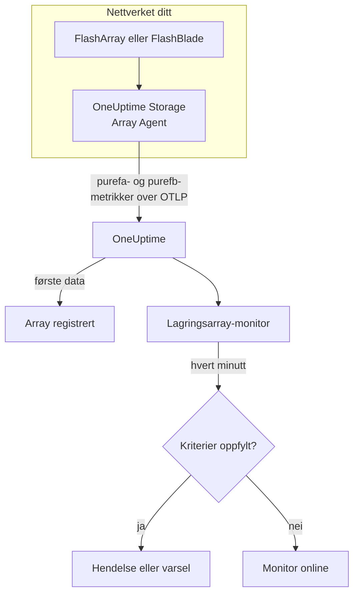

# Lagringsarray-overvåking

En lagringsarray-monitor følger med på ett lagringsarray og sier fra når arrayet selv sender ut et varsel, går tom for plass, blir tregt, mister maskinvare eller en vertssti, eller henger etter med replikering. Den virker med Pure Storage FlashArray og Pure Storage FlashBlade og leser metrikkene arrayet selv eksporterer - Pures serier `purefa_*` og `purefb_*` -, som OneUptime Storage Array Agent samler inn.

:::cards
- [Opprett monitoren](#opprett-en-lagringsarray-monitor): Seks trinn i dashbordet.
- [Maler](#ferdige-varslingsmaler): Atten ferdige varsler, én hendelse per volum, vert eller komponent.
- [Slik fungerer Pures serier](#slik-er-pures-serier-bygd-opp): Ett metrikknavn, mange verdier.
- [Metrikker](#innsamlede-metrikker): Hver serie monitoren kan varsle på.
:::

## Slik fungerer det

OneUptime Storage Array Agent kjører på en maskin som kan nå arrayets administrasjonsgrensesnitt. Den leser arrayets metrikker med et skrivebeskyttet API-token, merker dem med arrayets navn, `storage.array.name`, og plattformen, `storage.system`, og sender dem til OneUptime over OTLP. De første dataene registrerer arrayet.

En lagringsarray-monitor er knyttet til ett array. Hvert minutt kjører den spørringen sin på det arrayets metrikker og sammenligner resultatet med kriteriene sine.



## Før du begynner

- **Installer Storage Array Agent** et sted der den kan nå arrayet over HTTPS, med API-tokenet til en bruker som har arrayets rolle **readonly**. [Veiledningen for Storage Array Agent](/docs/telemetry/storage-arrays) dekker brukeren, tokenet og installasjonen, gjennom `ONEUPTIME_URL`, `ONEUPTIME_TELEMETRY_INGESTION_KEY`, `STORAGE_ARRAY_NAME` og arrayets adresse og token (`PURE_FA_ENDPOINT` og `PURE_FA_API_TOKEN`, eller `PURE_FB_ENDPOINT` og `PURE_FB_API_TOKEN`).
- **Sjekk at arrayet er registrert.** Det vises under **Produkter → Infrastruktur → Storage Arrays → All Storage Arrays**, oppkalt etter agentens `STORAGE_ARRAY_NAME`, rundt et minutt etter den første avlesningen.

## Opprett en lagringsarray-monitor

:::steps
### Start en ny monitor

Gå til **Monitorer**, og klikk på **Opprett monitor**.

### Velg Lagringsarray

Klikk på **Flere monitortyper** under **Monitortype**, og velg **Lagringsarray** under **Infrastruktur**, eller skriv `storage` i søkefeltet. Skriv inn et **Navn** - det brukes i titlene på hendelser og varsler - og klikk på **Neste**.

### Velg arrayet

Velg arrayet i **Lagringsarray** under **Storage Array Monitor Configuration**. Hvert array som har sendt data, står i listen. Plattformen avgjør hvilke metrikker og maler skjemaet tilbyr.

### Velg hva som skal overvåkes

Velg en av de tre fanene:

- **Quick Setup** - klikk på en [mal](#ferdige-varslingsmaler). Den setter metrikken, etikettfiltrene, aggregeringen, tidsintervallet og tersklene og erstatter kriteriene nedenfor med sine egne. Du kan fortsatt endre **Tidsintervall**.
- **Custom Metric** - velg én metrikk i **Storage Array Metric**, og sett deretter **Aggregering** og **Tidsintervall**. [Filtrene](#monitorinnstillinger) snevrer den inn til ett volum, én vert, én pod, én komponent, ett filsystem eller én bucket.
- **Avansert** - bygg spørringer og formler selv under **Velg målinger**, for eksempel brukt kapasitet som `purefa_array_space_bytes` filtrert til `space=capacity` minus den samme metrikken filtrert til `space=empty`. Bruk **Group by** med et objekts etikett for å vurdere hvert objekt for seg.

### Sjekk kriteriene

Åpne hvert kriterium under **Monitorkriterier**, og sjekk **Metrikk**, **Aggregering**, **Betingelse** og **Threshold**. En mal fyller dem ut. Med **Custom Metric** eller **Avansert** starter monitoren med [standardkriteriene](#standardkriterier), som bare oppdager at en metrikk faller til null, så sett din egen terskel.

### Opprett monitoren

Klikk på **Opprett monitor**. OneUptime åpner monitorens side og evaluerer den hvert minutt. Hendelser og varsler den sender ut, vises også på arrayets sider **Hendelser** og **Varsler**.
:::

> [!TIP]
> For å sette opp flere maler på én gang åpner du arrayet fra **Produkter → Infrastruktur → Storage Arrays** og går til **Recommendations**. Velg malene du vil ha, velg hvem som skal tilkalles, og OneUptime oppretter én monitor per mal.

## Monitorinnstillinger

| Felt | Fane | Hva det gjør |
| --- | --- | --- |
| **Lagringsarray** | Alle | Påkrevd. Begrenser hver spørring til `resource.storage.array.name`, så to arrays som begge har et volum som heter `vol-01`, aldri blandes. |
| **Volum** | Custom Metric, Avansert | Bare FlashArray. Ett volum, via etiketten `name`, som `vol-db-01`. Et volum i en pod eller en volumgruppe heter `pod::volume` eller `group/volume`. |
| **Vert** | Custom Metric, Avansert | Bare FlashArray. Én vert slik arrayet kjenner den, via etiketten `host`, som `esxi-01`. |
| **Pod** | Custom Metric, Avansert | Bare FlashArray. Én ActiveCluster- eller ActiveDR-pod, via etiketten `name`, eller `local_pod` på serier for replikalenker. |
| **Hardware Component** | Custom Metric, Avansert | Én maskinvarekomponent, som `CH0.BAY1` eller `CT0`: etiketten `component_name` på et FlashArray, `name` på et FlashBlade. |
| **File System** | Custom Metric, Avansert | Bare FlashBlade. Ett filsystem, via etiketten `name`. |
| **Bucket** | Custom Metric, Avansert | Bare FlashBlade. Én bucket for objektlagring, via etiketten `name`. |
| **Storage Array Metric** | Custom Metric | Én metrikk fra [katalogen](#innsamlede-metrikker). Skjemaet legger til etikettfilteret som gir den betydningen sin, og grupperer den etter objektet den beskriver, så hvert volum, hver vert eller hver komponent vurderes for seg. |
| **Aggregering** | Custom Metric | Hvordan prøver kombineres: **Gjennomsnitt**, **Maksimum**, **Minimum**, **Sum** eller **Antall**. Starter på metrikkens vanlige aggregering. |
| **Tidsintervall** | Alle | Det glidende vinduet spørringen leser, fra **Past 1 Minute** til **Past 365 Days**. En ny monitor starter på **Past 5 Minutes**; en egendefinert metrikk for et filsystem eller en bucket på **Past 15 Minutes**; maler setter sitt eget. |
| **Velg målinger** | Avansert | Spørringsbyggeren: **Metrikk**, **Aggregate by**, **Filter by attributes**, **Group by**, pluss **Legg til metrikk** og **Legg til formel** for å kombinere spørringer. |

Agenten leser arrayets endepunkt hvert 60. sekund, og volumer, verter og pods hvert 2. minutt, så et vindu på 5 minutter alltid inneholder en prøve. Filsystemene og bucketene til et FlashBlade leser den hvert 5. minutt, derav 15, og FlashArray-kataloger hvert 30. minutt: gi en katalogmonitor et vindu på 60 minutter.

## Slik er Pures serier bygd opp

Pure legger flere verdier på **ett** metrikknavn og skiller dem med en etikett:

- **`dimension`** på ytelsesseriene. `purefa_array_performance_latency_usec` bærer leselatensen (`usec_per_read_op`), skrivelatensen (`usec_per_write_op`), latensen for speilede skrivinger og SAN-, kø-, QoS- og tjenestetiden for hver av dem. Filtrer alltid på én `dimension`: et gjennomsnitt på tvers av dem blander en leselatens på 200 µs med en køverdi.
- **`space`** på kapasitetsseriene: `capacity`, `empty`, `snapshots`, `total_provisioned`, `total_physical`, `available_ratio` og flere.

Flere serier bærer tilstanden sin i en **etikett**, med en verdi som alltid er 1:

| Serie | Tilstandsetikett | Én serie per |
| --- | --- | --- |
| `purefa_alerts_open` | `severity`, med `summary`, `code` og `component_type` | Åpent varsel |
| `purefa_hw_component_status` | `component_status` | Maskinvarekomponent |
| `purefa_host_connectivity_info` | `status`, med `details` | Vert |
| `purefa_drive_capacity_bytes` | `component_status` (verdien er diskens kapasitet) | Disk |

En serie som er filtrert til en dårlig tilstand, finnes bare så lenge noe er i den tilstanden, så ingen serie betyr sunt. Derfor er **Max over 0 utløser og 0 gjenoppretter** den riktige formen for dem, og slik er malene bygd: gjenopprettingskriteriene deres teller en manglende serie som null.

I monitorfiltre og grupperingsnøkler begynner agentens attributter med `resource.` (`resource.storage.array.name`, `resource.storage.system`), mens Pures egne etiketter ikke gjør det (`name`, `host`, `component_name`, `dimension`, `space`, `severity`).

## Ferdige varslingsmaler

OneUptime leverer 18 maler — 11 for FlashArray og 7 for FlashBlade — og **Quick Setup** tilbyr dem for arrayets plattform. Hver bygger en komplett monitor: metrikkspørringen, etikettfiltrene, en gruppering på objektets egen etikett, et kriterium som utløser og et som gjenoppretter. Terskler er utgangspunkter du kan redigere.

Et kriterium utløser bare når betingelsen gjelder for **hver** verdi i vinduet. En monitor som utløste på en terskel for kapasitet, latens, etterslep eller forhold, gjenoppretter først 10 % forbi den, så en verdi som svinger rundt terskelen, ikke skifter fram og tilbake; malene for varsler og maskinvare gjenoppretter så snart tilstanden forsvinner.

### FlashArray

| Mal                            | Kategori     | Alvorlighetsgrad | Overvåker                                                                                       | Utløser når                                                                                                                                      |
| ------------------------------ | ------------ | ---------------- | ----------------------------------------------------------------------------------------------- | ------------------------------------------------------------------------------------------------------------------------------------------------ |
| Critical Array Alert           | Array Health | Kritisk          | `purefa_alerts_open` filtrert til `severity=critical`, Max per `summary`, siste 5 minutter      | > 0 — arrayet har et åpent kritisk varsel (en defekt komponent, en kapasitetskrise, en replikeringsfeil). Én hendelse per varsel; gjenoppretter når varselet lukkes |
| Warning Array Alert            | Array Health | Warning          | `purefa_alerts_open` filtrert til `severity=warning`, Max per `summary`, siste 5 minutter       | > 0 — arrayet har et åpent varsel på nivå warning. Én hendelse per varsel; gjenoppretter når varselet lukkes                                    |
| Capacity Above 80%             | Kapasitet    | Warning          | `purefa_array_space_utilization`, Max, siste 15 minutter                                        | > 80 — Pures egen første kapasitetsterskel; gjenoppretter ved ≤ 72                                                                               |
| Capacity Above 90%             | Kapasitet    | Kritisk          | `purefa_array_space_utilization`, Max, siste 5 minutter                                         | > 90 — arrayet er nær ved å avvise skrivinger; gjenoppretter ved ≤ 81                                                                            |
| High Read Latency              | Performance  | Warning          | `purefa_array_performance_latency_usec` filtrert til `dimension=usec_per_read_op`, Avg, siste 10 minutter  | > 5000 µs (5 ms) — lesinger på et FlashArray tar normalt godt under 1 ms; gjenoppretter ved ≤ 4500                                   |
| High Write Latency             | Performance  | Warning          | `purefa_array_performance_latency_usec` filtrert til `dimension=usec_per_write_op`, Avg, siste 10 minutter | > 5000 µs (5 ms); gjenoppretter ved ≤ 4500                                                                                          |
| Hardware Component Failed      | Hardware     | Kritisk          | `purefa_hw_component_status` filtrert til `component_status=critical`, Max per `component_name`, siste 5 minutter | > 0 — en kontroller, strømforsyning, vifte, bay eller port er kritisk, og redundansen er borte. Én hendelse per komponent; gjenoppretter når den melder ok |
| Hardware Component Degraded    | Hardware     | Warning          | `purefa_hw_component_status` filtrert til `component_status=degraded`, Max per `component_name`, siste 5 minutter | > 0 — en komponent er degradert. Én hendelse per komponent; gjenoppretter når den melder ok                             |
| Drive Failed                   | Hardware     | Kritisk          | `purefa_drive_capacity_bytes` filtrert til `component_status=failed`, Max per `component_name`, siste 5 minutter | > 0 — en DirectFlash-modul eller en SSD har sviktet, og arrayet bygger opp igjen på de andre. Én hendelse per disk; gjenoppretter når den er byttet |
| Host Lost Redundant Paths      | Verter       | Warning          | `purefa_host_connectivity_info` filtrert til `status=critical`, Max per `host`, siste 5 minutter | > 0 — verten når arrayet gjennom én kontroller eller ingen; en kontroller-failover ville tatt lagringen dens offline. Én hendelse per vert; gjenoppretter når stiene er tilbake |
| Replication Lag Above 1 Minute | Replication  | Warning          | `purefa_pod_replica_links_lag_max_msec`, Max per `local_pod`, siste 10 minutter                 | > 60000 ms (60 s) — en failover nå ville miste flere nylige skrivinger enn planlagt. Én hendelse per pod; gjenoppretter ved ≤ 54000              |

### FlashBlade

| Mal                          | Kategori     | Alvorlighetsgrad | Overvåker                                                                                                      | Utløser når                                                                                                         |
| ---------------------------- | ------------ | ---------------- | -------------------------------------------------------------------------------------------------------------- | ------------------------------------------------------------------------------------------------------------------- |
| Critical Array Alert         | Array Health | Kritisk          | `purefb_alerts_open` filtrert til `severity=critical`, Max per `summary`, siste 5 minutter                     | > 0 — FlashBladen har et åpent kritisk varsel. Én hendelse per varsel; gjenoppretter når varselet lukkes           |
| Warning Array Alert          | Array Health | Warning          | `purefb_alerts_open` filtrert til `severity=warning`, Max per `summary`, siste 5 minutter                      | > 0 — FlashBladen har et åpent varsel på nivå warning. Én hendelse per varsel; gjenoppretter når varselet lukkes   |
| Capacity Above 80%           | Kapasitet    | Warning          | `purefb_array_space_utilization` filtrert til `type=array`, Max, siste 15 minutter                             | > 80; gjenoppretter ved ≤ 72                                                                                        |
| Capacity Above 90%           | Kapasitet    | Kritisk          | `purefb_array_space_utilization` filtrert til `type=array`, Max, siste 5 minutter                              | > 90 — skrivinger feiler for hver klient når den blir full; gjenoppretter ved ≤ 81                                  |
| Hardware Component Unhealthy | Hardware     | Kritisk          | `purefb_hardware_health`, Min per `name`, siste 5 minutter                                                     | < 1 — et blad, en fabric-modul, en strømforsyning eller en vifte er ikke sunn (en ubrukt plass melder 2). Én hendelse per komponent; gjenoppretter ved ≥ 1 |
| High Read Latency            | Performance  | Warning          | `purefb_array_performance_latency_usec` filtrert til `dimension=usec_per_read_op` og `protocol=all`, Avg, siste 10 minutter | > 10000 µs (10 ms) på tvers av alle protokoller; gjenoppretter ved ≤ 9000                             |
| File System Near Full        | File Systems | Warning          | `purefb_file_systems_space_bytes` filtrert til `space=available_ratio`, Min per `name`, siste 15 minutter      | < 0.1 — det er mindre enn 10 % igjen av et filsystems tildelte størrelse. Én hendelse per filsystem; gjenoppretter ved ≥ 0.11 |

**Alvorlighetsgrad** er etiketten velgeren viser. Hendelsen og varselet en mal oppretter, starter på prosjektets mest alvorlige hendelses- og varslingsgrad; endre dem i kriteriet.

- **Åpne varsler og maskinvaretilstander bruker Max** av en serie som bare finnes så lenge varselet er åpent eller komponenten er i den tilstanden, så én avlesning som viser den, krysser terskelen.
- **Hver mal per objekt grupperer på objektets egen etikett** (`summary`, `component_name`, `host`, `local_pod`, `name`), så det utløses én hendelse per berørt objekt, og hendelsen nevner det.
- **Latensmaler bruker Avg** av arrayets eget gjennomsnitt per operasjon, og kapasitetsmaler **Max** av dets egen utnyttelsesprosent. Latenser er låst i mikrosekunder og kapasitet i prosent.
- **Hardware Component Unhealthy bruker Min** per komponent: helsen er 1 når den er sunn, og faller til 0 når den ikke er det.

Det finnes ingen mal for latensen til hvert volum, fordi den riktige terskelen avhenger av arbeidsbelastningen: bygg den fra katalogen med en gruppering på `name`. Kapasitetsprognoser trenger en vekstkurve heller enn en terskel, og slitasje på disker har ingen serie å varsle på.

## Innsamlede metrikker

Agenten sender alt arrayet eksporterer; seriene nedenfor er katalogen monitorskjemaet tilbyr. Hver verdi er en gauge som arrayet selv beregner - latenser er mikrosekunder per operasjon, og gjennomstrømning er per sekund -, så det trengs ingen rateberegning. **Filter** er etikettfilteret som gir serien betydningen raden angir; skjemaet bruker det for deg.

### Array Health

| Metrikk              | Filter | Plattform  | Enhet   | Beskrivelse                                                                                                                                                       |
| -------------------- | ------ | ---------- | ------- | ----------------------------------------------------------------------------------------------------------------------------------------------------------------- |
| `purefa_alerts_open` | —      | FlashArray | `count` | Én serie per åpent varsel på arrayet (verdi 1), med etikettene `severity` (`critical`, `warning`, `info`, `hidden`), `category`, `code`, `component_type` og `summary` |
| `purefb_alerts_open` | —      | FlashBlade | `count` | Én serie per åpent varsel på FlashBladen (verdi 1), med etikettene `severity` (`info`, `warning`, `critical`), `code`, `component_name`, `component_type`, `summary` og `kburl` (Pures artikkel i kunnskapsbasen) |

### Capacity

| Metrikk                                   | Filter                       | Plattform  | Enhet   | Beskrivelse                                                                                                                           |
| ----------------------------------------- | ---------------------------- | ---------- | ------- | ------------------------------------------------------------------------------------------------------------------------------------- |
| `purefa_array_space_utilization`          | —                            | FlashArray | `%`     | Andelen av arrayets brukbare kapasitet som er i bruk. Pure sender selv ut kapasitetsvarsler ved 80 %, 90 % og 100 %                   |
| `purefa_array_space_bytes`                | `space=capacity`             | FlashArray | `bytes` | Arrayets brukbare kapasitet                                                                                                           |
| `purefa_array_space_bytes`                | `space=empty`                | FlashArray | `bytes` | Ubrukt kapasitet — følg trenden for å forutsi når arrayet blir fullt                                                                 |
| `purefa_array_space_bytes`                | `space=snapshots`            | FlashArray | `bytes` | Fysisk plass som bare snapshots opptar; en rask økning betyr som regel at en beskyttelsesgruppe beholder flere snapshots enn planlagt  |
| `purefa_array_space_data_reduction_ratio` | —                            | FlashArray | `ratio` | Deduplisering og komprimering på tvers av arrayet, f.eks. 4.2 for 4.2:1. Et vedvarende fall betyr at nye data reduseres dårlig         |
| `purefb_array_space_utilization`          | `type=array`                 | FlashBlade | `%`     | Andelen av FlashBladens brukbare kapasitet som er i bruk                                                                              |
| `purefb_array_space_bytes`                | `type=array`, `space=empty`  | FlashBlade | `bytes` | FlashBladens ubrukte kapasitet                                                                                                        |
| `purefb_array_space_data_reduction_ratio` | `type=array`                 | FlashBlade | `ratio` | Datareduksjon på tvers av FlashBladen                                                                                                 |

### Performance

| Metrikk                                    | Filter                                         | Plattform  | Enhet     | Beskrivelse                                                                                                  |
| ------------------------------------------ | ---------------------------------------------- | ---------- | --------- | ------------------------------------------------------------------------------------------------------------ |
| `purefa_array_performance_latency_usec`    | `dimension=usec_per_read_op`                   | FlashArray | `µs`      | Gjennomsnittlig latens for en lesing slik vertene ser den; lesinger på et FlashArray tar typisk godt under 1 ms |
| `purefa_array_performance_latency_usec`    | `dimension=usec_per_write_op`                  | FlashArray | `µs`      | Gjennomsnittlig latens for en skriving slik vertene ser den                                                  |
| `purefa_array_performance_latency_usec`    | `dimension=usec_per_mirrored_write_op`         | FlashArray | `µs`      | Gjennomsnittlig latens for en skriving til en utstrakt ActiveCluster-pod, inkludert rundturen til partnerarrayet |
| `purefa_array_performance_latency_usec`    | `dimension=san_usec_per_read_op`               | FlashArray | `µs`      | Tiden en lesing bruker i SAN-et; høy SAN-latens med lav tjenestelatens peker mot fabricen eller verten       |
| `purefa_array_performance_throughput_iops` | `dimension=reads_per_sec`                      | FlashArray | `ops/s`   | Leseoperasjoner per sekund                                                                                   |
| `purefa_array_performance_throughput_iops` | `dimension=writes_per_sec`                     | FlashArray | `ops/s`   | Skriveoperasjoner per sekund                                                                                 |
| `purefa_array_performance_bandwidth_bytes` | `dimension=read_bytes_per_sec`                 | FlashArray | `bytes/s` | Leste byte per sekund                                                                                        |
| `purefa_array_performance_bandwidth_bytes` | `dimension=write_bytes_per_sec`                | FlashArray | `bytes/s` | Skrevne byte per sekund                                                                                      |
| `purefa_array_performance_queue_depth_ops` | —                                              | FlashArray | `ops`     | Operasjoner i kø på arrayet; en voksende kø med økende latens betyr at vertene sender mer enn det kan betjene |
| `purefa_array_performance_average_bytes`   | `dimension=bytes_per_op`                       | FlashArray | `bytes`   | Gjennomsnittlig størrelse på en operasjon — stor I/O øker latensen uten at noe er galt                       |
| `purefb_array_performance_latency_usec`    | `dimension=usec_per_read_op`, `protocol=all`   | FlashBlade | `µs`      | Gjennomsnittlig leselatens på tvers av alle protokoller                                                      |
| `purefb_array_performance_latency_usec`    | `dimension=usec_per_write_op`, `protocol=all`  | FlashBlade | `µs`      | Gjennomsnittlig skrivelatens på tvers av alle protokoller                                                    |
| `purefb_array_performance_throughput_iops` | `dimension=reads_per_sec`, `protocol=all`      | FlashBlade | `ops/s`   | Leseoperasjoner per sekund på tvers av alle protokoller                                                      |
| `purefb_array_performance_throughput_iops` | `dimension=writes_per_sec`, `protocol=all`     | FlashBlade | `ops/s`   | Skriveoperasjoner per sekund på tvers av alle protokoller                                                    |
| `purefb_array_performance_bandwidth_bytes` | `dimension=read_bytes_per_sec`, `protocol=all` | FlashBlade | `bytes/s` | Leste byte per sekund på tvers av alle protokoller                                                           |
| `purefb_array_performance_bandwidth_bytes` | `dimension=write_bytes_per_sec`, `protocol=all` | FlashBlade | `bytes/s` | Skrevne byte per sekund på tvers av alle protokoller                                                        |

### Volumes

| Metrikk                                     | Filter                           | Plattform  | Enhet     | Beskrivelse                                                   |
| ------------------------------------------- | -------------------------------- | ---------- | --------- | ------------------------------------------------------------- |
| `purefa_volume_performance_latency_usec`    | `dimension=usec_per_read_op`     | FlashArray | `µs`      | Gjennomsnittlig leselatens for hvert volum — grupper etter `name` |
| `purefa_volume_performance_latency_usec`    | `dimension=usec_per_write_op`    | FlashArray | `µs`      | Gjennomsnittlig skrivelatens for hvert volum                  |
| `purefa_volume_performance_throughput_iops` | `dimension=reads_per_sec`        | FlashArray | `ops/s`   | Leseoperasjoner per sekund for hvert volum                    |
| `purefa_volume_performance_throughput_iops` | `dimension=writes_per_sec`       | FlashArray | `ops/s`   | Skriveoperasjoner per sekund for hvert volum                  |
| `purefa_volume_performance_bandwidth_bytes` | `dimension=read_bytes_per_sec`   | FlashArray | `bytes/s` | Byte per sekund lest fra hvert volum                          |
| `purefa_volume_performance_bandwidth_bytes` | `dimension=write_bytes_per_sec`  | FlashArray | `bytes/s` | Byte per sekund skrevet til hvert volum                       |
| `purefa_volume_space_bytes`                 | `space=total_provisioned`        | FlashArray | `bytes`   | Størrelsen på hvert volum slik vertene ser den                |
| `purefa_volume_space_bytes`                 | `space=total_physical`           | FlashArray | `bytes`   | Fysisk plass hvert volum bruker etter datareduksjon           |
| `purefa_volume_space_data_reduction_ratio`  | —                                | FlashArray | `ratio`   | Hvert volums datareduksjonsforhold                            |

### Hosts

| Metrikk                                   | Filter                        | Plattform  | Enhet   | Beskrivelse                                                                                                                                    |
| ----------------------------------------- | ----------------------------- | ---------- | ------- | ---------------------------------------------------------------------------------------------------------------------------------------------- |
| `purefa_host_connectivity_info`           | —                             | FlashArray | `count` | Én serie per vert (verdi 1) med etiketten for tilkoblingen `status` (`healthy`, `critical`, `unused`) og `details` (`Redundant`, `Single Controller`, `None`, ...) |
| `purefa_host_performance_latency_usec`    | `dimension=usec_per_read_op`  | FlashArray | `µs`    | Gjennomsnittlig leselatens hver vert ser — grupper etter `host`                                                                                |
| `purefa_host_performance_latency_usec`    | `dimension=usec_per_write_op` | FlashArray | `µs`    | Gjennomsnittlig skrivelatens hver vert ser                                                                                                     |
| `purefa_host_performance_throughput_iops` | `dimension=reads_per_sec`     | FlashArray | `ops/s` | Leseoperasjoner per sekund for hver vert                                                                                                       |
| `purefa_host_performance_throughput_iops` | `dimension=writes_per_sec`    | FlashArray | `ops/s` | Skriveoperasjoner per sekund for hver vert                                                                                                     |

### Replication

| Metrikk                                              | Filter                                 | Plattform  | Enhet     | Beskrivelse                                                                                                                                                  |
| ---------------------------------------------------- | -------------------------------------- | ---------- | --------- | ------------------------------------------------------------------------------------------------------------------------------------------------------------ |
| `purefa_pod_replica_links_lag_max_msec`              | —                                      | FlashArray | `ms`      | Største replikeringsetterslep for hver pod-replikalenke (ActiveDR / asynkron), med etikettene `local_pod`, `remote_pod`, `remote`, `direction` og `status` — grupper etter `local_pod` |
| `purefa_pod_replica_links_lag_average_msec`          | —                                      | FlashArray | `ms`      | Gjennomsnittlig replikeringsetterslep for hver pod-replikalenke                                                                                              |
| `purefa_pod_performance_replication_bandwidth_bytes` | —                                      | FlashArray | `bytes/s` | Replikeringstrafikken til hver pod, med etikettene `direction` og `dimension`                                                                                |
| `purefa_pod_performance_latency_usec`                | `dimension=usec_per_mirrored_write_op` | FlashArray | `µs`      | Gjennomsnittlig latens for speilede skrivinger for hver ActiveCluster-pod                                                                                    |

### Hardware

| Metrikk                                       | Filter                           | Plattform  | Enhet      | Beskrivelse                                                                                                                                                                                                  |
| --------------------------------------------- | -------------------------------- | ---------- | ---------- | ------------------------------------------------------------------------------------------------------------------------------------------------------------------------------------------------------------ |
| `purefa_hw_component_status`                  | —                                | FlashArray | `count`    | Én serie per maskinvarekomponent (verdi 1) — chassis, kontrollere, disk- og NVRAM-bayer, strømforsyninger, vifter, temperatursensorer, Ethernet- og Fibre Channel-porter — med etiketten `component_status` (`ok`, `critical`, `degraded`, `device_off`, `identifying`, `not_installed`, `unknown`) |
| `purefa_hw_component_temperature_celsius`     | —                                | FlashArray | `°C`       | Temperaturen til hver sensor — grupper etter `component_name`                                                                                                                                                |
| `purefa_drive_capacity_bytes`                 | —                                | FlashArray | `bytes`    | Rå kapasitet for hver disk, med etiketten for dens `component_status` (`healthy`, `failed`, `missing`, `recovering`, `unhealthy`, `empty`, ...) og type                                                      |
| `purefa_network_interface_performance_errors` | `dimension=total_errors_per_sec` | FlashArray | `errors/s` | Feil per sekund på hvert Ethernet- og Fibre Channel-grensesnitt — vedvarende feil betyr som regel en dårlig kabel, optikk eller switchport                                                                   |
| `purefb_hardware_health`                      | —                                | FlashBlade | —          | Helsen til hver maskinvarekomponent (blader, fabric-moduler, strømforsyninger, vifter, ...): 1 = sunn, 2 = ubrukt, 0 = usunn. Ta minimum per `name`                                                           |

### File Systems

| Metrikk                                        | Filter                        | Plattform  | Enhet   | Beskrivelse                                                                                  |
| ---------------------------------------------- | ----------------------------- | ---------- | ------- | -------------------------------------------------------------------------------------------- |
| `purefb_file_systems_performance_latency_usec` | `dimension=usec_per_read_op`  | FlashBlade | `µs`    | Gjennomsnittlig leselatens for hvert filsystem — grupper etter `name`                        |
| `purefb_file_systems_performance_latency_usec` | `dimension=usec_per_write_op` | FlashBlade | `µs`    | Gjennomsnittlig skrivelatens for hvert filsystem                                             |
| `purefb_file_systems_space_bytes`              | `space=total_physical`        | FlashBlade | `bytes` | Fysisk plass hvert filsystem bruker                                                          |
| `purefb_file_systems_space_bytes`              | `space=available_ratio`       | FlashBlade | `ratio` | Andelen av hvert filsystems tildelte størrelse som fortsatt er ledig, fra 0 til 1 — nær 0 er det i ferd med å fylle kvoten sin |

### Buckets

| Metrikk                                   | Filter                       | Plattform  | Enhet   | Beskrivelse                                           |
| ----------------------------------------- | ---------------------------- | ---------- | ------- | ----------------------------------------------------- |
| `purefb_buckets_performance_latency_usec` | `dimension=usec_per_read_op` | FlashBlade | `µs`    | Gjennomsnittlig leselatens for hver bucket — grupper etter `name` |
| `purefb_buckets_space_bytes`              | `space=total_physical`       | FlashBlade | `bytes` | Fysisk plass hver bucket bruker                       |
| `purefb_buckets_object_count`             | —                            | FlashBlade | `count` | Antall objekter i hver bucket                         |

## Overvåkingskriterier

Et kriterium sammenligner en av monitorens spørringer eller formler med en terskel. Kriteriene til en lagringsarray-monitor har ingen **Filtertype**: hver regel sjekker metrikkverdien, med disse feltene.

| Felt | Hva det gjør |
| --- | --- |
| **Metrikk** | Spørringen eller formelen som skal sjekkes, etter variabelnavnet. |
| **Aggregering** | Hvordan verdiene i vinduet blir til ett svar: **Gjennomsnitt**, **Sum**, **Maximum Value**, **Minimum Value**, **All Values** (hver verdi må samsvare) eller **Any Value** (én er nok). |
| **Betingelse** | **Greater Than**, **Less Than**, **Greater Than Or Equal To**, **Less Than Or Equal To** eller **Equal To** — eller en anomalibetingelse: **Anomalously High**, **Anomalously Low** eller **Anomalous**. |
| **Threshold** | Verdien det sammenlignes med. En enhetsliste står ved siden av når metrikken har en enhet. Vises ikke for anomalibetingelser. |
| **Følsomhet** | Bare anomalibetingelser. **Lav** (4σ), **Middels** (3σ, standarden) eller **Høy** (2σ). |
| **Grunnlinjevindu** | Bare anomalibetingelser. 14 dager (standarden), 28, 60 eller 90 dagers historikk. |
| **Hvis ingen data** | Under **Flere felt**. Hva som skjer når vinduet ikke har noen prøver: **Ignore** (standarden), **Treat As Zero** eller **Trigger**. |

Anomalibetingelser sammenligner hver verdi med den samme timen i uken i grunnlinjen. De blir værende i tilstanden "Learning", og sender ikke ut noe, til grunnlinjevinduet inneholder nok historikk.

Noen kriterier å starte med:

- **Et volum er tregt:** `purefa_volume_performance_latency_usec` filtrert til `dimension=usec_per_read_op`, Gjennomsnitt, gruppert etter `name`, **Greater Than** `2000`, over de siste 10 minuttene.
- **Arrayet er i ferd med å bli fullt:** `purefa_array_space_utilization`, Maksimum, **Greater Than** `85`, over de siste 15 minuttene.
- **En vert kjører på én kontroller:** `purefa_host_connectivity_info` filtrert til `status=critical`, Maksimum, gruppert etter `host`, **Greater Than** `0`.
- **Et FlashBlade-filsystem er nesten fullt:** `purefb_file_systems_space_bytes` filtrert til `space=available_ratio`, Minimum, gruppert etter `name`, **Less Than** `0.05`.

### Standardkriterier

En monitor du ikke bygger fra en mal, starter med to kriterier:

| Rekkefølge | Kriterium | Samsvarer når | Så |
| --- | --- | --- | --- |
| 1 | Check if _monitor name_ is offline | En hvilken som helst verdi i den første spørringen er `0` | Markerer monitoren som **Frakoblet** og erklærer hendelsen "_monitor name_ is offline", som løser seg selv når monitoren kommer seg. |
| 2 | Check if _monitor name_ is online | En hvilken som helst verdi er over `0` | Markerer monitoren som **I drift**. |

> [!IMPORTANT]
> Stillhet samsvarer ikke med noen av kriteriene: et array som slutter å sende data, lar monitoren stå slik den var. For å få beskjed når data uteblir, setter du **Hvis ingen data** til **Trigger** på et kriterium. Tid der OneUptime selv ikke mottok noe, teller aldri som manglende data: en sjekk der vinduet inneholder den tiden, venter i stedet, slik [Når OneUptime ikke mottar data](/docs/monitor/when-oneuptime-is-not-receiving) forklarer.

## Terraform

[OneUptimes Terraform-provider](/docs/terraform/monitor-steps) bærer konfigurasjonen av et trinn i en lagringsarray-monitor i attributtet `storage_array_monitor`: den rå JSON-en for konfigurasjonen `storageArrayMonitor` (`arrayIdentifier`, `storageSystem`, `resourceFilters`, `metricViewConfig`, `rollingTime`), skrevet med `jsonencode()`:

```hcl title="main.tf"
monitor_steps = [{
  storage_array_monitor = jsonencode({
    arrayIdentifier = "my-storage-array"
    storageSystem   = "purestorage.flasharray"
    resourceFilters = {}
    rollingTime     = "Past 15 Minutes"
    metricViewConfig = {
      queryConfigs = [{
        metricAliasData = { metricVariable = "capacity_used_percent", title = "Capacity Used", description = "", legend = "" }
        metricQueryData = {
          filterData = {
            metricName     = "purefa_array_space_utilization"
            attributes     = {}
            aggegationType = "Max"
            aggregateBy    = {}
          }
        }
      }]
      formulaConfigs = []
    }
  })
  criteria = [ /* ... */ ]
}]
```

`arrayIdentifier` er arrayets `storage.array.name` - det `STORAGE_ARRAY_NAME` agenten ble startet med -, ikke dets OneUptime-ID. `storageSystem` er `purestorage.flasharray` eller `purestorage.flashblade`. Det avgjør hvilken katalog og hvilke maler skjemaet viser, og om et maskinvarefilter leser `component_name` eller `name`.

## Feilsøking

:::details Arrayet står ikke i listen Lagringsarray
Arrays registrerer seg selv ut fra agentens data. Sjekk at agenten kjører og sender data (se [veiledningen for Storage Array Agent](/docs/telemetry/storage-arrays)), og at `STORAGE_ARRAY_NAME` er satt.
:::

:::details En varslings- eller maskinvaremal utløser aldri
Det er det sunne tilfellet. `purefa_alerts_open`, `purefa_hw_component_status`, `purefa_drive_capacity_bytes` og `purefa_host_connectivity_info` bærer tilstanden sin i en etikett, og en serie filtrert til en dårlig tilstand (`severity=critical`, `component_status=failed`) finnes bare så lenge noe er i den tilstanden. For å se serien bak en mal kjører du spørringen dens uten filteret på siden **Målinger**.
:::

:::details En latensmonitor viser feil verdier
Pure legger lese-, skrive-, speilet-skrive-, SAN-, kø- og QoS-verdier på ett metrikknavn, bare skilt av etiketten `dimension`, og en spørring uten et `dimension`-filter tar gjennomsnittet av alle sammen. Filtrer på én dimensjon, slik malene og skjemaets katalog gjør. Serier per volum og per vert beholder bare `usec_per_read_op`, `usec_per_write_op` og `usec_per_mirrored_write_op`: agenten forkaster resten for å spare serier, og bare den arraydekkende `purefa_array_performance_latency_usec` beholder alle.
:::

:::details Et vindu på 1 minutt viser ingen data
Agenten leser volumer, verter og pods hvert 2. minutt, filsystemene og bucketene til et FlashBlade hvert 5. og FlashArray-kataloger hvert 30., så et vindu på 1 minutt inneholder kanskje ingen prøve. Bruk 5 minutter eller mer: 15 for filsystemer og buckets, 60 for kataloger.
:::

:::details Hendelser utløses én gang for hele arrayet i stedet for én gang per volum
Grupper spørringen etter objektets etikett: `name` for volumer, pods, kataloger, filsystemer og buckets, `host` for verter og `component_name` for FlashArray-maskinvare. Pures etiketter har ikke noe prefiks, så `resource.name` samsvarer ikke med noe.
:::

## Neste steg

:::cards
- [Lagringsarray-agent](/docs/telemetry/storage-arrays): Installer agenten som sender metrikkene.
- [Ceph-overvåking](/docs/monitor/ceph-monitor): Samme type monitor for Ceph-lagringsclustere.
- [Metrikk-overvåking](/docs/monitor/metrics-monitor): Varsle på hvilken som helst metrikk, fra hvilken som helst kilde.
- [Hendelser – Oversikt](/docs/incidents/index): Hva som skjer etter at et kriterium har erklært en hendelse.
:::
