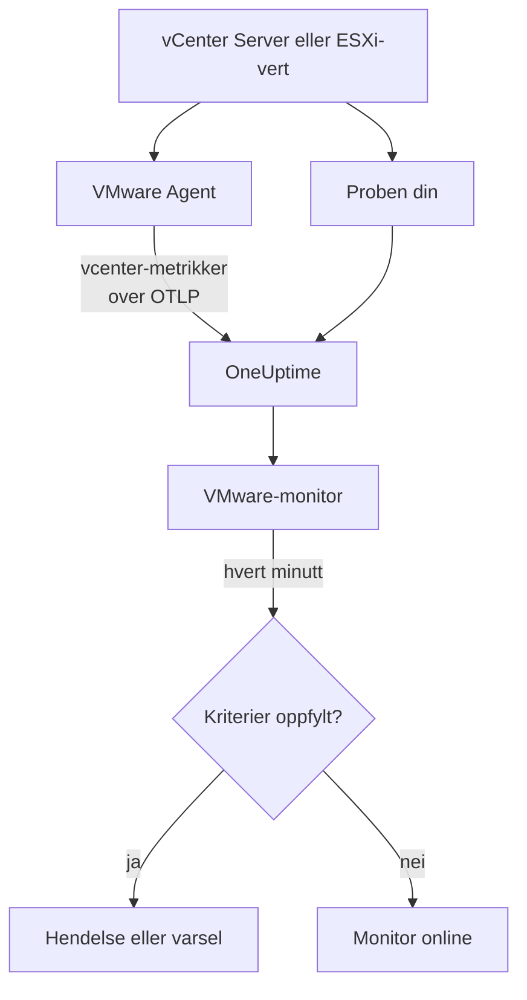

# VMware-overvåking

En VMware-monitor følger med på ett vCenter - datasentrene, klyngene, ESXi-vertene, de virtuelle maskinene, datastorene, ressurspoolene og vSAN - og sier fra når en vert blir mettet, en VM mangler CPU eller minne, en datastore blir full, eller vSphere sender ut en alarm. Den leser `vcenter.*`-metrikkene som OneUptime VMware Agent samler inn, eller som en av probene dine samler inn uten en agent.

:::cards
- [Opprett monitoren](#opprett-en-vmware-monitor): Seks trinn i dashbordet.
- [Maler](#ferdige-varslingsmaler): Tjuetre ferdige varsler, én hendelse per vert, VM eller datastore.
- [Identitetsattributter](#identitetsattributter): Slik treffer du én vert, VM eller datastore.
- [Metrikker](#innsamlede-metrikker): Hver `vcenter.*`-serie monitoren kan varsle på.
:::

## Slik fungerer det

Metrikkene kommer fra vCenters API og leses med en skrivebeskyttet konto på en av to måter:

- **VMware Agent**, en OpenTelemetry Collector med receiveren `vcenter`, som du kjører på en maskin som kan nå vCenter. Se [VMware-agent](/docs/telemetry/vmware).
- **En probe**, uten noe å installere: du kobler til vCenteret i OneUptime og velger proben som kan nå det. Se [VMware uten agent](/docs/telemetry/vmware-agentless).

Begge sender de samme seriene hvert innsamlingsintervall (2 minutter som standard), merket med vCenterets navn, `vmware.vcenter.name`. Et vCenter er ett vSphere-endepunkt: en vCenter Server eller en frittstående ESXi-vert. En VMware-monitor er knyttet til ett vCenter. Hvert minutt kjører den spørringen sin på det vCenterets metrikker og sammenligner resultatet med kriteriene sine.



## Før du begynner

- **Samle inn vCenterets metrikker**, med [VMware Agent](/docs/telemetry/vmware) eller [uten en agent](/docs/telemetry/vmware-agentless). Begge bruker en vSphere-bruker med rollen **Read-Only** på det øverste vCenter-objektet, med **Propagate to children** avkrysset. Agenten leser `ONEUPTIME_URL`, `ONEUPTIME_TELEMETRY_INGESTION_KEY`, `VMWARE_VCENTER_NAME`, `VCENTER_ENDPOINT`, `VCENTER_USERNAME` og `VCENTER_PASSWORD`.
- **Sjekk at vCenteret er registrert.** Det vises under **Produkter → Infrastruktur → VMware → Alle vCenter**: via agenten, oppkalt etter dens `VMWARE_VCENTER_NAME`, etter den første fullstendige innsamlingen; uten agent fra det øyeblikket du kobler det til.

## Opprett en VMware-monitor

:::steps
### Start en ny monitor

Gå til **Monitorer**, og klikk på **Opprett monitor**.

### Velg VMware

Klikk på **Flere monitortyper** under **Monitortype**, og velg **VMware** under **Infrastruktur**, eller skriv `vmware` i søkefeltet. Skriv inn et **Navn** - det brukes i titlene på hendelser og varsler - og klikk på **Neste**.

### Velg vCenteret

Velg vCenteret i **vCenter** under **VMware Monitor Configuration**. Hvert vCenter som har sendt data, eller som du har koblet til uten en agent, står i listen.

### Velg hva som skal overvåkes

Velg en av de tre fanene:

- **Quick Setup** - klikk på en [mal](#ferdige-varslingsmaler). Den setter metrikken, attributtfiltrene, aggregeringen, tidsintervallet, grupperingen og tersklene og erstatter kriteriene nedenfor med sine egne. Du kan fortsatt endre **Tidsintervall**.
- **Custom Metric** - velg én metrikk i **VMware Metric**, og sett deretter **Aggregering** og **Tidsintervall**. Skjemaet grupperer den etter objektet den beskriver, så hver vert, VM eller datastore vurderes for seg, og [filtrene](#monitorinnstillinger) snevrer den inn til ett datasenter, én klynge, én vert, én VM, én datastore eller én ressurspool.
- **Avansert** - bygg spørringer og formler selv under **Velg målinger**, med filtre på attributter som `disk_state`, `power_state` eller `status`. Bruk **Group by** med et [identitetsattributt](#identitetsattributter) for å vurdere hvert objekt for seg.

### Sjekk kriteriene

Åpne hvert kriterium under **Monitorkriterier**, og sjekk **Metrikk**, **Aggregering**, **Betingelse** og **Threshold**. En mal fyller dem ut. Med **Custom Metric** eller **Avansert** starter monitoren med [standardkriteriene](#standardkriterier), som bare oppdager at en metrikk faller til null, så sett din egen terskel.

### Opprett monitoren

Klikk på **Opprett monitor**. OneUptime åpner monitorens side og evaluerer den hvert minutt. Hendelser og varsler den sender ut, vises også på vCenterets sider **Hendelser** og **Varsler**.
:::

> [!TIP]
> For å sette opp flere maler på én gang åpner du vCenteret fra **Produkter → Infrastruktur → VMware** og går til **Recommendations**. Velg malene du vil ha, velg hvem som skal tilkalles, og OneUptime oppretter én monitor per mal.

## Monitorinnstillinger

| Felt | Fane | Hva det gjør |
| --- | --- | --- |
| **vCenter** | Alle | Påkrevd. Begrenser hver spørring til `resource.vmware.vcenter.name`. |
| **Datacenter** | Custom Metric, Avansert | Valgfritt. Ett datasenter: `resource.vcenter.datacenter.name`. Hver serie bærer det. |
| **Klynge** | Custom Metric, Avansert | Valgfritt. Én klynge: `resource.vcenter.cluster.name`. Samsvarer med klyngens egne serier og seriene til vertene, VM-ene og ressurspoolene i den; en frittstående ESXi-vert har ingen. |
| **ESXi Host** | Custom Metric, Avansert | Valgfritt. Én ESXi-vert: `resource.vcenter.host.name`. Samsvarer med vertens egne serier **og** seriene til hver VM den kjører, fordi en VM bærer navnet til verten sin. |
| **Virtual Machine** | Custom Metric, Avansert | Valgfritt. Én VM: `resource.vcenter.vm.name`. VM-navn trenger ikke være unike: legg til en vert eller en klynge når to VM-er deler et navn. |
| **Datastore** | Custom Metric, Avansert | Valgfritt. Én datastore: `resource.vcenter.datastore.name`. |
| **Resource Pool Path** | Custom Metric, Avansert | Valgfritt. Én ressurspool, via inventarstien (`/DC/host/Cluster/Resources/pool`): `resource.vcenter.resource_pool.inventory_path`. En sti, fordi poolnavn bare er unike innenfor det overordnede objektet. |
| **VMware Metric** | Custom Metric | Én metrikk fra [katalogen](#innsamlede-metrikker). |
| **Aggregering** | Custom Metric | Hvordan prøver kombineres: **Gjennomsnitt**, **Maksimum**, **Minimum**, **Sum** eller **Antall**. Starter på metrikkens vanlige aggregering. |
| **Tidsintervall** | Alle | Det glidende vinduet spørringen leser, fra **Past 1 Minute** til **Past 365 Days**. En ny monitor starter på **Past 5 Minutes**; maler setter sitt eget. |
| **Velg målinger** | Avansert | Spørringsbyggeren: **Metrikk**, **Aggregate by**, **Filter by attributes**, **Group by**, pluss **Legg til metrikk** og **Legg til formel** for å kombinere spørringer. |

vCenter leses én gang per innsamlingsintervall, 2 minutter som standard, så et vindu på 1 minutt inneholder kanskje ingen prøve i det hele tatt. Hold vinduet på 5 minutter eller mer, og lengre hvis du har økt innsamlingsintervallet for et stort inventar.

## Identitetsattributter

Receiveren `vcenter` sender én OpenTelemetry-ressurs per vSphere-objekt og navngir den med **ressursattributter**. Hvilke av dem en serie bærer, forteller deg hvilken type objekt den beskriver:

| vSphere-objekt      | Ressursattributter for identitet                                                                                               |
| ------------------- | ------------------------------------------------------------------------------------------------------------------------------ |
| Datasenter          | `vcenter.datacenter.name`                                                                                                      |
| Klynge              | `vcenter.datacenter.name`, `vcenter.cluster.name`                                                                              |
| ESXi-vert           | `vcenter.datacenter.name`, `vcenter.host.name` (+ `vcenter.cluster.name` når den er i en klynge)                               |
| Virtuell maskin     | `vcenter.datacenter.name`, `vcenter.host.name`, `vcenter.vm.name`, `vcenter.vm.id` (+ `vcenter.cluster.name`; `vcenter.resource_pool.*` eller `vcenter.virtual_app.*`) |
| VM-mal              | `vcenter.datacenter.name`, `vcenter.host.name`, `vcenter.vm_template.name`, `vcenter.vm_template.id`                           |
| Datastore           | `vcenter.datacenter.name`, `vcenter.datastore.name`                                                                            |
| Ressurspool         | `vcenter.datacenter.name`, `vcenter.resource_pool.name`, `vcenter.resource_pool.inventory_path` (+ `vcenter.cluster.name` eller `vcenter.host.name`) |

I monitorfiltre og grupperingsnøkler begynner ressursattributter med `resource.` (`resource.vcenter.host.name`), mens datapunktattributter ikke gjør det (`disk_state`, `power_state`, `status`, `effective`, `direction`, `object`, `type`). Det boolske attributtet `effective` lagres som teksten `"true"` eller `"false"`, så filtrer det med teksten. Filtrer på et identitetsattributt for å treffe ett objekt, og grupper etter det for å vurdere hvert objekt for seg.

## Ferdige varslingsmaler

OneUptime leverer 23 maler for vanlige VMware-problemer, og **Quick Setup** tilbyr alle. Hver bygger en komplett monitor: metrikkspørringen, attributtfiltrene, en gruppering på objektets eget identitetsattributt, et kriterium som utløser og et som gjenoppretter. Terskler er utgangspunkter du kan redigere.

Malene leser de siste 5 minuttene, med mindre tabellen sier noe annet. Et kriterium utløser bare når betingelsen gjelder for hvert minutt i vinduet, og et terskelkriterium gjenoppretter 10 % forbi terskelen, så en verdi som svinger rundt linjen, ikke skifter fram og tilbake.

| Mal | Kategori | Alvorlighetsgrad | Overvåker | Utløser når | Gjenoppretter når |
| --- | --- | --- | --- | --- | --- |
| Host CPU Saturation | Vert | Warning | `vcenter.host.cpu.utilization`, Avg per `resource.vcenter.host.name` | Over 90 %: hver VM på verten konkurrerer om kjerner og viser CPU-ready-tid | Ved 81 % eller mindre |
| Host Memory Saturation | Vert | Warning | `vcenter.host.memory.utilization`, Avg per vert | Over 90 %: verten begynner å ta tilbake minne med ballooning, komprimering og swapping | Ved 81 % eller mindre |
| Host Disk Latency High | Vert | Warning | `vcenter.host.disk.latency.max`, Max per vert | Over 50 ms: hver VM med disker på den stien venter på lagring. Krever ytelsestellernivå 3 | Ved 45 ms eller mindre |
| Host Network Packet Errors | Vert | Warning | `vcenter.host.network.packet.error.rate`, Max per vert | Over 0: nesten alltid en feil i kabel, SFP eller switchport | Ved 0 |
| Host Network Packet Drops | Vert | Warning | `vcenter.host.network.packet.drop.rate`, Max per vert | Over 0: en overbooket uplink, eller ringbuffere i NIC-en som renner over | Ved 0 |
| VM CPU Saturation | Virtual Machine | Warning | `vcenter.vm.cpu.utilization`, Avg per `resource.vcenter.vm.name`, **siste 15 minutter** | Over 90 % av VM-ens vCPU-er i alle 15 minuttene: en VM kan bruke det den har fått, så bare en som aldri går ned, tilkaller | Ved 81 % eller mindre |
| VM CPU Ready Contention | Virtual Machine | Warning | `vcenter.vm.cpu.readiness`, Avg per VM | Over 10 %: VM-en var klar til å kjøre, men verten hadde ingen fysisk kjerne til den. Usynlig fra innsiden av gjesten | Ved 9 % eller mindre |
| VM Memory Saturation | Virtual Machine | Warning | `vcenter.vm.memory.utilization`, Avg per VM | Over 90 % av minnet: gjesten er i ferd med å begynne å pagere | Ved 81 % eller mindre |
| VM Memory Ballooning | Virtual Machine | Warning | `vcenter.vm.memory.ballooned`, Max per VM | Over 0: verten mangler minne og tar det tilbake fra denne gjesten | Ved 0 |
| VM Memory Swapping | Virtual Machine | Kritisk | `vcenter.vm.memory.swapped`, Max per VM | Over 0: verten swapper VM-ens minne, siste utvei etter ballooning og komprimering | Ved 0 |
| VM Disk Latency High | Virtual Machine | Warning | `vcenter.vm.disk.latency.max`, Max per VM | Over 50 ms: applikasjoner i gjesten får tidsavbrudd på I/O | Ved 45 ms eller mindre |
| VM Disk Usage High | Virtual Machine | Warning | `vcenter.vm.disk.utilization`, Avg per VM | Over 90 % av den tildelte lagringen er brukt: en thin-provisjonert VM er i ferd med å kreve hele størrelsen sin | Ved 81 % eller mindre |
| Datastore Capacity Warning | Datastore | Warning | `vcenter.datastore.disk.utilization`, Avg per `resource.vcenter.datastore.name` | Over 80 %: et tidlig varsel, siden thin-disker og snapshots raskt bruker resten | Ved 72 % eller mindre |
| Datastore Capacity Critical | Datastore | Kritisk | `vcenter.datastore.disk.utilization`, Avg per datastore | Over 90 %: en full datastore setter hver VM med en disk på den på pause | Ved 81 % eller mindre |
| Cluster Host Not Effective | Klynge | Kritisk | `vcenter.cluster.host.count` filtrert til `effective = false`, Max per `resource.vcenter.cluster.name` | Over 0: en vert er i vedlikeholdsmodus, frakoblet eller svarer ikke, så klyngen kjører med mindre kapasitet enn den er dimensjonert for | Ved 0 |
| Datacenter Hosts Unhealthy | Datacenter | Kritisk | `vcenter.datacenter.host.count` filtrert til `status = red`, Max per `resource.vcenter.datacenter.name` | Over 0: en vert har en kritisk alarm, som en maskinvaresensor, en tapt lagringssti eller en feil i HA-agenten | Ved 0 |
| Datacenter Hosts Degraded | Datacenter | Warning | `vcenter.datacenter.host.count` filtrert til `status = yellow`, Max per datasenter | Over 0: en vert har en advarselsalarm | Ved 0 |
| Datacenter Hosts Powered Off | Datacenter | Warning | `vcenter.datacenter.host.count` filtrert til `power_state = off`, Max per datasenter | Over 0: en vert er slått av - den krasjet, mistet strømmen eller ble satt i standby av DPM | Ved 0 |
| Datacenter VMs Unhealthy | Datacenter | Warning | `vcenter.datacenter.vm.count` filtrert til `status = red`, Max per datasenter | Over 0: en VM har en kritisk alarm, som en mislykket HA-omstart, en tapt datastore eller et tapt Tools-heartbeat | Ved 0 |
| Datacenter Clusters Unhealthy | Datacenter | Kritisk | `vcenter.datacenter.cluster.count` filtrert til `status = red`, Max per datasenter | Over 0: en klynge har en kritisk alarm, som for få HA-failoverressurser, et mislykket HA-valg eller en kritisk vSAN-helsesjekk | Ved 0 |
| vSAN Latency High | vSAN | Warning | `vcenter.cluster.vsan.latency.avg`, Avg per klynge | Over 20 000 µs (20 ms): lagringen blir tregere for hver VM på vSAN-datastoren. Stille på klynger uten vSAN | Ved 18 000 µs eller mindre |
| vSAN Congestion | vSAN | Warning | `vcenter.cluster.vsan.congestions`, Max per klynge | Over 0: en diskgruppe klarer ikke å holde tritt, og vSAN bremser I/O-en til klientene sine | Ved 0 |
| Resource Pool Memory Swapped | Klynge | Warning | `vcenter.resource_pool.memory.swapped`, Max per `resource.vcenter.resource_pool.inventory_path` | Over 0: poolens VM-er tar minne fra vertens swap, som regel fordi poolens minnegrense eller -andeler er for lave | Ved 0 |

**Alvorlighetsgrad** er etiketten velgeren viser. Hendelsen og varselet en mal oppretter, starter på prosjektets mest alvorlige hendelses- og varslingsgrad; endre dem i kriteriet.

- **Utnyttelsesmaler bruker Avg:** receiveren rapporterer en ekte prosent fra 0 til 100 for hvert objekt, så gjennomsnittet i et minutt er den vedvarende utnyttelsen.
- **Latensmaler bruker Max:** metrikken er allerede den verste latensen på tvers av objektets disker, så den høyeste prøven er den ærlige.
- **Antalls- og tilstandsmaler bruker Max**, så én innsamling som viser tilstanden, utløser dem: pakkefeil, ballooning, swapping, rød og gul status, verter som ikke er effektive, overbelastning.
- **Hver mal grupperer på objektets eget identitetsattributt**, så det utløses én hendelse per berørt objekt, og hendelsen nevner det.
- **Terskler er låst i enheten sin** (`%`, `ms`, `us`), så de beholder betydningen sin uansett hvilken enhet en graf viser.

## Innsamlede metrikker

Metrikkene nedenfor er katalogen monitorskjemaet tilbyr. Enhetene er receiverens egne: `MHz`, `%`, `MiBy` (mebibyte), `By` (byte), `KiBy`, `ms`, `us` (mikrosekunder), `{KiBy/s}`, `By/s` og antall. En metrikk merket _av som standard_ samles ikke inn før du slår den på i agentens `otel-collector-config.yaml`; den medfølgende konfigurasjonen slår allerede på `vcenter.host.memory.capacity`.

### Datasenter

| Metrikk                              | Enhet               | Beskrivelse                                                                                                                                                    |
| ------------------------------------ | ------------------- | -------------------------------------------------------------------------------------------------------------------------------------------------------------- |
| `vcenter.datacenter.cluster.count`   | `{clusters}`        | Klynger i datasenteret, delt opp etter `status` (`red` / `yellow` / `green` / `gray`). Summer for totalen; filtrer `status = red` for klynger med en kritisk alarm |
| `vcenter.datacenter.cpu.limit`       | `MHz`               | Total CPU tilgjengelig for datasenteret på tvers av alle ESXi-verter                                                                                           |
| `vcenter.datacenter.datastore.count` | `{datastores}`      | Datastorer i datasenteret                                                                                                                                      |
| `vcenter.datacenter.disk.space`      | `By`                | Datastoreplass på tvers av datasenteret, delt opp etter `disk_state` (`used` / `available`). used ÷ (used + available) er lagringsutnyttelsen for hele datasenteret |
| `vcenter.datacenter.host.count`      | `{hosts}`           | ESXi-verter i datasenteret, delt opp etter `status` og `power_state` (`on` / `off` / `standby` / `unknown`). Filtrer `status = red` eller `power_state = off`  |
| `vcenter.datacenter.memory.limit`    | `By`                | Totalt fysisk minne tilgjengelig for datasenteret på tvers av alle ESXi-verter                                                                                 |
| `vcenter.datacenter.vm.count`        | `{virtual_machines}` | Virtuelle maskiner i datasenteret, delt opp etter `status` og `power_state` (`on` / `off` / `suspended` / `unknown`). Filtrer `power_state = on` for VM-er som kjører |

### Klynge

| Metrikk                             | Enhet                         | Beskrivelse                                                                                                                                                  |
| ----------------------------------- | ----------------------------- | ------------------------------------------------------------------------------------------------------------------------------------------------------------ |
| `vcenter.cluster.cpu.effective`     | `MHz`                         | CPU klyngen faktisk kan planlegge — uten verter i vedlikeholdsmodus eller verter som ikke svarer. Sammenlign med `vcenter.cluster.cpu.limit` for kapasitet ute av drift |
| `vcenter.cluster.cpu.limit`         | `MHz`                         | Total CPU for hver ESXi-vert i klyngen, uavhengig av vertens tilstand                                                                                        |
| `vcenter.cluster.host.count`        | `{hosts}`                     | ESXi-verter i klyngen, delt opp etter `effective` (`"true"` / `"false"`). En vert er ikke effektiv mens den er i vedlikeholdsmodus, frakoblet eller ikke svarer |
| `vcenter.cluster.memory.effective`  | `By`                          | Minne klyngen faktisk kan tildele VM-er — uten verter i vedlikehold eller verter som ikke svarer, og uten ESXi sitt eget reserverte minne                    |
| `vcenter.cluster.memory.limit`      | `By`                          | Totalt fysisk minne for hver ESXi-vert i klyngen                                                                                                             |
| `vcenter.cluster.vm.count`          | `{virtual_machines}`          | Virtuelle maskiner i klyngen, delt opp etter `power_state`. Summer for totalen; filtrer `power_state = on` for VM-er som kjører                              |
| `vcenter.cluster.vm_template.count` | `{virtual_machine_templates}` | Maler for virtuelle maskiner i klyngen                                                                                                                       |

### Vert (ESXi)

| Metrikk                                  | Enhet         | Beskrivelse                                                                                                                                                       |
| ---------------------------------------- | ------------- | ----------------------------------------------------------------------------------------------------------------------------------------------------------------- |
| `vcenter.host.cpu.capacity`              | `MHz`         | ESXi-vertens totale CPU-kapasitet (kjerner × klokke) — nevneren for `vcenter.host.cpu.usage`                                                                      |
| `vcenter.host.cpu.reserved`              | `MHz`         | CPU reservert for virtuelle maskiner, delt opp etter `cpu_reservation_type` (`total` / `used`). Når `used` nærmer seg `total`, vil nye reservasjoner feile i tilgangskontrollen |
| `vcenter.host.cpu.usage`                 | `MHz`         | CPU som akkurat nå forbrukes på verten av alle VM-er og selve hypervisoren                                                                                        |
| `vcenter.host.cpu.utilization`           | `%`           | Vertens CPU-utnyttelse i prosent (0–100) av kapasiteten                                                                                                           |
| `vcenter.host.disk.latency.avg`          | `ms`          | Gjennomsnittlig disklatens (enhets- + kjernetid), delt opp etter `direction` (`read` / `write`) og `object` (diskenhet). Krever ytelsestellernivå 2                |
| `vcenter.host.disk.latency.max`          | `ms`          | Høyeste latens sett på tvers av alle disker verten bruker, per `object`, i det siste intervallet på 20 s. Krever ytelsestellernivå 3                              |
| `vcenter.host.disk.throughput`           | `{KiBy/s}`    | Kilobyte per sekund lest fra eller skrevet til vertens disker, etter `direction` og `object`. Krever ytelsestellernivå 4                                           |
| `vcenter.host.memory.active`             | `MiBy`        | Minne som vertens påslåtte VM-er aktivt bruker. _Av som standard_ — slå på `vcenter.host.memory.active` i agentkonfigurasjonen                                    |
| `vcenter.host.memory.ballooned`          | `MiBy`        | Gjesteminne som balloon-driveren har tatt tilbake fra vertens VM-er; over 0 betyr minnepress på verten. _Av som standard_                                         |
| `vcenter.host.memory.capacity`           | `MiBy`        | Vertens totale fysiske minne — nevneren for `vcenter.host.memory.usage`. Av som standard oppstrøms; den medfølgende agentkonfigurasjonen slår den på              |
| `vcenter.host.memory.granted`            | `MiBy`        | Maskinminne tildelt de påslåtte VM-ene på verten. _Av som standard_                                                                                               |
| `vcenter.host.memory.usage`              | `MiBy`        | Minne som akkurat nå forbrukes på verten, inkludert hypervisorens eget overhead                                                                                   |
| `vcenter.host.memory.utilization`        | `%`           | Vertens minneutnyttelse i prosent (0–100) av den fysiske kapasiteten                                                                                              |
| `vcenter.host.network.packet.drop.rate`  | `{packets/s}` | Pakker per sekund som forkastes på hvert fysiske NIC, etter `direction` (`transmitted` / `received`) og `object` (f.eks. `vmnic0`) — en overbooket uplink eller et NIC som svikter |
| `vcenter.host.network.packet.error.rate` | `{errors/s}`  | Pakkefeil per sekund på vertens fysiske NIC-er, etter `direction` og `object` — nesten alltid en feil i kabel, SFP eller switchport                               |
| `vcenter.host.network.packet.rate`       | `{packets/s}` | Pakker per sekund sendt eller mottatt på hvert fysiske NIC, etter `direction` og `object`                                                                        |
| `vcenter.host.network.throughput`        | `{KiBy/s}`    | Kilobyte per sekund sendt eller mottatt av verten, etter `direction` og `object`                                                                                 |
| `vcenter.host.network.usage`             | `{KiBy/s}`    | Samlet sende- og mottaksrate på tvers av vertens NIC-er, per `object`                                                                                             |

### Virtuell maskin

| Metrikk                                    | Enhet         | Beskrivelse                                                                                                                                                                   |
| ------------------------------------------ | ------------- | ----------------------------------------------------------------------------------------------------------------------------------------------------------------------------- |
| `vcenter.vm.cpu.readiness`                 | `%`           | Andelen av tiden VM-en var klar til å kjøre, men ikke kunne planlegges på en fysisk CPU (CPU ready). Over 5 % føles gjesten treg; over 10 % er verten overbooket. Bare påslåtte VM-er |
| `vcenter.vm.cpu.time`                      | `%`           | Tid VM-ens vCPU-er brukte i hver tilstand, etter `cpu_state` (`idle` / `ready` / `wait`) og `object` (vCPU). _Av som standard_ — slå på `vcenter.vm.cpu.time`                  |
| `vcenter.vm.cpu.usage`                     | `MHz`         | CPU forbrukt av VM-en. Bare påslåtte VM-er — tilstedeværelsen er hvordan OneUptime utleder en VMs strømtilstand                                                                |
| `vcenter.vm.cpu.utilization`               | `%`           | VM-ens CPU-utnyttelse i prosent (0–100) av de konfigurerte vCPU-ene. Bare påslåtte VM-er                                                                                      |
| `vcenter.vm.disk.latency.avg`              | `ms`          | Gjennomsnittlig disklatens, etter `direction` (`read` / `write`), `disk_type` (`virtual` / `physical`) og `object` (virtuell disk). Krever ytelsestellernivå 2                  |
| `vcenter.vm.disk.latency.max`              | `ms`          | Høyeste totale latens (enhets- + kjernetid) VM-en så på en disk over et intervall på 20 s, per `object`                                                                       |
| `vcenter.vm.disk.throughput`               | `{KiBy/s}`    | Kilobyte per sekund lest fra eller skrevet til VM-ens disker, etter `direction` og `object`. Krever ytelsestellernivå 2                                                        |
| `vcenter.vm.disk.usage`                    | `By`          | Datastoreplass som VM-ens filer bruker, delt opp etter `disk_state` (`used` / `available`). Sendes også for VM-maler. Filtrer `disk_state = used` for den brukte størrelsen     |
| `vcenter.vm.disk.utilization`              | `%`           | Prosentandel (0–100) av VM-ens tildelte lagring som er brukt på datastoren — en thin-provisjonert VM nær 100 % er i ferd med å kreve hele størrelsen sin                      |
| `vcenter.vm.memory.ballooned`              | `MiBy`        | Gjesteminne som balloon-driveren (VMware Tools) har tatt tilbake fra VM-en. Over 0 betyr at ESXi-verten mangler minne                                                        |
| `vcenter.vm.memory.granted`                | `MiBy`        | Maskinminne verten har tildelt VM-en. _Av som standard_ — slå på `vcenter.vm.memory.granted`                                                                                  |
| `vcenter.vm.memory.swapped`                | `MiBy`        | Minne VM-en får fra vertens swapfil — siste utvei etter ballooning og komprimering; enhver verdi over 0 betyr at VM-en betaler disklatens for RAM                             |
| `vcenter.vm.memory.swapped_ssd`            | `KiBy`        | VM-ens minne swappet til vertens flash-swapbuffer — mindre smertefullt enn swapfilen, men fortsatt minnepress                                                                 |
| `vcenter.vm.memory.usage`                  | `MiBy`        | Minne som VM-ens gjest aktivt bruker. Sendes for både påslåtte og avslåtte VM-er (0 når den er av)                                                                            |
| `vcenter.vm.memory.utilization`            | `%`           | VM-ens minneutnyttelse i prosent (0–100) av det konfigurerte minnet                                                                                                            |
| `vcenter.vm.network.broadcast.packet.rate` | `{packets/s}` | Broadcast-pakker per sekund per vNIC, etter `direction` og `object`. _Av som standard_                                                                                        |
| `vcenter.vm.network.multicast.packet.rate` | `{packets/s}` | Multicast-pakker per sekund per vNIC, etter `direction` og `object`. _Av som standard_                                                                                        |
| `vcenter.vm.network.packet.drop.rate`      | `{packets/s}` | Pakker per sekund som hvert vNIC forkaster, etter `direction` og `object`. Tap på mottakersiden betyr som regel at gjesten ikke tømmer ringbufferen sin raskt nok             |
| `vcenter.vm.network.packet.rate`           | `{packets/s}` | Pakker per sekund sendt eller mottatt av hvert vNIC, etter `direction` og `object`                                                                                           |
| `vcenter.vm.network.throughput`            | `By/s`        | Byte per sekund sendt eller mottatt over VM-ens nettverk, etter `direction` og `object`                                                                                      |
| `vcenter.vm.network.usage`                 | `{KiBy/s}`    | VM-ens samlede sende- og mottaksrate, per `object`                                                                                                                             |

### Datastore

| Metrikk                              | Enhet | Beskrivelse                                                                                                                                  |
| ------------------------------------ | ----- | -------------------------------------------------------------------------------------------------------------------------------------------- |
| `vcenter.datastore.disk.usage`       | `By`  | Plass på datastoren, delt opp etter `disk_state` (`used` / `available`). used + available er datastorens kapasitet                         |
| `vcenter.datastore.disk.utilization` | `%`   | Prosentandel (0–100) av datastorens kapasitet som er i bruk. En full datastore setter hver VM som skriver til den, på pause, så varsle i god tid før 100 % |

### Ressurspool

| Metrikk                                  | Enhet      | Beskrivelse                                                                                                                                                              |
| ---------------------------------------- | ---------- | ------------------------------------------------------------------------------------------------------------------------------------------------------------------------ |
| `vcenter.resource_pool.cpu.shares`       | `{shares}` | CPU-andeler konfigurert på poolen — dens relative prioritet mot søskenpooler når det overordnede objektet er under press                                                  |
| `vcenter.resource_pool.cpu.usage`        | `MHz`      | CPU forbrukt av hver VM i poolen (og underpoolene)                                                                                                                       |
| `vcenter.resource_pool.memory.ballooned` | `MiBy`     | Minne som balloon-driveren har tatt tilbake på tvers av alle VM-er i poolen                                                                                              |
| `vcenter.resource_pool.memory.granted`   | `MiBy`     | Vertsminne tildelt poolens VM-er, delt opp etter `type` (`private` / `shared` — delte sider dedupliseres av transparent page sharing)                                     |
| `vcenter.resource_pool.memory.shares`    | `{shares}` | Minneandeler konfigurert på poolen                                                                                                                                       |
| `vcenter.resource_pool.memory.swapped`   | `MiBy`     | Minne som poolens VM-er får fra ESXi-vertenes swapplass — enhver verdi over 0 betyr at minst én VM i poolen blir swappet av verten                                      |
| `vcenter.resource_pool.memory.usage`     | `MiBy`     | Minne brukt av poolen, delt opp etter `type` (`guest` / `host` / `overhead`) på nyere collector-bygg; eldre bygg sender én serie uten type. Filtrer `type = guest`        |

### vSAN

Sendes bare for klynger med vSAN, vertene i dem og VM-ene på en vSAN-datastore. Latenser er i **mikrosekunder** (`us`), i motsetning til latensene i millisekunder for verter og VM-er:

| Metrikk                             | Enhet             | Beskrivelse                                                                                                                                     |
| ----------------------------------- | ----------------- | ----------------------------------------------------------------------------------------------------------------------------------------------- |
| `vcenter.cluster.vsan.congestions`  | `{congestions/s}` | Overbelastningshendelser per sekund rettet mot I/O fra hver vSAN-klient i klyngen — vSAN sitt eget mottrykkssignal                              |
| `vcenter.cluster.vsan.latency.avg`  | `us`              | Gjennomsnittlig latens klyngen ser ved tilgang til vSAN-lagring, etter `type` (`read` / `write`). 20 000 µs = 20 ms                             |
| `vcenter.cluster.vsan.operations`   | `{operations/s}`  | vSAN-I/O-operasjoner per sekund på tvers av klyngen, etter `type` (`read` / `write` / `unmap`)                                                  |
| `vcenter.cluster.vsan.throughput`   | `By/s`            | Klyngens vSAN-gjennomstrømning, etter `direction` (`read` / `write`)                                                                            |
| `vcenter.host.vsan.cache.hit_rate`  | `%`               | Andelen av vertens vSAN-lese-I/O som ble betjent fra den lokale klientbufferen i det siste intervallet på 5 min — en fallende rate betyr at lesinger treffer kapasitetslaget |
| `vcenter.host.vsan.congestions`     | `{congestions/s}` | Overbelastningshendelser per sekund rettet mot vertens vSAN-I/O                                                                                 |
| `vcenter.host.vsan.latency.avg`     | `us`              | Gjennomsnittlig latens verten ser ved tilgang til vSAN-lagring, etter `type`                                                                    |
| `vcenter.host.vsan.operations`      | `{operations/s}`  | vSAN-I/O-operasjoner per sekund utstedt av verten, etter `type`                                                                                 |
| `vcenter.host.vsan.throughput`      | `By/s`            | Vertens vSAN-gjennomstrømning, etter `direction`                                                                                                |
| `vcenter.vm.vsan.latency.avg`       | `us`              | Gjennomsnittlig latens VM-en ser ved tilgang til vSAN-lagring, etter `type`                                                                     |
| `vcenter.vm.vsan.operations`        | `{operations/s}`  | vSAN-I/O-operasjoner per sekund utstedt av VM-en, etter `type`                                                                                  |
| `vcenter.vm.vsan.throughput`        | `By/s`            | VM-ens vSAN-gjennomstrømning, etter `direction`                                                                                                 |

> [!NOTE]
> En VMs strømtilstand er ikke en metrikk. Receiveren sender bare `vcenter.vm.cpu.*` for påslåtte VM-er, så OneUptime skiller **Powered on** fra **Powered off** ut fra om CPU-data kom i samme innsamling som VM-ens minne- og diskdata; vCenterets side **Virtual Machines** viser resultatet. For å varsle om avslåtte verter eller om hvor mange VM-er som kjører, bruker du attributtet `power_state` på `vcenter.datacenter.host.count`, `vcenter.datacenter.vm.count` eller `vcenter.cluster.vm.count`.

## Overvåkingskriterier

Et kriterium sammenligner en av monitorens spørringer eller formler med en terskel. Kriteriene til en VMware-monitor har ingen **Filtertype**: hver regel sjekker metrikkverdien, med disse feltene.

| Felt | Hva det gjør |
| --- | --- |
| **Metrikk** | Spørringen eller formelen som skal sjekkes, etter variabelnavnet. |
| **Aggregering** | Hvordan verdiene i vinduet blir til ett svar: **Gjennomsnitt**, **Sum**, **Maximum Value**, **Minimum Value**, **All Values** (hver verdi må samsvare) eller **Any Value** (én er nok). |
| **Betingelse** | **Greater Than**, **Less Than**, **Greater Than Or Equal To**, **Less Than Or Equal To** eller **Equal To** — eller en anomalibetingelse: **Anomalously High**, **Anomalously Low** eller **Anomalous**. |
| **Threshold** | Verdien det sammenlignes med. En enhetsliste står ved siden av når metrikken har en enhet. Vises ikke for anomalibetingelser. |
| **Følsomhet** | Bare anomalibetingelser. **Lav** (4σ), **Middels** (3σ, standarden) eller **Høy** (2σ). |
| **Grunnlinjevindu** | Bare anomalibetingelser. 14 dager (standarden), 28, 60 eller 90 dagers historikk. |
| **Hvis ingen data** | Under **Flere felt**. Hva som skjer når vinduet ikke har noen prøver: **Ignore** (standarden), **Treat As Zero** eller **Trigger**. |

Anomalibetingelser sammenligner hver verdi med den samme timen i uken i grunnlinjen. De blir værende i tilstanden "Learning", og sender ikke ut noe, til grunnlinjevinduet inneholder nok historikk.

Noen kriterier å starte med:

- **En vert er mettet:** `vcenter.host.cpu.utilization`, Gjennomsnitt, gruppert etter `resource.vcenter.host.name`, **Greater Than** `90`, over de siste 5 minuttene.
- **En datastore er i ferd med å bli full:** `vcenter.datastore.disk.utilization`, Gjennomsnitt, gruppert etter `resource.vcenter.datastore.name`, **Greater Than** `80`.
- **En klynge mistet en vert:** `vcenter.cluster.host.count` filtrert til `effective = false`, Maksimum, gruppert etter `resource.vcenter.cluster.name`, **Greater Than** `0`.
- **Færre VM-er kjører enn forventet:** `vcenter.cluster.vm.count` filtrert til `power_state = on` og `resource.vcenter.cluster.name = Production`, Sum, **Less Than** antallet du forventer.
- **En VM blir swappet av verten:** `vcenter.vm.memory.swapped`, Maksimum, gruppert etter `resource.vcenter.vm.name`, **Greater Than** `0`.

### Standardkriterier

En monitor du ikke bygger fra en mal, starter med to kriterier:

| Rekkefølge | Kriterium | Samsvarer når | Så |
| --- | --- | --- | --- |
| 1 | Check if _monitor name_ is offline | En hvilken som helst verdi i den første spørringen er `0` | Markerer monitoren som **Frakoblet** og erklærer hendelsen "_monitor name_ is offline", som løser seg selv når monitoren kommer seg. |
| 2 | Check if _monitor name_ is online | En hvilken som helst verdi er over `0` | Markerer monitoren som **I drift**. |

> [!IMPORTANT]
> Stillhet samsvarer ikke med noen av kriteriene: et vCenter som slutter å sende data, lar monitoren stå slik den var. For å få beskjed når data uteblir, setter du **Hvis ingen data** til **Trigger** på et kriterium. Tid der OneUptime selv ikke mottok noe, teller aldri som manglende data: en sjekk der vinduet inneholder den tiden, venter i stedet, slik [Når OneUptime ikke mottar data](/docs/monitor/when-oneuptime-is-not-receiving) forklarer.

## Terraform

[OneUptimes Terraform-provider](/docs/terraform/monitor-steps) bærer konfigurasjonen av et trinn i en VMware-monitor i attributtet `vmware_monitor`: den rå JSON-en for konfigurasjonen `vmwareMonitor` (`vcenterIdentifier`, `resourceFilters`, `metricViewConfig`, `rollingTime`), skrevet med `jsonencode()`:

```hcl title="main.tf"
monitor_steps = [{
  vmware_monitor = jsonencode({
    vcenterIdentifier = "prod-vcenter"
    resourceFilters   = { clusterName = "Production" }
    rollingTime       = "Past 5 Minutes"
    metricViewConfig = {
      queryConfigs = [{
        metricAliasData = { metricVariable = "host_cpu", title = "Host CPU", description = "", legend = "" }
        metricQueryData = {
          filterData = {
            metricName     = "vcenter.host.cpu.utilization"
            attributes     = {}
            aggegationType = "Avg"
            aggregateBy    = {}
          }
          groupByAttributeKeys = ["resource.vcenter.host.name"]
        }
      }]
      formulaConfigs = []
    }
  })
  criteria = [ /* ... */ ]
}]
```

`vcenterIdentifier` er vCenterets `vmware.vcenter.name` - det `VMWARE_VCENTER_NAME` agenten ble startet med -, ikke dets OneUptime-ID.

## Feilsøking

:::details vCenteret står ikke i listen vCenter
Et vCenter som agenten samler inn fra, registrerer seg selv ut fra agentens data. Sjekk at agenten kjører og sender data (se [Bekreft installasjonen](/docs/telemetry/vmware#verify-the-installation)), at `VMWARE_VCENTER_NAME` er satt, og at et innsamlingsintervall har gått: ingenting sendes før den første fullstendige gjennomgangen av inventaret er ferdig.
:::

:::details Verter har metrikker, men VM-er, datastorer eller klynger har ikke
Den skrivebeskyttede vSphere-brukeren fikk rollen sin uten **Propagate to children**, eller på et objekt under vCenterets rot. Objekter brukeren ikke kan se, mangler rett og slett i metrikkene. Sett tillatelsen på det øverste vCenter-objektet, med videreføring avkrysset.
:::

:::details Host CPU Saturation utløser aldri
Malen tar gjennomsnittet av `vcenter.host.cpu.utilization` per `resource.vcenter.host.name`, så hver vert sjekkes for seg. Hvis du bygde din egen spørring, grupperer du den etter identitetsattributtet med prefikset `resource.`: den bare `vcenter.host.name` samsvarer ikke med noe, og et gjennomsnitt på tvers av alle verter trekkes ned av de inaktive.
:::

:::details vSAN-malene utløser aldri
`vcenter.cluster.vsan.*`, `vcenter.host.vsan.*` og `vcenter.vm.vsan.*` sendes bare for klynger med vSAN, vertene i dem og VM-ene på en vSAN-datastore. Uten vSAN finnes ikke seriene, og malene forblir stille.
:::

:::details Et kriterium filtrert på effective samsvarer ikke med noe
Receiverens boolske attributt `effective` lagres som teksten `"true"` eller `"false"`. Filtrer det med teksten, ikke med en boolsk verdi.
:::

:::details Metrikker for disklatens eller gjennomstrømning mangler
`vcenter.host.disk.latency.avg` og `vcenter.vm.disk.*` krever vCenters statistikknivå 2, `vcenter.host.disk.latency.max` krever nivå 3, og `vcenter.host.disk.throughput` nivå 4. Øk statistikknivået for 5-minuttersintervallet under _vCenter → Configure → General → Statistics_.
:::

:::details Et vindu på 1 minutt viser ingen data
vCenter leses én gang per innsamlingsintervall, 2 minutter som standard og ofte lengre for et stort inventar, så et vindu på 1 minutt inneholder kanskje ingen prøve. Bruk 5 minutter eller mer.
:::

## Neste steg

:::cards
- [VMware-agent](/docs/telemetry/vmware): Installer agenten som samler inn fra vCenter.
- [VMware uten agent](/docs/telemetry/vmware-agentless): La en probe samle inn i stedet.
- [Proxmox-overvåking](/docs/monitor/proxmox-monitor): Samme type monitor for Proxmox VE.
- [Hendelser – Oversikt](/docs/incidents/index): Hva som skjer etter at et kriterium har erklært en hendelse.
:::
