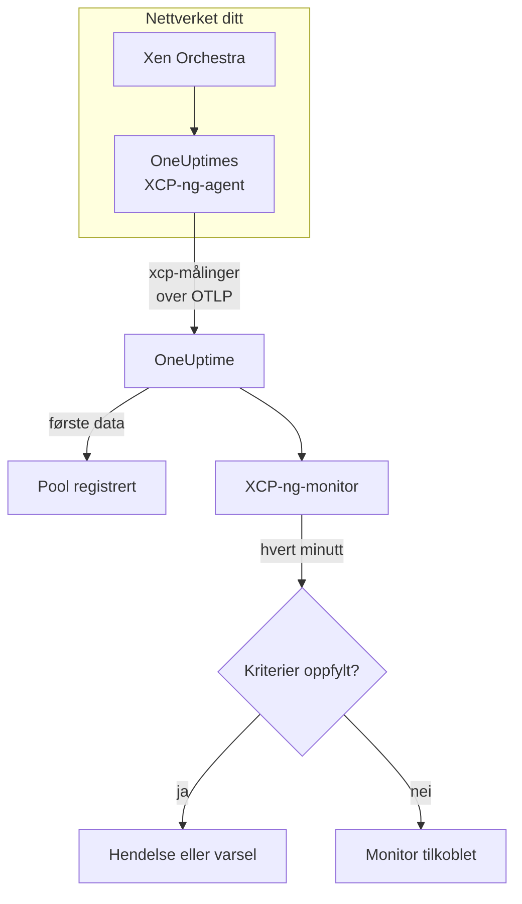

# XCP-ng-monitor

En XCP-ng-monitor overvåker én XCP-ng-pool – vertene, VM-ene, lagringsrepositoriene og de virtuelle diskene – og sier fra når Xen Orchestra mister poolen, en vert blir offline eller forblir deaktivert, en VM som kjørte, stopper eller mangler CPU, eller et lagringsrepositorium fylles opp eller blir tregt. Den leser seriene `xcp_*` fra Xen Orchestras OpenMetrics-plugin, som OneUptimes XCP-ng-agent samler inn, og helseseriene OneUptime utleder fra dem, så ingenting undersøkes utenfra.

:::cards
- [Opprett monitoren](#opprett-en-xcp-ng-monitor): Seks trinn i dashbordet.
- [Maler](#ferdige-varslingsmaler): Ti ferdige varsler, én hendelse per vert, VM eller lagringsrepositorium.
- [Ressursidentitet](#ressursidentitet): Slik treffer du én vert, VM eller ett lagringsrepositorium.
- [Målinger](#innsamlede-målinger): Hver serie monitoren kan varsle på.
:::

## Slik fungerer det

OneUptimes XCP-ng-agent kjører på en maskin som kan nå Xen Orchestra. Hvert 60. sekund leser den Xen Orchestras OpenMetrics-plugin, som leser hver vert i hver pool Xen Orchestra administrerer, og sender seriene til OneUptime over OTLP, én ressurs per pool, stemplet med poolens UUID, `xcp_ng.pool.id`. De første dataene registrerer hver pool.

En XCP-ng-monitor er knyttet til én pool. Hvert minutt kjører den spørringen sin over poolens målinger og sammenligner resultatet med kriteriene sine.



## Før du begynner

- **Installer XCP-ng-agenten** et sted der den kan nå Xen Orchestra, med hemmeligheten til OpenMetrics-pluginen i Xen Orchestra. [Veiledningen for XCP-ng-agenten](/docs/telemetry/xcp-ng) dekker pluginen, sertifikatet til Xen Orchestra og installasjonen.
- **Kontroller at poolen er registrert.** Den vises under **Produkter → Infrastruktur → XCP-ng → Alle pooler**, navngitt slik Xen Orchestra navngir den, omtrent et minutt etter den første innsamlingen.

## Opprett en XCP-ng-monitor

:::steps
### Start en ny monitor

Gå til **Monitorer** og klikk på **Opprett monitor**.

### Velg XCP-ng

Klikk på **Flere monitortyper** under **Monitortype**, og velg **XCP-ng** under **Infrastruktur**, eller skriv `xcp` i søkefeltet. Skriv inn et **Navn** – det brukes i titler på hendelser og varsler – og klikk på **Neste**.

### Velg poolen

Velg poolen i **XCP-ng-pool** under **XCP-ng Monitor Configuration**. Hver pool som har sendt data, står i listen. Når du har valgt, viser en linje under feltet om det kommer data. **Legg til XCP-ng-pool** åpner oppsettstrinn med nøklene dine fylt inn, som venter på de første dataene.

### Velg hva som skal overvåkes

En ny monitor starter med **Pool Disconnected** under **Hva det skal varsles om**. Slik overvåker du noe annet:

- **Endre** – velg en annen [mal](#ferdige-varslingsmaler). Den angir målingene, filtrene, aggregeringen, tidsintervallet og tersklene, og erstatter kriteriene nedenfor med sine egne. Du kan fortsatt endre **Tidsintervall**.
- **Custom Metric** (under **Flere felt**) – velg én måling i **XCP-ng Metric**, og angi deretter **Aggregering** og **Tidsintervall**. [Filtrene](#monitorinnstillinger) snevrer den inn til én type objekt eller til ett objekt.
- **Avansert** (under **Flere felt**) – bygg spørringer og formler selv under **Velg målinger**, for eksempel den brukte andelen av et lagringsrepositorium fra `xcp_sr_physical_usage_bytes / xcp_sr_physical_size_bytes`. Bruk **Grupper etter** `xcp_ng.id` for å vurdere hvert objekt for seg.

### Kontroller kriteriene

Åpne hvert kriterium under **Kriterier** og kontroller **Måling**, **Aggregering**, **Betingelse** og **Terskel**. En mal fyller inn disse. Med **Custom Metric** eller **Avansert** starter monitoren med [standardkriteriene](#standardkriterier), som bare merker at målingen ikke sender data, så angi din egen terskel.

### Opprett monitoren

Klikk på **Opprett monitor**. OneUptime åpner monitorens side og evaluerer den hvert minutt. Hendelser og varsler den åpner, vises også på poolens sider **Hendelser** og **Varsler**.
:::

> [!TIP]
> For å sette opp flere maler samtidig åpner du poolen fra **Produkter → Infrastruktur → XCP-ng** og går til **Anbefalinger**. Velg malene du vil ha og hvem som skal varsles, så oppretter OneUptime én monitor per mal.

## Monitorinnstillinger

| Felt | Fane | Hva det gjør |
| --- | --- | --- |
| **XCP-ng-pool** | Alle | Påkrevd. Avgrenser hver spørring til `resource.xcp_ng.pool.id`, poolens UUID, så to pooler med samme navn aldri blandes. |
| **Ressursomfang** | Custom Metric, Avansert | Valgfritt. **Vert**, **VM**, **Lagringsrepositorium**, **Virtuell disk**, **XOSTOR** eller **XCP-ng-pool** – et nøyaktig samsvar med `xcp_ng.scope`. |
| **UUID** | Custom Metric, Avansert | Valgfritt. Nøyaktig samsvar med `xcp_ng.id`: UUID-en til én vert, VM, ett lagringsrepositorium eller én virtuell disk, slik Xen Orchestra viser den. Kombiner den med et omfang for å treffe ett objekt. |
| **Vertens navn** | Custom Metric, Avansert | Valgfritt. Nøyaktig samsvar med Xen Orchestras etikett `host_name`: vertens egne serier og seriene til VM-ene som kjører på den. |
| **XCP-ng Metric** | Custom Metric | Én måling fra [katalogen](#innsamlede-målinger). |
| **Aggregering** | Custom Metric | Hvordan målinger kombineres: **Gjennomsnitt**, **Maksimum**, **Minimum**, **Sum** eller **Antall**. Starter på målingens vanlige aggregering. |
| **Tidsintervall** | Alle | Det glidende vinduet spørringen leser, fra **Past 1 Minute** til **Past 365 Days**. En ny monitor starter på **Past 1 Minute**; maler angir sitt eget. |
| **Velg målinger** | Avansert | Spørringsbyggeren: **Måling**, **Aggreger etter**, **Filtrer etter attributter**, **Grupper etter**, pluss **Legg til måling** og **Legg til formel** for å kombinere spørringer. |

Agenten leser Xen Orchestra hvert 60. sekund, og Xen Orchestra leser vertene sine med en oppløsning på 60 sekunder, så et vindu på 1 minutt inneholder omtrent ett datapunkt; malene leser 5 minutter eller mer.

## Ressursidentitet

Xen Orchestra navngir en vert eller en VM med etiketten `uuid`, et lagringsrepositorium med `sr_uuid` og en virtuell disk med `vdi_uuid`. OneUptime setter to attributter på hvert datapunkt når det kommer inn, så ett filter leser hver serie for et objekt, uansett hvilken etikett som navnga det. Malene bygger på dem:

| Attributt | Verdier | For en VM |
| --- | --- | --- |
| `xcp_ng.scope` | `pool`, `host`, `vm`, `sr` (et lagringsrepositorium), `vdi` (en virtuell disk), `xostor` | `vm` |
| `xcp_ng.id` | Objektets UUID, med små bokstaver: `uuid` for en vert eller VM, `sr_uuid` for et lagringsrepositorium eller en XOSTOR-klynge, `vdi_uuid` for en virtuell disk, og poolens egen UUID på poolens serier | `5c6d7e8f-1a2b-4c3d-9e8f-0a1b2c3d4e5f` |

Filtrer på `xcp_ng.scope` for én type objekt, på `xcp_ng.id` for ett objekt, og grupper etter `xcp_ng.id` for å vurdere hvert objekt for seg. Xen Orchestras egne etiketter blir som den sender dem: `host_name` navngir en vert på seriene dens og en VMs vert på VM-ens, `vm_name`, `sr_name` og `vdi_name` navngir resten, `power_state` og `enabled` bærer tilstanden til en vert eller en VM på statusseriene, og `is_control_domain` er `true` på VM-seriene til et kontrolldomene.

Selve poolen er ressursen seriene kommer inn på, så attributtene dens får prefikset `resource.` i filtre og grupperingsnøkler: `resource.xcp_ng.pool.id` (UUID-en), `resource.xcp_ng.pool.name` (navnet i Xen Orchestra) og `resource.xen_orchestra.name` (Xen Orchestra-en den leses fra).

## Ferdige varslingsmaler

Listen under **Hva det skal varsles om** tilbyr 10 maler. Hver bygger en komplett monitor – spørringer, attributtfiltre, en gruppering, et kriterium som utløses, og et som gjenoppretter. De fleste grupperer etter `xcp_ng.id`, så hver vert, VM eller hvert lagringsrepositorium får sin egen hendelse og sitt eget varsel. Tersklene er utgangspunkter du kan redigere.

Et kriterium utløses bare når betingelsen gjelder i hvert minutt av vinduet, og et terskelkriterium gjenoppretter 10 % forbi terskelen, slik at en verdi som svever ved grensen, ikke blafrer. En 0/1-serie gjenoppretter ved den andre verdien.

| Mal | Kategori | Alvorlighetsgrad | Overvåker | Utløses når | Gjenoppretter når |
| --- | --- | --- | --- | --- | --- |
| Pool Disconnected | Tilgjengelighet | Kritisk | `xcp_pool_connected`, Count over hele poolen, siste 10 minutter | Ingen data i hele vinduet | Data kommer inn igjen |
| Host Offline | Tilgjengelighet | Kritisk | `xcp_ng.host.running` for `xcp_ng.scope = host`, Min per `xcp_ng.id`, siste 5 minutter | Under 1 | På 1 |
| VM Stopped | VM | Advarsel | `xcp_ng.vm.stopped_after_running` for `xcp_ng.scope = vm`, Min per `xcp_ng.id`, siste 5 minutter | Over 0 | På 0 |
| Storage Repository Near Full | Lagring | Kritisk | `xcp_sr_physical_usage_bytes` ÷ `xcp_sr_physical_size_bytes` × 100 for `xcp_ng.scope = sr` (begge Sum), per `xcp_ng.id`, siste 5 minutter | Over 90 % | På eller under 81 % |
| Host Disabled | Vert | Advarsel | `xcp_ng.host.enabled` for `xcp_ng.scope = host`, Max per `xcp_ng.id`, siste 30 minutter | Under 1 | På 1 |
| Host Restarted | Vert | Advarsel | `xcp_host_uptime_seconds` og `xcp_ng.host.running` for `xcp_ng.scope = host`, Min per `xcp_ng.id`, siste 5 minutter | `xcp_host_uptime_seconds` er under 900 (15 minutter) mens `xcp_ng.host.running` er 1 | `xcp_host_uptime_seconds` er på 990 eller mer, eller `xcp_ng.host.running` er 0 |
| High Host CPU Usage | Vert | Advarsel | `xcp_host_cpu_average` for `xcp_ng.scope = host`, Avg per `xcp_ng.id`, siste 10 minutter | Over 0,9 (90 % av vertens CPU) | På eller under 0,81 |
| High Host Memory Usage | Vert | Advarsel | (`xcp_host_memory_total_bytes` − `xcp_host_memory_free_bytes`) ÷ `xcp_host_memory_total_bytes` × 100 for `xcp_ng.scope = host` (begge Sum), per `xcp_ng.id`, siste 10 minutter | Over 95 % | På eller under 85,5 % |
| VM Starved of CPU | VM | Advarsel | `xcp_vm_runstate_full_contention` for `xcp_ng.scope = vm`, Avg per `xcp_ng.id`, siste 15 minutter | Over 0,1 (10 % av tiden) | På eller under 0,09 |
| Storage Repository Slow | Lagring | Advarsel | `xcp_host_disk_latency_seconds` for `xcp_ng.scope = host`, Avg per `sr`, siste 15 minutter | Over 0,05 (50 ms) | På eller under 0,045 |

**Alvorlighetsgrad** er etiketten velgeren viser. Hendelsen og varselet en mal oppretter, starter på prosjektets mest alvorlige hendelses- og varslingsgrad; endre dem i kriteriene.

- **Pool Disconnected** utløses når `xcp_pool_connected` slutter å komme i ti minutter. Xen Orchestra sender den ved hver innsamling så lenge den er koblet til poolen, og slutter å sende den, i stedet for å sende 0, når den mister poolens master; den stopper også når Xen Orchestra, pluginen eller XCP-ng-agenten stopper, eller agenten mister ruten til OneUptime. Den løses når serien kommer tilbake. Når data stopper, har de andre malene ingenting å sammenligne og beholder den siste statusen, så det er denne som sier fra til deg.
- **Host Offline** leser `xcp_ng.host.running`, som OneUptime utleder fra `xcp_host_status`: 0 mens Xen Orchestra rapporterer verten som Halted, eller tilstanden som Unknown fordi pool-masteren mistet kontakten med den. VM-ene som kjørte på verten, er også nede, med mindre HA startet dem på nytt et annet sted.
- **VM Stopped** leser `xcp_ng.vm.stopped_after_running`: 1 mens en VM som kjørte de siste 24 timene, er Halted eller Paused. En VM som har vært slått av i mer enn et døgn, regnes som slått av med vilje og slutter å varsle, en suspendert VM varsler aldri, og kontrolldomener og VM-maler utelates.
- **Host Disabled** utløses for en vert som forblir deaktivert i 30 minutter: i vedlikeholdsmodus, eller etterlatt deaktivert av en evakuering. XAPI starter ingen VM på den, og HA kan ikke flytte noe over til den. Tretti minutter lar en planlagt omstart eller oppdatering gå uten å varsle noen.
- **Host Restarted** utløses for en vert som er oppe, men har kjørt i mindre enn 15 minutter: den har startet på nytt, eller den krasjet og kom tilbake. Den løses når verten har vært oppe i 16,5 minutter, 10 % forbi terskelen; en vert som er nede, utløser **Host Offline** i stedet.
- **Forholdsformler** tar **Sum** av begge sider. Begge kommer fra samme innsamling, så resultatet er en ekte prosent. Et lagringsrepositorium som rapporterer en størrelse på 0, slik noen ISO-biblioteker og flyttbare medier gjør, utløses aldri.
- **VM Starved of CPU** leser full konkurranse: andelen av tiden da alle en VMs vCPU-er var klare til å kjøre, men ventet på en fysisk CPU. Verten har flere kjørbare vCPU-er enn CPU-tråder, så VM-en kjører tregere enn sitt eget CPU-forbruk tilsier.
- **Storage Repository Slow** grupperer etter `sr`, Xen Orchestras korte id for et lagringsrepositorium på hver verts diskserier, så hvert lagringsrepositorium får én hendelse, med forsinkelsen som gjennomsnitt over vertene som leser og skriver på det.

Pluginen rapporterer ingen alarmer utover XOSTORs, ingen HA-tilstand, ingen pool-master, ingen manglende oppdateringer og ingen sikkerhetskopier, så ingen mal overvåker dem ennå: se [Hva pluginen ikke dekker ennå](/docs/telemetry/xcp-ng#hva-pluginen-ikke-dekker-ennå).

## Innsamlede målinger

Agenten leser hver serie fra Xen Orchestras OpenMetrics-plugin hvert 60. sekund; seriene nedenfor er katalogen monitorskjemaet tilbyr. Xen Orchestra gjør allerede om XAPIs KiB, MiB/s og mikrosekunder til byte, byte per sekund og sekunder. Åtte serier som den kaller `_total` og typer som tellere, inneholder rater per sekund, og OneUptime lagrer dem som ratene de er, slik [veiledningen for XCP-ng-agenten](/docs/telemetry/xcp-ng#hva-agenten-samler-inn) forklarer. De fire seriene `xcp_ng.*` er OneUptimes egne, utledet fra statusseriene til Xen Orchestra når de kommer inn.

### Tilgjengelighet

| Måling | Enhet | Beskrivelse |
| --- | --- | --- |
| `xcp_pool_connected` | — | 1 mens Xen Orchestra er koblet til poolen. Xen Orchestra slutter å sende den når den mister poolen, i stedet for å sende 0: følg med på at den stopper. |
| `xcp_ng.host.running` | — | 1 mens Xen Orchestra rapporterer en vert som Running, 0 mens den er Halted eller tilstanden er Unknown. Utledet av OneUptime fra vertens status. |
| `xcp_ng.host.enabled` | — | 1 mens en vert er aktivert, 0 mens den er i vedlikeholdsmodus eller evakueres, når XAPI ikke starter noen VM på den. Utledet av OneUptime fra vertens status. |
| `xcp_ng.vm.running` | — | 1 mens en VM er Running, 0 mens den er Halted, Paused eller Suspended. Kontrolldomener utelates. Utledet av OneUptime fra VM-ens status. |
| `xcp_ng.vm.stopped_after_running` | — | 1 mens en VM som kjørte de siste 24 timene, er Halted eller Paused, ellers 0. En VM ingen har sett kjøre på et døgn, regnes som slått av med vilje, og en suspendert VM teller aldri. Utledet av OneUptime. |
| `xcp_host_status` | count | Alltid 1 for hver vert, kjørende eller ikke; vertens tilstand står i etikettene `power_state` (Running, Halted, Unknown) og `enabled`. |
| `xcp_vm_status` | count | Alltid 1 for hver VM unntatt kontrolldomener og VM-maler; VM-ens tilstand står i etiketten `power_state` (Running, Halted, Paused, Suspended). |
| `xcp_host_uptime_seconds` | seconds | Hvor lenge en vert har vært oppe siden den startet. |
| `xcp_vm_uptime_seconds` | seconds | Hvor lenge en kjørende VM har vært oppe siden den startet. Rapporteres bare mens VM-en kjører. |

### Vert

| Måling | Enhet | Beskrivelse |
| --- | --- | --- |
| `xcp_host_cpu_average` | ratio | En verts CPU-bruk som gjennomsnitt over kjernene, som et forhold fra 0 til 1. |
| `xcp_host_cpu_core_usage` | ratio | Én CPU-tråds bruk på en vert, som et forhold fra 0 til 1; etiketten `core` sier hvilken. |
| `xcp_host_load` | — | vCPU-ene som kjører eller venter på å kjøre på en vert, per fysisk CPU. Over 1 venter VM-er på en CPU. |
| `xcp_host_load_average` | — | Load average for en verts kontrolldomene (dom0). |
| `xcp_host_memory_total_bytes` | bytes | En verts fysiske minne. |
| `xcp_host_memory_free_bytes` | bytes | En verts minne som ikke er gitt til noen VM. Sammenlign det med `xcp_host_memory_total_bytes` for å se hvor full verten er. |
| `xcp_host_memory_reclaimed_bytes` | bytes | Minne som dynamisk minnestyring har tatt tilbake fra en verts VM-er. |
| `xcp_host_memory_reclaimed_max_bytes` | bytes | Det meste minnet dynamisk minnestyring kunne ta tilbake fra en verts VM-er. |
| `xcp_host_running_vcpus` | count | vCPU-ene til VM-ene som kjører på en vert, lagt sammen. |
| `xcp_host_power_consumption_watts` | W | En verts strømforbruk, lest fra DCMI-sensoren. Der Xen Orchestra i stedet leser det via IPMI, sender den målingen uten poolen, så agenten beholder den ikke; hver VMs anslåtte andel av det beholdes. |

### VM

| Måling | Enhet | Beskrivelse |
| --- | --- | --- |
| `xcp_vm_cpu_usage` | ratio | En VMs CPU-bruk som gjennomsnitt over vCPU-ene, som et forhold fra 0 til 1. |
| `xcp_vm_cpu_core_usage` | ratio | Én vCPUs bruk, som et forhold fra 0 til 1; etiketten `core` sier hvilken. |
| `xcp_vm_runstate_full_contention` | ratio | Andelen av tiden da alle en VMs vCPU-er var klare til å kjøre, men ventet på en fysisk CPU, fra 0 til 1. En høy verdi betyr at VM-en mangler CPU på grunn av naboene. |
| `xcp_vm_runstate_partial_contention` | ratio | Andelen av tiden da noen av en VMs vCPU-er ventet på en fysisk CPU mens resten var blokkert, fra 0 til 1. |
| `xcp_vm_runstate_concurrency_hazard` | ratio | Andelen av tiden da noen av en VMs vCPU-er kjørte mens andre ventet på en fysisk CPU, fra 0 til 1. |
| `xcp_vm_runstate_fullrun` | ratio | Andelen av tiden da alle en VMs vCPU-er kjørte, fra 0 til 1. |
| `xcp_vm_runstate_partial_run` | ratio | Andelen av tiden da noen av en VMs vCPU-er kjørte og resten var blokkert, fra 0 til 1. |
| `xcp_vm_runstate_blocked` | ratio | Andelen av tiden da alle en VMs vCPU-er var blokkert, uten noe å gjøre eller i venting på I/O, fra 0 til 1. |
| `xcp_vm_memory_bytes` | bytes | Minnet en VM har fått. |
| `xcp_vm_memory_target_bytes` | bytes | Minnet dynamisk minnestyring tar sikte på å gi en VM. |
| `xcp_vm_memory_internal_free_bytes` | bytes | Minnet gjesten rapporterer som ledig. Krever gjesteverktøyene i VM-en. |
| `xcp_vm_power_consumption_watts` | W | Xen Orchestras anslag over en VMs andel av vertens strømforbruk, fordelt etter CPU-belastning. Etiketten `data_complete` er `false` når VM-ens CPU-måling manglet. |

### Lagring

| Måling | Enhet | Beskrivelse |
| --- | --- | --- |
| `xcp_sr_physical_size_bytes` | bytes | Den fysiske størrelsen til et lagringsrepositorium. Noen ISO-biblioteker og flyttbare medier rapporterer 0. |
| `xcp_sr_physical_usage_bytes` | bytes | Plassen som brukes på et lagringsrepositorium. Del den på størrelsen for å se hvor fullt det er. |
| `xcp_sr_virtual_size_bytes` | bytes | Den virtuelle størrelsen til hver disk på et lagringsrepositorium, lagt sammen. Over størrelsen er repositoriet tildelt utover det det kan romme, via thin provisioning. |
| `xcp_vdi_virtual_size_bytes` | bytes | Størrelsen til en virtuell disk slik VM-en ser den. |
| `xcp_vdi_physical_usage_bytes` | bytes | Plassen en virtuell disk tar på lagringsrepositoriet sitt. |
| `xcp_host_disk_iops_read` | ops/s | Leseoperasjoner per sekund fra en vert til et lagringsrepositorium; etiketten `sr_name` sier hvilket. |
| `xcp_host_disk_iops_write` | ops/s | Skriveoperasjoner per sekund fra en vert til et lagringsrepositorium. |
| `xcp_host_disk_iops_total` | ops/s | Lese- og skriveoperasjoner per sekund fra en vert til et lagringsrepositorium. |
| `xcp_host_disk_throughput_read_bytes` | bytes/s | Byte per sekund en vert leser fra et lagringsrepositorium. |
| `xcp_host_disk_throughput_write_bytes` | bytes/s | Byte per sekund en vert skriver til et lagringsrepositorium. |
| `xcp_host_disk_throughput_total_bytes` | bytes/s | Byte per sekund en vert leser fra og skriver til et lagringsrepositorium. |
| `xcp_host_disk_read_latency_seconds` | seconds | Hvor lang tid en verts lesinger fra et lagringsrepositorium tar. |
| `xcp_host_disk_write_latency_seconds` | seconds | Hvor lang tid en verts skrivinger til et lagringsrepositorium tar. |
| `xcp_host_disk_latency_seconds` | seconds | Hvor lang tid en verts lesinger og skrivinger på et lagringsrepositorium tar. |
| `xcp_host_disk_iowait` | ratio | Andelen av tiden da en vert ventet på et lagringsrepositorium, fra 0 til 1. |
| `xcp_vm_disk_read_bytes_total` | bytes/s | Byte per sekund en VM leser fra en av diskene sine; etiketten `device` sier hvilken. En rate, selv om Xen Orchestra kaller den `_total` og typer den som en teller. |
| `xcp_vm_disk_write_bytes_total` | bytes/s | Byte per sekund en VM skriver til en av diskene sine. En rate, selv om Xen Orchestra kaller den `_total` og typer den som en teller. |
| `xcp_vm_disk_iops_read` | ops/s | Leseoperasjoner per sekund på en VMs disk. |
| `xcp_vm_disk_iops_write` | ops/s | Skriveoperasjoner per sekund på en VMs disk. |
| `xcp_vm_disk_iops_total` | ops/s | Lese- og skriveoperasjoner per sekund på en VMs disk. |
| `xcp_vm_disk_throughput_read_bytes` | bytes/s | Byte per sekund lest fra en VMs disk. |
| `xcp_vm_disk_throughput_write_bytes` | bytes/s | Byte per sekund skrevet til en VMs disk. |
| `xcp_vm_disk_throughput_total_bytes` | bytes/s | Byte per sekund lest fra og skrevet til en VMs disk. |
| `xcp_vm_disk_read_latency_seconds` | seconds | Hvor lang tid lesinger fra en VMs disk tar. |
| `xcp_vm_disk_write_latency_seconds` | seconds | Hvor lang tid skrivinger til en VMs disk tar. |
| `xcp_vm_disk_latency_seconds` | seconds | Hvor lang tid lesinger og skrivinger på en VMs disk tar i gjennomsnitt. |
| `xcp_vm_disk_iowait` | ratio | Andelen av tiden da en VM ventet på en av diskene sine, fra 0 til 1. |
| `xcp_vm_disk_inflight` | count | Forespørslene på en VMs disk som ikke er besvart ennå. |
| `xcp_vm_disk_queue_size` | count | Den gjennomsnittlige køen av forespørsler på en VMs disk. |

### Nettverk

| Måling | Enhet | Beskrivelse |
| --- | --- | --- |
| `xcp_host_network_receive_bytes_total` | bytes/s | Byte per sekund en vert mottar på ett fysisk grensesnitt; etiketten `interface` sier hvilket. En rate, selv om Xen Orchestra kaller den `_total` og typer den som en teller. |
| `xcp_host_network_transmit_bytes_total` | bytes/s | Byte per sekund en vert sender på ett fysisk grensesnitt. En rate, selv om Xen Orchestra kaller den `_total` og typer den som en teller. |
| `xcp_host_network_aggregated_receive_bytes` | bytes/s | Byte per sekund en vert mottar på alle de fysiske grensesnittene sine. |
| `xcp_host_network_aggregated_transmit_bytes` | bytes/s | Byte per sekund en vert sender på alle de fysiske grensesnittene sine. |
| `xcp_vm_network_receive_bytes_total` | bytes/s | Byte per sekund en VM mottar på et av nettverksgrensesnittene sine; etiketten `vif` sier hvilket. En rate, selv om Xen Orchestra kaller den `_total` og typer den som en teller. |
| `xcp_vm_network_transmit_bytes_total` | bytes/s | Byte per sekund en VM sender på et av nettverksgrensesnittene sine. En rate, selv om Xen Orchestra kaller den `_total` og typer den som en teller. |
| `xcp_vm_network_receive_errors_total` | errors/s | Mottaksfeil per sekund på et av en VMs nettverksgrensesnitt. En rate, selv om Xen Orchestra typer den som en teller. |
| `xcp_vm_network_transmit_errors_total` | errors/s | Sendefeil per sekund på et av en VMs nettverksgrensesnitt. En rate, selv om Xen Orchestra typer den som en teller. |

### XOSTOR

Sendes bare for pooler som kjører XOSTOR, Vates' replikerte lagring bygget på LINSTOR.

| Måling | Enhet | Beskrivelse |
| --- | --- | --- |
| `xcp_xostor_up` | — | 1 når Xen Orchestra kunne lese helsen til en XOSTOR-klynge, 0 når den ikke kunne. |
| `xcp_xostor_node_status` | count | Alltid 1 for hver node i en XOSTOR-klynge; rollen og tilstanden står i etikettene `role` og `state`. |
| `xcp_xostor_resource_total` | count | LINSTOR-ressursene en XOSTOR-klynge definerer. |
| `xcp_xostor_resource_state_count` | count | Ressursreplikaene til en XOSTOR-klynge i hver disktilstand; etiketten `state` sier hvilken. |
| `xcp_xostor_alarms_up` | — | 1 når Xen Orchestra kunne lese alarmene til en XOSTOR-klynge, 0 når den ikke kunne. |
| `xcp_xostor_alarms_count` | count | Aktive XAPI-alarmer på et XOSTOR-lagringsrepositorium eller vertene dets, etter `alarm_name` og `target_type`. Fraværende når ingen er utløst. |
| `xcp_xostor_smart_up` | — | 1 når Xen Orchestra kunne lese SMART-dataene til en vert for XOSTOR, 0 når den ikke kunne. |
| `xcp_xostor_disk_smart_status` | count | Alltid 1 for hver disk på en XOSTOR-vert; SMART-helsen står i etiketten `status`. |
| `xcp_xostor_updates_up` | — | 1 når en verts XOSTOR-oppdateringssjekk svarte, 0 når den feilet. |
| `xcp_xostor_package_update_available` | count | 1 for hver XOSTOR-pakke med en oppdatering som venter på en vert; etiketten `package` sier hvilken. |

## Overvåkingskriterier

Et kriterium sammenligner en av monitorens spørringer eller formler med en terskel. Kriteriene til en XCP-ng-monitor har ingen **Filtertype**: hver regel kontrollerer målingsverdien, med disse feltene.

| Felt | Hva det gjør |
| --- | --- |
| **Måling** | Spørringen eller formelen som kontrolleres, etter variabelnavnet. |
| **Aggregering** | Hvordan verdiene i vinduet blir til ett svar: **Gjennomsnitt**, **Sum**, **Maksimumsverdi**, **Minimumsverdi**, **Alle verdier** (hver verdi må samsvare, i hele vinduet) eller **Minst én verdi** (én er nok). |
| **Betingelse** | **Større enn**, **Mindre enn**, **Større enn eller lik**, **Mindre enn eller lik**, **Lik** eller **Ikke lik** – eller en avviksbetingelse: **Unormalt høy**, **Unormalt lav** eller **Avvikende**. **Ingen data** stemmer når spørringen ikke ga noe i vinduet, og **Har data** når den ga noe. **Ventes å stige over** og **Ventes å falle under** treffer når målingens trend i vinduet er forbi terskelen ved slutten av **Tidshorisont**. |
| **Terskel** | Verdien det sammenlignes med. En liste over enheter står ved siden av når målingen har en enhet. Vises ikke for avviksbetingelser. |
| **Følsomhet** | Bare avviksbetingelser. **Lav** (4σ), **Middels** (3σ, standard) eller **Høy** (2σ). |
| **Grunnlinjevindu** | Bare avviksbetingelser. 14 dager (standard), 28, 60 eller 90 dager med historikk. |
| **Hvis ingen data** | Under **Flere felt**. Hva som skjer når vinduet ikke har noen målinger: **Ignore** (standard), **Treat As Zero** eller **Utløser**. |

Avviksbetingelser sammenligner hver verdi med samme time i uken i grunnlinjen. De blir værende i en «Learning»-tilstand og gir ingenting før grunnlinjevinduet inneholder nok historikk. Denne monitoren filtrerer spørringene sine etter attributter, så hver spørring, og hver serie i en gruppert spørring, sammenlignes med sin egen historikk, så langt tilbake som målingene dine beholdes. Er det under to uker, blir en sum, en telling eller en spørring på et histogram værende i den tilstanden for alltid, og alt annet sammenlignes med alle seriene til målingen. En persentil av et histogram blir alltid værende i den tilstanden.

Hvert kriterium sier også hva som skal skje når det samsvarer: endre monitorstatusen, opprette et varsel eller erklære en hendelse. Kriterier kontrolleres ovenfra og ned, og det første som samsvarer, avgjør.

### Standardkriterier

En monitor du ikke bygger fra en mal, starter med to kriterier:

| Rekkefølge | Kriterium | Samsvarer når | Deretter |
| --- | --- | --- | --- |
| 1 | Sjekk om _monitornavn_ er offline | Den første spørringen har ingen data i hele vinduet | Markerer monitoren som **Offline** og erklærer hendelsen «_monitornavn_ er offline», som løser seg selv når monitoren kommer seg. |
| 2 | Sjekk om _monitornavn_ er tilkoblet | Den første spørringen har data | Markerer monitoren som **I drift**. |

> [!IMPORTANT]
> En verdi på `0` er data, så en måling som ofte er null, som nettverksfeilene til en VM, gjør ikke monitoren offline. For å få varsel om en verdi, start fra en mal eller legg til et kriterium med en terskel. Når ingen data kommer i det hele tatt og ingen kriterier passer, beholder monitoren statusen sin, og åpne hendelser forblir åpne: stillhet er ikke bedring. Tid da OneUptime selv ikke mottok data, regnes aldri som manglende data: en sjekk der vinduet inneholder slik tid, venter i stedet, slik [Når OneUptime ikke mottar data](/docs/monitor/when-oneuptime-is-not-receiving) forklarer.

## Terraform

[OneUptimes Terraform-provider](/docs/terraform/monitor-steps) bærer konfigurasjonen av et trinn i en XCP-ng-monitor i attributtet `xcp_ng_monitor`: den rå JSON-en for konfigurasjonen `xcpNgMonitor` (`poolIdentifier`, `resourceFilters`, `metricViewConfig`, `rollingTime`), skrevet med `jsonencode()`:

```hcl title="main.tf"
monitor_steps = [{
  xcp_ng_monitor = jsonencode({
    poolIdentifier  = "b7569d99-30f8-178a-7d94-801de3e29b5b"
    resourceFilters = { scope = "host" }
    rollingTime     = "Past 10 Minutes"
    metricViewConfig = {
      queryConfigs = [{
        metricAliasData = { metricVariable = "host_cpu", title = "Host CPU", description = "", legend = "" }
        metricQueryData = {
          filterData = {
            metricName     = "xcp_host_cpu_average"
            attributes     = {}
            aggegationType = "Avg"
            aggregateBy    = {}
          }
          groupByAttributeKeys = ["xcp_ng.id"]
        }
      }]
      formulaConfigs = []
    }
  })
  criteria = [ /* ... */ ]
}]
```

`poolIdentifier` er poolens UUID, `xcp_ng.pool.id`, slik **Innstillinger** for poolen viser den, ikke OneUptime-ID-en. `resourceFilters` inneholder [filtrene](#monitorinnstillinger) skjemaet kaller **Ressursomfang**, **UUID** og **Vertens navn**: `scope` (`host`, `vm`, `sr`, `vdi`, `xostor` eller `pool`), `xcpNgId` og `hostName`.

## Feilsøking

:::details Poolen står ikke i listen XCP-ng-pool
Pooler registrerer seg selv fra agentens data. Kontroller at agenten kjører og sender data (se [veiledningen for XCP-ng-agenten](/docs/telemetry/xcp-ng)), og at Xen Orchestra er koblet til poolen: en pool Xen Orchestra ikke rapporterer, når aldri frem til OneUptime.
:::

:::details Host Offline eller VM Stopped utløses aldri
De leser `xcp_ng.host.running` og `xcp_ng.vm.stopped_after_running`, som OneUptime utleder fra `xcp_host_status` og `xcp_vm_status`. Begge statusseriene kommer fra OpenMetrics-pluginen i Xen Orchestra 6.9 eller nyere: oppgrader en eldre Xen Orchestra. **VM Stopped** forblir også stille for en VM ingen har sett kjøre de siste 24 timene, og for en suspendert.
:::

:::details Hendelser utløses én gang for hele poolen i stedet for én gang per vert
Grupper spørringen etter `xcp_ng.id`, slik malene gjør. Uten gruppering leser spørringen hver vert, VM eller hvert lagringsrepositorium i poolen som én serie, og et gjennomsnitt over dem skjuler den som har problemer.
:::

:::details Et gjennomstrømningsdiagram viser altfor høyt, eller faller under null
De åtte seriene `_total` som inneholder rater, lagres som gauges i byte eller feil per sekund, verdiene Xen Orchestra leverer. Les dem som de er, med **Gjennomsnitt** eller **Maksimum**: **Gjør om til rate per sekund** i spørringsbyggeren ville tatt en rate av en rate. En collector du har konfigurert selv, må også gjøre dem til gauges, slik agentens prosessor `transform/xcp-ng-rates` gjør; OneUptime konverterer også alle som fortsatt kommer som tellere.
:::

:::details Pool Disconnected utløses for alle poolene til en Xen Orchestra samtidig
Agenten, Xen Orchestra eller OpenMetrics-pluginen stoppet, eller agenten mistet ruten til OneUptime: alle poolene til den Xen Orchestra-en ble stille samtidig. Agentens `troubleshoot.sh` nevner trinnet som feiler, slik [veiledningen for XCP-ng-agenten](/docs/telemetry/xcp-ng#feilsøking) forklarer.
:::

## Neste trinn

:::cards
- [XCP-ng-agent](/docs/telemetry/xcp-ng): Installer agenten som sender målingene.
- [Proxmox-monitor](/docs/monitor/proxmox-monitor): Samme type monitor for Proxmox VE.
- [VMware-monitor](/docs/monitor/vmware-monitor): Samme type monitor for vSphere.
- [Hendelser – Oversikt](/docs/incidents/index): Hva som skjer etter at et kriterium har erklært en hendelse.
:::
