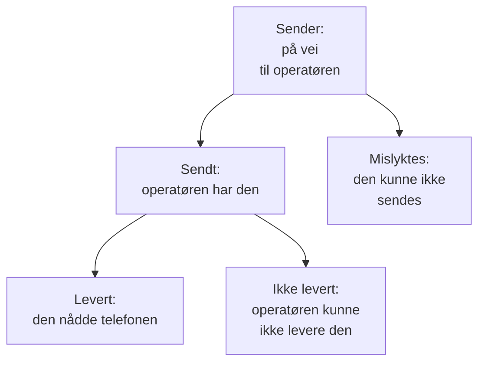

# Varslingslogger

Varslingslogger viser hver melding OneUptime har sendt for prosjektet ditt, med én fane per kanal, og hva som ble av hver: om den gikk ut, om den kom frem og, hvis ikke, hvorfor. Åpne dem under **Prosjektinnstillinger → Varslinger → Varslingslogger**, eller under **Varslingslogger** på en hendelse, et varsel, en vedlikeholdshendelse, en statusside eller en vaktpolicy, for det som ble sendt om den.

:::cards
- [Slik leser du en status](#slik-leser-du-en-status): Fargen viser hvor meldingen er, og peker du på den, sier den hva den betyr.
- [SMS](#sms): Sender, så Sendt, så Levert, slik operatøren melder det.
- [Anrop](#anrop): Ringer, og så hvordan anropet endte.
- [WhatsApp og Telegram](#whatsapp-og-telegram): Hva hver app melder etter at den har tatt imot en melding.
- [E-post, push, webhooks og arbeidsområder](#e-post-push-webhooks-og-arbeidsområder): Suksess, eller Feil og hvorfor.
- [Når en SMS blir stående på Sendt](#når-en-sms-blir-stående-på-sendt): Operatører som aldri melder tilbake, og meldinger som aldri kommer frem.
:::

## Slik leser du en status

Hver status er et merke der fargen viser hvor meldingen er:

| Farge | Hvor meldingen er |
| --- | --- |
| Grå | Overlevert, og ingenting har kommet tilbake ennå, som **Sender**. |
| Blå | Leverandøren har den og skal ennå si hvordan det endte, som **Sendt** for en SMS eller **Ringer** for et anrop. |
| Grønn | Den nådde personen, som **Levert**, eller dette er den siste statusen den får. |
| Gul | Den nådde telefonen og ingen svarte, som **Tapt anrop**, eller den gikk ut med en advarsel. |
| Rød | Den nådde ikke personen, som **Ikke levert**, **Mislyktes**, **Feil** eller **For lav saldo**. |

Pek på en status, trykk på den, eller gå til den med Tab-tasten, så sier den hva den betyr og hva som kommer etterpå. **Vis statusmelding** i radens meny viser hva leverandøren svarte, som meldingens ID eller hvorfor den mislyktes. Filteret **Status** på hver fane viser hver status fanen kan vise, i den rekkefølgen en melding går gjennom dem.

## SMS

| Status | Hva det betyr |
| --- | --- |
| **Sender** | OneUptime har gitt SMS-en til Twilio, som sender den videre til operatøren. |
| **Sendt** | Operatøren har godtatt SMS-en. Den går til **Levert** eller **Ikke levert** så snart operatøren melder tilbake. |
| **Levert** | Operatøren har bekreftet at SMS-en nådde telefonen. Det er den siste statusen for en SMS som kom frem. |
| **Ikke levert** | Operatøren kunne ikke levere den. **Feilkode** forteller hvorfor: `30003` er en telefon som er avslått eller utenfor dekning, `30005` et nummer som ikke finnes, `30006` en fasttelefon, og `30007` en melding som operatøren filtrerte. |
| **Mislyktes** | Twilio kunne ikke sende den. **Feilkode** forteller hvorfor. |
| **Feil** | Den ble ikke sendt, for eksempel fordi SMS er slått av for prosjektet, eller fordi Twilio avviste nummeret. **Vis statusmelding** forteller hvorfor. |
| **For lav saldo** | Den ble ikke sendt: Prosjektets saldo var for lav til å betale for den. |
| **Suksess** | Den ble sendt før OneUptime fulgte leveringen, og Twilio godtok den. |

En SMS som serverens egen SMS- og anropsgateway tok imot, blir stående på **Sendt**, i grønt: Gatewayen melder ikke om levering, så det er dens siste status.

Twilio melder hver endring til OneUptime så snart den skjer, signert med auth-tokenet til kontoen SMS-en gikk ut fra, og OneUptime avviser enhver melding som ikke kommer fra Twilio. Derfor må Twilio kunne nå serveren din: se [Twilio-integrasjon](/docs/self-hosted/twilio-integration).

## Anrop

| Status | Hva det betyr |
| --- | --- |
| **Ringer** | Twilio har ringt opp. Dette endres så snart Twilio melder hvordan anropet endte. |
| **Suksess** | Anropet ble besvart, og **Vis statusmelding** forteller hvor lenge det varte. Et anrop som serverens egen SMS- og anropsgateway tok imot, er **Suksess** så snart gatewayen godtar det. |
| **Tapt anrop** | Anropet ringte ut: Ingen svarte. |
| **Opptatt** | Linjen var opptatt, eller anropet ble avvist. |
| **Talepost** | Talepost svarte på et vaktanrop. **Vis statusmelding** forteller om det ble lagt igjen en beskjed. |
| **Feil** | Anropet kunne ikke utføres eller kobles til. |
| **For lav saldo** | Det ble ikke utført: Prosjektets saldo var for lav til å betale for det. |

## WhatsApp og Telegram

En WhatsApp-melding er **I kø** mens OneUptime overleverer den, **Sendt** så snart WhatsApp godtar den, **Levert** så snart den når telefonen, og **Lest** så snart den åpnes, hvis personen deler lesebekreftelser. **Mislyktes** er en melding WhatsApp ikke kunne levere, og **Advarsel** en den sendte med en advarsel: **Vis statusmelding** forteller hva WhatsApp meldte. **Feil** og **For lav saldo** betyr at den ikke ble sendt, slik som for en SMS.

Telegram melder ingenting etter at det har tatt imot en melding, så **Sendt** er grønn for en Telegram-melding: Telegram har lagt den i chatten, og det er dens siste status.

## E-post, push, webhooks og arbeidsområder

Disse fanene viser **Suksess** eller **Feil**. **Suksess** er den siste statusen: E-postserveren har godtatt e-posten, push-tjenesten varslingen, webhookens adresse har svart at den tok imot forespørselen, eller arbeidsområdet har gjort det som ble bedt om. OneUptime følger ikke en e-post etter at e-postserveren har godtatt den, og en push-varsling går til **Feil** hvis push-tjenesten senere melder at det ikke ble levert. **Vis statusmelding** forteller hvorfor en melding er **Feil**, slik **Årsak** gjør på fanen **Arbeidsområde**.

## Når en SMS blir stående på Sendt

**Sendt** betyr at operatøren har SMS-en og ennå ikke har meldt tilbake. De fleste operatører melder tilbake innen sekunder eller minutter, men noen gjør det aldri: Da holder også Twilio SMS-en på `sent`, slik meldingsloggene viser, og OneUptime kan ikke vite om den kom frem.

En SMS som blir stående på **Sender**, er noe annet: Meldingene fra Twilio når ikke frem til OneUptime. Sjekk at Twilio kan nå serveren din, og se i serverens logg etter linjer som begynner med `Twilio callback refused`: se [Twilio-integrasjon](/docs/self-hosted/twilio-integration).

## Neste steg

:::cards
- [Twilio-integrasjon](/docs/self-hosted/twilio-integration): Koble til Twilio, og la leveringsmeldingene nå frem til OneUptime.
- [SMS- og anropsgateway](/docs/self-hosted/sms-and-call-gateway): Send SMS og anrop gjennom en egen gateway.
- [Målinger for varslingslevering](/docs/self-hosted/notification-delivery-metrics): Tell hva som ble levert i hele installasjonen.
:::
