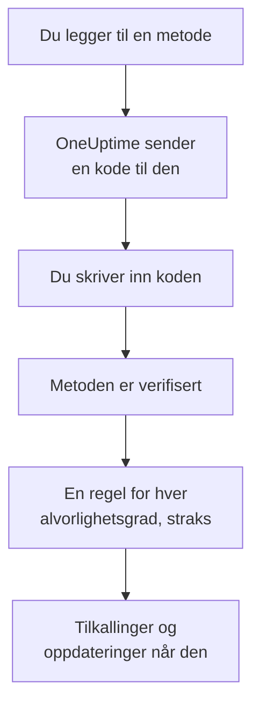

# Varselmetoder

En varselmetode er en adresse OneUptime kan nå deg på i ett prosjekt: en e-postadresse, et telefonnummer for SMS eller anrop, et WhatsApp-nummer, en Telegram-konto, Slack- eller Microsoft Teams-kontoen din, en telefon eller nettleser for push-varsler, eller en webhook. Du legger dem til under **Brukerinnstillinger → Varselmetoder**, verifiserer dem, og OneUptime begynner straks å bruke dem til tilkallingene dine.

:::cards
- [Velg en metode](#velg-en-metode): Hva hver metode trenger, og hvordan den verifiseres.
- [Legg til og verifiser en metode](#legg-til-og-verifiser-en-metode): E-post, SMS, anrop og WhatsApp, med en kode på 6 sifre.
- [Webhooks](#webhooks): Send tilkallinger til ditt eget endepunkt, signert om du vil.
- [Slå på en kanal for prosjektet](#slå-på-en-kanal-for-prosjektet): Hvorfor SMS, anrop, WhatsApp eller Telegram kan mangle.
:::

## Slik blir en metode aktiv



En metode du ikke har verifisert, blir aldri brukt. Push-enheter, Slack, Microsoft Teams og webhooks trenger ingen kode: å registrere en enhet eller koble til kontoen din beviser at den er din, og en webhook trenger ikke noe bevis. Å verifisere en metode legger straks til [standardreglene](/docs/notifications/on-call-rules#reglene-du-starter-med) dine for den, så et nytt telefonnummer tilkaller deg for hver alvorlighetsgrad til du endrer reglene dets.

## Velg en metode

Hver fane i **Varselmetoder** har ett eller flere kort, ett per type metode:

| Kort | Fane | Hva du legger til | Hvordan den verifiseres |
| --- | --- | --- | --- |
| **E-poster for varsler** | **Direct Contact** | En e-postadresse | En kode på e-post |
| **Telefonnumre for SMS-varsler** | **Direct Contact** | Et telefonnummer | En kode på SMS |
| **Telefonnumre for anropsvarsler** | **Direct Contact** | Et telefonnummer | En kode som leses opp i et anrop, eller ingen for et nummer som er verifisert for SMS |
| **WhatsApp-numre for varsler** | **Direct Contact** | Et WhatsApp-nummer | En kode på WhatsApp |
| **Telegram-kontoer for varsler** | **Direct Contact** | Telegram-kontoen din | En melding til OneUptime-boten |
| **Slack Account for Notifications** | **Workspace Apps** | Slack-kontoen din | Å koble kontoen din til prosjektets arbeidsområde |
| **Microsoft Teams Account for Notifications** | **Workspace Apps** | Microsoft Teams-kontoen din | Å koble kontoen din til prosjektets arbeidsområde |
| **Enheter for push-varsler** | **Push Notifications** | En telefon med appen OneUptime On-Call, eller en nettleser | Å registrere enheten |
| **Webhooks for varsler** | **Webhooks** | Et eget HTTPS-endepunkt | Ingen |

**Workspace Apps** vises bare når prosjektet har koblet til Slack eller Microsoft Teams, og inneholder bare dem det har koblet til. SMS, anrop, WhatsApp og Telegram kan være slått av for hele prosjektet; se [Slå på en kanal for prosjektet](#slå-på-en-kanal-for-prosjektet).

## Legg til og verifiser en metode

E-postadresser, SMS-numre, anropsnumre og WhatsApp-numre verifiseres med en kode på 6 sifre.

:::steps
### Åpne metodene dine

Gå til **Brukerinnstillinger → Varselmetoder**. **Direct Contact** er den første fanen.

### Legg til adressen

Klikk på legg-til-knappen i metodens kort, for eksempel **Legg til Telefonnummer for SMS-varsler**. Skriv inn **E-post**, eller **Telefonnummer** i internasjonalt format, for eksempel `+11234567890`, og lagre.

### Skriv inn koden

Verifiseringsdialogen åpner seg selv, og sier hvor koden ble sendt og hvor lenge den gjelder. Skriv koden i **Verifiseringskode**, og klikk **Verifiser**.

### Sjekk raden

Raden er nå merket **Verifisert**. Lukket du dialogen for tidlig? Klikk **Verifiser** i raden for å åpne den igjen.
:::

- En kode gjelder i 15 minutter. Fem feil forsøk ugyldiggjør den, og du trenger en ny.
- **Send a new code**, eller **Call me with a new code** for et anropsnummer, finnes i dialogen. Du kan be om en ny ett minutt etter den forrige.
- Et nummer du har verifisert for SMS, er også verifisert for anrop. Å legge det til under **Telefonnumre for anropsvarsler** krever ingen kode, og å verifisere et SMS-nummer verifiserer også anropsnummeret du har lagt til for det.
- Påloggings-e-posten din er der allerede, verifisert, fra dagen du ble medlem av prosjektet.

## Koble til Telegram

:::steps
### Legg til kontoen

Klikk **Legg til Telegram-konto** i **Telegram-kontoer for varsler**. **Telegram-brukernavn (valgfritt)** er bare en merkelapp for deg selv, og kan stå tomt.

### Skriv til boten

Klikk **Verifiser** i den nye raden. Dialogen **Verifiser Telegram-konto** gir deg tre måter å nå OneUptime-boten på: skann QR-koden med telefonen din, klikk **Open in Telegram**, eller søk opp boten i Telegram og send den `/start`-kommandoen dialogen viser.

### Bekreft

Tilbake i OneUptime klikker du **I've sent the message — check**. Så snart boten har meldingen din, er kontoen verifisert.
:::

**Roter kode** lager en ny kode for en konto som ikke er verifisert ennå. QR-koden og lenken du åpnet før, slutter da å virke. I en selvdriftet OneUptime kobler serverens administrator til en Telegram-bot før noen kan koble til en konto.

## Slack og Microsoft Teams

1. Koble din egen konto til prosjektets arbeidsområde: **Brukerinnstillinger → Arbeidsområde → Slack**, eller **Microsoft Teams**. Se [Slack](/docs/workspace-connections/slack) og [Microsoft Teams](/docs/workspace-connections/microsoft-teams).
2. Klikk **Add Slack Account** eller **Add Microsoft Teams Account** på fanen **Workspace Apps**. Kontoen er verifisert så snart den er lagt til.
3. Klikk **Send Test Message** i raden dens. Tilkallinger kommer som direktemeldinger fra OneUptime-appen.

## Push-varsler

Fanen **Push Notifications** viser **Enheter for push-varsler** dine.

- **En telefon.** Installer appen OneUptime On-Call, koble den til OneUptime-en din, logg inn og tillat varsler: telefonen legger seg selv til i denne listen. Se [Apper – Oversikt](/docs/mobile-desktop-apps/index).
- **Denne nettleseren.** Klikk **Registrer enhet**, fyll ut **Enhetsnavn**, og tillat varsler når nettleseren spør.
- **Testvarsel** i raden til en enhet sender en push til den med en gang.
- **Kritiske varsler** viser om telefonens tilkallinger bryter gjennom lydløs modus og Ikke forstyrr. Det slås på i appen, aldri her, og en nettleser kan ikke gjøre det. Se [Kritiske vaktvarsler](/docs/self-hosted/push-notifications#kritiske-vaktvarsler-overstyre-lydløs-modus).
- En enhet merket **Mottar ikke varsler** får ingenting sendt. Åpne appen på den telefonen, eller registrer nettleseren på nytt, så er den med igjen.

## Webhooks

En webhook sender hver tilkalling som JSON til et HTTPS-endepunkt du eier, slik at et eget verktøy kan handle på den.

:::steps
### Legg til webhooken

Klikk **Legg til Webhook** på fanen **Webhooks**. Fyll ut **Navn** med noe du kjenner igjen, deretter **Webhook-URL** og **Signeringshemmelighet (valgfritt)**.

### Send en test

Klikk **Send test** i raden dens. Endepunktet ditt mottar en hendelse der `eventType` er `test`.

### Sjekk hva som kommer

En tilkalling er en JSON-`POST` som den nedenfor. Svar med en hvilken som helst `2xx`-status innen 10 sekunder; omdirigeringer følges ikke.
:::

```json title="A page, as your endpoint receives it"
{
  "eventType": "on-call.incident.created",
  "timestamp": "2026-10-15T09:30:00.000Z",
  "projectId": "6a3f0d2e-1c4b-4e8a-9b7d-2f5c8e1a0b3c",
  "userId": "0c9e8d7f-6b5a-4c3d-8e2f-1a0b9c8d7e6f",
  "incident": {
    "id": "5b4a3c2d-1e0f-4a9b-8c7d-6e5f4a3b2c1d",
    "title": "Checkout API is down",
    "description": "Health check failed from 3 probes.",
    "incidentNumber": 42,
    "incidentNumberWithPrefix": "INC-42",
    "severity": "Critical Incident",
    "state": "Identified"
  },
  "onCallPolicyId": "7d6c5b4a-3e2f-4d1c-9b8a-7f6e5d4c3b2a",
  "onCallPolicyEscalationRuleId": "8e7d6c5b-4a3f-4e2d-8c1b-9a8f7e6d5c4b"
}
```

| `eventType` | Sendes for | Nøkkelen til posten |
| --- | --- | --- |
| `on-call.incident.created` | En hendelse | `incident` |
| `on-call.alert.created` | Et varsel | `alert` |
| `on-call.incidentEpisode.created` | En hendelsesepisode | `incidentEpisode` |
| `on-call.alertEpisode.created` | En varselepisode | `alertEpisode` |

Oppdateringene du slår på for Webhook i **Varselinnstillinger**, kommer til det samme endepunktet, med innstillingens hendelse i `eventType` og et kort sammendrag i `subject` og `message`.

Hver forespørsel har `X-OneUptime-Event`, hendelsestypen. Med en signeringshemmelighet har den også `X-OneUptime-Signature`: `sha256=` etterfulgt av HMAC-SHA256 av den rå bodyen, i heks. Sjekk den før du stoler på forespørselen:

```javascript title="verify-signature.js"
const crypto = require("crypto");

// rawBody: the request body exactly as it arrived, before any JSON parsing.
function isFromOneUptime(rawBody, signatureHeader, secret) {
  const expected =
    "sha256=" + crypto.createHmac("sha256", secret).update(rawBody).digest("hex");
  const received = Buffer.from(signatureHeader || "");
  const wanted = Buffer.from(expected);
  return received.length === wanted.length && crypto.timingSafeEqual(received, wanted);
}
```

En webhook trenger ingen verifisering, så når du legger den til, legges reglene dens til med en gang. Private og interne adresser avvises, med mindre administratoren av en selvdriftet server tillater dem: se [Tilgang til privat nettverk](/docs/self-hosted/private-network-access#webhooks-og-arbeidsflyter).

## Slå på en kanal for prosjektet

**SMS**, **Telefonanrop**, **WhatsApp** og **Telegram** er slått av i hvert nytt prosjekt, fordi hver melding koster penger: I OneUptime Cloud betales den fra prosjektets saldo, og SMS og anrop går i stedet gjennom prosjektets egen Twilio-konto når standardkontoen sender dem. E-post, push, Slack, Microsoft Teams og webhooks er alltid slått på.

Så lenge en kanal er slått av, kan ingen i prosjektet legge til en metode på den: kortet har ingen legg-til-knapp, og sier hvem som kan slå den på. En prosjekteier, en **Faktureringsadministrator** eller noen med **Manage Billing** slår den på, i kortet **Varslingskanaler** under **Prosjektinnstillinger → Varsler → Varselinnstillinger**. En prosjektadministrator kan ikke det. I en selvdriftet OneUptime trenger SMS og anrop i tillegg en Twilio-konto, og Telegram en bot som serverens administrator kobler til; se [Twilio-integrasjon](/docs/self-hosted/twilio-integration).

## Slett en metode

Klikk **Slett** i metodens rad. Å slette en metode sletter hver vaktregel som bruker den, så dialogen teller først disse reglene og nevner hver alvorlighetsgrad som slettingen ville latt stå helt uten regel.

## Feilsøking

:::details Et kort har ingen legg-til-knapp
Den kanalen er slått av i dette prosjektet. Kortet sier hvem som kan slå den på; se [Slå på en kanal for prosjektet](#slå-på-en-kanal-for-prosjektet).
:::

:::details Koden kom aldri
E-poster kan ta noen minutter, og havner noen ganger i søppelpost; SMS kan ta ett minutt. Vent ett minutt, og klikk så **Send a new code** i dialogen. **Prosjektinnstillinger → Varsler → Varsellogger** viser hva som skjedde med meldingen.
:::

:::details Det mislykkes å legge til Slack-kontoen min
Koble først til kontoen din under **Brukerinnstillinger → Arbeidsområde → Slack**, og klikk så **Add Slack Account** igjen. Feildialogen har en knapp som tar deg dit.
:::

:::details Telefonen min får ingen push-varsler
Sjekk at telefonen står under **Enheter for push-varsler**, og send den et **Testvarsel**. Se [Vanlige spørsmål og feilsøking](/docs/mobile-desktop-apps/faq-troubleshooting#varsler).
:::

## Neste steg

:::cards
- [Personlige vaktregler](/docs/notifications/on-call-rules): Bestem hvilken metode hver tilkalling prøver, og når.
- [Varselinnstillinger](/docs/notifications/notification-settings): Velg oppdateringene du får vite om, og via hvilke kanaler.
- [Apper – Oversikt](/docs/mobile-desktop-apps/index): Få tilkallinger på telefonen eller datamaskinen.
- [Slik når OneUptime deg](/docs/notifications/index): Hvordan metoder, regler og innstillinger henger sammen.
:::
