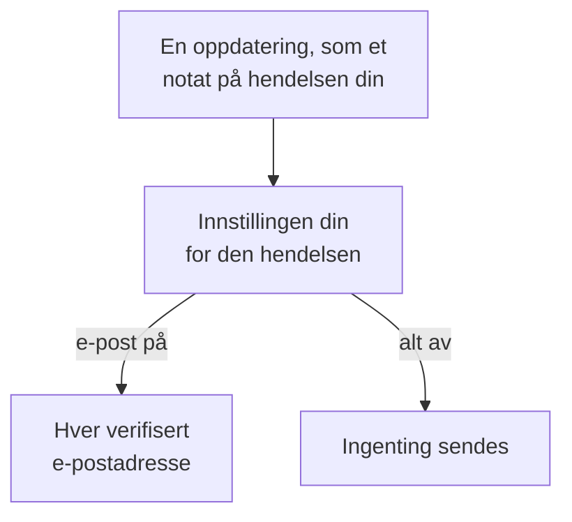

# Varselinnstillinger

Varselinnstillinger avgjør hvilke oppdateringer som når deg om det du eier, som en hendelse, en overvåking eller en statusside, og om dine egne vakter, og via hvilke kanaler. De tilkaller deg aldri: å tilkalle er vaktreglenes jobb. Du setter dem opp under **Brukerinnstillinger → Varselinnstillinger**, med én bryter per hendelse og kanal.

:::cards
- [Slik virker innstillingene](#slik-virker-innstillingene): Én bryter per hendelse og kanal, sendt til hver verifisert metode.
- [Endre en innstilling](#endre-en-innstilling): Tre klikk, lagret med en gang.
- [Hva som er slått på for et nytt medlem](#hva-som-er-slått-på-for-et-nytt-medlem): Standardinnstillingene, fane for fane.
- [Færre e-poster](#færre-e-poster): Samle bølgene, eller dropp rutine-e-postene.
:::

## Slik virker innstillingene

- Hver rad er en hendelse, og hver kolonne en kanal: E-post, SMS, Anrop, Push, WhatsApp, Telegram, Slack og Microsoft Teams, og Webhook. Slack og Microsoft Teams er bare kolonner når prosjektet har koblet dem til.
- En kanal som er slått på, sender til hver verifisert metode du har på den i dette prosjektet, ikke bare til én.
- En kanal som er slått på uten en verifisert metode bak seg, sender ingenting. **Your setup checklist** sier fra om det under **Staying informed**.
- En oppdatering går til eierne av tingen: personene som er oppført som eiere, og medlemmene av eierteamene dens. Har en ting ingen eiere, går den i stedet til prosjektets eiere. En hendelse om å ha blitt lagt til som eier går bare til personen som ble lagt til.
- Sikkerhetssaker har ingen eiere. En ny sak går til alle som kan se prosjektets saker, på prioriteten hver av dem velger, og en tildelt sak går til personene den er tildelt. Se [Sikkerhetssaker](/docs/telemetry/security-cases#varslinger).
- Hver e-post til eiere slutter med en lenke, "Manage notification preferences", tilbake til denne siden.

## Endre en innstilling

:::steps
### Åpne innstillingene dine

Gå til **Brukerinnstillinger → Varselinnstillinger**. Fanene er **Hendelser**, **Varsler**, **Overvåking**, **Statussider**, **Planlagt vedlikehold**, **Vakt** og **Sikkerhet**.

### Finn hendelsen

Hver fane har ett eller flere kort, som **Hendelse Episoder** på fanen **Hendelser**. Hver rad er en hendelse, med en linje som sier når den sendes.

### Klikk på en kanal

Klikk på en kanals sirkel for å slå den på, og igjen for å slå den av. En hake betyr på. Endringer lagres automatisk.
:::

## Hva som er slått på for et nytt medlem

Når du blir medlem av et prosjekt, er disse hendelsene slått på, via e-post. Alt annet starter slått av, og sender ingenting før du slår på en kanal.

| Fane | Slått på via e-post | Av til du slår dem på |
| --- | --- | --- |
| **Hendelser** | **Hendelse opprettet**, **Hendelsestilstand endret**, **Incident reminder**, **SLA for hendelse brutt**, **Hendelsesepisode opprettet**, **Tilstand for hendelsesepisode endret**, **Hendelse lagt til i hendelsesepisode** | **Hendelsesnotat publisert**, **Lagt til som hendelseseier**, **Tildelt en hendelse**, **Notat for hendelsesepisode publisert**, **Lagt til som hendelsesepisode-eier** |
| **Varsler** | **Varsel opprettet**, **Varseltilstand endret**, **Alert reminder**, **Varselepisode opprettet**, **Tilstand for varselepisode endret**, **Varsel lagt til i varselepisode** | **Varselnotat publisert**, **Lagt til som varseleier**, **Notat for varselepisode publisert**, **Lagt til som varselepisode-eier** |
| **Overvåking** | **Sondestatus endret for overvåkingen din**, **Overvåking har ingen aktive sonder**, **SLO status changed**, **Added as SLO owner**, **Sondestatus endret**, **Lagt til som sonde-eier** | **Overvåking opprettet**, **Overvåkingsstatus endret**, **Lagt til som overvåkingseier**, **AI-agentstatus endret**, **Lagt til som AI-agenteier** |
| **Statussider** | Ingen | **Statusside opprettet**, **Statusside-kunngjøring publisert**, **Lagt til som statussideeier** |
| **Planlagt vedlikehold** | **Maintenance reminder** | **Vedlikeholdshendelse opprettet**, **Vedlikeholdstilstand endret**, **Vedlikeholdsnotat publisert**, **Lagt til som vedlikeholdseier** |
| **Vakt** | **Du går på vakt**, **Du er neste på vakt**, **Du går av vakt**, **Lagt til i vakttjeneste-retningslinje**, **Fjernet fra vaktordning-retningslinje**, **Tapt anrop**, og også via push: **Før vakten min starter**, **Min kommende vakt blir tildelt noen andre** | Ingen |
| **Sikkerhet** | Også via push: **Ny sikkerhetssak** (saker med prioritet High og Kritisk), **Sikkerhetssak tildelt meg**, **Playbook-trinn venter på min godkjenning** | Ingen |

> [!IMPORTANT]
> **Overvåkingsstatus endret** starter slått av. Vil du vite når en overvåking du eier går ned eller kommer opp igjen, slår du den på på fanen **Overvåking**.

## Vaktene dine

Fanen **Vakt** handler om deg, ikke om det du eier:

- **Du går på vakt**, **Du er neste på vakt** og **Du går av vakt** følger turene dine i vaktplanene du er med i.
- **Lagt til i vakttjeneste-retningslinje** og **Fjernet fra vaktordning-retningslinje** forteller deg når en vaktpolicy begynner eller slutter å nevne deg.
- **Før vakten min starter** sender påminnelser på tidspunktene du velger under **Brukerinnstillinger → Kalender → Kalenderfeed**, og **Min kommende vakt blir tildelt noen andre** forteller deg når noen andre dekker en vakt du er blitt minnet på. Se [Kalenderfeeder](/docs/on-call/calendar-feeds#påminnelser-og-meldinger-om-ny-tildeling).
- **Tapt anrop**, på kortet **Retningslinjer for innkommende anrop**, forteller eierne av en policy for innkommende anrop at en som ringte, ikke nådde noen. Se [Policy for innkommende anrop](/docs/on-call/incoming-call-policy#tapte-anrop).

## Sikkerhetssaker

Fanen **Sikkerhet** handler om sikkerhetssakene du kan se:

- **Ny sikkerhetssak** har en prioritet under navnet: den laveste prioriteten en sak må ha for å varsle deg. Den er **Høy og høyere** med mindre du velger **Bare Kritisk**, **Middels og høyere**, **Lav og høyere** eller **Alle saker**.
- **Sikkerhetssak tildelt meg** følger sakene som er tildelt deg, og dem som er tildelt teamene du er med i.
- **Playbook-trinn venter på min godkjenning** ber deg godkjenne eller avvise et playbook-steg på en sak der du kan godkjenne steg.

Se [Sikkerhetssaker](/docs/telemetry/security-cases#varslinger).

## Færre e-poster

Disse bryterne avgjør hvilke oppdateringer som når deg, ikke hvor mange e-poster de blir. **Brukerinnstillinger → E-postinnstillinger** har to kort for det, begge bare for deg, i dette prosjektet:

- **Email Rollup** samler en bølge av oppdateringer i én e-post: de første kommer fortsatt én og én, resten samlet noen minutter senere.
- **Fewer routine emails** slår med **Reduce routine emails** av e-postene om notater, nye eiere, nye overvåkinger og statussider, tillegg i episoder og endringer i vaktpolicyer.

Se [Varseloppsummering](/docs/emails/notification-rollup).

## Feilsøking

:::details En bryter er på, men ingenting kommer
Sjekk at du har en verifisert metode på den kanalen under **Brukerinnstillinger → Varselmetoder**. For SMS, anrop, WhatsApp og Telegram må prosjektet også ha slått på kanalen.
:::

:::details Jeg eier en overvåking, men får aldri vite når den går ned
**Overvåkingsstatus endret** starter slått av. Slå på en kanal for den, på fanen **Overvåking**.
:::

:::details Jeg får fortsatt e-poster etter at jeg slo av alt
Tilkallinger følger vaktreglene dine, ikke disse bryterne, og e-poster om pålogging, sikkerhet og fakturering er ikke oppdateringer om ting. Hvert prosjekt har egne innstillinger, så sjekk prosjektet e-posten kom fra. Se [Personlige vaktregler](/docs/notifications/on-call-rules).
:::

## Neste steg

:::cards
- [Varselmetoder](/docs/notifications/notification-methods): Legg til metodene innstillingene dine sender til.
- [Personlige vaktregler](/docs/notifications/on-call-rules): Bestem hvordan en tilkalling når deg.
- [Varseloppsummering](/docs/emails/notification-rollup): Færre, fyldigere e-poster under en bølge.
- [Slik når OneUptime deg](/docs/notifications/index): Hvordan metoder, regler og innstillinger henger sammen.
:::
