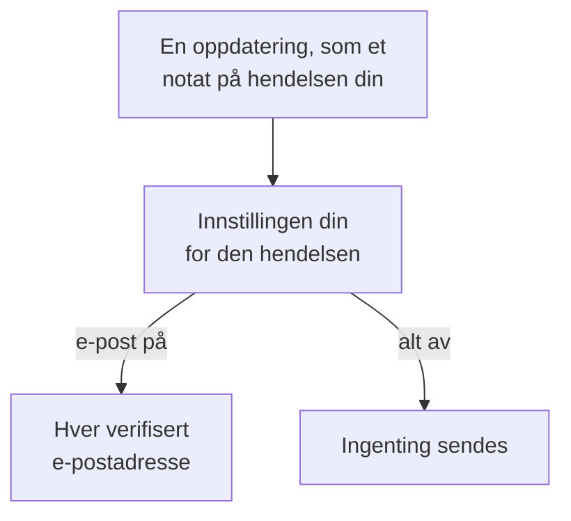

# Varslingsinnstillinger

Varslingsinnstillinger avgjør hvilke oppdateringer som når deg om det du eier, som en hendelse, en monitor eller en statusside, og om dine egne vakter, og via hvilke kanaler. De tilkaller deg aldri: å tilkalle er vaktreglenes jobb. Du setter dem opp under **Brukerinnstillinger → Varslingsinnstillinger**, med én bryter per hendelse og kanal.

:::cards
- [Slik virker innstillingene](#slik-virker-innstillingene): Én bryter per hendelse og kanal, sendt til hver verifisert metode.
- [Endre en innstilling](#endre-en-innstilling): Tre klikk, lagret med en gang.
- [Hva som er slått på for et nytt medlem](#hva-som-er-slått-på-for-et-nytt-medlem): Standardinnstillingene, fane for fane.
- [Færre e-poster](#færre-e-poster): Samle bølgene, eller dropp rutine-e-postene.
:::

## Slik virker innstillingene

- Hver rad er en hendelse, og hver kolonne en kanal: E-post, SMS, Anrop, Push, WhatsApp, Telegram, Slack, Microsoft Teams, Mattermost og Webhook. Slack, Microsoft Teams og Mattermost er bare kolonner når prosjektet har koblet dem til. En kanal du ikke har satt opp ennå, er ikke en kolonne: Den står over fanene under **Kanaler som ikke er satt opp ennå**, som en lenke for å sette den opp.
- WhatsApp leverer bare meldinger som Meta har godkjent, og OneUptime har dem for oppdateringer om hendelser, varsler, episoder, monitorer, sonder, AI-agenter, statussider, vedlikeholdshendelser og de fleste vakter. Andre oppdateringer, som statusen til et SLO, et tapt anrop, en sikkerhetssak eller å bli eier av en tjeneste, har ingen WhatsApp-bryter, og kortet deres sier at WhatsApp ikke er tilgjengelig. De når deg gjennom de andre kanalene dine.
- En kanal som er slått på, sender til hver verifisert metode du har på den i dette prosjektet, ikke bare til én.
- En kanal som er slått på uten en verifisert metode bak seg, sender ingenting. Kolonnen dens viser **Konfigurer** under navnet, og bryterne dens kan bare slås av. **Your setup checklist** sier fra om det også, under **Staying informed**.
- En oppdatering går til eierne av tingen: personene som er oppført som eiere, og medlemmene av eierteamene dens. Har en ting ingen eiere, går den i stedet til Prosjekteiere. Den som vakttilkallingen for en ny hendelse, et nytt varsel eller en ny episode allerede har nådd, får ikke beskjed på nytt om at den er opprettet. En hendelse om å ha blitt lagt til som eier går bare til personen som ble lagt til. Stopper OneUptime mens den sender en oppdatering til eierne av en ting, får personene den ennå ikke hadde nådd, den når OneUptime er tilbake, noen minutter forsinket, og ingen får den to ganger.
- Sikkerhetssaker har ingen eiere. En ny sak går til alle som kan se prosjektets saker, på prioriteten hver av dem velger, og en tildelt sak går til personene den er tildelt. Se [Sikkerhetssaker](/docs/telemetry/security-cases#varslinger).
- Hver e-post til eiere slutter med en lenke, "Manage notification preferences", tilbake til denne siden.

## Endre en innstilling

:::steps
### Åpne innstillingene dine

Gå til **Brukerinnstillinger → Varslingsinnstillinger**. Fanene er **Hendelser**, **Varsler**, **Overvåking**, **Statussider**, **Planlagt vedlikehold**, **Vakt** og **Sikkerhet**.

### Finn hendelsen

Hver fane har ett eller flere kort, som **Hendelsesepisoder** på fanen **Hendelser**. Hver rad er en hendelse, med en linje som sier når den sendes. Over kortene sier fanen hvor mange av hendelsene dens du får høre om, og via hvilke kanaler.

### Klikk på en kanal

Klikk på en kanals bryter for å slå den på, og igjen for å slå den av. Kortets første rad, **Alle hendelser**, slår en kanal på eller av for hver hendelse på kortet. Hver endring lagres med en gang, og kortet viser **Lagret**.
:::

## Hva som er slått på for et nytt medlem

Når du blir medlem av et prosjekt, er disse hendelsene slått på, via e-post. Alt annet starter slått av, og sender ingenting før du slår på en kanal.

| Fane | Slått på via e-post | Av til du slår dem på |
| --- | --- | --- |
| **Hendelser** | **Hendelse opprettet**, **Hendelsestilstand endret**, **Påminnelse om hendelse**, **SLA for hendelse brutt**, **Hendelsesepisode opprettet**, **Tilstand for hendelsesepisode endret**, **Hendelse lagt til i hendelsesepisode** | **Hendelsesnotat publisert**, **Lagt til som hendelseseier**, **Tildelt en hendelse**, **Notat for hendelsesepisode publisert**, **Lagt til som hendelsesepisode-eier** |
| **Varsler** | **Varsel opprettet**, **Varseltilstand endret**, **Påminnelse om varsel**, **Varselepisode opprettet**, **Tilstand for varselepisode endret**, **Varsel lagt til i varselepisode** | **Varselnotat publisert**, **Lagt til som varseleier**, **Notat for varselepisode publisert**, **Lagt til som varselepisode-eier** |
| **Overvåking** | **Sondestatus endret for monitoren din**, **Monitor har ingen aktive sonder**, **SLO-status endret**, **Lagt til som SLO-eier**, **Unntak tildelt meg**, **Sondestatus endret**, **Lagt til som sonde-eier**, **Lagt til som tabell-eier**, **Lagt til som pipeline-eier**, **Lagt til som eier av en tjeneste eller infrastruktur**, **Lagt til som dashbord-eier**, **Lagt til som arbeidsflyt-eier**, **Lagt til som runbook-eier**, **Lagt til som monitorgruppe-eier**, **Lagt til som Runner-eier** | **Monitor opprettet**, **Monitorstatus endret**, **Lagt til som monitoreier**, **AI-agentstatus endret**, **Lagt til som AI-agenteier** |
| **Statussider** | **Mitt offentlige notat godkjent eller avvist**, og også via push: **Offentlig notat venter på min godkjenning** | **Statusside opprettet**, **Statusside-kunngjøring publisert**, **Lagt til som statussideeier** |
| **Planlagt vedlikehold** | **Påminnelse om vedlikehold** | **Vedlikeholdshendelse opprettet**, **Vedlikeholdstilstand endret**, **Vedlikeholdsnotat publisert**, **Lagt til som vedlikeholdseier** |
| **Vakt** | **Du går på vakt**, **Du er neste på vakt**, **Du går av vakt**, **Lagt til i vaktpolicy**, **Fjernet fra vaktpolicy**, **Tapt anrop**, **Lagt til som vaktpolicy-eier**, **Lagt til som vakttidsplan-eier**, **Lagt til som eier av policy for innkommende anrop**, og også via push: **Før vakten min starter**, **Min kommende vakt blir tildelt noen andre** | Ingen |
| **Sikkerhet** | **Lagt til som datalager-eier**, og også via push: **Ny sikkerhetssak** (saker med prioritet High og Kritisk), **Sikkerhetssak tildelt meg**, **Playbook-trinn venter på min godkjenning**, **Responsmål for sikkerhetssak**, **Oppgave i sikkerhetssak tildelt meg**, **En hunt fant sikkerhetshendelser** | Ingen |

> [!IMPORTANT]
> **Monitorstatus endret** starter slått av. Vil du vite når en overvåking du eier går ned eller kommer opp igjen, slår du den på på fanen **Overvåking**.

**Lagt til som eier av en tjeneste eller infrastruktur**, på kortet **Tjenester og infrastruktur**, er én bryter for hver tjeneste, RUM-applikasjon, database, kø, vert, klynge, skyressurs og annen infrastruktur du blir eier av. Meldingen sier hvilken det er.

**Lagt til som monitorgruppe-eier**, på kortet **Monitorer**, og **Lagt til som Runner-eier**, på kortet **Dashbord og automatisering**, forteller deg når noen legger deg til som eier av en monitorgruppe eller en Runner.

## Vaktene dine

Fanen **Vakt** handler om deg og om vaktpostene du eier:

- **Du går på vakt**, **Du er neste på vakt** og **Du går av vakt** følger turene dine i vaktplanene du er med i.
- **Lagt til i vaktpolicy** og **Fjernet fra vaktpolicy** forteller deg når en vaktpolicy begynner eller slutter å nevne deg.
- **Før vakten min starter** sender påminnelser på tidspunktene du velger under **Brukerinnstillinger → Profil og kalender → Kalenderfeed**, og **Min kommende vakt blir tildelt noen andre** forteller deg når noen andre dekker en vakt du er blitt minnet på. Se [Kalenderfeeder](/docs/on-call/calendar-feeds#påminnelser-og-meldinger-om-ny-tildeling).
- **Tapt anrop**, på kortet **Policyer for innkommende anrop**, forteller eierne av en policy for innkommende anrop at en som ringte, ikke nådde noen. Se [Policy for innkommende anrop](/docs/on-call/incoming-call-policy#tapte-anrop).
- **Lagt til som vaktpolicy-eier**, **Lagt til som vakttidsplan-eier** og **Lagt til som eier av policy for innkommende anrop** forteller deg når du blir eier av en av dem, gjennom en eierregel eller av en person på siden Eiere.

## Sikkerhetssaker

Fanen **Sikkerhet** handler om sikkerhetssakene du kan se:

- **Ny sikkerhetssak** har en prioritet under navnet: den laveste prioriteten en sak må ha for å varsle deg. Den er **Høy og høyere** med mindre du velger **Bare Kritisk**, **Middels og høyere**, **Lav og høyere** eller **Alle saker**.
- **Sikkerhetssak tildelt meg** følger sakene som er tildelt deg, og dem som er tildelt teamene du er med i.
- **Playbook-trinn venter på min godkjenning** ber deg godkjenne eller avvise et playbook-steg på en sak der du kan godkjenne steg.

Se [Sikkerhetssaker](/docs/telemetry/security-cases#varslinger).

## Godkjenning av offentlige notater

Kortet **Godkjenning av offentlige notater** på fanen **Statussider** gjelder offentlige notater som venter på godkjenning før de publiseres, i et prosjekt som krever det:

- **Offentlig notat venter på min godkjenning** forteller deg at et offentlig notat, eller en redigering av et, venter på et trinn du godkjenner, ved navn eller gjennom et team. Du blir ikke spurt om et notat du selv har sendt, eller om et trinn etter et du har godkjent. Du blir spurt om hvert trinn én gang: når notatet kommer til det, eller når du blir en av godkjennerne mens notatet venter, fordi godkjenningstrinnene ble endret eller du ble med i et team et trinn nevner. Det er slått på fra start via e-post og push, og **Email Rollup** holder det aldri tilbake: kundene notatet er skrevet for, venter på det.
- **Mitt offentlige notat godkjent eller avvist** forteller deg at et notat du sendte til godkjenning, ble godkjent og publisert, eller avvist, med begrunnelsen. Det er slått på fra start via e-post.

Se [Godkjenning av offentlige notater](/docs/incidents/notes-owners-and-feed#godkjenning-av-offentlige-notater).

## Færre e-poster

Disse bryterne avgjør hvilke oppdateringer som når deg, ikke hvor mange e-poster de blir. **Brukerinnstillinger → E-postinnstillinger** har to kort for det, begge bare for deg, i dette prosjektet:

- **Email Rollup** samler en bølge av oppdateringer i én e-post: de første kommer fortsatt én og én, resten samlet noen minutter senere.
- **Fewer routine emails** slår med **Reduce routine emails** av e-postene om notater, nye eiere, nye monitorer og statussider, tillegg i episoder og endringer i vaktpolicyer.

Se [Varslingsoppsummering](/docs/emails/notification-rollup).

## Feilsøking

:::details En bryter er på, men ingenting kommer
Sjekk at du har en verifisert metode på den kanalen under **Brukerinnstillinger → Varslingsmetoder**. For SMS, anrop, WhatsApp og Telegram må prosjektet også ha slått på kanalen.
:::

:::details Det er ingen WhatsApp-bryter for en oppdatering
WhatsApp leverer bare meldinger som Meta har godkjent, og OneUptime har ingen for den oppdateringen, så kortet sier at WhatsApp ikke er tilgjengelig. Velg en annen kanal for den, som SMS eller Push.
:::

:::details Jeg eier en monitor, men får aldri vite når den går ned
**Monitorstatus endret** starter slått av. Slå på en kanal for den, på fanen **Overvåking**.
:::

:::details Jeg får fortsatt e-poster etter at jeg slo av alt
Tilkallinger følger vaktreglene dine, ikke disse bryterne, og e-poster om pålogging, sikkerhet og fakturering er ikke oppdateringer om ting. Hvert prosjekt har egne innstillinger, så sjekk prosjektet e-posten kom fra. Se [Slik når man meg](/docs/notifications/on-call-rules).
:::

## Neste steg

:::cards
- [Varslingsmetoder](/docs/notifications/notification-methods): Legg til metodene innstillingene dine sender til.
- [Slik når man meg](/docs/notifications/on-call-rules): Bestem hvordan en tilkalling når deg.
- [Varslingsoppsummering](/docs/emails/notification-rollup): Færre, fyldigere e-poster under en bølge.
- [Slik når OneUptime deg](/docs/notifications/index): Hvordan metoder, regler og innstillinger henger sammen.
:::
