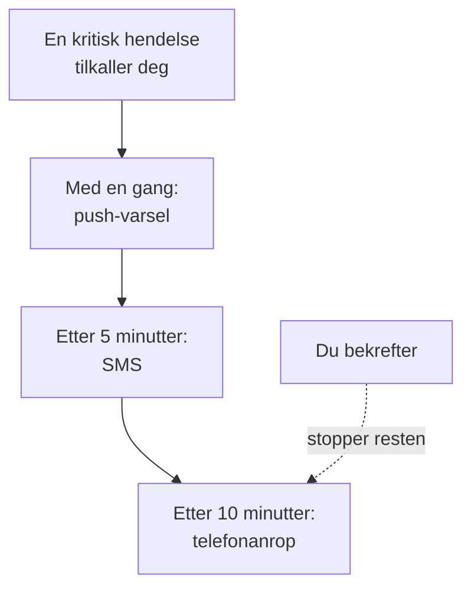

# Personlige vaktregler

Vaktreglene dine avgjør hvordan en tilkalling når deg: hvilke av varselmetodene dine OneUptime prøver, og hvor lenge etter at tilkallingen startet. Hver type tilkalling har egne regler, ett sett per alvorlighetsgrad, så en kritisk hendelse kan ringe deg med en gang mens et lavt varsel venter på en e-post. Du setter dem opp under **Brukerinnstillinger → Vaktregler**.

> [!NOTE]
> Disse reglene er bare dine. **Vaktregler** under **Hendelser → Regler** og **Varsler → Regler** er noe annet: de avgjør hvilke vaktpolicyer en ny hendelse eller et nytt varsel kjører.

:::cards
- [Slik når en tilkalling deg](#slik-når-en-tilkalling-deg): Reglene dine for én tilkalling, steg for steg.
- [Reglene du starter med](#reglene-du-starter-med): Hva hver verifisert metode legger til, og hvordan du kutter ned.
- [Legg til en regel](#legg-til-en-regel): En metode og en ventetid for én alvorlighetsgrad.
- [Push-regler](#push-regler): Bryt gjennom lydløs, og gjenta til noen bekrefter.
:::

## Slik når en tilkalling deg

En vaktpolicy tilkaller deg når en av eskaleringsreglene dens nevner deg, et team du er med i, eller en vaktplan der du har vakt. OneUptime går da gjennom reglene dine for den typen tilkalling og dens alvorlighetsgrad: hver regel utløses via sin egen metode når ventetiden er over, regnet fra tilkallingens start. Å bekrefte hendelsen eller varselet, fra en hvilken som helst melding eller i OneUptime, stopper hver regel som ikke er utløst ennå.

De fleste meldinger kan bekrefte tilkallingen: e-post, SMS og meldinger i WhatsApp, Telegram, Slack og Microsoft Teams har en bekreftelseslenke, og et anrop ber deg trykke 1. Kan du ikke ta en tilkalling, kan du eskalere den fra de samme meldingene, og et anrop ber deg trykke 2: retningslinjen varsler neste nivå med en gang, og du blir ikke varslet om det igjen. Se [Eskaler en varsling](/docs/on-call/escalation-rules#eskaler-en-varsling). Hver tilkalling du får, står under **Brukerinnstillinger → Vaktlogger**, der **Vis tidslinje** viser hver sendte melding og om den ble levert.

## De fire fanene

**Brukerinnstillinger → Vaktregler** har en fane for hver type tilkalling. Hver fane har et kort per alvorlighetsgrad, med navnet og fargen prosjektet ditt har gitt den:

| Fane | Tilkallinger for | Kort for |
| --- | --- | --- |
| **Hendelser** | Hendelser | Alvorlighetsgrader for hendelser |
| **Hendelse Episoder** | Episoder som samler hendelser | Alvorlighetsgrader for hendelser |
| **Varsler** | Varsler | Alvorlighetsgrader for varsler |
| **Varsel Episoder** | Episoder som samler varsler | Alvorlighetsgrader for varsler |

En episode tilkaller deg gjennom sine egne vaktpolicyer, atskilt fra hendelsene eller varslene i den, så reglene dens har sin egen fane. Sidens adresse angir den åpne fanen, for eksempel `/dashboard/{projectId}/user-settings/on-call-rules?type=alerts`; de andre verdiene er `incident-episodes` og `alert-episodes`, og uten `type` åpner siden på **Hendelser**.

En alvorlighetsgrad som prosjektet ditt har arkivert, kommer etter de andre, merket **Arkivert**, så lenge du har regler for den: Hendelser og varsler som fortsatt har den, varsler deg etter dem. Du kan endre eller fjerne de reglene, men ikke legge til nye.

## Reglene du starter med

Hver metode du verifiserer, får en regel på hvert kort på hver fane, sendt så snart du blir tilkalt. Påloggings-e-posten din har dem fra dagen du ble medlem, slik at en tilkalling alltid når deg. Verifiser et telefonnummer for SMS, så sender hver tilkalling deg også en SMS.

Det er en trygg start, og som regel for mye. Kutt det ned til det hver alvorlighetsgrad fortjener:

| Alvorlighetsgrad | Et fornuftig sett |
| --- | --- |
| Kritisk | Push med en gang, et anrop etter 5 minutter |
| Alvorlig | Push med en gang, en SMS etter 10 minutter |
| Mindre eller lav | En e-post med en gang |

Dine egne regler har ingen stilletimer: hold lave alvorlighetsgrader på e-post, eller på en push-regel satt til **Normal**, så de aldri vekker deg. For å la tilkallingen for en lav alvorlighetsgrad vente på arbeidstiden for alle, setter du vaktregelen som tilkaller, til **Bare i arbeidstiden**: se [Vaktregler](/docs/alerts/settings#vaktregler).

## Legg til en regel

:::steps
### Åpne kortet

Gå til **Brukerinnstillinger → Vaktregler**, åpne fanen for typen tilkalling, og finn kortet for alvorlighetsgraden.

### Velg metoden

Klikk **Legg til Varsling Regel**. Velg en av de verifiserte metodene dine under **Varselmetode**; en metode du ikke har verifisert, blir ikke tilbudt.

### Velg hvordan en push høres ut

For en telefon velger du under **Push-varsel** enten **Kritisk varsel** eller **Normal**. For enhver push-enhet velger du **Gjenta til det bekreftes**. Se [Push-regler](#push-regler).

### Sett ventetiden

Velg **Varsle meg etter**: **Umiddelbart**, **5 minutter**, **10 minutter**, **15 minutter**, **30 minutter** eller **1 time**. Klikk så **Legg til Varsling Regel** i dialogen.
:::

Kortet viser reglene sine i rekkefølge etter ventetid, med **Varselmetode** og **Varsle etter** for hver.

## Endre eller slett en regel

- **Rediger** i raden til en regel endrer ventetiden. Vil du sende en regel til en annen metode, sletter du den og legger til en ny.
- På en push-regel klikker du merkelappen under metoden for å bytte mellom **Kritisk varsel** og **Normal**, eller for å endre hvor ofte den gjentas. Det lagres med en gang.
- **Slett** spør først, og sier om alvorlighetsgraden blir stående uten regel. En alvorlighetsgrad uten regel faller tilbake på de verifiserte metodene dine; se [Når en alvorlighetsgrad ikke har noen regel](#når-en-alvorlighetsgrad-ikke-har-noen-regel).

## Push-regler

En regel som tilkaller en telefon, bestemmer hvordan pushen høres ut:

| Valg | Hva telefonen gjør |
| --- | --- |
| **Kritisk varsel** | Ringer selv når telefonen er på lydløs eller i Ikke forstyrr, når Critical On-Call Alerts er slått på i appen OneUptime On-Call. En ny telefonregel starter her. |
| **Normal** | Følger telefonens innstillinger for lyd, lydløs og Ikke forstyrr. |

En push-regel, for en telefon eller en nettleser, kan også sende pushen på nytt til noen bekrefter: **Ikke gjenta**, standarden, eller **Hvert minutt**, **Hvert 2. minutt**, **Hvert 3. minutt**, **Hvert 5. minutt**, **Hvert 10. minutt**, **Hvert 15. minutt** eller **Hvert 30. minutt**. Den gjentas opptil 10 ganger til, og stopper så snart hendelsen, varselet eller episoden er bekreftet. Se [Kritiske vaktvarsler](/docs/self-hosted/push-notifications#kritiske-vaktvarsler-overstyre-lydløs-modus).

## Når en alvorlighetsgrad ikke har noen regel

En alvorlighetsgrad prosjektet legger til senere, får regler innen noen minutter, laget ut fra valgene du allerede har gjort på den fanen: de samme metodene, etter de samme ventetidene. Hadde du ingen regler på den fanen, får den den verifiserte e-posten din, med en gang.

En tilkalling som likevel ikke finner noen regel, sendes til de verifiserte metodene dine uansett, og du får en e-post om det; se [Når ingen regel passer](/docs/notifications/index#når-ingen-regel-passer).

:::details Slå av en alvorlighetsgrad med vilje
API-et kan lagre en reservasjonsregel, med `isOptOut` satt og uten metode: da blir du ikke tilkalt i det hele tatt for den typen tilkalling og den alvorlighetsgraden, og ingenting trer inn i stedet. Raden viser **Muted - notifications turned off for this rule**, og å slette den slår tilkallingene på igjen. En alvorlighetsgrad som legges til senere, blir også stum når hver regel du har på den fanen, er en reservasjon.
:::

:::details Slå av reserveløsningen for et helt prosjekt
En prosjekteier, eller noen med **Manage Billing**, kan sette prosjektets `disableOnCallNotificationFallback` via API-et. En tilkalling som ikke finner noen regel, blir da ikke levert, og loggen dens sier at brukeren må legge til regler under **Brukerinnstillinger → Vaktregler**.
:::

## Reglene til en kollega

Prosjekteiere og administratorer kan se og endre den samme siden for alle i prosjektet: Under **Brukere** åpner de personen, og deretter **Vaktregler** i seksjonen **Vakt**. **Beredskap**, rett ved siden av, viser om hver alvorlighetsgrad når personen. Når noen andre legger til, endrer eller sletter reglene dine, får du en e-post om det, og hver endring står i prosjektets revisjonslogg.

## Feilsøking

:::details Telefonen min var stille ved en kritisk tilkalling
Sjekk at regelens push er **Kritisk varsel** og ikke **Normal**, og at **Kritiske varsler** er slått på for telefonen under **Brukerinnstillinger → Varselmetoder**, på fanen **Push Notifications**.
:::

:::details Jeg blir tilkalt to ganger for hver hendelse
Hver verifisert metode har en regel for hver alvorlighetsgrad, sendt med en gang. Slett reglene du ikke vil ha, eller gi dem en ventetid. En hendelse i en episode kan tilkalle deg én gang for hendelsen og én gang for episoden, gjennom to policyer.
:::

:::details Jeg fikk en e-post selv om regelen min sier SMS
Tilkallingen fant ingen regel for sin type eller alvorlighetsgrad, og falt tilbake på de gratis metodene dine: legg til regelen på riktig fane og riktig kort. Eller e-posten var en oppdatering om noe du eier, og den følger **Varselinnstillinger**, ikke reglene dine. **Vaktlogger** viser bare tilkallinger.
:::

## Neste steg

:::cards
- [Varselmetoder](/docs/notifications/notification-methods): Legg til og verifiser metodene reglene dine peker på.
- [Eskaleringsregler](/docs/on-call/escalation-rules): Hvordan en vaktpolicy tilkaller folk, nivå for nivå.
- [Push-varsler](/docs/self-hosted/push-notifications): Kritiske varsler, alarmlyder og gjentakelser på telefoner.
- [Slik når OneUptime deg](/docs/notifications/index): Hvordan metoder, regler og innstillinger henger sammen.
:::
