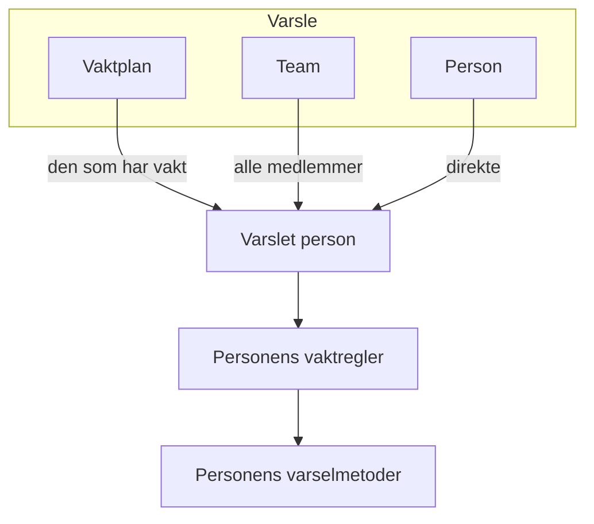

# Eskaleringsregler

En vaktretningslinje varsler folk i nivåer. Hver eskaleringsregel er ett nivå: hvem som varsles, og hvor lenge det ventes på at noen bekrefter før neste nivå varsles. Reglene i en retningslinje står i rekkefølge på siden **Eskaleringsregler**.

```mermaid title="En vaktretningslinje varsler nivå for nivå til noen bekrefter"
flowchart TB
    trigger["Hendelse eller varsel"] --> level1["Level 1 varsler"]
    level1 --> ack1{"Bekreftet<br/>i tide?"}
    ack1 -->|"Ja"| stop["Varslingen stopper"]
    ack1 -->|"Nei"| level2["Level 2 varsler"]
    level2 --> ack2{"Bekreftet<br/>i tide?"}
    ack2 -->|"Ja"| stop
    ack2 -->|"Nei, siste nivå"| repeat{"Gjenta retningslinjen?"}
    repeat -->|"Ja"| level1
    repeat -->|"Nei"| done["Retningslinjen stopper"]
```

:::cards
- [Hvem som varsles først](#hvem-som-varsles-først): Opprett en retningslinje med det første nivået.
- [Legg til en eskaleringsregel](#legg-til-en-eskaleringsregel): Legg til neste nivå, steg for steg.
- [Slik varsler nivåene folk](#slik-varsler-nivåene-folk): Tidsbruk, gjentakelser og hvordan hver person nås.
- [Neste person i rotasjonen](#eskaler-til-neste-person-i-rotasjonen): Varsle backupen til den som har vakt, fra samme rotasjon.
- [Eskaler en varsling](#eskaler-en-varsling): Kan du ikke ta en varsling? Få neste nivå varslet med en gang.
- [API og Terraform](#opprett-regler-med-api-et-eller-terraform): Opprett retningslinjer og regler som kode.
:::

## Hvem som varsles først

Når du oppretter en vaktretningslinje på siden **Vaktretningslinjer**, spør skjemaet om **Navn** og **Hvem varsles først?**. Spørsmålet bruker samme velger som **Varsle**: vaktplaner, team og personer, så mange du trenger. De du velger, blir den første eskaleringsregelen i retningslinjen, **Level 1**, som venter **30 minutter** på en bekreftelse før neste nivå varsles.

:::steps
1. Gå til **Vakttjeneste** > **Vaktretningslinjer**, og klikk på **Opprett Vaktpolicy**.
2. Skriv inn et **Navn**.
3. Klikk på **Legg til mottaker** under **Hvem varsles først?**, og velg vaktplanene, teamene og personene som skal varsles først.
4. Klikk på **Opprett Vaktpolicy**. Den nye retningslinjen åpnes deretter på siden **Eskaleringsregler**, der du kan legge til flere nivåer.
:::

**Hvem varsles først?** er valgfritt. Lar du det stå tomt, starter retningslinjen uten eskaleringsregler: den varsler ingen før du legger til en, og oversikten sier det. Beskrivelsen og etikettene ligger under **Flere felt**. Spørsmålet stilles bare til dem som kan legge til eskaleringsregler.

## Legg til en eskaleringsregel

:::steps
### Åpne eskaleringsreglene i retningslinjen

Åpne vaktretningslinjen, velg **Eskaleringsregler** i sidemenyen, og klikk på **Legg til eskaleringsregel**. Dialogen er én kort side.

### Velg hvem som skal varsles

Klikk på **Legg til mottaker** under **Varsle**, søk, og velg så mange vaktplaner, team og personer som dette nivået skal varsle. Legg til minst én.

| Mottaker | Hvem som varsles når nivået kjører |
| --- | --- |
| En **vaktplan** | Den som har vakt i den når nivået kjører, ikke en fast person. |
| En vaktplans **Neste i rotasjonen** | Personen etter den som har vakt i den, fra samme rotasjon. Se [Eskaler til neste person i rotasjonen](#eskaler-til-neste-person-i-rotasjonen). |
| Et **team** | Alle medlemmene i teamet. |
| En **person** | Den personen, direkte. |

### Angi hvor lenge det ventes

**Eskaler etter (i minutter)** er hvor lenge det ventes på en bekreftelse før neste nivå varsles. Den starter på **30 minutter**; endre den til det som passer for nivået.

### Gi regelen et navn, hvis du vil

Alt annet ligger under **Flere felt**, slått sammen til du åpner det:

- **Navn**: valgfritt. En regel du ikke gir navn, får navn etter nivået sitt: den første regelen i en retningslinje er **Level 1**, den andre **Level 2** og så videre. Navnefeltet viser navnet regelen får.
- **Beskrivelse**: valgfrie notater, for eksempel hvem dette nivået varsler og hvorfor.

Sammenslått nevner overskriften til **Flere felt** de to og viser dem regelen har: en beskrivelse eller et navn du har valgt selv.

### Opprett regelen

Klikk på **Opprett regel**. Regelen legges til under de andre, som neste nivå i retningslinjen.
:::

## Slik varsler nivåene folk

Når en hendelse eller et varsel når retningslinjen, varsler **Level 1** mottakerne sine med en gang. Bekrefter ingen innen ventetiden, varsles **Level 2**, og så videre nedover listen. Når ventetiden for det siste nivået har gått uten bekreftelse, starter retningslinjen på nytt fra **Level 1** hvis **Gjentakelsesretningslinje** (under reglene) sier at den skal gjentas, så mange ganger som den tillater, og ellers stopper den. Å bekrefte eller løse hendelsen eller varselet stopper varslingen på et hvilket som helst nivå. Den som blir varslet og ikke kan ta det, kan eskalere varslingen, og neste nivå varsles uten å vente: se [Eskaler en varsling](#eskaler-en-varsling).

En hendelse, et varsel eller en episode som opprettes allerede bekreftet eller løst — registrert i etterkant — kjører ingen av retningslinjene sine: ingen varsles, og feeden sier det og nevner dem ved navn. Se [Erklært allerede bekreftet eller løst](/docs/incidents/declaring-incidents#erklært-allerede-bekreftet-eller-løst).

For å gjenta en retningslinje klikker du på **Rediger** på kortet **Gjentakelsesretningslinje**, velger **Start på nytt fra Level 1** og angir **Hvor mange ganger til?**.

### Eskaleringsoversikten

Oversikten øverst på siden **Eskaleringsregler** viser hele stigen: når hvert nivå varsles, hvem det varsler, og hva som skjer etter det siste. Et nivå der ikke alle mottakerne kan varsles, sier det på kortet sitt; klikk på etiketten for å se hvem og hvorfor.

### Slik nås hver person

Hver person et nivå varsler, nås slik personens egne vaktregler sier: **Brukerinnstillinger** > **Vaktregler**, med en fane for hendelser, hendelsesepisoder, varsler og varselepisoder, og et kort per alvorlighetsgrad som viser hvilken varselmetode som prøves og etter hvor lang tid. En prosjektadministrator kan se og endre reglene til et medlem under **Brukere** > medlemmet > **Vaktregler**. Se [Personlige vaktregler](/docs/notifications/on-call-rules).



En brukeroverstyring som gjelder for en person, sender varslene til den som dekker for personen i stedet. En overstyring som ikke navngir noen til å dekke, hopper over personen: personen får ingen varsler, kjøringen av retningslinjen viser at personen er borte og til når, og i en vaktplan går hver av personens vakter til neste person i rotasjonen. Se [Brukeroverstyringer](/docs/on-call/user-overrides).

Hver melding er en som leverandøren tar imot, så et varsel går alltid ut. Så mye bærer hver kanal:

| Kanal | Den lengste meldingen den bærer |
| --- | --- |
| SMS | 1 600 tegn |
| Telefonanrop | Det som får plass i Twilios anropsskript på 4 000 tegn |
| Pushvarsel | 4 KB, der tittel, tekst og data tar opptil 3 KB |
| WhatsApp | 1 024 tegn |
| Telegram | 4 096 tegn |

En lengre melding, med en lang tittel eller en lang beskrivelse som en mal har satt inn, kortes ned og slutter med en merknad om at hele teksten står i OneUptime: "… (truncated — see OneUptime for the full text)". Ordlyden i en WhatsApp-melding er en fast mal, så der kortes de lengste verdiene ned i stedet, hver med "…" til slutt. Lenkene i en melding kortes aldri ned.

### Hva SMS-en for en varsling sier

En SMS sendes, og faktureres, i deler på 160 tegn. En varsling på SMS skrives slik at den får plass i én del der det går an, og sier bare det du trenger på en låst telefon: hvem som sender den, hva som har skjedd, og den ene lenken for å bekrefte varslingen eller eskalere den. På en telefon ser den slik ut:

```text
OneUptime: Critical Incident INC-42 in Acme Prod: Checkout API is down.
Ack or escalate: https://oneuptime.com/l/XJlaZRsd
```

Den oppgir alvorlighetsgraden og hva som har skjedd (en hendelse, et varsel eller en episode av en av dem), nummeret, prosjektet og tittelen, i den rekkefølgen. Når ikke alt får plass i én del:

1. Først utelates prosjektet.
2. Deretter kortes tittelen ned, og den slutter med `...`.

Alvorlighetsgraden, nummeret og lenken kortes aldri ned. En tittel beholder minst 20 tegn: får ikke engang det plass, for eksempel med en svært lang adresse eller et svært langt produktnavn, tar SMS-en en del til og sier alt.

Ett tegn utenfor det enkle SMS-alfabetet gjør at hele meldingen går ut i deler på 70 tegn. Derfor skrives typografiske anførselstegn og tankestreker som `"`, `'` og `-`, `…` som `...`, og bokstaver som `ç` og `ł` mister aksentene sine; emojier utelates. En tittel i en annen skrift, som japansk eller russisk, sendes slik den er skrevet, og tar to deler eller flere.

De andre SMS-ene OneUptime sender deg, for eksempel om en endring i en hendelse du eier eller starten på vakten din, begynner også med `OneUptime:` og slutter med `Turn off in User Settings > Notification Settings.`, en setning som utelates når det er det som får SMS-en til å passe i én del.

### Når et varsel ikke sendes

Et varsel som ikke sendes, sier hvorfor i personens **Vaktlogger** (Brukerinnstillinger): raden viser **Feil**, og statusmeldingen gir årsaken. Det blir ikke lenger stående på **Sender**. Meldingen sier ett av dette:

- prosjektets saldo kunne ikke betale for det, og hvem som kan fylle på saldoen;
- kanalen er slått av i prosjektet, og hvem som kan slå den på.

Eierne av prosjektet får én e-post om det, til saldoen er fylt på eller kanalen er slått på igjen.

På OneUptime Cloud betales hver SMS, hvert anrop og hver WhatsApp- og Telegram-melding fra prosjektets saldo på **Prosjektinnstillinger > Varsler > Varselinnstillinger**: den nøyaktige kostnaden trekkes fra saldoen når leverandøren tar imot meldingen, uansett hvor mange meldinger som går ut samtidig.

- Med **Automatisk påfylling** slått på der, legger meldingen som finner saldoen under terskelen, først til beløpet automatisk påfylling er satt til, og belaster prosjektets kort; meldinger som finner saldoen lav i samme øyeblikk, belaster kortet én gang.
- Hvis belastningen mislykkes (det finnes ingen betalingsmetode, eller kortet ble avvist), prøver automatisk påfylling kortet igjen en time senere, og **Varselinnstillinger** sier det øverst til da. Å fylle på saldoen manuelt, eller å lagre automatisk påfylling på nytt, prøver med en gang.
- Varslene fortsetter å gå ut på saldoen som er igjen, mens automatisk påfylling ikke får belastet kortet.

> [!IMPORTANT]
> SMS, telefonanrop, WhatsApp og Telegram er slått av i et nytt prosjekt: på OneUptime Cloud betales hver melding fra prosjektets saldo, og en selvdriftet installasjon trenger først en Twilio-konto eller en Telegram-bot som er satt opp. Så lenge en kanal er slått av, kan ingen i prosjektet legge til en metode på den. Bare en prosjekteier, en **Faktureringsadministrator** eller noen med tillatelsen **Manage Billing** kan slå en på, i kortet **Varslingskanaler** på **Prosjektinnstillinger > Varsler > Varselinnstillinger** — en prosjektadministrator kan ikke. Alle andre får vite nøyaktig hvem som kan, overalt der en kanal er slått av: over sin egen liste med metoder på den, på oppsettsjekklisten sin og i meldingen de får når noe trenger den.

## Eskaler til neste person i rotasjonen

Et nivå kan varsle neste person i en vaktplans rotasjon: personen etter den som har vakt i den. Slik kan en retningslinje først varsle den som har vakt, så backupen fra samme rotasjon og så et team eller en leder, alt fra én vaktplan.

| Nivå | Varsle | Hvem som varsles |
| --- | --- | --- |
| **Level 1** | Vaktplanen Payments primary | Den som har vakt i den, for eksempel Alex |
| **Level 2** | Samme vaktplans **Neste i rotasjonen** | Personen etter Alex i rotasjonen, for eksempel Sam |
| **Level 3** | Teamet Platform | Alle medlemmene i teamet |

:::steps
1. Sørg for at det første nivået i retningslinjen, **Level 1**, varsler vaktplanen.
2. Klikk på **Legg til eskaleringsregel**, deretter på **Legg til mottaker**, og velg den samme vaktplanen under **Neste i rotasjonen**. Angi **Eskaler etter (i minutter)**, og klikk på **Opprett regel**.
3. Legg til ett nivå til for teamet eller lederen som skal få beskjed etterpå.
:::

Neste person finnes når nivået kjører, ut fra vaktplanen slik den er da:

- Det er personen etter den som har vakt, i den rekkefølgen personene i rotasjonen bytter på. Etter den siste personen kommer den første igjen.
- Personer som er borte, hoppes over, uansett om noen dekker for dem, og det samme gjelder alle som har vakt i stedet for en annen.
- Det er alltid noen fra samme rotasjon: med flere lag, laget som den som har vakt, kommer fra. En rotasjon uten andre i, eller der alle andre er borte, har ingen neste person, og nivået varsler ingen der og sier det.
- Når ingen har vakt i vaktplanen i det hele tatt, er det heller ingen neste person, og nivået prøves på nytt i noen minutter, som for selve vaktplanen.

Kjøringens melding i Slack og Microsoft Teams, hendelsens feed og **Tidslinje for utførelsen** viser hvem som ble varslet som neste i rotasjonen, og fra hvilken vaktplan: "Sam Lee (next in the Payments primary rotation)".

> [!TIP]
> Én vaktplan er nok: det finnes ingen annen backup-vaktplan å holde i takt med den første, og fraværet som personene i den registrerer, gjelder for begge nivåene.

## Eskaler en varsling

Den som blir varslet og ikke kan ta det, fordi vedkommende sover, sitter på et fly eller allerede jobber med en annen hendelse, kan eskalere varslingen i stedet for å la den ringe ut. Retningslinjen varsler da neste nivå med en gang, uten å vente ut nivåets **Eskaler etter (i minutter)**, og vedkommende blir ikke varslet om det igjen.

```mermaid title="En eskalert varsling flytter retningslinjen straks til neste nivå"
flowchart TB
    page["Level 1 varsler Alex"] --> take{"Kan Alex<br/>ta den?"}
    take -->|"Ja"| ack["Alex bekrefter:<br/>varslingen stopper"]
    take -->|"Nei"| pass["Alex eskalerer den"]
    pass --> others{"Varsles andre på<br/>Level 1 fortsatt?"}
    others -->|"Ja"| wait["Retningslinjen venter<br/>på dem som før"]
    others -->|"Nei"| next["Level 2 varsles<br/>nå"]
```

Hver varsling kan eskaleres fra der den nådde deg:

| Hvor | Slik eskalerer du den |
| --- | --- |
| E-post | Knappen **Escalate**, deretter **Escalate** på siden den åpner |
| SMS og WhatsApp | Lenken i meldingen åpner bekreftelsessiden, som også har **Escalate** |
| Telegram, Slack og Microsoft Teams | Lenken "Can't take it? Escalate", deretter **Escalate** på siden den åpner |
| Anrop | Trykk 2. Anropet sier deretter hva som skjedde |
| Push-varsel | Trykk på det: hendelsen, varselet eller episoden åpnes i OneUptime On-Call-appen, med **Escalate** under seg |
| OneUptime | **Eskaler** øverst i hendelsen, varselet eller episoden, etter tilstandsknappene |

Alle veier unntatt anropet spør før de gjør noe, og sier hva som vil skje, for eksempel "This will immediately page Platform leads (Level 2 of 3), without waiting."; i et anrop er det å trykke 2 svaret. Bare den som blir varslet, kan eskalere varslingen sin: knappen i OneUptime vises bare for vedkommende, og lenken i en melding eskalerer bare den varslingen den ble sendt om, for den personen den ble sendt til, i 7 dager.

Hva som skjer videre, avhenger av hvem andre som blir varslet:

- Andre på samme nivå blir fortsatt varslet: retningslinjen venter på dem som før. Den går videre når nivåets ventetid løper ut, eller så snart den siste av dem også eskalerer varslingen.
- Det er ingen andre igjen på nivået: neste nivå varsles med en gang.
- Det var det siste nivået: hvis **Gjentakelsesretningslinje** sier at den skal gjentas, starter retningslinjen på nytt fra **Level 1** med en gang. Ellers stopper varslingen, og noen må ta seg av det.

Å eskalere en varsling bekrefter den ikke: hendelsen eller varselet venter fortsatt på at noen bekrefter, og den som eskalerte den, kan fortsatt bekrefte selv. Denne kjøringen varsler ikke vedkommende om det igjen: et senere nivå, eller en gjentakelse, som nevner vedkommende, hopper over vedkommende. Når alle den varslet har eskalert den, og det ikke er noen igjen å varsle, stopper varslingen, og hendelsens feed sier det.

En varsling som en arbeidsflyt sender direkte til personer, har ingen nivåer: eskalerer du den, blir du ikke varslet mer, og når alle den varslet har eskalert den, stopper varslingen.

Hver gang en varsling eskaleres, blir det registrert. Kjøringens **Tidslinje for utførelsen** merker personens linje **Eskalert**, hendelsens feed sier "Alex Kim escalated the page from on-call policy Payments at escalation rule Level 1.", kjøringens melding i Slack og Microsoft Teams sier at vedkommende eskalerte den, og vedkommendes **Vaktlogger** viser varslingen som **Eskalert**.

## Rediger, endre rekkefølge på og slett regler

Kortet til hver regel har **Rediger regel**, og en **⋯**-meny med de andre handlingene:

- **Rediger regel** åpner den samme dialogen på én side, fylt ut med regelen slik den er: mottakerne, ventetiden, og navnet og beskrivelsen under **Flere felt**. Legg til eller fjern mottakere, og klikk på **Lagre endringer**. Tømmer du navnet, får regelen navnet til nivået sitt igjen.
- **Flytt opp** og **Flytt ned** i **⋯**-menyen til en regel endrer nivået. En regel som har navn etter nivået sitt, beholder et navn som passer til plassen: når **Level 3** flyttes opp forbi **Level 2**, bytter de to navn. Et navn du har valgt selv, for eksempel **Ledere**, forblir det samme uansett hvor regelen flyttes.
- **Slett regel** spør først og sier hvem nivået varsler. Sletter du et nivå, flyttes nivåene under det opp, og regler som har navn etter nivået sitt, får nye navn som passer.

## Opprett regler med API-et eller Terraform

Eskaleringsregler er ressursen `/api/on-call-duty-policy-escalation-rule`; personene, teamene og vaktplanene en regel varsler, er ressursene `/api/on-call-duty-policy-escalation-rule-user`, `-team` og `-schedule`.

- En regel som opprettes uten `name`, får navn etter nivået sitt, som i dashbordet: **Level 3** for en regel som blir det tredje nivået i retningslinjen. Terraforms ressurs for eskaleringsregler krever fortsatt et navn.
- `escalateAfterInMinutes` har ingen standardverdi utenfor dashbordet. En regel som opprettes uten den, venter ikke: neste nivå varsles så snart dette har kjørt. Angi den eksplisitt — 30 er det dashbordet foreslår.
- En regel som opprettes med `onCallSchedules`, `teams` eller `users` (lister med ID-er) i `miscDataProps`, får de mottakerne; det er slik dashbordets velger **Varsle** sender dem. En regel som opprettes uten dem, varsler ingen før du legger til mottakere gjennom ressursene ovenfor.
- En regel som opprettes med `nextInRotationSchedules` (en liste med vaktplan-ID-er) i `miscDataProps`, varsler neste person i rotasjonen til hver av disse vaktplanene. På ressursen `-schedule` gjør en rad med `pageNextInRotation` satt til `true` det samme; verdien settes når raden opprettes.
- Regler som har navn etter nivået sitt, får nye navn når du flytter eller sletter regler i dashbordet. Å endre `order` gjennom API-et eller Terraform endrer bare rekkefølgen.
- Å opprette en vaktretningslinje på `/api/on-call-duty-policy` med `onCallSchedules`, `teams` eller `users` (lister med ID-er) i `miscDataProps` gir den den første eskaleringsregelen, slik dashbordet gjør: **Level 1**, som varsler dem, med en `escalateAfterInMinutes` på 30. Hver ID må høre til prosjektet, og den som kaller, må ha lov til å opprette eskaleringsregler, ellers blir ikke retningslinjen opprettet. En retningslinje som opprettes uten dem, har ingen regler, som før; Terraforms ressurs for retningslinjer sender dem ikke.

```bash
curl -X POST https://oneuptime.com/api/on-call-duty-policy \
  -H "apikey: $ONEUPTIME_API_KEY" \
  -H "Content-Type: application/json" \
  -d '{
    "data": {
      "projectId": "<project-id>",
      "name": "Production on-call"
    },
    "miscDataProps": {
      "onCallSchedules": ["<schedule-id>"],
      "users": ["<user-id>"]
    }
  }'
```

## Neste steg

:::cards
- [Vaktplaner](/docs/on-call/schedules): Bygg rotasjonene et nivå varsler.
- [Tidslinje for vaktplaner](/docs/on-call/schedule-timeline): Se hvem som har vakt på tvers av alle vaktplaner, og finn hull i dekningen.
- [Policy for innkommende anrop](/docs/on-call/incoming-call-policy): La innringere nå vakthavende ingeniør på telefon.
:::
