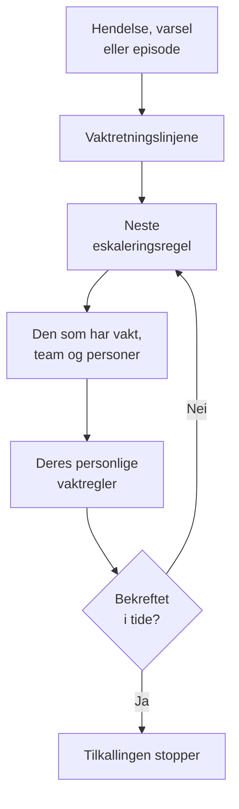

# Vakt – Oversikt

Vakt er hvordan OneUptime får en person til å ta tak i et problem, når som helst på døgnet. Når en hendelse, et varsel eller en episode trenger noen, tilkaller vaktretningslinjene folk nivå for nivå til noen bekrefter, og hver person nås slik de selv har valgt: et push-varsel, en SMS, et anrop, en e-post eller en chatmelding. Denne siden viser hvordan delene henger sammen, og hvor hver del ligger.

:::cards
- [Slik når en tilkalling noen](#slik-når-en-tilkalling-noen): Fra en ny hendelse til personen som svarer.
- [Byggesteinene](#byggesteinene): Retningslinjer, eskaleringsregler, vaktplaner, overstyringer og personlige regler.
- [Sett opp vakt](#sett-opp-vakt): Fra ingenting til et team som tilkalles, i fem steg.
- [Hvor vakt ligger](#hvor-vakt-ligger): Menyen Vakttjeneste, seksjon for seksjon.
:::

## Slik når en tilkalling noen

1. En ny hendelse, et nytt varsel eller en ny episode kjører vaktretningslinjene sine med en gang: dem som er valgt på den, og dem vaktreglene legger til. Hver retningslinje kjører for seg. En vaktregel satt til **Bare i arbeidstiden** lar retningslinjene den legger til, vente til arbeidstiden begynner.
2. Den første eskaleringsregelen i en retningslinje tilkaller med en gang: den som har vakt i vaktplanene dens akkurat nå, hvert medlem av teamene dens og personene den nevner.
3. Er en av dem borte, sender en brukeroverstyring tilkallingen til personen som dekker for dem, eller hopper over dem.
4. Hver person nås gjennom sine personlige vaktregler: hvilken av metodene deres som prøves, og etter hvor lang tid. En tilkalling uten regel når dem likevel på metodene de har verifisert.
5. Bekrefter ingen før ventetiden til regelen er ute, tilkaller neste regel. Etter den siste starter retningslinjen på nytt hvis den gjentas, og ellers stopper den.

Å bekrefte eller løse hendelsen, varselet eller episoden stopper alle retningslinjer som fortsatt tilkaller for den. OneUptime fører kjørende retningslinjer et steg videre hvert minutt og registrerer hver kjøring, regel for regel, i **Utførelseslogger**.

Første gang en tilkalling når noen, registrerer OneUptime det på hendelsen, varselet eller episoden som `First Paged At`. En måling kan telle derfra: **Tid til bekreftelse etter tilkalling** måler hvor lang tid folk brukte på å svare etter at de ble tilkalt, ikke hvor lenge hendelsen, varselet eller episoden ventet før noen ble tilkalt. Se [Tid til bekreftelse etter tilkalling](/docs/incidents/settings#tid-til-bekreftelse-etter-tilkalling).

> [!NOTE]
> En hendelse, et varsel eller en episode som opprettes allerede bekreftet eller løst, kjører ingen av retningslinjene sine, og feeden sier det. Se [Opprettet allerede bekreftet eller løst](/docs/alerts/index#opprettet-allerede-bekreftet-eller-løst).

## Byggesteinene

| Del | Hva den avgjør | Les mer |
| --- | --- | --- |
| Vaktretningslinje | Hvem som tilkalles om en hendelse eller et varsel, nivå for nivå | [Vaktretningslinjer](/docs/on-call/policies) |
| Eskaleringsregel | Ett nivå i en retningslinje: hvem det tilkaller, og hvor lenge det venter på en bekreftelse | [Eskaleringsregler](/docs/on-call/escalation-rules) |
| Vaktplan | Hvem som har vakt til enhver tid, etter hvert som folk bytter på | [Vaktplaner](/docs/on-call/schedules) |
| Brukeroverstyring | Hvem som dekker for noen mens de er borte | [Brukeroverstyringer](/docs/on-call/user-overrides) |
| Personlige vaktregler | Hvordan én person nås: hvilken metode, og etter hvor lang tid | [Personlige vaktregler](/docs/notifications/on-call-rules) |
| Policy for innkommende anrop | Et telefonnummer som ringer til den som har vakt | [Policy for innkommende anrop](/docs/on-call/incoming-call-policy) |

Retningslinjer, eskaleringsregler, vaktplaner og overstyringer hører til prosjektet, under **Vakttjeneste**. Varselmetoder og personlige vaktregler hører til hver person, under **Brukerinnstillinger**: en administrator kan se oppsettet til noen, men bare personen selv kan verifisere telefonen eller e-posten sin. Se [Slik når OneUptime deg](/docs/notifications/index).

## Sett opp vakt

:::steps
### Bygg en vaktplan

Åpne **Vakttjeneste** fra menyen **Produkter**, og gå til **Vaktplaner**. Klikk på **Opprett vaktplan**, gi den et navn, og velg personene under **Hvem bytter på å ha vakt?** i den rekkefølgen de bytter på. Se [Vaktplaner](/docs/on-call/schedules).

### Opprett en retningslinje

Gå til **Vaktretningslinjer**, og klikk på **Opprett Vaktpolicy**. Velg vaktplanen under **Hvem varsles først?**. Den blir den første eskaleringsregelen i retningslinjen, **Level 1**, som venter 30 minutter på en bekreftelse.

### Legg til de neste nivåene

Klikk på **Legg til eskaleringsregel** på siden **Eskaleringsregler** for retningslinjen, for hvert nivå etter det første: neste person i samme vaktplans rotasjon, en teamleder, en leder. Se [Eskaleringsregler](/docs/on-call/escalation-rules).

### Kjør retningslinjen automatisk

Den første retningslinjen i et prosjekt kan gjøre dette allerede når den opprettes: la **Utløs den ved hver nye hendelse og hvert nye varsel** være slått på. For alle andre retningslinjer går du til **Hendelser → Regler → Vaktregler** eller **Varsler → Regler → Vaktregler**, og legger til en regel som kjører den for hendelsene eller varslene den passer på, for eksempel hver kritiske. Se [Hva som kjører en retningslinje](/docs/on-call/policies#hva-som-kjører-en-retningslinje).

### Sjekk at alle kan nås

Åpne **Vakttjeneste → Beredskap**. Alle retningslinjene dine kan tilkalle, står oppført som **Klar**, **Må settes opp** eller **Utilgjengelig**, med det som mangler. Se [Beredskap og rapporter](/docs/on-call/readiness).
:::

> [!NOTE]
> I OneUptime Cloud er vaktretningslinjer og eskaleringsregler med i alle abonnementer. Vaktplaner, brukeroverstyringer, utførelseslogger og rapporten om vakttid krever abonnementet **Growth**.

## Hvor vakt ligger

Åpne **Vakttjeneste** fra menyen **Produkter** i topplinjen. Den åpner på **Vaktretningslinjer**, på `/dashboard/{projectId}/on-call-duty/policies`, og sidemenyen inneholder resten:

| Seksjon | Sider |
| --- | --- |
| **Retningslinjer** | **Vaktretningslinjer** og **Beredskap**: hvem retningslinjene dine faktisk kan nå |
| **Tidsplaner** | **Vaktplaner**, **Tidslinje for vaktplaner** og **Kalenderfeeder** |
| **Innkommende anrop** | **Retningslinjer for innkommende anrop**: et telefonnummer som ringer til den som har vakt |
| **Avansert** | **Brukeroverstyringer**, **Utførelseslogger** og **Arkiverte retningslinjer** |
| **Rapporter** | **Brukerens vakttid**: hvor lenge hver person hadde vakt |
| **Arbeidsområde** | **Slack** og **Microsoft Teams**: regler som legger ut vakthendelser i en kanal |
| **Innstillinger** | **Egendefinerte felt**, **Etikettregler** og **Eierregler** |
| **Utvikler** | **Terraform**, **API** og **AI-assistenter**: vakt satt opp fra kode |

**Retningslinjer**, **Tidsplaner** og **Innkommende anrop** er åpne; de andre seksjonene starter sammenslått, og en seksjon åpner seg selv når du er på en av sidene i den. **Arbeidsområde** viser chatverktøyene prosjektet har koblet til, eller **Koble til Slack eller Teams** når det ikke har noen.

Når du har vakt for en retningslinje, viser klokken øverst til høyre det. Klikk på den for å åpne **Mine vaktretningslinjer**: alle retningslinjer du har vakt for, i alle prosjektene dine, og om du er nevnt direkte, i et team eller i en vaktplan.

## Feilsøking

:::details Ingen ble tilkalt for en ny hendelse
Åpne siden **Vaktutførelser** for hendelsen. Er den tom, hadde hendelsen ingen vaktretningslinje: ingen ble valgt på den, og ingen vaktregel passet. En kjøring med **Execution Completed - No One Notified** gikk gjennom alle eskaleringsregler uten å finne noen: som regel en vaktplan der ingen har vakt. Se [Utførelseslogger](/docs/on-call/policies#utførelseslogger). En kjøring med **Venter** venter på arbeidstiden for en vaktregel satt til **Bare i arbeidstiden** og tilkaller ingen før den begynner.
:::

:::details Noen ble tilkalt på feil kanal, eller ikke i det hele tatt
Åpne **Vakttjeneste → Beredskap**, og klikk på **Coverage** i raden til personen. Den viser metodene de har verifisert, og hver alvorlighetsgrad de ikke har noen regel for. Bare de selv kan rette det, under **Brukerinnstillinger**: send dem en påminnelse om oppsettet fra den samme siden. Se [Beredskap og rapporter](/docs/on-call/readiness). På OneUptime Cloud kan en telefon som blokkerer ukjente oppringere, dempe et varsel: legg [OneUptimes numre](/docs/on-call/phone-number-whitelist) til i tillatelseslisten.
:::

:::details En person på ferie blir fortsatt tilkalt
Legg til en brukeroverstyring med personen under **Hvem er borte?**. En under **Vakttjeneste → Avansert → Brukeroverstyringer** gjelder for alle retningslinjer; en på en retningslinjes egen side **Brukeroverstyringer** gjelder bare for den retningslinjen. Se [Brukeroverstyringer](/docs/on-call/user-overrides).
:::

## Neste steg

:::cards
- [Vaktretningslinjer](/docs/on-call/policies): Opprett en retningslinje, bestem hva som kjører den, og les hva den gjorde.
- [Eskaleringsregler](/docs/on-call/escalation-rules): Tilkall folk nivå for nivå til noen svarer.
- [Vaktplaner](/docs/on-call/schedules): Rotasjoner, lag og overleveringer.
- [Slik når OneUptime deg](/docs/notifications/index): Metodene og reglene som avgjør hvordan hver person nås.
:::
