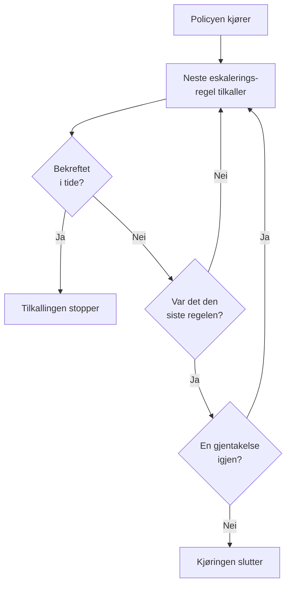

# Vaktpolicyer

En vaktpolicy avgjør hvem som tilkalles om en hendelse eller et varsel, og hvem som er neste hvis ingen bekrefter. Eskaleringsreglene er nivåene dens, og hendelsene, varslene og episodene som bruker den, kjører den. Denne siden handler om å opprette en policy, hva som kjører den, hva sidene dens viser, og hvordan hver kjøring registreres.

:::cards
- [Opprett en policy](#opprett-en-policy): Et navn, og hvem som tilkalles først.
- [Hva som kjører en policy](#hva-som-kjører-en-policy): Regler, maler, monitorer, chat og deg selv.
- [Utførelseslogger](#utførelseslogger): Hver kjøring, regel for regel, og hvorfor den stoppet.
- [Arkiver eller slett en policy](#arkiver-eller-slett-en-policy): Ta en policy ut av drift.
:::

## Opprett en policy

:::steps
1. Gå til **Vakt → Vaktpolicyer**, og klikk på **Opprett vaktpolicy**.
2. Skriv inn et **Navn**, for eksempel "Betalinger primær".
3. Klikk på **Legg til mottaker** under **Hvem varsles først?**, og velg vaktplanene, teamene og personene som skal tilkalles først.
4. Klikk på **Opprett vaktpolicy**. Policyen åpner på siden **Eskaleringsregler**, med **Level 1** på plass.
:::

**Hvem varsles først?** er valgfritt og vises bare for folk som kan legge til eskaleringsregler: står det tomt, tilkaller policyen ingen før den har en regel. **Beskrivelse** og **Etiketter** venter under **Flere felt**. Se [Eskaleringsregler](/docs/on-call/escalation-rules) for å legge til de neste nivåene.

Skjemaet spør også **Utløs den ved hver nye hendelse og hvert nye varsel**, hvis du kan legge til vaktregler. Den legger til en regel under **Hendelser → Regler → Vaktregler** og en under **Varsler → Regler → Vaktregler**, som hver treffer alt og kjører denne policyen. Den starter slått på for den første policyen i et prosjekt, så lenge prosjektet verken har en vaktpolicy eller en vaktregel, og slått av for senere policyer: å utløse to policyer ved hver nye hendelse og hvert nye varsel er et valg du må ta. Slått av tilkaller policyen ingen før en regel, en monitor eller en person kjører den.

Vil du heller bli veiledet steg for steg, fra telefonen din til et testtilkall, klikker du på **Veiledet oppsett**: på den tomme listen **Vaktpolicyer** eller under **Slik fungerer det**. Se [Bli varslet via telefon, SMS eller push](/docs/guides/paging).

Listen **Vaktpolicyer** viser **Navn**, **Beskrivelse**, **Etiketter** og **Eiere** for hver policy. Velg policyer for å bruke **Legg til etiketter**, **Fjern etiketter**, **Legg til eier**, **Fjern eier**, **Arkiver** eller **Eksporter JSON**, eller for å slette dem. **Importer JSON** oppretter policyer fra en eksport: en eksport inneholder policyens egne innstillinger, ikke eskaleringsreglene eller eierne.

## Hva som kjører en policy

En policy tilkaller ingen før noe kjører den. Hver hendelse, hvert varsel og hver episode kjører policyene sine så snart den er opprettet:

| Hva | Hvordan policyen legges til | Les mer |
| --- | --- | --- |
| Selve posten | Feltet **Vaktpolicy** når en hendelse eller et varsel opprettes, en hendelsesmal, eller den sammenslåtte delen **Vakt** i kriteriene til en monitor | [Opprette en hendelse](/docs/incidents/declaring-incidents) |
| Vaktregler | **Hendelser → Regler → Vaktregler** og **Varsler → Regler → Vaktregler** legger til policyene fra hver regel som passer | [Vaktregler for hendelser](/docs/incidents/settings#vaktregler-for-hendelser) |
| Grupperingsregler | En grupperingsregel kjører policyene sine når den åpner en episode | [Varselepisoder og grupperingsregler](/docs/alerts/episodes) |
| Manuelt | **Kjør vaktpolicy**, i menyen **Handlinger** i en feed, eller på en melding i Slack eller Microsoft Teams | [Hendelsens feed](/docs/incidents/notes-owners-and-feed#hendelsens-feed) |
| Chat og arbeidsflyter | `/oneuptime page` i Slack eller Microsoft Teams, og steget **Page an On-Call Policy** i en arbeidsflyt | [Paging](/docs/workflows/components#paging) |

En policy som flere regler legger til, kjører én gang. En alvorlighetsgrad kjører aldri en policy av seg selv: det gjør en vaktregel som passer alvorlighetsgraden. En hendelse eller et varsel som opprettes allerede bekreftet eller løst, kjører ingen av policyene sine. En vaktregel satt til **Bare i arbeidstiden** lar policyene den legger til, vente til arbeidstiden begynner.

## Sidene til en policy

Åpne en policy fra listen. Sidemenyen inneholder alt om den:

| Seksjon | Sider |
| --- | --- |
| **Grunnleggende** | **Oversikt**, **Eskaleringsregler** og **Eiere** |
| **Logger** | **Utførelseslogger** og **Varslingslogger** |
| **Utvikler** | **Terraform**, **API**, **CLI** og **AI-assistenter** |
| **Avansert** | **Brukeroverstyringer**, **Egendefinerte felt**, **Innstillinger**, **Revisjonslogger** og **Slett policy** |

**Grunnleggende** er åpen; de andre seksjonene starter sammenslått til du klikker på dem.

- **Oversikt** viser **Detaljer for vaktpolicy**, deretter **Policyen i korte trekk**: hvor mange nivåer og mottakere policyen har, hvor lang tid det går til det siste nivået, og hvor ofte den gjentas. **Mottakernes beredskap** sier om alle den kan tilkalle, kan nås nå, og **Vaktpolicyens feed** viser hva som er endret: personer, team og vaktplaner som er lagt til eller fjernet, overstyringer og overleveringer. Reglene for Slack, Microsoft Teams og Mattermost publiserer dem i kanalene dine, et vaktskifte i én linje: se [Vaktmeldinger](/docs/workspace-connections/slack#vaktmeldinger).
- **Eiere** er personene og teamene som er ansvarlige for policyen. Når en tilkalling fra den ikke finner noen regel for noen, eller ikke kan leveres, får de en e-post; en policy uten eiere sender i stedet e-post til Prosjekteiere.
- **Varslingslogger** viser hver melding policyen har sendt, med en fane per kanal.
- **Brukeroverstyringer** dekker for folk bare i denne policyen. Se [Brukeroverstyringer](/docs/on-call/user-overrides).
- **Innstillinger** har **Eksporter Vaktpolicy** og kortet som arkiverer policyen.

**Hva som utløser denne policyen**, på **Oversikt**, viser vaktreglene, monitorene der kriteriene utløser policyen, malene og andre regler som utløser den, og arbeidsflytene som gjør det, hver med en lenke. En regel som er slått av, viser **Av**. Når ingenting utløser policyen, sier kortet det: den varsler ingen før noe utløser den. Når du sletter eller arkiverer policyen, sies det samme først. Det du ikke kan åpne, telles, men navngis ikke.

## Gjenta en policy

Når ventetiden til det siste nivået er ute uten at noen har bekreftet, stopper en policy, med mindre den gjentas. For å velge åpner du siden **Eskaleringsregler** for policyen og klikker på **Rediger** på kortet **Gjentakelsespolicy** under reglene. **Rediger gjentakelsespolicy** spør **Hvis ingen bekrefter etter det siste nivået**:

| Svar | Hva det gjør |
| --- | --- |
| **Stopp varslingen** | Ingen varsles igjen, så policyen kjører én gang. En ny policy starter med dette svaret. |
| **Start på nytt fra Level 1** | Hvert nivå varsles igjen, i rekkefølge. **Hvor mange ganger til?** sier hvor mange: 1 eller flere. |

En policy som starter på nytt tre ganger til, går gjennom nivåene sine fire ganger til sammen. En runde der ingen nivåer hadde noen å varsle, gjentas ikke: en til ville heller ikke varsle noen, så policyen stopper. Kortets rad **Etter det siste nivået** sier hva policyen gjør, og **Policyen i korte trekk** på **Oversikt** sier det samme med ord.

## Varsle igjen hvis den ikke blir løst

En bekreftelse stopper en policys varsling for godt, også om ingen løser hendelsen eller varselet etterpå. En policy kan i stedet varsle igjen: åpne siden **Eskaleringsregler** for den, åpne **Flere innstillinger** nederst, og klikk på **Rediger** på kortet **Tidsavbrudd etter bekreftelse**. **Rediger tidsavbrudd etter bekreftelse** spør **Hvis den er bekreftet, men ikke løst**:

| Svar | Hva det gjør |
| --- | --- |
| **Ikke varsle igjen** | En bekreftelse stopper varslingen for godt. En ny policy starter med dette svaret. |
| **Varsle igjen** | Varsler den som bekreftet, og den som har vakt nå. **Etter hvor mange minutter?** sier når: fra 5 til 1440, først 30. |

Minuttene telles fra hver bekreftelse, og en policy varsler høyst 5 ganger igjen om den samme hendelsen, det samme varselet eller den samme episoden. En ny varsling starter på nivået som varslet da det ble bekreftet, varsler den som har vakt der nå, og går videre gjennom nivåene som den første kjøringen. Hendelsen eller varselet forblir bekreftet: den nye varslingen er en egen kjøring, i feeden og i utførelsesloggene til policyen, der **Status** sier "Varslet igjen (1 av 5)".

Den som varsles igjen, bekrefter fra meldingen eller med **Bekreft igjen** på siden til hendelsen eller varselet, og minuttene starter på nytt; **Eskaler** sender varslingen videre til neste nivå. Å løse eller slette hendelsen eller varselet, arkivere eller slette policyen, eller velge **Ikke varsle igjen** stopper den. Kortets rad **Etter en bekreftelse** sier hva policyen gjør, og **Flere innstillinger** viser minuttene mens den er lukket. **Policyen i korte trekk** på **Oversikt** og **Oversikt over eskalering** sier det samme med ord.

## Når flere policyer tilkaller

En hendelse, et varsel eller en episode kjører hver av policyene sine for seg, samtidig.

- Den som har vakt i to av dem, tilkalles bare én gang. Når et nivå i en policy når en person som en annen policy allerede tilkaller om det samme, tilkaller den ikke vedkommende igjen: utførelsesloggen dens viser vedkommende som **Allerede kalt opp**, og feeden til hendelsen og policyens melding i Slack og Microsoft Teams nevner policyen som tilkaller vedkommende. Nivået venter likevel ut minuttene sine før neste nivå, slik det gjør for alle det har tilkalt. Et svar på den ene tilkallingen gjelder for begge policyene. Innenfor én policy tilkalles en person som et nivå nevner to ganger, personlig og gjennom et team eller en vaktplan, bare én gang.
- En tilkalling sendt direkte til personer teller også. Når et nivå i en policy når en person som en tilkalling fra Slack eller Microsoft Teams, eller en arbeidsflyts tilkallingsblokk, allerede tilkaller om det samme, tilkaller den ikke vedkommende igjen: utførelsesloggen dens nevner hvem som sendte den tilkallingen, eller arbeidsflyten. En arbeidsflyts tilkallingsblokk tilkaller heller ikke igjen en person som en policy eller en annen tilkalling allerede tilkaller.
- En bekreftelse av hendelsen eller varselet stopper innen ett minutt alle policyer som kjører for den, uansett hvor den bekreftes: fra en hvilken som helst tilkalling om den, på dens egen side, i mobilappen eller i Slack eller Microsoft Teams. Ingen neste nivå tilkalles, og ingen samtale eller SMS som fortsatt venter, sendes. Meldinger som allerede er sendt, forblir sendt.

Ingen går glipp av en tilkalling ved bare å bli tilkalt én gang. Den ene tilkallingen kan ende uten svar: vedkommende eskalerer den fra en av meldingene dens, noe som bare eskalerer den tilkallingen, tilkallingen kan ikke sendes, eller den stopper. Da tilkaller den andre policyen, eller arbeidsflytens blokk, vedkommende selv innen ett minutt, uten å sende på nytt det som allerede har nådd vedkommende. **Eskaler** på siden til hendelsen eller i mobilappen eskalerer begge. En ny varsling, en policy som er startet manuelt, og en tilkalling som noen har sendt fra Slack eller Microsoft Teams, tilkaller alltid sine egne personer selv, også en person som en annen policy allerede tilkaller. En tilkalling til en observatør og en tilkalling til en mottaker slås aldri sammen.

Noen tilkallinger fortsetter etter at den er bekreftet, til noen de har tilkalt, svarer, eller den er løst: en ny varsling, en tilkalling til observatører, en tilkalling som noen har sendt til personer fra Slack eller Microsoft Teams, og en policy som er startet manuelt.

En policy som er startet manuelt, er en som er startet med **Kjør vaktpolicy**, eller av en tilkalling fra Slack eller Microsoft Teams som nevner den. Den tilkaller nivå for nivå som enhver kjøring, med samtaler og gjentatte push-varsler, og at noen andre bekrefter hendelsen, stopper den ikke: slik tilkaller du et annet team til en hendelse som noen allerede jobber med. Den den har tilkalt, svarer fra meldingen i tilkallingen sin, en samtale eller en SMS, eller ved selv å bekrefte hendelsen; når hendelsen er bekreftet, tilbyr siden til hendelsen vedkommende **Bekreft igjen**. **Eskaler** sender den videre til neste nivå. På en hendelse, et varsel eller en episode som er løst, startes ingenting, og du får vite hvorfor: dashbordet slår av **Kjør vaktpolicy** og viser årsaken. Varslene fra den sier hvem som startet hvilken policy, og har med meldingen som ble sendt med en tilkalling fra Slack eller Microsoft Teams.

## Test en policy

**Test denne policyen**, i eskaleringsreglene til en policy, kaller opp det første nivået som en test, uten en hendelse bak: det står TEST i hver melding, og ingen statusside, abonnent eller kanal får beskjed. Slå på **Gå gjennom hvert eskaleringsnivå** for å kalle opp hvert nivå etter tur, høyst 2 minutter fra hverandre, til noen bekrefter. Før noe sendes, viser dialogen hvem testen kaller opp og hvordan, og hva den koster på OneUptime Cloud.

**Send testoppkall** forblir slått av så lenge testen ikke ville nådd noen: alle den kaller opp, har valgt bort alvorlighetsgraden, har ingen regel for den og ingenting å falle tilbake på, eller har bare metoder som ikke er verifisert eller er slått av i prosjektet. En linje under listen sier hvorfor. Kan bare et senere nivå nås, tilbyr linjen **Gå gjennom hvert eskaleringsnivå** med ett klikk.

Den som kalles opp, bekrefter testen fra hvilken som helst av meldingene sine: lenken i en e-post, en SMS eller en chatmelding, 1 i et anrop eller push-varslingen i OneUptime On-Call-appen, i versjoner nyere enn 1.6.0. En policy kan testes én gang hvert 5. minutt, og et prosjekt sender høyst 20 tester i timen.

### Hold en beredskapsøvelse for en monitor

**Hold en beredskapsøvelse**, på kortet **Når den går ned** for en monitor, øver på en av feilene dens: en hendelse eller et varsel som et av kriteriene åpner, eller hendelsen som en hendelsesregel for varsler oppretter fra et slikt varsel. Den tester hver vaktpolicy som den feilen ville kalt opp, hver slik **Test denne policyen** tester den, og ingenting offentlig skjer: ingen hendelse eller varsel opprettes, og ingen statusside, abonnent eller kanal får beskjed. Før noe sendes, nevner dialogen feilen, hver policy og hvem den policyen kaller opp nå. For en opprettet hendelse nevner den også regelen og hvor lenge varselet først står åpent: øvelsen tester hendelsens policyer med en gang, uten den ventetiden.

En øvelse kaller opp hver policys første nivå. Under **Flere felt** kan du slå på **Gå gjennom hvert eskaleringsnivå** for å kalle opp hver policys nivåer etter tur, høyst 2 minutter fra hverandre, til noen bekrefter: dialogen viser da hvert nivå hver policy når, og hva gjennomgangen høyst koster. Når ingen på de første nivåene kan nås, men et senere nivå kan, tilbyr linjen under listen **Gå gjennom hvert eskaleringsnivå** med ett klikk.

**Start beredskapsøvelse** forblir slått av så lenge en av de policyene er en du ikke kan teste, fordi du ikke kan redigere den, eller så lenge ingen de kaller opp, kan nås. Hver policy i en øvelse teller som en egen test: en policy som er testet de siste 5 minuttene, stopper hele øvelsen, og en øvelse med tre policyer bruker tre av prosjektets 20 tester i timen.

Når dialogen er lukket, sier **Siste beredskapsøvelse** på kortet hvilken feil monitorens siste øvelse øvde på, når og av hvem den ble startet, og hvor mange av testene som ble bekreftet. **Vis detaljer** viser hver policys test: om den ble bekreftet, av hvem, hvordan og hvor raskt. Hver test blir værende i policyens utførelseslogger, merket som en beredskapsøvelse for monitoren. Resultatene av en øvelse vises for den som kan lese monitoren og hver av disse utførelsesloggene.

## Utførelseslogger

Hver gang en policy kjører, skriver den en utførelseslogg, og loggen går gjennom statusene sine etter hvert som kjøringen skrider frem:

| Status | Hva den betyr |
| --- | --- |
| **Venter** | En vaktregel satt til **Bare i arbeidstiden** lar kjøringen vente til arbeidstiden begynner: den sier når tilkallingen starter, og tilkaller ingen fram til da. Den avsluttes uten å tilkalle hvis hendelsen eller varselet blir bekreftet eller løst først. Den begynner å tilkalle straks hvis hendelsen eller varselet endrer seg og nå samsvarer med en vaktregel som tilkaller med en gang. |
| **Planlagt**, **Startet** | Kjøringen settes opp. En som fortsatt står her etter 5 minutter, ble ikke ferdig med å starte: den går videre til **Utføres** og tilkaller derfra starten stoppet. En direkte tilkalling eller en testtilkalling som fortsatt står her, stoppes som **Feil**. |
| **Utføres** | Kjøringen tilkaller. OneUptime fører den et steg videre hvert minutt. Et steg som feiler et øyeblikk, for eksempel fordi databasen ikke kunne nås, prøves igjen et minutt senere, så 2 og 4 minutter senere, og deretter hvert 5. minutt. |
| **Utførelse fullført** | Noen bekreftet, hendelsen eller varselet ble løst, alle regler og gjentakelser ble brukt, eller policyen ble arkivert. |
| **Utførelse fullført - ingen varslet** | Kjøringen gikk gjennom alle regler og tilkalte ingen: som regel en vaktplan der ingen har vakt, eller et nivå uten mottakere. |
| **Feil** | Kjøringen mislyktes: et steg feilet på en måte et nytt forsøk ikke kan rette, for eksempel en slettet eskaleringsregel, eller feilet 10 forsøk på rad over omtrent 37 minutter. **Vis statusmelding** sier hvorfor. |

Du finner utførelseslogger tre steder:

- i policyens egne **Utførelseslogger**, under **Logger**;
- under **Vakt → Avansert → Utførelseslogger**, for alle policyer, der direkte tilkallinger fra arbeidsflyter og chat står som **Direkte tilkalling**;
- på siden **Vaktutførelser** for en hendelse eller et varsel.

Hver rad viser hva som startet kjøringen, når, **Status** og hvem som bekreftet. **Vis tidslinje** åpner **Tidslinje for utførelsen**: hver eskaleringsregel, hvem den tilkalte, gjennom hvilken vaktplan, og hvordan hver tilkalling endte. **Varslet via** viser hvordan hver tilkalling nådde personen: telefonanrop, SMS, e-post, push-varsling og så videre. En vaktplan der ingen har vakt, viser **Ingen hadde vakt** i stedet for en person. Et nivå som ikke tilkalte noen, sier hvorfor, med **Gikk videre med en gang** under: policyen ventet ikke på det. En person som en annen policy eller en direkte tilkalling allerede tilkalte, viser **Allerede kalt opp**: se [Når flere policyer tilkaller](#når-flere-policyer-tilkaller). I OneUptime Cloud krever utførelseslogger abonnementet **Growth**.

## Arkiver eller slett en policy

Arkivering tar en policy ut av drift og beholder alt: åpne **Innstillinger** for policyen og klikk på **Arkiver** på arkivkortet, eller velg policyer i listen og velg **Arkiver**.

- En arkivert policy tilkaller ingen. Hendelser og varsler som bruker den, hopper over den, og en kjøring som fortsatt eskalerer, stopper ved neste steg.
- Den forlater listen **Vaktpolicyer** og flyttes til **Vakt → Avansert → Arkiverte policyer**, der **Fjern fra arkivet** setter den i drift igjen.

**Slett policy**, under **Avansert**, sletter policyen sammen med eskaleringsreglene og brukeroverstyringene. Sletting fra listen spør først og foreslår å arkivere i stedet.

## Hvem som kan endre en policy

**Prosjekteier**, **Prosjektadministrator**, **Prosjektmedlem**, **Vaktadministrator** og **Vaktmedlem** kan opprette, endre og slette policyer; **Leser** og **Vaktleser** kan lese dem. I en egendefinert rolle heter tillatelsene **Create On-Call Policy**, **Edit On-Call Policy**, **Delete On-Call Policy** og **Read On-Call Policy**, og en rolle som er begrenset til enkelte etiketter, når bare policyene som har dem. Å legge til eiere og egendefinerte felt krever abonnementet **Growth** i OneUptime Cloud.

## API og Terraform

Vaktpolicyer er ressursen `/api/on-call-duty-policy`, og ressursen `oneuptime_on_call_policy` i Terraform:

| Innstilling | API-felt |
| --- | --- |
| **Navn** | `name` |
| **Beskrivelse** | `description` |
| **Hvis ingen bekrefter etter det siste nivået** | `repeatPolicyIfNoOneAcknowledges` |
| **Hvor mange ganger til?** | `repeatPolicyIfNoOneAcknowledgesNoOfTimes` |
| **Etter hvor mange minutter?** | `acknowledgementTimeoutInMinutes` |
| Arkivert | `isArchived` |

`repeatPolicyIfNoOneAcknowledges` er `false` for **Stopp varslingen** og `true` for **Start på nytt fra Level 1**. Med `true` må `repeatPolicyIfNoOneAcknowledgesNoOfTimes` være et heltall på 1 eller mer: OneUptime avviser `0`. En eldre policy som er lagret med `0`, gjentas aldri, og dashbordet viser den som **Stopp varslingen**.

`acknowledgementTimeoutInMinutes` er `null` for **Ikke varsle igjen** og et helt antall minutter fra 5 til 1440 for **Varsle igjen**. OneUptime avviser alt annet.

Se [Opprett regler med API-et eller Terraform](/docs/on-call/escalation-rules#opprett-regler-med-api-et-eller-terraform) for å opprette en policy med det første nivået i én forespørsel.

## Feilsøking

:::details En policy kjørte, men ingen ble tilkalt
Kjøringen viser **Utførelse fullført - ingen varslet**. Åpne **Vis tidslinje**: en rad med **Ingen hadde vakt** peker på en vaktplan med et hull, og statusmeldingen i en rad med **Hoppet over** sier hvorfor, for eksempel noen som var borte uten noen til å dekke. **Vakt → Beredskap** viser hvem som ikke kunne nås.
:::

:::details Neste nivå ble tilkalt et minutt etter ventetiden
OneUptime fører kjørende policyer et steg videre én gang i minuttet, så et nivå tilkalles ved den første sjekken etter at ventetiden er ute.
:::

:::details Neste nivå ble tilkalt med en gang, uten å vente
Nivået før hadde ingen å tilkalle: ingen mottakere, ingen med vakt i vaktplanene eller ingen som kunne nås. Et nivå som ikke tilkaller noen, har ingen ventetid, så neste nivå tilkalles så snart policyen når det. **Vis tidslinje** viser hvorfor det nivået ikke tilkalte noen.
:::

:::details En hendelse viser en policy som ikke tilkalte noen
Policyen er arkivert: en arkivert policy blir stående på hendelsene og varslene som bruker den, tilkaller ingen, og utførelsesloggen sier at den ikke ble utført. Fjern den fra arkivet under **Vakt → Avansert → Arkiverte policyer**.
:::

:::details Noen ble tilkalt to ganger om én hendelse
Den som har vakt i to av policyene hendelsen kjører, tilkalles bare én gang, av den første policyen som når vedkommende, og det samme gjelder en person som både en policy og en tilkalling fra Slack, Microsoft Teams eller en arbeidsflyt når. Den andre tilkaller vedkommende også når det er en ny varsling, en policy som er startet manuelt, en tilkalling sendt fra Slack eller Microsoft Teams eller en tilkalling til observatører, som alle tilkaller sine egne personer selv, eller når den første tilkallingen til vedkommende var over før den andre nådde frem til vedkommende: vedkommende hadde eskalert den, eller den hadde stoppet. **Vis tidslinje** for den andre tilkallingen viser **Allerede kalt opp** for en person den ikke tilkalte igjen.
:::

:::details En policy fortsatte å tilkalle etter at hendelsen var bekreftet
Den ble startet manuelt, eller det er en ny varsling: den fortsetter til noen den har tilkalt, svarer, eller hendelsen er løst. Se [Når flere policyer tilkaller](#når-flere-policyer-tilkaller).
:::

## Neste steg

:::cards
- [Eskaleringsregler](/docs/on-call/escalation-rules): Legg til nivåene en policy tilkaller, og hvor lenge hvert av dem venter.
- [Brukeroverstyringer](/docs/on-call/user-overrides): Send tilkallingene til noen videre til en kollega mens de er borte.
- [Beredskap og rapporter](/docs/on-call/readiness): Sjekk at alle en policy tilkaller, kan nås.
:::
