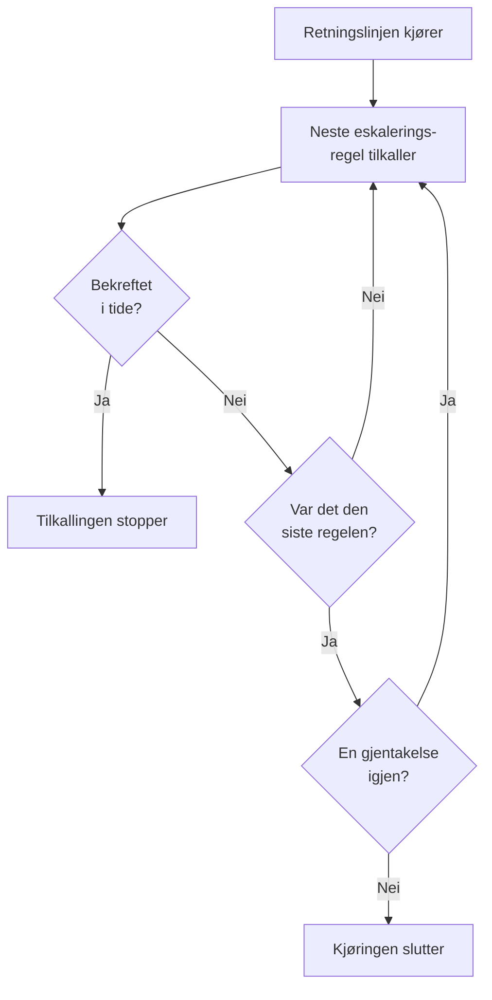

# Vaktretningslinjer

En vaktretningslinje avgjør hvem som tilkalles om en hendelse eller et varsel, og hvem som er neste hvis ingen bekrefter. Eskaleringsreglene er nivåene dens, og hendelsene, varslene og episodene som bruker den, kjører den. Denne siden handler om å opprette en retningslinje, hva som kjører den, hva sidene dens viser, og hvordan hver kjøring registreres.

:::cards
- [Opprett en retningslinje](#opprett-en-retningslinje): Et navn, og hvem som tilkalles først.
- [Hva som kjører en retningslinje](#hva-som-kjører-en-retningslinje): Regler, maler, overvåkinger, chat og deg selv.
- [Utførelseslogger](#utførelseslogger): Hver kjøring, regel for regel, og hvorfor den stoppet.
- [Arkiver eller slett en retningslinje](#arkiver-eller-slett-en-retningslinje): Ta en retningslinje ut av drift.
:::

## Opprett en retningslinje

:::steps
1. Gå til **Vakttjeneste → Vaktretningslinjer**, og klikk på **Opprett Vaktpolicy**.
2. Skriv inn et **Navn**, for eksempel "Betalinger primær".
3. Klikk på **Legg til mottaker** under **Hvem varsles først?**, og velg vaktplanene, teamene og personene som skal tilkalles først.
4. Klikk på **Opprett Vaktpolicy**. Retningslinjen åpner på siden **Eskaleringsregler**, med **Level 1** på plass.
:::

**Hvem varsles først?** er valgfritt og vises bare for folk som kan legge til eskaleringsregler: står det tomt, tilkaller retningslinjen ingen før den har en regel. **Beskrivelse** og **Etiketter** venter under **Flere felt**. Se [Eskaleringsregler](/docs/on-call/escalation-rules) for å legge til de neste nivåene.

For den første retningslinjen i et prosjekt spør skjemaet også **Utløs den ved hver nye hendelse og hvert nye varsel**, som starter slått på. Den legger til en regel under **Hendelser → Regler → Vaktregler** og en under **Varsler → Regler → Vaktregler**, som hver treffer alt og kjører denne retningslinjen. Bare folk som kan legge til vaktregler, får spørsmålet, så lenge prosjektet verken har en vaktpolicy eller en vaktregel.

Listen **Vaktpolicyer** viser **Navn**, **Beskrivelse**, **Etiketter** og **Eiere** for hver retningslinje. Velg retningslinjer for å bruke **Legg til etiketter**, **Fjern etiketter**, **Legg til eier**, **Fjern eier**, **Arkiver** eller **Eksporter JSON**, eller for å slette dem. **Importer JSON** oppretter retningslinjer fra en eksport: en eksport inneholder retningslinjens egne innstillinger, ikke eskaleringsreglene eller eierne.

## Hva som kjører en retningslinje

En retningslinje tilkaller ingen før noe kjører den. Hver hendelse, hvert varsel og hver episode kjører retningslinjene sine så snart den er opprettet:

| Hva | Hvordan retningslinjen legges til | Les mer |
| --- | --- | --- |
| Selve posten | Feltet **Vaktpolicy** når en hendelse eller et varsel opprettes, en hendelsesmal, eller den sammenslåtte delen **Vakt** i kriteriene til en overvåking | [Opprette en hendelse](/docs/incidents/declaring-incidents) |
| Vaktregler | **Hendelser → Regler → Vaktregler** og **Varsler → Regler → Vaktregler** legger til retningslinjene fra hver regel som passer | [Vaktregler for hendelser](/docs/incidents/settings#vaktregler-for-hendelser) |
| Grupperingsregler | En grupperingsregel kjører retningslinjene sine når den åpner en episode | [Varselepisoder og grupperingsregler](/docs/alerts/episodes) |
| Manuelt | **Kjør vakttjenesteretningslinje**, i menyen **Handlinger** i en feed, eller på en melding i Slack eller Microsoft Teams | [Hendelsens feed](/docs/incidents/notes-owners-and-feed#hendelsens-feed) |
| Chat og arbeidsflyter | `/oneuptime page` i Slack eller Microsoft Teams, og steget **Page an On-Call Policy** i en arbeidsflyt | [Paging](/docs/workflows/components#paging) |

En retningslinje som flere regler legger til, kjører én gang. En alvorlighetsgrad kjører aldri en retningslinje av seg selv: det gjør en vaktregel som passer alvorlighetsgraden. En hendelse eller et varsel som opprettes allerede bekreftet eller løst, kjører ingen av retningslinjene sine. En vaktregel satt til **Bare i arbeidstiden** lar retningslinjene den legger til, vente til arbeidstiden begynner.

## Sidene til en retningslinje

Åpne en retningslinje fra listen. Sidemenyen inneholder alt om den:

| Seksjon | Sider |
| --- | --- |
| **Grunnleggende** | **Oversikt**, **Eskaleringsregler** og **Eiere** |
| **Logger** | **Utførelseslogger** og **Varsellogger** |
| **Utvikler** | **Terraform**, **API** og **AI-assistenter** |
| **Avansert** | **Brukeroverstyringer**, **Egendefinerte felt**, **Innstillinger**, **Revisjonslogger** og **Slett retningslinjer** |

**Grunnleggende** er åpen; de andre seksjonene starter sammenslått til du klikker på dem.

- **Oversikt** viser **Detaljer for vaktretningslinje**, deretter **Policyen i korte trekk**: hvor mange nivåer og mottakere retningslinjen har, hvor lang tid det går til det siste nivået, og hvor ofte den gjentas. **Mottakernes beredskap** sier om alle den kan tilkalle, kan nås nå, og **Vaktpolicyens feed** viser hva som er endret: personer, team og vaktplaner som er lagt til eller fjernet, overstyringer og overleveringer.
- **Eiere** er personene og teamene som er ansvarlige for retningslinjen. Når en tilkalling fra den ikke finner noen regel for noen, eller ikke kan leveres, får de en e-post; en retningslinje uten eiere sender i stedet e-post til prosjektets eiere.
- **Varsellogger** viser hver melding retningslinjen har sendt, med en fane per kanal.
- **Brukeroverstyringer** dekker for folk bare i denne retningslinjen. Se [Brukeroverstyringer](/docs/on-call/user-overrides).
- **Innstillinger** har **Eksporter Vaktpolicy** og kortet som arkiverer retningslinjen.

## Gjenta en retningslinje

Når ventetiden til det siste nivået er ute uten at noen har bekreftet, stopper en retningslinje, med mindre den gjentas. For å velge åpner du siden **Eskaleringsregler** for retningslinjen og klikker på **Rediger** på kortet **Gjentakelsesretningslinje** under reglene. **Rediger gjentakelsesretningslinje** spør **Hvis ingen bekrefter etter det siste nivået**:

| Svar | Hva det gjør |
| --- | --- |
| **Stopp varslingen** | Ingen varsles igjen, så retningslinjen kjører én gang. En ny retningslinje starter med dette svaret. |
| **Start på nytt fra Level 1** | Hvert nivå varsles igjen, i rekkefølge. **Hvor mange ganger til?** sier hvor mange: 1 eller flere. |

En retningslinje som starter på nytt tre ganger til, går gjennom nivåene sine fire ganger til sammen. En runde der ingen nivåer hadde noen å varsle, gjentas ikke: en til ville heller ikke varsle noen, så retningslinjen stopper. Kortets rad **Etter det siste nivået** sier hva retningslinjen gjør, og **Policyen i korte trekk** på **Oversikt** sier det samme med ord.

## Varsle igjen hvis den ikke blir løst

En bekreftelse stopper en retningslinjes varsling for godt, også om ingen løser hendelsen eller varselet etterpå. En retningslinje kan i stedet varsle igjen: åpne siden **Eskaleringsregler** for den, åpne **Flere innstillinger** nederst, og klikk på **Rediger** på kortet **Tidsavbrudd etter bekreftelse**. **Rediger tidsavbrudd etter bekreftelse** spør **Hvis den er bekreftet, men ikke løst**:

| Svar | Hva det gjør |
| --- | --- |
| **Ikke varsle igjen** | En bekreftelse stopper varslingen for godt. En ny retningslinje starter med dette svaret. |
| **Varsle igjen** | Varsler den som bekreftet, og den som har vakt nå. **Etter hvor mange minutter?** sier når: fra 5 til 1440, først 30. |

Minuttene telles fra hver bekreftelse, og en retningslinje varsler høyst 5 ganger igjen om den samme hendelsen, det samme varselet eller den samme episoden. En ny varsling starter på nivået som varslet da det ble bekreftet, varsler den som har vakt der nå, og går videre gjennom nivåene som den første kjøringen. Hendelsen eller varselet forblir bekreftet: den nye varslingen er en egen kjøring, i feeden og i utførelsesloggene til retningslinjen, der **Status** sier "Varslet igjen (1 av 5)".

Den som varsles igjen, bekrefter fra meldingen eller med **Bekreft igjen** på siden til hendelsen eller varselet, og minuttene starter på nytt; **Eskaler** sender varslingen videre til neste nivå. Å løse eller slette hendelsen eller varselet, arkivere eller slette retningslinjen, eller velge **Ikke varsle igjen** stopper den. Kortets rad **Etter en bekreftelse** sier hva retningslinjen gjør, og **Flere innstillinger** viser minuttene mens den er lukket. **Policyen i korte trekk** på **Oversikt** og **Oversikt over eskalering** sier det samme med ord.

## Utførelseslogger

Hver gang en retningslinje kjører, skriver den en utførelseslogg, og loggen går gjennom statusene sine etter hvert som kjøringen skrider frem:

| Status | Hva den betyr |
| --- | --- |
| **Venter** | En vaktregel satt til **Bare i arbeidstiden** lar kjøringen vente til arbeidstiden begynner: den sier når tilkallingen starter, og tilkaller ingen fram til da. Den avsluttes uten å tilkalle hvis hendelsen eller varselet blir bekreftet eller løst først. Den begynner å tilkalle straks hvis hendelsen eller varselet endrer seg og nå samsvarer med en vaktregel som tilkaller med en gang. |
| **Planlagt**, **Startet** | Kjøringen settes opp. En som fortsatt står her etter 5 minutter, stoppes som **Feil**. |
| **Executing** | Kjøringen tilkaller. OneUptime fører den et steg videre hvert minutt. |
| **Execution Completed** | Noen bekreftet, hendelsen eller varselet ble løst, alle regler og gjentakelser ble brukt, eller retningslinjen ble arkivert. |
| **Execution Completed - No One Notified** | Kjøringen gikk gjennom alle regler og tilkalte ingen: som regel en vaktplan der ingen har vakt, eller et nivå uten mottakere. |
| **Feil** | Kjøringen mislyktes. **Vis statusmelding** sier hvorfor. |

Du finner utførelseslogger tre steder:

- i retningslinjens egne **Utførelseslogger**, under **Logger**;
- under **Vakttjeneste → Avansert → Utførelseslogger**, for alle retningslinjer, der direkte tilkallinger fra arbeidsflyter og chat står som **Direkte tilkalling**;
- på siden **Vaktutførelser** for en hendelse eller et varsel.

Hver rad viser hva som startet kjøringen, når, **Status** og hvem som bekreftet. **Vis tidslinje** åpner **Tidslinje for utførelsen**: hver eskaleringsregel, hvem den tilkalte, gjennom hvilken vaktplan, og hvordan hver tilkalling endte. En vaktplan der ingen har vakt, viser **Ingen hadde vakt** i stedet for en person. Et nivå som ikke tilkalte noen, sier hvorfor, med **Gikk videre med en gang** under: retningslinjen ventet ikke på det. I OneUptime Cloud krever utførelseslogger abonnementet **Growth**.

## Arkiver eller slett en retningslinje

Arkivering tar en retningslinje ut av drift og beholder alt: åpne **Innstillinger** for retningslinjen og klikk på **Arkiver** på arkivkortet, eller velg retningslinjer i listen og velg **Arkiver**.

- En arkivert retningslinje tilkaller ingen. Hendelser og varsler som bruker den, hopper over den, og en kjøring som fortsatt eskalerer, stopper ved neste steg.
- Den forlater listen **Vaktretningslinjer** og flyttes til **Vakttjeneste → Avansert → Arkiverte retningslinjer**, der **Fjern fra arkiv** setter den i drift igjen.

**Slett retningslinjer**, under **Avansert**, sletter retningslinjen sammen med eskaleringsreglene og brukeroverstyringene. Sletting fra listen spør først og foreslår å arkivere i stedet.

## Hvem som kan endre en retningslinje

**Prosjekteier**, **Prosjektadministrator**, **Prosjektmedlem**, **Vaktadministrator** og **Vaktmedlem** kan opprette, endre og slette retningslinjer; **Leser** og **Vaktleser** kan lese dem. I en egendefinert rolle heter tillatelsene **Create On-Call Duty Policy**, **Edit On-Call Duty Policy**, **Delete On-Call Duty Policy** og **Read On-Call Duty Policy**, og en rolle som er begrenset til enkelte etiketter, når bare retningslinjene som har dem. Å legge til eiere og egendefinerte felt krever abonnementet **Growth** i OneUptime Cloud.

## API og Terraform

Vaktretningslinjer er ressursen `/api/on-call-duty-policy`, og ressursen `oneuptime_on_call_policy` i Terraform:

| Innstilling | API-felt |
| --- | --- |
| **Navn** | `name` |
| **Beskrivelse** | `description` |
| **Hvis ingen bekrefter etter det siste nivået** | `repeatPolicyIfNoOneAcknowledges` |
| **Hvor mange ganger til?** | `repeatPolicyIfNoOneAcknowledgesNoOfTimes` |
| **Etter hvor mange minutter?** | `acknowledgementTimeoutInMinutes` |
| Arkivert | `isArchived` |

`repeatPolicyIfNoOneAcknowledges` er `false` for **Stopp varslingen** og `true` for **Start på nytt fra Level 1**. Med `true` må `repeatPolicyIfNoOneAcknowledgesNoOfTimes` være et heltall på 1 eller mer: OneUptime avviser `0`. En eldre retningslinje som er lagret med `0`, gjentas aldri, og dashbordet viser den som **Stopp varslingen**.

`acknowledgementTimeoutInMinutes` er `null` for **Ikke varsle igjen** og et helt antall minutter fra 5 til 1440 for **Varsle igjen**. OneUptime avviser alt annet.

Se [Opprett regler med API-et eller Terraform](/docs/on-call/escalation-rules#opprett-regler-med-api-et-eller-terraform) for å opprette en retningslinje med det første nivået i én forespørsel.

## Feilsøking

:::details En retningslinje kjørte, men ingen ble tilkalt
Kjøringen viser **Execution Completed - No One Notified**. Åpne **Vis tidslinje**: en rad med **Ingen hadde vakt** peker på en vaktplan med et hull, og statusmeldingen i en rad med **Hoppet over** sier hvorfor, for eksempel noen som var borte uten noen til å dekke. **Vakttjeneste → Beredskap** viser hvem som ikke kunne nås.
:::

:::details Neste nivå ble tilkalt et minutt etter ventetiden
OneUptime fører kjørende retningslinjer et steg videre én gang i minuttet, så et nivå tilkalles ved den første sjekken etter at ventetiden er ute.
:::

:::details Neste nivå ble tilkalt med en gang, uten å vente
Nivået før hadde ingen å tilkalle: ingen mottakere, ingen med vakt i vaktplanene eller ingen som kunne nås. Et nivå som ikke tilkaller noen, har ingen ventetid, så neste nivå tilkalles så snart retningslinjen når det. **Vis tidslinje** viser hvorfor det nivået ikke tilkalte noen.
:::

:::details En hendelse viser en retningslinje som ikke tilkalte noen
Retningslinjen er arkivert: en arkivert retningslinje blir stående på hendelsene og varslene som bruker den, tilkaller ingen, og utførelsesloggen sier at den ikke ble utført. Fjern den fra arkivet under **Vakttjeneste → Avansert → Arkiverte retningslinjer**.
:::

## Neste steg

:::cards
- [Eskaleringsregler](/docs/on-call/escalation-rules): Legg til nivåene en retningslinje tilkaller, og hvor lenge hvert av dem venter.
- [Brukeroverstyringer](/docs/on-call/user-overrides): Send tilkallingene til noen videre til en kollega mens de er borte.
- [Beredskap og rapporter](/docs/on-call/readiness): Sjekk at alle en retningslinje tilkaller, kan nås.
:::
