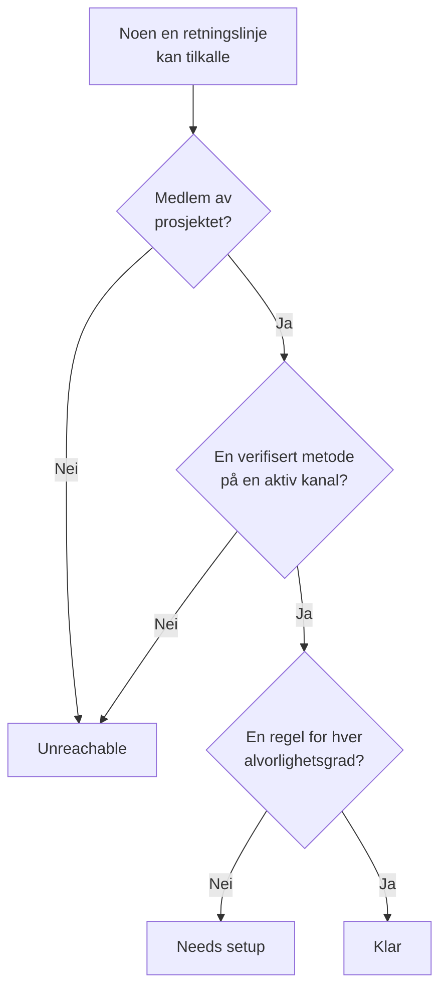

# Beredskap og rapporter

Beredskap svarer på et spørsmål før en hendelse gjør det: hvis noe gikk av akkurat nå, ville alle som vaktretningslinjene dine tilkaller, faktisk bli nådd? Siden viser hver mottaker i prosjektet, sier hvem som er klar og hvem som ikke er det, og lar deg minne folk på å gjøre ferdig oppsettet sitt. Rapporten **Brukerens vakttid** viser deretter hvor lenge hver person hadde vakt.

:::cards
- [Slik fastsettes en status](#slik-fastsettes-en-status): Klar, Needs setup eller Unreachable, og hvorfor.
- [Siden Beredskap](#siden-beredskap): Hver mottaker i prosjektet, i én liste.
- [Minn folk på å gjøre ferdig oppsettet](#minn-folk-på-å-gjøre-ferdig-oppsettet): En e-post som sier hva som mangler.
- [Brukerens vakttid](#brukerens-vakttid): Hvor lenge hver person hadde vakt.
:::

## Slik fastsettes en status

En mottaker er alle en vaktretningslinje kan tilkalle: en person som er nevnt i en eskaleringsregel, et medlem av et team en regel tilkaller, noen i et lag i en vaktplan en regel tilkaller, og personen som dekker i en brukeroverstyring som ikke har sluttet. En vaktplan som ingen retningslinje tilkaller, legger ikke til noen.

| Status | Hva den betyr |
| --- | --- |
| **Klar** | Personen har en verifisert metode på en kanal prosjektet har slått på, og en regel for hver alvorlighetsgrad, på hver fane i vaktreglene sine. |
| **Må settes opp** | Personen kan nås, men noen alvorlighetsgrader har ingen regel. Raden teller disse hullene. |
| **Utilgjengelig** | Ingenting når personen: ingen verifisert metode, hver verifisert metode er på en kanal prosjektet har slått av, eller personen er ikke medlem av prosjektet. |

Et hull er en alvorlighetsgrad uten regel, på fanen for hendelser, hendelsesepisoder, varsler eller varselepisoder. En regel som slår av en alvorlighetsgrad med vilje, er ikke et hull. En tilkalling som treffer et hull, når likevel personen på de verifiserte metodene, med mindre prosjektet har slått av den reserveløsningen: se [Når ingen regel passer](/docs/notifications/index#når-ingen-regel-passer).

## Siden Beredskap

Åpne **Vakttjeneste → Beredskap**. Kortet **On-call readiness** viser alle som en vaktretningslinje i prosjektet kan nå, med dem som trenger noe først. Alle i prosjektet kan åpne den.

Over listen teller flisene **Mottakere**, **Klar**, **Må settes opp** og **Utilgjengelig**. Klikk på **Klar**, **Må settes opp** eller **Utilgjengelig** for å vise bare de mottakerne, og klikk igjen for å vise alle.

| Kolonne | Hva den viser |
| --- | --- |
| **Mottaker** | Personen, med e-postadressen. |
| **Status** | **Klar**, **Utilgjengelig** eller hvor mange hull personen har. |
| **Kanaler** | Ett segment per kanal: fylt for en verifisert metode, hult for en som ikke er verifisert ennå. |
| **Coverage** | Hvor mange alvorlighetsgrader som har en regel, på hver fane, av alle. |
| **Reached via** | Hvordan retningslinjene når personen: hvert team som tilkaller personen gjennom en eskaleringsregel, med navnet sitt, eller **Direct**, **Tidsplan** eller **Overstyring**. |

**Coverage** i en rad viser varselmetodene til personen, hvorfor personen har statusen sin, og et rutenett over hver alvorlighetsgrad med eller uten regel. Trakten filtrerer listen etter **Mottaker**, **Status**, **Team** eller **Reached via**. Svaret kan være et minutt gammelt: **Oppdater** fastsetter det på nytt.

## Minn folk på å gjøre ferdig oppsettet

Bare personen selv kan legge til og verifisere sine egne varselmetoder og regler, så løsningen er å be dem om det.

:::steps
1. Kryss av for mottakerne du vil minne på, på siden Beredskap. Mottakere som er klare, kan ikke krysses av: det er ingenting å minne dem på.
2. Klikk på **Send påminnelse om oppsett**. Bekreftelsen nevner alle den er i ferd med å sende e-post til.
3. Bekreft. Hver person får én e-post som sier hva som mangler i deres eget oppsett, med en lenke til siden som retter det.
:::

Et banner sier deretter hvor mange påminnelser som ble sendt, hoppet over eller mislyktes, og hvorfor for hver som ikke ble sendt. Ingen blir minnet på mer enn én gang i løpet av 24 timer, og én runde minner høyst 250 personer. Å sende påminnelser krever **Prosjekteier**, **Prosjektadministrator** eller **Vaktadministrator**, eller **Edit On-Call Duty Policy** i en egendefinert rolle.

## Beredskap på andre sider

- På **Oversikt** for en retningslinje viser **Mottakernes beredskap** alle som den retningslinjen kan tilkalle, og som trenger oppmerksomhet, og **Kontroller på nytt** leser det på nytt. Din egen rad har en knapp til siden som retter det; raden til noen andre åpner en e-post til dem i ditt eget e-postprogram, med løsningen i.
- På **Eskaleringsregler** for en retningslinje sier et nivå fra på kortet sitt hvis ikke alle mottakerne kan tilkalles. Se [Eskaleringsoversikten](/docs/on-call/escalation-rules#eskaleringsoversikten).
- Under **Brukere** åpner du et medlem, og deretter **Beredskap** i seksjonen **Vakt**: statusen, metodene og dekningsrutenettet til personen.
- For ditt eget oppsett leder **Brukerinnstillinger → Oppsettsjekkliste** deg gjennom det. Se [Oppsettsjekklisten](/docs/notifications/index#oppsettsjekklisten).

## Den ukentlige e-posten om beredskap

Én gang i uken sjekker OneUptime hvert prosjekt som har en vaktretningslinje. Er noen der **Utilgjengelig** eller **Må settes opp**, får eierne av prosjektet én e-post som viser dem i to grupper, hvem som ikke kan tilkalles i det hele tatt og hvem som kan nås med hull, opptil 20 navn i hver, med en lenke til siden Beredskap.

En uke der alle er klare, sender ingenting, så e-posten betyr alltid at noe må rettes. Når noen ikke kan tilkalles i det hele tatt, starter emnet med `[Action Required]`.

## Brukerens vakttid

**Vakttjeneste → Rapporter → Brukerens vakttid** viser hvor lenge hver person hadde vakt, over et tidsrom du velger: **Siste måned** til å begynne med.

| Kolonne | Hva den viser |
| --- | --- |
| **Bruker** | Personen. |
| **Tid brukeren var på vakt** | Tiden personen hadde vakt i tidsrommet, i timer og minutter. |

Tiden registreres etter hvert som folk går på og av vakt: fra en vaktplan som en regel tilkaller, gir dem en vakt, eller de legges til i en regel direkte eller gjennom et team, til overleveringen eller til de tas av. Vakt gjennom to retningslinjer samtidig teller én gang, og tid som fortsatt pågår, teller frem til nå.

**Tidslinje for vaktplaner** og kalenderfeedene viser tidligere vakter slik rotasjonen er satt opp i dag. Denne rapporten skrives mens det skjer, så bruk den til rettferdig fordeling og vaktgodtgjørelse.

> [!NOTE]
> I OneUptime Cloud krever rapporten abonnementet **Growth**, og tid som sluttet for mer enn 200 dager siden, slettes. En selvhostet installasjon beholder alt.

## Feilsøking

:::details Noen kan ikke nås, men har et verifisert telefonnummer
Metodene deres ligger kanskje alle på kanaler prosjektet har slått av: SMS, anrop, WhatsApp og Telegram starter avslått i et nytt prosjekt. Se [Slå på en kanal for prosjektet](/docs/notifications/notification-methods#slå-på-en-kanal-for-prosjektet).
:::

:::details Noen mangler i listen
Listen inneholder bare folk som en vaktretningslinje kan tilkalle. Et teammedlem som ikke har godtatt invitasjonen, noen i en vaktplan som ingen retningslinje tilkaller, og en som dekker i en overstyring som har sluttet, er utelatt.
:::

:::details Eierne får aldri den ukentlige e-posten
Den sendes bare i en uke der noen er **Utilgjengelig** eller **Må settes opp**, og bare til eierne av prosjektet.
:::

## Neste steg

:::cards
- [Slik når OneUptime deg](/docs/notifications/index): Metodene, reglene og reserveløsningen bak hver status.
- [Varselmetoder](/docs/notifications/notification-methods): Legg til og verifiser måtene OneUptime når noen på.
- [Personlige vaktregler](/docs/notifications/on-call-rules): Tett hullene, alvorlighetsgrad for alvorlighetsgrad.
:::
