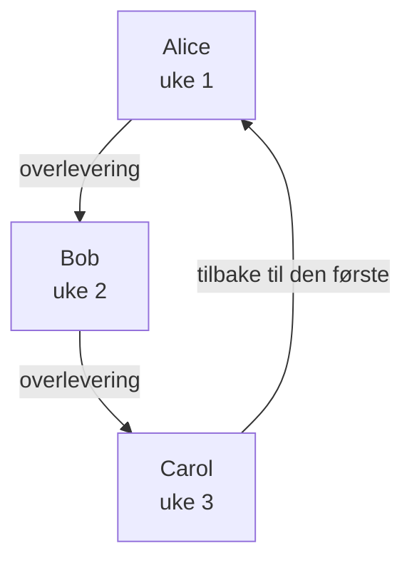
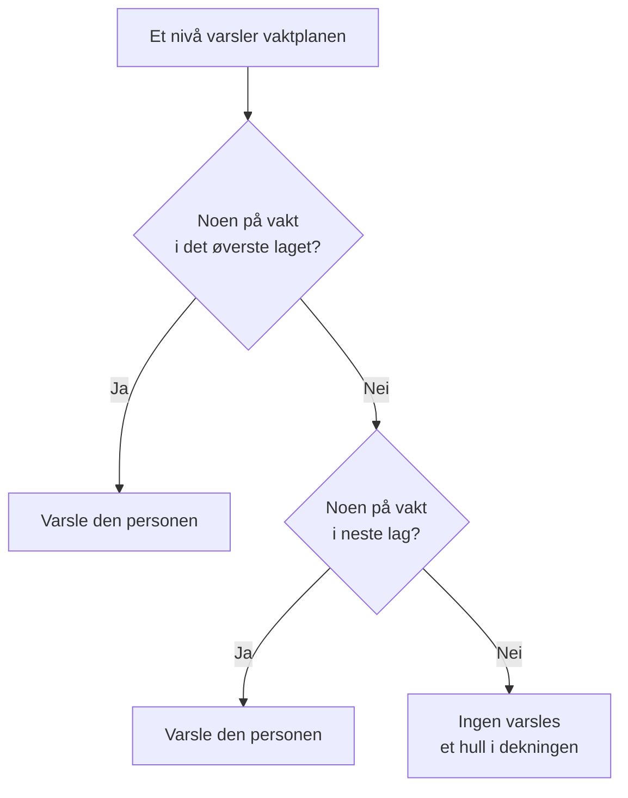

# Vaktplaner

En vaktplan bestemmer hvem som har vakt til enhver tid. Folk bytter på i den: hver har vakt en stund, og så tar den neste over. Legg til en vaktplan i eskaleringsreglene til en vaktpolicy, så varsler policyen den som har vakt i den når det nivået kjører.

> [!NOTE]
> På OneUptime Cloud hører vaktplaner til planen **Growth** og høyere. En vaktplan som et prosjekt fortsatt har, fortsetter å varsle personene i den, gjennom eskaleringsreglene som nevner den, etter at en prøveperiode for Growth er over eller planen nedgraderes. Under **Growth** viser siden **Vaktplaner** derfor merknaden om planen med vaktplanene som fortsatt er satt opp under, der du kan slette dem. Å opprette eller endre en vaktplan krever **Growth**.

:::cards
- [Hvem som bytter på](#hvem-som-bytter-på): Opprett en vaktplan med den første rotasjonen.
- [Lag](#lag): Stable rotasjoner, begrens vakttimene og legg til reservedekning.
- [Når noen er borte](#når-noen-er-borte): Hopp over noen i rotasjonen til de er tilbake.
- [API og Terraform](#opprett-vaktplaner-med-api-et-eller-terraform): Opprett vaktplaner og rotasjonene deres som kode.
:::

## Hvem som bytter på

Når du oppretter en vaktplan på siden **Vaktplaner**, spør skjemaet om **Navn** og **Hvem bytter på å ha vakt?**. Personene du velger, blir det første laget i vaktplanen, **Layer 1**, med vakt døgnet rundt.

:::steps
1. Gå til **Vakt** > **Vaktplaner**, og klikk på **Opprett vaktplan**.
2. Skriv inn et **Navn**. Et navn som en annen vaktplan i prosjektet allerede har, avvises uavhengig av store og små bokstaver og mellomrom, slik at hver velger skiller vaktplanene fra hverandre.
3. Klikk på **Legg til bruker** under **Hvem bytter på å ha vakt?**, og velg personene i den rekkefølgen de bytter på.
4. Åpne eventuelt **Flere felt** for å endre hvor lenge hver vakt varer, tidssonen, beskrivelsen eller etikettene.
5. Klikk på **Opprett vaktplan**. Den nye vaktplanen åpnes deretter på siden **Lag**, der du kan endre rotasjonen eller legge til flere lag.
:::

Personene bytter på én om gangen, og den første har vakt så snart vaktplanen er opprettet:



**Hvem bytter på å ha vakt?** er valgfritt. Lar du det stå tomt, starter vaktplanen uten lag: den setter ingen på vakt før du legger til et lag på siden **Lag**. Spørsmålet stilles bare til dem som kan legge til lag.

Alt annet ligger under **Flere felt**, slått sammen til du åpner det:

| Felt | Hva det gjør |
| --- | --- |
| **Hver vakt varer** | **1 dag**, **1 uke**, **2 uker** eller **1 måned**, og **1 uke** hvis du ikke endrer det. Det spørres om så snart noen bytter på. Hver person har vakt så lenge, og så tar den neste over, på det tidspunktet på dagen da vaktplanen ble opprettet. |
| **Tidssone** | Tidssonen overleveringstider og vakttimer holdes i. Den starter på din. Hver tidssone følger de gjeldende reglene i sin region: America/Vancouver (British Columbia) holder seg på UTC-7 hele året fra 2026. |
| **Beskrivelse** | Notater om vaktplanen. |
| **Etiketter** | Etiketter for å finne og gruppere vaktplanen. |

Så lenge noen bytter på og ingenting under **Flere felt** er endret, sier den sammenslåtte overskriften hva som vil skje: hver person har vakt i en uke, og så tar den neste over.

Også noen som er invitert til prosjektet, men ennå ikke har blitt medlem, kan bytte på å ha vakt, men ingenting varsler vedkommende før invitasjonen er godtatt, og vedkommende får ikke vite noe. Turen er et hull i dekningen, og kanalene og feeden til hver vaktpolicy som varsler vaktplanen, sier det, med navnet som ble skrevet inn med invitasjonen, aldri med e-postadressen: "⚠️ Nobody is paged for Payments through schedule Primary until tomorrow at 5:50 PM, when @bob takes over: Ivy is on call but hasn't joined the project yet." `/oneuptime oncall` i Slack og `oncall` i Microsoft Teams sier det også. Når vedkommende blir medlem, når varslene fram, vedkommende får vite hvilke vaktpolicyer som varsler vedkommende nå, og kanalene får "📞 Ivy has joined the project and is now on call for Payments until tomorrow at 5:50 PM, then @bob." Fram til da viser [Beredskap og rapporter](/docs/on-call/readiness) vedkommende, med hva som må gjøres.

## Lag

Rotasjonen i en vaktplan består av lag, på siden **Lag**. Lagene leses ovenfra og ned: det øverste laget med noen på vakt er det som varsler, så legg hovedrotasjonen øverst og reservedekningen under.



**Legg til lag** legger til et lag som starter slik det første gjør: på vakt fra nå, hver person i en uke, døgnet rundt. Utvid et lag for å legge til personer i det, og for å endre når det starter, hvor ofte det overleverer, når det overleverer første gang og timene det har vakt:

| Felt | Hva det angir |
| --- | --- |
| **Lagnavn** | Hva laget dekker, for eksempel "Primær på hverdager". |
| **Rotasjonen starter** | Datoen og klokkeslettet lagets rotasjon begynner. |
| **Bytt hver** | Hvor ofte vakten går videre til neste person i laget. |
| **Tidspunkt for første overlevering** | Den første overleveringen til neste person, ved eller etter starten. Senere overleveringer følger hvert rotasjonsintervall. |
| **Begrensninger** | Timene laget har vakt: **Ingen begrensninger**, **Bestemte tidspunkter på dagen** eller **Bestemte tidspunkter i uken**, i vaktplanens tidssone. Utenfor dem tar lavere lag over. |

For å endre hvilket lag som kommer først, bruker du pilene på kortet til et lag: **Flytt lag opp (høyere prioritet)** eller **Flytt lag ned (lavere prioritet)**.

Endringer i hvem som bytter på, venter til du lagrer dem, så du kan gjøre flere og sjekke dem før noens vakt flyttes. Dra personer i en ny rekkefølge, legg til eller fjern personer, flytt et lag opp eller ned eller slett et, og siden viser hver endring før den er lagret:

- Den du la til, er merket **Ny**, og den du dro til en ny plass, **Flyttet**. Personene du fjernet, står under **Fjernes når du lagrer**, hver med **Angre**.
- Et lag du sletter, viser at det slettes når du lagrer, med **Angre**.
- Hvert lag og den endelige vaktplanen viser rotasjonen slik den blir. Den endelige vaktplanen er merket **Inneholder ulagrede endringer**.
- En linje nederst på siden nevner endringene, med **Lagre endringer** og **Forkast**.

**Lagre endringer** lagrer alle endringene på én gang. Hvem som har vakt, regnes så ut én gang, for lagene slik de er lagret: Den som går på eller av vakt, eller er neste, får beskjed én gang, ikke én gang per endring. **Forkast** setter lagene tilbake slik de sist ble lagret. Hvis du forlater siden før du lagrer, blir du spurt først: **Lagre endringer** lagrer og forlater deretter siden, **Fortsett å redigere** blir på siden, og **Forkast endringer** forlater den uten å lagre.

Hvis noen andre endret lagene etter at du åpnet siden, lagres ikke endringene dine over deres. Linjen sier fra, og **Last inn lag på nytt** viser lagene slik de er nå, så du kan gjøre endringene dine på nytt. **Legg til lag** legger til laget med en gang, og innstillingene for et lag lagres med lagets egen knapp **Lagre lag**.

Hver person beholder én farge overalt, så du kan følge personen med et blikk: i hvert lag, i den endelige vaktplanen og overstyringene i den, og på **Tidslinje for vaktplaner**.

## Når noen er borte

Når noen drar på ferie, hopper du over dem til de er tilbake. Utvid et lag på vaktplanens side **Lag**, og klikk på **Hopp over til…** ved siden av navnet deres. Det åpner skjemaet for fravær med dem under **Hvem er borte?**, **Neste person i rotasjonen** under **Hvem dekker?** og **Starter** fra nå: sett **Slutter** til når de er tilbake, og lagre. Har personen allerede fravær da, sier skjemaet det ved siden av tidspunktene mens du velger dem, med **Rediger den overstyringen** for å endre den andre i stedet.

Mens de er borte:

- Hver av vaktene deres går til neste person i laget som ikke er borte, i alle vaktplaner de er med i. Ingen andres vakter flytter seg, og deres egne er deres igjen så snart de er tilbake.
- Hvis alle i et lag er borte, har laget ingen på vakt, og lagene under tar over. Laget viser **Alle i dette laget er borte akkurat nå**.
- Eskaleringsregler som varsler dem direkte eller gjennom et team, hopper over dem. Kjøringen av policyen viser at de er borte, og til når.
- Raden deres i laget viser når de er tilbake, og den endelige vaktplanen og **Tidslinje for vaktplaner** viser hvem som har hver av vaktene deres.

Velg i stedet noen under **Hvem dekker?**, så får den personen alle varslene deres fra alle vaktplaner og alle policyer, i stedet for at rotasjonen tar vaktene deres.

Fravær som legges til på denne måten, gjelder for alle vaktpolicyer, så det krever tillatelsen for overstyringer over hele prosjektet. Er teamets rolle begrenset til egne policyer eller til noen etiketter, legges det i stedet på policyene i denne vaktplanen du kan legge til overstyringer på, med én overstyring per policy, som står på hver policys egen side **Brukeroverstyringer**; er det flere, krysser du dem av under **Vaktpolicyer**. **Hopp over til…** er bare låst og sier hvorfor der du ikke kan på noen av dem. Det står under **Vakt** > **Tidsplaner** > **Brukeroverstyringer**, og blant vaktplanens brukeroverstyringer på siden **Lag**, der **Avslutt nå** får dem tilbake tidligere. For å hoppe over noen i bare én policy legger du til overstyringen på den policyens side **Brukeroverstyringer** og lar **Hvem dekker?** være som det er. Se [Brukeroverstyringer](/docs/on-call/user-overrides).

Via API-et hopper en brukeroverstyring (`/api/on-call-duty-policy-user-override`) som opprettes uten `routeAlertsToUserId`, over personen i `overrideUserId` fra `startsAt` til `endsAt`.

**Oversikt** for en vaktplan har kortet **Brukes av**: vaktpolicyene der eskaleringsreglene varsler den som har vakt, med reglene som gjør det. Gjør ingen det, sier kortet det og lenker til vaktpolicyene. Når du sletter vaktplanen, på siden dens eller fra listen, sies det først hvilke policyer som varsler via den. Policyer du ikke kan åpne, telles, men navngis ikke. En vaktplan som har samme navn som en annen vaktplan fra før navn måtte være forskjellige, er merket med **Samme navn som en annen tidsplan** i listen **Vaktplaner**, som viser hvor mange det er: sammenlign lagene deres, og gi så én av dem nytt navn med **Gi nytt navn** på raden til vaktplanen.

## Opprett vaktplaner med API-et eller Terraform

Vaktplaner er ressursen `/api/on-call-duty-policy-schedule`; lagene deres og personene i dem er ressursene `/api/on-call-duty-schedule-layer` og `/api/on-call-duty-schedule-layer-user`.

- Å opprette en vaktplan med `firstLayerUsers` (en liste med bruker-ID-er, i den rekkefølgen de bytter på) i `miscDataProps` gir den det første laget, slik dashbordet gjør: **Layer 1**, på vakt fra nå, døgnet rundt. `firstLayerRotation` sier hvor lenge hver vakt varer, som en rotasjon som `{"_type": "Recurring", "value": {"intervalType": "Week", "intervalCount": 1}}`; uten den en uke. Hver bruker må være medlem av prosjektet, og den som kaller, må ha lov til å opprette lag, ellers blir ikke vaktplanen opprettet.
- En vaktplan som opprettes uten dem, har ingen lag, som før; Terraforms ressurs for vaktplaner sender dem ikke.
- Et lag som opprettes uten `rotation`, overleverer daglig, slik det alltid har gjort.
- En endring i lagene i en vaktplan og personene i dem, gjort med API-et eller Terraform, meldes som én endring: Hvem som har vakt, regnes ut når lagene ikke er endret på et halvt minutt, og den som går på eller av vakt, eller er neste, får beskjed én gang, ikke én gang per lag eller person som skrives. Varsler går til den lagene setter på vakt så snart hver endring er lagret.
- For å endre på én gang hvem som tar vakter i lagene i en vaktplan, slik **Lagre endringer** på siden **Lag** gjør, leser du lagene med `GET /api/on-call-duty-policy-schedule/<schedule-id>/layers` og sender dem tilbake, endret, til `POST /api/on-call-duty-policy-schedule/<schedule-id>/save-layers`. De nevner hvert lag vaktplanen beholder, det med høyest prioritet først, hvert med personene sine i vaktrekkefølge: den som allerede er i et lag, med sin `layerUserId`, den som legges til, bare med `userId`. `deletedLayerIds` nevner lagene som skal slettes.
- En lagring skrives helt eller ikke i det hele tatt, og hvem som har vakt, regnes ut én gang, med en gang. En som gjøres etter at noen andre har endret lagene, avvises med 409, fordi `basedOnVersion` ikke lenger er lagenes: les lagene på nytt, og gjør endringen på det som er der nå. Terraform-ressursen `oneuptime_on_call_schedule_layers` lagrer lagene i en vaktplan på denne måten.

```bash
curl -X POST https://oneuptime.com/api/on-call-duty-policy-schedule \
  -H "apikey: $ONEUPTIME_API_KEY" \
  -H "Content-Type: application/json" \
  -d '{
    "data": {
      "projectId": "<project-id>",
      "name": "Primary on-call",
      "timezone": "Europe/Berlin"
    },
    "miscDataProps": {
      "firstLayerUsers": ["<user-id-1>", "<user-id-2>", "<user-id-3>"],
      "firstLayerRotation": {"_type": "Recurring", "value": {"intervalType": "Week", "intervalCount": 1}}
    }
  }'
```

```bash
curl https://oneuptime.com/api/on-call-duty-policy-schedule/<schedule-id>/layers \
  -H "apikey: $ONEUPTIME_API_KEY"

curl -X POST https://oneuptime.com/api/on-call-duty-policy-schedule/<schedule-id>/save-layers \
  -H "apikey: $ONEUPTIME_API_KEY" \
  -H "Content-Type: application/json" \
  -d '{
    "basedOnVersion": "<the version the read answered>",
    "layers": [
      {
        "layerId": "<layer-id>",
        "users": [
          {"layerUserId": "<row-of-user-2>", "userId": "<user-id-2>"},
          {"layerUserId": "<row-of-user-1>", "userId": "<user-id-1>"},
          {"userId": "<user-id-4>"}
        ]
      }
    ],
    "deletedLayerIds": []
  }'
```

## Neste steg

:::cards
- [Eskaleringsregler](/docs/on-call/escalation-rules): La et nivå i en vaktpolicy varsle denne vaktplanen.
- [Tidslinje for vaktplaner](/docs/on-call/schedule-timeline): Se alle vaktplanene side om side, med hull i dekningen.
- [Kalenderfeeder](/docs/on-call/calendar-feeds): Få vakter inn i Google Kalender, Outlook eller Apple Kalender.
- [Slik når man meg](/docs/notifications/on-call-rules): Bestem hvordan en varsling når deg mens du har vakt.
:::
