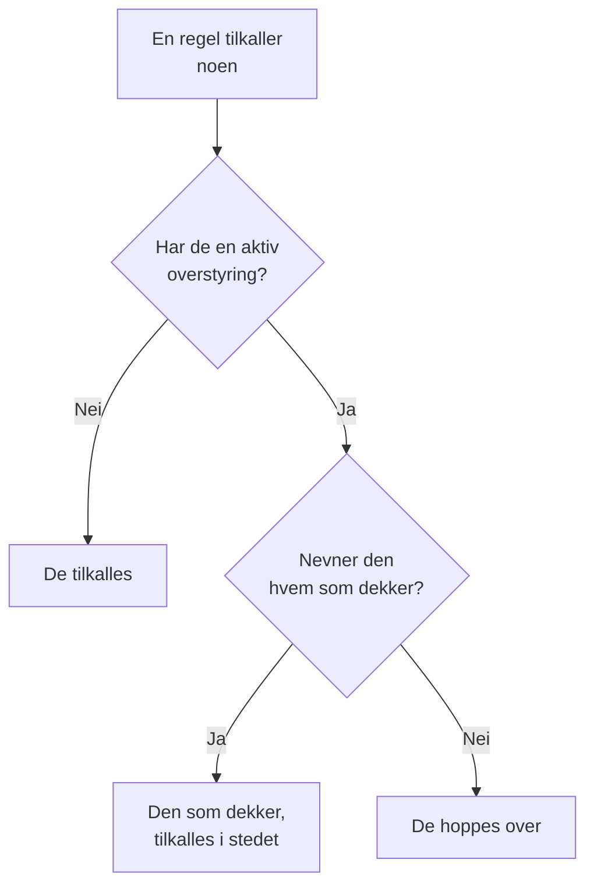

# Brukeroverstyringer

Mens noen er borte, sender en brukeroverstyring tilkallingene som ville nådd dem, til personen som dekker for dem, i et bestemt tidsrom. Er ingen valgt til å dekke, hopper den i stedet over dem: hver av vaktene deres i en vaktplan går til neste person i rotasjonen. Bruk en til en ferie, en sykedag eller en byttet vakt.

:::cards
- [Slik endrer en overstyring en tilkalling](#slik-endrer-en-overstyring-en-tilkalling): Hvem som tilkalles i stedet, og når.
- [Legg til en overstyring](#legg-til-en-overstyring): Hvem som er borte, hvem som dekker, fra når og til når.
- [Rediger en overstyring](#rediger-en-overstyring): Endre hvem som dekker, eller når den starter og slutter.
- [Avslutt en overstyring tidligere](#avslutt-en-overstyring-tidligere): Hent noen tilbake før overstyringen slutter.
- [Alle policyer, eller én](#alle-policyer-eller-én): Hvor du legger til en overstyring, og hvilken som vinner.
- [Andre måter å legge til en på](#andre-måter-å-legge-til-en-på): Fra en vaktplan og fra de kommende vaktene dine.
:::

## Slik endrer en overstyring en tilkalling



Mens en overstyring gjelder, fra start til slutt:

- Står det noen under **Hvem dekker?**, får den personen alle tilkallingene til personen som er borte, fra hver vaktplan, hvert team og hver regel overstyringen gjelder for. Tilkallingen når dem gjennom deres egne personlige vaktregler.
- Er det ingen som dekker, hoppes personen over. I en vaktplan går hver av vaktene deres til neste person i rotasjonen som ikke er borte; er alle i et lag borte, tar lagene under over. En regel som nevner dem direkte, eller gjennom et team, tilkaller dem ikke, og kjøringen av policyen viser at de er borte, og til når.
- Overstyringer kjedes ikke. Er personen som dekker, også borte, er det fortsatt de som tilkalles for personen de dekker for.

Når overstyringen slutter, er tilkallingene deres igjen. **Tidslinje for vaktplaner**, lagene i en vaktplan og kalenderfeedene viser alle hvem som har hver dekket vakt.

## Legg til en overstyring

:::steps
### Åpne overstyringene

Gå til **Vakt → Tidsplaner → Brukeroverstyringer** for å dekke for noen i alle vaktpolicyer, eller til en policys egen side **Brukeroverstyringer**, under **Avansert**, for å dekke for dem bare i den policyen. Klikk på **Legg til Brukeroverstyring**.

### Si hvem som er borte

**Hvem er borte?** starter med deg, fordi det vanligste er å registrere din egen fritid. Velg noen andre for å ordne dekning for dem.

### Si hvem som dekker

La **Hvem dekker?** stå på **Neste person i rotasjonen** for å hoppe over dem, eller velg kollegaen som tar alle tilkallingene deres. Personen som er borte, tilbys ikke.

### Angi tiden

**Starter** er nå, med mindre du velger et annet tidspunkt. Sett **Slutter** til når de er tilbake: det må være etter starten. Klikk på **Legg til Brukeroverstyring**.
:::

Hver overstyring er en rad: **Borte**, **Dekket av**, **Starter** og **Slutter**, filtrert etter start og slutt. **Dekket av** viser **Neste person i rotasjonen** for en overhopping.

## Rediger en overstyring

Klikk på **Rediger** i raden til en overstyring, på en av de to sidene **Brukeroverstyringer** eller i listen over brukeroverstyringer på siden **Lag** for en vaktplan. Skjemaet åpnes med overstyringen slik den ble lagret: endre den, og klikk på **Lagre endringer**.

- **Hvem dekker?** kan endres til overstyringen slutter. Sett den tilbake til **Neste person i rotasjonen** for å hoppe over personen i stedet.
- **Starter** kan flyttes til overstyringen starter, og blir deretter som den er. **Slutter** kan flyttes til overstyringen slutter: bruk **Avslutt nå** for å avslutte den nå. Ingen av dem kan flyttes til fortiden.
- **Hvem er borte?** kan ikke endres. Legg til en ny overstyring for noen andre.

En overstyring som er avsluttet, kan ikke lenger endres: **Rediger** for den er låst og sier hvorfor. OneUptime-mobilappen redigerer overstyringer etter de samme reglene.

## Avslutt en overstyring tidligere

For å hente noen tilbake før overstyringen slutter, klikker du på **Avslutt nå**: i menyen på raden til overstyringen på en av de to sidene **Brukeroverstyringer**, ved siden av den i listen over brukeroverstyringer på siden **Lag** for en vaktplan, eller under **Slutter** i redigeringsskjemaet. Den spør først og sier hva som skjer med tiden som er igjen: den som dekker, slutter å dekke for personen, eller personen blir ikke lenger hoppet over, og fra da av er tilkallingene deres igjen. Overstyringen slutter så med en gang.

**Avslutt nå** tilbys bare mens en overstyring pågår: en som ikke har startet ennå, har ingenting å avslutte, så slett den i stedet. Mobilappen avslutter en pågående overstyring på samme måte.

## Alle policyer, eller én

| Lagt til under | Kort | Gjelder for |
| --- | --- | --- |
| **Vakt → Tidsplaner → Brukeroverstyringer** | **Globale brukeroverstyringer** | Alle vaktpolicyer i prosjektet |
| **Brukeroverstyringer** for en policy | **Brukeroverstyringer for vaktpolicyen** | Bare den policyen |

To overstyringer for samme person kan ikke overlappe på samme policy, heller ikke når begge er globale. Skjemaet, og **Hopp over til…** i lagene til en vaktplan, sier det ved siden av tidspunktene så snart de er valgt, med **Rediger den overstyringen** for å endre den andre i stedet. Den ene kan slutte når den neste starter.

En policys egen overstyring kan overlappe en global for samme person: på den policyen brukes dens egen mens begge gjelder, og skjemaet sier det. En tilkalling uten policy, fra en arbeidsflyt eller fra chat, følger bare de globale overstyringene.

Overstyringer som allerede overlappet før denne regelen, blir som de er. Begge er merket med **Overlapper**, som sier hvilken som brukes: en som nevner hvem som dekker, foran en overhopping, deretter den som starter først, deretter den som ble lagt til først. Begge kan likevel kortes ned eller avsluttes med **Avslutt nå**: bare en endring som legger til tid, omfattes av regelen.

## Andre måter å legge til en på

- Fra en vaktplan: utvid et lag på siden **Lag** for en vaktplan, og klikk på **Hopp over til…** ved siden av en person. Det åpner det samme skjemaet med personen som borte og rotasjonen som dekker, som en global overstyring. Se [Når noen er borte](/docs/on-call/schedules#når-noen-er-borte).
- Fra de kommende vaktene dine: **Finn avløser** på en av vaktene dine, under **Brukerinnstillinger → Profil og kalender → Kalenderfeed**, åpner skjemaet med deg som borte for tidene til den vakten, så bare **Hvem dekker?** gjenstår. Se [Kommende vakter og avløsning](/docs/on-call/calendar-feeds#kommende-vakter-og-avløsning).

Når noen forlater prosjektet, slettes hver overstyring som nevner dem og ikke har sluttet ennå, på begge sider.

## Hvem som kan legge til overstyringer

**Prosjekteier**, **Prosjektadministrator**, **Prosjektmedlem**, **Vaktadministrator** og **Vaktmedlem** kan legge til, redigere og slette overstyringer; **Leser** og **Vaktleser** kan se dem. I en egendefinert rolle heter tillatelsene **Create On-Call Policy User Override**, **Edit On-Call Policy User Override**, **Delete On-Call Policy User Override** og **Read On-Call Policy User Override**. På **Tidslinje for vaktplaner** ser bare folk som kan lese overstyringer, hvem sin vakt som dekkes.

En overstyring på en policy følger policyens omfang. Gi et team **Vaktmedlem** begrenset til policyene det eier, eller til etiketten sin, så legger medlemmene til, redigerer og sletter overstyringer bare på de policyene. En global overstyring gjelder for alle policyer, også et annet teams, så å legge til, redigere eller slette en krever tillatelsen for overstyringer over hele prosjektet. Med en smalere tillatelse er **Legg til Brukeroverstyring**, **Rediger**, **Avslutt nå** og **Slett** under **Vakt → Tidsplaner → Brukeroverstyringer** låst og sier hvorfor. **Hopp over til…** i lagene til en vaktplan og **Finn avløser** på de kommende vaktene dine, som legger til globale overstyringer, tilbyr i stedet policyene du kan legge til overstyringer på, med én overstyring per policy, og det samme gjør avløsningen i mobilappen; der du ikke kan på noen av dem, er de låst og sier hvorfor. Teamet legger til overstyringene sine på hver policys egen side **Brukeroverstyringer**. Det samme gjelder for API-et: en overstyring uten `onCallDutyPolicyId` avvises for en tillatelse begrenset til etiketter eller til eide policyer.

Vil du la et team ordne dekning bare blant sine egne folk, gir du det **Manage On-Call Policy User Overrides for Own Team**, direkte eller gjennom en egendefinert rolle. Medlemmene legger da til, redigerer og sletter overstyringer bare når personen som er borte og personen som dekker, hver for seg er i et av teamene deres som har fått denne tillatelsen; de andre teamene deres teller ikke. **Hvem er borte?** og **Hvem dekker?** viser bare folkene i de teamene og sier hvorfor, og **Rediger**, **Avslutt nå** og **Slett** er låst og sier hvorfor på en overstyring som nevner noen andre. For å se overstyringene trenger de fortsatt **Read On-Call Policy User Override**, eller en rolle som har den, som **Vaktleser**. API-et, Terraform og mobilappen holdes til samme regel; en API-nøkkel er ikke på noe team og når ingen med den. Den som også har **Vaktmedlem**, eller en annen tillatelse som når alle, begrenses ikke av den.

I OneUptime Cloud krever brukeroverstyringer abonnementet **Growth**.

## API

Brukeroverstyringer er ressursen `/api/on-call-duty-policy-user-override`:

| Felt | Hva det inneholder |
| --- | --- |
| `overrideUserId` | Personen som er borte. Påkrevd. |
| `routeAlertsToUserId` | Personen som dekker. Utelat det for å hoppe over personen i stedet. |
| `startsAt`, `endsAt` | Når overstyringen starter og slutter. Begge er påkrevd, og slutten kommer etter starten. |
| `onCallDutyPolicyId` | Policyen den gjelder for. Utelat det for en global overstyring. |

```bash
curl -X POST https://oneuptime.com/api/on-call-duty-policy-user-override \
  -H "apikey: $ONEUPTIME_API_KEY" \
  -H "Content-Type: application/json" \
  -d '{
    "data": {
      "projectId": "<project-id>",
      "overrideUserId": "<away-user-id>",
      "routeAlertsToUserId": "<cover-user-id>",
      "startsAt": "2026-12-22T09:00:00Z",
      "endsAt": "2027-01-05T09:00:00Z"
    }
  }'
```

En overstyring der personen som er borte og personen som dekker er den samme, avvises, og det samme gjør en som slutter før den starter. Det samme gjør en som overlapper en annen overstyring for samme person på samme policy, eller når begge er globale: avvisningen nevner den den overlapper.

For å endre en overstyring sender du `PUT /api/on-call-duty-policy-user-override/<override-id>` med feltene som skal endres, i `data`: `routeAlertsToUserId` (`null` for å hoppe over personen i stedet), `startsAt` og `endsAt`. `overrideUserId` og `onCallDutyPolicyId` kan ikke endres. En overstyring som er avsluttet, kan ikke endres, heller ikke starten på en som har startet, og et tidspunkt som endres, kan ikke flyttes til fortiden.

For å avslutte en pågående overstyring sender du `POST /api/on-call-duty-policy-user-override/<override-id>/end-now`. Den slutter etter serverens klokke, og svaret gir den nye `endsAt`. En som ikke har startet ennå, eller som allerede er avsluttet, avvises.

## Feilsøking

:::details Personen på ferie ble likevel tilkalt
Sjekk hvor overstyringen ble lagt til. En på en policys side **Brukeroverstyringer** dekker bare den policyen, og andre policyer tilkaller dem fortsatt: legg den til under **Vakt → Tidsplaner → Brukeroverstyringer** for å dekke alle policyer. Sjekk også **Starter** og **Slutter**: tidene vises i din tidssone.
:::

:::details Personen som dekker, ble heller ikke tilkalt
De nås gjennom sine egne personlige vaktregler og verifiserte metoder. Slå dem opp under **Vakt → Beredskap**, og sjekk kjøringen i **Utførelseslogger** for policyen.
:::

:::details Jeg kan ikke legge til en overstyring
Det krever en av rollene over, og i OneUptime Cloud abonnementet **Growth**. En global overstyring krever rollen over hele prosjektet: er teamets rolle begrenset til egne policyer eller til noen etiketter, legger du til overstyringen på policyens egen side **Brukeroverstyringer**. **Hopp over til…**, **Finn avløser** og mobilappen tilbyr da bare policyene du kan legge til overstyringer på, og er låst der du ikke kan på noen av dem.
:::

:::details En overstyring kan ikke lagres fordi den overlapper en annen
Personen har allerede en overstyring på noen av de tidspunktene: på samme policy, eller en global når denne også er global. Klikk på **Rediger den overstyringen** under **Slutter** for å endre den i stedet, eller velg tidspunkter som ikke overlapper den.
:::

## Neste steg

:::cards
- [Vaktplaner](/docs/on-call/schedules): Rotasjoner, lag og å hoppe over noen i et lag.
- [Tidslinje for vaktplaner](/docs/on-call/schedule-timeline): Se hver dekket vakt på tvers av alle vaktplaner.
- [Kalenderfeeder](/docs/on-call/calendar-feeds): Finn en avløser for en av dine egne vakter.
:::
