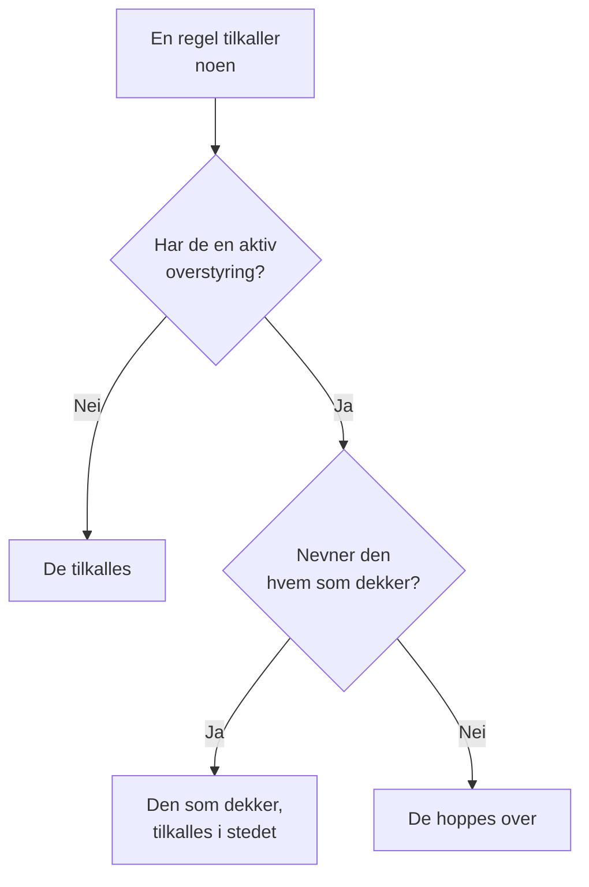

# Brukeroverstyringer

Mens noen er borte, sender en brukeroverstyring tilkallingene som ville nådd dem, til personen som dekker for dem, i et bestemt tidsrom. Er ingen valgt til å dekke, hopper den i stedet over dem: hver av vaktene deres i en vaktplan går til neste person i rotasjonen. Bruk en til en ferie, en sykedag eller en byttet vakt.

:::cards
- [Slik endrer en overstyring en tilkalling](#slik-endrer-en-overstyring-en-tilkalling): Hvem som tilkalles i stedet, og når.
- [Legg til en overstyring](#legg-til-en-overstyring): Hvem som er borte, hvem som dekker, fra når og til når.
- [Alle retningslinjer, eller én](#alle-retningslinjer-eller-én): Hvor du legger til en overstyring, og hvilken som vinner.
- [Andre måter å legge til en på](#andre-måter-å-legge-til-en-på): Fra en vaktplan og fra de kommende vaktene dine.
:::

## Slik endrer en overstyring en tilkalling



Mens en overstyring gjelder, fra start til slutt:

- Står det noen under **Hvem dekker?**, får den personen alle tilkallingene til personen som er borte, fra hver vaktplan, hvert team og hver regel overstyringen gjelder for. Tilkallingen når dem gjennom deres egne personlige vaktregler.
- Er det ingen som dekker, hoppes personen over. I en vaktplan går hver av vaktene deres til neste person i rotasjonen som ikke er borte; er alle i et lag borte, tar lagene under over. En regel som nevner dem direkte, eller gjennom et team, tilkaller dem ikke, og kjøringen av retningslinjen viser at de er borte, og til når.
- Overstyringer kjedes ikke. Er personen som dekker, også borte, er det fortsatt de som tilkalles for personen de dekker for.

Når overstyringen slutter, er tilkallingene deres igjen. **Tidslinje for vaktplaner**, lagene i en vaktplan og kalenderfeedene viser alle hvem som har hver dekket vakt.

## Legg til en overstyring

:::steps
### Åpne overstyringene

Gå til **Vakttjeneste → Avansert → Brukeroverstyringer** for å dekke for noen i alle vaktretningslinjer, eller til en retningslinjes egen side **Brukeroverstyringer**, under **Avansert**, for å dekke for dem bare i den retningslinjen. Klikk på **Legg til Brukeroverstyring**.

### Si hvem som er borte

**Hvem er borte?** starter med deg, fordi det vanligste er å registrere din egen fritid. Velg noen andre for å ordne dekning for dem.

### Si hvem som dekker

La **Hvem dekker?** stå på **Neste person i rotasjonen** for å hoppe over dem, eller velg kollegaen som tar alle tilkallingene deres. Personen som er borte, tilbys ikke.

### Angi tiden

**Starter** er nå, med mindre du velger et annet tidspunkt. Sett **Slutter** til når de er tilbake: det må være etter starten. Klikk på **Legg til Brukeroverstyring**.
:::

Hver overstyring er en rad: **Borte**, **Dekket av**, **Starter** og **Slutter**, filtrert etter start og slutt. **Dekket av** viser **Neste person i rotasjonen** for en overhopping. En overstyring kan ikke redigeres: slett den og legg til en ny, eller slett den for å få noen tilbake tidligere.

## Alle retningslinjer, eller én

| Lagt til under | Kort | Gjelder for |
| --- | --- | --- |
| **Vakttjeneste → Avansert → Brukeroverstyringer** | **Globale brukeroverstyringer** | Alle vaktretningslinjer i prosjektet |
| **Brukeroverstyringer** for en retningslinje | **Brukeroverstyringer for vaktretningslinjen** | Bare den retningslinjen |

Når to overstyringer for samme person overlapper, vinner retningslinjens egen over en global, og en som nevner hvem som dekker, vinner over en overhopping. En tilkalling uten retningslinje, fra en arbeidsflyt eller fra chat, følger bare de globale overstyringene.

## Andre måter å legge til en på

- Fra en vaktplan: utvid et lag på siden **Lag** for en vaktplan, og klikk på **Hopp over til…** ved siden av en person. Det åpner det samme skjemaet med personen som borte og rotasjonen som dekker, som en global overstyring. Se [Når noen er borte](/docs/on-call/schedules#når-noen-er-borte).
- Fra de kommende vaktene dine: **Finn avløser** på en av vaktene dine, under **Brukerinnstillinger → Kalender → Kalenderfeed**, åpner skjemaet med deg som borte for tidene til den vakten, så bare **Hvem dekker?** gjenstår. Se [Kommende vakter og avløsning](/docs/on-call/calendar-feeds#kommende-vakter-og-avløsning).

Når noen forlater prosjektet, slettes hver overstyring som nevner dem og ikke har sluttet ennå, på begge sider.

## Hvem som kan legge til overstyringer

**Prosjekteier**, **Prosjektadministrator**, **Prosjektmedlem**, **Vaktadministrator** og **Vaktmedlem** kan legge til og slette overstyringer; **Leser** og **Vaktleser** kan se dem. I en egendefinert rolle heter tillatelsene **Create On-Call Duty Policy User Override**, **Delete On-Call Duty Policy User Override** og **Read On-Call Duty Policy User Override**. På **Tidslinje for vaktplaner** ser bare folk som kan lese overstyringer, hvem sin vakt som dekkes.

I OneUptime Cloud krever brukeroverstyringer abonnementet **Growth**.

## API

Brukeroverstyringer er ressursen `/api/on-call-duty-policy-user-override`:

| Felt | Hva det inneholder |
| --- | --- |
| `overrideUserId` | Personen som er borte. Påkrevd. |
| `routeAlertsToUserId` | Personen som dekker. Utelat det for å hoppe over personen i stedet. |
| `startsAt`, `endsAt` | Når overstyringen starter og slutter. Begge er påkrevd, og slutten kommer etter starten. |
| `onCallDutyPolicyId` | Retningslinjen den gjelder for. Utelat det for en global overstyring. |

```bash
curl -X POST https://oneuptime.com/api/on-call-duty-policy-user-override \
  -H "apikey: $ONEUPTIME_API_KEY" \
  -H "Content-Type: application/json" \
  -d '{
    "data": {
      "projectId": "<project-id>",
      "overrideUserId": "<away-user-id>",
      "routeAlertsToUserId": "<cover-user-id>",
      "startsAt": "2026-12-22T09:00:00Z",
      "endsAt": "2027-01-05T09:00:00Z"
    }
  }'
```

En overstyring der personen som er borte og personen som dekker er den samme, avvises, og det samme gjør en som slutter før den starter.

## Feilsøking

:::details Personen på ferie ble likevel tilkalt
Sjekk hvor overstyringen ble lagt til. En på en retningslinjes side **Brukeroverstyringer** dekker bare den retningslinjen, og andre retningslinjer tilkaller dem fortsatt: legg den til under **Vakttjeneste → Avansert → Brukeroverstyringer** for å dekke alle retningslinjer. Sjekk også **Starter** og **Slutter**: tidene vises i din tidssone.
:::

:::details Personen som dekker, ble heller ikke tilkalt
De nås gjennom sine egne personlige vaktregler og verifiserte metoder. Slå dem opp under **Vakttjeneste → Beredskap**, og sjekk kjøringen i **Utførelseslogger** for retningslinjen.
:::

:::details Jeg kan ikke legge til en overstyring
Det krever en av rollene over, og i OneUptime Cloud abonnementet **Growth**.
:::

## Neste steg

:::cards
- [Vaktplaner](/docs/on-call/schedules): Rotasjoner, lag og å hoppe over noen i et lag.
- [Tidslinje for vaktplaner](/docs/on-call/schedule-timeline): Se hver dekket vakt på tvers av alle vaktplaner.
- [Kalenderfeeder](/docs/on-call/calendar-feeds): Finn en avløser for en av dine egne vakter.
:::
