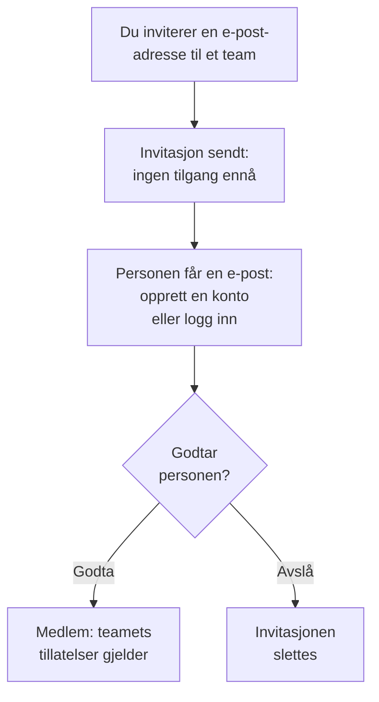

# Inviter personer

Folk kommer inn i et prosjekt via en invitasjon. Du inviterer en persons e-postadresse til et team, personen godtar, og fra da av bestemmer teamet hva personen kan gjøre. Denne siden viser hvordan du inviterer folk, hva de ser, og hvordan du endrer eller avslutter tilgangen deres senere.

:::cards
- [Inviter noen](#inviter-noen): En e-postadresse og et team.
- [Godta en invitasjon](#godta-en-invitasjon): Hva den inviterte ser og gjør.
- [Endre teamene til en person](#endre-teamene-til-en-person): Gi mer tilgang, eller mindre.
- [Fjern noen](#fjern-noen-fra-prosjektet): Hva det tar med seg å forlate prosjektet.
:::

## Slik fungerer en invitasjon

- **Teamet bestemmer hva personen kan gjøre.** Ingen har egne tillatelser: en person kan gjøre det teamene personen er med i tillater. Se [Brukere, team og tillatelser](/docs/permissions/index).
- **Ingenting gis før personen godtar.** En ventende invitasjon vises som **Invitasjon sendt** og gir ingen tilgang til prosjektet.
- **Én godkjenning gjelder hele prosjektet.** Når en invitasjon godtas, godtas også alle personens andre invitasjoner til samme prosjekt. Et medlem du senere legger til i et annet team, er med med en gang, uten noe å godta.

## Før du begynner

- **En rolle som kan invitere.** Project Owner, Project Admin eller en rolle med tillatelsen **Invite New Members**. Du kan bare invitere folk til et team der du selv har tillatelsene, fordi en invitasjon gir dem teamets tilgang. En Project Admin uten noen blokkering regnes her som innehaver av alt Project Admin allerede kan: de kan invitere folk til **Members** eller til et team med en hvilken som helst smalere rolle, men ikke til et team som har Project Owner, en faktureringstillatelse, **Delete Project**, **Edit Project**, **Edit Team** eller **Invite New Members**.
- **I OneUptime Cloud: plass i abonnementet ditt.** Hver person i prosjektet er en plass på regningen, fra det øyeblikket personen blir invitert. Free-abonnementet har plass til én person. Se [Fakturering og bruk](/docs/configuration/billing#abonnementet-og-plassene-dine).
- **Ingen SCIM Push Groups.** Så lenge identitetsleverandøren din styrer prosjektets team via SCIM Push Groups, inviterer og fjerner du folk der, ikke i OneUptime.

## Inviter noen

:::steps
### Åpne Brukere

Gå til **Produkter → Innstillinger → Brukere**. Listen **Brukere** viser alle i prosjektet, teamene deres og om de har blitt med.

### Klikk på Inviter bruker

Klikk på **Inviter bruker**. Dialogen **Inviter ny bruker** åpnes.

### Skriv inn e-postadressen

Skriv adressen i **E-post**. Hvis ingen OneUptime-konto bruker den ennå, ber dialogen også om et **Navn**, som den nye kontoen starter med.

### Velg teamet

**Team** starter på prosjektets medlemsteam: teamet som har Project Member for hele prosjektet, ellers det som heter Members. Velg et annet team for å gi mer eller mindre tilgang. **Team** står tomt når prosjektet ikke har et slikt team, eller når du ikke selv kunne invitert noen til det.

### Send invitasjonen

Klikk på **Inviter**. OneUptime sender invitasjonen på e-post og åpner personens side. Personen vises som **Invitasjon sendt** til invitasjonen er godtatt.
:::

> [!TIP]
> Inviter folk til det minste teamet som lar dem gjøre jobben sin. Du kan legge dem til i flere team senere, og hvert team de blir med i, utvider hva de kan gjøre.

## Godta en invitasjon

Invitasjonsmeldingen nevner prosjektet. Knappen i den er **Create Your Account** for den som ikke har en OneUptime-konto ennå, og **Sign In to OneUptime** for den som har en. Etter innlogging godtar personen på ett av to steder:

| Hvor personen er | Hva personen ser | Hva personen klikker på |
| --- | --- | --- |
| Ennå ikke i noe prosjekt | Invitasjonen, på siden personen kommer til etter innlogging | **Accept & Join** eller **Decline** |
| Allerede i et annet prosjekt | Den ventende invitasjonen ved bjellen øverst til høyre, som åpner **Prosjektinvitasjoner** | **Godta** eller **Avvis** |

Når personen godtar, er den med i prosjektet med en gang, med teamets tillatelser og varseloppsettet alle medlemmer starter med: se [Det du starter med](/docs/notifications/index#dette-starter-du-med). Å avslå sletter invitasjonen, så det trengs en ny for å bli med senere.

## Se hvem som er i prosjektet

**Brukere** har én rad per person:

| Kolonne | Hva den viser |
| --- | --- |
| **Bruker** | Navn og e-postadresse. |
| **Team** | Hvert av prosjektets team personen er med i eller invitert til. |
| **Status** | **Medlem** når personen har blitt med, med antallet invitasjoner til andre team som ikke er godtatt ennå. **Invitasjon sendt** til da. |

Filtrer listen etter **Bruker**, **Status** eller **Team**. Klikk på en rad for å åpne personens side:

| Side | Hva den brukes til |
| --- | --- |
| **Profil** | Navn, e-postadresse, bilde og bruker-ID. |
| **Team** | Teamene personen er med i. Legg til eller fjern et team her. |
| **Beredskap**, **Varselmetoder**, **Vaktregler** | Om personen kan tilkalles, og hvordan. Vises for Project Owners, Project Admins, personen selv og alle som kan lese andres varselregler. Se [Beredskap og rapporter](/docs/on-call/readiness). |
| **Egendefinerte felt** | Prosjektets egendefinerte felt for personer, hvis det har noen. |
| **Fjern fra prosjekt** | Ta personen ut av prosjektet. |

## Endre teamene til en person

:::steps
### Åpne personens Team-side

Under **Brukere** klikker du på personen og deretter på **Team**.

### Legg personen til i et team

Klikk på **Inviter**, velg **Team**, og klikk på **Inviter** i dialogen. Et medlem er med i det nye teamet med en gang. Den som ikke har blitt med ennå, får én invitasjon til, og når den ene godtas, godtas begge.

### Ta personen ut av et team

Klikk på **Fjern** i teamets rad. Er det det siste teamet personen har blitt med i, tar fjerningen personen ut av prosjektet, og dialogen sier det før noe endres.
:::

Owners-teamet beholder alltid minst ett medlem som har blitt med, så et prosjekt aldri mister sin siste eier.

## Fjern noen fra prosjektet

Under **Brukere** åpner du radmenyen til personen, **⋯**, og klikker på **Fjern fra prosjekt**. Eller åpne personen og velg **Fjern fra prosjekt** i sidemenyen. For å fjerne flere personer samtidig merker du radene deres og sletter utvalget: hver av dem fjernes på samme måte.

Å fjerne noen tar personen ut av alle prosjektets team. Personen mister tilgangen med en gang, selv om den er innlogget, tas av vaktplaner og eskaleringsregler og får ikke lenger prosjektets varsler. OneUptime-kontoen slettes ikke, og du kan invitere personen igjen. [Brukere, team og tillatelser](/docs/permissions/index#brukere) viser alt det tar med seg å forlate et prosjekt.

## Andre måter å bli med på

- **Single sign-on.** Den som logger inn med prosjektets identitetsleverandør for første gang, blir med i teamene leverandøren nevner. Se [Roller og team for SSO-brukere](/docs/identity/sso#roller-og-team-for-sso-brukere).
- **SCIM.** Identitetsleverandøren din oppretter personer og legger dem til i tilkoblingens standardteam. Se [SCIM](/docs/identity/scim#slik-klargjøres-en-prosjektbruker).
- **Admin Dashboard.** På en selvhostet installasjon kan en hovedadministrator legge noen til i et prosjekt og godta invitasjonen for personen. Se [Brukere, team og tillatelser](/docs/permissions/index#brukere).

## Feilsøking

:::details "This user has already been invited to this team"
Personen er allerede med i teamet, som medlem eller med en invitasjon som ikke er godtatt. Åpne personen under **Brukere** for å se teamene, eller inviter personen til et annet team.
:::

:::details "You have reached the user limit for the free plan"
I OneUptime Cloud har et prosjekt på Free-abonnementet plass til én person. Endre abonnement, og inviter på nytt. Se [Endre abonnementet](/docs/configuration/billing#endre-abonnementet).
:::

:::details "Too many invitations were sent to this email address in the last hour"
Én adresse kan få 10 invitasjoner i timen, til prosjekter og private statussider til sammen, uansett hvem som sender dem. Vent en time, og inviter så personen på nytt.
:::

:::details Invitasjonsmeldingen kom ikke frem, eller lenken er utløpt
Invitasjonen avhenger ikke av e-posten. Be personen registrere seg med den inviterte adressen: OneUptime sender den adressen en ny lenke for å fullføre kontoen. Den som allerede har en konto, logger inn og finner invitasjonen.
:::

:::details Inviter bruker sier at brukerne styres av SCIM Push Groups
Identitetsleverandøren din styrer prosjektets team. Inviter eller fjern folk i identitetsleverandøren, eller slå av Push Groups under **Prosjektinnstillinger → Sikkerhet → SCIM** for å styre dem her.
:::

## Neste steg

:::cards
- [Brukere, team og tillatelser](/docs/permissions/index): Bestem hva hvert team kan gjøre.
- [Prosjektinnstillinger](/docs/configuration/project-settings): Alt som gjelder for hele prosjektet.
- [Kontoen din](/docs/introduction/your-account): Innlogging, profil og prosjektene du er med i.
- [SCIM](/docs/identity/scim): La identitetsleverandøren din styre personer og team.
:::
