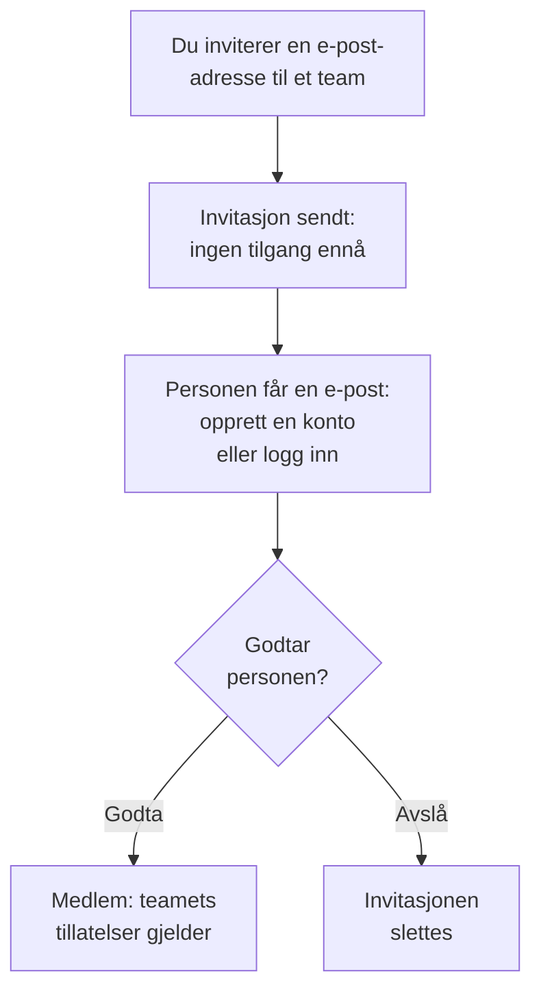

# Inviter personer

Folk kommer inn i et prosjekt via en invitasjon. Du inviterer en persons e-postadresse til et team, personen godtar, og fra da av bestemmer teamet hva personen kan gjøre. Denne siden viser hvordan du inviterer folk, hva de ser, og hvordan du endrer eller avslutter tilgangen deres senere.

:::cards
- [Inviter noen](#inviter-noen): En e-postadresse og et team.
- [Godta en invitasjon](#godta-en-invitasjon): Hva den inviterte ser og gjør.
- [Endre teamene til en person](#endre-teamene-til-en-person): Gi mer tilgang, eller mindre.
- [Fjern noen](#fjern-noen-fra-prosjektet): Hva det tar med seg å forlate prosjektet.
:::

## Slik fungerer en invitasjon

- **Teamet bestemmer hva personen kan gjøre.** Ingen har egne tillatelser: en person kan gjøre det teamene personen er med i tillater. Se [Brukere, team og tillatelser](/docs/permissions/index).
- **Ingenting gis før personen godtar.** En ventende invitasjon vises som **Invitasjon sendt** og gir ingen tilgang til prosjektet.
- **Én godkjenning gjelder hele prosjektet.** Når en invitasjon godtas, godtas også alle personens andre invitasjoner til samme prosjekt. Et medlem du senere legger til i et annet team, er med med en gang, uten noe å godta.

## Før du begynner

- **En rolle som kan invitere.** Prosjekteier, Prosjektadministrator eller en rolle med tillatelsen **Invite New Members**. Du kan bare invitere folk til et team der du selv har tillatelsene, fordi en invitasjon gir dem teamets tilgang.
- **I OneUptime Cloud: plass i abonnementet ditt.** Hver person i prosjektet er en plass på regningen, fra det øyeblikket personen blir invitert. Free-abonnementet har plass til én person. Se [Fakturering og bruk](/docs/configuration/billing#abonnementet-og-plassene-dine).
- **Ingen SCIM Push Groups.** Så lenge identitetsleverandøren din styrer prosjektets team via SCIM Push Groups, inviterer og fjerner du folk der, ikke i OneUptime.

## Inviter noen

:::steps
### Åpne Brukere

Gå til **Produkter → Innstillinger → Brukere**. Listen **Brukere** viser alle i prosjektet, teamene deres og om de har blitt med.

### Klikk på Inviter bruker

Klikk på **Inviter bruker**. Dialogen **Inviter ny bruker** åpnes.

### Skriv inn e-postadressen

Skriv adressen i **E-post**. Mens du skriver, foreslår **E-post** personer i prosjektet etter navn eller adresse, og viser hvem som er **Invitert** og hvem som er **Allerede i dette teamet**: klikk på en av dem for å fylle inn adressen. På en selvhostet server får en hovedadministrator også foreslått serverens andre kontoer, merket **Ikke i dette prosjektet ennå**, og det samme gjør alle som kan invitere personer, når en hovedadministrator tillater det i Admin Dashboard. For en adresse du skriver selv, ber dialogen også om et **Navn**, som er valgfritt: har personen ingen OneUptime-konto ennå, opprettes den med det navnet. Til personen godtar, viser prosjektet personen med det navnet eller bare med adressen, aldri med navnet eller bildet fra personens egen konto. Invitasjonsskjemaene i Admin Dashboard foreslår personer på samme måte.

### Velg teamet

**Team** starter på prosjektets medlemsteam: teamet som har Prosjektmedlem for hele prosjektet, ellers det som heter Members. Velg et annet team for å gi mer eller mindre tilgang. **Team** står tomt når prosjektet ikke har et slikt team, eller når du ikke selv kunne invitert noen til det.

### Send invitasjonen

Klikk på **Inviter**. OneUptime sender invitasjonen på e-post og åpner personens side. Personen vises som **Invitasjon sendt** til invitasjonen er godtatt.

På en selvhostet server som ikke kan sende e-post ennå, sendes ingen e-post, og personen vises som **Invitert**. En hovedadministrator ser først **Send dem invitasjonslenken**: kopier lenken, send den selv til personen, og klikk deretter på **Ferdig**. Alle andre ber serverens administrator om å [sette opp e-post](/docs/emails/smtp#åpne-skjemaet). E-post som settes opp senere, sender ikke invitasjonene som ble laget før: Personen kommer inn med invitasjonslenken sin, eller ved å registrere seg med den inviterte adressen.
:::

> [!TIP]
> Inviter folk til det minste teamet som lar dem gjøre jobben sin. Du kan legge dem til i flere team senere, og hvert team de blir med i, utvider hva de kan gjøre.

## Godta en invitasjon

Invitasjonsmeldingen nevner prosjektet og hvem som inviterte personen. Knappen i den er **Create Your Account** for den som ikke har en OneUptime-konto ennå, og **Sign In to OneUptime** for den som har en. Når SSO skal styre personens pålogging, fordi prosjektet styrer påloggingen til personene sine med SSO, og det gjør alle de andre prosjektene personen hører til, også, eller fordi hele serveren krever SSO, sier meldingen det i stedet, og knappen i den er **Sign In with SSO**.

**Create Your Account** åpner registreringssiden med adressen og navnet du skrev inn allerede fylt ut, og sier hvilket prosjekt som inviterte personen, og hvem. Den som registrerer seg der, blir med i prosjektet uten mer å godta. **Sign In with SSO** åpner den samme siden, som tilbyr single sign-on i stedet for passord: den som logger inn der med en av prosjektets identitetsleverandører, blir med i prosjektet.

På en selvhostet server som ikke kan sende e-post ennå, får ingen e-post: Invitasjonslenken personen får i stedet, åpner den samme registreringssiden, eller innloggingssiden for den som allerede har en konto.

Den som logger inn, eller registrerer seg på en annen måte, godtar på ett av to steder:

| Hvor personen er | Hva personen ser | Hva personen klikker på |
| --- | --- | --- |
| Ennå ikke i noe prosjekt | Invitasjonen, på siden personen kommer til etter innlogging | **Accept & Join** eller **Avslå** |
| Allerede i et annet prosjekt | Den ventende invitasjonen ved bjellen øverst til høyre, som åpner **Prosjektinvitasjoner** | **Godta** eller **Avvis** |

Når personen godtar, er den med i prosjektet med en gang, med teamets tillatelser og varslingsoppsettet alle medlemmer starter med: se [Det du starter med](/docs/notifications/index#dette-starter-du-med). Å avslå sletter invitasjonen, så det trengs en ny for å bli med senere.

## Se hvem som er i prosjektet

**Brukere** har én rad per person:

| Kolonne | Hva den viser |
| --- | --- |
| **Bruker** | Navn og e-postadresse. Til personen godtar, navnet du skrev inn for personen, hvis det finnes. |
| **Team** | Hvert av prosjektets team personen er med i eller invitert til. |
| **Status** | **Medlem** når personen har blitt med, med antallet invitasjoner til andre team som ikke er godtatt ennå. **Invitasjon sendt** til da, eller **E-post ikke sendt** når e-posttjenesten avviste den siste invitasjonsmeldingen. På en selvhostet server som ikke kan sende e-post ennå, **Invitert** i stedet: invitasjonen opprettes, men ingen e-post sendes. |

Filtrer listen etter **Bruker**, **Status** eller **Team**. Klikk på en rad for å åpne personens side:

| Side | Hva den brukes til |
| --- | --- |
| **Profil** | Navn, e-postadresse, bilde og bruker-ID. |
| **Team** | Teamene personen er med i. Legg til eller fjern et team her. |
| **Beredskap**, **Varslingsmetoder**, **Slik når man meg** | Om personen kan tilkalles, og hvordan. Vises for Prosjekteiere, Prosjektadministratorer, personen selv og alle som kan lese andres varslingsregler. Se [Beredskap og rapporter](/docs/on-call/readiness). |
| **Egendefinerte felt** | Prosjektets egendefinerte felt for personer, hvis det har noen. |
| **Fjern fra prosjekt** | Ta personen ut av prosjektet. |

## Endre teamene til en person

:::steps
### Åpne personens Team-side

Under **Brukere** klikker du på personen og deretter på **Team**.

### Legg personen til i et team

Klikk på **Inviter**, velg **Team**, og klikk på **Inviter** i dialogen. Et medlem er med i det nye teamet med en gang. Den som ikke har blitt med ennå, får én invitasjon til, og når den ene godtas, godtas begge.

Prosjektet ditt sender en person høyst én invitasjon i timen på e-post. En invitasjon innen en time etter den siste e-posten, til et annet team eller etter at du har fjernet personen, blir opprettet, men ingen ny e-post sendes før personen godtar eller avslår en av dem. **Send invitasjon på nytt** i radmenyen til personen under **Brukere** sender fortsatt en e-post.

### Ta personen ut av et team

Klikk på **Fjern** i teamets rad. Er det det siste teamet personen har blitt med i, tar fjerningen personen ut av prosjektet, og dialogen sier det før noe endres.
:::

Owners-teamet beholder alltid minst ett medlem som har blitt med, så et prosjekt aldri mister sin siste eier.

## Fjern noen fra prosjektet

Under **Brukere** åpner du radmenyen til personen, **⋯**, og klikker på **Fjern fra prosjekt**. Eller åpne personen og velg **Fjern fra prosjekt** i sidemenyen. For å fjerne flere personer samtidig merker du radene deres og sletter utvalget: hver av dem fjernes på samme måte.

Hvis rollen din bare fjerner personer fra noen team, for eksempel dem du eier, er **Fjern fra prosjekt** låst for en person som også er i et team du ikke kan fjerne personen fra, og nevner teamene som holder personen i prosjektet, de du får se. Når du fjerner flere personer samtidig, hoppes personen over, og det blir sagt.

Å fjerne noen tar personen ut av alle prosjektets team. Personen mister tilgangen med en gang, selv om den er innlogget, tas av vaktplaner og eskaleringsregler og får ikke lenger prosjektets varslinger. OneUptime-kontoen slettes ikke, og du kan invitere personen igjen. [Brukere, team og tillatelser](/docs/permissions/index#brukere) viser alt det tar med seg å forlate et prosjekt.

## Andre måter å bli med på

- **Single sign-on.** Den som logger inn med prosjektets identitetsleverandør for første gang, blir med i teamene leverandøren nevner. Se [Roller og team for SSO-brukere](/docs/identity/sso#roller-og-team-for-sso-brukere).
- **SCIM.** Identitetsleverandøren din oppretter personer og legger dem til i tilkoblingens standardteam. Se [SCIM](/docs/identity/scim#slik-klargjøres-en-prosjektbruker).
- **Admin Dashboard.** På en selvhostet installasjon kan en hovedadministrator legge noen til i et prosjekt og godta invitasjonen for personen. Se [Brukere, team og tillatelser](/docs/permissions/index#brukere). En hovedadministrator kan også opprette en konto for noen under **Brukere** med **Opprett Bruker**: vedkommende skriver inn et navn og en e-postadresse, og OneUptime sender adressen en lenke for å velge et passord, som virker én gang, i 7 dager. For å angi passordet selv åpner vedkommende **Flere felt**. Blir e-posten ikke sendt, vises lenken, så vedkommende kan sende den selv.

## Feilsøking

:::details "This user has already been invited to this team"
Personen er allerede med i teamet, som medlem eller med en invitasjon som ikke er godtatt. Åpne personen under **Brukere** for å se teamene, eller inviter personen til et annet team.
:::

:::details "You have reached the user limit for the free plan"
I OneUptime Cloud har et prosjekt på Free-abonnementet plass til én person. Endre abonnement, og inviter på nytt. Se [Endre abonnementet](/docs/configuration/billing#endre-abonnementet).
:::

:::details "Too many invitations were sent to this email address in the last hour"
Prosjektet ditt kan sende én adresse 10 invitasjoner i timen, til prosjektets team og private statussider til sammen. Invitasjoner fra andre prosjekter teller ikke. Vent en time, og inviter så personen på nytt.
:::

:::details "This invitation cannot be sent right now"
OneUptime sender ikke mer enn 50 invitasjoner i timen til én adresse fra alle prosjekter til sammen, og denne ville gått over det. Ingenting ble opprettet. Prøv igjen om en time.
:::

:::details "You can remove this person from only some of their teams, so you can't remove them from the project"
Rollen din fjerner bare personer fra noen av prosjektets team, for eksempel dem du eier, og denne personen er også i andre. Fjern personen fra dine egne team på personens side **Team**, eller be en Prosjekteier eller Prosjektadministrator om å fjerne personen fra prosjektet.
:::

:::details Invitasjonsmeldingen kom ikke frem, eller lenken er utløpt
Invitasjonen avhenger ikke av e-posten. Be personen registrere seg med den inviterte adressen: OneUptime sender den adressen en ny lenke for å fullføre kontoen. Den som allerede har en konto, logger inn og finner invitasjonen.

For å se om den ble sendt, åpner du fanen **E-post** under prosjektets **Varslingslogger**: Raden for hver invitasjon sier om den ble sendt, og hvorfor ikke. På en selvhostet server finner en hovedadministrator også hver e-post serveren ikke klarte å sende, i [e-postloggen](/docs/emails/email-providers#se-hva-serveren-har-sendt) til serveren.

På en selvhostet server som ikke kan sende e-post ennå, kan heller ikke registreringen sende en ny lenke på e-post: den ber i stedet personen spørre etter invitasjonslenken sin. Når serverens administrator har [satt opp e-post](/docs/emails/smtp#åpne-skjemaet), virker registreringen som over. Inntil da kan en hovedadministrator sende personen en ny lenke, som virker én gang, bare for den adressen, i 7 dager: under **Brukere** åpner du radmenyen til personen, **⋯**, og klikker på **Hent invitasjonslenke**.
:::

:::details En person viser E-post ikke sendt
E-posttjenesten avviste den siste invitasjonsmeldingen, så ingenting nådde personen. Pek på **E-post ikke sendt**, eller trykk på den, for å se hvorfor, slik fanen **E-post** under prosjektets **Varslingslogger** sier det. Sjekk adressen du inviterte, og når e-post virker, åpner du radmenyen til personen under **Brukere**, **⋯**, og klikker på **Send invitasjon på nytt**: Personen vises som **Invitasjon sendt** igjen når den er sendt. På en selvhostet server kan serverens administrator sende personen invitasjonslenken i stedet: En hovedadministrator klikker på **Hent invitasjonslenke** i samme meny.
:::

:::details Inviter bruker sier at brukerne styres av SCIM Push Groups
Identitetsleverandøren din styrer prosjektets team. Inviter eller fjern folk i identitetsleverandøren, eller slå av Push Groups under **Prosjektinnstillinger → Sikkerhet → SCIM** for å styre dem her.
:::

## Neste steg

:::cards
- [Brukere, team og tillatelser](/docs/permissions/index): Bestem hva hvert team kan gjøre.
- [Prosjektinnstillinger](/docs/configuration/project-settings): Alt som gjelder for hele prosjektet.
- [Kontoen din](/docs/introduction/your-account): Innlogging, profil og prosjektene du er med i.
- [SCIM](/docs/identity/scim): La identitetsleverandøren din styre personer og team.
:::
