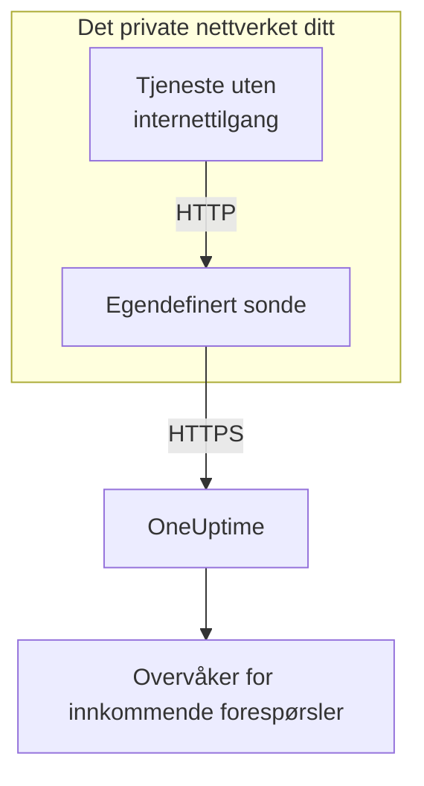

# Inngangsport for innkommende forespørsler

En tjeneste uten internettilgang kan likevel sende heartbeats til en [overvåker for innkommende forespørsler](/docs/monitor/incoming-request-monitor). Den sender dem i stedet til en [egendefinert sonde](/docs/probe/custom-probe) i sitt eget nettverk, og sonden sender dem videre til OneUptime.

:::cards
- [Slik fungerer det](#slik-fungerer-det): Fra tjenesten din, gjennom sonden, til overvåkeren.
- [Slå på lytteren](#slå-på-lytteren): Én innstilling på sonden, for Docker, Docker Compose eller Kubernetes.
- [Send forespørsler til sonden](#send-forespørsler-til-sonden): Endre URL-en tjenesten din sender til, og ingenting annet.
- [Feilsøking](#feilsøking): Hva sonden logger når en forespørsel ikke kommer gjennom.
:::

## Slik fungerer det



1. **Tjenesten din sender forespørselen til sonden.** Den samme `GET` eller `POST`, med den samme hemmelige nøkkelen, som den ville sendt til OneUptime, til en port sonden lytter på.
2. **Sonden svarer med en gang.** Den svarer `200` før den sender forespørselen videre, så tjenesten din aldri venter på OneUptime.
3. **Sonden sender den videre.** Den sender forespørselen videre til OneUptime med metode, headere og body, og legger til en header `OneUptime-Probe-Id` som nevner sonden.
4. **OneUptime leser den som vanlig.** Overvåkerens kriterier ser forespørselen som om tjenesten hadde sendt den direkte.

Lytteren kjører på sin egen port, atskilt fra sondens helsesjekker, så du kan åpne den for det private nettverket ditt uten å åpne noe annet.

## Når du bruker den

Bruk lytteren når:

- Tjenestene dine kjører i et isolert nettverkssegment uten utgående HTTPS-tilgang
- Du må holde all overvåkingstrafikk innenfor VPC-en eller det lokale nettverket ditt
- Du vil ha ett enkelt utgangspunkt, sonden, som får nå OneUptime
- Du allerede har tatt i bruk en [egendefinert sonde](/docs/probe/custom-probe) og vil gjenbruke den for innkommende heartbeats

Kan tjenestene dine allerede nå `https://oneuptime.com` (eller den selvhostede URL-en din) direkte, trenger du **ikke** denne funksjonen: kall heartbeat-URL-en direkte fra tjenesten.

## Før du begynner

- **En egendefinert sonde som kjører.** **Status** for den viser **Tilkoblet**. Se [Egendefinerte probes](/docs/probe/custom-probe) for å installere en.
- **En overvåker for innkommende forespørsler.** Heartbeat-URL-en dens inneholder den hemmelige nøkkelen tjenesten din sender: se [Innkommende forespørsel-overvåking](/docs/monitor/incoming-request-monitor).
- **En port på sondens vert som tjenestene dine kan nå.** Eksemplene bruker `3875`.

## Slå på lytteren

Sett `PROBE_INGRESS_PORT` til porten lytteren skal bruke. Enhver verdi større enn `0` slår den på; ikke satt, eller `0`, lar den være av.

:::tabs
@tab Docker
```bash
docker run --name oneuptime-probe --network host \
  -e PROBE_KEY=<probe-key> \
  -e PROBE_ID=<probe-id> \
  -e ONEUPTIME_URL=https://oneuptime.com \
  -e PROBE_INGRESS_PORT=3875 \
  -d oneuptime/probe:release
```

Uten `--network host` publiserer du porten med `-p 3875:3875`.
@tab Docker Compose
```yaml title="docker-compose.yml"
services:
  oneuptime-probe:
    image: oneuptime/probe:release
    container_name: oneuptime-probe
    environment:
      - PROBE_KEY=<probe-key>
      - PROBE_ID=<probe-id>
      - ONEUPTIME_URL=https://oneuptime.com
      - PROBE_INGRESS_PORT=3875
    network_mode: host
    restart: always
```

Uten `network_mode: host` publiserer du porten under `ports:` som `"3875:3875"`.
@tab Kubernetes
```yaml title="oneuptime-probe.yaml"
apiVersion: apps/v1
kind: Deployment
metadata:
  name: oneuptime-probe
spec:
  selector:
    matchLabels:
      app: oneuptime-probe
  template:
    metadata:
      labels:
        app: oneuptime-probe
    spec:
      containers:
        - name: oneuptime-probe
          image: oneuptime/probe:release
          env:
            - name: PROBE_KEY
              value: "<probe-key>"
            - name: PROBE_ID
              value: "<probe-id>"
            - name: ONEUPTIME_URL
              value: "https://oneuptime.com"
            - name: PROBE_INGRESS_PORT
              value: "3875"
          ports:
            - name: ingress
              containerPort: 3875
---
apiVersion: v1
kind: Service
metadata:
  name: oneuptime-probe-ingress
spec:
  selector:
    app: oneuptime-probe
  ports:
    - name: ingress
      port: 3875
      targetPort: 3875
  type: ClusterIP
```

Tjenester i klyngen sender da til `http://oneuptime-probe-ingress.<namespace>.svc.cluster.local:3875/heartbeat/<secret-key>`.
:::

Når lytteren kjører, står det i sondens logg `Probe ingress listener started on port 3875 (heartbeat / incoming-request endpoints)`.

## Send forespørsler til sonden

Tjenesten din sender til sonden i stedet for til OneUptime. Erstatt den offentlige heartbeat-URL-en:

```text
https://oneuptime.com/heartbeat/<secret-key>
```

med sondens ingress-URL:

```text
http://<probe-host>:<PROBE_INGRESS_PORT>/heartbeat/<secret-key>
```

Sti, metode, body og headere er ellers like, så eksisterende klientkode trenger bare å endre basis-URL-en. Sonden tar også imot `/incoming-request/<secret-key>`, som fungerer på samme måte.

```bash
# GET heartbeat
curl http://probe.internal:3875/heartbeat/YOUR_SECRET_KEY

# POST heartbeat with JSON body
curl -X POST http://probe.internal:3875/heartbeat/YOUR_SECRET_KEY \
  -H "Content-Type: application/json" \
  -d '{"status": "healthy", "version": "1.2.3"}'

# Cron job
*/5 * * * * curl -s http://probe.internal:3875/heartbeat/YOUR_SECRET_KEY > /dev/null
```

## Slik sendes forespørsler videre

| Hva | Hvordan sonden håndterer det |
| --- | --- |
| Svaret | `200` med et tomt JSON-objekt (`{}`), sendt før forespørselen sendes videre. Som hos OneUptime sendes det uansett hva som skjer etterpå: også en feil hemmelig nøkkel får det. |
| Metoder | `POST` sendes videre som `POST`. `GET`, og `HEAD`, sendes videre som `GET`. Andre metoder får `404` fra sonden. |
| Headere | Alle unntatt hop-by-hop-headerne (`Host`, `Connection`, `Content-Length`, `Transfer-Encoding`, `Keep-Alive`, `Proxy-Authenticate`, `Proxy-Authorization`, `TE`, `Trailer`, `Upgrade`) og `Content-Encoding`, siden sonden videresender bodyen ukomprimert. Sonden legger til `OneUptime-Probe-Id`. |
| Body | JSON- og skjema-bodyer på opptil 50 MB, som når du sender direkte til OneUptime. Som der kommer enhver annen body tom frem til overvåkeren. |
| Nye forsøk | Når en videresending feiler, prøver sonden igjen opptil `PROBE_INGRESS_FORWARD_RETRY_LIMIT` ganger og venter 2 s, så 4 s, så 8 s, og aldri mer enn 15 s. Deretter logger den feilen og forkaster forespørselen. |
| Proxyer | Videresendingen går gjennom sondens proxy når `HTTP_PROXY_URL` eller `HTTPS_PROXY_URL` er satt. |
| Hvor den går | `ONEUPTIME_URL` etterfulgt av `/incoming-request-ingest/incoming-request/<secret-key>`. |

## Miljøvariabler

| Variabel | Standard | Hva den gjør |
| --- | --- | --- |
| `PROBE_INGRESS_PORT` | ikke satt (av) | Porten lytteren bruker. Enhver verdi større enn `0` slår den på. |
| `PROBE_INGRESS_FORWARD_TIMEOUT_MS` | `10000` | Hvor lang tid hver videresending til OneUptime kan ta, i millisekunder. En verdi under `1000` faller tilbake til standarden. |
| `PROBE_INGRESS_FORWARD_RETRY_LIMIT` | `3` | Hvor mange ganger en mislykket videresending prøves igjen. `0` slår av nye forsøk. |

Sondens vanlige variabler (`PROBE_KEY`, `PROBE_ID`, `ONEUPTIME_URL` og proxyvariablene) gjelder alle: se [Egendefinerte probes](/docs/probe/custom-probe) for den fullstendige listen.

## Sikkerhetshensyn

- **Endepunktet er med vilje uten autentisering**: den hemmelige nøkkelen i URL-stien *er* autentiseringen, akkurat som på det offentlige endepunktet `oneuptime.com`. Behandle den hemmelige nøkkelen som et passord.
- **Hold lytteren på det private nettverket ditt.** Den skal ikke kunne nås fra internett. Bruk en network policy, en brannmurregel eller en `ClusterIP`-tjeneste for å begrense hvem som kan nå den.
- **Sett TLS foran hvis du trenger kryptering på nettverket ditt.** Lytteren snakker vanlig HTTP. Sett den bak en intern lastbalanserer eller en ingress controller for TLS på den strekningen. Videresendingen fra sonden til OneUptime bruker HTTPS når `ONEUPTIME_URL` begynner med `https://`.
- **Begrens body-størrelsen selv hvis 50 MB er for mye.** Sett en reverse proxy med en lavere grense foran lytteren.

## Feilsøking

:::details Sondens logg sier aldri at lytteren har startet
`PROBE_INGRESS_PORT` er ikke satt, er `0` eller er ikke et tall. Sett den til et portnummer og start sonden på nytt. Logglinjen er `Probe ingress listener started on port <port> (heartbeat / incoming-request endpoints)`.
:::

:::details Sonden logger `Probe ingress: failed to forward to <url> after N attempts`
Sonden kunne ikke nå OneUptime, heller ikke etter de nye forsøkene. Sjekk sondens utgående tilkobling, proxyinnstillingene og verdien av `ONEUPTIME_URL`. Viser sonden også **Frakoblet**, kan du se [Egendefinerte probes](/docs/probe/custom-probe) for å finne ut hvor forespørslene dens stopper.
:::

:::details Sonden logger `Probe ingress: probe ID not available, forwarding without it`
Sonden er ikke ferdig med å koble til OneUptime ennå, så den sender forespørselen videre uten headeren `OneUptime-Probe-Id`. Forespørselen når likevel frem til overvåkeren.
:::

:::details Overvåkeren får forespørslene, men ikke gjennom sonden
Tjenesten din sender fortsatt til den offentlige URL-en. Sjekk at den sender til `http://<probe-host>:<port>/...`: et DNS-navn eller en oppføring i `/etc/hosts` som peker et annet sted, er den vanlige årsaken.
:::

:::details Overvåkeren får ingenting, og sonden logger ingenting
Forespørselen nådde aldri sonden. Sjekk at tjenesten når sondens vert på porten: en brannmurregel, en port som ikke er publisert, eller en Kubernetes-Service som ikke velger sondens pod.
:::

## Neste steg

:::cards
- [Innkommende forespørsel-overvåking](/docs/monitor/incoming-request-monitor): Bestem hva som teller som et sunt heartbeat.
- [Egendefinerte probes](/docs/probe/custom-probe): Installer sonden, og se hver innstilling den leser.
:::
