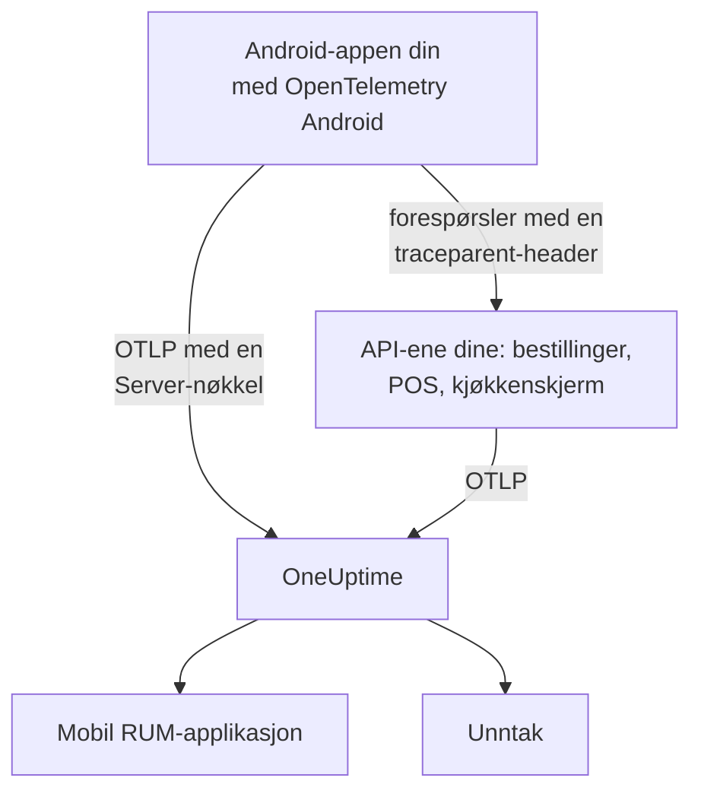

# Android-oppsett

Instrumenter en native Android-app med OpenTelemetry Android, slik at den rapporterer til OneUptime som en mobil RUM-applikasjon: krasj og ANR-er, trege og frosne rammer, appoppstarter, skjermer, økter og nettverksforespørsler, sporet helt gjennom til backenden din.

:::cards
- [Legg til OpenTelemetry Android](#legg-til-opentelemetry-android): Én Gradle-avhengighet, og noen få linjer når appen starter.
- [Hva den rapporterer](#hva-den-rapporterer): Krasj, ANR-er, frosne rammer, oppstarter og økter, og hvor hver av dem havner.
- [Spor forespørsler til backenden din](#spor-forespørsler-til-backenden-din): Et spenn for hvert OkHttp-kall, og en `traceparent` på det.
- [Spor dine egne arbeidsflyter](#spor-dine-egne-arbeidsflyter): En bestilling fra menyen til kjøkkenet, en betalingsterminal, en skriver.
- [Kiosker og andre enheter du eier](#kiosker-og-andre-enheter-du-eier): Gi hver enhet et navn, konfigurer den fra MDM-en, behold data mens den er uten nett.
:::

## Slik fungerer det

OpenTelemetry Android kjører inne i appen din. Den sender spor, logger og målinger til OneUptime over OTLP med en **Server**-inntaksnøkkel, og legger til en W3C-header `traceparent` på forespørslene appen din sender, slik at spennene fra backenden din blir en del av appens spor.



## Før du begynner

- En Android-app med `minSdk` 23 eller høyere, bygget med `compileSdk` 34 eller høyere. Med en `minSdk` under 26 slår du på [desugaring av kjernebiblioteker](https://developer.android.com/studio/write/java8-support#library-desugaring), med Android Gradle Plugin 8.3.0 eller nyere og `android.useFullClasspathForDexingTransform=true` i `gradle.properties`.
- En **Server**-inntaksnøkkel, opprettet under **Prosjektinnstillinger → Telemetri og APM → Inntaksnøkler** med **Opprett inntaksnøkkel**. En **Nettleser**-nøkkel avvises fra en app: Den kontrolleres mot headeren `Origin`, som en app ikke sender.
- Disse OTLP-innstillingene. Hvis du drifter OneUptime selv, bytter du ut `https://oneuptime.com` med din egen vert.

| Innstilling | Verdi |
| --- | --- |
| OTLP-endepunkt | `https://oneuptime.com/otlp` |
| Header | `x-oneuptime-token: YOUR_TELEMETRY_INGESTION_TOKEN` |

> [!WARNING]
> Nøkkelen følger med i appen din, og en app kan pakkes ut, så gå ut fra at noen kopierer den. Sett et **Festet tjenestenavn**, en **Requests Per Minute Limit** og en dato under **Utløper** på nøkkelens side, og bytt nøkkelen med utgivelsene dine.

## Legg til OpenTelemetry Android

:::steps
### Legg til avhengigheten

```kotlin title="app/build.gradle.kts"
dependencies {
    implementation("io.opentelemetry.android:android-agent:1.8.1")
}
```

Agenten tar med seg instrumenteringen for krasj, ANR, treg rendering, aktiviteter, fragmenter, nettverk og økter. Se etter en nyere versjon i [utgivelsene dens](https://github.com/open-telemetry/opentelemetry-android/releases).

### Start den når appen starter

```kotlin title="KioskApplication.kt"
import android.app.Application
import io.opentelemetry.android.OpenTelemetryRum
import io.opentelemetry.android.agent.OpenTelemetryRumInitializer

class KioskApplication : Application() {
    lateinit var otelRum: OpenTelemetryRum

    override fun onCreate() {
        super.onCreate()

        otelRum = OpenTelemetryRumInitializer.initialize(this) {
            httpExport {
                baseUrl = "https://oneuptime.com/otlp"
                baseHeaders = mapOf("x-oneuptime-token" to BuildConfig.ONEUPTIME_TOKEN)
            }
            resource {
                put("service.name", "kiosk-ordering")
                put("deployment.environment.name", "production")
            }
        }
    }
}
```

`baseUrl` er endepunktet uten signal: Agenten legger selv til `/v1/traces`, `/v1/logs` og `/v1/metrics`. Sett `service.name`, ellers får appen navnet fra launcher-etiketten sin. Det er applikasjonens identitet i OneUptime, så hold det likt fra utgivelse til utgivelse.

Oppgi klassen i `android:name` på `<application>`-elementet i manifestet ditt. `BuildConfig.ONEUPTIME_TOKEN` står for der bygget ditt oppbevarer nøkkelen; en flåte kan i stedet få den fra MDM-en sin, slik [Kiosker og andre enheter du eier](#kiosker-og-andre-enheter-du-eier) viser.

### Start appen og sjekk at det kommer inn

```bash
curl -i https://oneuptime.com/otlp/v1/validate \
  -H "x-oneuptime-token: YOUR_TELEMETRY_INGESTION_TOKEN"
```

`200` med `"valid": true` betyr at nøkkelen godtas. Start deretter appen og bruk den et øyeblikk: Den vises under **Produkter → Ressurser → Overvåking av reelle brukere**, oppkalt etter sin `service.name`. Agenten skriver telemetrien til disk før den sender den, så det kan ta et minutt før den første batchen kommer fram.
:::

## Hva den rapporterer

OpenTelemetry Android registrerer alt dette av seg selv. Enhetsattributtene den setter, `device.model.identifier`, `device.model.name` og `device.manufacturer`, arkiverer appen som en mobil RUM-applikasjon og fyller siden **Klienter**. Den setter også `os.name`, `os.version` og en `app.installation.id` for hver installasjon, og ingen `device.id`.

| Hva | Hvordan agenten sender det | Hvor det vises i OneUptime |
| --- | --- | --- |
| Krasj | En `app.crash`-hendelse med unntakets type, melding og stack trace | **Unntak**, som uhåndtert |
| ANR-er | En `device.anr`-hendelse med hovedtrådens stakk, når appen har sluttet å svare i omtrent 5 sekunder | **Unntak**, som uhåndtert, med typen `ANR` |
| Trege og frosne rammer | En `app.jank`-hendelse med `app.jank.frame_count`, rammene som er tregere enn 16 ms (`app.jank.threshold` er `0.016`) eller 700 ms (`0.7`) | **Logger**, med `@event.name:app.jank` |
| Appoppstarter | Et `AppStart`-spenn, med `start.type` satt til `cold`, `warm` eller `hot` | **Spor** |
| Skjermer | Et spenn for hvert steg i livssyklusen til en aktivitet eller et fragment, og `app.screen.name` på hvert spenn og hver logg | **Spor** |
| Økter | `session.id` på hvert spenn og hver logg, og hendelsene `session.start` og `session.end` | **Spor** og **Logger**, søkt med `@session.id:` |
| Nettverksendringer | En `network.change`-hendelse, og `network.connection.type` på hvert spenn og hver logg | **Logger** |

Krasj og ANR-er havner i **Unntak** som uhåndterte, gruppert etter stack trace, sammen med økten de skjedde i. Agenten lagrer et krasj på disk idet appen dør, og sender det derfra, så et krasj som skjer uten nett, kommer likevel inn når appen kjører igjen med nettverk.

Applikasjonens side **Oversikt** leser av dette for deg: **Økter**, **Krasjfrie økter**, **Krasj**, **ANR-er**, **Appoppstarter**, **Kaldstart (p95)** og **Frosne rammer**, som hver åpner unntakene, spennene eller hendelsene den teller. Til appen sender appoppstarter eller rammer, forteller diagrammene deres hva som slår dem på. Siden **Anbefalinger** tilbyr monitorer for krasj, ANR-er, trege kaldstarter, frosne rammer, og en app eller en av enhetene dens som slutter å rapportere.

Under **Krasjfrie økter** viser linjen den samme andelen av installasjonene: `app.installation.id` som OpenTelemetry Android 1.1 og nyere setter på hvert spenn og hver logg, en ID som beholdes så lenge appen er installert, og som derfor kan stå for appens brukere. For en app med hundrevis av økter i timen, der ett krasj om dagen er normalt, varsler **App Crash Rate** og **App ANR Rate** ved andelen av øktene i en time som krasjet eller frøs, over grensene til Android vitals på 1,09 % og 0,47 %, i stedet for ved hvert enkelt krasj.

En økt avsluttes etter 15 minutter i bakgrunnen, eller etter 4 timer. En app som aldri går i bakgrunnen, for eksempel en kiosk, beholder én økt i 4 timer, så spor hver kundes besøk som et eget spenn, slik [Spor dine egne arbeidsflyter](#spor-dine-egne-arbeidsflyter) viser.

Appens egne `android.util.Log`-kall blir også logger når du legger til `android-log-library` og `android-log-agent` ved siden av OkHttp-modulene nedenfor: Taggen til hvert kall havner i `android.log.tag`, og et kall med en throwable blir et unntak i **Unntak**. OpenTelemetry Android leser ikke Logcat.

## Spor forespørsler til backenden din

Legg til OkHttp-instrumenteringen og ByteBuddy-pluginen den bygges med:

```kotlin title="app/build.gradle.kts"
plugins {
    // ...the plugins your app already applies, then:
    id("net.bytebuddy.byte-buddy-gradle-plugin") version "1.18.15"
}

dependencies {
    implementation("io.opentelemetry.android:android-agent:1.8.1")
    implementation("io.opentelemetry.android.instrumentation:okhttp3-library:1.8.1-alpha")
    byteBuddy("io.opentelemetry.android.instrumentation:okhttp3-agent:1.8.1-alpha")
}
```

Pluginen instrumenterer selve klassen `OkHttpClient`, så hver klient i appen spores, også de som biblioteker oppretter. Hver forespørsel blir et klientspenn oppkalt etter metoden sin, med URL, statuskode og varighet, og bærer en W3C-header `traceparent`. En backend som er instrumentert med [OpenTelemetry](/docs/telemetry/open-telemetry), fører sporet videre fra den headeren, så bestillings-API-et, POS-broen og kjøkkenskjermtjenesten legger spennene sine til det samme sporet som trykket på kiosken.

- `HttpURLConnection` har det samme modulparet: `httpurlconnection-library` og `httpurlconnection-agent`.
- Uten pluginen pakker du inn en klient selv: `OkHttpTelemetry.builder(otelRum.openTelemetry).build().createCallFactory(client)`, fra `io.opentelemetry.instrumentation:opentelemetry-okhttp-3.0`.
- Et spenn som åpnes i koden din, som i neste avsnitt, er forelder til forespørslene som gjøres inne i det.

## Spor dine egne arbeidsflyter

Hent en tracer fra agenten, og lag ett spenn for én kundes bestilling, med et underspenn for hvert steg i den. Hvert steg får da sin egen varighet og sine egne feil, og bestillingen sier hvordan den endte:

```kotlin title="OrderTrace.kt"
import io.opentelemetry.api.trace.Span
import io.opentelemetry.api.trace.StatusCode
import io.opentelemetry.api.trace.Tracer
import io.opentelemetry.context.Context

class OrderTrace(private val tracer: Tracer) {
    // order.session: from the first tap to the order reaching the kitchen.
    private val order: Span = tracer.spanBuilder("order.session").startSpan()
    private val parent: Context = Context.current().with(order)

    // One step: menu.browse, cart.customize, payment.process, pos.inject.
    fun <T> step(name: String, block: (Span) -> T): T {
        val span = tracer.spanBuilder(name).setParent(parent).startSpan()
        return try {
            span.makeCurrent().use { block(span) }
        } catch (error: Throwable) {
            span.recordException(error)
            span.setStatus(StatusCode.ERROR)
            throw error
        } finally {
            span.end()
        }
    }

    fun complete() = finish("completed")

    fun abandon(reason: String) {
        order.setAttribute("order.abandon_reason", reason)
        finish("abandoned")
    }

    private fun finish(outcome: String) {
        order.setAttribute("order.outcome", outcome)
        order.end()
    }
}
```

```kotlin title="CheckoutFlow.kt"
val order = OrderTrace(otelRum.openTelemetry.getTracer("kiosk.ordering"))

order.step("cart.customize") { span ->
    span.setAttribute("cart.items", cart.size.toLong())
}
order.step("payment.process") { terminal.charge(cart.total) }
order.step("pos.inject") { posApi.submit(cart) } // its OkHttp span is a child
order.complete()
```

Pakk inn hvert kall til SDK-et for en betalingsterminal, en skriver, en skanner eller en NFC-leser på samme måte, og oppgi hvilken enhet det var, så en treg eller sviktende enhet blir et tregt eller sviktende spenn:

```kotlin title="ReceiptPrinter.kt"
order.step("printer.print") { span ->
    span.setAttribute("peripheral.type", "printer")
    span.setAttribute("peripheral.model", printer.model)
    span.setAttribute("peripheral.connection", "usb")
    printer.print(receipt, timeoutMillis = 10_000)
}
```

Attributtnavnene velger du selv: Hold dem like i hver app, så finner ett filter alle skrivere. Gi hvert kall et tidsavbrudd, fordi et spenn bare avsluttes når kallet returnerer. Et steg som går over flere skjermer, for eksempel å bla i menyen, er et spenn du starter når skjermen åpnes, og avslutter når den lukkes, med samme forelder. For et faktum uten varighet, for eksempel at en skriver går tom for papir, sender du en hendelse: `otelRum.emitEvent("printer.paper_low")`.

I **Spor** filtrerer du på et stegs navn for å se hvor lang tid det tar og hvor ofte det feiler, og på `@order.outcome:abandoned` for å finne bestillingene som aldri ble fullført.

## Kiosker og andre enheter du eier

### Gi hver enhet et navn

OneUptime arkiverer en mobilapp etter applikasjon, aldri etter enhet, så en app på tusenvis av telefoner lister aldri opp brukernes telefoner. For enheter du eier, gir du hver av dem et navn i `host.name`. Hver enhet vises da i **Inventar** som en vert, ved siden av de andre maskinene dine, med merke, modell og OS-versjon som agenten rapporterer, det du legger til nedenfor, og når den sist ble sett:

```kotlin title="KioskApplication.kt"
resource {
    put("service.name", "kiosk-ordering")
    put("host.name", deviceName)
    put("host.serial_number", serialNumber)
    put("device.type", "kiosk")
    put("device.location", "Store 0412")
}
```

Appens telemetri blir værende hos RUM-applikasjonen, og enheten blir ikke en vert under **Verter**: En app rapporterer ingen vertsmålinger, så det ville ikke vært noe å vise der. Enhetens side i **Inventar** viser dens egne logger, spor og unntak, og `@resource.host.name:` finner dem i **Spor** og **Logger**. En enhet som ikke sender noe på 30 dager, forsvinner fra **Inventar**. For å se selve enheten, minnet, lagringen og omstartene dens og krasjene i alle appene på den, legger du til [Android-agent](/docs/telemetry/android-agent) og gir den samme navn i `device_name`: Enheten blir da også en vert under **Verter**, og er fortsatt ett element i **Inventar**.

### Få vite når en enhet blir stille

Applikasjonens side **Anbefalinger** tilbyr **Device Stopped Reporting**: et varsel for hver enhet som ikke sender spenn på en time etter å ha sendt noen den siste uken, skilt fra hverandre med `app.installation.id` som agenten setter. Varselet for hver enhet nevner installasjonen, og løses så snart enheten rapporterer igjen. Når alle enhetene blir stille samtidig, for eksempel når nettverket i en butikk går ned, varsler ingen enhet: **App Stopped Reporting** rapporterer det én gang for hele appen.

En kiosk som står på én skjerm, sender ingenting før noen bruker den. Send et spenn med noen minutters mellomrom mens appen kjører, så en kiosk som står ubrukt, ikke forveksles med en som har blitt stille:

```kotlin title="KioskHeartbeat.kt"
import android.os.Handler
import android.os.Looper
import io.opentelemetry.api.trace.Tracer

class KioskHeartbeat(private val tracer: Tracer) {
    private val handler = Handler(Looper.getMainLooper())

    private val beat = object : Runnable {
        override fun run() {
            tracer.spanBuilder("kiosk.heartbeat").startSpan().end()
            handler.postDelayed(this, 5 * 60 * 1000L)
        }
    }

    fun start() = handler.post(beat)

    fun stop() = handler.removeCallbacks(beat)
}
```

Start den når agenten har startet, med `KioskHeartbeat(otelRum.openTelemetry.getTracer("kiosk.heartbeat")).start()`. Et spenn hvert femte minutt holder en kiosk som virker, godt innenfor timen.

### Konfigurer flåten fra MDM-en

En app kan lese Androids administrerte konfigurasjoner, som alle tjenester for enhetsadministrasjon sender ut til enhetene sine. Les nøkkelen og enhetens navn derfra i stedet for å bygge dem inn i appen:

```kotlin title="KioskApplication.kt"
import android.content.RestrictionsManager

val restrictions = (getSystemService(RESTRICTIONS_SERVICE) as RestrictionsManager)
    .applicationRestrictions
val token = restrictions.getString("oneuptime_token").orEmpty()
val deviceName = restrictions.getString("device_name") ?: android.os.Build.MODEL
val serialNumber = restrictions.getString("device_serial").orEmpty()
```

Gi deretter `token` til `baseHeaders` i stedet for `BuildConfig.ONEUPTIME_TOKEN`, og `deviceName` og `serialNumber` til ressursen ovenfor. I Esper limer du inn konfigurasjonen nedenfor under appens **Managed Configuration** i en blueprint. Esper fyller inn plassholderne på hver enhet, med Esper Agent 8.00.0764 eller nyere:

```json title="Managed configuration"
{
  "oneuptime_token": "YOUR_TELEMETRY_INGESTION_TOKEN",
  "device_name": "${esper.deviceName}",
  "device_serial": "${esper.serialNumber}"
}
```

Kjør Converge på enhetene etter en endring, slik at de leser de nye verdiene. Deklarer de samme nøklene i en `app_restrictions.xml` hvis MDM-en din ber om et skjema. Esper avviser en APK uten v1-signatur, så signer utgivelsen med v1-signaturskjemaet i tillegg til v2 eller v3.

### Importer flåten fra Esper

Koble Esper-leieren din til inventaret, og alle enheter Esper registrerer, vises, også enhetene der appen aldri har startet, med det bare Esper vet: gruppe, Android-versjon, sikkerhetspatchnivå, serienummer, batteri, lagring, installerte apper og siste innsjekking. En enhet som slutter å sjekke inn, vises som offline, med hvor lenge siden den sist gjorde det. Se [Importer enheter fra Esper](/docs/inventory/overview#importer-enheter-fra-esper).

En enhet som appen gir navn som ovenfor, er ett element med det appen sender: `host.name` er navnet i Esper. OneUptime finner elementet til en enhet etter `host.name` og deretter etter `host.serial_number`, så gi hver enhet samme navn og serienummer i alle apper som rapporterer fra den, og i innstillingene `device_name` og `device_serial` til Android Agent.

### Behold det som registreres uten nett

Agenten skriver hvert spenn, hver logg og hver måling til disk før den sender dem. Mens nettverket er nede, beholder den dem der og sender dem når det er tilbake, opptil 18 timer senere. Den tar vare på 10 MB; øk grensen for en enhet som ofte er uten nett:

```kotlin title="KioskApplication.kt"
diskBuffering {
    maxCacheSize = 50 * 1024 * 1024
}
```

## Feilsøking

:::details Appen vises under Tjenester i stedet for Overvåking av reelle brukere
OpenTelemetry Android setter `device.model.identifier` selv, så appen ble satt opp med et annet SDK, eller ressursen ble erstattet med `resource(Resource)`, som forkaster agentens egne attributter. Bruk blokken `resource { }`, som utvider dem. Tjenesten som allerede ble opprettet, blir ikke til en RUM-applikasjon, så slett den under **Produkter → Tjenester** når RUM-telemetrien kommer inn.
:::

:::details Ingenting kommer inn, eller nøkkelen avvises
Kjør nøkkelsjekken i [Legg til OpenTelemetry Android](#legg-til-opentelemetry-android). En `401` betyr at nøkkelen er ukjent, tilbakekalt, slått av eller utløpt. En **Nettleser**-nøkkel avvises fra en app: Bruk en **Server**-nøkkel. Sjekk at `baseUrl` slutter på `/otlp`, uten `/v1/traces`: Agenten legger til stien selv.
:::

:::details Et krasj eller en ANR mangler i Unntak
Et krasj lagres idet appen dør, og en ANR når hovedtråden har stått fast i omtrent 5 sekunder. Begge venter på disk til enheten kan sende dem, så se etter igjen når appen har kjørt i et minutt med nettverk. Start agenten øverst i `onCreate` i `Application`-klassen din, før alt som kan krasje, slik at krasjhåndtereren dens er på plass først.
:::

:::details En enhet mangler i Inventar
Bare en enhet der appen setter `host.name`, blir listet opp. Sjekk verdien i ressursattributtene til et spenn: En tom verdi navngir ingen enhet, og to enheter med samme navn blir én rad.
:::

## Neste steg

:::cards
- [Mobiloppsett](/docs/rum/mobile-setup): iOS, React Native og de andre plattformene.
- [Android-agent](/docs/telemetry/android-agent): Overvåk selve enheten: tilstanden, omstartene, de installerte appene og krasjene i alle apper.
- [Unntak](/docs/telemetry/exceptions): Gå gjennom krasjene og ANR-ene appen din rapporterer.
- [Sporutforsker](/docs/telemetry/traces-explorer): Følg en bestilling fra kiosken til kjøkkenet.
- [Administrere applikasjoner](/docs/rum/applications): Navn, etiketter, eiere og oppbevaring.
:::
