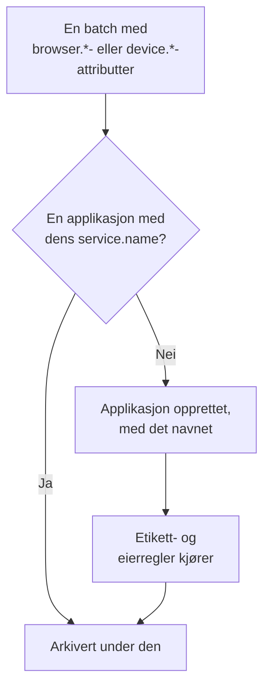

# Administrere applikasjoner

OneUptime oppretter en RUM-applikasjon første gang telemetrien fra appen din kommer inn. Denne siden dekker det du administrerer derfra: applikasjonens navn, etikettene og eierne, hvor lenge dataene oppbevares, arkivering, hvem som kan se den, og varsler.

:::cards
- [Slik opprettes en applikasjon](#slik-opprettes-en-applikasjon): Gjenkjent på sitt `service.name` og opprettet med sin første batch.
- [Etiketter](#etiketter): Grupper applikasjoner, og bestem hvem som kan nå dem.
- [Oppbevaring](#oppbevaring): Hvor lenge telemetri og opptak oppbevares.
- [Tillatelser](#tillatelser): Hvem som kan se applikasjoner, og hvem som kan se opptak.
:::

## Slik opprettes en applikasjon

Du trenger ikke å opprette en RUM-applikasjon. Når en batch med telemetri med nettleser- eller enhetsattributter og et `service.name` kommer inn, arkiverer OneUptime den under applikasjonen med det `service.name`, og oppretter applikasjonen hvis prosjektet ikke har en.



- `service.name` er applikasjonens identitet og sammenlignes uten forskjell på store og små bokstaver: `Storefront-Web` og `storefront-web` er én applikasjon.
- Et nytt `service.name` starter en ny applikasjon. Den gamle beholder historikken sin og går over til **Frakoblet**, den nye starter tom, og de to slås aldri sammen.
- Bruk ett `service.name` per app, ikke ett per miljø. Skill mellom miljøer med en etikett som `oneuptime.label.env=production`, slik at de deler én applikasjon og én historikk.

### Gi nytt navn til en applikasjon

**Visningsnavn** starter som `service.name`. For å endre det åpner du applikasjonens side **Innstillinger** og klikker på **Rediger detaljer** på kortet **Applikasjonsdetaljer**, der du også redigerer beskrivelsen og etikettene. Telemetri matches på **App-navn (service.name)**, som kortet viser, og som aldri endres, så det er trygt å gi nytt navn.

### Legg til en applikasjon selv

Opprett en applikasjon selv når du vil ha etikettene, eierne eller avspillingsretningslinjen klar før den første besøkende kommer.

:::steps
#### Åpne listen over applikasjoner

Gå til **Produkter → Ressurser → Overvåking av reelle brukere**, og klikk på **Opprett RUM-applikasjon**.

#### Skriv inn app-navnet

Fyll ut **App-navn (service.name)** med det `service.name` appen din kommer til å sende, nøyaktig slik den sender det.

#### Gi den et navn, og lagre

Applikasjonen får navnet på appen sin, akkurat som en oppdaget applikasjon. For å vise et annet navn åpner du **Flere felt** og skriver inn et **Visningsnavn**; beskrivelsen og etikettene finnes også der. Lagre deretter skjemaet.
:::

Deretter åpnes oppsettveiledningen for applikasjonen av seg selv, med app-navnet som `service.name` i kodeutdraget. Det siste trinnet, **Vent på tilkobling**, sier fra når de første dataene kommer inn.

Hvis prosjektet allerede har en applikasjon med det `service.name`, oppdaget, lagt til tidligere eller arkivert, sier skjemaet fra i stedet for å opprette en til.

## Tilkoblingsstatus

En applikasjon viser **Tilkoblet** mens telemetri kommer inn, og **Frakoblet** etter 15 minutter uten. Både OpenTelemetry-telemetri og trafikk fra øktavspilling teller med.

**Sist sett** oppdateres med noen minutters mellomrom i stedet for ved hver batch, så den kan ligge opptil rundt fem minutter etter den faktiske trafikken, og de 15 minuttene gir rom for det. Tid da OneUptime selv var nede eller holdt på å ta igjen inntakskøen sin, teller ikke.

**Frakoblet** er ikke en feil i seg selv: et internt verktøy uten besøkende om natten er virkelig frakoblet. Hvis folk bruker appen, kan du se [RUM-feilsøking](/docs/rum/troubleshooting).

## Etiketter

Etiketter grupperer applikasjoner i lister og filtre. De bestemmer også hva et medlem som er begrenset til enkelte etiketter, kan nå: det medlemmet ser bare applikasjonene som har en av de etikettene. En applikasjon får etiketter på tre måter:

| Hvordan | Hvor |
| --- | --- |
| Manuelt | I opprettelsesskjemaet under **Flere felt**, eller senere med **Rediger detaljer** på kortet **Applikasjonsdetaljer** på applikasjonens side **Innstillinger**. For flere om gangen merker du dem i listen og velger **Legg til etiketter** under **Massehandlinger**. |
| Fra telemetri | Et ressursattributt med navnet `oneuptime.label.<name>` legger til etiketten `<name>:<value>`, som vist nedenfor. |
| Fra en etikettregel | En regel legger til etiketter på hver nye applikasjon som treffer den. Se [Etikettregler og eierregler](#etikettregler-og-eierregler). |

Sett attributtene på den samme ressursen som `service.name`, for eksempel i filen `src/telemetry.ts` fra [Nettleseroppsett](/docs/rum/browser-setup):

```ts
const resource = defaultResource().merge(
  resourceFromAttributes({
    [ATTR_SERVICE_NAME]: "storefront-web",
    "oneuptime.label.team": "payments",
    "oneuptime.label.env": "production",
  }),
);
```

Dette legger til etikettene `team:payments` og `env:production` og oppretter dem i prosjektet hvis de ikke finnes. Når attributtnavnet står i etiketten, holdes `oneuptime.label.team=prod` og `oneuptime.label.env=prod` adskilt. En etikett på mer enn 100 tegn kortes ned til 100, og en tom verdi eller en verdi som ikke er en streng, legger ikke til noe.

## Etikettregler og eierregler

En regel legger til etiketter eller eiere på hver nye applikasjon som treffer den. Åpne **Overvåking av reelle brukere → Innstillinger → Etikettregler**, eller **Eierregler**, og opprett regelen i to trinn:

1. Under **Treff** treffer **Alle RUM-applikasjoner**, som en ny regel starter på, alle applikasjoner. For å snevre inn regelen velger du **Bare RUM-applikasjoner som oppfyller betingelsene** og legger til betingelser på **Applikasjonsetiketter** (har en, alle eller ingen av etikettene du velger), **Applikasjonsnavn** eller **Applikasjonsbeskrivelse** (er lik, inneholder, starter med, slutter med eller samsvarer med et mønster).
2. Under **Etiketter**, eller **Eiere** for en eierregel, velger du hva regelen legger til. En ny regel må legge til minst én etikett eller eier. **Navn** fylles ut fra det du velger, som _Add team:payments_ eller _Add Payments as owners_, til du skriver ditt eget. **Beskrivelse**, og **Varsle eiere** for en eierregel, venter under **Flere felt**.

Regler kjører når en applikasjon opprettes, også når den er oppdaget. For å bruke en regel på applikasjoner du allerede har, åpner du radens meny **⋯** og velger **Kjør nå**: se [Kjøre regler på eksisterende ressurser](/docs/configuration/run-rules-now). En regel som en redigering har latt stå uten noe å legge til, er merket med **Legger ikke til noe** i listen. [Etikett- og eierregler](/docs/configuration/label-and-owner-rules) dekker de fullstendige skjemaene.

### Eiere

Eiere er personene og teamene som har ansvaret for en applikasjon. Eierregler legger dem til nye applikasjoner. For å legge dem til eller fjerne dem manuelt merker du applikasjoner i listen og velger **Legg til eier** eller **Fjern eier** under **Massehandlinger**; API-et legger dem til via `/rum-application-owner-user` og `/rum-application-owner-team`. Med **Varsle eiere** slått på, som er standard, blir hver eier som en regel legger til, varslet. Slå det av før du kjører en regel på mange applikasjoner hvis ingen skal varsles.

## Oppbevaring

En applikasjons telemetri og opptakene dens oppbevares i ulik tid:

| Data | Oppbevares | Stilles inn på |
| --- | --- | --- |
| Logger, målinger, spor og profiler | Prosjektets oppbevaring, med mindre applikasjonen overstyrer den | Applikasjonens side **Innstillinger** |
| Opptak fra øktavspilling | 7 dager som standard, eller 1, 14, 30 eller 90 dager | **Replay Policy**, med **Rediger policy → Grenser** |

### Oppbevaring av telemetri

Som standard oppbevares en applikasjons telemetri i prosjektets oppbevaringstid, som stilles inn under **Prosjektinnstillinger → Telemetri og APM → Dataoppbevaring**. To kort på applikasjonens side **Innstillinger** overstyrer den:

- **Oppbevaring av telemetridata** inneholder **Behold telemetridata i (dager)**, én verdi for all telemetrien til applikasjonen. La den stå tom for å bruke prosjektets oppbevaring.
- **Oppbevaring etter telemetritype** inneholder en standard for logger, spor, målinger og profiler og for logger etter alvorlighetsgrad og spor etter status. En verdi som står tom, faller tilbake på applikasjonens verdi og deretter på prosjektets.

Overstyringer av oppbevaring er en del av [Enterprise Edition](/docs/self-hosted/enterprise) og av Scale-abonnementet og høyere på OneUptime Cloud. Uten dem viser kortene hva abonnementet legger til, og applikasjonen beholder prosjektets oppbevaring.

På et lavere Cloud-abonnement fortsetter en overstyring som er igjen etter en prøveperiode, å gjelde for ny telemetri. Siden **Innstillinger** viser den på et kort **Overstyring for oppbevaring** med en knapp **Fjern overstyring**, som virker på alle abonnementer: deretter beholder applikasjonen prosjektets oppbevaring, og det som allerede er lagret, beholder oppbevaringen det ble lagret med. Å sette en overstyring igjen krever Scale-abonnementet.

### Oppbevaring av øktavspillinger

Opptak har sin egen oppbevaring, som stilles inn på applikasjonens side **Replay Policy** med **Rediger policy → Grenser**: 7 dager som standard, eller 1, 14, 30 eller 90 dager. Den er kort med vilje, fordi et opptak er langt mer følsomt, og langt større, enn et spenn. Kortet **Oppbevaring av øktavspilling** på siden **Innstillinger** viser den (_Session replays are kept for 7 days._), og knappen **Rediger i Replay Policy** åpner retningslinjen.

En lengre oppbevaring av telemetri beholder ikke opptak lenger. En økts tellinger, signaler og enhet utløper sammen med opptaket; bare øktens logger, spenn og unntak følger telemetriens oppbevaring. Se [Oppbevaring og sletting](/docs/telemetry/session-replay#oppbevaring-og-sletting).

> [!TIP]
> RUM er ofte den mest omfangsrike telemetrien i et prosjekt, fordi den vokser med brukerne dine og ikke med serverne dine. En kortere oppbevaring her, og en lengre på backend-tjenestene dine, er et vanlig oppsett.

## Arkivering og sletting

**Arkiver** skjuler en applikasjon fra **Alle applikasjoner** mens den fortsetter å samle inn telemetri. Arkiver en applikasjon du ikke lenger følger med på, men som du vil beholde historikken til.

- Klikk på **Arkiver** på applikasjonens side **Innstillinger**, eller velg flere applikasjoner i listen og arkiver dem samlet.
- Arkiverte applikasjoner finnes under **Overvåking av reelle brukere → Avansert → Arkivert**. **Avansert** starter sammenslått i sidemenyen: klikk på den for å vise **Arkivert**. Bruk **Fjern fra arkiv** der på én applikasjon, eller på flere om gangen.

**Slett applikasjon**, i delen **Avansert** i applikasjonens sidemeny, sletter applikasjonen permanent. Hvis appen fortsatt sender telemetri, gjenoppretter den neste batchen applikasjonen uten noen av innstillingene, så stopp instrumenteringen først.

For å slette én persons data i stedet for en hel applikasjon sender du inn en sletteforespørsel: se [Slett økter](/docs/telemetry/session-replay#slett-økter).

## Tillatelser

Alle med prosjektets Viewer-rolle kan se RUM-applikasjoner og telemetrien deres. Øktavspilling er holdt utenfor den rollen med vilje: å liste opp opptak, se ett og lese hvem som så det, er separate tillatelser. Prosjekteiere og -administratorer har alle. Tillatelsesvelgerne viser hver tillatelse med tittelen sin, her vist i kursiv.

| Tillatelse | Lar et medlem |
| --- | --- |
| `ReadRumApplication` (_Read RUM Application_) | Se applikasjoner og telemetrisidene deres. |
| `CreateRumApplication`, `EditRumApplication`, `DeleteRumApplication` | Legge til, redigere og slette applikasjoner. |
| `ReadRumSessionReplay` (_List Session Replays_) | Liste opp innspilte økter og detaljene deres uten å spille dem av eller vite hvem brukeren var. |
| `ReadRumSessionReplayPayload` (_Watch Session Replays_) | Spille av opptak og lese den identifiserte brukerens referanse og egenskaper. |
| `ReadRumSessionReplayAudit` (_Read Session Replay Audit_) | Lese **Tilgangslogg for avspillinger**: hvem som så hvilket opptak. |
| `DeleteRumSessionReplay` (_Delete Session Replays_) | Slette opptak. |
| `CreateRumSessionErasureRequest`, `ReadRumSessionErasureRequest` | Sende inn sletteforespørsler og følge dem opp. |
| `ReadRumApplicationLabelRule`, `ReadRumApplicationOwnerRule` (og deres Create, Edit og Delete) | Administrere etikettregler og eierregler. |
| `ReadRumApplicationOwnerUser`, `ReadRumApplicationOwnerTeam` (og deres Create, Edit og Delete) | Legge til og fjerne eiere via API-et. |

En nyttig fordeling: gi en supportmedarbeider `ReadRumApplication` og `ReadRumSessionReplay`. Vedkommende kan da se hvilke økter som hadde feil, uten å se noens skjerm eller vite hvem brukeren var. Gi `ReadRumSessionReplayPayload` bare til dem som trenger det; medlemmer med `ReadRumSessionReplayAudit` ser da hver visning på applikasjonens side **Tilgangslogg for avspillinger**. [Hvem kan se et opptak](/docs/telemetry/session-replay#hvem-kan-se-et-opptak) viser hva hver tillatelse låser opp i øktlisten og avspilleren.

## Varsler på RUM-data

RUM-telemetri er vanlige logger, målinger og spor, så det finnes ingen egen RUM-overvåking: de vanlige overvåkingene virker med den. Den raskeste starten er applikasjonens side **Anbefalinger**, som tilbyr overvåkinger som allerede er avgrenset til applikasjonen:

| Gruppe | Anbefalinger |
| --- | --- |
| Core Web Vitals | Poor Largest Contentful Paint, Poor Interaction to Next Paint, Poor Cumulative Layout Shift, Slow First Contentful Paint og Slow Time to First Byte. Se [Core Web Vitals](/docs/rum/web-vitals). |
| Feil | Failed User Operations og Unhandled Browser Exceptions. |
| Øktavspilling | De fire [varslene for lagringsbudsjettet](/docs/telemetry/session-replay#varsler-for-lagringsbudsjettet), som advarer før prosjektets daglige grense eller applikasjonens månedlige budsjett er brukt opp. De tilbys så snart applikasjonen har tatt opp en avspilling, og det månedlige paret når den også har et månedlig budsjett. |

For å lage din egen overvåking velger du den som leser signalet:

- [Metrikk-overvåking](/docs/monitor/metrics-monitor): en Core Web Vital eller en annen måling appen din sender.
- [Trase-overvåking](/docs/monitor/traces-monitor): feilrate eller ventetid på klientsiden.
- [Logg-overvåking](/docs/monitor/logs-monitor): et mønster i nettleserlogger.
- [Unntak-overvåking](/docs/monitor/exceptions-monitor): nye eller raskt økende unntak på klientsiden.

Avgrens overvåkingen du lager, til applikasjonen, slik at en backend-tjeneste med en lignende signatur ikke utløser den.

## Neste steg

:::cards
- [Øktavspilling](/docs/telemetry/session-replay): Ta opp det brukerne så, med egen retningslinje og oppbevaring.
- [Etikett- og eierregler](/docs/configuration/label-and-owner-rules): De to regelskjemaene, trinn for trinn.
- [Kjøre regler på eksisterende ressurser](/docs/configuration/run-rules-now): Bruk en ny regel på applikasjonene du allerede har.
- [RUM-feilsøking](/docs/rum/troubleshooting): Når en applikasjon mangler, er tom eller viser Frakoblet.
:::
