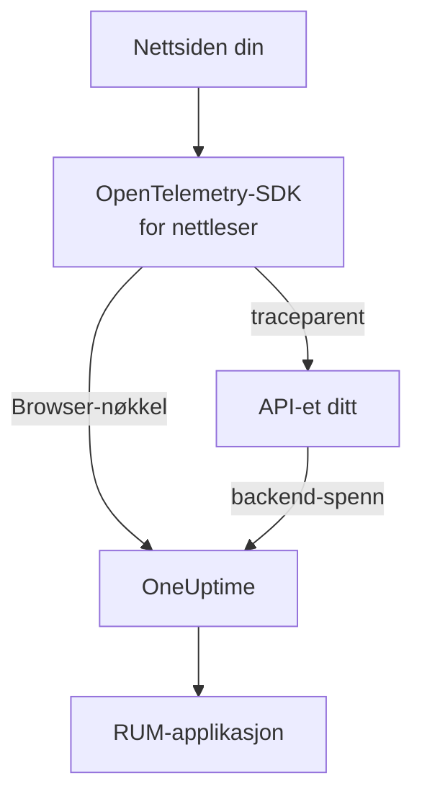

# Nettleseroppsett

Instrumenter en webapp med OpenTelemetry-SDK-et for nettleser, slik at den rapporterer til OneUptime som en RUM-applikasjon. Sideinnlastinger og forespørsler kommer inn som spor, og det samme oppsettet frakter også feil, logger, målinger og Core Web Vitals.

:::cards
- [Sett det opp](#sett-det-opp): Seks trinn fra en Browser-nøkkel til din første sideinnlasting.
- [Koble til backend](#koble-til-backend-sporene-dine): Knytt nettleserens spenn til backend-sporene de starter.
- [Rapporter feil](#rapporter-ufangede-feil): Send ufangede feil til visningen Unntak.
- [Feilsøking](#feilsøking): Hva du sjekker når ingenting kommer inn.
:::

## Slik fungerer det

SDK-et kjører i de besøkendes nettlesere. Det registrerer et spenn for hver sideinnlasting og hver forespørsel, og eksporterer dem rett til OneUptime med en **Browser**-inntaksnøkkel, uten egen collector eller proxy imellom.



## Før du begynner

- En webapp der du kan endre og rulle ut koden på nytt, med avhengigheter installert gjennom npm.
- Opprinnelsene sidene dine serveres fra, for eksempel `https://app.example.com`. En Browser-nøkkel godtar bare forespørsler fra opprinnelsene du lister opp på den.
- En rolle som kan opprette inntaksnøkler: Prosjekteiere og -administratorer kan det, og det kan også alle med tillatelsen **Create Telemetry Ingestion Key**.

## Sett det opp

:::steps
### Opprett en Browser-inntaksnøkkel

1. Gå til **Produkter → Prosjektinnstillinger**.
2. Åpne **Telemetri og APM** i sidemenyen, og velg **Inntaksnøkler**.
3. Klikk på **Opprett ingestion-nøkkel**, og velg **Browser** som **Nøkkeltype**.
4. I trinnet **Nettleserinnstillinger** lister du opprinnelsene dine under **Allowed Origins** som en JSON-matrise, for eksempel `["https://app.example.com"]`, og oppretter så nøkkelen. På gratisplanen i OneUptime Cloud viser et siste trinn **Fakturering** først prisen for telemetri.


Den nye nøkkelen åpnes på en egen side. Kopier **Hemmelig nøkkel**: Det er tokenet SDK-et sender som `x-oneuptime-token`.


### Installer pakkene

```bash
npm install @opentelemetry/api \
  @opentelemetry/sdk-trace-web \
  @opentelemetry/resources \
  @opentelemetry/semantic-conventions \
  @opentelemetry/opentelemetry-browser-detector \
  @opentelemetry/exporter-trace-otlp-http \
  @opentelemetry/context-zone \
  @opentelemetry/instrumentation \
  @opentelemetry/instrumentation-document-load \
  @opentelemetry/instrumentation-fetch \
  @opentelemetry/instrumentation-xml-http-request
```

### Opprett telemetrifilen

Opprett `src/telemetry.ts`. `browserDetector` legger til `browser.*`-attributtene som klassifiserer telemetrien som RUM, og `service.name` gir applikasjonen navnet.

```ts title="src/telemetry.ts"
import {
  WebTracerProvider,
  BatchSpanProcessor,
} from "@opentelemetry/sdk-trace-web";
import { OTLPTraceExporter } from "@opentelemetry/exporter-trace-otlp-http";
import { ZoneContextManager } from "@opentelemetry/context-zone";
import { registerInstrumentations } from "@opentelemetry/instrumentation";
import { DocumentLoadInstrumentation } from "@opentelemetry/instrumentation-document-load";
import { FetchInstrumentation } from "@opentelemetry/instrumentation-fetch";
import { XMLHttpRequestInstrumentation } from "@opentelemetry/instrumentation-xml-http-request";
import {
  defaultResource,
  detectResources,
  resourceFromAttributes,
} from "@opentelemetry/resources";
import { browserDetector } from "@opentelemetry/opentelemetry-browser-detector";
import { ATTR_SERVICE_NAME } from "@opentelemetry/semantic-conventions";

const ONEUPTIME_URL = "https://oneuptime.com";
// Public: it ships in your page. It must be a Browser ingestion key.
const ONEUPTIME_TOKEN = "YOUR_TELEMETRY_INGESTION_TOKEN";

/*
 * browserDetector supplies the browser.* attributes. Without them this
 * telemetry is classified as a backend Service, not a RUM application.
 * The attributes set last win, so service.name here overrides the
 * "unknown_service" that defaultResource() provides.
 */
const resource = defaultResource()
  .merge(detectResources({ detectors: [browserDetector] }))
  .merge(
    resourceFromAttributes({
      [ATTR_SERVICE_NAME]: "storefront-web",
    }),
  );

const provider = new WebTracerProvider({
  resource: resource,
  spanProcessors: [
    new BatchSpanProcessor(
      new OTLPTraceExporter({
        url: `${ONEUPTIME_URL}/otlp/v1/traces`,
        headers: { "x-oneuptime-token": ONEUPTIME_TOKEN },
      }),
    ),
  ],
});

provider.register({
  contextManager: new ZoneContextManager(),
});

registerInstrumentations({
  instrumentations: [
    new DocumentLoadInstrumentation(),
    new FetchInstrumentation({
      // See "Linking to your backend traces" before widening this.
      propagateTraceHeaderCorsUrls: [/^https:\/\/api\.example\.com/],
    }),
    new XMLHttpRequestInstrumentation({
      propagateTraceHeaderCorsUrls: [/^https:\/\/api\.example\.com/],
    }),
  ],
});
```

### Importer den først

Gjør den til den første importen i appen din. Instrumenteringene patcher `fetch` og `XMLHttpRequest`, og en forespørsel som gjøres før patchen, spores ikke.

```ts
// src/index.tsx (React), src/main.ts (Vue / Angular), etc.
import "./telemetry";
import React from "react";
// ... the rest of your app
```

### Sjekk nøkkelen

Spør OneUptime om den godtar nøkkelen før du leter andre steder:

```bash
curl -i https://oneuptime.com/otlp/v1/validate \
  -H "x-oneuptime-token: YOUR_TELEMETRY_INGESTION_TOKEN"
```

`200` med `"valid": true` betyr at nøkkelen godtas; for en Browser-nøkkel legger meldingen til at den bare virker fra en nettleser, fra en av de tillatte opprinnelsene. `401` betyr at nøkkelen er ukjent, tilbakekalt, slått av eller utløpt.

### Last inn en side

Åpne nettstedet ditt. Innen et minutt vises applikasjonen under **Produkter → Ressurser → Overvåking av reelle brukere**, oppkalt etter sin `service.name`.
:::

## Hva en Browser-nøkkel tillater

Alt i snippet-et sendes til de besøkende, så hvem som helst kan kopiere tokenet fra siden din. En Browser-nøkkel begrenser hva en kopi kan gjøre:

| Innstilling | Hva den gjør |
| --- | --- |
| **Allowed Origins** | Forespørsler godtas bare fra disse opprinnelsene, hver med sitt skjema og eventuelle port. En vert kan begynne med ett jokertegn `*.`: `https://*.example.com` dekker alle underdomener av `example.com`, men ikke `example.com` selv. |
| **Requests Per Minute Limit** | Ett tak for alle besøkende som bruker nøkkelen: 6000 forespørsler per minutt, med mindre du setter ditt eget. |
| **Pinned Service Name** | Tvinger `service.name` på alt nøkkelen skriver, så en kopi ikke kan utgi telemetrien sin for å være en av backend-tjenestene dine. |
| **Utløper** | Etter denne datoen godtas ikke nøkkelen lenger. |
| **Aktivert** | Slå den av for å stoppe en lekket nøkkel med en gang. |

En Browser-nøkkel skriver OTLP-spor, -logger og -målinger, og i tillegg øktavspillinger; alle andre inntaksveier avviser den. Du endrer disse innstillingene på nøkkelens egen side. Nøkkeltypen kan ikke endres etter at nøkkelen er opprettet.

> [!WARNING]
> Legg aldri en **Server**-nøkkel i en side. En Server-nøkkel skriver alle slags telemetri fra hvor som helst, uten opprinnelseskontroll, så alle som leser siden din, kan skrive inn i prosjektet ditt.

## Sett `browser.*` uten detektoren

`browserDetector` leser [UA Client Hints-API-et](https://wicg.github.io/ua-client-hints/), som bare Chromium-nettlesere har. I Safari og Firefox setter den `browser.language` og `user_agent.original`, men ikke `browser.platform`, `browser.brands` eller `browser.mobile`.

Det er likevel nok til å klassifisere telemetrien som RUM, fordi `browser.language` alene markerer en batch som nettleser-RUM. Siden **Klienter** viser imidlertid plattformer ut fra `browser.platform`, så besøk fra Safari og Firefox legger ikke til noen rad der.

For å droppe detektoren, eller for å gi alle nettlesere en plattform, setter du attributtene selv:

```ts
const resource = defaultResource().merge(
  resourceFromAttributes({
    [ATTR_SERVICE_NAME]: "storefront-web",
    // browser.language or browser.platform marks the telemetry as browser RUM.
    "browser.language": navigator.language,
    "browser.platform":
      (navigator as any).userAgentData?.platform ?? "unknown",
    "browser.mobile": (navigator as any).userAgentData?.mobile ?? false,
    "user_agent.original": navigator.userAgent,
  }),
);
```

Hold `browser.platform` grov. Hver distinkte verdi blir en rad på siden **Klienter**, så en full user-agent-streng eller en verdi per bruker gir en endeløs liste der, og er i tillegg et personvernproblem.

## Spor ruteskifter

`DocumentLoadInstrumentation` sporer bare den første innlastingen. I en enkeltsideapp forblir ruteskifter usynlige til du registrerer dem, noe som krever noen få linjer i ruteren din:

```ts
import { trace } from "@opentelemetry/api";

const tracer = trace.getTracer("app-router");

function onRouteChange(to: string): void {
  const span = tracer.startSpan("route-change", {
    attributes: { "app.route": to },
  });
  // End it when the route's data has loaded and the view has painted.
  requestAnimationFrame(() => {
    return span.end();
  });
}
```

Legg til `@opentelemetry/instrumentation-user-interaction` for også å spore klikk og andre DOM-hendelser. For INP per rute, se [Enkeltsideapper](/docs/rum/web-vitals#enkeltsideapper).

## Koble til backend-sporene dine

`propagateTraceHeaderCorsUrls` avgjør hvilke forespørsler på tvers av opprinnelser som får en W3C-header `traceparent`, som knytter nettleserens spenn til backend-sporet det startet. Forespørsler til sidens egen opprinnelse får den uten noen konfigurasjon.

> [!WARNING]
> Ikke sett den til `/.*/`. Headeren gjør en enkel forespørsel på tvers av opprinnelser til en med preflight, så alle tredjeparts-API-er som ikke har `traceparent` i sin `Access-Control-Allow-Headers`, begynner å feile.

List bare opp opprinnelser du kontrollerer og har konfigurert:

```ts
new FetchInstrumentation({
  propagateTraceHeaderCorsUrls: [
    /^https:\/\/api\.example\.com/,
    /^https:\/\/auth\.example\.com/,
  ],
});
```

Med [Øktavspilling](/docs/telemetry/session-replay) installert bærer forespørsler til din egen opprinnelse også avspillingens økt-ID, som arkiverer backend-telemetrien din under opptaket: se [Knytt spor til øktavspilling](#knytt-spor-til-øktavspilling).

## Knytt spor til øktavspilling

Hvis du også kjører [Øktavspilling](/docs/telemetry/session-replay), blir telemetrien fra **backend**-tjenestene dine knyttet til opptaket uten kode her. Mens en økt lastes opp, legger opptakeren et `tracestate`-medlem med økt-ID-en til forespørslene siden din sender til sin egen opprinnelse, og overlater `traceparent` til din `FetchInstrumentation` / `XMLHttpRequestInstrumentation`. Backend-spennene dine får økt-ID-en ved inntak, i hver tjeneste som fører W3C-sporkonteksten videre, og loggene og unntakene der knyttes til opptaket via spor-ID-en. Se [Korrelere med resten av telemetrien din](/docs/telemetry/session-replay#correlating-with-your-other-telemetry) for hvordan det virker, hva det ikke dekker, og bryteren som slår det av.

Opptakeren leser også tilbake `traceparent` som instrumenteringene dine setter, enten kallet sender en URL (med eller uten init-objekt) eller et `Request`-objekt, slik at hver forespørselsrad i avspillingen lenker til sitt backend-spor. Et API på en annen opprinnelse lister du opp i `propagateTraceHeaderCorsUrls` ovenfor; forespørslene dets bærer ingen økt-ID og knyttes til opptaket via spor-ID-en. **Trace propagation origins** i applikasjonens avspillingspolicy gjør det samme for sider *uten* dette SDK-et.

Det headerne ikke når, er dette SDK-ets egne nettleserspenn: dokumentinnlastinger, ruteskifter og feilene du rapporterer. For å arkivere også dem under opptaket, setter du `session.id` på hvert spenn når det starter. Opptakeren gir deg ID-en gjennom `onSessionChange`, som utløses med en gang hvis en økt allerede finnes, og igjen hver gang ID-en endres: når den besøkende kommer tilbake etter 30 minutter uten aktivitet, ved taket på 4 timer, når `identify()` navngir en annen bruker, eller når en annen fane hos samme besøkende endret den først.

```ts title="src/replaySession.ts"
import type { Context } from "@opentelemetry/api";
import type {
  ReadableSpan,
  Span,
  SpanProcessor,
} from "@opentelemetry/sdk-trace-web";

declare global {
  interface Window {
    OneUptimeReplayQueue?: Array<Array<unknown>>;
  }
}

let replaySessionId: string | null = null;

// The recorder script loads asynchronously. The queue is applied the
// moment it starts and stays live afterwards, so this works either way.
(window.OneUptimeReplayQueue = window.OneUptimeReplayQueue || []).push([
  "onSessionChange",
  (sessionId: string): void => {
    replaySessionId = sessionId;
  },
]);

export class ReplaySessionSpanProcessor implements SpanProcessor {
  public onStart(span: Span, _parentContext: Context): void {
    if (replaySessionId) {
      span.setAttribute("session.id", replaySessionId);
    }
  }

  public onEnd(_span: ReadableSpan): void {}

  public forceFlush(): Promise<void> {
    return Promise.resolve();
  }

  public shutdown(): Promise<void> {
    return Promise.resolve();
  }
}
```

Legg den deretter først blant providerens spennprosessorer i `src/telemetry.ts`:

```ts
import { ReplaySessionSpanProcessor } from "./replaySession";

const provider = new WebTracerProvider({
  resource: resource,
  spanProcessors: [
    new ReplaySessionSpanProcessor(),
    new BatchSpanProcessor(
      new OTLPTraceExporter({
        url: `${ONEUPTIME_URL}/otlp/v1/traces`,
        headers: { "x-oneuptime-token": ONEUPTIME_TOKEN },
      }),
    ),
  ],
});
```

Spenn som starter etter det, bærer ID-en, fanen **Spor** i avspilleren viser dem på opptakets klokke, og hvert av dem lenker i dashbordet tilbake til øyeblikket i avspillingen. En spennprosessor stempler hvert spenn med ID-en som gjaldt da det startet; å skrive ID-en i `resource.attributes` i stedet ville merket om spenn som fortsatt ventet i eksportbatchen da økten byttet. Lytteren får ID-en så snart opptakeren starter, før samtykke eller en opptaksutløser, så hvis det betyr noe, bør du bare stemple når siden din har samtykke.

## Content Security Policy

Hvis nettstedet ditt sender en Content Security Policy, blokkerer nettleseren eksportørens forespørsler til du tillater OneUptime i `connect-src`. Ingenting feiler synlig: Siden rapporterer rett og slett ingenting.

```text
connect-src 'self' https://oneuptime.com;
```

Slå det sammen med det eksisterende `connect-src`-direktivet ditt. Hvis du drifter OneUptime selv, bruker du din egen vert.

## Rapporter ufangede feil

OpenTelemetry-SDK-et for nettleser fanger ikke ufangede feil. Rapporter dem selv, så vises de under **Unntak** ved siden av backend-feilene dine:

```ts
import { trace, SpanStatusCode } from "@opentelemetry/api";

const tracer = trace.getTracer("app-errors");

window.addEventListener("error", (event: ErrorEvent) => {
  const span = tracer.startSpan("window.onerror");
  span.recordException(event.error ?? new Error(event.message));
  span.setStatus({ code: SpanStatusCode.ERROR });
  span.end();
});

window.addEventListener("unhandledrejection", (event: PromiseRejectionEvent) => {
  const span = tracer.startSpan("unhandledrejection");
  span.recordException(
    event.reason instanceof Error ? event.reason : new Error(String(event.reason)),
  );
  span.setStatus({ code: SpanStatusCode.ERROR });
  span.end();
});
```

Med [Øktavspilling](/docs/telemetry/session-replay) fanger også opptakeren ufangede feil og markerer dem på avspillingens tidslinje. Unntakets side viser da et kort **Watch what the user saw**, som åpner avspillingen ti sekunder før feilen. Med standardpolicyen tas hver økt opp, enten noe feiler eller ikke; feilen avgjør bare hvor kortet åpner.

## Legg til logger og målinger

Spor er nok til å fylle oversikten. Legg til logg- og målingspipelinene når du vil ha nettleserlogger i OneUptime, eller for å sende [Core Web Vitals](/docs/rum/web-vitals):

```bash
npm install @opentelemetry/api-logs @opentelemetry/sdk-logs \
  @opentelemetry/exporter-logs-otlp-http \
  @opentelemetry/sdk-metrics @opentelemetry/exporter-metrics-otlp-http
```

```ts
import { LoggerProvider, BatchLogRecordProcessor } from "@opentelemetry/sdk-logs";
import { OTLPLogExporter } from "@opentelemetry/exporter-logs-otlp-http";
import { MeterProvider, PeriodicExportingMetricReader } from "@opentelemetry/sdk-metrics";
import { OTLPMetricExporter } from "@opentelemetry/exporter-metrics-otlp-http";
import { logs } from "@opentelemetry/api-logs";
import { metrics } from "@opentelemetry/api";

const headers = { "x-oneuptime-token": ONEUPTIME_TOKEN };

logs.setGlobalLoggerProvider(
  new LoggerProvider({
    resource: resource,
    processors: [
      new BatchLogRecordProcessor({
        exporter: new OTLPLogExporter({
          url: `${ONEUPTIME_URL}/otlp/v1/logs`,
          headers,
        }),
      }),
    ],
  }),
);

metrics.setGlobalMeterProvider(
  new MeterProvider({
    resource: resource,
    readers: [
      new PeriodicExportingMetricReader({
        exporter: new OTLPMetricExporter({
          url: `${ONEUPTIME_URL}/otlp/v1/metrics`,
          headers,
        }),
        exportIntervalMillis: 30000,
      }),
    ],
  }),
);
```

Bygg dem med det samme `resource`-objektet. En logg- eller målingspipeline der ressursen mangler `browser.*`, arkiveres som en egen backend-tjeneste.

## Endepunktreferanse

| Signal | Endepunkt | Header |
| --- | --- | --- |
| Spor | `POST {host}/otlp/v1/traces` | `x-oneuptime-token: <token>` |
| Målinger | `POST {host}/otlp/v1/metrics` | `x-oneuptime-token: <token>` |
| Logger | `POST {host}/otlp/v1/logs` | `x-oneuptime-token: <token>` |

`{host}` er `https://oneuptime.com`, eller din egen vert hvis du kjører OneUptime selv; endre den i OTLP-URL-ene og i oppføringen i Content Security Policy. OneUptime godtar OTLP/JSON og OTLP/protobuf. Endepunktene svarer på forespørsler på tvers av opprinnelser fra enhver opprinnelse og tillater headeren `x-oneuptime-token`, så en nettleser eksporterer direkte til dem.

## Feilsøking

:::details Ingen forespørsel til OneUptime i fanen Nettverk
Åpne utviklerverktøyene i nettleseren, gå til fanen Nettverk og filtrer på `otlp`: Du ser etter `POST /otlp/v1/traces`. Ingen forespørsel i det hele tatt betyr at SDK-et aldri startet:

- `telemetry.ts` er ikke den første importen, eller bundleren din har droppet den.
- Batchprosessoren har ikke eksportert ennå. Den venter noen sekunder for å fylle en batch, så vent, eller gå til en annen side, før du konkluderer med at ingenting sendes.
- En miljøvariabel fra bygget ble `undefined`, så eksportørens URL er ødelagt. Logg URL-en én gang ved oppstart.
:::

:::details Nettleseren blokkerer forespørselen
- En feil fra Content Security Policy i konsollen betyr at `connect-src` ennå ikke tillater OneUptime: se [Content Security Policy](#content-security-policy).
- En CORS-feil betyr nesten alltid at forespørselen aldri nådde OneUptime, der endepunktene tillater enhver opprinnelse: Se etter en bedriftsproxy, en annonseblokkerer eller en skrivefeil i verten.
:::

:::details OneUptime avviser forespørselen
- `422` med `Origin https://app.example.com is not allowed for this browser ingestion key.` betyr at sidens nøyaktige opprinnelse (skjema, vert og port) mangler i nøkkelens **Allowed Origins**.
- `422` med `This telemetry ingestion key has been disabled.` betyr at noen har slått av nøkkelen. Slå den på igjen, eller bruk en annen nøkkel.
- `401` betyr at nøkkelen er ukjent, tilbakekalt eller utløpt. Kjør nøkkelsjekken i [Sett det opp](#sett-det-opp), og opprett deretter en gyldig Browser-nøkkel.
- `404` betyr at URL-en er feil. Sporeksportøren trenger hele stien, `/otlp/v1/traces`.
:::

:::details Appen vises under Tjenester i stedet for Overvåking av reelle brukere
Ressursen har ingen `browser.*`-attributt, så telemetrien ble arkivert som en backend-tjeneste. Legg til `browserDetector`, eller sett attributtene som i [Sett `browser.*` uten detektoren](#sett-browser-uten-detektoren).

Sjekk i fanen Nettverk, i forespørselens nyttelast, hva du sender: `resourceSpans[0].resource.attributes` er listen som avgjør det. Tjenesten som allerede ble opprettet, blir ikke til en RUM-applikasjon, så slett den under **Produkter → Tjenester** når RUM-telemetrien kommer inn.
:::

:::details Siden Klienter er tom i Safari eller Firefox
Klientrader kommer fra `browser.platform`, som `browserDetector` bare setter i Chromium-nettlesere. Sett den selv for å vise besøk fra Safari og Firefox: se [Sett `browser.*` uten detektoren](#sett-browser-uten-detektoren).
:::

## Neste steg

:::cards
- [Core Web Vitals](/docs/rum/web-vitals): Send LCP, INP, CLS, FCP og TTFB fra den samme siden.
- [Øktavspilling](/docs/telemetry/session-replay): Ta opp hva brukeren så, ved siden av disse sporene.
- [Administrere applikasjoner](/docs/rum/applications): Navn, etiketter, eiere og oppbevaring.
- [RUM-feilsøking](/docs/rum/troubleshooting): Hver sjekk, i den rekkefølgen problemer vanligvis oppstår.
:::
