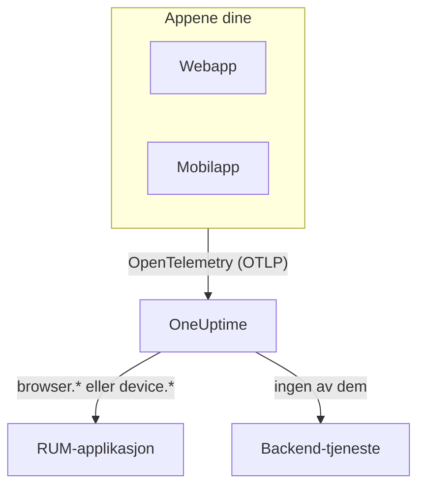

# RUM – Oversikt

Real User Monitoring (RUM) viser hva ekte brukere opplever i web- og mobilappene dine: sideinnlastinger, forespørsler, feil og Core Web Vitals, rapportert av appen selv i stedet for av en probe. OneUptime samler den telemetrien i en RUM-applikasjon som du kan vise i grafer, søke i og overvåke med varsler.

:::cards
- [Slik fungerer det](#slik-fungerer-det): Én OpenTelemetry-pipeline, klassifisert som RUM ved ankomst.
- [Slik gjenkjenner OneUptime RUM](#slik-gjenkjenner-oneuptime-rum): Ressursattributtene som avgjør det.
- [Dette får du](#dette-får-du): Oversikten, vitals, utforskerne og avspillingene.
- [Kom i gang](#kom-i-gang): Fra en inntaksnøkkel til din første sideinnlasting.
:::

## Slik fungerer det

RUM bruker den samme OpenTelemetry-pipelinen som resten av OneUptime. Det finnes ingen RUM-agent og ikke noe eget overføringsformat: Du peker et OpenTelemetry-SDK for nettleser eller mobil mot OneUptime, og telemetrien klassifiseres som RUM når den kommer inn.

- **Én applikasjon per app.** Identiteten er `service.name` som SDK-et ditt rapporterer, og OneUptime oppretter applikasjonen ved første telemetribatch.
- **Aldri telt to ganger.** Klienttelemetri hører bare til sin egen RUM-applikasjon; den vises ikke også som backend-tjeneste.
- **Session Replay er et eget, valgfritt lag.** Det har sitt eget snippet og egne personverninnstillinger: se [Øktavspilling](/docs/telemetry/session-replay).

## Hvor du finner det

Åpne **Produkter → Ressurser → Overvåking av reelle brukere**. **Alle applikasjoner** viser applikasjonene dine med **Klienttype**, **Status** og **Sist sett**. To andre seksjoner i sidemenyen er lukket fra start:

- **Innstillinger**: **Eierregler**, **Etikettregler** og prosjektets felles **Session Replay**-bryter.
- **Avansert**: **Arkivert**, applikasjonene du har arkivert.

Sidemenyen til en applikasjon grupperer sidene slik; **Innstillinger**, **Utvikler** og **Avansert** er lukket fra start:

| Seksjon | Sider |
| --- | --- |
| **Grunnleggende** | **Oversikt**, **Recommendations**, **Dokumentasjon** |
| **Observerbarhet** | **Målinger**, **Logger**, **Spor**, **Klienter** |
| **Session Replay** | **Session Replay**, **User Flows**, **Replay Users**, **Health**, **Replay Policy**, **Replay Access Log**, **Dokumentasjon** |
| **Innstillinger** | **Innstillinger** |
| **Utvikler** | **Terraform**, **API**, **AI-assistenter** |
| **Avansert** | **Slett applikasjon** |

## Slik gjenkjenner OneUptime RUM

De fleste spørsmål av typen «appen min dukker ikke opp» ender her. OneUptime avgjør for hver telemetribatch ved ankomst, ut fra batchens **ressursattributter**:

1. En batch der ressursen har `browser.platform`, `browser.language` eller en ikke-tom `browser.brands`, er **nettleser**-RUM.
2. Ellers er en batch med `device.id` eller `device.model.identifier` **mobil**-RUM.
3. Ellers er en batch med `device.manufacturer` og uten vertsidentitet (`host.name`, `host.id` eller `k8s.node.name`) også **mobil**-RUM.
4. Alt annet er en backend-tjeneste.

Backend-SDK-er setter aldri `browser.*`, `device.id` eller `device.model.identifier`, så dette er tydelige signaler. `device.manufacturer` er unntaket: En verts inventar rapporterer også en maskins produsent med den, så den teller bare på en ressurs uten vertsidentitet. Se [Inventarattributter](/docs/telemetry/host-otel-collector#inventarattributter-ip-mac-serienummer-produsent-modell-fastvare).

| Attributt | Påkrevd | Hva det gjør |
| --- | --- | --- |
| `service.name` | **Ja** | Applikasjonens identitet, for eksempel `storefront-web`. Uten den opprettes ingen RUM-applikasjon. |
| `browser.platform`, `browser.language`, `browser.brands` | En av dem, på nettet | Markerer batchen som nettleser-RUM. `browser.platform` fyller også siden **Klienter**. |
| `device.id`, `device.model.identifier` | En av dem, på mobil | Markerer batchen som mobil-RUM. `device.model.identifier` fyller også siden **Klienter**. |
| `device.manufacturer` | Nei | Markerer bare batchen som mobil-RUM når ressursen ikke har noen vertsidentitet. |
| `telemetry.sdk.language` | Nei | Vises i oversikten, for eksempel `webjs` eller `swift`. |
| `telemetry.sdk.version` | Nei | Vises som SDK-versjon; mangler den, leses `oneuptime.agent.version`. |
| `oneuptime.label.<name>` | Nei | Legger prosjektetiketten `<name>:<value>` til applikasjonen. |

OneUptime finner applikasjonen ut fra `service.name`, uten å skille mellom store og små bokstaver, og oppretter den når prosjektet ikke har en. En ny `service.name` starter en ny applikasjon, så hold den stabil, og skill miljøer med en etikett i stedet for et nytt navn. [Administrere applikasjoner](/docs/rum/applications) tar for seg navn, etiketter, eiere og oppbevaring.

> [!IMPORTANT]
> OpenTelemetry-SDK-et for nettleser legger ikke til `browser.*`-attributter med mindre du legger til nettleserens ressursdetektor eller setter dem selv. Med bare `service.name` blir telemetrien en backend-tjeneste, ikke en RUM-applikasjon. [Nettleseroppsett](/docs/rum/browser-setup) viser begge måtene.

## Dette får du

| Hvor | Hva det viser |
| --- | --- |
| **Oversikt** | Fliser for **Page loads**, **Page load time (p95)**, **Hendelser**, **Feilrate**, **Event duration (p95)**, **Unntak**, **Klienter** og **Sessions recorded**, og trendgrafer over tidsrommet du velger. |
| **Core Web Vitals** | Et kort i oversikten med LCP, INP, CLS, FCP og TTFB, hver vurdert mot Googles grenser, og INP for hver rute i en enkeltsideapp. Se [Core Web Vitals](/docs/rum/web-vitals) og [Enkeltsideapper](/docs/rum/web-vitals#enkeltsideapper). |
| **Målinger**, **Logger**, **Spor** | Telemetriutforskerne, begrenset til denne applikasjonen. |
| **Klienter** | Nettleserplattformene og enhetsmodellene applikasjonen er brukt på: en kort liste per plattform, aldri én rad per bruker. |
| **Session Replay** | Opptak av ekte økter, ved siden av feilene, sporene og loggene deres: se [Øktavspilling](/docs/telemetry/session-replay). |
| **Recommendations** | Ferdige monitorer for applikasjonen: dårlige Core Web Vitals, mislykkede forespørsler, nettleserunntak og, så snart den tar opp, budsjetter for Session Replay. |

Tallene kommer fra spennene instrumenteringen din sender. **Page loads** teller spennet `documentLoad`, som instrumenteringen for sideinnlasting registrerer ved hver fullstendige innlasting, så et ruteskifte i en enkeltsideapp er ikke en sideinnlasting.

En applikasjon viser **Tilkoblet** så lenge telemetri kommer inn, og **Frakoblet** etter 15 minutter uten. Tid da OneUptime selv var nede eller tok igjen inntakskøen sin, teller ikke med i de 15 minuttene.

## Kom i gang

:::steps
### Opprett en inntaksnøkkel

Åpne **Prosjektinnstillinger → Telemetri og APM → Inntaksnøkler** og klikk på **Opprett ingestion-nøkkel**. En webapp trenger en **Browser**-nøkkel, som bare virker fra opprinnelsene du lister opp. En mobilapp trenger en **Server**-nøkkel, fordi et mobil-SDK ikke sender en `Origin`-header.

### Instrumenter appen din

Følg [Nettleseroppsett](/docs/rum/browser-setup) for en webapp, eller [Mobiloppsett](/docs/rum/mobile-setup) for Android, iOS, React Native og andre plattformer.

### Åpne en side

Last inn en side på nettstedet ditt, eller start appen. Applikasjonen vises under **Produkter → Ressurser → Overvåking av reelle brukere** ved første telemetribatch, oppkalt etter sin `service.name`. Du trenger ikke å opprette den først.

### Legg til vitals og avspillinger

Når det grunnleggende kommer inn, sender du [Core Web Vitals](/docs/rum/web-vitals) og legger til [Øktavspilling](/docs/telemetry/session-replay). Begge deler er valgfrie.
:::

Hvis ingenting dukker opp, går [RUM-feilsøking](/docs/rum/troubleshooting) gjennom årsakene i den rekkefølgen de vanligvis oppstår.

## Neste steg

:::cards
- [Nettleseroppsett](/docs/rum/browser-setup): Instrumenter en webapp med OpenTelemetry-SDK-et for nettleser.
- [Mobiloppsett](/docs/rum/mobile-setup): Android, iOS, React Native og ethvert annet OpenTelemetry-SDK.
- [Core Web Vitals](/docs/rum/web-vitals): Send LCP, INP, CLS, FCP og TTFB, og les INP rute for rute.
- [Øktavspilling](/docs/telemetry/session-replay): Se hva brukeren så, ved siden av brukerens feil og spor.
:::
