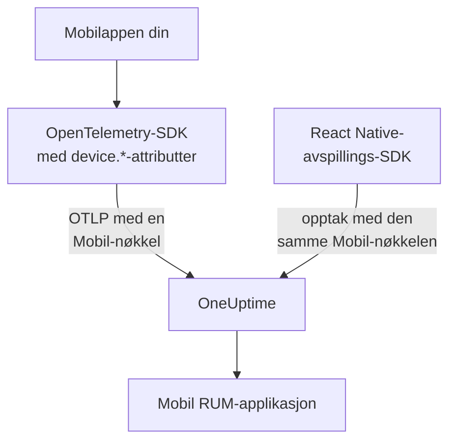

# Mobiloppsett

Instrumenter en Android-, iOS- eller React Native-app med OpenTelemetry, slik at den rapporterer til OneUptime som en mobil RUM-applikasjon. Alle andre plattformer med et OpenTelemetry-SDK fungerer på samme måte.

:::cards
- [Hva OneUptime trenger](#hva-oneuptime-trenger): To ressursattributter, sendt med en Mobil-nøkkel.
- [Sett opp plattformen din](#sett-opp-plattformen-din): Android, iOS, React Native og resten.
- [Krasj og heng på iOS](#krasj-og-heng-på-ios): Rapporter fra MetricKit og KSCrash i Unntak, navngitt av dSYM-filene dine.
- [Sjekk at det kommer inn](#sjekk-at-det-kommer-inn): Test nøkkelen, og finn så appen.
- [Session Replay på mobil](#session-replay-på-mobil): Opptak for React Native-apper.
:::

## Slik fungerer det

Appen din eksporterer OTLP rett til OneUptime med en **Mobil**-inntaksnøkkel, festet til appen, så alt den sender, arkiveres som den mobile RUM-applikasjonen. Med alle andre nøkler er det `device.*`-attributtene på ressursen som klassifiserer den som mobil-RUM i stedet for som backend-tjeneste.



## Hva OneUptime trenger

To ressursattributter, på hver batch appen din eksporterer:

| Attributt | Hva det er |
| --- | --- |
| `service.name` | Applikasjonens identitet, for eksempel `storefront-android`. |
| `device.id` eller `device.model.identifier` | Markerer telemetrien som mobil-RUM. `device.model.identifier` fyller også siden **Klienter**. |

Sendt med en annen nøkkel kommer telemetri uten en enhetsattributt likevel inn, og du kan søke i den, men den arkiveres som en backend-tjeneste i stedet for en RUM-applikasjon.

`device.manufacturer` markerer også en batch som mobil, men bare på en ressurs uten vertsidentitet, fordi en verts inventar rapporterer en maskins produsent med den. Sett også `device.id` eller `device.model.identifier`, slik hver oppskrift nedenfor gjør, så spiller det aldri noen rolle.

Gjør `device.id` til en ID per installasjon, aldri en annonse-ID eller noe annet som identifiserer en person. OneUptime leser den bare for å gjenkjenne mobiltelemetri.

## Før du begynner

- En app med et OpenTelemetry-SDK: OpenTelemetry Java SDK eller OpenTelemetry Android, opentelemetry-swift, eller OpenTelemetry JavaScript SDK for React Native.
- En **Mobil**-inntaksnøkkel, opprettet under **Prosjektinnstillinger → Telemetri og APM → Inntaksnøkler** med **Opprett inntaksnøkkel**, med appens `service.name` som **Festet tjenestenavn**. En **Nettleser**-nøkkel avvises fra en mobilapp: Den kontrolleres mot headeren `Origin`, som mobil-SDK-er ikke sender. Send aldri med en **Server**-nøkkel i en app.
- Disse OTLP-innstillingene. Hvis du drifter OneUptime selv, bytter du ut `https://oneuptime.com` med din egen vert.

| Innstilling | Verdi |
| --- | --- |
| OTLP-endepunkt | `https://oneuptime.com/otlp` |
| Header | `x-oneuptime-token: YOUR_TELEMETRY_INGESTION_TOKEN` |
| Spor | `POST https://oneuptime.com/otlp/v1/traces` |
| Målinger | `POST https://oneuptime.com/otlp/v1/metrics` |
| Logger | `POST https://oneuptime.com/otlp/v1/logs` |

> [!WARNING]
> Nøkkelen følger med i appen din, og en app kan pakkes ut, så gå ut fra at noen kopierer den. En kopi av en Mobil-nøkkel kan bare sende denne appens spor, logger, målinger og øktavspillinger, arkivert under dens **Festet tjenestenavn**, og aldri fra en nettside. Den kan likevel sende oppdiktede data for denne appen, opp til nøkkelens **Grense for forespørsler per minutt**, så legg til en dato under **Utløper**, og bytt nøkkelen med utgivelsene dine.

## Sett opp plattformen din

Snippetene viser formen på oppsettet. Mobil-SDK-ene for OpenTelemetry endrer API-ene sine mellom utgivelser, så sjekk metodenavnene mot versjonen du låser. Det OneUptime trenger, endrer seg aldri: endepunktet, headeren, `service.name` og én `device.*`-attributt.

:::tabs
@tab Android
Bruk OpenTelemetry Java SDK og OTLP-eksportøren, som kjører på Android:

```kotlin title="app/build.gradle.kts"
dependencies {
    implementation(platform("io.opentelemetry:opentelemetry-bom:<latest>"))
    implementation("io.opentelemetry:opentelemetry-sdk")
    implementation("io.opentelemetry:opentelemetry-exporter-otlp")
}
```

```kotlin title="StorefrontApplication.kt"
import android.app.Application
import android.os.Build
import io.opentelemetry.exporter.otlp.http.trace.OtlpHttpSpanExporter
import io.opentelemetry.sdk.OpenTelemetrySdk
import io.opentelemetry.sdk.resources.Resource
import io.opentelemetry.sdk.trace.SdkTracerProvider
import io.opentelemetry.sdk.trace.export.BatchSpanProcessor

class StorefrontApplication : Application() {
    override fun onCreate() {
        super.onCreate()

        val resource = Resource.getDefault().toBuilder()
            .put("service.name", "storefront-android")
            .put("device.manufacturer", Build.MANUFACTURER)
            .put("device.model.identifier", Build.MODEL)
            .build()

        val exporter = OtlpHttpSpanExporter.builder()
            .setEndpoint("https://oneuptime.com/otlp/v1/traces")
            .addHeader("x-oneuptime-token", BuildConfig.ONEUPTIME_TOKEN)
            .build()

        OpenTelemetrySdk.builder()
            .setTracerProvider(
                SdkTracerProvider.builder()
                    .setResource(resource)
                    .addSpanProcessor(BatchSpanProcessor.builder(exporter).build())
                    .build()
            )
            .buildAndRegisterGlobal()
    }
}
```

Agenten [OpenTelemetry Android](https://github.com/open-telemetry/opentelemetry-android) legger krasj, ANR-er, trege og frosne rammer og appoppstarter på toppen, og setter `device.model.identifier` og `device.manufacturer` på sin egen ressurs. [Android-oppsett](/docs/rum/android-setup) setter den opp i stedet for koden ovenfor.
@tab iOS
Bruk [opentelemetry-swift](https://github.com/open-telemetry/opentelemetry-swift), og sett enhetsattributtene selv: Ressursen hver versjon legger til av seg selv, har endret seg mellom utgivelser.

```swift
let resource = Resource(attributes: [
    "service.name": .string("storefront-ios"),
    "device.model.identifier": .string(UIDevice.current.model),
    "device.manufacturer": .string("Apple"),
    "device.id": .string(UIDevice.current.identifierForVendor?.uuidString ?? ""),
    "telemetry.sdk.language": .string("swift"),
])

let exporter = OtlpHttpTraceExporter(
    endpoint: URL(string: "https://oneuptime.com/otlp/v1/traces")!,
    config: OtlpConfiguration(
        headers: [("x-oneuptime-token", oneUptimeToken)]
    )
)

OpenTelemetry.registerTracerProvider(
    tracerProvider: TracerProviderBuilder()
        .with(resource: resource)
        .add(spanProcessor: BatchSpanProcessor(spanExporter: exporter))
        .build()
)
```

`UIDevice.current.model` gir et kort navn som `iPhone`, noe som holder siden **Klienter** på én rad per enhetstype. `identifierForVendor` er installasjonen OneUptime teller krasjfrie installasjoner etter, slik [Merk øktene](#merk-øktene) beskriver.
@tab React Native
React Native kjører OpenTelemetry JavaScript SDK, så bygg provideren, OTLP-eksportøren og batchprosessoren som i [Nettleseroppsett](/docs/rum/browser-setup), med tre endringer: Send med en **Mobil**-nøkkel, utelat `browserDetector` og `DocumentLoadInstrumentation`, og sett enhetsattributtene selv.

```ts
import { Platform } from "react-native";
import * as Device from "expo-device"; // or react-native-device-info
import {
  defaultResource,
  resourceFromAttributes,
} from "@opentelemetry/resources";

const resource = defaultResource().merge(
  resourceFromAttributes({
    "service.name": "storefront-mobile",
    "device.manufacturer": Device.manufacturer ?? Platform.OS,
    "device.model.identifier":
      Device.modelId ?? Device.modelName ?? "unknown",
    "telemetry.sdk.language": "webjs",
  }),
);
```

`Device.modelId` settes bare på iOS, så Android faller tilbake på `Device.modelName`.
@tab Andre plattformer
Flutter, Unity, .NET MAUI, en innebygd klient eller en egen OTLP-skriver fungerer alle, så lenge ressursen har `service.name` og én `device.*`-attributt. Et SDK som leser standard miljøvariabler for OpenTelemetry, tar disse som de er:

```bash
OTEL_EXPORTER_OTLP_ENDPOINT="https://oneuptime.com/otlp"
OTEL_EXPORTER_OTLP_HEADERS="x-oneuptime-token=YOUR_TELEMETRY_INGESTION_TOKEN"
OTEL_RESOURCE_ATTRIBUTES="service.name=storefront-mobile,device.manufacturer=Acme,device.model.identifier=AC-100"
```

SDK-et legger selv til `/v1/traces`, `/v1/metrics` og `/v1/logs` på endepunktet.
:::

## Krasj og heng på iOS

opentelemetry-swift 2.3 og nyere rapporterer krasj og heng i en iOS-app gjennom MetricKit-instrumenteringen sin, som gir hver av Apples diagnostikker videre til OpenTelemetry som en loggpost. OneUptime arkiverer dem slik det arkiverer krasj og ANR-er fra OpenTelemetry Android, så de vises i **Unntak** og på applikasjonens side **Oversikt**:

| Apples diagnostikk | Hendelsesnavn | I Unntak |
| --- | --- | --- |
| Et krasj | `metrickit.diagnostic.crash` | Et uhåndtert unntak, med typen fra det som avsluttet appen: Objective-C-unntaket på iOS 17 og nyere, ellers Mach-unntaket (`EXC_BAD_ACCESS`), ellers signalet (`SIGSEGV`) |
| Et heng | `metrickit.diagnostic.hang` | Et uhåndtert unntak av typen **Hang**, iOS' motstykke til en ANR, som tar vare på hvor lenge henget varte |

Flisen **Krasj** på oversikten teller krasjene, og flisen **ANR-er** teller hengene sammen med Androids ANR-er. Hver stack trace tegnes som trådene i en krasjrapport, med tråden som krasjet eller hang, først. En stakkramme i koden til appen din navngis etter funksjonen sin, for eksempel `CartViewController.checkout()`, når dSYM-filen for bygget er lastet opp, som i [Last opp dSYM-filene dine](#last-opp-dsym-filene-dine). Alle andre stakkrammer nevner binærfilen sin og hvor langt inn i den koden var, og **Binary Images** viser UUID-en til hver binærfil, som forteller hvilket bygg dSYM-filen som navngir den, hører til.

Krasj og heng grupperes etter appens stakkrammer på tråden som krasjet eller hang: etter funksjonene der en dSYM-fil har navngitt dem, så et krasj forblir ett unntak fra én utgivelse til den neste, og etter forskyvningene i binærfilen der ingen har gjort det, som endres med hvert bygg. En rapport navngis når den kommer inn, så last opp dSYM-filene for et bygg før du sender det ut: Et krasj som kom inn før dSYM-filen sin, beholder forskyvningene sine.

:::steps
### Eksporter logger i tillegg til spenn

MetricKit rapporterer diagnostikk som loggposter, så registrer en logger-provider ved siden av tracer-provideren, med samme ressurs, endepunkt og header:

```swift
let logExporter = OtlpHttpLogExporter(
    endpoint: URL(string: "https://oneuptime.com/otlp/v1/logs")!,
    config: OtlpConfiguration(
        headers: [("x-oneuptime-token", oneUptimeToken)]
    )
)

OpenTelemetry.registerLoggerProvider(
    loggerProvider: LoggerProviderBuilder()
        .with(resource: resource)
        .with(processors: [
            BatchLogRecordProcessor(logRecordExporter: logExporter),
        ])
        .build()
)
```

### Registrer MetricKit-instrumenteringen

Legg til produktet `MetricKitInstrumentation` fra opentelemetry-swift, og registrer det hos MetricKit når logger-provideren er registrert:

```swift
import MetricKit
import MetricKitInstrumentation

// MXMetricManager keeps only a weak reference: hold this for the app's lifetime.
let metricKitInstrumentation = MetricKitInstrumentation()
MXMetricManager.shared.add(metricKitInstrumentation)
```

### Merk øktene

Flisene **Økter** og **Krasjfrie økter** teller `session.id` på spennene dine. Produktet `Sessions` i opentelemetry-swift setter den: Legg til `SessionSpanProcessor` i tracer-provideren, og pakk inn loggprosessoren i `SessionLogRecordProcessor`, så diagnostikken også får med seg en økt.

Linjen under **Krasjfrie økter** viser andelen installasjoner som ikke krasjet, og **Daily Crash Rate** og **Daily ANR Rate** varsler ut fra andelen som gjorde det. En installasjon er `device.id` i ressursen ovenfor, appens leverandør-ID: én per enhet for alle appene dine, som beholdes så lenge en av dem er installert, så å installere den eneste appen din på nytt gir en ny installasjon, mens å installere én av to på nytt ikke gjør det. En utgivelse av opentelemetry-swift som setter `app.installation.id`, telles etter den i stedet.

### Last opp dSYM-filene dine

Xcode skriver en dSYM-fil for hver av appens binærfiler når den arkiverer appen, og App Store Connect gir dem tilbake under **Download dSYMs**. Last dem opp etter hver arkivering, fra CI eller en byggefase i Xcode, med [OneUptime CLI](/docs/cli/index) og en Server-nøkkel som hører til bygget ditt: En nøkkel med et **Festet tjenestenavn**, som den appen din sendes ut med, avvises, fordi en dSYM-fil navngir stakkrammene i hver app i prosjektet som sender ut binærfilen dens.

```bash
oneuptime dsym upload "$ARCHIVE_PATH/dSYMs" --app storefront-ios --url https://oneuptime.com --ingestion-key YOUR_TELEMETRY_INGESTION_TOKEN
```

CLI-en leser `.dSYM`-pakker, mapper og zip-filer med dem, og DWARF-filer der de ligger, og sender bare hver binærfils UUID, arkitektur og funksjonsnavn: dSYM-filene til en stor app er på hundrevis av megabyte, navnene deres på noen få. Uten CLI-en sender du DWARF-filen til en dSYM-fil, eller en zip-fil med `.dSYM`-pakker, som den er, opptil 50 MB per fil:

```bash
curl --fail -X POST "https://oneuptime.com/dsyms/v1/upload" \
  -H "x-oneuptime-token: YOUR_TELEMETRY_INGESTION_TOKEN" \
  -F "appName=storefront-ios" \
  -F "dsym=@MyApp.app.dSYM/Contents/Resources/DWARF/MyApp"
```

Hver binærfil beholdes etter UUID-en sin i 400 dager, så en utgivelse som fortsatt ligger på folks telefoner måneder senere, fortsatt navngis, og å laste opp et bygg på nytt erstatter det som var lagret for det. En dSYM-fil hører til prosjektet, ikke til én app: Et rammeverk som to av appene dine bygger inn, navngis i begge.
:::

> [!NOTE]
> Apple gir MetricKits diagnostikk til appen ved en senere oppstart, med en gang på iOS 15 og nyere og én gang om dagen før det, så et krasj eller et heng kan komme minutter eller en dag etter at det skjedde, og telles når det kommer. "0 krasj den siste timen" på oversikten for en iOS-app er ennå ikke gode nyheter. En diagnostikk har med seg økten som rapporterte den, ikke den den avsluttet.

opentelemetry-swift registrerer ikke noe spenn når appen starter, så flisene **Appoppstarter** og **Kaldstart (p95)** forblir tomme til appen din registrerer ett: et spenn med navnet `AppStart`, med `start.type` satt til `cold`, `warm` eller `hot`, fra prosessen starter til den første skjermen er klar.

### Når KSCrash også rapporterer et krasj

opentelemetry-swift kan også rapportere krasj gjennom KSCrash, som sender rapporten sin som en loggpost `device.crash` neste gang appen åpnes, med tidspunktet appen krasjet. En app som registrerer begge, rapporterer hvert krasj to ganger: KSCrash ved neste oppstart, MetricKit ved neste oppstart eller opptil en dag senere. OneUptime teller et slikt krasj én gang: Den første rapporten som kommer inn, er forekomsten, og den andre lagres ved siden av den, i det samme unntaket, som bevis på det samme krasjet, og telles ikke i noen flis, noe diagram eller noen monitor. Under unntakets **Forekomster** står det **Rapportert to ganger** ved forekomsten.

To rapporter regnes bare som ett krasj når alt dette gjelder:

- De kommer fra de to rapportørene, KSCrash og MetricKit. Ingen av dem rapporterer ett krasj to ganger, så to rapporter fra den samme er to krasj.
- De kommer fra den samme installasjonen: den samme `app.installation.id`, eller `device.id`.
- De ligger høyst 26 timer fra hverandre: MetricKit stempler et krasj med slutten av dagen det rapporterer om, KSCrash med øyeblikket krasjet skjedde.
- De stemmer overens om signalet, Mach-unntaket og Objective-C-unntaket, der begge nevner ett.
- Trådene som krasjet, stemmer overens ramme for ramme fra der tråden startet og innover, etter binærfil og forskyvning, over hver ramme i appens kode som en av dem nevner. Et krasj som ligger helt i Apples kode, må stemme overens i minst tre rammer, og i alle.

Hver rapport pares én gang, med den nærmeste i tid, så to krasj fra den samme feilen på én installasjon, med minutters mellomrom, er to forekomster, hver med sin andre rapport. Når OneUptime ikke kan sammenligne en rapport med de andre fra installasjonen, teller den den, så et krasj telles i verste fall to ganger, men går aldri tapt.

## Sjekk at det kommer inn

:::steps
### Test nøkkelen

Før du går gjennom SDK-ets innstillinger, spør du OneUptime om den godtar nøkkelen:

```bash
curl -i https://oneuptime.com/otlp/v1/validate \
  -H "x-oneuptime-token: YOUR_TELEMETRY_INGESTION_TOKEN"
```

`200` med `"valid": true` betyr at nøkkelen godtas. En Browser-nøkkel svarer også `200`, men meldingen sier at den bare virker fra en nettleser: En mobilapp trenger en Mobil-nøkkel. `401` betyr at nøkkelen er ukjent, tilbakekalt, slått av eller utløpt, og ingen SDK-innstilling fikser det.

### Start appen

Kjør appen og bruk den et øyeblikk. Den vises under **Produkter → Ressurser → Overvåking av reelle brukere** ved første telemetribatch, oppkalt etter sin `service.name`.

### Åpne siden Klienter

Åpne applikasjonens side **Klienter**: Hver enhetsmodell fra `device.model.identifier` har en rad. Hvis siden forblir tom mens **Spor** fylles, når ikke enhetsattributtene fram til ressursen.
:::

## Session Replay på mobil

React Native-apper kan ta opp økter med `@oneuptime/react-native-replay`. Det tar opp det native visningstreet som en trådramme, aldri skjermbilder eller teksten på skjermen, og opptakene åpnes i den samme avspilleren som opptak fra nettet. Det sender med den samme **Mobil**-nøkkelen som OpenTelemetry-SDK-et ditt, med nøkkelens **Festet tjenestenavn** som `appIdentifier`, så appen har bare én nøkkel med seg. En **Nettleser**-nøkkel der **Tillatte opprinnelser** lister appen din som `app://` etterfulgt av Android-applikasjons-ID-en eller iOS-bundle-ID-en, virker også. [Installere i React Native](/docs/telemetry/session-replay#installasjon-i-react-native) viser deg hvordan.

Native Android- og iOS-apper og de andre plattformene har ingen øktopptaker: Siden **Øktavspilling** forblir tom, mens spor, logger, målinger, unntak og siden **Klienter** virker som vanlig.

## Feilsøking

:::details Nøkkelsjekken returnerer 401, eller nøkkelen avvises
En `401` betyr at nøkkelen er ukjent, tilbakekalt, slått av eller utløpt: Opprett en Mobil-nøkkel, og bygg appen på nytt med den.

En Browser-nøkkel består sjekken, men hver eksport fra en mobilapp avvises med en `422` som lyder `This request did not send an Origin header, so it cannot be checked against the allowed origins of this browser ingestion key. Use a mobile ingestion key in a mobile app, and a server ingestion key on a server.` Bruk en **Mobil**-nøkkel. En Mobil-nøkkel avvises også med en `422` over gRPC, fra en nettside og for en øktavspilling der `appIdentifier` ikke er dens **Festet tjenestenavn**: Eksporter over OTLP/HTTP, og gi avspillings-SDK-et nøkkelens festede navn.
:::

:::details Appen vises under Tjenester i stedet for Overvåking av reelle brukere
Telemetrien ble sendt med en annen nøkkel enn en Mobil-nøkkel, og ressursen har verken `device.id` eller `device.model.identifier`, så den ble arkivert som en backend-tjeneste. Send med en Mobil-nøkkel, eller sett dem som i [Sett opp plattformen din](#sett-opp-plattformen-din).

Tjenesten som allerede ble opprettet, blir ikke til en RUM-applikasjon, så slett den under **Produkter → Tjenester** når RUM-telemetrien kommer inn.
:::

:::details Siden Klienter er tom
Klientrader kommer bare fra `device.model.identifier`. Et SDK som bare setter `device.id` eller `device.manufacturer`, arkiverer appen som mobil-RUM, men viser ingen klienter: Sett også `device.model.identifier`.
:::

:::details Statusen sier Ingen nylig trafikk mens folk bruker appen
Statusen går over til **Ingen nylig trafikk** etter 15 minutter uten telemetri. Hvis folk bruker appen:

- En sampler forkaster kanskje alt: Se etter en always-off-sampler eller en svært lav rate.
- Appen sender kanskje telemetri bare for handlinger ingen utførte i den perioden.
- Nøkkelen kan ha blitt tilbakekalt, eller ha utløpt, siden utgivelsen: Test den som i [Sjekk at det kommer inn](#sjekk-at-det-kommer-inn).
:::

## Neste steg

:::cards
- [Øktavspilling](/docs/telemetry/session-replay): Ta opp React Native-økter ved siden av sporene deres.
- [Administrere applikasjoner](/docs/rum/applications): Navn, etiketter, eiere og oppbevaring.
- [OpenTelemetry](/docs/telemetry/open-telemetry): OTLP-endepunktene, grensene og feilene i detalj.
- [RUM-feilsøking](/docs/rum/troubleshooting): Hver sjekk, i den rekkefølgen problemer vanligvis oppstår.
:::
