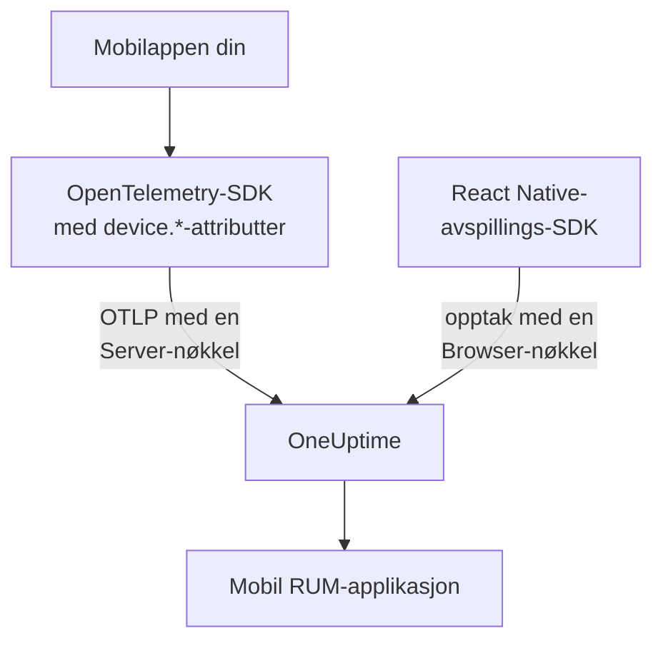

# Mobiloppsett

Instrumenter en Android-, iOS- eller React Native-app med OpenTelemetry, slik at den rapporterer til OneUptime som en mobil RUM-applikasjon. Alle andre plattformer med et OpenTelemetry-SDK fungerer på samme måte.

:::cards
- [Hva OneUptime trenger](#hva-oneuptime-trenger): To ressursattributter, sendt med en Server-nøkkel.
- [Sett opp plattformen din](#sett-opp-plattformen-din): Android, iOS, React Native og resten.
- [Sjekk at det kommer inn](#sjekk-at-det-kommer-inn): Test nøkkelen, og finn så appen.
- [Session Replay på mobil](#session-replay-på-mobil): Opptak for React Native-apper.
:::

## Slik fungerer det

Appen din eksporterer OTLP rett til OneUptime med en **Server**-inntaksnøkkel. Det er `device.*`-attributtene på ressursen som klassifiserer den som mobil-RUM i stedet for som backend-tjeneste.



## Hva OneUptime trenger

To ressursattributter, på hver batch appen din eksporterer:

| Attributt | Hva det er |
| --- | --- |
| `service.name` | Applikasjonens identitet, for eksempel `storefront-android`. |
| `device.id` eller `device.model.identifier` | Markerer telemetrien som mobil-RUM. `device.model.identifier` fyller også siden **Klienter**. |

Uten en enhetsattributt kommer telemetrien likevel inn, og du kan søke i den, men den arkiveres som en backend-tjeneste i stedet for en RUM-applikasjon.

`device.manufacturer` markerer også en batch som mobil, men bare på en ressurs uten vertsidentitet, fordi en verts inventar rapporterer en maskins produsent med den. Sett også `device.id` eller `device.model.identifier`, slik hver oppskrift nedenfor gjør, så spiller det aldri noen rolle.

Gjør `device.id` til en ID per installasjon, aldri en annonse-ID eller noe annet som identifiserer en person. OneUptime leser den bare for å gjenkjenne mobiltelemetri.

## Før du begynner

- En app med et OpenTelemetry-SDK: OpenTelemetry Java SDK eller OpenTelemetry Android, opentelemetry-swift, eller OpenTelemetry JavaScript SDK for React Native.
- En **Server**-inntaksnøkkel, opprettet under **Prosjektinnstillinger → Telemetri og APM → Inntaksnøkler** med **Opprett ingestion-nøkkel**. En **Browser**-nøkkel avvises fra en mobilapp: Den kontrolleres mot headeren `Origin`, som mobil-SDK-er ikke sender.
- Disse OTLP-innstillingene. Hvis du drifter OneUptime selv, bytter du ut `https://oneuptime.com` med din egen vert.

| Innstilling | Verdi |
| --- | --- |
| OTLP-endepunkt | `https://oneuptime.com/otlp` |
| Header | `x-oneuptime-token: YOUR_TELEMETRY_INGESTION_TOKEN` |
| Spor | `POST https://oneuptime.com/otlp/v1/traces` |
| Målinger | `POST https://oneuptime.com/otlp/v1/metrics` |
| Logger | `POST https://oneuptime.com/otlp/v1/logs` |

> [!WARNING]
> Nøkkelen følger med i appen din, og en app kan pakkes ut, så gå ut fra at noen kopierer den. Sett et **Pinned Service Name** på nøkkelens side, slik at en kopi ikke kan skrive under navnene på backend-tjenestene dine, legg til en **Requests Per Minute Limit** og en dato under **Utløper**, og bytt nøkkelen med utgivelsene dine.

## Sett opp plattformen din

Snippetene viser formen på oppsettet. Mobil-SDK-ene for OpenTelemetry endrer API-ene sine mellom utgivelser, så sjekk metodenavnene mot versjonen du låser. Det OneUptime trenger, endrer seg aldri: endepunktet, headeren, `service.name` og én `device.*`-attributt.

:::tabs
@tab Android
Bruk OpenTelemetry Java SDK og OTLP-eksportøren, som kjører på Android:

```kotlin title="app/build.gradle.kts"
dependencies {
    implementation(platform("io.opentelemetry:opentelemetry-bom:<latest>"))
    implementation("io.opentelemetry:opentelemetry-sdk")
    implementation("io.opentelemetry:opentelemetry-exporter-otlp")
}
```

```kotlin title="StorefrontApplication.kt"
import android.app.Application
import android.os.Build
import io.opentelemetry.exporter.otlp.http.trace.OtlpHttpSpanExporter
import io.opentelemetry.sdk.OpenTelemetrySdk
import io.opentelemetry.sdk.resources.Resource
import io.opentelemetry.sdk.trace.SdkTracerProvider
import io.opentelemetry.sdk.trace.export.BatchSpanProcessor

class StorefrontApplication : Application() {
    override fun onCreate() {
        super.onCreate()

        val resource = Resource.getDefault().toBuilder()
            .put("service.name", "storefront-android")
            .put("device.manufacturer", Build.MANUFACTURER)
            .put("device.model.identifier", Build.MODEL)
            .build()

        val exporter = OtlpHttpSpanExporter.builder()
            .setEndpoint("https://oneuptime.com/otlp/v1/traces")
            .addHeader("x-oneuptime-token", BuildConfig.ONEUPTIME_TOKEN)
            .build()

        OpenTelemetrySdk.builder()
            .setTracerProvider(
                SdkTracerProvider.builder()
                    .setResource(resource)
                    .addSpanProcessor(BatchSpanProcessor.builder(exporter).build())
                    .build()
            )
            .buildAndRegisterGlobal()
    }
}
```

Agenten [OpenTelemetry Android](https://github.com/open-telemetry/opentelemetry-android) legger automatisk instrumentering på toppen og setter enhetsattributter på sin egen ressurs. Hvis du bruker den, peker du eksportøren mot samme endepunkt og header, og sjekker at `device.model.identifier` når ressursen i din versjon.
@tab iOS
Bruk [opentelemetry-swift](https://github.com/open-telemetry/opentelemetry-swift), og sett enhetsattributtene selv: Ressursen hver versjon legger til av seg selv, har endret seg mellom utgivelser.

```swift
let resource = Resource(attributes: [
    "service.name": .string("storefront-ios"),
    "device.model.identifier": .string(UIDevice.current.model),
    "device.manufacturer": .string("Apple"),
    "telemetry.sdk.language": .string("swift"),
])

let exporter = OtlpHttpTraceExporter(
    endpoint: URL(string: "https://oneuptime.com/otlp/v1/traces")!,
    config: OtlpConfiguration(
        headers: [("x-oneuptime-token", oneUptimeToken)]
    )
)

OpenTelemetry.registerTracerProvider(
    tracerProvider: TracerProviderBuilder()
        .with(resource: resource)
        .add(spanProcessor: BatchSpanProcessor(spanExporter: exporter))
        .build()
)
```

`UIDevice.current.model` gir et kort navn som `iPhone`, noe som holder siden **Klienter** på én rad per enhetstype.
@tab React Native
React Native kjører OpenTelemetry JavaScript SDK, så bygg provideren, OTLP-eksportøren og batchprosessoren som i [Nettleseroppsett](/docs/rum/browser-setup), med tre endringer: Send med en **Server**-nøkkel, utelat `browserDetector` og `DocumentLoadInstrumentation`, og sett enhetsattributtene selv.

```ts
import { Platform } from "react-native";
import * as Device from "expo-device"; // or react-native-device-info
import {
  defaultResource,
  resourceFromAttributes,
} from "@opentelemetry/resources";

const resource = defaultResource().merge(
  resourceFromAttributes({
    "service.name": "storefront-mobile",
    "device.manufacturer": Device.manufacturer ?? Platform.OS,
    "device.model.identifier":
      Device.modelId ?? Device.modelName ?? "unknown",
    "telemetry.sdk.language": "webjs",
  }),
);
```

`Device.modelId` settes bare på iOS, så Android faller tilbake på `Device.modelName`.
@tab Andre plattformer
Flutter, Unity, .NET MAUI, en innebygd klient eller en egen OTLP-skriver fungerer alle, så lenge ressursen har `service.name` og én `device.*`-attributt. Et SDK som leser standard miljøvariabler for OpenTelemetry, tar disse som de er:

```bash
OTEL_EXPORTER_OTLP_ENDPOINT="https://oneuptime.com/otlp"
OTEL_EXPORTER_OTLP_HEADERS="x-oneuptime-token=YOUR_TELEMETRY_INGESTION_TOKEN"
OTEL_RESOURCE_ATTRIBUTES="service.name=storefront-mobile,device.manufacturer=Acme,device.model.identifier=AC-100"
```

SDK-et legger selv til `/v1/traces`, `/v1/metrics` og `/v1/logs` på endepunktet.
:::

## Sjekk at det kommer inn

:::steps
### Test nøkkelen

Før du går gjennom SDK-ets innstillinger, spør du OneUptime om den godtar nøkkelen:

```bash
curl -i https://oneuptime.com/otlp/v1/validate \
  -H "x-oneuptime-token: YOUR_TELEMETRY_INGESTION_TOKEN"
```

`200` med `"valid": true` betyr at nøkkelen godtas. En Browser-nøkkel svarer også `200`, men meldingen sier at den bare virker fra en nettleser: En mobilapp trenger en Server-nøkkel. `401` betyr at nøkkelen er ukjent, tilbakekalt, slått av eller utløpt, og ingen SDK-innstilling fikser det.

### Start appen

Kjør appen og bruk den et øyeblikk. Den vises under **Produkter → Ressurser → Overvåking av reelle brukere** ved første telemetribatch, oppkalt etter sin `service.name`.

### Åpne siden Klienter

Åpne applikasjonens side **Klienter**: Hver enhetsmodell fra `device.model.identifier` har en rad. Hvis siden forblir tom mens **Spor** fylles, når ikke enhetsattributtene fram til ressursen.
:::

## Session Replay på mobil

React Native-apper kan ta opp økter med `@oneuptime/react-native-replay`. Det tar opp det native visningstreet som en trådramme, aldri skjermbilder eller teksten på skjermen, og opptakene åpnes i den samme avspilleren som opptak fra nettet. Det sender med en **Browser**-nøkkel der **Allowed Origins** lister appen din som `app://` etterfulgt av Android-applikasjons-ID-en eller iOS-bundle-ID-en: en annen nøkkel enn Server-nøkkelen OpenTelemetry-SDK-et ditt bruker. [Installere i React Native](/docs/telemetry/session-replay#install-in-react-native) viser deg hvordan.

Native Android- og iOS-apper og de andre plattformene har ingen øktopptaker: Siden **Session Replay** forblir tom, mens spor, logger, målinger, unntak og siden **Klienter** virker som vanlig.

## Feilsøking

:::details Nøkkelsjekken returnerer 401, eller nøkkelen avvises
En `401` betyr at nøkkelen er ukjent, tilbakekalt, slått av eller utløpt: Opprett en Server-nøkkel, og bygg appen på nytt med den.

En Browser-nøkkel består sjekken, men hver eksport fra en mobilapp avvises med en `422` som lyder `This request did not send an Origin header, so it cannot be checked against the allowed origins of this browser ingestion key. Use a server ingestion key for requests that are not sent by a browser.` Bruk en **Server**-nøkkel.
:::

:::details Appen vises under Tjenester i stedet for Overvåking av reelle brukere
Ressursen har verken `device.id` eller `device.model.identifier`, så telemetrien ble arkivert som en backend-tjeneste. Sett dem som i [Sett opp plattformen din](#sett-opp-plattformen-din).

Tjenesten som allerede ble opprettet, blir ikke til en RUM-applikasjon, så slett den under **Produkter → Tjenester** når RUM-telemetrien kommer inn.
:::

:::details Siden Klienter er tom
Klientrader kommer bare fra `device.model.identifier`. Et SDK som bare setter `device.id` eller `device.manufacturer`, arkiverer appen som mobil-RUM, men viser ingen klienter: Sett også `device.model.identifier`.
:::

:::details Statusen sier Frakoblet mens folk bruker appen
Statusen går over til **Frakoblet** etter 15 minutter uten telemetri. Hvis folk bruker appen:

- En sampler forkaster kanskje alt: Se etter en always-off-sampler eller en svært lav rate.
- Appen sender kanskje telemetri bare for handlinger ingen utførte i den perioden.
- Nøkkelen kan ha blitt tilbakekalt, eller ha utløpt, siden utgivelsen: Test den som i [Sjekk at det kommer inn](#sjekk-at-det-kommer-inn).
:::

## Neste steg

:::cards
- [Øktavspilling](/docs/telemetry/session-replay): Ta opp React Native-økter ved siden av sporene deres.
- [Administrere applikasjoner](/docs/rum/applications): Navn, etiketter, eiere og oppbevaring.
- [OpenTelemetry](/docs/telemetry/open-telemetry): OTLP-endepunktene, grensene og feilene i detalj.
- [RUM-feilsøking](/docs/rum/troubleshooting): Hver sjekk, i den rekkefølgen problemer vanligvis oppstår.
:::
