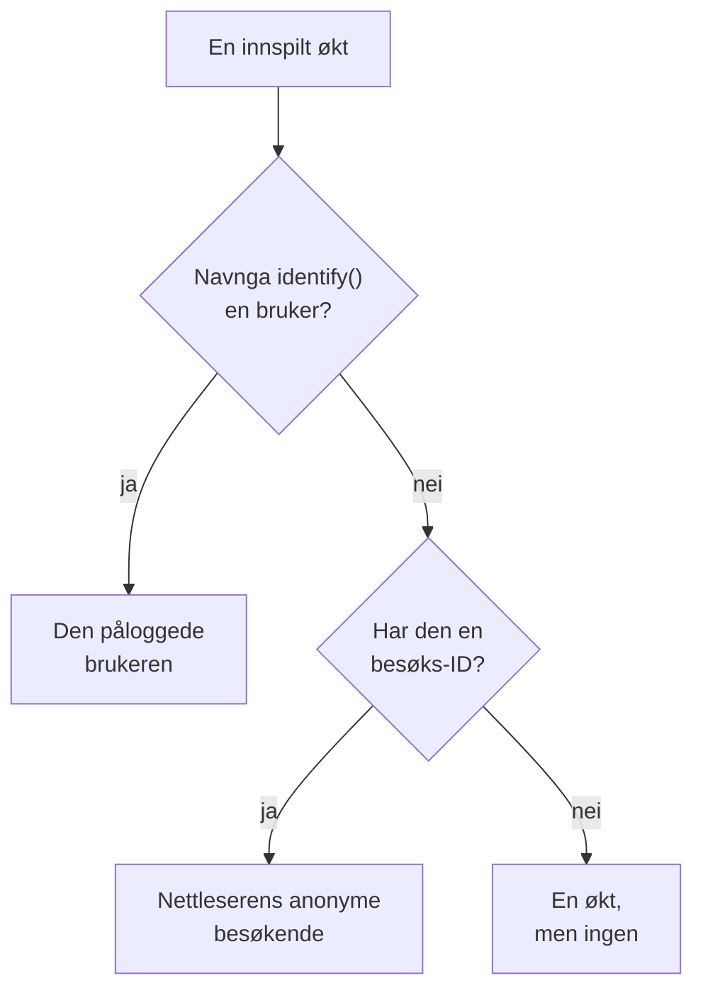

# Produktanalyse

Produktanalyse teller menneskene som bruker en RUM-applikasjon, hvordan øktene deres går, og hva de gjør: aktive, nye, tilbakevendende, påloggede og inaktive brukere, økter etter enhet, nettleser, land og side, og hendelsene appen din sender, som trender, trakter og lojalitet. Den teller øktene som [Øktavspilling](/docs/telemetry/session-replay) tar opp, og hendelsene opptakeren dens sender, så den trenger ikke noe eget snippet, og den tar vare på tallene sine i 13 måneder, lenge etter at opptakene er utløpt.

:::cards
- [Brukere](#brukere): Aktive, nye, tilbakevendende, påloggede, alle og inaktive brukere.
- [Økter](#økter): Hvor mange, hvor lenge, og etter enhet, nettleser, land og side.
- [Send hendelser og målinger](#send-hendelser-og-målinger): Hva folk gjør, og tallene siden din måler.
- [Hendelser](#hendelser): Hvor ofte noe skjedde, hvem som gjorde det, og hvor.
- [Trakter](#trakter): Hvem som gikk videre, trinn for trinn, og hvor lang tid det tok.
- [Brukerlojalitet](#brukerlojalitet): Hvem som kom tilbake, kohort for kohort.
:::

## Hvordan personer telles

Sidemenyen til en applikasjon har en seksjon **Produktanalyse**: **Brukere**, **Økter**, **Hendelser**, **Trakter**, **Brukerlojalitet**, **Brukerflyter** og **Analyseinnstillinger**. **Brukere** og **Økter** teller øktene som Øktavspilling tar opp, så de begynner når applikasjonens opptaker gjør det, og en økt som avspillingspolicyen ikke tar opp, telles ikke. Hver økt teller for én person, eller for ingen:



- **En pålogget bruker telles én gang**, på hver nettleser og enhet vedkommende bruker: brukeren kjennes igjen på enveis-hashen av referansen siden din ga `identify()` (se [Identifiser brukerne dine](/docs/telemetry/session-replay#identifiser-brukerne-dine)).
- **En anonym nettleser telles én gang**, via sin [anonyme besøks-ID](/docs/telemetry/session-replay#anonyme-besøkende). To nettlesere er to besøkende, og øktene en nettleser hadde før noen logget på i den, forblir dens besøkendes.
- **En økt fra en eldre opptaker**, som ikke sendte noen besøks-ID, teller som en økt, men ikke som en person.

**Hendelser**, **Trakter** og **Brukerlojalitet** teller personer på samme måte, ut fra hendelsene opptakeren sender fra hver økt, tatt opp eller ikke (se [Send hendelser og målinger](#send-hendelser-og-målinger)).

Dager telles i din egen tidssone.

## Brukere

**Brukere** teller personene i tidsrommet du velger:

| Flis | Hva den teller |
| --- | --- |
| **Aktive brukere** | Alle som kom i tidsrommet: hver pålogget bruker én gang og hver anonym nettleser én gang. |
| **Nye brukere** | Aktive brukere som hadde sitt første besøk i tidsrommet. |
| **Tilbakevendende brukere** | Aktive brukere som hadde kommet før tidsrommet begynte. |
| **Påloggede brukere** | Aktive brukere som appen din logget på med `identify()`, og andelen deres av alle aktive brukere. |
| **Brukere totalt** | Alle applikasjonen har sett de siste 13 månedene. |
| **Inaktive brukere** | Personer som kom før, men ikke de siste 30 dagene, eller de 7, 14, 60 eller 90 dagene du velger. |

De tre første viser også hvordan de endret seg fra perioden før. Under flisene tegner **Aktive brukere** for hver dag personene som kom den dagen, dem som kom i de 7 dagene fram til den, og dem som kom i de 30 dagene fram til den, og **Nye og tilbakevendende brukere** deler hver dags personer i to.

**Personer** viser alle flisene teller, én rad per person, de sist sette først, og filteret viser én flis' personer, de anonyme besøkende eller alle. Åpne en person for første og siste besøk og hver av vedkommendes økter fra de siste 13 månedene, med **Se** på hver økt der opptaket fortsatt er lagret.

## Økter

**Økter** teller øktene som begynte i tidsrommet: **Økter**, **Påloggede økter**, **Median øktlengde**, **Sider per økt**, **Økter med feil** og **Frustrerte økter**. Under flisene:

- **Økter etter enhet** tegner hver dags økter fra datamaskiner, telefoner og nettbrett. En mobilapps økt på en skjerm der den korte siden er 600 punkter eller mer, teller som et nettbretts.
- **Øktlengde** deler de avsluttede øktene inn etter hvor lenge de varte, fra under 10 sekunder til over 30 minutter. En økt som fortsatt tas opp, har ingen lengde ennå.
- **Oppdeling** rangerer brukere og økter etter enhetstype, nettleser, operativsystem, land, appversjon, inngangsside eller side, flest brukere først.

## Send hendelser og målinger

Hendelser sendes så lenge **Send produktanalysehendelser** er slått på, på applikasjonens side **Analyseinnstillinger**. Den er slått på fra start for en ny applikasjon, og av for en applikasjon som ble opprettet før den fantes, så slå den på der. Øktavspilling må også være slått på for applikasjonen, siden det er opptakeren dens som sender hendelsene; React Native-opptakeren sender ingen ennå.

Hver økt nettleseropptakeren kjører i, sender selv starten sin og hver side den viser, inkludert rutebytter i en enkeltsideapp, enten avspillingens utvalg og policy tar opp økten eller ikke. Dine egne hendelser og tall kommer fra koden på siden din:

```js
OneUptimeReplay.track("Signed up", { plan: "pro" });
OneUptimeReplay.metric("cart.value", 42.5, { currency: "EUR" });
```

| Kall | Hva det sender |
| --- | --- |
| `track(name, properties?)` | En hendelse som **Hendelser**, **Trakter** og **Brukerlojalitet** teller, og en markør på avspillingens tidslinje når økten tas opp. `name` ≤ 64 tegn; ≤ 20 egenskaper med streng-, tall- eller boolske verdier, nøkkel ≤ 40 tegn, verdi ≤ 200 tegn. |
| `metric(name, value, attributes?)` | Et tall siden din har målt, som et punkt i en av applikasjonens målinger (se [Dashbord og varsler](#dashbord-og-varsler)). `name` ≤ 100 tegn av bokstaver, sifre, `_`, `.`, `-` og `/`, som begynner med en bokstav og ikke med `oneuptime.`; `value` et endelig tall; `attributes` som egenskapene til `track()`. |

Før opptakeren er lastet, legger du de samme kallene i `window.OneUptimeReplayQueue` som `["track", name, properties]` og `["metric", name, value, attributes]` (se [JavaScript-API](/docs/telemetry/session-replay#javascript-api)).

- **Hver økt, tatt opp eller ikke.** Avspillingens utvalg og opplastingspolicyen avgjør hvilke økter som tas opp, ikke hvilke som telles. Ingenting sendes under Do Not Track eller Global Privacy Control, og ingenting tas vare på fra en opprinnelse applikasjonen ikke tillater. Når policyen krever samtykke, venter hendelsene på `grantConsent()`, høyst 500 av dem, og `revokeConsent()` forkaster dem.
- **Maskert som opptaket.** Under _Mask all text_ maskeres verdiene til egenskaper og attributter før de forlater siden, så en oppdeling etter en av dem viser plassholdere, ikke verdiene dine; hendelsesnavn, egenskapsnøkler og verdiene til målinger sendes slik de er skrevet. En verdi du må kunne lese i den modusen, hører hjemme i en økttagg (`setTags()`), som aldri maskeres, så hold personopplysninger utenfor den. Tagger vises på økten og i et søk med `tag:key=value` i øktlisten, ikke i oppdelingene på disse sidene. En side sendes som stien sin, uten spørring og fragment.
- **I små puljer**, hvert 5. sekund og når fanen skjules. En hendelse som når OneUptime mer enn 3 dager etter at den skjedde, forkastes, og et prosjekt kan sende 60 000 hendelser og målepunkter i minuttet, alle applikasjonene til sammen; utover det venter opptakeren og sender dem på nytt.

`metric()` sender ingenting mens hendelsene er slått av, og `getDiagnostics().productAnalytics` sier om de er slått på (se [`getDiagnostics()`](/docs/telemetry/session-replay#getdiagnostics)).

### Brukeregenskaper

For å dele opp og segmentere hendelser etter hvem som utførte dem, oppgir du nøkler for egenskaper fra `identify()` under **Brukeregenskaper for analyse** på **Analyseinnstillinger**, for eksempel `["plan", "role"]`, høyst 20, sammenlignet nøyaktig slik de er skrevet. Hver hendelse bærer da disse egenskapene til den påloggede brukeren, slik siden din ga dem til `identify()`. De andre egenskapene forlater aldri siden, og ingen gjør det mens **Registrer sluttbrukerens identitet** er slått av. Ikke oppgi egenskaper som inneholder personopplysninger, for eksempel en e-postadresse.

## Hendelser

**Hendelser** viser én hendelse om gangen: appens hyppigste hendelse til du velger en annen, eller den mest viste siden så lenge appen ikke sender noen. Velgeren viser også **Økt startet** og hver side som er vist, og **Alle hendelser** nedenfor viser hver hendelse i tidsrommet med hvor mange ganger den skjedde og hvor mange personer som utførte den; velg én for å se den ovenfor.

- Flisene teller hendelsens **Hendelser**, med hvor mange hver person utførte i snitt, dens **Brukere** og dens **Økter**.
- **Hendelser og brukere** tegner for hver dag hvor mange ganger hendelsen skjedde, og hvor mange personer som utførte den den dagen.
- **Oppdeling** rangerer hendelsen etter enhetstype, nettleser, operativsystem, land, appversjon, side, hendelsesegenskap eller brukeregenskap, med hver verdis hendelser, brukere og andel. Velg en verdi for å vise bare den.

**Segment** avgrenser siden til hendelsene der feltene har verdiene du velger: **Legg til filter**, deretter et felt og en verdi, sammenlignet nøyaktig. Et segment har høyst 5 filtre, og en hendelse må samsvare med alle. Sidens adresse beholder hendelsen, tidsrommet, segmentet og oppdelingen, så en lenke åpner den samme visningen.

## Trakter

**Trakter** følger personer gjennom 2 til 6 trinn i rekkefølge, hvert trinn en hendelse slik **Hendelser** viser dem. Av personene som utførte det første trinnet i tidsrommet, teller den hvor mange som deretter utførte det andre, så det tredje, alle innenfor tiden du velger fra deres første trinn: **Innen 1 time**, **Innen 1 dag**, **Innen 7 dager**, **Innen 14 dager** eller **Innen 30 dager**. **Legg til trinn** legger til ett.

Under **Konvertering** står andelen personer som utførte hvert trinn, og for hvert trinn hvor mange personer som nådde det, hvor stor andel av personene i det første trinnet det er, hvor mange som falt fra siden trinnet før, og mediantiden de brukte fra det. Den som prøvde mer enn én gang, telles én gang, etter forsøket som kom lengst.

Segmentet til en trakt, og til en lojalitetstabell, bruker feltene hver hendelse bærer og brukeregenskaper, ikke en hendelses egne egenskaper, siden trinnene er forskjellige hendelser.

## Brukerlojalitet

**Brukerlojalitet** grupperer personer etter dagen, uken eller måneden i tidsrommet da de første gang utførte én hendelse, **Personer som utførte**, og viser hvor stor andel av hver gruppe som utførte en annen, **Og kom tilbake for å utføre**, i den perioden og i hver periode etter. Begge er **Økt startet** til du velger andre.

**Kohorter** angir perioden: **Per dag**, **Per uke** eller **Per måned**. Når tidsrommet har flere perioder enn én tabell viser, 32 dager, 26 uker eller 13 måneder, gjør siden kohortene lengre og sier fra.

Hver rad er en kohort og hvor mange personer den har, og hver celle andelen av dem som kom tilbake i den perioden, mørkere jo flere som gjorde det. En periode som ikke har begynt ennå, står tom.

**Alle kohorter**, over dem, teller kohortene som én: i hver periode personene som kom tilbake, av personene i kohortene som har nådd den, så en kohort på 200 personer veier fire ganger så mye som en på 50. Den vises så snart to kohorter har noen i seg.

## Lagrede trakter og lojalitetstabeller

**Lagrede trakter**, på siden **Trakter**, og **Lagrede lojalitetstabeller**, på **Brukerlojalitet**, viser hva teamet ditt har lagret for applikasjonen, for å åpne det igjen eller vise det på et dashbord. En lagret trakt tar vare på trinnene, tiden til å fullføre dem og segmentet, og en lagret lojalitetstabell på de to hendelsene, perioden og segmentet. Ingen av dem tar vare på tidsrommet: siden har sitt eget, og et dashbord leser sitt eget.

- **+ Lagre trakt** eller **+ Lagre lojalitetstabell** lagrer det siden viser, under et navn. En applikasjon tar vare på høyst 100 av hver.
- Velg en for å åpne den. Sidens adresse nevner den, så en lenke åpner den for alle som kan se den. Når du endrer det den viser, sier navnet fra om det, og **Oppdater** lagrer endringen.
- **Rediger** gir en nytt navn, og **Slett** sletter den for alle. **Fjern visning** lukker den som er åpen, og beholder det siden viser.
- En lenke til en som er slettet, eller som du ikke kan se, sier fra om det, og siden åpnes uten den.

## Dashbord og varsler

Hver hendelse telles også, minutt for minutt, som en av applikasjonens målinger, og hvert kall til `metric()` er et punkt i en egen måling, under navnet kallet oppgir. Vis dem i diagram på applikasjonens side **Målinger**, legg dem til i et dashbord, eller varsle på dem med en metrikk-overvåking; **Åpne Målinger** under **Alle hendelser** åpner siden.

| Måling | Hva den teller | Etter |
| --- | --- | --- |
| `oneuptime.rum.product.events` | `track()`-hendelsene dine, per minutt | `event.name` |
| `oneuptime.rum.product.sessions` | Økter som startet, per minutt | `device.type` |
| `oneuptime.rum.product.page.views` | Viste sider, per minutt | `device.type` |

Disse tre faktureres ikke, og `metric()` avviser et navn som begynner med `oneuptime.`, så ingenting siden din sender, kan utgi seg for dem. `metric()`-punktene dine lagres og faktureres som applikasjonens andre målinger.

En lagret trakt eller lojalitetstabell kan også settes på et dashbord: widgetene **Trakt** og **Brukerlojalitet**, i widgetkatalogens gruppe **Produktanalyse**, viser en i dashbordets tidsintervall, og **Åpne i Trakter** eller **Åpne i Brukerlojalitet** åpner den på siden dens (se [Dashbord-widgets](/docs/dashboards/widgets#produktanalyse)).

## Personvern og oppbevaring

- **13 måneder.** En måneds tall fjernes den første dagen i den 13. måneden etter, så de siste 12 hele månedene alltid er der, uansett opptakenes egen oppbevaring (7 dager som standard). Hendelser lagres på samme måte.
- **Ingen navn lagret.** Tallene tar vare på en pålogget brukers enveisnøkkel og en nettlesers besøks-ID, aldri referansen eller en IP-adresse, og av egenskapene bare brukeregenskapene du oppgir. En rad navngir en pålogget bruker bare så lenge et av vedkommendes opptak fortsatt er lagret, og bare for en rolle som kan lese identitet; ellers står det **Pålogget bruker** eller **Anonym besøkende** og starten av ID-en.
- **Slettet på forespørsel.** En sletteforespørsel fjerner også de samsvarende tallene og hendelsene her (se [Slett økter](/docs/telemetry/session-replay#slett-økter)).

## Hvem kan se det

Å lese disse sidene krever det samme som å lese øktlisten: `ReadRumSessionReplay` (_List Session Replays_) eller `ReadRumSessionReplayPayload` (_Watch Session Replays_), som prosjekteiere og administratorer har. Å se hvem en pålogget bruker er, og å søke etter personer på navn, krever `ReadRumSessionReplayPayload` (_Watch Session Replays_), som [Hvem kan se et opptak](/docs/telemetry/session-replay#hvem-kan-se-et-opptak) beskriver.

Å lagre, gi nytt navn til og slette lagrede trakter og lojalitetstabeller krever de samme tillatelsene som å lese disse sidene, og en dashbord-widget viser en bare til en leser som har dem.

Å slå hendelsene på eller av krever `EditRumApplication` (_Edit RUM Application_) eller rollen som prosjekteier, administrator eller medlem. Å oppgi brukeregenskaper krever `EditRumApplication` eller rollen som eier eller administrator, siden det avgjør hva som tas vare på om påloggede personer.

## Neste steg

:::cards
- [Øktavspilling](/docs/telemetry/session-replay): Ta opp øktene disse sidene teller, og se dem.
- [Administrere applikasjoner](/docs/rum/applications): Navn, etiketter, eiere og oppbevaring.
- [RUM – Oversikt](/docs/rum/index): Hva en RUM-applikasjon ellers viser.
:::
