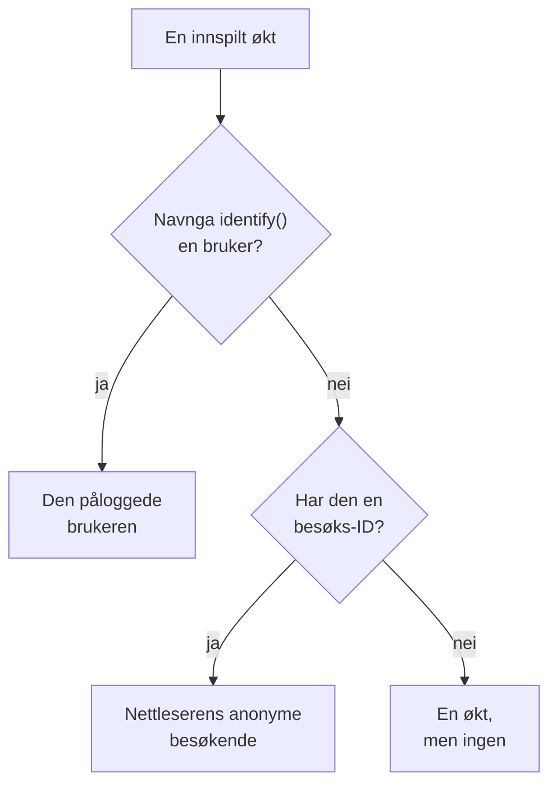

# Produktanalyse

Produktanalyse teller menneskene som bruker en RUM-applikasjon, og hvordan øktene deres går: aktive, nye, tilbakevendende, påloggede og inaktive brukere, og økter etter enhet, nettleser, land og side. Den teller øktene som [Øktavspilling](/docs/telemetry/session-replay) tar opp, så den trenger ikke noe eget snippet, og den tar vare på tallene sine i 13 måneder, lenge etter at opptakene er utløpt.

:::cards
- [Hvordan personer telles](#hvordan-personer-telles): En pålogget bruker én gang, en anonym nettleser én gang.
- [Brukere](#brukere): Aktive, nye, tilbakevendende, påloggede, alle og inaktive brukere.
- [Økter](#økter): Hvor mange, hvor lenge, og etter enhet, nettleser, land og side.
- [Personvern og oppbevaring](#personvern-og-oppbevaring): 13 måneder, ingen navn lagret, slettet på forespørsel.
:::

## Hvordan personer telles

Sidemenyen til en applikasjon har en seksjon **Produktanalyse** med to sider, **Brukere** og **Økter**. Begge teller øktene som Øktavspilling tar opp, så de begynner når applikasjonens opptaker gjør det, og en økt som avspillingspolicyen ikke tar opp, telles ikke. Hver økt teller for én person, eller for ingen:

- **En pålogget bruker telles én gang**, på hver nettleser og enhet vedkommende bruker: brukeren kjennes igjen på enveis-hashen av referansen siden din ga `identify()` (se [Identifiser brukerne dine](/docs/telemetry/session-replay#identifiser-brukerne-dine)).
- **En anonym nettleser telles én gang**, via sin [anonyme besøks-ID](/docs/telemetry/session-replay#anonyme-besøkende). To nettlesere er to besøkende, og øktene en nettleser hadde før noen logget på i den, forblir dens besøkendes.
- **En økt fra en eldre opptaker**, som ikke sendte noen besøks-ID, teller som en økt, men ikke som en person.

Dager telles i din egen tidssone.

## Brukere

**Brukere** teller personene i tidsrommet du velger:

| Flis | Hva den teller |
| --- | --- |
| **Aktive brukere** | Alle som kom i tidsrommet: hver pålogget bruker én gang og hver anonym nettleser én gang. |
| **Nye brukere** | Aktive brukere som hadde sitt første besøk i tidsrommet. |
| **Tilbakevendende brukere** | Aktive brukere som hadde kommet før tidsrommet begynte. |
| **Påloggede brukere** | Aktive brukere som appen din logget på med `identify()`, og andelen deres av alle aktive brukere. |
| **Brukere totalt** | Alle applikasjonen har sett de siste 13 månedene. |
| **Inaktive brukere** | Personer som kom før, men ikke de siste 30 dagene, eller de 7, 14, 60 eller 90 dagene du velger. |

De tre første viser også hvordan de endret seg fra perioden før. Under flisene tegner **Aktive brukere** for hver dag personene som kom den dagen, dem som kom i de 7 dagene fram til den, og dem som kom i de 30 dagene fram til den, og **Nye og tilbakevendende brukere** deler hver dags personer i to.

**Personer** viser alle flisene teller, én rad per person, de sist sette først, og filteret viser én flis' personer, de anonyme besøkende eller alle. Åpne en person for første og siste besøk og hver av vedkommendes økter fra de siste 13 månedene, med **Se** på hver økt der opptaket fortsatt er lagret.

## Økter

**Økter** teller øktene som begynte i tidsrommet: **Økter**, **Påloggede økter**, **Median øktlengde**, **Sider per økt**, **Økter med feil** og **Frustrerte økter**. Under flisene:

- **Økter etter enhet** tegner hver dags økter fra datamaskiner, telefoner og nettbrett. En mobilapps økt på en skjerm der den korte siden er 600 punkter eller mer, teller som et nettbretts.
- **Øktlengde** deler de avsluttede øktene inn etter hvor lenge de varte, fra under 10 sekunder til over 30 minutter. En økt som fortsatt tas opp, har ingen lengde ennå.
- **Oppdeling** rangerer brukere og økter etter enhetstype, nettleser, operativsystem, land, appversjon, inngangsside eller side, flest brukere først.

## Personvern og oppbevaring

- **13 måneder.** En måneds tall fjernes den første dagen i den 13. måneden etter, så de siste 12 hele månedene alltid er der, uansett opptakenes egen oppbevaring (7 dager som standard).
- **Ingen navn lagret.** Tallene tar vare på en pålogget brukers enveisnøkkel og en nettlesers besøks-ID, aldri referansen, egenskapene eller en IP-adresse. En rad navngir en pålogget bruker bare så lenge et av vedkommendes opptak fortsatt er lagret, og bare for en rolle som kan lese identitet; ellers står det **Pålogget bruker** eller **Anonym besøkende** og starten av ID-en.
- **Slettet på forespørsel.** En sletteforespørsel fjerner også de samsvarende tallene her (se [Slett økter](/docs/telemetry/session-replay#slett-økter)).

## Hvem kan se det

Å lese de to sidene krever det samme som å lese øktlisten: `ReadRumSessionReplay` (_List Session Replays_) eller `ReadRumSessionReplayPayload` (_Watch Session Replays_), som prosjekteiere og administratorer har. Å se hvem en pålogget bruker er, og å søke etter personer på navn, krever identitetstillatelsen som [Hvem kan se et opptak](/docs/telemetry/session-replay#hvem-kan-se-et-opptak) beskriver.

## Neste steg

:::cards
- [Øktavspilling](/docs/telemetry/session-replay): Ta opp øktene disse sidene teller, og se dem.
- [Administrere applikasjoner](/docs/rum/applications): Navn, etiketter, eiere og oppbevaring.
- [RUM – Oversikt](/docs/rum/index): Hva en RUM-applikasjon ellers viser.
:::
