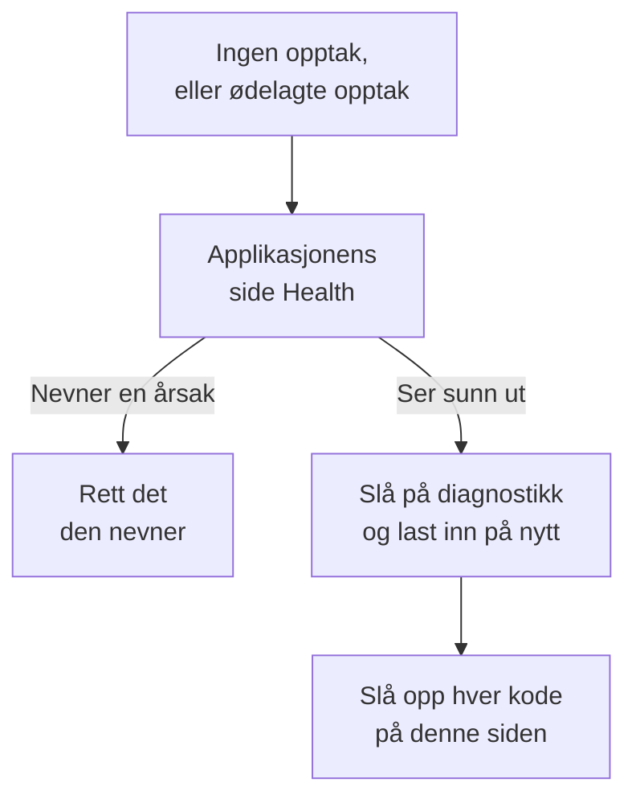

# Feilsøking av øktavspilling

Når ingen opptak kommer inn, eller de kommer inn ødelagt, finner denne siden årsaken. Øktavspilling tar som standard opp hver økt og laster den opp mens den pågår, så en sunn side sender en chunk omtrent hvert 15. sekund mens brukeren gjør noe. En inaktiv fane produserer ingen hendelser og sender ingenting, og etter fem minutter uten input setter opptakeren helt på pause (`recording-paused-idle`), så beveg musen eller klikk før du vurderer en installasjon ut fra fanen Nettverk. Hvis du fortsatt ikke ser noen forespørsel til OneUptime, er en av årsakene nedenfor grunnen.

:::cards
- [Slå på diagnostikk](#slå-på-diagnostikk): Få opptakeren til å forklare hver beslutning i konsollen.
- [Koder](#koder): Hver linje opptakeren skriver ut, og hva du gjør med den.
- [En brannmur foran OneUptime avviser chunkene](#en-brannmur-foran-oneuptime-avviser-chunkene): Regler som skal sjekkes, og unntak som skal legges til.
- [Bilder, ikoner eller stiler mangler i avspillingen](#bilder-ikoner-eller-stiler-mangler-i-avspillingen): Opptak som spilles av, men ikke slik brukeren din så dem.
:::



Den eneste innstillingen der stillhet er normalt, er opplasting ved _On error or frustration_ (`OnErrorOrFrustration`): opptakeren holder da en ringbuffer i minnet og laster bare opp når noe går galt, noe som ser nøyaktig ut som en ødelagt installasjon til en utløser går av. Sjekk hvilken du bruker før du leter etter noe annet: linjen `config-accepted` nedenfor skriver det ut.

Begynn på serversiden hvis du kan. Applikasjonens side **Helse**, i delen **Øktavspilling** i sidemenyen, nevner årsaken når ingenting kommer inn: opptakeren ble aldri lastet inn, ble lastet inn, men lastet ikke opp noe og hvorfor, opplastinger blir avvist og av hvilken grunn, eller budsjettet er brukt opp. Se [Opptaksstatus](/docs/telemetry/session-replay#opptaksstatus). Det som følger, er nettlesersiden: slå på diagnostikk, last inn på nytt én gang og les konsollen.

Kommer opptak inn, men spilles av med ødelagte bilder, manglende ikoner eller områder uten stil? Det er et avspillingsspørsmål, som besvares i [Bilder, ikoner eller stiler mangler i avspillingen](#bilder-ikoner-eller-stiler-mangler-i-avspillingen).

## Slå på diagnostikk

Velg bryteren du har for hånden. De gjør alle det samme.

:::tabs
@tab I nettleseren
I nettleseren der det går galt. Krever ingen ny utrulling, virker i produksjon og overlever nye innlastinger:

```js
localStorage.setItem("oneuptime.sessionReplay.debug", "true");
// then reload the page
```

Slå det av igjen med:

```js
localStorage.removeItem("oneuptime.sessionReplay.debug");
```
@tab Med en lenke
For noen som ikke er teknisk, eller en side der du ikke kan åpne en konsoll, legger du `oneuptime_debug=1` til URL-en. Det virker også i fragmentet, som overlever en server som fjerner spørreparametere den ikke kjenner:

```text
https://your-app.example.com/checkout?oneuptime_debug=1
https://your-app.example.com/checkout#oneuptime_debug=1
```
@tab På skript-taggen
For et stagingmiljø der du vil ha det slått på for alle:

```html
<script
  src="https://oneuptime.com/telemetry/session-replay/v1/recorder.js"
  data-oneuptime-token="YOUR_TELEMETRY_INGESTION_KEY"
  data-oneuptime-app-identifier="YOUR_RUM_APP_IDENTIFIER"
  data-oneuptime-debug="true"
  crossorigin="anonymous"
  async
></script>
```
@tab I init-globalen
Hvis du konfigurerer opptakeren med init-globalen:

```js
window.__ONEUPTIME_SESSION_REPLAY__ = {
  host: "https://oneuptime.com",
  token: "YOUR_TELEMETRY_INGESTION_KEY",
  appIdentifier: "YOUR_RUM_APP_IDENTIFIER",
  debug: true,
};
```
@tab På deploymenten
På OneUptime-deploymenten, den eneste bryteren som ikke krever noen ved nettleseren der det går galt. Sett `SESSION_REPLAY_DEBUG=true`, og start på nytt. Hver opptaker denne instansen leverer, logger da på hver side den kjører på, så slå det på, samle inn én ny innlasting og slå det av igjen. Det endrer ingen retningslinje: verken sampling, maskering eller samtykke. Se [Merknader om egen hosting](/docs/telemetry/session-replay#merknader-om-egen-hosting) for deploymentens øvrige innstillinger.
@tab Under kjøring
Når opptakeren er lastet inn:

```js
OneUptimeReplay.setDebug(true);
```
:::

Utdataene ser slik ut:

```text
[OneUptime Session Replay] loader-start: Loader running.
[OneUptime Session Replay] init-options-read: Init options read. {host: "https://oneuptime.com", appIdentifier: "checkout-web", …}
[OneUptime Session Replay] config-fetch-start: Requesting the policy. {url: "https://oneuptime.com/telemetry/session-replay/v1/config", …}
[OneUptime Session Replay] config-accepted: Policy accepted. {captureTrigger: "Always", samplePercentage: 100, …}
[OneUptime Session Replay] recording: Recording and uploading …
```

## Få tidslinjen uten å slå på noe først

Opptakeren beholder sine siste 250 beslutninger, uansett om diagnostikk er slått på eller ikke. Hvis problemet allerede har skjedd, trenger du ikke å gjenskape det med logging slått på — be om dette i stedet:

```js
copy(JSON.stringify(OneUptimeReplay.getDiagnostics(), null, 2));
```

Det returnerer opptakerens versjon, økt-ID-en, dens `state` (`recording`, `uploading`, `not-sampled`, `stopped`…), hvorfor den stoppet hvis den gjorde det, `bootstrapDecision`, svaret fra hver port i `decisions` (samplet eller ikke, samtykkestatus, om opplastinger er tillatt og hva som blokkerer dem, serverens siste direktiv), opptakerens `capabilities` og hele listen over poster — inkludert dem fra loaderen, som kjører før opptakerens artefakt finnes, og der de fleste tilbaketrekningene avgjøres. Den inneholder i kraft av oppbygningen ikke noe sideinnhold; se [Hva diagnostikken aldri inneholder](#hva-diagnostikken-aldri-inneholder). Feltene er beskrevet i [`getDiagnostics()`](/docs/telemetry/session-replay#getdiagnostics).

**Hvis du får `OneUptimeReplay is not defined`**, ble opptakerens artefakt aldri lastet inn — som i seg selv er svaret på en stor del av kodene nedenfor, og akkurat når du trenger tidslinjen mest. Postene er der fortsatt, på en global som loaderen skriver til før artefaktet finnes:

```js
copy(JSON.stringify(window.__ONEUPTIME_SESSION_REPLAY_DEBUG__.records, null, 2));
```

Lim inn ett av dem i supportsaken din — eller i **Ask the browser** på applikasjonens side **Helse**, som forklarer hver kode i det. Ofte er det nok i seg selv.

## Når stillhet er normalt: den feilstyrte retningslinjen

Denne delen gjelder bare hvis `config-accepted` skrev ut `captureTrigger: "OnErrorOrFrustration"`. Med standardretningslinjen `Always` sender opptakeren mens den tar opp, og stillhet på en side brukeren samhandler med, betyr at noe virkelig er galt — les i så fall videre etter denne delen.

Hvis konsollen sier dette:

```text
[OneUptime Session Replay] recording: Recording into memory. Nothing uploads until a trigger fires - call OneUptimeReplay.captureSession() to force one.
```

…så virker opptakeren. Med en feilstyrt retningslinje gjør en sunn side nøyaktig én forespørsel til OneUptime per sideinnlasting (hentingen av konfigurasjonen) og sender ingenting annet før det oppstår en feil, en 5xx, et frustrasjonssignal eller en overskridelse av et ytelsesbudsjett.

For å teste hele veien fra ende til ende tvinger du frem en opplasting:

```js
OneUptimeReplay.captureSession("installation test");
```

Du bør umiddelbart se en `POST /telemetry/session-replay/v1/chunk` på fanen Nettverk og en linje `chunk-accepted` i konsollen. Gjør du det, er installasjonen riktig, og avspillingen vises i dashbordet innen omtrent et minutt, med årsaken din markert på tidslinjen.

En `202` med `chunk-accepted` er det du ser etter. En `204` logger i stedet `chunk-not-recorded`: forespørselen var riktig, og serveren bestemte seg for ikke å lagre den — budsjettet er overskredet, ikke samplet eller applikasjonen deaktivert. Det er et svar fra retningslinjen, ikke en installasjonsfeil, og linjen `server-directive` ved siden av sier hvilket.

For å ta opp hver økt igjen setter du **Når et opptak skal lastes opp** til _Always_ og **Utvalgsprosent** over 0 på applikasjonens side **Replay Policy**. Det er fabrikkstandarden.

## Koder

Hver linje bærer en stabil `code`. Slå opp din her.

### Oppstart

| code | hva det betyr |
| --- | --- |
| `loader-start` | Opptakerens skript kjørte. Hvis du ikke ser dette mens diagnostikk er slått på, kjørte selve skriptet aldri — sjekk `<script>`-forespørselen på fanen Nettverk og `script-src` i CSP-en din. |
| `init-options-read` | Alternativer funnet. Sjekk `host` og `appIdentifier` i detaljen: `appIdentifier` må samsvare nøyaktig med RUM-applikasjonen, og `host` må være OneUptime-opprinnelsen din, ikke din egen apps. |
| `init-options-incomplete` | Et påkrevd alternativ mangler. Detaljen sier hvilken av `hasHost` / `hasToken` / `hasAppIdentifier` som er false. Hvis `hasHost` er false, har skript-taggen ingen `src` å utlede verten fra — legg til `data-oneuptime-host`. |
| `privacy-signal` | Nettleseren sender Do Not Track eller Global Privacy Control, og det blir respektert — av siden (ingenting på skript-taggen sier noe annet) eller av serverens retningslinje. Ingenting tas opp; med `stage: "before-config-fetch"` gjøres heller ingen konfigurasjonsforespørsel. Ikke en feil. Sett bare `data-oneuptime-respect-do-not-track="false"` hvis rettsgrunnlaget ditt virkelig ikke avhenger av signalet. |
| `init-options-missing` | Det finnes ingenting å lese på siden: verken en `script[data-oneuptime-token]`-tagg eller `window.__ONEUPTIME_SESSION_REPLAY__`. Markørattributtet er stavet feil, snippeten har havnet i et annet dokument, eller en tag manager har fjernet den. |
| `loader-threw` | En feil i selve opptakeren, ikke i konfigurasjonen din. Rapporter den med utdataene fra diagnostikken. |

### Retningslinje

| code | hva det betyr |
| --- | --- |
| `config-fetch-start` | Skal til å be om retningslinjen. `url` i detaljen er den nøyaktige URL-en — sjekk at den svarer fra en nettleser. |
| `config-fetch-rejected` | Endepunktet svarte med noe annet enn 2xx. Se [Statuser for henting av konfigurasjonen](#statuser-for-henting-av-konfigurasjonen) nedenfor. |
| `config-fetch-failed` | Forespørselen ble aldri fullført: `connect-src` i CSP-en, en annonseblokkering, DNS, TLS, ingen tilkobling eller et tidsavbrudd på 5 sekunder. Nettleseren logger vanligvis sin egen linje ved siden av denne. |
| `config-body-unparseable` | Endepunktet svarte 2xx med en body som ikke er JSON i det hele tatt. Forskjellig fra `config-fetch-failed`: forespørselen *ble* fullført, så noe underveis — en proxy, en captive portal, en mellomside for SSO — svarte i stedet for OneUptime. |
| `config-unparseable` | Bodyen *var* gyldig JSON, men ikke et objekt — `null`, en streng, en matrise. En omskrivende proxy, eller en server som svarer på en annen bane. |
| `config-disabled` | Serveren sier at avspilling er slått av her. `disabledReason` i detaljen er svaret: se [disabledReason](#disabledreason) nedenfor. |
| `config-recorder-version-invalid` | Retningslinjen nevnte ikke nøyaktig `latest` med små bokstaver, så ingen artefakt-URL kunne bygges. En omskrivende proxy eller et manipulert svar — en deployment uten bygg rapporterer i stedet `config-disabled` med `recorder-not-built`. |
| `config-accepted` | Retningslinje godtatt. Detaljen er hele retningslinjen — `captureTrigger`, `samplePercentage`, `consentMode`, `maskingMode`. |
| `config-field-defaulted` | Serveren sendte ingen verdi for et felt i retningslinjen (nevnt i detaljen), så denne opptakeren brukte produktets standard. Informativt: vanligvis en server som er eldre enn opptakeren. Hvis dashbordet viser en annen verdi for det feltet, bør du oppdatere OneUptime. |
| `config-value-unrecognised` | Serveren sendte en verdi som dette bygget av opptakeren ikke kjenner, så den falt tilbake på den sikreste — som kanskje ikke er den dashbordet ditt viser. Vanligvis en side som fortsatt kjører en opptaker fra en tidligere deployment. |
| `directive-stop` | Serveren ba denne opptakeren om å trekke seg. Sjekk applikasjonens opptaksstatus for et budsjett, en hastighetsgrense eller en kill switch. |

#### Statuser for henting av konfigurasjonen

| status | løsning |
| --- | --- |
| `401` | Inntakstokenet er feil, tilbakekalt, utløpt eller fra et annet prosjekt. Opprett et under **Prosjektinnstillinger → Telemetri og APM → Inntaksnøkler**, og bekreft det med `GET /session-replay/v1/validate` — send nøkkelen slik opptakeren gjør, og legg til headeren `x-oneuptime-app-identifier`, så bærer svaret også `isSessionReplayEnabled` for den applikasjonen, `sessionReplayDisabledDetail` som nevner bryteren som er av når den ikke er slått på, `isIngestEnabledOnThisInstance` og `keyType`. |
| `400` | `data-oneuptime-app-identifier` mangler. |
| `403` | Sidens opprinnelse er ikke i inntaksnøkkelens **Tillatte opprinnelser**. Legg den til, eller bruk en nøkkel der listen over tillatte opprinnelser dekker denne siden. |
| `404` | Banen ble ikke funnet på OneUptime-opprinnelsen. Nesten alltid en feil `data-oneuptime-host` — eller en omvendt proxy foran OneUptime som ikke videresender `/telemetry/*`. |
| `5xx` | En feil på serversiden; sjekk loggene til OneUptime-appen. |

#### disabledReason

| verdi | hva du gjør |
| --- | --- |
| `not-enabled-for-application` | Øktavspilling er slått av for denne RUM-applikasjonen, identifikatoren samsvarer ikke med noen, eller prosjektet har ikke lov til avspilling. `disabledDetail` sier hvilken: `application-not-enabled` (denne applikasjonens bryter), `project-not-allowed` (bryteren for hele prosjektet, under **Overvåking av reelle brukere → Innstillinger → Øktavspilling**), `application-unknown` (ingen applikasjon har denne `appIdentifier` — sjekk stavingen på applikasjonens side **Replay Policy**) eller `project-killed` (en kill switch fra operatøren på denne deploymenten). |
| `budget-exhausted` | Prosjektets daglige bytebudsjett eller applikasjonens månedlige budsjett er allerede brukt opp, så opptakerne får beskjed om ikke å ta opp i stedet for å laste opp chunker som ville blitt avvist. `disabledDetail` er `project-daily-budget-exhausted` eller `app-monthly-budget-exhausted`, og `budgetResetsAt` sier når det blir frigjort. Øk budsjettet på siden **Replay Policy**, eller vent på tilbakestillingen. |
| `recorder-not-built` | **Deploymenten har ikke noe opptakerartefakt.** Ingenting på kundens side kan rette det. Bygget som produserer `packages/App/FeatureSet/BrowserRecorder/public/dist/manifest.json`, kjørte ikke, eller resultatet nådde ikke det kjørende imaget. Bygg og rull ut OneUptime-appen på nytt. Det er det typiske svaret på en egenhostet installasjon der avspilling aldri har virket. |
| `disabled-by-default` | `SESSION_REPLAY_ENABLED_BY_DEFAULT=false` på denne deploymenten. Sett den til `true` — og sett først `SESSION_REPLAY_MAX_BYTES_PER_PROJECT_PER_DAY` hvis du hoster selv, fordi avspilling er den tyngste tabellen du har. |
| `ingest-disabled` | `SESSION_REPLAY_INGEST_ENABLED=false` på denne deploymenten. |
| `policy-unavailable` | Serveren kunne ikke avgjøre retningslinjen — vanligvis Redis eller Postgres. Feiler lukket med vilje. Sjekk loggene til OneUptime-appen. |
| `not-reported` | Serveren er eldre enn dette feltet. Bruk i stedet panelet **Test your installation** i dashbordet, på siden **Replay Policy**. |

### Artefaktet

| code | hva det betyr |
| --- | --- |
| `artifact-requested` | Den nyeste opptakerpakken blir satt inn. `url` er den nøyaktige. |
| `artifact-load-failed` | Den ble ikke lastet inn. I rekkefølge etter sannsynlighet: en `script-src` i CSP-en som ikke tillater OneUptime-opprinnelsen din, et SRI-avvik (en proxy som skriver om pakken) eller en 404 fordi denne deploymenten ikke bygde opptakeren. |
| `artifact-url-invalid` | Retningslinjen nevnte ikke nøyaktig `latest` med små bokstaver, så ingen URL ble bygget. Et manipulert eller proxy-endret konfigurasjonssvar. |
| `artifact-api-missing` | Pakken ble lastet inn, men publiserte ikke `window.OneUptimeReplay` — et annet skript på siden overskrev den. |
| `bootstrap` | Opptakerens artefakt starter opp. |
| `bootstrap-already-started` | To kopier av snippeten på én side. Fjern den ene. |
| `bootstrap-already-running` | `bootstrap()` ble kalt igjen mens en opptaker allerede kjørte. Harmløst; vanligvis en dobbel integrasjon. |
| `bootstrap-cancelled` | En `revokeConsent()` eller `stop()` i køen `window.OneUptimeReplayQueue` kjørte før opptakeren startet, så denne økten tas ikke opp. Riktig hvis banneret ditt allerede var avvist. |
| `start-stopped` | `start()` fikk ingen brukbar retningslinje på banen for den frittstående pakken. Den nøyaktige årsaken står i `config-*`-linjen rett over. |
| `rrweb-did-not-start` | DOM-opptakeren nektet å starte. Rapporter det. |
| `rrweb-error` | DOM-opptakeren fikk en intern feil på denne siden (feilens navn står i detaljen; den logges én gang). Opptaket kan hoppe over eller fryse rundt det punktet, og etter tre slike feil bærer økten en troverdighetsmelding som sier det. Rapporter det med sidens rammeverk og feilens navn. |

### Opptak og opplasting

| code | hva det betyr |
| --- | --- |
| `not-sampled` | Denne økten tapte samplingstrekningen, så ingenting tas opp i det hele tatt. Sampling er deterministisk ut fra økt-ID-en, så ny innlasting hjelper ikke denne økten. Øk samplingsprosenten. |
| `recording` | Tar opp. Les detaljen: `uploading: true` er den normale tilstanden med standardutløseren `Always`. `uploading: false` med `captureTrigger: "OnErrorOrFrustration"` er den andre sunne tilstanden, uten forespørsler. |
| `same-origin-propagation` | Logges én gang når opptakeren starter: om den legger til sporingskontekst (`traceparent`, og en `tracestate` som bærer økt-ID-en) i forespørsler til sidens egen opprinnelse. `enabled: true` med `reason: "on"` er standard. `reason: "policy-off"` betyr at **Sporvideresending fra samme opprinnelse** er slått av på applikasjonens side **Replay Policy**; `reason: "opaque-origin"` betyr at siden ikke har sin egen opprinnelse (en sandkasset iframe, `about:blank`, `srcdoc` eller `file:`), så ingenting teller som samme opprinnelse. Selv når den er slått på, kommer headerne bare på forespørsler som gjøres mens økten laster opp, og aldri på en `POST` til en bane som ender på `/v1/traces`, `/v1/logs` eller `/v1/metrics` (sidens egne OpenTelemetry-eksporter). Logges én gang til, med `reason: "agent-stand-down"` og et felt `agent` (`DD_RUM`, `NREUM` eller `elasticApm`), første gang i en sideinnlasting at opptakeren overlater `traceparent` for en forespørsel til samme opprinnelse til den agenten fordi den er konfigurert til å spore forespørselen (Datadog RUM bare i en økt den sporer); forespørselen får fortsatt `tracestate`-medlemmet, og kobles bare hvis agenten faktisk sender en `traceparent`, noe Datadog bare gjør i en sporet Datadog-økt som er samplet for spor. New Relic (`NREUM`) sender sin egen `tracestate` i stedet for medlemmet, så forespørslene dens kobles bare via spor-ID (se [fanene Logs og Traces er tomme](#avspillerens-faner-logs-og-traces-er-tomme)). Se [Korreler med resten av telemetrien din](/docs/telemetry/session-replay#korreler-med-resten-av-telemetrien-din). |
| `same-origin-propagation-tripped` | En forespørsel som opptakeren hadde lagt til sporingskontekst i, feilet på nettverksnivå, vanligvis en forespørsel til samme opprinnelse som ble omdirigert til en annen opprinnelse som ikke tillater `traceparent` og `tracestate`. Opptakeren sluttet å legge dem til resten av denne sideinnlastingen. `retried: true` betyr at det var en `fetch` `GET` eller `HEAD` uten body, og at den ble sendt én gang til nøyaktig slik siden din gjorde det; `false` betyr at den ikke kunne prøves på nytt og feilet: ingenting annet enn en `fetch` `GET` eller `HEAD` uten body (ingen XHR, ingen annen metode, ingen forespørsel med body) prøves på nytt. Din egen sides avbrytelser og tidsavbrudd utløser den ikke, og det gjør heller ikke en feil mens nettleseren melder seg frakoblet; neste sideinnlasting starter på nytt. Se [Nedlastinger eller omdirigeringer feiler etter at øktavspilling er slått på](#nedlastinger-eller-omdirigeringer-feiler-etter-at-øktavspilling-er-slått-på). |
| `trigger` | Noe verdt å ta vare på skjedde. `reason` er en av `error`, `frustration`, `performance`, `sampled` eller `manual`. |
| `upload-started` | Bufferens pre-roll blir tømt. Chunk-POST-ene begynner her. |
| `upload-blocked-consent` | En utløser gikk av, og ingenting ble lastet opp fordi samtykke aldri ble gitt. Med samtykkemodusen `RequireExplicit` må siden din kalle `OneUptimeReplay.grantConsent()` når banneret ditt blir godtatt. |
| `chunk-discarded-consent` | Samme årsak, ett lag lenger ned: en ferdig chunk ble kastet. |
| `chunk-accepted` | En chunk kom fram og ble lagret. Installasjonen virker. |
| `chunk-not-recorded` | Serveren godtok forespørselen og bestemte bevisst å ikke ta den opp — budsjettet er overskredet, ikke samplet, applikasjonen deaktivert eller grensen for chunker per økt. Linjen `server-directive` ved siden av bærer årsaken. Installasjonen er riktig; retningslinjen eller budsjettet er ikke det du forventer. |
| `chunk-post-failed` | POST-en nådde aldri serveren, før denne siden hadde lastet opp noe vellykket. `connect-src` i CSP-en, en annonseblokkering eller CORS på inntaksopprinnelsen — eller en side som mistet tilkoblingen før sin første opplasting. Teller med i kretsbryteren. |
| `chunk-held-offline` | Offlinemodus: enheten har ingen tilkobling (nettleseren melder seg frakoblet, eller en forespørsel nådde aldri en server som hadde svart før). Opptaket fortsetter, og chunken venter; `queueDepth` er hvor mange som venter, og `retryInMs` når neste forsøk er. Teller ikke som en feil, og ingenting går tapt. |
| `back-online` | Den første forespørselen etter et brudd nådde serveren. Chunkene i køen lastes opp, fra eldst til nyest. |
| `browser-offline` | Nettleseren sendte hendelsen `offline`. Opptaket fortsetter; opptakeren åpner offlinelageret sitt, slik at chunkene fra en fane som lukkes nå, blir tatt vare på. |
| `browser-online` | Nettleseren sendte hendelsen `online`, og `queuedChunks` lastes opp nå i stedet for av tidtakeren for nye forsøk. |
| `offline-queue-full` | Bruddet varte lenger enn opplastingskøen rommer (240 chunker eller 4 MB): de eldste `dropped` chunkene ble kastet for å beholde de nyeste. Økten viser et hull der de var. |
| `offline-flush-stored` | Siden ble skjult eller lukket mens den var frakoblet, så de siste chunkene ble skrevet til nettleserens IndexedDB i stedet for å bli sendt. `storeOpen: false` betyr at lageret ikke var ferdig med å åpne, og at en fane som lukkes, fortsatt kan miste dem. Appens neste side laster dem opp. |
| `final-flush-deferred` | Den avsluttende forespørselen kunne ikke bære alle chunkene, og resten (`kept`) ble skrevet til IndexedDB for neste side i stedet for å bli kastet. |
| `offline-chunks-restored` | Denne siden fant `chunks` som en tidligere side tok opp frakoblet og ikke klarte å sende, og laster dem opp før sine egne. |
| `offline-chunk-claimed-elsewhere` | En annen fane i den samme appen hadde allerede lastet opp en chunk som denne fanen hadde lagret, så denne fanen hoppet over den. Ingenting mangler. |
| `chunk-post-server-error` | Serveren svarte 5xx. Opptakeren prøver på nytt; `consecutiveFailures` mot `maxFlushFailures` i detaljen viser hvor nær den er å gi opp. |
| `chunk-retry-scheduled` | En feil som kan prøves på nytt (nettverk, 5xx eller en begrensning fra serveren), satte chunken i køen for nye forsøk; `inMs` i detaljen er pausen før neste forsøk, og `queueDepth` hvor mange chunker som venter. Ingenting er tapt ennå. |
| `chunk-retry` | Pausen er over, og chunkene i køen sendes på nytt. |
| `chunk-abandoned` | En chunk feilet for mange ganger og ble kastet; opplastingen fortsetter med den neste. Økten viser et hull der den var. Se den tidligere `chunk-post-*`-linjen for årsaken. |
| `final-chunk-carried-queue` | Siden ble skjult eller lukket mens det fortsatt lå chunker i køen for nye forsøk, og de gikk med som ekstra rammer i sidens ene forespørsel ved skjuling: `frames` er hvor mange forespørselen bar, `bytes` den samlede størrelsen. Ingenting gikk tapt — det som ikke fikk plass, rapporteres av `final-flush-partial`. |
| `final-flush-truncated` | Da siden forsvant, lå det mer i bufferen enn en keepalive-forespørsel kan bære, så de eldste hendelsene i den avsluttende chunken ble kastet for å få den til å passe; `droppedEvents` sier hvor mange. Slutten av økten — den delen du vanligvis leter etter — er det som overlever. |
| `final-flush-partial` | Den avsluttende forespørselen kunne ikke bære alle chunkene den fikk: `sent` rammer gikk, og `dropped` gjorde det ikke. Den forseglende chunken velges først, så det som går tapt, er eldre chunker i køen, og økten viser et hull der de var. |
| `chunk-too-large` | En chunk var fortsatt over grensen per forespørsel etter komprimering — et udelelig øyeblikksbilde av en hel side fra et svært stort DOM. Bare den oppgitte størrelsen sendes, serveren svarer 422, og økten bærer en troverdighetsmelding i stedet for det øyeblikksbildet i stedet for å feile. |
| `envelope-trimmed` | Chunkens header-JSON var over serverens konvoluttgrense på 8 KB, så valgfrie felt ble fjernet i denne rekkefølgen til den passet: spor-ID-er, ruter, egenskaper, tagger, troverdighetsmeldinger (`shed` lister opp hva som ble borte). Opptaket er ikke berørt; økten kan mangle noen korrelasjons- eller taggdata. Vanligvis 20 tagger og 20 egenskaper med maksimal lengde i samme økt. |
| `final-chunk-too-large` | En chunk som ble sendt da siden forsvant, var over de 56 KB som opptakeren tillater seg ved tømming når siden skjules — bevisst under nettleserens samlede keepalive-kvote på 64 KB. Med `sealed: true` var det den siste chunken: hendelsene ble kastet, så opptaket slutter noen sekunder tidligere, og en tom siste chunk går i stedet, slik at økten fortsatt slutter med fanen og chunk-sekvensen ikke har hull. Med `sealed: false` var det ikke en siste chunk: den ble kastet i sin helhet, ingenting ble forseglet, og økten forblir åpen med et hull der chunken var. I begge tilfeller er det chunkens hendelser som går tapt; en chunk i køen som ikke fikk plass i den samme forespørselen, rapporteres separat av `final-flush-partial`. |
| `upload-blocked-transport` | En utløser gikk av da opplasting allerede var slått av for denne siden. Linjen `transport-disabled` over sier hvorfor. |
| `chunk-rejected-terminal` | Opplastingen har stoppet for godt. `status: 401` er et feil token; `status: 403` er en opprinnelse som ikke står på applikasjonens eller nøkkelens liste over tillatte opprinnelser; `status: 404` er en feil vert. Rett det og last inn på nytt — opptakeren prøver ikke på nytt selv. Les `answeredBy` først: `"not-oneuptime"` betyr at avvisningen ikke kom fra OneUptime i det hele tatt — en brannmur for webapplikasjoner, et CDN eller en proxy foran den svarte, eller verten er ikke OneUptime. Se [En brannmur foran OneUptime avviser chunkene](#en-brannmur-foran-oneuptime-avviser-chunkene). |
| `chunk-refused` | En chunk ble avvist (for stor, eller uleselig), og opptaket fortsatte uten den. |
| `chunk-refused-terminal` | Opplastingen stoppet fordi serveren kommer til å avvise hver chunk fra denne opptakeren: enten er `error` i detaljen en som serveren alltid svarer likt på (`unsupported-wire-version` — en opptaker som serveren ikke lenger godtar; `app-identifier-mismatch` eller `missing-app-identifier` — chunken nevner en annen applikasjon enn den retningslinjen ble hentet for; `malformed-body` / `malformed-envelope` / `missing-envelope` — en proxy som skriver om forespørselen), eller så ble hver nylig chunk avvist som misdannet. Oppdater OneUptime slik at den publiserte opptakeren passer til serveren, og rapporter det med diagnostikken hvis det vedvarer. |
| `chunk-throttled` | Hastighetsbegrenset. Opplastinger tar pause og fortsetter av seg selv. |
| `transport-disabled` | Kretsbryteren slo ut etter gjentatte feil. `reason` sier hvilken. |
| `server-directive` | Serveren endret hva opptakeren skal gjøre midt i økten. `reason` kommer fra et lukket ordforråd — se [Statuser for chunk-POST](#statuser-for-chunk-post) nedenfor. |
| `recorder-stopped-by-server` | Serveren ba opptakeren om å stoppe. Vanligvis det daglige bytebudsjettet. |
| `recorder-throttled-by-server` | Serveren ba opptakeren om å senke farten. Opplastinger fortsetter av seg selv; det er ingenting å gjøre. |
| `recorder-stopped-transport` | Opplastingen feilet permanent, så opptaket stoppet og bufferen ble frigjort. `reason` er den samme som `transport-disabled` rapporterte. |
| `recorder-stopped` | Opptaket ble avsluttet, med øktens totaler: `droppedEvents`, `droppedChunks`, `flushFailures`. Alle tre bør være 0 i en sunn økt. |
| `session-ended-idle` | Ingenting skjedde på siden i 30 minutter, så økten ble avsluttet — med datoen for siste aktivitet, ikke for når opptakeren merket det (`idleForMs` sier hvor lenge siden det var). Ingenting mer lastes opp, og forespørsler til din egen opprinnelse bærer ingen økt-ID, før brukeren kommer tilbake; en åpen fane uten noen foran starter ikke en ny økt hver halvtime. |
| `recording-paused-idle` | Ingen trykket på en tast, klikket, beveget musen, rullet eller berørte siden i 5 minutter, så opptaket tok pause (`idleForMs` sier hvor lenge det hadde gått). Ingenting fanges eller lastes opp, og forespørsler til din egen opprinnelse bærer ingen økt-ID, før neste input gjenopptar den samme økten — se [Inaktiv tid](/docs/telemetry/session-replay#inaktiv-tid). Normalt på enhver fane som blir latt i fred. |
| `recording-resumed` | Brukeren kom tilbake mens opptaket var på pause, så det ble gjenopptatt i den samme økten på et nytt øyeblikksbilde (`pausedForMs` sier hvor lenge det var på pause). Avspilleren hopper over strekningen imellom. |
| `session-rotated` | En ny økt begynte (brukeren kom tilbake etter 30 minutter inaktivitet, økten nådde 4 timer, `identify()` nevnte en annen bruker enn øktens — `rotationReason: "identity-change"` — eller en annen fane fra den samme besøkende startet en først — `rotationReason: "adopted"`). Opptaket fortsetter med en ny ID, lyttere på `onSessionChange` får beskjed, og fra da av bærer forespørsler til din egen opprinnelse den nye ID-en. |
| `command-queue-not-an-array` | `window.OneUptimeReplayQueue` er ikke en matrise, så alle kommandoene i køen ble ignorert. Den må være en matrise av `[command, ...arguments]`-oppføringer. |
| `command-queue-unknown-command` | Navnet på en kommando i køen ble ikke gjenkjent — sjekk stavingen mot [JavaScript-API-et](/docs/telemetry/session-replay#javascript-api). |
| `command-queue-command-failed` | En kommando i køen kastet en feil da den ble brukt — `command` og feilens `name` står i detaljen. Resten av køen kjørte likevel. Vanligvis et argument med feil form (en streng der et objekt med egenskaper forventes). |

#### Statuser for chunk-POST

Det inntaksendepunktet svarer på en chunks `POST`, slik du ville sett det på fanen Nettverk. Bare andre 4xx enn 429 betyr at installasjonen er feil.

| status | hva det betyr |
| --- | --- |
| `202` | Godtatt og satt i kø for lagring. Hvis den også bærer `directive: "stop"` med årsaken `session-chunk-cap`, har chunkene i denne forespørselen som var under grensen per økt, kommet fram, og ingenting etter dem vil noensinne komme — en fane som har stått åpen lenge og når grensen for hva én økt kan romme, ikke en feil. |
| `204` | Mottatt og bevisst ikke lagret. En 204 har ingen body, så direktivet reiser i headere: `x-oneuptime-replay-directive` er `stop` når opptakeren skal trekke seg (avspilling slått av, ikke samplet, budsjettet overskredet, ved grensen), eller `continue` når bare denne forespørselen ble avvist, og `x-oneuptime-replay-reason` bærer årsaken. `consent-required` er den som kommer tilbake med `continue`: samtykkemodusen er _Require explicit_, og siden har ennå ikke kalt `grantConsent()`, så opptakeren fortsetter å ta opp og prøver igjen. Ordforrådet for årsaker er `ingest-disabled`, `instance-not-offering-replay`, `policy-unavailable`, `not-enabled`, `origin-not-allowed`, `session-chunk-cap`, `not-sampled`, `rate-limited`, `rate-counter-unavailable`, `budget-exhausted`, `budget-counter-unavailable`, `app-monthly-budget-exhausted` og `consent-required`, og siden **Helse** teller dem etter navn. |
| `400` | Rammen kunne ikke behandles, og det kunne heller ikke den neste fra samme bygg, så bodyen bærer `directive: "stop"` og en stabil `error`-kode: `empty-body`, `missing-envelope`, `envelope-too-large`, `malformed-envelope`, `malformed-body`, `unsupported-wire-version`, `truncated-payload`, `too-many-frames`, `app-identifier-mismatch`, `missing-app-identifier` eller `chunk-index-malformed` (en `chunkIndex` som mangler, er negativ, en brøk eller absurd). Seks av dem — `unsupported-wire-version`, `app-identifier-mismatch`, `missing-app-identifier`, `malformed-body`, `malformed-envelope`, `missing-envelope` — stopper opplastingen umiddelbart (`chunk-refused-terminal`); enhver annen 400 tilgis én gang og stopper opplastingen etter tre på rad. Nesten alltid en proxy som skriver om forespørselen, eller en opptaker og en server i ulike versjoner. |
| `401` | Inntaksnøkkelen er feil, tilbakekalt, utløpt eller fra et annet prosjekt. |
| `403` | Sidens opprinnelse står ikke på inntaksnøkkelens eller applikasjonens liste over tillatte opprinnelser. Endelig — opptakeren prøver ikke på nytt. En 403 der bodyen er en HTML-side eller tom, kom ikke fra OneUptime: en brannmur for webapplikasjoner avviste forespørselen — se [En brannmur foran OneUptime avviser chunkene](#en-brannmur-foran-oneuptime-avviser-chunkene). |
| `413` | Bodyen var over grensen per forespørsel. Opptakeren deler chunker godt under den, så det er en proxy som har pakket ut en komprimert body igjen. Den chunken kastes; økten fortsetter. |
| `422` | `snapshot-too-large`: en ramme oppga en nyttelast over grensen — et udelelig øyeblikksbilde av en hel side som ikke får plass. Per chunk, ikke endelig: økten overlever med en troverdighetsmelding om at det øyeblikksbildet mangler, og avspillingen fortsetter ved det neste. Gjør DOM-et lettere, eller forvent et hull ved den sideinnlastingen. |
| `429` | Hastighetsbegrenset. `Retry-After` sier hvor lenge; opplastinger tar pause og fortsetter av seg selv. |
| `503` | Chunk-lageret kunne ikke nås. Opptakeren prøver på nytt. |

### Kall som siden din gjorde

Disse registrerer hva din egen kode ba opptakeren om. De er der for å bekrefte at et samtykkebanner eller et manuelt opptak faktisk nådde opptakeren, og når.

| code | hva det betyr |
| --- | --- |
| `api-capture-session` | `captureSession()` ble kalt. `hasReason` sier om den bar en årsak for tidslinjen. |
| `api-grant-consent` | `grantConsent()` ble kalt. |
| `api-revoke-consent` | `revokeConsent()` ble kalt. Alt i bufferen ble kastet, og opplastingen stoppet; opptakeren fortsetter å kjøre bare i minnet, så en senere `grantConsent()` fortsetter med en ny økt. |
| `api-stop` | `stop()` ble kalt. Den siste chunken ble lastet opp, og økten ble forseglet; ingenting tas opp resten av sidens levetid. |
| `api-no-recorder` | Et av kallene over kjørte uten noen aktiv opptaker — vanligvis fordi det kjørte før opptakerens artefakt ble lastet inn. Legg i stedet `[command, ...arguments]`-oppføringer i `window.OneUptimeReplayQueue`, så brukes de så snart den kommer. |

## Ingen forespørsel på fanen Nettverk

Gå gjennom denne listen; den er sortert etter hvor ofte hver årsak er svaret.

1. **Filtrer på `session-replay`, ikke på applikasjonens identifikator.** Konfigurasjonsforespørselen er en `GET`, og det er den eneste forespørselen en sunn økt uten utløser gjør.
2. **Finnes det en `GET .../session-replay/v1/config`?**
   - **Nei, og heller ingen `loader-start` i konsollen** → skriptet kjørte aldri. Sjekk at `<script>`-elementet er i DOM-et, at forespørselen lyktes, og `script-src` i CSP-en din.
   - **Nei, men `privacy-signal` står i konsollen** → Do Not Track eller GPC. Virker som tiltenkt.
   - **Ja, ikke 2xx** → se [Statuser for henting av konfigurasjonen](#statuser-for-henting-av-konfigurasjonen).
3. **Ingen chunk-`POST`?** Samhandle med siden først — en inaktiv fane har ingenting å sende. Les deretter linjen `recording`. Med standardutløseren `Always` bør `uploading` være `true`, og chunker bør gå omtrent hvert 15. sekund med aktivitet; `uploading: false` med `OnErrorOrFrustration` er normalt — kall `OneUptimeReplay.captureSession()` for å tvinge frem en og bekrefte at veien virker.
4. **Fortsatt ingenting etter `captureSession()`?** Se etter `upload-blocked-consent` (kall `grantConsent()`), `not-sampled` eller `transport-disabled`.

## En brannmur foran OneUptime avviser chunkene

Hvis opptakeren når OneUptime gjennom din egen edge — en brannmur for webapplikasjoner som Azure Front Door eller Application Gateway, Cloudflare eller en ModSecurity- eller Coraza-proxy — inspiserer den brannmuren hver chunk før OneUptime ser den. Når den avviser en, ser du:

- chunk-`POST`-er som svarer `403` (noen ganger `400` eller `406`) med en HTML-side eller en tom body i stedet for OneUptimes JSON;
- `chunk-rejected-terminal` i konsollen med `answeredBy: "not-oneuptime"`, og opplastingen stoppet resten av siden;
- i brannmurens logg en regel-ID som `920420` (_Request content type is not allowed by policy_), `921110` (_HTTP Request Smuggling Attack_) og deretter `949110` (_Inbound Anomaly Score Exceeded_).

Den raskeste sjekken er hvor forespørslene går. Hvis opptakerens vert er ditt eget domene (for eksempel `https://app.example.com/telemetry/...`, videresendt til OneUptime), ligger brannmuren din på veien. Å laste inn opptakeren direkte fra OneUptime-verten din tar brannmuren helt ut av veien.

### Hva opptakeren sender

Skriv ethvert unntak nøyaktig for dette, og ikke noe bredere:

| Hva | Slik ser det ut |
| --- | --- |
| Forespørsler | `GET /telemetry/session-replay/v1/config`, `POST /telemetry/session-replay/v1/chunk` og nettleserens CORS-preflight `OPTIONS` for hver av dem. De samme banene uten prefikset `/telemetry` er også aktive. |
| `Content-Type` | `application/octet-stream`. Opptakere som ble bygget før denne endringen, sendte `application/vnd.oneuptime.session-replay.v1`, som regel 920420 avviser. |
| Headere | `x-oneuptime-token` og `x-oneuptime-app-identifier` på begge forespørslene; `x-oneuptime-user-ref` på konfigurasjonsforespørselen når siden din har identifisert en bruker. Ingen `Content-Encoding`. |
| Body | Verken JSON, skjema eller XML: én eller flere rammer av `<envelope JSON>` etterfulgt av opptaket, vanligvis komprimert med gzip. En brannmur leser den som ugjennomsiktige byte. |

I tillegg til dette legger opptakeren til headerne `traceparent` og `tracestate` i sidens forespørsler til dens egen opprinnelse (se [Korreler med resten av telemetrien din](/docs/telemetry/session-replay#korreler-med-resten-av-telemetrien-din)). De går til backenden din, ikke til OneUptime, så de betyr bare noe her hvis brannmuren foran ditt eget nettsted avviser eller fjerner ukjente headere.

### OWASP Core Rule Set 3.3 og Azure DRS 2.x

Det er ingenting å konfigurere. `application/octet-stream` står på regelsettets standardliste over tillatte innholdstyper, så 920420 slipper den gjennom, og en body av den typen deles aldri opp i argumenter, så injeksjonsreglene ser aldri side-URL-ene eller egenskapsverdiene i den. Den eneste regelen som leser den rå bodyen, 921110, ser etter tekst formet som en HTTP-forespørselslinje: et metodenavn som `get`, mellomrom og deretter et linjeskift eller `HTTP/1.1`. Opptakeren skriver hver chunk slik at det mønsteret ikke kan oppstå — `%`, `&` og `http/` går ut som JSON-escaper, noe som ikke etterlater noe som brannmurens URL- og entitetsdekoding kan gjøre om til et linjeskift, og hver rammes eget linjeskift har et mellomrom foran. OneUptime leser chunken nøyaktig som før.

Azure Front Doors DRS 2.1 og 2.2 er basert på CRS 3.3.2 og 3.3.4, så de dekkes også av dette.

Hvis en side fortsatt kjører en opptaker fra før denne endringen — en fane som har stått åpen lenge, eller et bygg av en mobilapp som ikke er oppdatert — bærer chunkene den gamle innholdstypen og blir avvist til den lastes inn på nytt eller oppdateres. For å dekke den perioden på Azure Front Door legger du til en egendefinert regel som treffer `RequestUri` som inneholder `/session-replay/v1/chunk` og forespørselsheaderen `Content-Type` lik `application/vnd.oneuptime.session-replay.v1`, med handlingen _Allow_. Fjern den når de klientene er borte.

### OWASP Core Rule Set 4

CRS 4 fjernet `application/octet-stream` fra standardlisten over tillatte typer, så 920420 avviser chunkene til du tillater den typen — bare for chunk-banen, ikke for hele nettstedet:

```apache
# REQUEST-900-EXCLUSION-RULES-BEFORE-CRS.conf
SecRule REQUEST_FILENAME "@endsWith /session-replay/v1/chunk" \
    "id:1000100,phase:1,pass,nolog,ctl:ruleRemoveById=920420"
```

Chunkens body trenger ikke noe mer: den samme kodingen holder også 921110 stille under CRS 4.

### OpenTelemetry-forespørslene dine blir også blokkert

OTLP/HTTP-eksportøren i OpenTelemetry-SDK-et for nettleser sender `application/json`, som en brannmur tolker — og da er hvert spennattributt et argument for injeksjonsreglene. En `http.url` på et spenn med en spørrestreng er nok til å utløse en; en linje i brannmurens logg som nevner `JsonValue:resourceSpans.scopeSpans.spans.attributes.value.stringValue`, er dette tilfellet. OneUptime kan ikke endre hva det SDK-et sender, så løsningen ligger i brannmuren: unnta verdiene i OTLP-nyttelasten fra inspeksjon bare på OTLP-banene (`/otlp/v1/traces`, `/otlp/v1/logs`, `/otlp/v1/metrics`). På Azure Front Door knytter du en egen WAF-policy til ruten som betjener de banene, og legger der til unntak for administrerte regler med samsvarsvariabelen _Request body JSON arg names_, operatoren _Starts with_ og velgerne `resourceSpans`, `resourceLogs` og `resourceMetrics`, avgrenset til reglene eller regelgruppene som loggen din viser blir utløst.

## Øktlisten sier «N chunks missing», eller avspilleren tegner hull

Et opptak lastes opp som en nummerert sekvens av chunker per fane. Avslutteren rapporterer hver indeks som aldri kom fram, som en manglende chunk, listen viser økten som **Delvis** med de manglende sekundene, og avspilleren tegner et merket hull der sekvensen hopper, og hopper over det — med vilje, fordi alternativet ville være å spille av mutasjoner over et hull og vise et DOM som brukeren aldri så.

Så tallet forteller alltid sannheten. Hva det betyr, avhenger av hvor hullet er:

- **Et hull helt på slutten** er det vanlige, harmløse tilfellet: nettleseren ble lukket eller gikk til en annen side midt i en tømming. Se etter `final-flush-partial` eller `final-chunk-carried-queue` i konsollen. En `final-chunk-too-large` med `sealed: true` mister de siste sekundene uten å etterlate et hull i chunk-sekvensen.
- **Et hull i midten** er en chunk som serveren avviste eller aldri mottok. `chunk-refused`, `chunk-abandoned`, `chunk-post-failed`, `chunk-not-recorded` og `final-chunk-too-large` med `sealed: false` i konsollen nevner hver sin årsak, og linjen `server-directive` ved siden av bærer serverens årsak.
- **Det samme hullet på samme sted i hver økt, på en side med et stort DOM**, var en feil i gamle opptakere, rettet i opptakeren som denne versjonen av OneUptime publiserer. De byggene delte et rrweb-øyeblikksbilde av en hel side som var større enn tømmeterskelen på 256 KB, i biter merket `snapshotPart`, som ingenting på mottakersiden noen gang satte sammen igjen, så øyeblikksbildet — og hver chunk-indeks det tok opp — ble kastet ved hver sideinnlasting, og ingenting på kundens side kunne unngå det. Den nåværende opptakeren deler aldri et øyeblikksbilde. Serveren teller det den avviser, så en gammel opptaker vises på siden **Helse** som kastede chunker med årsaken `snapshot-fragment-unsupported`. Last inn den berørte siden på nytt for å få `latest` uten nettleserens hurtigbuffer; opptak som allerede er gjort, forblir som de er.

Hull er ikke det samme som inaktive strekninger: en inaktiv strekning er opptak der ingenting skjedde, tegnet i grått på tidslinjen og mulig å hoppe over; et hull er opptak som aldri kom fram, tegnet i rav.

## Avspilleren sier Buffering, eller et segment kunne ikke lastes inn

Avspilleren henter opptaket i segmenter på 15 sekunder etter hvert som avspillingshodet nærmer seg dem. _Buffering_ betyr at neste segment ikke har kommet ennå; etter åtte sekunder tilbyr den **Prøv på nytt**. Et segment som feiler for godt, viser en feil med **Prøv på nytt** og **Copy diagnostic** — sistnevnte bærer økt-ID-en, fanen, segmentet og generasjonen, som er det support trenger. En økt der opptaket er utløpt, viser en forklaring i stedet for scenen, mens fanene Logs, Traces og Errors fortsetter å virke på telemetrien din.

## Bilder, ikoner eller stiler mangler i avspillingen

Et opptak tar vare på adressen til hvert bilde, og til hvert stilark som opptakeren ikke kunne lese, i stedet for selve filen, og avspilleren laster dem inn fra de adressene i nettleseren din mens du ser; se [Bilder, stiler og skrifttyper under avspilling](/docs/telemetry/session-replay#bilder-stiler-og-skrifttyper-under-avspilling). Når en ikke lastes inn, ser avspillingen annerledes ut enn det brukeren din så:

- ikoner for ødelagte bilder, noen ganger med bildets alternative tekst ved siden av, som «web» eller «close»;
- en manglende logo eller et manglende produktbilde;
- områder som har mistet stilene sine: ren tekst, stablede oppsett, kontroller med nettleserens standardutseende;
- et banner eller en dialogboks som nettstedet ditt vanligvis skjuler, og som dukker opp, fordi regelen som skjuler det, ligger i et stilark som ikke ble lastet inn. Linjen _You're offline. This is a read only version of the page._ i en Power Pages-portal er en av dem: den er på hver side i portalen, skjult av et stilark fra `content.powerapps.com`. Det er et element i selve portalen, ikke OneUptimes [offlinemodus](/docs/telemetry/session-replay#offlinemodus), og sier ingenting om brukerens tilkobling;
- tekst i en annen skrifttype, noe som kan flytte linjeskift;
- ikonskrifttyper tegnet som tomme firkanter, eller som ordene de står for.

### Sjekk dette først

1. **Les opptaksnotatene under avspilleren.** Når bilder eller stilark ikke kunne lastes inn i nettleseren din, sier det første notatet det — for eksempel _2 images didn't load in this replay_ — og nevner nettstedene de kom fra. Det dekker hver fane avspilleren har spilt av siden du åpnet økten. **Øktdetaljer** (`I`) → **Fidelity** → **Missing assets** viser hver adresse, opptil de første 200. Webskrifttyper, CSS-bakgrunnsbilder og bilder som siden din har laget i nettleseren (`blob:`-adresser), er ikke på den listen; se etter dem i DevTools (nedenfor).
2. **Sjekk maskeringsmodusen.** En økt som er tatt opp med _Mask all text_, laster verken inn bildene eller webskrifttypene sine, med vilje (et bilde som siden hadde som `data:`-URL, er en del av opptaket og vises fortsatt), og opptaksnotatene sier _Images and web fonts are not loaded_. Det samme gjelder en økt der maskeringsmodusen ikke ble rapportert, eller ikke er en som dashbordet gjenkjenner. Stilark lastes fortsatt inn i begge tilfeller. **Øktdetaljer** → **Personvern** viser modusen økten rapporterer, som er modusen for den siste sideinnlastingen.
3. **Sjekk om det også feilet for brukeren din.** Åpne fanen **Feil** i hendelsespanelet på det tidspunktet: en rad _Resource failed to load_ for den samme filen betyr at den også var ødelagt på brukerens skjerm, og at avspillingen viser det trofast.

### Finn årsaken i DevTools

Åpne nettleserens utviklerverktøy på dashbordets fane (F12, eller Cmd+Option+I på en Mac), velg **Network**, last inn siden på nytt og spill av fram til der noe mangler. Filtrer på verten som opptaksnotatet nevner, eller etter type (**Img**, **CSS**, **Font**), og les statusen til filen som feilet; **Console** sier med ord hvorfor nettleseren avviste den. Tekstene nedenfor er dem Chrome og Edge viser; Firefox og Safari formulerer dem annerledes.

| Hva du ser | Hvorfor filen ikke ble lastet inn | Hva du endrer |
| --- | --- | --- |
| `401` eller `403` | Filen krever brukerens pålogging, eller serveren avviser den: en liste over tillatte IP-adresser, en brannmurregel eller en hotlink-beskyttelse som krever en `Referer` fra ditt eget nettsted. En utløpt signert lenke svarer også ofte `403`. | Lever statiske filer som logoer, ikoner og stilark uten pålogging, og få hotlink-beskyttelsen til å godta forespørsler uten `Referer` og forespørsler der `Referer` er OneUptime-opprinnelsen din: forespørsler fra CSS, som bakgrunnsbilder og skrifttyper, sender den i Chrome og Edge. En fil som bare en pålogget bruker kan hente, kan ikke vises i en avspilling. |
| `404` eller `410` | Filen finnes ikke lenger: en utrulling endret det hashede navnet, eller den ble slettet. Avspillingen ber om filen slik den er nå, ikke slik den var da brukeren din så den. | Hold filene fra tidligere utrullinger tilgjengelige så lenge du beholder opptakene. En fil som ikke lenger finnes, kan ikke hentes tilbake. |
| _CORS error_, og i konsollen _No 'Access-Control-Allow-Origin' header is present on the requested resource_ | En webskrifttype, eller et bilde som siden din laster inn med `crossorigin`. Nettleseren bruker dem bare på et annet nettsted med serverens tillatelse, og avspillingen kjører på OneUptime-opprinnelsen. | Send `Access-Control-Allow-Origin: *`, eller OneUptime-opprinnelsen din, med de filene. |
| `ERR_BLOCKED_BY_RESPONSE.NotSameOrigin` eller `ERR_BLOCKED_BY_RESPONSE.NotSameSite` i konsollen, og `(blocked:CORP not "same-origin")` eller `(blocked:CORP not "same-site")` i panelet Network | Serveren sender `Cross-Origin-Resource-Policy: same-origin` eller `same-site`, som nekter filen til ethvert annet nettsted. | Send `Cross-Origin-Resource-Policy: cross-origin` på statiske filer, eller ikke send den headeren. |
| `(blocked:mixed-content)`, og en konsollfeil som slutter med _This request has been blocked; the content must be served over HTTPS_ | Et stilark, en skrifttype, en `srcset`-kandidat eller et bilde inne i `<picture>` via `http://` på et `https`-dashbord. Andre `http://`-bilder (en vanlig ``, en videoplakat, en CSS-bakgrunn) oppgraderes i stedet til `https://` med en advarsel _Mixed Content_ og feiler der verten ikke har `https`. | Lever filene via `https`. |
| `(blocked:csp)`, og en konsollinje som sier at filen _violates the following Content Security Policy directive_ | Linjen nevner direktivet som avviste den. `img-src data: blob:` eller `font-src data:` er avspillingens egen retningslinje for en økt som spilles av uten bildene og webskrifttypene sine (_Mask all text_, eller en maskeringsmodus som ikke ble rapportert eller ikke gjenkjennes), og `object-src 'none'` eller `media-src 'none'` er dens retningslinje for innebygging, video og lyd i hvert opptak: begge er tilsiktet. Ethvert annet direktiv kommer fra en `Content-Security-Policy` på selve OneUptime-dashbordet, som også gjelder inne i avspillingen; på en egenhostet installasjon legger vanligvis en omvendt proxy den til. | Ingenting, for avspillingens egen retningslinje. For dashbordets tillater du `https:`, eller vertene sidene dine bruker, i dens `img-src`, `style-src` og `font-src`. |
| En nettverksfeil som `ERR_NAME_NOT_RESOLVED` eller `ERR_CONNECTION_TIMED_OUT` | Nettleseren din når ikke verten: et intranettnavn, en vert som bare kan nås via VPN, en liste over tillatte IP-adresser som du ikke står på. | Se avspillingen fra et nettverk som kan nå den. |
| `ERR_BLOCKED_BY_CLIENT` i konsollen, og `(blocked:other)` i panelet Network | En utvidelse i nettleseren din, som en annonse- eller sporingsblokkering, avviste filen. Brukeren din kan ha sett den; opptaksnotatet nevner også denne årsaken. | Tillat nettstedet i den utvidelsen, eller se avspillingen i en nettleserprofil uten den. Det er ingenting å endre på nettstedet ditt. |
| `(blocked:origin)` på sprite-filen, som er av typen **Other**, så filteret **Img** skjuler den, og i konsollen _Unsafe attempt to load URL … Domains, protocols and ports must match._ | Ikonet tegnes fra en SVG-sprite-fil (`<use href="/icons.svg#close">`). Nettlesere lar bare `<use>` peke på en fil på sidens egen opprinnelse, og avspillingen kjører på OneUptimes, så disse vises aldri, heller ikke fra ditt eget domene. | Bygg spriten inn i siden (`<use href="#close">`), eller tegn ikonet med `` eller en innebygd `<svg>`. |
| `(blocked:other)` på en `blob:`-adresse, og i konsollen _Not allowed to load local resource: blob:…_ | Et bilde som siden din laget i nettleseren med `URL.createObjectURL`: en forhåndsvisning av en opplasting, eller et bilde den hentet med et token. En `blob:`-adresse betyr bare noe inne i fanen som laget den, så disse lastes aldri inn i en avspilling, og opptaksnotatene viser dem ikke. | Ingenting: en avspilling kan ikke vise dem. |

### Power Pages-portaler

- Offlinelinjens stilark og ikonene `web.png` og `close.png` kommer fra `content.powerapps.com`, som leverer dem til ethvert nettsted, så avspilleren laster dem inn, og linjen forblir skjult, slik den var for brukeren din. Hvis den likevel vises, nevner opptaksnotatene stilarket fra `content.powerapps.com` som ikke ble lastet inn i nettleseren din. Sjekk at nettverket ditt, eller en retningslinje på et egenhostet dashbord, lar deg nå den verten; en `404` betyr at den versjonen av filen ikke lenger leveres.
- Ikonskrifttyper som portalen leverer fra sitt eget domene, som Glyphicons (`/fonts/glyphicons-halflings-regular.woff2`), lastes bare inn når portalen tillater OneUptime-opprinnelsen din via CORS. Legg den til (for eksempel `https://oneuptime.com`) i nettstedsinnstillingen `HTTP/Access-Control-Allow-Origin` i appen Portal Management, eller under **Security** → **Advanced settings** → **CORS** i designstudioet til Power Pages.
- Sider, webfiler og bilder som krever pålogging i portalen — bak side- eller tabelltillatelser, eller på et privat nettsted — forblir ødelagte i avspillingen, fordi nettleseren din ikke har brukerens portaløkt.

Portalopptak som ble gjort før OneUptime lastet inn disse filene under avspilling, de som viste offlinelinjen ved hver avspilling, spilles nå også av med den skjult, så lenge stilarket de nevner, fortsatt leveres: det er ingenting å endre i et opptak.

## RUM-appen sier «Frakoblet»

Statusetiketten og **Sist sett** på applikasjonens side rapporterer når det sist kom telemetri for den applikasjonen. Øktavspilling teller med: både en opptaker som henter retningslinjen sin og en godtatt chunk oppdaterer dem, så en applikasjon som bare er instrumentert med avspillingssnippeten, forblir Tilkoblet. I tidligere versjoner gjorde bare RUM-telemetri fra OpenTelemetry det, så en applikasjon med bare avspilling viste «Frakoblet» med en Sist sett fra dager før, mens opptakerne fungerte fint.

Så «Tilkoblet» betyr at *noe* rapporterer — ikke at alt gjør det. Sidevisninger, feilrate, p95-varighet og klienter kommer fra OpenTelemetry-SDK-et for nettleser, som installeres separat; når de står på null mens opptak kommer inn, sier applikasjonens side Oversikt det rett ut.

## RUM-telemetri er atskilt

Øktavspilling og RUM-spor er to uavhengige pipelines med to uavhengige måter å feile på. En fungerende opptaker betyr ikke at RUM-telemetri kommer inn, og en fungerende RUM-applikasjon er ingen forutsetning for at opptakeren lastes inn.

Hvis OTLP-forespørslene dine mangler på fanen Nettverk, er det sidens OpenTelemetry-SDK for nettleser, ikke denne opptakeren — se [RUM-feilsøking](/docs/rum/troubleshooting), som dekker årsakene på SDK-siden i rekkefølge.

## Avspillerens faner Logs og Traces er tomme

De fanene viser backendens telemetri som er koblet til opptaket, uten kode fra din side: spennene som ved inntak er merket med økt-ID-en, ut fra `tracestate` som opptakeren legger til i sidens forespørsler til dens egen opprinnelse, og loggene og unntakene fra de samme sporene, samlet via spor-ID. Se [Korreler med resten av telemetrien din](/docs/telemetry/session-replay#korreler-med-resten-av-telemetrien-din). Når de forblir tomme, går du gjennom denne listen:

1. **La opptakeren til headerne?** Med diagnostikk slått på bør `same-origin-propagation` si `enabled: true`. `reason: "policy-off"` betyr at **Sporvideresending fra samme opprinnelse** er slått av for applikasjonen; `"opaque-origin"` betyr at siden ikke har sin egen opprinnelse. En linje `same-origin-propagation-tripped` betyr at en forespørsel feilet, og at opptakeren sluttet å legge dem til resten av sideinnlastingen (se [nedenfor](#nedlastinger-eller-omdirigeringer-feiler-etter-at-øktavspilling-er-slått-på)). I DevTools bærer en `fetch` til samme opprinnelse som gjøres mens økten laster opp, `tracestate: oneuptime=sid:…`. Ingenting legges til før samtykke under _Require explicit_ eller før en utløser under _On error or frustration_.
2. **`tracestate`, men ingen `traceparent`?** En forespørsel til samme opprinnelse som viser `tracestate: oneuptime=…` i DevTools, men ingen `traceparent`, betyr at en annen sporingsagent på siden fikk opptakeren til å trekke seg og deretter ikke la til en `traceparent` selv. Backenden din kaster en `tracestate` som kommer uten en slik header, så ingenting kobles. Med diagnostikk slått på ser du etter `same-origin-propagation` med `reason: "agent-stand-down"`: dens `agent` nevner Datadog RUM (`DD_RUM`) eller Elastic APM (`elasticApm`). Med Datadog er det vanligvis en økt som Datadog ikke sampler for spor: med en `traceSampleRate` under 100 og standarden `traceContextInjection: "sampled"` sender den ingen `traceparent` i de andre øktene sine. Sett `traceSampleRate: 100` for å koble hver økt den sporer; `traceContextInjection: "all"` sender også en `traceparent` i de øktene, men merket som ikke samplet, så backendens standardsampler `ParentBased` kaster sporene deres likevel. Med Elastic APM sjekker du at dens `disableInstrumentations` ikke inneholder `fetch` eller `xmlhttprequest`. Ellers konfigurerer du den agenten til å videreformidle en W3C-`traceparent` til din egen opprinnelse. Med OpenTelemetry-SDK-et for nettleser sjekker du at URL-en ikke står i instrumenteringens `ignoreUrls`. New Relic (`NREUM`) viser et annet symptom, som behandles i trinn 5.
3. **Ligger API-et ditt på en annen opprinnelse?** Forespørslene dets får ingenting, med mindre opprinnelsen står i **Opprinnelser for sporvideresending**, og da bare en `traceparent`, som matches via spor-ID. Hvis forespørselens rad på fanen Nettverk heller ikke har en lenke til et spor, står ikke opprinnelsen på listen, og siden din setter ikke `traceparent` selv.
4. **Fortsetter backenden W3C-sporingskonteksten?** OpenTelemetry-propagatorene dens må inkludere `tracecontext` (Go-SDK-et videreformidler ingenting før `otel.SetTextMapPropagator(propagation.TraceContext{})`), og ingen proxy eller CDN foran den kan fjerne `traceparent` og `tracestate`. Et backend-spor med en ID som samsvarer med spor-ID-en i Nettverk-raden, men der spennene mangler på fanen, peker hit.
5. **Bar forespørselen allerede en `tracestate`?** Datadog RUM, Elastic RUM og noen OpenTelemetry-oppsett sender sin egen. Opptakeren skriver ikke i en annen leverandørs header, så de spennene merkes ikke og kobles bare via spor-ID. New Relic med distribuert sporing slått på (`agent-stand-down` nevner `NREUM`) sender sin egen `tracestate` med hver `traceparent` den legger til, i stedet for medlemmet: DevTools viser en `traceparent` og en `tracestate` uten noen `oneuptime=`-oppføring. Dens `XMLHttpRequest`-kall og dens `fetch`-kall med et `Request`-objekt kobles via spor-ID; en `fetch` som kalles med en URL, kobles ikke i det hele tatt når New Relic lastes inn først, fordi New Relic sender en kopi av forespørselens alternativer som opptakeren aldri ser. Ingen innstilling i New Relic bringer medlemmet tilbake; bare å slå av den distribuerte sporingen gjør det, og da oppretter opptakeren `traceparent` selv.
6. **Spor, men tomme logger?** Logger samles via spor-ID, så backenden din må skrive dem inne i forespørselens spenn, med en OpenTelemetry-logger som registrerer det aktive sporets ID.
7. **Kastet sampling det?** Et spor som backenden din kaster, når aldri OneUptime; se [Sampling av spor startet i nettleseren](/docs/telemetry/session-replay#sampling-av-spor-startet-i-nettleseren).

En låst fane som nevner en tillatelse, betyr at rollen din ikke kan lese Logs eller Traces. React Native-opptak kobler ingenting av seg selv: SDK-et instrumenterer ikke nettverket, så legg til `session.id` selv fra `onSessionChange()`.

## Nedlastinger eller omdirigeringer feiler etter at øktavspilling er slått på

En forespørsel til din egen opprinnelse som serveren omdirigerer til en annen opprinnelse (en nedlasting som sendes til en forhåndssignert URL hos S3, GCS eller Azure Blob, en avatar som leveres fra et CDN), tar med seg headerne `traceparent` og `tracestate` som opptakeren la til. Nettleseren må da be den andre opprinnelsen om tillatelse med en CORS-preflight, og hvis den opprinnelsen ikke tillater de headerne, feiler forespørselen med en CORS-feil i konsollen.

Opptakeren slår ut en kretsbryter ved den første feilen av denne typen. Den logger `same-origin-propagation-tripped`, slutter å legge til headere resten av sideinnlastingen og prøver en `fetch` `GET` eller `HEAD` uten body på nytt én gang, nøyaktig slik siden din gjorde det (`retried: true` i detaljen), så siden din får resultatet av det nye forsøket. Ingenting annet enn en `fetch` `GET` eller `HEAD` uten body (ingen `XMLHttpRequest`, ingen annen metode, ingen forespørsel med body) prøves på nytt, så den forespørselen fortsetter å feile, og neste sideinnlasting legger til headerne igjen. For å løse det permanent kan du enten:

- tillate `traceparent` og `tracestate` i den andre opprinnelsens CORS-konfigurasjon (på S3 bucketens CORS-`AllowedHeaders`), eller
- slå av **Sporvideresending fra samme opprinnelse** på applikasjonens side **Replay Policy** og fjerne din egen opprinnelse fra **Opprinnelser for sporvideresending** hvis du har lagt den der, ellers fortsetter forespørslene dens å få en `traceparent`. Backend-telemetri kobles da bare for opprinnelsene i **Opprinnelser for sporvideresending** og for forespørsler som siden din sporer selv.

Se [Omdirigeringer til en annen opprinnelse](/docs/telemetry/session-replay#omdirigeringer-til-en-annen-opprinnelse).

## Hver økt i listen sier Anonymous eller Visitor

Opptakeren vet ikke hvem brukeren din er, med mindre siden din forteller det. Kall `OneUptimeReplay.identify(userRef, traits)` så snart du vet det, eller legg det i køen `window.OneUptimeReplayQueue` før skriptet lastes inn — se [Identifiser brukerne dine](/docs/telemetry/session-replay#identifiser-brukerne-dine). Inntil da grupperer listen en nettlesers økter under _Visitor a1b2c3_, den tilfeldige [besøks-ID-en](/docs/telemetry/session-replay#anonyme-besøkende) som opptakeren oppretter for hver nettleser, og som følger en nettleser og aldri en person på tvers av enheter; siden **Replay Users** og avspillerens meny med andre økter virker med den, søket `user:` gjør det ikke.

Fem ting radene forteller deg:

- **_Visitor_ på hver rad** — opptakeren er oppdatert, og siden din kaller ikke `identify()`, eller kaller den først etter at økten er avsluttet. `hasTraits` i `getDiagnostics()` er `true` så snart en `identify()` med egenskaper har nådd opptakeren.
- **_Anonymous_ i stedet for _Visitor_** — de øktene kom fra en opptaker som ble bygget før besøks-ID-er fantes. Sjekk om `visitor-id` står i `getDiagnostics().capabilities`; hvis ikke, laster du inn siden på nytt for å få den gjeldende `latest`-opptakeren.
- **En ny _Visitor_-ID ved hver sideinnlasting fra den samme nettleseren** — opptakeren kunne ikke skrive til `localStorage` (privat surfing, blokkerte nettstedsdata), så den opprettet en ny ID ved hver innlasting. Opptaket virker fortsatt; bare grupperingen på tvers av besøk går tapt.
- **_Visitor_ selv om siden din kaller `identify()`** — sjekk at **Registrer sluttbrukerens identitet** er slått på for applikasjonen. Er det slått av, forlater referansen aldri nettleseren, med vilje, og økten forblir en besøkendes. En rad som sier _Hidden_, er noe annet: siden identifiserte noen, og rollen din har ikke lov til å lese hvem.
- **Noen av en pålogget brukers økter sier _Visitor_, og andre nevner brukeren** — en økt får brukerens navn så snart en hvilken som helst av sidene dens kaller `identify()`, og fra da av bærer hver side og fane i den økten brukeren, også sider som aldri kaller den selv (se [Identifiser brukerne dine](/docs/telemetry/session-replay#identifiser-brukerne-dine)). En _Visitor_-rad er en økt der ingen side identifiserte noen: vanligvis en påloggingsside som ble stående åpen, et besøk som ble avsluttet før brukeren logget på, eller en ny økt — etter 30 minutter inaktivitet eller grensen på 4 timer — på en side som ikke hadde kalt `identify()` selv. Å kalle `identify()` ved hver sideinnlasting der appen din kjenner brukeren, ikke bare rett etter pålogging, dekker det siste tilfellet. En bruker som logger av, og en annen som logger på i den samme nettleseren, får hver sin økt: `identify()` med en annen referanse avslutter den gjeldende økten og starter en ny.

## Hva diagnostikken aldri inneholder

Diagnostikken bærer ikke noe sideinnhold, og det er håndhevet i stedet for lovet:

- Detaljen i hver post er på typenivå begrenset til strenger, tall, booleske verdier og null. En DOM-node, en Response eller et hvilket som helst annet objekt som sendes fra utypet JavaScript, erstattes av `<object omitted>` før posten opprettes, ikke bare før den skrives ut.
- Strengverdier kortes ned.
- URL-er som vises i poster, er enten OneUptimes egne endepunkter eller URL-er som allerede er renset for spørrestrenger og fragmenter av den samme rensingen som selve opptaket bruker.

Utdataene fra `getDiagnostics()` kan derfor trygt limes inn i en supportsak. Det som ikke er lurt, er å la diagnostikk stå på for hver besøkende på et produksjonsnettsted — ikke av personvernhensyn, men fordi det er støy i sluttbrukernes konsoller.

## Står du fortsatt fast?

Samle dette før du ber om hjelp:

- Utdataene fra `OneUptimeReplay.getDiagnostics()`.
- Statusen for forespørselen `session-replay/v1/config`.
- Hva applikasjonens side **Helse** og panelet **Test your installation** på **Replay Policy** sier. De svarer fra serversiden, som er halvdelen en nettleser ikke kan se.
- For manglende bilder, ikoner eller stiler: adressen til en fil som ikke ble lastet inn (**Missing assets** viser dem), og linjen nettleserkonsollen skrev ut for den.

Skriv deretter til support@oneuptime.com, eller opprett en issue på [GitHub](https://github.com/OneUptime/oneuptime).

## Neste steg

:::cards
- [Øktavspilling](/docs/telemetry/session-replay): Installasjonen, retningslinjen og hver innstilling denne siden nevner.
- [RUM-feilsøking](/docs/rum/troubleshooting): Når det er OpenTelemetry-telemetrien som mangler, og ikke opptakene.
- [Nettleseroppsett](/docs/rum/browser-setup): Inntaksnøkler, tillatte opprinnelser og Content Security Policy.
:::
