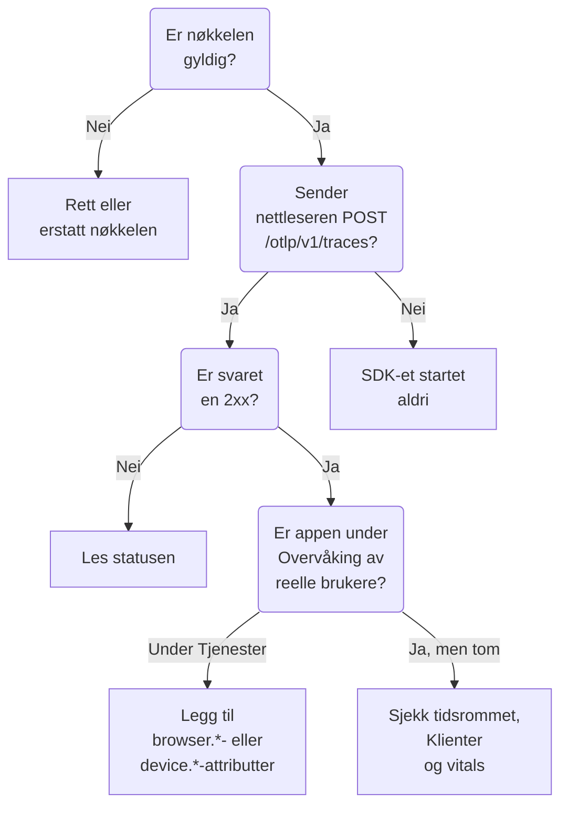

# RUM-feilsøking

Når en RUM-applikasjon mangler, er tom eller viser **Frakoblet**, går du gjennom denne siden i rekkefølge. Hver sjekk utelukker en del av veien mellom appen din og OneUptime, i den rekkefølgen disse problemene vanligvis oppstår.

:::cards
- [Sjekk nøkkelen](#sjekk-nøkkelen): Den raskeste sjekken, og alt annet avhenger av den.
- [Sjekk hva som forlater nettleseren](#sjekk-hva-som-forlater-nettleseren): Eksportforespørselen i nettleserens utviklerverktøy.
- [Sjekk hvor telemetrien havner](#sjekk-hvor-telemetrien-havner): En RUM-applikasjon eller en backend-tjeneste.
- [Problemer med øktavspilling](#problemer-med-øktavspilling): En egen pipeline, med sin egen side.
:::

## Hvor RUM-telemetri stopper

Telemetri passerer tre sjekker på vei til en RUM-applikasjon. Finn den første som feiler:



## Sjekk nøkkelen

Sjekk nøkkelen først. Det er den raskeste sjekken, og ingenting av det som følger, virker uten en nøkkel som OneUptime godtar:

```bash
curl -i https://oneuptime.com/otlp/v1/validate \
  -H "x-oneuptime-token: YOUR_TELEMETRY_INGESTION_TOKEN"
```

| Svar | Hva det betyr |
| --- | --- |
| `200` med `"valid": true` | OneUptime godtar nøkkelen. Svaret oppgir også dens `keyType` og dens `projectId`. Gå videre til neste sjekk. |
| `401` med `"valid": false` | Nøkkelen mangler, er ukjent, tilbakekalt, deaktivert eller utløpt, og `message` sier hvilken. Opprett en aktiv nøkkel under **Prosjektinnstillinger → Telemetri og APM → Inntaksnøkler**. |

En webapp trenger en **Nettleser**-nøkkel, og en mobilapp en **Server**-nøkkel: se [Nettleseroppsett](/docs/rum/browser-setup) og [Mobiloppsett](/docs/rum/mobile-setup). Eksportendepunktene avviser også en feil nøkkel med `401`, slik OTLP-spesifikasjonen krever, så et veloppdragent SDK logger avvisningen i stedet for å prøve på nytt. Den linjen er lett å overse i nettleserkonsollen, og denne sjekken svarer direkte.

## Sjekk hva som forlater nettleseren

Åpne nettleserens utviklerverktøy på appens side, velg fanen Nettverk og filtrer på `otlp`. Du ser etter `POST /otlp/v1/traces` besvart med en `2xx`-status.

### Ingen forespørsel

SDK-et startet aldri. Det er nesten alltid en av disse årsakene:

- `telemetry.ts` er ikke den første importen i appen din, eller bundleren din har fjernet den. Instrumenteringene endrer `fetch` og `XMLHttpRequest`, så en forespørsel som gjøres før den endringen, spores ikke, og en fil som bundleren har fjernet, kjører ingenting.
- Batchprosessoren har ikke eksportert ennå. `BatchSpanProcessor` venter noen sekunder for å fylle en batch, så vent, eller gå til en annen side, før du konkluderer med at ingenting sendes.
- En miljøvariabel ved byggetid er blitt stående som `undefined`, og eksportørens URL er ødelagt. Logg URL-en én gang ved oppstart.

### Nettleseren blokkerer forespørselen

- **En Content Security Policy-feil i konsollen.** Sidens retningslinje tillater ikke OneUptime ennå. Legg det til i det eksisterende `connect-src`-direktivet ditt, eller bruk din egen vert hvis du hoster OneUptime selv:

  ```text
  connect-src 'self' https://oneuptime.com;
  ```

- **En CORS-feil.** OTLP-endepunktene godtar forespørsler fra enhver opprinnelse og tillater headeren `x-oneuptime-token`, så en reell CORS-feil betyr nesten alltid at forespørselen aldri nådde OneUptime: se etter en bedriftsproxy, en annonseblokkering eller en skrivefeil i verten. Sjekk forespørselens URL på fanen Nettverk.

### Forespørselen får en feilstatus

**`401`.** Nøkkelen er ukjent, tilbakekalt eller utløpt. Kjør [nøkkelsjekken](#sjekk-nøkkelen), og bruk deretter en aktiv nøkkel.

**`404`.** URL-en er feil. Sporeksportøren trenger hele banen, `/otlp/v1/traces`. En vanlig feil er å gi basisadressen (`https://oneuptime.com/otlp`) til en eksportør som forventer hele URL-en, eller hele URL-en til en som legger til banen selv og ender på `/otlp/v1/traces/v1/traces`.

**`413`.** Batchen var større enn en proxy tillater. OneUptimes egen ingress godtar opptil 4 MB på `/otlp`, men en proxy du setter foran OneUptime, kan være strengere — ingress-nginx setter for eksempel `proxy-body-size` til 1 MB som standard — så hvis du har en, må du også heve grensen dens for `/otlp`. Uansett gjør en mindre `maxExportBatchSize` på `BatchSpanProcessor` hver eksport mindre:

```ts
new BatchSpanProcessor(exporter, { maxExportBatchSize: 100 });
```

En nettleser sender sjelden så store batcher, med mindre spennene bærer store attributter, som en hel stakksporing eller en svarbody. Å kutte dem ned er den bedre løsningen.

**`422`.** OneUptime avviste nøkkelen her, og meldingen sier hvorfor. `Origin https://app.example.com is not allowed for this browser ingestion key.` betyr at sidens nøyaktige opprinnelse, med skjema og eventuell port, mangler i nøkkelens **Tillatte opprinnelser**. `This telemetry ingestion key has been disabled.` betyr at noen har deaktivert nøkkelen.

**`429`.** Nøkkelens **Requests Per Minute Limit** er brukt opp: `Too many telemetry requests for this ingestion key. Please retry later.` En Browser-nøkkel tillater 6000 forespørsler i minuttet for alle de besøkende samlet, med mindre du setter din egen grense på nøkkelen.

**`403` med en HTML-side, eller en tom body.** OneUptime besvarer hver avvisning i JSON, så denne kom fra noe foran, vanligvis en brannmur for webapplikasjoner på ditt eget domene, hvis du sender OneUptime gjennom den. Brannmuren tolker OTLP/JSON og sammenligner hvert spennattributt med injeksjonsreglene sine, så en URL med en spørrestreng på et spenn er nok til at den blokkerer, og brannmurens logg nevner regelen. Unnta OTLP-nyttelasten fra inspeksjon bare på OTLP-banene: [OpenTelemetry-forespørslene dine blir også blokkert](/docs/rum/session-replay-troubleshooting#opentelemetry-forespørslene-dine-blir-også-blokkert) viser hvordan, og dekker avspillingsopptakeren bak den samme brannmuren.

## Sjekk hvor telemetrien havner

Forespørselen virker, men appen dukker opp under **Produkter → Tjenester** i stedet for under **Produkter → Ressurser → Overvåking av reelle brukere**. Det er den vanligste henvendelsen, og årsaken er nesten alltid en ressurs uten klientattributter. OneUptime arkiverer bare en batch som RUM når ressursen bærer en av disse:

| Type | Attributter |
| --- | --- |
| Nettleser | `browser.platform`, `browser.language` eller en ikke-tom `browser.brands` |
| Mobil | `device.id` eller `device.model.identifier`, eller `device.manufacturer` på en ressurs uten vertsidentitet (`host.name`, `host.id` eller `k8s.node.name`) |

Et `service.name` alene oppretter en backend-tjeneste. OpenTelemetry-SDK-et for nettleser legger ikke til noen `browser.*`-attributter med mindre du legger til nettleserens ressursdetektor eller setter dem selv: se [Nettleseroppsett](/docs/rum/browser-setup).

For å se hva du faktisk sender, åpner du OTLP-forespørselen på fanen Nettverk og ser på nyttelasten: `resourceSpans[0].resource.attributes` er listen som avgjør det. Hvis det ikke finnes noe `browser.*`-attributt, legger ikke SDK-et det til, uansett hva dokumentasjonen sier.

Legg til attributtene, så oppretter neste batch RUM-applikasjonen. Tjenesten som ble opprettet først, blir ikke til en RUM-applikasjon, fordi det er separate poster, så slett den under **Produkter → Tjenester** når RUM-telemetrien kommer inn.

> [!NOTE]
> En ressurs der det eneste klientattributtet er `device.manufacturer`, og som også har en vertsidentitet, leses som en maskin og ikke som en telefon, fordi en verts inventar rapporterer produsenten sin med det samme attributtet. Legg til `device.id` eller `device.model.identifier`, så arkiveres batchen som mobil-RUM uansett hva den ellers bærer.

## Applikasjonen er tom

Applikasjonen finnes, men sidene viser ingenting.

- **Sjekk tidsrommet.** Oversikten viser som standard den siste timen, så en testbatch fra i morges faller utenfor.
- **Vent noen minutter.** Inntak går gjennom en kø, og **Sist sett** oppdateres med noen minutters mellomrom i stedet for ved hver batch.
- **Sjekk prosjektet.** En nøkkel skriver til sitt eget prosjekt, så telemetri som sendes med et annet prosjekts nøkkel, ligger der og ikke her.

## Siden Klienter er tom

Siden **Klienter** viser `browser.platform` på web og `device.model.identifier` på mobil. To grunner til at den forblir tom selv når alt annet virker:

- **Safari og Firefox.** `browserDetector` leser UA Client Hints-API-et, som bare Chromium-nettlesere har. På de andre setter den `browser.language`, som er nok til å arkivere telemetrien som RUM, men ikke `browser.platform`. Sett `browser.platform` selv for å få med de klientene.
- **Et mobil-SDK som bare setter `device.manufacturer`.** Det arkiverer telemetrien som mobil-RUM, men siden **Klienter** trenger `device.model.identifier`.

## Core Web Vitals viser «No web vitals reported yet»

Kortet fylles bare med målingene appen din sender, så spor alene fyller det aldri. Sjekk at du eksporterer målinger, at navnene deres er blant dem OneUptime leser, og at de vises på applikasjonens side **Målinger**. [Kortet sier «No web vitals reported yet»](/docs/rum/web-vitals#feilsøking) går gjennom hver sjekk, inkludert verdier som går tapt når en besøkende lukker fanen før neste eksport.

## Statusen sier Frakoblet mens folk bruker appen

En applikasjon går over til **Frakoblet** etter 15 minutter uten telemetri. Hvis folk bruker appen:

- **En sampler kaster kanskje alt.** Sjekk at du ikke har satt en sampler som alltid er av, eller et svært lavt forhold.
- **Appen sender kanskje bare telemetri ved enkelte interaksjoner**, og ingen brukte dem i det tidsrommet.
- **Nøkkelen kan ha blitt tilbakekalt eller deaktivert** etter utrullingen: kjør [nøkkelsjekken](#sjekk-nøkkelen) på nytt.

En intern app eller en app med lite trafikk uten besøkende om natten er virkelig frakoblet. Det er ikke en feil.

## Problemer med øktavspilling

Øktavspilling er en egen pipeline med sine egne problemer: opptakerens skript, lister over tillatte opprinnelser, samtykke, Content Security Policy og maskering. [Feilsøking av øktavspilling](/docs/rum/session-replay-troubleshooting) dekker dem. Begynn der, og begynn med å slå på opptakerens diagnostikk, fordi de fleste feilene dens er stille med vilje:

```js
localStorage.setItem("oneuptime.sessionReplay.debug", "true");
// then reload the page
```

Applikasjonens side **Helse**, i delen **Øktavspilling**, og panelet **Test your installation** på **Replay Policy** sjekker nøkkelen, listene over tillatte opprinnelser og retningslinjen fra serversiden og sier hvorfor ingenting kommer inn. Nettleserkonsollen gir deg halvdelen som serveren ikke kan se.

Med standardretningslinjen sender en opptaker en chunk omtrent hvert 15. sekund mens brukeren samhandler med siden. En inaktiv fane har ingenting å sende, så klikk eller beveg musen først; hvis det da ikke finnes noen chunk-forespørsel, er noe galt. Hvis appen bare laster opp _On error or frustration_, er stillhet forventet til noe feiler. Kall `OneUptimeReplay.captureSession()` for å tvinge frem en opplasting og teste veien likevel.

De to pipelinene er uavhengige. Du trenger ingen fungerende RUM-applikasjon for at opptakeren skal lastes inn, og en fungerende opptaker betyr ikke at RUM-telemetri kommer inn: hver av dem kan feile for seg.

## Står du fortsatt fast?

Samle dette før du ber om hjelp. Det sparer en runde fram og tilbake:

- Listen `resource.attributes` fra nyttelasten i en faktisk OTLP-forespørsel.
- HTTP-statusen for den forespørselen.
- Det nøyaktige `service.name` du sender, og om prosjektet har en applikasjon eller en tjeneste med det navnet.
- Om `/otlp/v1/validate` svarer `200` for nøkkelen i det utrullede bygget.

Skriv deretter til support@oneuptime.com, eller opprett en issue på [GitHub](https://github.com/OneUptime/oneuptime).

## Neste steg

:::cards
- [Nettleseroppsett](/docs/rum/browser-setup): Oppsettet disse sjekkene forutsetter, trinn for trinn.
- [Mobiloppsett](/docs/rum/mobile-setup): Nøkkelen og attributtene en mobilapp trenger.
- [Administrere applikasjoner](/docs/rum/applications): Navn, etiketter, oppbevaring og status.
- [Feilsøking av øktavspilling](/docs/rum/session-replay-troubleshooting): Hver kode fra opptakeren, og hva du gjør med den.
:::
