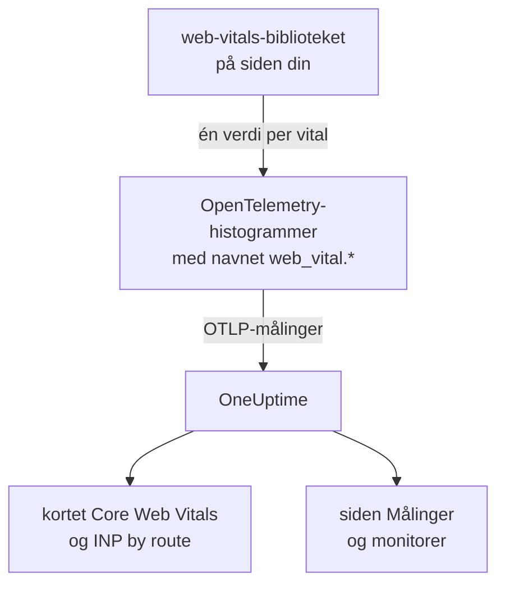
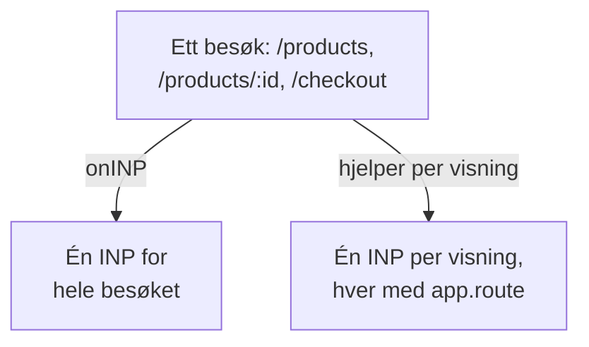

# Core Web Vitals

Kortet **Core Web Vitals** i en RUM-applikasjons oversikt viser LCP, INP, CLS, FCP og TTFB, hver vurdert mot Googles grenser. OneUptime måler ingen av dem selv: Kortet fylles bare fra målinger som nettleserinstrumenteringen din rapporterer, og denne siden viser hvordan du sender dem.

:::cards
- [Send dem](#send-dem-fra-appen-din): Videresend verdiene fra web-vitals-biblioteket som OpenTelemetry-målinger.
- [Navn OneUptime leser](#målingsnavn-oneuptime-gjenkjenner): Målingsnavnene hver vital kan komme inn under.
- [Enkeltsideapper](#enkeltsideapper): INP for hver visning, ikke én verdi per sideinnlasting.
- [Varsle på en vital](#varsle-på-en-vital): Ferdige monitorer for dårlige vitals.
:::

## Slik fungerer det

Biblioteket [`web-vitals`](https://github.com/GoogleChrome/web-vitals) måler hver vital på siden; det er det samme biblioteket som Chromes egne verktøy bruker. Koden din registrerer hver verdi i et OpenTelemetry-histogram, og nettleserens målingspipeline eksporterer den til OneUptime.



OpenTelemetry har ennå ingen endelig navnekonvensjon for web vitals, så OneUptime ser etter hver vital under flere navn og bruker det første med data. Bruk navnene `web_vital.*` for ny instrumentering.

## Før du begynner

- En webapp satt opp som i [Nettleseroppsett](/docs/rum/browser-setup), med målingspipelinen: Det er `MeterProvider` fra [Legg til logger og målinger](/docs/rum/browser-setup#legg-til-logger-og-målinger) som eksporterer disse verdiene.

## Send dem fra appen din

:::steps
### Installer biblioteket

```bash
npm install web-vitals
```

### Registrer hver vital i et histogram

Opprett `src/web-vitals.ts`. Hver vital er et histogram, slik at siden **Målinger** senere kan regne ut persentiler, med bøttegrenser på Googles grenser for god og dårlig.

```ts title="src/web-vitals.ts"
// Import after ./telemetry
import { metrics } from "@opentelemetry/api";
import { onCLS, onFCP, onINP, onLCP, onTTFB, type Metric } from "web-vitals";

const meter = metrics.getMeter("web-vitals");

// Histograms, so the Metrics tab can compute percentiles later. The bucket
// edges sit on each vital's good / poor limits: a percentile is read from
// the buckets, and the defaults are far too coarse for these ranges.
const buckets = (...edges: number[]) => ({ advice: { explicitBucketBoundaries: edges } });

const lcp = meter.createHistogram("web_vital.lcp", { unit: "ms", ...buckets(0, 1000, 1500, 2000, 2500, 3000, 3500, 4000, 5000, 7500, 10000) });
const inp = meter.createHistogram("web_vital.inp", { unit: "ms", ...buckets(0, 50, 100, 150, 200, 250, 300, 400, 500, 750, 1000, 2000) });
const fcp = meter.createHistogram("web_vital.fcp", { unit: "ms", ...buckets(0, 600, 1200, 1800, 2400, 3000, 4000, 6000, 10000) });
const ttfb = meter.createHistogram("web_vital.ttfb", { unit: "ms", ...buckets(0, 200, 400, 600, 800, 1200, 1800, 2500, 4000) });
const cls = meter.createHistogram("web_vital.cls", { unit: "1", ...buckets(0, 0.025, 0.05, 0.1, 0.15, 0.2, 0.25, 0.4, 0.6, 1) });

function record(
  histogram: { record: (v: number, a?: Record<string, string>) => void },
) {
  return (metric: Metric): void => {
    histogram.record(metric.value, {
      // Keep attributes low-cardinality. Never put a full URL or a user id here.
      "web_vital.rating": metric.rating,
    });
  };
}

onLCP(record(lcp));
onINP(record(inp));
onCLS(record(cls));
onFCP(record(fcp));
onTTFB(record(ttfb));
```

### Importer den etter telemetrioppsettet ditt

```ts
import "./telemetry";
import "./web-vitals";
```

### Sjekk siden Målinger

Last inn noen sider, og søk deretter etter `web_vital.lcp` på applikasjonens side **Målinger**. Når målingene er der, fylles kortet **Core Web Vitals** for tidsrommet du velger.
:::

## Send de siste verdiene før siden lukkes

`onINP` og `onCLS` rapporterer når siden skjules, ikke under besøket. Med eksportintervallet på 30 sekunder fra [Nettleseroppsett](/docs/rum/browser-setup) kan en besøkende som lukker fanen rett etter den siste verdien, rekke å forsvinne før den eksporteres. Hvis fullstendighet betyr noe, korter du ned `exportIntervalMillis`, eller beholder `MeterProvider` du bygde i `telemetry.ts` og tømmer den når siden skjules:

```ts
// In telemetry.ts, export the provider you created:
export const meterProvider = new MeterProvider({ /* ... */ });

// Anywhere after setup:
import { meterProvider } from "./telemetry";

document.addEventListener("visibilitychange", () => {
  if (document.visibilityState === "hidden") {
    void meterProvider.forceFlush();
  }
});
```

## Målingsnavn OneUptime gjenkjenner

OneUptime prøver navnene i denne rekkefølgen, og det første med data i det valgte tidsrommet vinner.

| Vital | Målingsnavn, hvilket som helst | Enhet |
| --- | --- | --- |
| LCP: Largest Contentful Paint | `web_vital.lcp`, `browser.largest_contentful_paint`, `largest_contentful_paint`, `web.vitals.lcp` | ms |
| INP: Interaction to Next Paint | `web_vital.inp`, `browser.interaction_to_next_paint`, `interaction_to_next_paint`, `web.vitals.inp` | ms |
| CLS: Cumulative Layout Shift | `web_vital.cls`, `browser.cumulative_layout_shift`, `cumulative_layout_shift`, `web.vitals.cls` | poengsum |
| FCP: First Contentful Paint | `web_vital.fcp`, `browser.first_contentful_paint`, `first_contentful_paint`, `web.vitals.fcp` | ms |
| TTFB: Time to First Byte | `web_vital.ttfb`, `browser.time_to_first_byte`, `time_to_first_byte`, `web.vitals.ttfb` | ms |

De andre navnene finnes slik at en app som allerede sender etter en fellesskapskonvensjon, dukker opp uten endringer.

## Vurderingsgrenser

Kortet vurderer hver verdi med Googles publiserte grenser for Core Web Vitals:

| Vital | **Good** | **Needs work** | **Poor** |
| --- | --- | --- | --- |
| LCP | under 2500 ms | 2500 til 4000 ms | 4000 ms eller mer |
| INP | under 200 ms | 200 til 500 ms | 500 ms eller mer |
| CLS | under 0,1 | 0,1 til 0,25 | 0,25 eller mer |
| FCP | under 1800 ms | 1800 til 3000 ms | 3000 ms eller mer |
| TTFB | under 800 ms | 800 til 1800 ms | 1800 ms eller mer |

Kortet viser **gjennomsnittet** over det valgte tidsrommet, ikke 75. persentilen som Googles feltverktøy rapporterer. Det er med vilje: OneUptime leser et histograms persentiler fra bøttene, så en persentil er bare så presis som bøttene er, mens gjennomsnittet kommer fra histogrammets nøyaktige sum og antall. Med OpenTelemetrys standardbøtter (`0, 5, 10, 25, 50, …`) havner hver CLS-verdi i den første bøtta, og en 75. persentil ville vist 2,5 for en side som knapt beveger seg.

> [!TIP]
> Les kortet som en trend. For 75. persentilen registrerer du med bøttegrensene ovenfor og viser deretter målingen på siden **Målinger** med aggregeringen **P75**. En målingsmonitor gir det samme valget.

## Enkeltsideapper

`onINP` måler INP slik nettleseren definerer det: **én verdi per sideinnlasting**. En enkeltsideapp lastes én gang og bytter deretter rute med `history.pushState`, så et besøk på `/products`, `/products/42` og `/checkout` gir én INP for hele besøket. Interaksjonene i alle visningene konkurrerer om det ene tallet, og en ruteattributt på det navngir siden som ble vist da det ble rapportert, ikke siden som var treg.



For å se INP per visning må du måle den per visning: Hvert ruteskifte avslutter gjeldende visning og starter en ny, og hver visning rapporterer sin egen INP. Hjelperen nedenfor gjør det med nettleserens Event Timing API, de samme dataene som `onINP` bruker, og håndterer delen som er lett å gjøre feil: Klikket som **forårsaket** en navigasjon, leveres først etter at ruten allerede er byttet, men hører til siden det ble klikket på.

```ts title="src/inp-per-route.ts"
// INP for each view of a single-page app.
type Report = (inpMs: number, route: string) => void;

interface View {
  route: string;
  path: string; // the URL path it was opened for
  start: number; // performance.now() when the view began
  latencies: Map<number, number>; // interactionId -> its slowest entry
}

// Long enough for the click that navigated to be delivered: its entry
// arrives after the next paint, i.e. after the route has changed.
const SETTLE_MS = 1000;

let views: Array<View> = [];
let report: Report = () => {};

// The path, plus the hash when a hash router keeps the route there.
const currentPath = (): string =>
  location.pathname + (location.hash.startsWith("#/") ? location.hash : "");

function close(view: View): void {
  if (!views.includes(view)) return; // already reported
  views = views.filter((v) => v !== view);

  const sorted = [...view.latencies.values()].sort((a, b) => b - a);
  if (sorted.length === 0) return; // nobody interacted: no INP, not 0

  // web-vitals' p98: skip one outlier for every 50 interactions.
  report(sorted[Math.min(sorted.length - 1, Math.floor(sorted.length / 50))]!, view.route);
}

function record(entries: PerformanceEntryList): void {
  for (const entry of entries as Array<PerformanceEventTiming & { interactionId?: number }>) {
    if (!entry.interactionId) continue; // hovers, scrolls: not interactions

    // The view the interaction STARTED in, so the click that navigated
    // counts towards the page it was clicked on.
    const view = [...views].reverse().find((v) => entry.startTime >= v.start);
    if (!view) continue;

    const slowest = view.latencies.get(entry.interactionId) ?? 0;
    view.latencies.set(entry.interactionId, Math.max(slowest, entry.duration));
  }
}

export function observeInpPerRoute(route: string, onReport: Report): void {
  if (typeof PerformanceObserver === "undefined" || !PerformanceObserver.supportedEntryTypes?.includes("event")) return;

  report = onReport;
  views = [{ route, path: currentPath(), start: 0, latencies: new Map() }];

  const observer = new PerformanceObserver((list) => record(list.getEntries()));
  observer.observe({ type: "event", durationThreshold: 40, buffered: true } as PerformanceObserverInit);

  // The tab may never come back: report every view now, then keep
  // measuring the current route as a fresh view.
  document.addEventListener("visibilitychange", () => {
    if (document.visibilityState !== "hidden") return;
    record(observer.takeRecords());
    const current = views[views.length - 1]?.route ?? route;
    [...views].forEach(close);
    views = [{ route: current, path: currentPath(), start: performance.now(), latencies: new Map() }];
  });
}

// Call after every navigation, with the route PATTERN ("/products/:id").
// Safe to call when nothing changed (a router's initial navigation, a
// query-string update): the view only ends when the path does.
export function startView(route: string): void {
  const closing = views[views.length - 1];
  if (!closing || closing.path === currentPath()) return;

  views.push({ route, path: currentPath(), start: performance.now(), latencies: new Map() });
  setTimeout(() => close(closing), SETTLE_MS);
}
```

Begge funksjonene tar rutens **mønster**, aldri URL-en: `/products/42` og `/products/7` må være én rute, ellers blir hvert produkt sin egen serie. Bruk ruterens mønster der den har et; ellers slår du sammen ID-ene selv:

```ts
// "/products/42" -> "/products/:id", also for UUIDs.
export const toRoutePattern = (path: string): string =>
  path.replace(/\/(\d+|[0-9a-f]{8}-[0-9a-f-]{27})(?=\/|$)/gi, "/:id");
```

Registrer det hjelperen rapporterer, i det samme histogrammet `web_vital.inp`, med ruten som `app.route`, og **fjern `onINP`** fra snippet-et ovenfor: Med begge ville hver interaksjon blitt telt to ganger.

```ts
// src/web-vitals.ts, in place of onINP(record(inp))
import { observeInpPerRoute } from "./inp-per-route";

observeInpPerRoute(toRoutePattern(location.pathname), (inpMs, route) => {
  inp.record(inpMs, {
    "app.route": route,
    "web_vital.rating": inpMs <= 200 ? "good" : inpMs <= 500 ? "needs-improvement" : "poor",
  });
});
```

Kall deretter `startView` der ruteren din melder en fullført navigasjon. Den ignorerer et kall når URL-stien ikke har endret seg, så en ruter som også rapporterer den første innlastingen eller en endring i spørrestrengen, deler ikke visningen:

:::tabs
@tab Vue Router
```ts
router.afterEach((to) => startView(to.matched[to.matched.length - 1]?.path ?? toRoutePattern(to.path)));
```
@tab React Router
```tsx
// In a component that stays mounted inside the router
const { pathname } = useLocation();
useEffect(() => startView(toRoutePattern(pathname)), [pathname]);
```
:::

Dette får du:

- **INP by route** i oversikten, tregeste først, ut fra `app.route`; OneUptime leser også OpenTelemetrys `url.template`.
- Et rutefilter for varsler: Filtrer en målingsmonitor på `web_vital.inp` etter `app.route` for å overvåke én flyt, som `/checkout`, for seg selv.
- Den samlede INP-en for appen på kortet **Core Web Vitals** virker fortsatt: Det er den samme målingen, nå med én verdi per visning i stedet for én per sideinnlasting.

Chromium-nettlesere rapporterer interaksjons-ID-ene dette trenger. Safari rapporterer ingen, og det er også derfor `onINP` ikke rapporterer noe der. Chromes eksperimentelle Soft Navigations API tar sikte på å gjøre dette innebygd, men det er ikke allment tilgjengelig; denne hjelperen virker i dag.

> [!NOTE]
> Opptakeren i [Øktavspilling](/docs/telemetry/session-replay) måler allerede INP per visning, uten kode: Hvert opptak viser en INP-rad for hver rute brukeren samhandlet på, med det trege elementet og hvordan tiden fordelte seg på inndataforsinkelse, behandling og presentasjon.

## Hold kardinaliteten under kontroll

Målingsattributter ganges opp. `web_vital.rating` har tre mulige verdier, som er greit, og en attributt for rute eller sidetype er som regel verdt det:

```ts
histogram.record(metric.value, {
  "web_vital.rating": metric.rating,
  "app.route": routePattern, // "/product/:id" — the PATTERN, not "/product/8842"
});
```

Å registrere den konkrete URL-en i stedet for rutemønsteret gir én tidsserie per produktside, noe som gjør siden **Målinger** treg og lagringsregningen stor. Det samme gjelder bruker-ID-er, økt-ID-er og skjermstørrelser.

## Varsle på en vital

Applikasjonens side **Recommendations** tilbyr en ferdig monitor for hver vital. Hver av dem leser femminuttersgjennomsnittet av målingen sin og utløses når det når Googles grense for dårlig:

| Anbefaling | Måling | Utløses ved | Alvorlighetsgrad |
| --- | --- | --- | --- |
| **Poor Largest Contentful Paint** | `web_vital.lcp` | 4000 ms | **Kritisk** |
| **Poor Interaction to Next Paint** | `web_vital.inp` | 500 ms | **Kritisk** |
| **Poor Cumulative Layout Shift** | `web_vital.cls` | 0,25 | **Kritisk** |
| **Slow First Contentful Paint** | `web_vital.fcp` | 3000 ms | **Warning** |
| **Slow Time to First Byte** | `web_vital.ttfb` | 1800 ms | **Warning** |

Disse monitorene leser bare navnene `web_vital.*`. Hvis appen din sender en vital under et annet navn, endrer du målingen i den opprettede monitoren. For å varsle på én rute legger du til et filter `app.route` i monitoren. Du kan også bygge din egen monitor på hvilken som helst av disse målingene: se [Metrikk-overvåking](/docs/monitor/metrics-monitor).

## Feilsøking

:::details Kortet sier «No web vitals reported yet»
Kortet fylles bare fra målinger appen din sender. Sjekk i rekkefølge:

1. At du i det hele tatt har en målingspipeline: Spor alene fyller aldri dette kortet.
2. At målingsnavnene er blant dem OneUptime leser: se [Målingsnavn OneUptime gjenkjenner](#målingsnavn-oneuptime-gjenkjenner).
3. At målingene finnes på applikasjonens side **Målinger**. Gjør de det, virker eksporten, og problemet er navnet eller tidsrommet.
4. At INP og CLS rapporteres når siden skjules, så et kort besøk kan ende før neste eksport: se [Send de siste verdiene før siden lukkes](#send-de-siste-verdiene-før-siden-lukkes).

Hvis ingenting av dette hjelper, sjekker [RUM-feilsøking](/docs/rum/troubleshooting) hele pipelinen.
:::

:::details INP rapporteres, men ikke per rute
Kortet **INP by route** trenger attributtet `app.route`, eller `url.template`, på `web_vital.inp`. Registrer rutemønsteret med hver verdi som i [Enkeltsideapper](#enkeltsideapper).
:::

:::details Verdiene avviker fra Googles rapport
Kortet viser gjennomsnittet over tidsrommet du valgte, og Google rapporterer 75. persentilen av sine egne besøkende. Vis **P75** på siden **Målinger** for å sammenligne like med like.
:::

## Neste steg

:::cards
- [Nettleseroppsett](/docs/rum/browser-setup): Pipelinen for spor, logger og målinger som disse vitals går gjennom.
- [Metrikk-overvåking](/docs/monitor/metrics-monitor): Varsle på hvilken som helst vital, for hele appen eller én rute.
- [Øktavspilling](/docs/telemetry/session-replay): Se INP per visning i opptak, uten kode.
- [RUM-feilsøking](/docs/rum/troubleshooting): Hver sjekk, i den rekkefølgen problemer vanligvis oppstår.
:::
