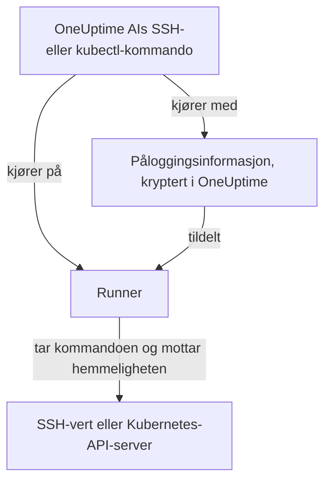

# AI-tilgang

AI-tilgang er måten OneUptime AIs egne kommandoer når noe som **ikke** er en Runners egen vert — en server over SSH, eller API-serveren til en Kubernetes-klynge som ikke kjører Kubernetes-agentens chart. Hver tilgang er påloggingsinformasjon: den tilgangen som et administrert objekt, kryptert i hvile, tildelt bestemte Runnere og valgt av OneUptime AI i stedet for å skrives inn i en kommando. Runbook-trinn bruker dem ikke: et SSH- eller kubectl-trinn logger på med en hemmelig [runbook-variabel](/docs/runbooks/variables). En Runner som er eldre enn denne utgivelsen, er unntaket: den kjører et Kubernetes-trinn som er flyttet fra en handling, med påloggingsinformasjonen trinnet nevnte, til trinnets skript eller kubeconfig endres.

Administrer den under **Runbooks → Runbook-agenter → AI-tilgang**.

:::cards
- [Opprett påloggingsinformasjon](#opprett-påloggingsinformasjon): Tilgangen og Runnerne som får bruke den.
- [Minste privilegium på den andre siden](#minste-privilegium-på-den-andre-siden): Begrens hva nøkkelen eller tokenet kan gjøre.
- [Runnere som kjører OneUptime AIs kommandoer](#runnere-som-kjører-kommandoene-til-oneuptime-ai): Hvem som kan gi en slik Runner SSH-påloggingsinformasjon.
:::

## Slik brukes påloggingsinformasjon

OneUptime AI kjører en SSH-kommando med en av SSH-påloggingsinformasjonene som er tildelt Runneren den kjører på, og en kubectl-kommando for en klynge som ikke kjører Kubernetes-agentens chart, med Kubernetes-påloggingsinformasjonen som er knyttet til den klyngen, slik [AI SRE](/docs/ai/ai-sre) viser. Når Runneren tar kommandoen, kontrollerer OneUptime at påloggingsinformasjonen er tildelt den, dekrypterer hemmeligheten og utleverer den bare i svaret på det kravet. Hemmeligheten lagres aldri på jobben og kan aldri leses gjennom API-et.

## Før du begynner

- **En rolle som administrerer påloggingsinformasjon.** Project Owner og Project Admin, eller alle med tillatelsen **Create Runbook Credential**. Rollen Runbook Admin omfatter den ikke. Å tildele SSH-påloggingsinformasjon til en Runner som kjører kommandoene til OneUptime AI, krever også **Read Runbook Credential**; se [Runnere som kjører kommandoene til OneUptime AI](#runnere-som-kjører-kommandoene-til-oneuptime-ai).
- **Et abonnement som omfatter den.** På OneUptime Cloud krever runbook-påloggingsinformasjon abonnementet **Growth** eller høyere.
- **En [Runner](/docs/runbooks/agents)** som kan nå verten eller API-serveren til klyngen over nettverket.

## Opprett påloggingsinformasjon

:::steps
### Åpne AI-tilgang

Åpne **Runbooks → Runbook-agenter → AI-tilgang**, og klikk **Opprett Credential**.

### Gi den et navn, og velg typen

I trinnet **Credential** skriver du inn et **Navn**, for eksempel `prod-cluster`, en valgfri **Beskrivelse** og **Type**: **SSH** eller **Kubernetes**. Typen kan ikke endres senere; opprett ny påloggingsinformasjon i stedet.

### Skriv inn tilgangen

:::tabs
@tab SSH
Under **SSH-vert** skriver du inn **Vertsnavn**, **Port** (22 hvis feltet er tomt) og **Brukernavn**. Under **SSH-autentisering** velger du under **Logg på med**: en **Privat nøkkel**, det beste valget når du kan velge, og limer så inn **Private Key (PEM)** med tilhørende **Private Key Passphrase** hvis den har en; eller et **Passord** for en vert uten nøkkeltilgang, og skriver så inn **Passord**.
@tab Kubernetes
Under **Kubernetes** skriver du inn **API Server URL**, for eksempel `https://10.0.0.1:6443`, **Service Account Token** og **CA Certificate (PEM)**, slik at Runneren kan verifisere API-serveren. La bare CA-en stå tom hvis API-serveren presenterer et sertifikat som Runneren allerede stoler på.
:::

### Tildel den til Runnere

I trinnet **Runbook-agenter** velger du Runnerne som får bruke påloggingsinformasjonen, og klikker deretter **Opprett Credential**. Påloggingsinformasjon som ikke er tildelt noen Runner, kan ikke brukes av noen kommando.

### La OneUptime AI bruke den

OneUptime AI kjører SSH-kommandoene sine på Runneren en regel for automatisk utbedring velger for dem, med en av SSH-påloggingsinformasjonene som er tildelt den. Kubernetes-påloggingsinformasjon brukes så snart den er knyttet til en klynge sammen med en av Runnerne sine: se [AI SRE](/docs/ai/ai-sre).
:::

## Hva som lagres

| Type | Felt |
| --- | --- |
| SSH | Vertsnavn, port (22 som standard), brukernavn og enten en privat PEM-nøkkel (med valgfri passordfrase) eller et passord. |
| Kubernetes | API-serverens URL, et serviceaccount-token og klyngens CA-sertifikat. |

## Hemmelige verdier kan bare skrives

Private nøkler, passordfraser, passord og serviceaccount-tokens er kryptert i hvile, og API-et **returnerer dem aldri**: verken til dashbordet, til en arbeidsflyt eller til en eksport. Tabellen kan vise deg hva påloggingsinformasjonen *er*, uten noen gang å vise hva den inneholder.

Det finnes derfor ingen "vis" for en hemmelig verdi, bare "erstatt": å skrive inn en verdi på nytt er måten å bytte den på. Har du mistet originalen, utsteder du en ny nøkkel på målsystemet og oppdaterer påloggingsinformasjonen.

## Tildel påloggingsinformasjon til Runnere

Påloggingsinformasjon kan bare brukes av Runnerne du tildeler den. En kommando som nevner påloggingsinformasjon som Runneren ikke er tildelt, **feiler i stedet for å kjøre** — en Runner som stille ikke gjør noe, ser akkurat ut som en som fungerte.

Tildelingen er tilgangsgrensen, så hold den smal: en Runner som bare noen gang starter én klynge på nytt, trenger ikke SSH-nøkkelen til databasevertene dine.

### Runnere som kjører kommandoene til OneUptime AI

En Runner kjører kommandoene til OneUptime AI så snart den er valgt for dem: som Runneren til en regel for automatisk utbedring, eller for AI-tilgangen til en Kubernetes-klynge. På en slik Runner velger OneUptime AI blant SSH-påloggingsinformasjonen som er tildelt Runneren, for kommandoene den kjører der. Derfor når SSH-påloggingsinformasjon bare en slik Runner gjennom en person som har lov til å lese runbook-påloggingsinformasjon (**Read Runbook Credential**, eller en Project Owner eller Project Admin), uansett hva som lagres først:

- **Tildel påloggingsinformasjonen.** Å opprette SSH-påloggingsinformasjon med en slik Runner, eller legge til en slik Runner i den, krever den tillatelsen. Uten den avvises lagringen og nevner Runneren: tildel påloggingsinformasjonen til Runnere som ikke kjører AI-utbedringskommandoer, eller be noen med tillatelsen om å tildele den.
- **Velg Runneren.** Å velge en Runner som har SSH-påloggingsinformasjon, for kommandoene til OneUptime AI - som Runneren til en regel, eller for en klynge - krever samme tillatelse første gang den velges.

Å fjerne Runnere fra påloggingsinformasjon, lagre påloggingsinformasjon med Runnerne den allerede har, og Kubernetes-påloggingsinformasjon krever ikke mer: kubectl-kommandoene til OneUptime AI kjører med påloggingsinformasjonen som er bundet til klyngen deres. Tildelinger av påloggingsinformasjon og valg av en Runner gjort av noen uten den tillatelsen lagres én om gangen i et prosjekt, slik at de to ikke kan bestå kontrollene sine sammen; en lagring som kommer mens en annen lagres, venter på den, og tar det for lang tid, avvises den med *Try again in a moment*. Lagre på nytt. Å lagre en Runner, for eksempel når du endrer beskrivelsen, venter aldri.

Et trinn i en arbeidsflyt handler som Project Admin, men låner ikke lesingen av runbook-påloggingsinformasjon fra en Project Admin: et trinn har den bare hvis personen som sist lagret trinnene i arbeidsflyten, har den. Se [Hva arbeidsflyttrinn kan gjøre](/docs/workflows/configuration#hva-arbeidsflyttrinn-kan-gjøre).

## Minste privilegium på den andre siden

OneUptime kan ikke begrense hva påloggingsinformasjonen din får gjøre på målsystemet: det er målsystemets oppgave, og det er verdt å gjøre:

- **SSH** — foretrekk en nøkkel framfor et passord, gi brukeren bare kommandoene den trenger (en tvungen kommando eller et begrenset skall der det er praktisk), og gjenbruk ikke den personlige nøkkelen til en administrator.
- **Kubernetes** — knytt tjenestekontoen til en Role som bare tillater det du lar OneUptime AI gjøre, i namespacene den kan handle i. En tjenestekonto som bare kan lese, lar OneUptime AI undersøke og avviser enhver retting.

## Hvem kan se dem

Å opprette, redigere og slette påloggingsinformasjon krever tillatelsene for runbook-påloggingsinformasjon (eller Project Owner/Admin). Å lese påloggingsinformasjon viser bare de ikke-hemmelige feltene.

Merk at **agentnøkkelen** til en Runner tilsvarer påloggingsinformasjonen som er tildelt den Runneren: alt som har nøkkelen, kan ta arbeid som den Runneren og motta påloggingsinformasjon. Derfor kan agentnøkler bare leses av Project Owners, Project Admins og Runbook Admins: behandle dem slik du ville behandlet selve påloggingsinformasjonen.

## Neste steg

:::cards
- [Runbook-variabler](/docs/runbooks/variables): Hemmelighetene SSH- og kubectl-trinn logger på med.
- [Runbook-agenter](/docs/runbooks/agents): Installer Runneren som påloggingsinformasjonen tildeles.
- [Runbook-konfigurasjon & sikkerhet](/docs/runbooks/configuration): Tillatelser og herding for hele runbook-stakken.
:::
