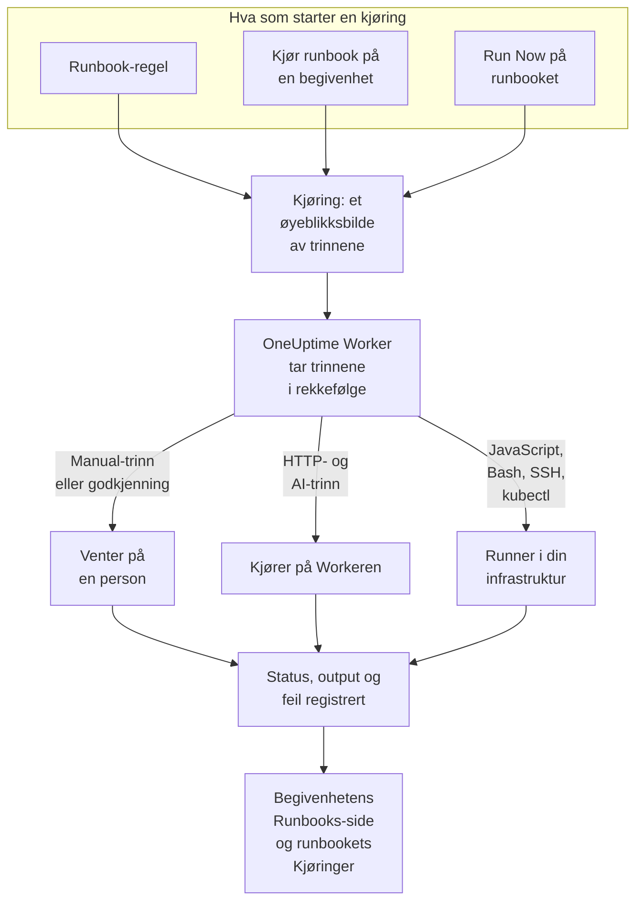

# Runbooks – Oversikt

Et runbook er en gjenbrukbar responsprosedyre: en ordnet liste med manuelle og automatiserte trinn som du kjører på en hendelse, et varsel eller en planlagt vedlikeholdshendelse. Det gjør tråden "hva gjør vi nå?" om til en sjekkliste som alle på vakt kan følge klokken 3 om natten, med skript, API-kall og godkjenninger allerede skrevet. Runbooks er for vakthavende ingeniører som håndterer hendelser, og for plattformteam som automatiserer den håndteringen.

:::cards
- [Skrive et runbook](/docs/runbooks/authoring): Opprett et runbook, og skriv trinnene.
- [Runbook-regler](/docs/runbooks/rules): Start runbooks ved nye hendelser, varsler og vedlikeholdshendelser.
- [Kjøre et runbook](/docs/runbooks/running): Start en kjøring, fullfør og godkjenn trinnene, avbryt den.
- [Runbook-utløsere](/docs/runbooks/triggers): Kjør et runbook etter en tidsplan, eller fra et annet verktøy via webhook-URL-en dets.
- [Runbook-variabler](/docs/runbooks/variables): Vertene, nøklene, passordene og kubeconfigene som trinnene dine bruker ved navn.
- [Runbook-agenter](/docs/runbooks/agents): Installer Runneren som kjører skriptene dine i din egen infrastruktur.
:::

## Slik kjører et runbook



Hver gang et runbook kjøres, opprettes en **kjøring**. Når den starter, kopieres runbookets trinn over på den, og OneUptime går gjennom dem i rekkefølge. Et Manual-trinn, eller et trinn som krever godkjenning, setter kjøringen på pause til noen handler.

HTTP- og AI-trinn kjører på OneUptime Worker. Bash-, SSH- og kubectl-trinn kjører på en [Runner](/docs/runbooks/agents) som du installerer i din egen infrastruktur, slik at disse skriptene aldri kjører på OneUptimes servere. Et JavaScript-trinn kjører også på en av dine Runnere eller, hvis det ikke velger noen og prosjektet ikke har noen [standard-Runner](/docs/runbooks/agents#prosjektets-standard-runner), på en [global Runner](/docs/runbooks/agents#globale-runnere), i en sandkasse som bare når internett. Hvert trinns status, output og feilmelding registreres på kjøringen, som blir liggende på hendelsen, varselet eller begivenheten den kjørte for.

## Sentrale begreper

| Begrep | Betydning |
| --- | --- |
| **Runbook** | Malen. En navngitt, gjenbrukbar prosedyre med en ordnet liste med trinn og en bryter **Kjør dette runbooket**. |
| **Trinn** | Ett punkt i et runbook. Det har en type (Manual, JavaScript, HTTP request, Bash, SSH, kubectl eller AI), en tittel, en beskrivelse og typespesifikke innstillinger. |
| **Runbook-regel** | En regel som automatisk knytter ett eller flere runbooks til hendelser, varsler eller planlagte vedlikeholdshendelser som oppfyller betingelsene: monitorene deres, alvorlighetsgrad, etiketter, monitoretiketter, tittel eller beskrivelse. |
| **Kjøring** | Én kjøring av et runbook. Opprettes når en regel utløses, når noen klikker **Kjør runbook** på en begivenhet, eller når noen klikker **Kjør nå** på selve runbooket. Den inneholder et øyeblikksbilde av trinnene og hvert trinns status og output. |
| **Øyeblikksbilde** | Den frosne kopien av runbookets trinn som ligger på hver kjøring. Du kan redigere runbooket senere uten å skrive om historikken for tidligere kjøringer. |
| **Runner** | En liten agent som du kjører på en vert i din egen infrastruktur. Den kjører JavaScript-, Bash-, SSH- og kubectl-trinnene som peker på den. Kalles også en runbook-agent. En global Runner, en av dem OneUptime kjører for alle prosjekter, kjører JavaScript-trinnene som ikke nevner noen, med mindre prosjektet har en standard-Runner. |
| **Variabel** | En verdi som trinn bruker ved navn, for eksempel en vert eller en URL: `{{global.variables.NAME}}` for en av prosjektets, som hver runbook kan bruke, eller `{{local.variables.NAME}}` for en av runbookens egne. |
| **Hemmelighet** | En variabel der verdien er kryptert i hvile, aldri vises igjen og skjules i det trinnene skriver ut, for eksempel en SSH-nøkkel, et passord, en kubeconfig eller et API-token. Bare utlevert til Runnerne du lar bruke den; globale Runnere får den bare hvis du lar dem. |

## Trinntyper

Velg typen som passer hvert trinn. [Skrive et runbook](/docs/runbooks/authoring) beskriver innstillingene for hver type.

| Trinntype | Kjører på | Bruk den når … | Eksempel |
| --- | --- | --- | --- |
| **Manual** | En person | Et menneske må kontrollere noe, gjøre en vurdering eller handle der OneUptime ikke kan. | "Bekreft at trafikken er flyttet til den sekundære regionen." |
| **JavaScript** | En Runner | Du trenger en liten, avgrenset beregning i en sandkasse. | Beregn replikaforsinkelsen, og avgjør om du skal fortsette. |
| **HTTP request** | OneUptime Worker | Du kaller et eksisterende API: en skyleverandør, PagerDuty, en Slack-webhook, din egen tjeneste. | `POST` til failover-orkestratoren din. |
| **Bash** | En Runner | Du trenger skallkommandoer på din egen infrastruktur. | Kjør et gjenopprettingsskript, eller kall med `curl` en tjeneste som bare nettverket ditt når. |
| **SSH** | En Runner | Du trenger et bash-skript på en ekstern maskin, logget på med en hemmelig variabel. | Start en tjeneste på nytt på en webserver. |
| **kubectl** | En Runner | Du trenger kubectl-kommandoer mot en klynge. | Start `checkout-api` på nytt i `production`, og vent så på de nye podene. |
| **AI** | OneUptime Worker | Du vil ha en analyse, et sammendrag eller en vurdering midt i kjøringen fra prosjektets LLM-leverandør. | "Gå gjennom diagnostikken ovenfor. Er det trygt å gjøre failover?" |

Et runbook kan blande alle sammen. Styrken ved runbooks er å flette menneskelige kontroller sammen med automatisering og AI-analyse.

## Hva som starter en kjøring

| Hvordan | Hvor | Kjøringen knyttes til |
| --- | --- | --- |
| En runbook-regel | **Hendelser**, **Varsler** eller **Planlagt vedlikehold** → **Regler** → **Runbook-regler** | Den nye hendelsen, varselet eller begivenheten |
| **Kjør runbook** | Siden **Runbooks** for en hendelse, et varsel eller en planlagt vedlikeholdshendelse | Den begivenheten |
| **Kjør nå** | Runbookets side **Oversikt** | Ingenting: en ad hoc-kjøring |
| En AI-regel | Se [AI SRE](/docs/ai/ai-sre) | Hendelsen eller varselet |
| Runbookets tidsplan | Runbookets side **Utløsere**, se [Runbook-utløsere](/docs/runbooks/triggers#kjør-etter-en-tidsplan) | Ingenting: en kjøring uten tilsyn |
| Et kall til runbookets webhook-URL | Runbookets side **Utløsere**, se [Runbook-utløsere](/docs/runbooks/triggers#kall-webhooken) | Ingenting: kjøringen tar vare på verdiene kallet sendte |

Et runbook der bryteren **Kjør dette runbooket** er slått av på siden **Innstillinger**, startes ikke av noen av disse. Kjøringer som allerede er startet, fortsetter.

## Hvor runbooks ligger i dashbordet

Runbooks ligger under **Produkter**, i gruppen **Dashbord og automatisering**.

| Side | Hva du gjør der |
| --- | --- |
| **Produkter → Runbooks** | Bla gjennom, opprett og åpne runbooks. |
| Et runbooks **Trinn** | Skriv og omorganiser trinnene, og velg deretter **Lagre trinn**. |
| Et runbooks **Oversikt** | Se den siste kjøringen og resultatene, og klikk **Kjør nå**. |
| Et runbooks **Kjøringer** | Alle kjøringer av dette runbooket, filtrert etter status eller startdato. |
| Et runbooks **Utløsere** | Kjør det etter en [tidsplan](/docs/runbooks/triggers#kjør-etter-en-tidsplan), eller fra et annet verktøy via [webhook-URL-en](/docs/runbooks/triggers#kall-webhooken) dets. |
| Et runbooks **Variabler** | Administrer [variablene](/docs/runbooks/variables) som bare det runbookets trinn bruker. |
| Et runbooks **Eiere** | Legg til personene og teamene som er ansvarlige for det. |
| Et runbooks **Innstillinger** | Slå av **Kjør dette runbooket** uten å slette runbooket. |
| **Runbooks → Kjøringer** | Alle kjøringer av alle runbooks i prosjektet. |
| **Runbooks → Runbook-agenter** | Installer [Runnerne](/docs/runbooks/agents) som runbook-trinnene dine kjører på. |
| **Runbooks → Innstillinger** | Administrer under **Globale variabler** variablene som hver runbook kan [bruke](/docs/runbooks/variables), samt **Eierregler** og **Etikettregler** som legger til eiere og etiketter på nye runbooks. |
| **Hendelser / Varsler / Planlagt vedlikehold → Regler → Runbook-regler** | Opprett reglene som starter runbooks automatisk. |
| En hendelse, et varsel eller en vedlikeholdshendelse → **Runbooks** | Se kjøringene som er knyttet til den, og klikk **Kjør runbook** for å starte en. |

Sidemenyen til et runbook grupperer sidene slik. Bare **Grunnleggende** er åpen fra start: klikk på tittelen til en seksjon for å åpne den. En seksjon åpnes av seg selv på enhver side i den.

| Seksjon | Sider |
| --- | --- |
| **Grunnleggende** | **Oversikt**, **Trinn** |
| **Logger** | **Kjøringer** |
| **Eiere** | **Eiere** |
| **Innstillinger** | **Utløsere**, **Variabler**, **Innstillinger** |
| **Utvikler** | **Terraform**, **API**, **AI-assistenter** |
| **Avansert** | **Revisjonslogger**, **Slett kjørebok** |

## Et gjennomgått eksempel

Anta at hver hendelse med "db-primary" i tittelen skal starte et runbook for database-failover med fem trinn.

:::steps
### Opprett runbooket

Under **Runbooks** klikker du **Opprett Runbook** og kaller det "DB primary failover". Det åpnes på **Trinn**: legg til disse trinnene, og klikk deretter **Lagre trinn**:

| # | Type | Tittel |
| --- | --- | --- |
| 1 | JavaScript | Registrer replikaforsinkelsen før failover |
| 2 | Manual | Bekreft i DBA-dashbordet at replikaen er frisk |
| 3 | HTTP request | `POST` til failover-orkestratoren |
| 4 | Manual | Kontroller at skrivinger går til den nye primære |
| 5 | HTTP request | Send avblåsningen til `#db-incidents` i Slack |

### Legg til en regel

Under **Hendelser → Regler → Runbook-regler** oppretter du en regel med én betingelse og runbooket som skal startes:

```text
Conditions:  Incident Title starts with db-primary
Runbooks:    [DB primary failover]
```

### La det kjøre

En monitor åpner hendelsen `INC-4821 · db-primary connection timeout`. Regelen treffer, og en kjøring starter:

- Trinn 1 (JavaScript) kjører på Runneren du valgte for det. Returverdien, for eksempel `{ lagMs: 412 }`, registreres. Et trinn som ikke velger noen Runner, kjører på prosjektets standard-Runner eller, hvis det ikke er angitt en, på en global Runner.
- Trinn 2 (Manual) setter kjøringen på pause, og den viser **Venter på deg**. Den vakthavende sjekker dashbordet og klikker **Marker som ferdig**.
- Trinn 3 (HTTP request) kjører, og svaret på `POST` registreres.
- Trinn 4 (Manual) setter kjøringen på pause igjen til noen fullfører det.
- Trinn 5 (HTTP request) kjører, og kjøringen er **Fullført**.

### Gå gjennom den

Kjøringen blir liggende på hendelsens side **Runbooks**. Når du skriver postmortem, er hvert trinns output, feil og tidsbruk ett klikk unna.
:::

## Vanlige bruksområder

- **Database-failover**: registrer tilstanden med JavaScript, be den vakthavende DBA-en bekrefte replikaens tilstand (Manual), kall orkestratoren (HTTP request), bekreft DNS (Manual), send avblåsningen (HTTP request).
- **Tømming av cache**: én HTTP-forespørsel, og deretter et Manual-trinn "bekreft at treffraten i cachen er på vei opp igjen".
- **Hendelse som rammer kunder**: Manual "publiser en oppdatering på statussiden", en HTTP-forespørsel for å varsle supportteamet, JavaScript for å hente listen over berørte kontoer.
- **Forhåndssjekk før planlagt vedlikehold**: ta et øyeblikksbilde av metrikker, bekreft endringsvinduet med interessentene (Manual), slå på vedlikeholdsmodus på lastbalansereren (HTTP request).
- **Diagnostiser, og rett deretter**: et Bash-trinn samler inn diagnostikk, et AI-trinn leser den og anbefaler en løsning, og et kubectl-trinn med **Krev godkjenning** starter arbeidsbelastningen på nytt først når en person har godkjent det.
- **Hygiene som alltid kjører**: en regel uten betingelser som registrerer systemets tilstand ved hver hendelse til postmortem.

## Slik passer runbooks inn i resten av OneUptime

- **Monitorer** åpner hendelser og varsler, og **runbook-regler** gjør dem om til runbook-kjøringer: oppdag, utløs, håndter, registrer.
- **[Vaktpolicyer](/docs/on-call/schedules)** avgjør hvem som blir tilkalt. Runbooks avgjør hva den personen gjør når hen er våken.
- **[Workspace-tilkoblinger](/docs/workspace-connections/slack)** som Slack og Microsoft Teams er naturlige mål for HTTP-forespørselstrinn som sender oppdateringer.
- **[Statussider](/docs/status-pages/index)** oppdateres ofte som et Manual-trinn i et kunderettet runbook.

## Neste steg

:::cards
- [Skrive et runbook](/docs/runbooks/authoring): Opprett ditt første runbook og trinnene i det.
- [Runbook-agenter](/docs/runbooks/agents): Installer en Runner før du skriver et Bash-, SSH- eller kubectl-trinn.
- [Runbook-regler](/docs/runbooks/rules): Start runbooks automatisk når det opprettes hendelser.
- [Runbook-konfigurasjon & sikkerhet](/docs/runbooks/configuration): Grenser, tidsavbrudd, tillatelser og herding.
:::
