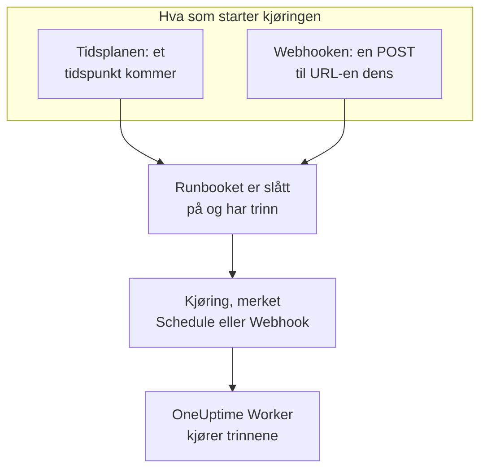

# Runbook-utløsere

Et runbook kan starte av seg selv: etter en tidsplan, eller når et annet verktøy kaller webhook-URL-en dets. Bruk en tidsplan til rutinearbeid, som en nattlig opprydding eller en ukentlig sjekk av sertifikater, og webhooken til å starte et runbook fra et varslingssystem, en CI-pipeline eller et skript. Begge settes opp på runbookets side **Utløsere**.

:::cards
- [Kjør etter en tidsplan](#kjør-etter-en-tidsplan): Med noen minutters mellomrom, hver dag, på valgte ukedager eller med et cron-uttrykk.
- [Kall webhooken](#kall-webhooken): Start en kjøring med en POST-forespørsel til runbookets URL.
- [Verdier et webhook-kall sender](#verdier-et-webhook-kall-sender): Hvordan trinnene leser JSON-en en kaller sender.
- [Feilsøking](#feilsøking): En tidsplan som ikke kjører, et kall som avvises.
:::

## Slik starter en utløser en kjøring



En utløser starter en kjøring slik **Kjør nå** gjør: kjøringen går gjennom runbookets nåværende trinn og er ikke knyttet til noen hendelse, noe varsel eller noen planlagt vedlikeholdshendelse. Hver kjøring registrerer hva som startet den. Runbookets **Kjøringer** og **Runbooks → Kjøringer** viser det under **Utløst av**, med når en planlagt kjøring skulle skje, eller adressen som kalte webhooken, og begge listene kan filtreres på det.

## Før du begynner

- Et runbook med minst ett trinn, der bryteren **Kjør dette runbooket** er slått på, på siden **Innstillinger**.
- Tillatelse til å redigere runbooket og til å kjøre det. Se [Hvem som kan sette opp utløsere](#hvem-som-kan-sette-opp-utløsere).

## Kjør etter en tidsplan

:::steps
### Åpne runbookets side Utløsere
Åpne runbooket fra **Runbooks**, og klikk på **Innstillinger → Utløsere** i sidemenyen. **Innstillinger** starter sammenslått: klikk på den for å vise **Utløsere**.

### Sett opp tidsplanen
Klikk på **Sett opp tidsplan**. Under **Når den kjører** velger du et alternativ under **Gjenta** og det det trenger. Dialogen sier tidsplanen i én setning, som "Kjører hver hverdag kl. 09:00", og viser de neste kjøringene mens du endrer den.

### Sjekk tidssonen
**Tidssone** starter med din egen. Tidsplanens tidspunkter leses på klokken i denne sonen.

### Lagre den
Klikk på **Lagre tidsplan**. Tidsplanen slås på, og kortet viser den i én setning med **Neste kjøringer**.
:::

| **Gjenta** | Hva du velger | For eksempel |
| --- | --- | --- |
| **Med noen minutters mellomrom** | **Hver**: 1, 2, 3, 4, 5, 6, 10, 12, 15, 20 eller 30 minutter | Hvert 15. minutt |
| **Med noen timers mellomrom** | **Hver**: 1, 2, 3, 4, 6, 8 eller 12 timer, og **Minutter over hel time** | Hver 2. time kl. :30 |
| **Hver dag** | **Klokkeslett** | Hver dag kl. 09:00 |
| **På valgte ukedager** | **På disse dagene**, med **Hverdager** og **Hver dag** som snarveier, og **Klokkeslett** | Hver hverdag kl. 09:00 |
| **Egendefinert (cron-uttrykk)** | **Cron-uttrykk** | `0 2 1 * *`: kl. 02:00 den 1. i hver måned |

Et cron-uttrykk har fem felt: minutt, time, dag i måneden, måned og ukedag. Runbooks kjører maks. én gang i minuttet, så det finnes ikke noe sekundfelt. Dialogen forklarer et uttrykk den ikke kan lese, eller et som aldri kjører, som `0 0 31 2 *`, og lagrer ingenting før det kan kjøre.

Kortet viser deretter tidsplanen, de tre neste kjøringene etter sonens klokke, hva den gjør når en kjøring fortsatt pågår eller et tidspunkt ble tapt, og **Siste planlagte kjøring** med **Se kjøring**. **Rediger tidsplan** åpner den samme dialogen, og bryteren **Kjør etter denne tidsplanen** setter tidsplanen på pause uten å miste den.

### Hvis en kjøring fortsatt pågår

En kjøring pågår fortsatt så lenge den står i kø, kjører eller venter på at noen fullfører eller godkjenner et trinn, uansett hvordan den ble startet. Tidsplanens innstilling **Hvis en kjøring fortsatt pågår**, foldet inn under **Flere felt** i dialogen, avgjør hva et tidspunkt som kommer da, gjør:

| Innstilling | Hva som skjer |
| --- | --- |
| **Hopp over det tidspunktet** (standard) | Ingenting starter. Tidsplanen venter på neste tidspunkt. |
| **Kjør når den er ferdig** | Én kjøring venter og starter når den pågående kjøringen er ferdig. Flere tidspunkter som kommer i mellomtiden, starter ingenting. |

### Hvis OneUptime gikk glipp av et tidspunkt

Hvis OneUptime var nede eller ble oppgradert på et planlagt tidspunkt, er tidspunktet tapt så snart det er mer enn 5 minutter forsinket. **Hvis OneUptime gikk glipp av et tidspunkt** avgjør hva som skjer når OneUptime er tilbake:

| Innstilling | Hva som skjer |
| --- | --- |
| **Kjør én gang når OneUptime er tilbake** (standard) | Én kjøring starter, uansett hvor mange tidspunkter som ble tapt, merket "Kjørt én gang for å ta igjen tidspunkter OneUptime gikk glipp av". |
| **Hopp over de tapte tidspunktene** | Ingenting starter før neste tidspunkt. |

Tidspunkter som går mens tidsplanen eller runbooket er slått av, er ikke tapt: slår du en av dem på igjen, fortsetter den fra neste tidspunkt.

### Tidssoner og sommertid

Tidspunktene leses hele året på sonens klokke. En tidsplan for kl. 09:00 i Europe/London kjører kl. 09:00 London-tid både vinter og sommer. Natten klokkene stilles frem, kjører et tidspunkt som ikke finnes den natten, en time senere på klokken. Når klokkene stilles tilbake og en time kommer to ganger, kjører en tidsplan som kjører hver time, i begge, og alle andre tidsplaner kjører én gang, i den første.

## Kall webhooken

:::steps
### Slå på webhooken
Slå på **Kjør når denne URL-en kalles** på runbookets side **Utløsere**. Runbooket får sin egen URL.

### Kopier URL-en
**Webhook-URL** er maskert: klikk på **Vis** for å se den, eller på **Kopier URL** for å kopiere hele. **Prøv det** har en `curl`-kommando å starte med.

### Kall den fra verktøyet ditt
Send en `POST`-forespørsel til URL-en, med et JSON-objekt som innhold, eller uten innhold:

```bash
curl -X POST "https://oneuptime.com/runbook/webhook/RUNBOOK_ID/SECRET_KEY" \
  -H "Content-Type: application/json" \
  -d '{"host": "web-1", "reason": "Disk almost full"}'
```

### Sjekk kjøringen
Svaret navngir kjøringen det startet: `{"runbookExecutionId": "...", "status": "Scheduled"}`. Kjøringen står under runbookets **Kjøringer**, der **Utløst av** sier **Webhook**, og siden dens viser under **Inndata** hva kallet sendte.
:::

**Send testforespørsel** sender en `POST` med et innhold du skriver, til URL-en, slik et annet verktøy ville gjort, og lenker til kjøringen den startet. Det er en ekte kjøring av runbooket.

### Hva et kall får som svar

| Svar | Når |
| --- | --- |
| `200` | Kjøringen ble startet. Innholdet navngir den. |
| `400` | Innholdet er ikke et JSON-objekt, er nestet mer enn 32 nivåer dypt eller inneholder et NUL-tegn, eller runbooket har ingen trinn. |
| `403` | Webhooken eller runbooket er slått av. |
| `404` | Ingen runbook-webhook svarer på denne URL-en: runbook-ID-en eller nøkkelen er feil, eller URL-en ble tilbakestilt. |
| `405` | Forespørselen er en `GET`. En `GET` starter aldri en kjøring, så en forhåndsvisning av en lenke i en chatteapp kan ikke kjøre den ved et uhell. |
| `413` | Innholdet er større enn 64 KB. |
| `429` | Webhooken startet 30 kjøringer det siste minuttet, 10 av kjøringene dens pågår fortsatt, eller én adresse gjorde mer enn 120 kall til runbook-webhooks i løpet av et minutt, eller adressene i ett IPv6-/64 til sammen mer enn 1200. Headeren `Retry-After` sier når du kan prøve igjen, der det er mulig. |
| `503` | OneUptime kan ikke telle kall akkurat nå. Prøv igjen om et minutt. |

Et avvist kall starter ingenting, og innholdet sier hvorfor i én setning, som "This runbook is turned off, so it was not started. Turn it on with Run this runbook, under the runbook's Settings."

### Hold URL-en hemmelig

URL-en inneholder runbookets hemmelige nøkkel: alle som har den, kan starte runbooket. Nøkkelen er 43 tilfeldige tegn, sammenlignes i konstant tid, og en feil nøkkel får samme svar som om det ikke fantes noe slikt runbook.

Hvis URL-en lekker, klikker du på **Tilbakestill URL**. Runbooket får en ny URL, og den gamle slutter å virke med en gang, så gi den nye til hvert verktøy som kaller den. Slår du webhooken av og på igjen, beholdes den samme URL-en.

## Verdier et webhook-kall sender

Innholdets verdier på øverste nivå blir kjøringens inndata. De når trinnene som data, aldri som tekst limt inn i et skript eller en kommando:

| Trinntype | Hvordan den leser inndataene |
| --- | --- |
| Bash og kubectl | Miljøvariabler: én `ONEUPTIME_INPUT_<NAME>` for hver verdi på øverste nivå, `ONEUPTIME_INPUTS` med hele objektet som JSON og `ONEUPTIME_TRIGGER` med det som startet kjøringen, som `Webhook` eller `Schedule`. |
| JavaScript | `args.inputs`, objektet slik det ble sendt, og `args.trigger`. |
| AI | I prompten, merket som data utenfra OneUptime, når **Ta med utløserkontekst** er slått på. |
| HTTP request og SSH | Ikke i det hele tatt. URL-en, skriptet og målet deres er det runbooket sier, og ingenting en kaller sender, endrer dem. |

Navnet på en variabel er verdiens navn med store bokstaver, der hvert tegn som ikke er en bokstav eller et siffer, skrives som `_`: `host-name` blir `ONEUPTIME_INPUT_HOST_NAME`. Tekst sendes som den er, tall og `true` eller `false` slik de er skrevet, og objekter og lister som JSON. Et trinn får maks. 100 av disse variablene, og et navn på mer enn 100 tegn blir ingen; hver verdi står fortsatt i `ONEUPTIME_INPUTS`. Hvert navn begynner med `ONEUPTIME_`, så en kaller kan ikke sette `PATH` eller noen annen variabel som Runneren leser.

En kaller bestemmer disse verdiene, så sjekk dem før du handler på dem:

```bash
set -euo pipefail
case "$ONEUPTIME_INPUT_HOST" in
  web-1|web-2|web-3) ;;
  *) echo "Unknown host: $ONEUPTIME_INPUT_HOST"; exit 1 ;;
esac
curl -fsS -X POST "http://$ONEUPTIME_INPUT_HOST.internal:8080/restart"
```

```javascript
const host = args.inputs.host;
if (!["web-1", "web-2", "web-3"].includes(host)) {
  throw new Error(`Unknown host: ${host}`);
}
console.log(`Started by ${args.trigger} for ${host}`);
return { host };
```

## Hvem som kan sette opp utløsere

En tidsplan eller en webhook starter kjøringer uten at noen er til stede, så å sette opp en krever tillatelse til å redigere runbooket og til å kjøre det: Project Owner, Project Admin eller Runbook Admin, eller **Edit Runbook** sammen med Project Member, Runbook Member eller **Create Runbook Execution**. Etikettene en rolle er begrenset til, teller, slik de gjør for **Kjør nå**. Å se eller tilbakestille webhook-URL-en krever det samme.

Å slå av en tidsplan eller en webhook starter ingenting, så det krever bare tillatelse til å redigere runbooket. Den som kan redigere runbooket, men ikke kjøre det, ser siden **Utløsere** med **Sett opp tidsplan** låst, og får vite hvem som kan se webhook-URL-en.

## Feilsøking

:::details Ingenting kjører etter tidsplanen
Runbooket er slått av eller har ingen trinn: kortet sier hvilket. Slå på **Kjør dette runbooket** på runbookets side **Innstillinger**, eller legg til trinn på siden **Trinn**. Hvis kortet sier at tidsplanen er satt på pause, slår du på **Kjør etter denne tidsplanen**.
:::

:::details Et planlagt tidspunkt startet ingenting
En kjøring pågikk fortsatt, og tidsplanen hopper over slike tidspunkter, eller OneUptime gikk glipp av tidspunktet, og tidsplanen hopper over tapte tidspunkter. Se [Hvis en kjøring fortsatt pågår](#hvis-en-kjøring-fortsatt-pågår) og [Hvis OneUptime gikk glipp av et tidspunkt](#hvis-oneuptime-gikk-glipp-av-et-tidspunkt).
:::

:::details Å lagre en tidsplan feiler med "You do not have permission to set up this runbook's schedule or webhook."
Å sette opp en utløser krever tillatelse til å kjøre runbooket i tillegg til å redigere det. Be om Runbook Admin, eller om Runbook Member eller **Create Runbook Execution** i tillegg til **Edit Runbook**.
:::

:::details Et kall får svaret "No runbook webhook answers at this URL."
URL-en ble tilbakestilt eller kopiert feil. Kopier den på nytt fra runbookets side **Utløsere**.
:::

:::details Et kall får svaret "This runbook's webhook is turned off, so the runbook was not started."
Slå på **Kjør når denne URL-en kalles** på runbookets side **Utløsere**. URL-en er den samme som før.
:::

## Neste steg

:::cards
- [Kjøre et runbook](/docs/runbooks/running): Hva en kjøring viser, og hvordan du får den videre.
- [Skrive et runbook](/docs/runbooks/authoring): Skriv trinnene en utløser kjører.
- [Runbook-konfigurasjon & sikkerhet](/docs/runbooks/configuration): Grenser, tillatelser og herding.
:::
