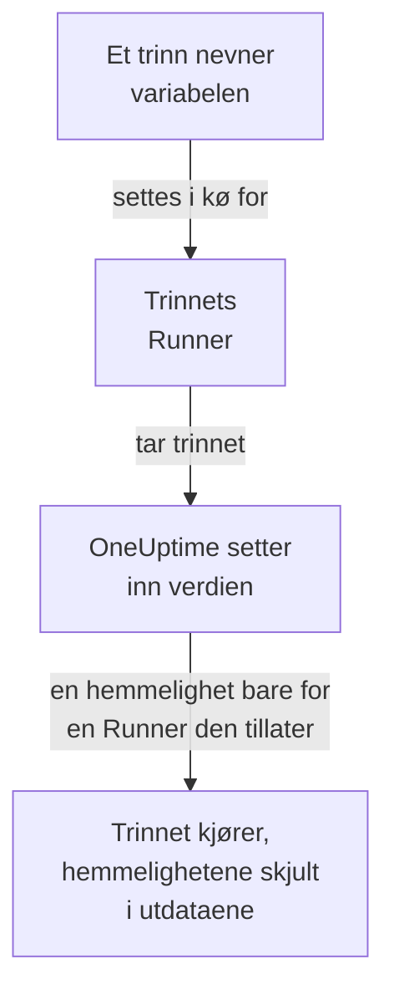

# Runbook-variabler

En runbook-variabel er en verdi som trinnene dine bruker ved navn i stedet for å holde den selv: en vert, et namespace eller en URL, eller en hemmelighet som en SSH-nøkkel, et passord, en kubeconfig eller et API-token. Endre verdien én gang, og hvert trinn som nevner den, bruker den nye neste gang det kjører. En hemmelighet er kryptert, vises aldri igjen og skjules i det trinnene skriver ut.

:::cards
- [Opprett en variabel](#opprett-en-variabel): En vanlig verdi, eller en hemmelighet og Runnerne som kan bruke den.
- [Bruk en variabel i et trinn](#bruk-en-variabel-i-et-trinn): I et skript eller en HTTP-forespørsel, eller som innloggingen til et SSH-trinn og kubeconfigen til et kubectl-trinn.
- [Hvem mottar en hemmelighet](#hvem-mottar-en-hemmelighet): Runnerne dine, globale Runnere når du lar dem, og OneUptime for et HTTP-forespørselstrinn.
:::

## Slik når en variabel et trinn



Et trinn holder variabelens navn, aldri verdien. Når trinnets Runner tar det, setter OneUptime inn verdien - i skriptet, i maskinen og innloggingen til et SSH-trinn, eller i kubeconfigen til et kubectl-trinn - og gir den bare til den Runneren. Et trinn som nevner en variabel det ikke får ha, feiler med årsaken i stedet for å kjøre med navnet der verdien skulle stått.

Bash-, JavaScript-, SSH-, kubectl- og HTTP-forespørselstrinn bruker variabler. AI-trinn setter dem ikke inn. Et HTTP-forespørselstrinn sender OneUptime selv, uten en Runner, så trinnet får hver variabel det nevner, også hemmeligheter, og skjuler dem i svaret det registrerer.

## Globale variabler og runbook-variabler

| | Globale variabler | Et runbooks egne variabler |
| --- | --- | --- |
| Administreres under | **Runbooks → Innstillinger → Globale variabler** | Runbookens **Innstillinger → Variabler** |
| Brukes av | Hver runbook i prosjektet | Bare den runbookens trinn |
| Skrives i et trinn som | `{{global.variables.NAME}}` | `{{local.variables.NAME}}` |

Et navn brukes én gang, uavhengig av store og små bokstaver, blant prosjektets globale variabler, og én gang blant en runbooks egne. En runbooks variabel kan dele navn med en global: hver skrives på sin egen måte.

## Før du begynner

- **En rolle som administrerer variabler.** Project Owner og Project Admin, eller tillatelsen **Create Runbook Variable**. Runbook Admin leser variabler for å velge dem i trinnene den skriver, men endrer dem ikke.
- **Et abonnement som inkluderer dem.** På OneUptime Cloud krever runbook-variabler abonnementet **Growth** eller høyere.

## Opprett en variabel

:::steps
### Åpne variablene

Åpne **Runbooks → Innstillinger → Globale variabler**, eller en runbooks **Innstillinger → Variabler**, og klikk på **Opprett Variabel**.

### Gi den et navn og skriv inn verdien

Skriv inn et **Navn** i trinnet **Variabel**: bokstaver, tall, bindestreker og understreker, opptil 100 tegn, for eksempel `PROD_DB_SSH_KEY`. **Hemmelighet** er slått på fra start: lim inn nøkkelen, passordet, tokenet eller kubeconfigen i **Verdi for hemmelighet**, og klikk på **Neste**. For en verdi alle kan lese, som en vert, slår du av **Hemmelighet**, skriver den inn i **Verdi** og klikker på **Opprett Variabel**. En valgfri **Beskrivelse** venter under **Flere felt**.

### Velg hvem som kan bruke en hemmelighet

Velg Runnerne dine under **Runnerne dine som kan bruke den** i trinnet **Hvem kan bruke den**. På en server med [globale Runnere](/docs/runbooks/agents#globale-runnere) lar **Globale Runnere kan bruke den** også dette prosjektets trinn som kjører på en global Runner, bruke hemmeligheten: den er slått på fra start så lenge prosjektet bruker globale Runnere. En hemmelighet trenger det ene eller det andre. Klikk på **Opprett Variabel**.
:::

Om en variabel er en hemmelighet, kan ikke endres senere. Slett den i stedet og opprett den på nytt med samme navn: trinn nevner variabler ved navn, så de fortsetter å virke. En klynges Runner i klyngen, den som Kubernetes-agentens chart installerer, får aldri en hemmelighet.

## Hemmelige verdier kan bare skrives

En hemmelighets verdi er kryptert i hvile, og API-et **returnerer den aldri**: verken til dashbordet, til en arbeidsflyt eller til en eksport. Listen viser **Hemmelighet** der en vanlig variabel viser verdien, og kolonnen **Runbook-agenter** viser hvilke Runnere som får hver hemmelighet. For å endre den klikker du på **Erstatt verdi** i raden: den nye verdien krypteres, den gamle er borte for godt, og trinnene får den nye neste gang de kjører.

Når et trinn skriver ut en hemmelighet det har fått, erstatter Runneren den med `[REDACTED]` før utdataene forlater verten, og OneUptime gjør det igjen før utdataene lagres. En linje av en privat nøkkel, eller tokenet i en kubeconfig, skjules også. Det søkes ikke etter en hemmelighet på under 4 tegn.

## Bruk en variabel i et trinn

:::tabs
@tab I et skript
Skriv referansen der verdien skal stå, i et Bash-, JavaScript-, SSH- eller kubectl-skript:

```bash
curl -s -X POST \
  -H "Authorization: Bearer {{global.variables.CDN_API_TOKEN}}" \
  "https://api.cdn.example.com/v1/purge"
```
@tab I en HTTP-forespørsel
Skriv referansen i URL-en, headerne eller bodyen til et [HTTP-forespørselstrinn](/docs/runbooks/authoring#http-request):

```json
{ "Authorization": "Bearer {{global.variables.API_TOKEN}}" }
```
@tab SSH-innlogging
Et [SSH-trinn](/docs/runbooks/authoring#ssh) velger under **Logg på med** den hemmelige variabelen som holder den private nøkkelen eller passordet, og under **Flere felt → Passordfrase for nøkkelen** passordfrasen til nøkkelen. Verdien viser om det er en nøkkel eller et passord.
@tab Kubeconfig
Et [kubectl-trinn](/docs/runbooks/authoring#kubectl) velger under **Kubeconfig** den hemmelige variabelen som holder klyngens kubeconfig, eller **Runnerens egen tilgang** for å bruke Runnerens.
:::

På en runbooks side **Trinn** viser hvert skript og hver HTTP-forespørsel under **Variabler – klikk for å kopiere** variablene trinnet kan bruke, og redigeringsprogrammet sier fra når et trinn nevner en variabel som ikke finnes, eller en hemmelighet som Runneren ikke får bruke.

## Hvem mottar en hemmelighet

| Hvem som kjører trinnet | En vanlig variabel | En hemmelighet |
| --- | --- | --- |
| En av Runnerne dine | Alltid | Når hemmeligheten viser den under **Runnerne dine som kan bruke den** |
| En global Runner | Alltid | Når **Globale Runnere kan bruke den** er slått på, for et trinn i hemmelighetens eget prosjekt |
| OneUptime selv, for et HTTP-forespørselstrinn | Alltid | Alltid |

Et trinn som nevner en hemmelighet som Runneren ikke får bruke, feiler med navnet på hemmeligheten og det som må endres, og ingenting utleveres.

## Runbook-hemmeligheter og påloggingsinformasjon ble variabler

Runbook-variabler tok plassen til runbook-hemmeligheter og til påloggingsinformasjonen som SSH- og Kubernetes-trinn nevnte. Da OneUptime ble oppgradert, ble det hvert prosjekt hadde, flyttet én gang, slik at hver runbook kjører som før:

- hver runbook-hemmelighet ble en hemmelig global variabel med samme navn, samme verdi, samme Runnere og samme bryter for globale Runnere;
- `{{runbookSecrets.NAME}}` i et skript ble skrevet om til `{{global.variables.NAME}}`, og den gamle skrivemåten leser fortsatt den globale variabelen `NAME`;
- all påloggingsinformasjon et trinn nevnte, ble hemmelige globale variabler med samme Runnere, oppkalt etter den: `<name>-ssh-key` (og `<name>-ssh-key-passphrase`, for en nøkkel som hadde en), `<name>-ssh-password` eller `<name>-kubeconfig`;
- hvert SSH-trinn som nevnte påloggingsinformasjon, logger på maskinen sin med dem og kjører kommandoen sin som skriptet, og hvert Kubernetes-trinn ble et kubectl-trinn som kjører den `kubectl patch` handlingen gjorde, uten å trenge mer tilgang enn trinnet hadde.

En Runner som er eldre enn denne utgivelsen (14.0.79), kan ikke kjøre et kubectl-skript: den får et kubectl-trinn til å feile og sier at Runneren må oppdateres. Hvert Kubernetes-trinn som ble flyttet slik, beholdt først påloggingsinformasjonen og handlingen sin ved siden av skriptet for en slik Runner; de forsvant med runbook-påloggingsinformasjonen, så hvert kubectl-trinn trenger en Runner fra 14.0.79 eller nyere.

Runbook-påloggingsinformasjon er siden fjernet, og et trinn som fortsatt nevnte påloggingsinformasjon, ble først flyttet på samme måte. Et trinn som nevner påloggingsinformasjon, kjører ikke lenger, og siden med trinn tilbyr **Gjør om til et skripttrinn**; en lagring gjennom API-et eller Terraform som gir et trinn påloggingsinformasjon, avvises. Se [Runbook-påloggingsinformasjon er fjernet](/docs/installation/upgrading#runbook-påloggingsinformasjon-er-fjernet).

## Neste trinn

:::cards
- [Skriv en runbook](/docs/runbooks/authoring): Skriv SSH- og kubectl-trinnene som bruker en variabel.
- [Runbook-agenter](/docs/runbooks/agents): Installer Runneren en hemmelighet gis til.
- [Runbook-konfigurasjon og sikkerhet](/docs/runbooks/configuration): Tillatelser og herding for hele runbook-stakken.
:::
