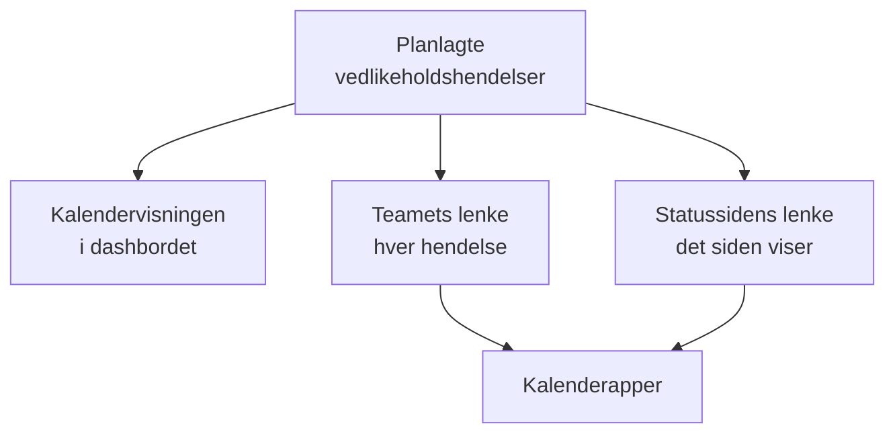

# Vedlikeholdskalender

Vedlikeholdskalenderen viser det planlagte vedlikeholdet ditt etter dato: på en egen side i dashbordet, i teamets egne kalenderapper via en hemmelig lenke og i kalenderne til dem som følger statussidene dine. På siden dens kan kalendere utenfor prosjektet, som helligdager eller et endringsstopp, vises ved siden av hendelsene dine. Denne siden forklarer kalendersiden, eksterne kalendere, teamets kalenderlenke, kalenderen til en statusside og hva hver kalenderhendelse inneholder.

:::cards
- [Kalendersiden](#kalendersiden): Hver hendelse på en måned, en uke eller en dag, i fargen til tilstanden sin.
- [Eksterne kalendere](#eksterne-kalendere): Helligdager, endringsstopp eller vedlikeholdet til et annet team, ved siden av hendelsene dine.
- [Teamets kalenderlenke](#teamets-kalenderlenke): Hver hendelse i prosjektet i Google Kalender, Outlook eller Apple Kalender.
- [Kalenderen til en statusside](#kalenderen-til-en-statusside): Det en statusside viser, i kalenderne til de besøkende.
- [Hva en kalenderhendelse inneholder](#hva-en-kalenderhendelse-inneholder): Tittelen, tidsrommet, tilstanden og en lenke tilbake.
:::



## Kalendersiden

Åpne **Planlagt vedlikehold → Vedlikeholdskalender** i delen **Kalender** i sidemenyen. **Alle hendelser** viser de samme hendelsene som en liste.

- Kalenderen åpner på denne måneden, med dagen i dag markert. **Måned**, **Uke** og **Dag** endrer hvor mye den viser; bla med pilene, og gå tilbake med **I dag**. Tidene står i din egen tidssone.
- Hver hendelse er en blokk i fargen til tilstanden sin, og fargene til tilstandene er navngitt under kalenderen. Klikk på en hendelse for å åpne den.
- Filtrene over kalenderen virker som på listen: velg en tilstand, en etikett eller en eier for å se bare de hendelsene.
- En dag som ennå ikke har kommet, viser et **+** når du peker på uken dens. Det åpner **Opprett planlagt vedlikeholdshendelse** med **Begynner den** på den dagen, i den timen skjemaet ville valgt i dag. Du ser det bare hvis du kan opprette hendelser.
- En visning viser opptil 500 hendelser. En travlere måned sier ifra: snevre den inn med filtrene, eller se på en uke.

**Alle hendelser** byttet tidligere mellom en liste og en kalender. Hvis nettleseren din sist lot den stå på kalenderen, åpner **Alle hendelser** **Vedlikeholdskalender** én gang og er listen fra da av.

## Eksterne kalendere

Kalendersiden kan også vise hendelsene fra kalendere utenfor prosjektet: helligdager, et endringsstopp som bedriften din fører i en annen kalender, eller vedlikeholdet til et annet team. OneUptime leser hver av dem fra iCalendar-lenken (`.ics`) og tegner hendelsene ved siden av dine, lysere og i kalenderens egen farge. De er skrivebeskyttet: de blir aldri vedlikeholdshendelser, ingen varsles om dem, og de vises aldri i prosjektets egne kalenderlenker.

:::steps
### Legg til kalenderen

Velg **Legg til ekstern kalender** i kalenderens **⋯**-meny, eller åpne **Planlagt vedlikehold → Kalenderinnstillinger** i delen **Innstillinger** i sidemenyen, og klikk på **Legg til ekstern kalender**. Fyll ut **Navn**, og lim inn lenken i **Kalenderlenke**. **Flere felt** har **Farge** og **Oppdater**, hvor ofte den leses: **Hver time** med mindre du velger noe annet.

### Sjekk at den ble lest

OneUptime leser en ny kalender med en gang. **Status** sier **Fungerer** når den er lest, og **Sist lest** sier når, og hvor mange hendelser den beholdt. En lesing som mislyktes, sier **Fungerer ikke**, med årsaken og hva du skal gjøre.

### Vis eller skjul den

Hver ekstern kalender har en bryter med navnet sitt under kalenderen. Skjuler du en, skjules den bare for deg; nettleseren husker valget for prosjektet.
:::

Kopier lenken fra kalenderens egne delingsinnstillinger: i Google Kalender den hemmelige adressen i iCal-format, i Outlook ICS-lenken til en publisert kalender, i alle andre apper `.ics`- eller `webcal://`-lenken. Lenken kan være privat: OneUptime lagrer den kryptert, viser den aldri igjen, og **Endre lenke** erstatter den.

| Handling | Hva som skjer |
| --- | --- |
| **Les nå** | Leser kalenderen nå i stedet for ved neste lesing. |
| **Endre lenke** | Erstatter lenken. Hendelsene fra den gamle lenken glemmes, og den nye leses med en gang. |
| **Slå av** | Slutter å lese den og skjuler hendelsene for alle, til **Slå på**. |

Hver kalender beholder hendelsene sine fra 90 dager tilbake til ett år frem, opptil 2 000 av dem, de nærmeste i dag først. En kalender større enn 5 MB leses ikke. Gjentakende hendelser, unntakene deres og tidssonene deres leses slik kalenderappen skrev dem, og en heldagshendelse blir stående på datoen sin i alle tidssoner. Et prosjekt kan ha opptil 20 eksterne kalendere, og én visning av kalenderen tegner opptil 500 av hendelsene deres.

Rollene som oppretter, redigerer og sletter planlagte vedlikeholdshendelser, legger til, endrer og fjerner eksterne kalendere, og alle som kan lese hendelsene, ser dem i kalenderen. OneUptime leser aldri en adresse på sin egen server eller en metadataadresse i skyen, og OneUptime Cloud avviser adresser på et privat nettverk. En selvhostet server kan lese en kalender på ditt eget nettverk, med mindre `DATA_SOURCE_BLOCK_PRIVATE_ADDRESSES` er `true`.

## Teamets kalenderlenke

**Abonner på kalender**, under kalenderen, åpner prosjektets kalenderlenke: én hemmelig iCalendar-lenke (`.ics`) som legger hver planlagte vedlikeholdshendelse i prosjektet inn i Google Kalender, Outlook, Apple Kalender eller hvilken som helst app som abonnerer på en kalender via en URL.

:::steps
### Publiser lenken

Klikk på **Publiser lenke**. Et prosjekt har én lenke for hele teamet, så dette trengs bare én gang.

### Legg den til i kalenderappen din

**Google Kalender** åpner Google Kalender, som spør om kalenderen skal legges til. **Apple Kalender / Outlook** åpner lenken i kalenderappen på datamaskinen eller telefonen din. **Kopier lenke** kopierer den til en hvilken som helst annen app.

### Sjekk at det virker

Panelet **Status** sier når en kalenderapp sist leste lenken, og hvilken. En ny lenke viser **Venter på første synkronisering** til en app leser den.
:::

Lenken ser slik ut:

```text
https://<your host>/api/scheduled-maintenance-calendar/project/<token>/maintenance.ics
```

> [!WARNING]
> Alle som har lenken, ser hver planlagte vedlikeholdshendelse i prosjektet uten å logge inn. Behandle den som et passord, og generer den på nytt hvis den blir delt ved en feil.

### Hvem som kan se lenken

Lenken viser hver hendelse i prosjektet, så dialogen viser den bare til personer som kan lese hver hendelse. Den som har en rolle som begrenser dem til noen hendelser, etter etikett eller til hendelsene de eier, får i stedet vite hvorfor.

| Handling | Hvem som kan gjøre det |
| --- | --- |
| Kopiere lenken | Alle som kan lese hver planlagte vedlikeholdshendelse i prosjektet |
| **Publiser lenke** | Alle som også kan opprette planlagte vedlikeholdshendelser |
| **Generer lenke på nytt**, **Deaktiver lenke** | Alle som også kan redigere planlagte vedlikeholdshendelser |

### Administrer lenken

**Generer lenke på nytt** og **Deaktiver lenke** ligger i menyen **⋯** øverst i dialogen.

| Handling | Hva som skjer |
| --- | --- |
| **Generer lenke på nytt** | Lager en ny lenke. I 30 dager leverer den gamle en tom kalender, så appene som har den, tømmer kopien sin; deretter finnes den ikke. Abonner på nytt med den nye lenken. |
| **Deaktiver lenke** | Beholder lenken, men den leverer en tom kalender frem til **Aktiver lenke**. |

Kalenderen inneholder hver hendelse fra 90 dager tilbake til ett år frem, opptil 1 000 hendelser.

## Kalenderen til en statusside

De som følger en statusside, kan legge det planlagte vedlikeholdet inn i sin egen kalender. På statussidens side for planlagte hendelser tilbyr **Abonner på kalender** Google Kalender, kalenderappen på enheten deres eller lenken til å kopiere. Lenken er sidens adresse etterfulgt av `/maintenance.ics`, for eksempel `https://status.example.com/maintenance.ics`.

- **Hva den inneholder.** Nøyaktig det siden viser: hendelsene i sidens historikkvindu, hver hendelse som ennå ikke har startet, og hver som pågår, så lenge **Synlig på statussiden** er slått på, og fra **Publiser den** for den hvis du har valgt et. Det hver hendelse berører, navngis slik siden navngir ressursene sine, aldri med monitorenes egne navn.
- **En privat side.** En kalenderapp kan ikke logge inn, så en privat side tilbyr ingen **Abonner på kalender**, og lenken leverer en tom kalender som sier at siden er privat.
- **Én hendelse.** **Legg til i kalender** på en hendelses side legger bare til den hendelsen: Google Kalender åpnes med den utfylt, eller den lastes ned som en fil som enhetens kalenderapp åpner. Det virker også på en privat side for en besøkende som har logget inn, og tilbys ikke når hendelsen er over.

## Hva en kalenderhendelse inneholder

Hver kalender, teamets og en statussides, skriver en hendelse på samme måte.

| Del | Hva den inneholder |
| --- | --- |
| Tittel | Hendelsens tittel |
| Start og slutt | Det planlagte tidsrommet i UTC; kalenderappen viser det i din egen tidssone |
| Beskrivelse | Beskrivelsen som ren tekst, tilstanden, hva den berører og en lenke til hendelsen; teamets lenke navngir også statussidene |
| Status | Avlyst når hendelsen ble avlyst: fullført uten noen gang å ha pågått |
| Ledig eller opptatt | Ledig, så et vedlikeholdsvindu aldri blokkerer tilgjengeligheten din |
| Kategorier | Etikettene; kalenderen til en statusside viser dem bare når siden viser etiketter |

En hendelse som redigeres i OneUptime, oppdateres på stedet i hver kalender som har den, og en som slettes eller tas av en statusside, forsvinner fra kalenderen ved neste oppdatering.

## Hvor ofte kalendere oppdateres

Kalenderapper leser en abonnert lenke etter sin egen tidsplan. Google Kalender gjør det med noen timers mellomrom, noen ganger bare én gang om dagen; Apple Kalender og Outlook som regel hver time. OneUptime tar vare på en kalender i høyst fem minutter, så ventetiden du ser, er kalenderappens. Stegene for hver app står på [Kalenderfeeder](/docs/on-call/calendar-feeds#abonner-i-kalenderappen-din), som fungerer på samme måte for vakter.

## Feilsøking

:::details Kalenderappen viser ikke lenger nye hendelser
Lenken er generert på nytt eller deaktivert: åpne **Abonner på kalender** for å se statusen. En lenke som er generert på nytt, må abonneres på igjen med den nye lenken; en deaktivert lenke kommer tilbake med **Aktiver lenke**.
:::

:::details Google Kalender kan ikke legge til lenken
Google Kalender leser lenken fra Googles servere, så OneUptime-serveren må kunne nås fra internett. Se [Kalenderfeeder](/docs/on-call/calendar-feeds#feilsøking) for en server du drifter selv.
:::

:::details En hendelse mangler i kalenderen til en statusside
Sidens kalender inneholder det siden viser. Sjekk at hendelsen navngir siden, at **Synlig på statussiden** er slått på i **Innstillinger**, at **Publiser den** for den, hvis den har et, er nådd, og at den startet innenfor sidens historikkvindu.
:::

:::details En ekstern kalender sier Fungerer ikke
Årsaken står under **Fungerer ikke** i **Status**: ingen kalender på lenken, en lenke som krever pålogging eller ikke lenger deles, en feil fra serveren, en kalender større enn 5 MB, eller en som gjentar hendelser for ofte til å kunne behandles. Rett lenken med **Endre lenke**, eller bruk **Les nå** når kalenderen er tilbake. Til da viser kalenderen hendelsene fra siste vellykkede lesing.
:::

## Neste steg

:::cards
- [Opprett vedlikeholdshendelser](/docs/scheduled-maintenance/creating-events): Skjemaet, felt for felt, og hva som skjer etterpå.
- [Abonnenter og kunngjøringer](/docs/status-pages/subscribers#planlagte-vedlikeholdshendelser): Hva abonnentene til en statusside får vite om vedlikehold.
- [Kalenderfeeder](/docs/on-call/calendar-feeds): Samme slags lenke for vakter.
:::
