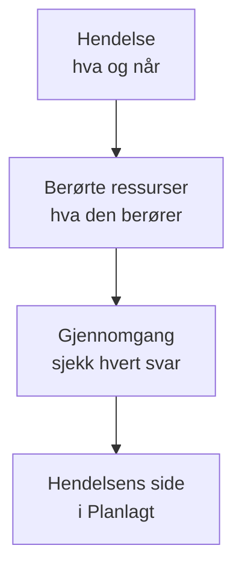

# Opprett vedlikeholdshendelser

Planlegg vedlikehold i to korte trinn: si hva som skjer og når, og deretter hva det berører og hvem som skal få høre om det. Bare tittelen må skrives inn; alt annet starter med en fornuftig standardverdi. Denne siden går gjennom skjemaet, hva som skjer i det øyeblikket du oppretter en hendelse, hvordan du endrer den senere, og hvordan du oppretter hendelser fra kode.

:::cards
- [Opprett en hendelse](#opprett-en-hendelse): To trinn og en gjennomgang.
- [Hva som skjer når du oppretter den](#hva-som-skjer-når-du-oppretter-den): Nummeret, reglene, eierne og de første meldingene.
- [Publiser den senere](#publiser-den-senere): Hold den borte fra statussidene dine til en dato og et klokkeslett.
- [Endre en hendelse senere](#endre-en-hendelse-senere): Vinduet, ressursene, statussidene og notatene.
- [Opprett hendelser fra kode](#opprett-hendelser-fra-kode): API-et, Terraform, arbeidsflyter og chat.
:::

## Slik fungerer det

Skjemaet stiller to spørsmål, ett per trinn, og viser deretter alt i en gjennomgang før det oppretter hendelsen. Hendelsen starter i den planlagte tilstanden din, og siden dens åpnes.



## Før du begynner

- **Rollen din.** Å opprette en hendelse krever **Prosjekteier**, **Prosjektadministrator**, **Prosjektmedlem**, **Vedlikeholdsadministrator** eller **Vedlikeholdsmedlem**, eller en egendefinert rolle med **Create Scheduled Maintenance**.
- **Statussidene dine.** For å informere kundene trenger du en statusside som viser planlagte vedlikeholdshendelser. Se [Statussider – Oversikt](/docs/status-pages/index).

## Opprett en hendelse

:::steps
### Åpne skjemaet

Gå til **Planlagt vedlikehold → Alle hendelser** og klikk på **Opprett planlagt vedlikeholdshendelse**. Skjemaet åpnes på det første trinnet, **Hendelse**.

### Si hva som skjer og når

Skriv inn en **Tittel**, og legg til en **Beskrivelse** hvis det hjelper: den er Markdown, og den vises på statussidene dine. **Begynner den** er allerede neste hele time på klokken din, og **Slutter den** en time senere; endre dem bare når de er feil. Flytter du **Begynner den**, flyttes **Slutter den** med, så vinduet beholder lengden sin. **Eiere** og **Etiketter** venter under **Flere felt**, sammenslått.

### Velg hva det berører

Klikk på **Neste** for å komme til **Berørte ressurser**. Velg **Monitorer** som arbeidet berører. Så snart du velger én, vises **Endre overvåkingsstatus til** under dem: statusen monitorene går over til når hendelsen starter. Velg deretter eventuelle **Andre berørte ressurser**, for eksempel verter, klynger, databaser, nettverkslokasjoner eller tjenester.

### Velg hvem som får høre om det

Velg statussidene under **Vis hendelse på disse statussidene**. **Varsler til abonnenter**, sammenslått, sier på én linje når hendelsen vises på dem, og hvem som får beskjed og når; åpne den for å velge **På en dato og et klokkeslett** under **Publiser på statussider**, eller for å endre **Når hendelsen planlegges**, **Når hendelsen starter**, **Når hendelsen slutter** eller **Påminnelser før hendelsen**.

### Opprett den

Klikk på **Neste** for å se gjennomgangen, sjekk den, og klikk deretter på **Opprett planlagt vedlikeholdshendelse**. Hendelsens egen side åpnes.
:::

Ingenting sendes før du velger en statusside: en hendelse som ikke vises på noen statusside, gir ingen abonnent beskjed.

## Feltene i skjemaet

| Felt                                 | Trinn              | Starter som                     | Hva det gjør                                                                     |
| ------------------------------------ | ------------------ | ------------------------------- | -------------------------------------------------------------------------------- |
| **Tittel**                           | **Hendelse**       | Tom, og påkrevd                 | Navngir hendelsen overalt, også på statussidene dine.                            |
| **Beskrivelse**                      | **Hendelse**       | Tom                             | Forklarer arbeidet for kundene dine, i Markdown.                                 |
| **Begynner den**                     | **Hendelse**       | Neste hele time                 | Når hendelsen starter av seg selv.                                               |
| **Slutter den**                      | **Hendelse**       | En time etter **Begynner den**  | Når hendelsen slutter av seg selv. Den må komme etter **Begynner den**.          |
| **Eiere**                            | **Hendelse**       | Ingen                           | Personer og team som eier hendelsen og får beskjed om den.                       |
| **Etiketter**                        | **Hendelse**       | Ingen                           | Etiketter som regler og filtre kan matche på.                                    |
| **Monitorer**                        | **Berørte ressurser** | Ingen                        | Monitorene som ikke sjekkes mens hendelsen pågår.                                |
| **Endre overvåkingsstatus til**      | **Berørte ressurser** | Ingen endring                | Statusen disse monitorene viser under hendelsen. Spørres om så snart en monitor er valgt. |
| **Andre berørte ressurser**          | **Berørte ressurser** | Ingen                        | Verter, klynger, databaser, nettverkslokasjoner, tjenester og mer.               |
| **Vis hendelse på disse statussidene** | **Berørte ressurser** | Ingen                      | Statussidene som viser hendelsen og gir abonnentene sine beskjed.                |
| **Varsler til abonnenter**           | **Berørte ressurser** | Publisert med en gang, alle tre tidspunktene på, ingen påminnelser | Når hendelsen vises på disse sidene, og når abonnentene deres får beskjed. |

To ting fyller ut skjemaet for deg underveis:

- **Tilknyttede ressurser.** Når du velger en monitor, legges vertene, klyngene, tjenestene og andre ressurser den er knyttet til, under **Andre berørte ressurser**, og en linje under feltet nevner dem. Fjern dem du ikke vil ha. Skyressurser legges ikke til: En vedlikeholdshendelse inneholder dem ikke.
- **Foreslåtte statussider.** Under **Vis hendelse på disse statussidene** foreslås sidene som viser monitorene dine: klikk på navnet til en side for å legge den til, eller på **Legg til alle**. Ingenting velges for deg. Se [Planlagte vedlikeholdshendelser](/docs/status-pages/subscribers#planlagte-vedlikeholdshendelser).

## Start fra en ressurs eller en mal

På fanen **Planlagt vedlikehold** for en vert, en Kubernetes-, Proxmox-, Ceph- eller Docker Swarm-klynge, en Docker- eller Podman-vert, en vCenter, et lagringssystem, en IoT-flåte, en database, en tjeneste eller en nettverkslokasjon åpner **Opprett planlagt vedlikeholdshendelse** det samme skjemaet med den ressursen allerede valgt under **Andre berørte ressurser**, og fanen viser hendelsene som berører den. Fanen for et inventarelement velger verten, tjenesten eller Kubernetes-klyngen elementet peker på.

**Opprett fra mal**, ved siden av opprettingsknappen, ber deg om å **Velg mal for planlagt vedlikehold** og åpner deretter skjemaet utfylt fra malen. Se [Maler og gjentakende hendelser](/docs/scheduled-maintenance/templates).

## Hva som skjer når du oppretter den

I det øyeblikket du klikker på **Opprett planlagt vedlikeholdshendelse**, går OneUptime gjennom disse trinnene, i denne rekkefølgen:

1. **Den får et nummer og en tilstand.** Nummeret kommer fra en teller per prosjekt og vises med prefikset ditt (`SM-42`). Hendelsen starter i den planlagte tilstanden din, uansett hvilken tilstand en forespørsel nevner.
2. **Chatverktøyene dine får høre om den.** Slack- og Microsoft Teams-reglene under **Arbeidsområde** poster den i kanalene sine, og en regel kan opprette en kanal for hendelsen. Feeden dens registrerer at den ble opprettet.
3. **Tilstandstidslinjen dens starter.** Den første raden i **Tilstandstidslinje** er den planlagte tilstanden din.
4. **Eiere og etiketter legges til**: de du valgte, og deretter de fra matchende eier- og etikettregler.
5. **Runbook-regler starter** runbookene som matcher hendelsen.
6. **Påminnelser planlegges**, når en påminnelsesregel matcher, for eierne.

Innen et minutt etter at den publiseres, som skjer med en gang med mindre du har valgt et **Publiser den**, får abonnentene på statussidene dens beskjed om at den er planlagt, med mindre du har slått av **Når hendelsen planlegges**. Arbeidsflytutløseren **On Create Scheduled Maintenance Event** starter enhver arbeidsflyt som er bygget på den, og eierne får høre om den hvis de har slått på det varselet: se [Varselinnstillinger](/docs/notifications/notification-settings).

## Publiser den senere

Planlegg arbeidet så tidlig du vil, og hold det innenfor teamet til kundene dine skal høre om det. Velg **På en dato og et klokkeslett** under **Publiser på statussider**, i skjemaet eller i trinnet **Statussider** under **Rediger** for hendelsen, og et **Publiser den** før **Begynner den**. Inntil da er hendelsen ikke på noen av statussidene sine: ikke i listene deres, oppetidshistorikken deres, RSS- og Atom-feedene deres, vedlikeholdskalenderen deres eller API-et deres, og ikke på sin egen lenke. På det tidspunktet vises den som kommende, og abonnentene får én gang beskjed om at den er planlagt.

| Når                      | Hva som skjer                                                         | På statussidene dine |
| ------------------------ | --------------------------------------------------------------------- | -------------------- |
| Når du oppretter den     | Du velger et **Publiser den** før **Begynner den** for den            | Vises ikke           |
| **Publiser den** for den | Den publiseres, og abonnentene får beskjed om at den er planlagt      | Kommende             |
| **Begynner den** for den | Den starter, som enhver hendelse                                      | Pågår                |
| **Slutter den** for den  | Den slutter                                                           | Over                 |

- **Inntil da hører abonnentene ingenting.** Påminnelser før hendelsen, statusendringer og offentlige notater sendes ikke til dem mens hendelsen venter.
- **Siden dens sier det.** Toppen viser **Ikke på statussider ennå**, med tidspunktet den vises fra, og **Publiser nå** publiserer den med en gang, etter å ha spurt. **Innstillinger** for den sier det samme, og listen over hendelser viser tidspunktet under statussidene dens.
- **Endre den, eller publiser med en gang.** Flytt **Publiser den** i trinnet **Statussider** under **Rediger**, eller velg **Med en gang**. Slå av **Synlig på statussiden** i **Innstillinger** for den for å holde den borte fra statussidene sine uansett tidspunkt.

## Endre en hendelse senere

Alt i skjemaet kan endres på hendelsens egne sider, unntatt de tre abonnenttidspunktene, som settes én gang, når hendelsen opprettes.

| For å endre                                 | Gå til                                                                         |
| ------------------------------------------- | ------------------------------------------------------------------------------ |
| Tittelen, vinduet eller etikettene          | **Rediger** på kortet **Maintenance Details** i **Oversikt**, trinnet **Hendelse** |
| Statussidene, når den publiseres, eller påminnelsene | Samme **Rediger**, trinnet **Statussider**                             |
| Monitorene, statusen deres eller andre ressurser | **Rediger** på kortet **Berørte ressurser**                               |
| Beskrivelsen                                | **Beskrivelse** i sidemenyen                                                   |
| Eierne                                      | **Eiere** i sidemenyen                                                         |

**Endre overvåkingsstatus til** kan endres til hendelsen starter. Etter det viser kortet den skrivebeskyttet, fordi monitorene allerede har den statusen. En redigering legger til en oppføring i **Planlagt Vedlikehold Feed** som nevner hva den endret; å lagre uten endringer legger ikke til noen.

## Skriv notater mens arbeidet pågår

- **Offentlige notater** er oppdateringer til kundene dine: de vises på statussidene til hendelsen, og hvert av dem kan gi abonnentene deres beskjed med **Notify status page subscribers**.
- **Private notater** er bare for teamet ditt.

Skriv et på hendelsens side **Offentlige notater** eller **Private notater**, eller fra menyen **Handlinger** i **Planlagt Vedlikehold Feed** med **Add Public Note** eller **Legg til privat notat**. Den samme menyen kjører en runbook med **Execute Runbook**. En notatmal fyller ut tekst teamet ditt ofte skriver: se [Vedlikeholdsregler og innstillinger](/docs/scheduled-maintenance/settings#notatmaler).

## Opprett hendelser fra kode

Hendelsesmodellen har et standard-API, så `POST /api/scheduled-maintenance` oppretter en hendelse. Autentiser deg med en API-nøkkel fra **Prosjektinnstillinger → Avansert → API-nøkler**, sendt i overskriften `apikey`; nøkkelen angir prosjektet.

```bash
curl -X POST https://oneuptime.com/api/scheduled-maintenance \
  -H "apikey: $ONEUPTIME_API_KEY" \
  -H "Content-Type: application/json" \
  -d '{
    "data": {
      "title": "Database upgrade",
      "description": "Writes pause for a few minutes while the primary restarts.",
      "startsAt": "2030-06-01T02:00:00Z",
      "endsAt": "2030-06-01T04:00:00Z"
    }
  }'
```

| Felt                                                  | Merknader                                                                                 |
| ----------------------------------------------------- | ----------------------------------------------------------------------------------------- |
| `title`, `startsAt`, `endsAt`                          | Påkrevd, som i skjemaet.                                                                  |
| `monitors`, `statusPages`, `labels`                   | Monitorene, statussidene og etikettene til hendelsen, alle fra prosjektet til API-nøkkelen. |
| `changeMonitorStatusToId`                             | Overvåkingsstatusen monitorene går over til når den starter.                              |
| `currentScheduledMaintenanceStateId`                  | Ignoreres: hver hendelse starter i den planlagte tilstanden din.                          |
| `shouldStatusPageSubscribersBeNotifiedOnEventCreated` | Bryteren **Når hendelsen planlegges**. De to andre tidspunktene har egne felt.            |
| `publishOnStatusPageAt`                               | Når hendelsen publiseres på statussidene sine og abonnentene får beskjed om at den er planlagt. Utelatt: med en gang. |

Den samme hendelsen som kode er Terraform-ressursen `oneuptime_scheduled_maintenance_event`: se [Eksempler](/docs/terraform/examples#planlagt-vedlikehold). En arbeidsflyt oppretter en med trinnet **Create One Scheduled Maintenance Event**, og `/oneuptime maintenance` åpner skjemaet i Slack: se [Slack](/docs/workspace-connections/slack#opprett-hendelser-og-vedlikehold-fra-slack).

## Feilsøking

:::details Slutter den sier at den må komme etter Begynner den
Vinduet må være i riktig rekkefølge: hendelsen slutter etter at den har startet. Flytt **Begynner den** først, siden **Slutter den** følger med, og sett deretter **Slutter den**.
:::

:::details Endre overvåkingsstatus til mangler i skjemaet
Det spørres bare om den når hendelsen har en monitor. Velg én under **Monitorer**, så vises den rett under dem.
:::

:::details Endre overvåkingsstatus til kan ikke endres lenger
Hendelsen har startet, og monitorene dens har allerede den statusen. Statusen gjelder fra det øyeblikket hendelsen starter, til den slutter.
:::

:::details Publiser den sier at den må være før Begynner den
En hendelse publiseres slik at kundene dine hører om arbeidet før det begynner. Velg et **Publiser den** før **Begynner den**, eller **Med en gang**.
:::

## Neste steg

:::cards
- [Vedlikeholdstilstander](/docs/scheduled-maintenance/states): Hva som starter og avslutter en hendelse, og hvordan du flytter den manuelt.
- [Maler og gjentakende hendelser](/docs/scheduled-maintenance/templates): Lagre svarene i skjemaet til neste gang.
- [Abonnenter og kunngjøringer](/docs/status-pages/subscribers#planlagte-vedlikeholdshendelser): Nøyaktig hvem som får beskjed, og når.
- [Vedlikeholdsregler og innstillinger](/docs/scheduled-maintenance/settings): Legg til eiere, etiketter og påminnelser automatisk.
:::
