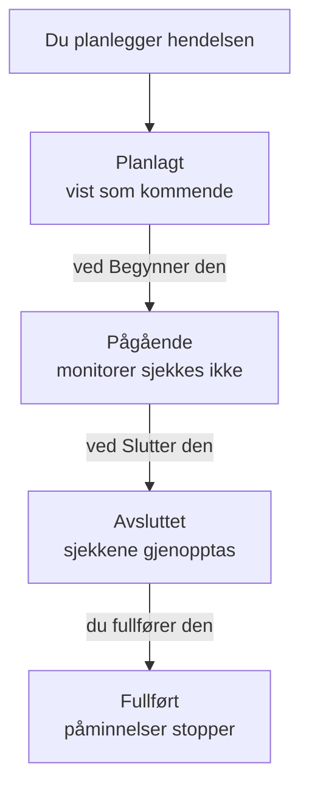

# Planlagt vedlikehold – Oversikt

En planlagt vedlikeholdshendelse forteller alle om planlagt arbeid før det skjer: en databaseoppgradering, en nettverksendring, en flytting til nye servere. OneUptime starter og avslutter hendelsen i tide, slutter å sjekke monitorene den berører mens arbeidet pågår, og viser den på statussidene dine, slik at planlagt nedetid aldri ser ut som et driftsavbrudd. Denne siden forklarer hvordan en hendelse forløper, hvor alt ligger i dashbordet, og hva en hendelse endrer i resten av OneUptime.

:::cards
- [Hvordan en hendelse forløper](#hvordan-en-hendelse-forløper): Fra planlagt til fullført, stort sett av seg selv.
- [Hvor hendelser kommer fra](#hvor-hendelser-kommer-fra): Skjemaet, maler, en tidsplan, skjemaer, chat og kode.
- [Hva en hendelse påvirker](#hva-en-hendelse-påvirker): Monitorer, statussider, abonnenter og varsler.
- [En hendelses egne sider](#en-hendelses-egne-sider): Oversikten, tidslinjen, notatene og innstillingene.
:::

## Hvordan en hendelse forløper

Hver hendelse har et planlagt tidsvindu, sitt **Begynner den** og **Slutter den**, og går nedover listen din over vedlikeholdstilstander. En jobb som kjører hvert minutt, flytter den videre i begge ender av vinduet, så du planlegger arbeidet én gang, og OneUptime gjør resten.

En ny hendelse starter i **Planlagt**. Ved sitt **Begynner den** går den over til **Pågående**: OneUptime slutter å sjekke monitorene dens og viser dem, hvis du har valgt en status for dem, i den statusen. Ved sitt **Slutter den** går den over til **Avsluttet**: sjekkene gjenopptas, og hver monitor går tilbake til "operativ". **Fullført** er det siste trinnet, og ingenting tar det av seg selv: en person, en chatknapp eller API-et markerer arbeidet som godkjent, noe som også stopper påminnelsene til eierne.

Du kan starte eller avslutte en hendelse tidlig, eller legge til egne tilstander mellom disse fire. Se [Vedlikeholdstilstander](/docs/scheduled-maintenance/states).

## Vedlikehold og kunngjøringer

Begge forteller de besøkende på statussidene dine om noe. Bruk en vedlikeholdshendelse for arbeid med en start og en slutt, og en kunngjøring for alt annet de bør lese.

|                              | Planlagt vedlikehold                                                    | Kunngjøring                                    |
| ---------------------------- | ----------------------------------------------------------------------- | ---------------------------------------------- |
| **Hva det er**               | Planlagt arbeid, med et tidsvindu                                       | En melding til de besøkende på statussidene dine |
| **Monitorene dens**          | Sjekkes ikke mens den pågår, og vises i statusen du velger              | Uendret                                        |
| **Hvordan den går videre**   | Gjennom vedlikeholdstilstandene dine, i tide                            | Den vises fra starttidspunktet til slutttidspunktet, hvis den har et |
| **Når abonnentene får beskjed** | Når den planlegges, starter og slutter, og før start hvis du ber om det | Én gang, når den begynner å vises          |
| **Numre i et nytt prosjekt** | `SM-42`                                                                 | Ingen                                          |

Kunngjøringer beskrives på [Abonnenter og kunngjøringer](/docs/status-pages/subscribers#kunngjøringer).

## Hvor hendelser kommer fra

- **Skjemaet.** Klikk på **Opprett planlagt vedlikeholdshendelse** i listen over hendelser, eller på fanen **Planlagt vedlikehold** for en vert, en klynge, en tjeneste, en nettverkslokasjon eller en annen ressurs, som velger den ressursen for deg. Se [Opprett vedlikeholdshendelser](/docs/scheduled-maintenance/creating-events).
- **En mal.** **Opprett fra mal** fyller ut skjemaet fra en mal du har lagret for arbeid du gjør ofte. Se [Maler og gjentakende hendelser](/docs/scheduled-maintenance/templates).
- **En tidsplan.** En gjentakende mal oppretter en ny hendelse etter en tidsplan, for eksempel hver uke eller hver måned, uten at noen åpner skjemaet.
- **Et skjema.** Et skjema der innsendinger oppretter vedlikeholdshendelser, gjør en endringsforespørsel om til en hendelse. Se [Hva en innsending oppretter](/docs/forms/on-submit#slik-blir-en-innsending-til-en-planlagt-vedlikeholdsbegivenhet).
- **Chat.** `/oneuptime maintenance` i Slack, eller `maintenance` skrevet til OneUptime-boten i Microsoft Teams, åpner skjemaet i chatverktøyet ditt. Se [Slack](/docs/workspace-connections/slack#opprett-hendelser-og-vedlikehold-fra-slack).
- **Kode.** API-et på `/api/scheduled-maintenance`, Terraform-ressursen `oneuptime_scheduled_maintenance_event` og trinnet **Create One Scheduled Maintenance Event** i en arbeidsflyt.

## Hvor vedlikehold ligger i dashbordet

Åpne **Planlagt vedlikehold** fra menyen **Produkter** i topplinjen. Listen over hendelser ligger på `/dashboard/{projectId}/scheduled-maintenance-events`, og sidemenyen dens rommer alt om vedlikehold:

| Seksjon       | Hva du gjør der                                                                                                            |
| ------------- | -------------------------------------------------------------------------------------------------------------------------- |
| **Oversikt**  | **Alle hendelser** og **Pågående hendelser**, der merket teller hendelsene som pågår akkurat nå.                            |
| **Kalender** | **Vedlikeholdskalender**: hver hendelse på en måned, en uke eller en dag, ved siden av kalenderne utenfor prosjektet som du legger til. |
| **Arbeidsområde** | **Slack** og **Microsoft Teams**, avhengig av hva prosjektet har koblet til, eller **Koble til Slack eller Teams** når det ikke har noen av dem. |
| **Regler**    | **Eierregler**, **Runbook-regler**, **Etikettregler**, **Reminder Rules**.                                                  |
| **Innstillinger** | **Hendelsesstatus**, **Hendelsesmaler**, **Notatmaler**, **Egendefinerte felt**, **Målinger**, **Kalenderinnstillinger**, **Nummerering**.       |

**Oversikt** og **Kalender** er åpne; **Arbeidsområde**, **Regler**, **Innstillinger** og **Utvikler** starter sammenslått, og en seksjon åpner seg av seg selv når du er på en av sidene dens. **Utvikler** rommer **Terraform**, **API** og **AI-assistenter**, for å styre vedlikehold fra kode. Alt om vedlikehold ligger her, ikke i **Prosjektinnstillinger**.

Listen viser **Nummer for planlagt vedlikehold**, **Tittel**, **Nåværende tilstand**, **Berørte ressurser**, **Vist på statussiden**, **Begynner den**, **Varighet**, **Slutter den**, **Etiketter** og **Eiere**. Velg hendelser for å handle på flere samtidig: **Merk som {{state}}**, **Endre tilstand**, **Tildel til meg**, **Legg til eier**, **Fjern eier**, **Legg til etiketter**, **Fjern etiketter** eller **Slett**. Menyen **⋯** på slutten av raden til hver hendelse gjør det samme for bare den hendelsen: stegene **Merk som {{state}}** så lenge hendelsen kan ta dem, **Endre tilstand**, **Tildel til meg** til du eier den, og **Legg til eier**.

**Vedlikeholdskalender** i delen **Kalender** viser de samme hendelsene på en måned, en uke eller en dag, og kan vise kalendere utenfor prosjektet ved siden av. Se [Vedlikeholdskalender](/docs/scheduled-maintenance/calendar).

## Hva en hendelse påvirker

Mens en hendelse pågår, behandler OneUptime avbruddet den planlegger, som forventet:

- **Monitorene dens sjekkes ikke.** Hver monitor under **Monitorer** slutter å bli sjekket, og sidene til hver av dem viser **Denne overvåkingen er deaktivert**. Hvis du har valgt en **Endre overvåkingsstatus til**, viser monitorene den statusen, også på statussidene dine. Når hendelsen slutter eller slettes, gjenopptas sjekkene, og hver monitor går tilbake til "operativ", med mindre en annen pågående hendelse fortsatt holder den.
- **De andre ressursene dens holder seg stille.** En telemetrimonitor som overvåker mange verter, klynger, databaser eller tjenester, med én serie hver, oppretter ingen hendelse eller varsel for en serie der hendelsen dekker ressursen, mens de andre seriene fortsetter å varsle.
- **Nettverkslokasjoner og SLO-er holder igjen.** En nettverkslokasjon som hendelsen dekker, slutter å regne det planlagte avbruddet sitt mot lokasjonene over den, og forbruksratereglene til en SLO utløser ingenting så lenge en av monitorene dens er i vedlikehold. Se [Nettverkslokasjoner](/docs/monitor/network-sites#planlagt-vedlikehold-for-nettverkslokasjoner) og [Forbruksratevarsler og -hendelser](/docs/slo/burn-rate-alerts#planlagt-vedlikehold).
- **Statussidene dine viser den.** Hendelsen vises på statussidene du har valgt, først som kommende, så som pågående og så som over, så lenge **Synlig på statussiden** er slått på i **Innstillinger** for den, og fra **Publiser den** for den hvis du har valgt et. Når den har startet, viser oppetidshistorikken på disse sidene for hver ressurs monitorene står på den på hver dag vinduet berører, og de ressursene viser «Under vedlikehold» mens den pågår; monitorens oppetidshistorikk i dashbordet viser den på samme måte. Se [Oppetidsprosenter og historikkdiagrammer](/docs/status-pages/resources-and-groups#oppetidsprosenter-og-historikkdiagrammer).
- **Abonnentene får høre om den.** Som standard får abonnentene på disse sidene beskjed når den planlegges, når den starter og når den slutter, og en påminnelse før start hvis du setter opp påminnelser. Se [Planlagte vedlikeholdshendelser](/docs/status-pages/subscribers#planlagte-vedlikeholdshendelser).
- **Teamet ditt får høre om den.** Eierne får beskjed slik [varselinnstillingene](/docs/notifications/notification-settings) deres sier, og Slack- og Microsoft Teams-reglene under **Arbeidsområde** poster den i kanalene dine.

## En hendelses egne sider

Åpne en hendelse fra listen for å se sidene dens. Sidemenyen dens rommer:

| Seksjon i sidemenyen | Sider                                                                                      |
| ----------------- | --------------------------------------------------------------------------------------------- |
| **Oversikt** | **Oversikt**, **Tilstandstidslinje**, **Beskrivelse**, **Runbooks** |
| **Team** | **Eiere** |
| **Varsler**        | **Varsellogger** og **AI-logger**: hver melding som er sendt om hendelsen, og hva AI har gjort for den |
| **Notater**       | **Private notater** og **Offentlige notater**                                                  |
| **Utvikler**      | **Terraform**, **API** og **AI-assistenter**: hendelsen styrt fra kode                         |
| **Avansert**      | **Egendefinerte felt**, **Innstillinger**, **Revisjonslogger**, **Slett hendelse**             |

**Oversikt**, **Team** og **Notater** er åpne; de andre seksjonene forblir sammenslått til du klikker på dem.

- **Oversikt** — overskriften viser hendelsens nummer, tittel og tilstand, hvor lenge det er til den starter eller hvor lenge den har pågått, hvem som eier den, hvilke statussider den vises på og hvem som opprettet den, og knappene som flytter den videre. Under den viser **Starter**, **Slutter** og **Varighet** det planlagte vinduet i tidssonen din. **Planlagt Vedlikehold Feed** registrerer alt som har skjedd med hendelsen, ved siden av kortene **Maintenance Details** og **Berørte ressurser**, og kortene **Målinger** og **Egendefinerte felt** når prosjektet ditt har noen.
- **Tilstandstidslinje** — hver tilstand hendelsen har vært i, når og hvor lenge. Se [Vedlikeholdstilstander](/docs/scheduled-maintenance/states#tilstandstidslinjen).
- **Offentlige notater** — oppdateringer til statussidene dine og abonnentene deres. **Private notater** er bare for teamet ditt.
- **Innstillinger** — **Synlig på statussiden**, som viser eller skjuler hendelsen på statussidene dens, og **Send påminnelser**, som minner eierne om den til den er fullført. Hver bryter lagrer i det øyeblikket du slår den om.

## Feilsøking

:::details En hendelse startet ikke ved sitt Begynner den
Jobben som starter hendelser, kjører hvert minutt, så gi den et minutt. Hvis overskriften viser **Start forsinket**, har hendelsen gått glipp av starten med mer enn to minutter: start den med knappen i overskriften, som gjør alt jobben gjør, og åpne **Tilstandstidslinje** for den for å se hvor den sto.
:::

:::details En monitor ble fortsatt sjekket under vedlikeholdet
Bare monitorene hendelsen nevner under **Monitorer**, slutter å bli sjekket, og bare mens hendelsen pågår. En monitor for en vert eller en tjeneste som hendelsen nevner under **Andre berørte ressurser**, sjekkes fortsatt. Rediger kortet **Berørte ressurser** for hendelsen for å legge til monitoren.
:::

:::details Hendelsen vises ikke på statussiden min
Sjekk at hendelsen nevner siden under **Vis hendelse på disse statussidene**, og at **Synlig på statussiden** er slått på i **Innstillinger** for hendelsen. Viser toppen dens **Ikke på statussider ennå**, vises den fra **Publiser den** for den: se [Publiser den senere](/docs/scheduled-maintenance/creating-events#publiser-den-senere). Sjekk deretter selve statussiden: den må vise planlagte vedlikeholdshendelser, og en hendelse som startet lenger tilbake enn historikkvinduet til siden, 14 dager med mindre du har endret det, vises ikke lenger.
:::

## Neste steg

:::cards
- [Opprett vedlikeholdshendelser](/docs/scheduled-maintenance/creating-events): Skjemaet, felt for felt, og hva som skjer etterpå.
- [Vedlikeholdstilstander](/docs/scheduled-maintenance/states): Hva som starter og avslutter en hendelse, og egne tilstander.
- [Maler og gjentakende hendelser](/docs/scheduled-maintenance/templates): Gjenbruk en hendelse, eller planlegg den hver uke.
- [Vedlikeholdsregler og innstillinger](/docs/scheduled-maintenance/settings): Eiere, etiketter, runbooks og påminnelser, automatisk.
:::
