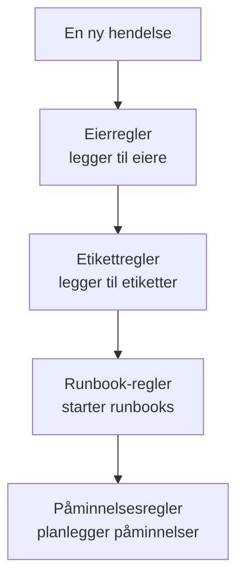

# Vedlikeholdsregler og innstillinger

Konfigurasjonen av vedlikehold ligger i **Planlagt vedlikehold**, ikke i **Prosjektinnstillinger**: reglene som virker på hver ny hendelse, og innstillingene som former hver hendelse i prosjektet. Denne siden er oppslagsverket for hver av dem, og for hvem som kan endre dem.

:::cards
- [Reglene en ny hendelse går gjennom](#reglene-en-ny-hendelse-går-gjennom): I rekkefølge, og hva hver av dem gjør.
- [Påminnelsesregler](#påminnelsesregler): Påminn eierne til en hendelse er fullført.
- [Innstillinger](#innstillinger): Notatmaler, egendefinerte felt, målinger og nummerering.
- [Hvem som kan endre dette](#hvem-som-kan-endre-dette): Vedlikeholdsrollene og abonnementene.
:::

## Hvor vedlikeholdsinnstillingene ligger

Åpne **Planlagt vedlikehold** fra menyen **Produkter** i topplinjen. Seksjonene **Regler** og **Innstillinger** i sidemenyen starter sammenslått, så utvid dem først. Hver side her gjelder hele prosjektet, på en adresse som begynner med `/dashboard/{projectId}/scheduled-maintenance-events/settings/`.

| Regelside          | Hva den gjør                                                        |
| ------------------ | ------------------------------------------------------------------- |
| **Eierregler**     | Legger til eiere på matchende hendelser.                            |
| **Runbook-regler** | Starter runbooks for matchende hendelser.                           |
| **Etikettregler**  | Legger til etiketter på matchende hendelser.                        |
| **Reminder Rules** | Påminner eierne med et intervall til en hendelse er fullført.       |

Seksjonen **Innstillinger** rommer **Hendelsesstatus**, beskrevet på [Vedlikeholdstilstander](/docs/scheduled-maintenance/states), **Hendelsesmaler**, beskrevet på [Maler og gjentakende hendelser](/docs/scheduled-maintenance/templates), og deretter **Notatmaler**, **Egendefinerte felt**, **Målinger**, **Kalenderinnstillinger** og **Nummerering**. **Kalenderinnstillinger** er beskrevet på [Vedlikeholdskalender](/docs/scheduled-maintenance/calendar#eksterne-kalendere), resten nedenfor.

Seksjonen **Arbeidsområde** rommer Slack- og Microsoft Teams-reglene som poster hendelser i kanaler. Se [Slack](/docs/workspace-connections/slack#varslingsregler) og [Microsoft Teams](/docs/workspace-connections/microsoft-teams#varslingsregler).

## Reglene en ny hendelse går gjennom

Reglene er forskjellige i hvordan flere treff avgjøres:

- **Eierregler**, **Etikettregler** og **Runbook-regler** virker alle når de matcher. Eiere og etiketter som flere regler legger til, legges til én gang.
- **Reminder Rules** sjekkes fra toppen av listen og nedover, og det første treffet vinner. Dra en regel for å endre plassen; en ny regel havner sist.

En ny regel starter aktivert; slå av **Aktivert** i redigeringsskjemaet for å sette den på pause, og listen viser en grønn **Aktivert** eller en rød **Deaktivert** for hver regel. Eier-, etikett- og runbook-regler virker på hendelser som opprettes etter at du har lagret dem. For å bruke en eier- eller etikettregel på hendelsene du allerede har, bruker du **Kjør nå**: se [Kjøre regler på eksisterende ressurser](/docs/configuration/run-rules-now).

## Eier- og etikettregler

**Eierregler** legger til eierbrukere og -team på nye hendelser som matcher, og **Etikettregler** legger til etiketter. Å opprette en tar to trinn: **Treff**, betingelsene, og deretter **Eiere** eller **Etiketter**, det regelen legger til.

| Betingelse                                                      | Matcher                                                                    |
| --------------------------------------------------------------- | -------------------------------------------------------------------------- |
| **Monitorer**, **Hendelsesetiketter**, **Overvåkingsetiketter** | Hendelser med en av monitorene eller etikettene du velger.                 |
| **Hendelsestittel**, **Hendelsesbeskrivelse**, **Overvåkingsnavn**, **Overvåkingsbeskrivelse** | Et mønster, som et regulært uttrykk, uten forskjell på store og små bokstaver. |

En regel matcher bare når hver betingelse du fyller ut, holder; en betingelse som står tom, hoppes over.

- **En regel kan arve.** Sammenslått under **Arv eiere** eller **Arv etiketter** gir seks brytere videre eierne eller etikettene til hendelsens monitorer, verter, Kubernetes-klynger, Docker-verter, Podman-verter og tjenester.
- **En ny regel må legge til noe**: velg minst én eier eller etikett, eller slå på en bryter.
- **Varsle eiere**, under **Flere felt** på en eierregel, avgjør om personene som legges til, får beskjed.

[Etikett- og eierregler](/docs/configuration/label-and-owner-rules) går gjennom skjemaet trinn for trinn, for alle typer ressurser.

## Runbook-regler

**Runbook-regler** starter en runbook når en ny hendelse matcher, for eksempel en sjekkliste før hver databaseoppgradering. De matcher på de samme tingene som eier- og etikettregler; vedlikeholdshendelser har ingen alvorlighetsgrad, så runbook-regler for vedlikehold tilbyr ingen. Kjøringen knyttes til hendelsen, på siden **Runbooks**. Se [Runbook-regler](/docs/runbooks/rules).

## Påminnelsesregler

**Planlagt vedlikehold → Regler → Reminder Rules** påminner eierne av en hendelse til arbeidet er godkjent. Hver hendelse får den første regelen som matcher den, fra toppen av listen og nedover.

:::steps
### Velg hvilke hendelser det skal påminnes om

Klikk på **Opprett Scheduled Maintenance Reminder Rule**. Under **Treff** lar du **Alle planlagte vedlikeholdshendelser** være valgt for å påminne om hver hendelse, eller du velger **Bare planlagte vedlikeholdshendelser som oppfyller betingelsene** og deretter **Etiketter** den gjelder for.

### Still inn intervallet

Under **Påminnelser** stiller du inn **Påminnelsesintervall (minutter)**, hvor ofte eierne påminnes, og velger under **Påminn eiere** når. **Navn** følger begge, for eksempel "Påminn hver 30 minutter mens den pågår", til du skriver inn ditt eget, og en **Beskrivelse** venter under **Flere felt**. Opprett deretter regelen.
:::

| Svar | Når eierne påminnes |
| --- | --- |
| **Mens den pågår** | Fra hendelsen starter til den slutter. En ny regel starter med dette svaret. |
| **Før den starter** | Fra hendelsen er planlagt til den starter. |
| **Før den starter og mens den pågår** | Fra hendelsen er planlagt til den slutter. |

API-et og Terraform avviser en regel som ville ventet til hendelsen starter, og stoppet når den starter: Den ville aldri sende en påminnelse. En eldre regel som er lagret slik, er merket med **Påminner aldri** i listen, og skjemaet ber deg velge når det skal sendes påminnelser.

Eierne får hver påminnelse som **Maintenance reminder**, som er på via e-post for hvert nye medlem. Å lagre, endre eller slette en påminnelsesregel matcher hver hendelse som ikke er fullført, på nytt. For å stoppe påminnelsene for én hendelse slår du av **Send påminnelser** på siden **Innstillinger** for den; den lagres i det øyeblikket du slår den om.

Disse påminnelsene er for teamet ditt. Påminnelsene statussideabonnentene dine får før en hendelse starter, stilles inn på selve hendelsen, under **Påminnelser før hendelsen**.

## Innstillinger

### Notatmaler

**Planlagt vedlikehold → Innstillinger → Notatmaler** rommer ferdigskrevet tekst for oppdateringer om vedlikehold. Kortet **Maler for offentlige eller private notater for planlagte vedlikeholdshendelser** viser dem; **Opprett Planlagt Vedlikehold Notat Mal** ber om et **Malnavn**, en **Malbeskrivelse** og **Notat**. En mal tilbys når noen skriver et offentlig eller privat notat på en hendelse, og når de endrer tilstanden, og teksten kan redigeres før den publiseres. I motsetning til notatmalene for uplanlagte hendelser fyller notatmaler for vedlikehold ikke ut noen variabler.

### Egendefinerte felt

**Planlagt vedlikehold → Innstillinger → Egendefinerte felt** legger til egne felt på hver hendelse, for eksempel en endringssak eller et kundenivå. Fyll dem ut på siden **Egendefinerte felt** for en hendelse, eller gjennom API-et som `customFields`. Et felt kan kopiere verdien sin fra et egendefinert felt på en monitor i stedet for å bli skrevet inn: se [Felt som kopieres fra en monitor](/docs/incidents/settings#felt-som-kopieres-fra-en-monitor), som fungerer på samme måte for vedlikeholdshendelser.

### Målinger

**Planlagt vedlikehold → Innstillinger → Målinger** tar tiden på hvor lenge ting tar på hver hendelse. Velg **Startforsinkelse**, fra den planlagte starten til hendelsen starter, **Overskridelse**, fra den planlagte slutten til den slutter, eller **Varighet på vedlikeholdet**, fra den starter til den slutter; eller to egne øyeblikk med **Noe annet**. Hver måling vises på siden til hendelsen og tegnes som `oneuptime.scheduled-maintenance.measurement.<key>`. Se [Målinger](/docs/incidents/settings#målinger), som fungerer på samme måte for vedlikeholdshendelser.

### Nummerering

**Planlagt vedlikehold → Innstillinger → Nummerering** angir teksten foran hendelsesnumre: `SM-` i et nytt prosjekt, eller `#` uten prefiks. **Oppdater** ber om **Nummerprefiks for planlagt vedlikehold** og viser nummeret i en forhåndsvisning mens du skriver. Bare hendelser som opprettes etterpå, får det nye prefikset; eksisterende beholder numrene sine. Reglene for et prefiks står på [Nummerprefikser](/docs/incidents/settings#nummerprefikser).

Kortet **Neste nummer** under setter nummeret den neste hendelsen får, for å fortsette numrene fra et annet verktøy: **Oppdater** åpner **Neste nummer for planlagt vedlikehold**, som må være høyere enn det høyeste så langt. Se [Neste numre](/docs/incidents/settings#neste-numre).

> [!NOTE]
> På OneUptime Cloud krever egendefinerte felt abonnementet **Growth** eller høyere, og det samme gjelder å legge til og endre vedlikeholdstilstander og maler.

## Arbeidsflyter

Hver vedlikeholdsmodell har arbeidsflytutløsere og -handlinger, oppkalt etter seg: **On Create Scheduled Maintenance Event**, **On Update Scheduled Maintenance Event**, **On Create or Update Scheduled Maintenance Event** og **On Delete Scheduled Maintenance Event**, det samme for **Scheduled Maintenance State Timeline** og de andre, og handlinger som **Create One Scheduled Maintenance Event** og **Update One Scheduled Maintenance Event**. Definisjoner av egendefinerte felt og måleverdier er unntakene: de har ingen arbeidsflyttrinn. Se [Oversikt over arbeidsflyter](/docs/workflows/index).

## Hvem som kan endre dette

| Rolle                             | Hva den kan gjøre                                                                                    |
| --------------------------------- | ---------------------------------------------------------------------------------------------------- |
| **Vedlikeholdsleser**  | Leser hendelser, og endrer ingenting.                                                                |
| **Vedlikeholdsmedlem**  | Oppretter, endrer og sletter hendelser med notatene, tilstandstidslinjene og eierne deres, og begge typer maler. |
| **Vedlikeholdsadministrator**   | Alt et medlem gjør, og oppretter, endrer og sletter i tillegg vedlikeholdstilstander.                |

Regler, egendefinerte felt og målinger krever **Prosjekteier** eller **Prosjektadministrator**, eller en egendefinert rolle med den sidens egen tillatelse, for eksempel **Create Scheduled Maintenance Owner Rule**. Runbook-regler godtar også **Runbook-administrator**. **Prosjektmedlem** arbeider med hendelser og maler, som **Vedlikeholdsmedlem**. Se [Brukere, team og tillatelser](/docs/permissions/index).

## Feilsøking

:::details En eierregel la ikke til noen på en ny hendelse
Åpne regelen og sjekk betingelsene: hver betingelse du har fylt ut, må holde. Et tittelmønster er et regulært uttrykk, så `db upgrade` matcher ikke "DB-Upgrade"; skriv `db.upgrade`. En regel virker også bare på hendelser som er opprettet etter at den ble lagret: bruk **Kjør nå** for dem du allerede har.
:::

:::details Eierne fikk ingen påminnelse
Sjekk at en påminnelsesregel matcher etikettene til hendelsen, at **Send påminnelser** for hendelsen er på, og at **Maintenance reminder** er på i varselinnstillingene til eierne. En regel med **Mens den pågår** sender ingenting før hendelsen starter.
:::

## Neste steg

:::cards
- [Vedlikeholdstilstander](/docs/scheduled-maintenance/states): Siden Hendelsesstatus, og hva hver tilstand gjør.
- [Maler og gjentakende hendelser](/docs/scheduled-maintenance/templates): Siden Hendelsesmaler, i dybden.
- [Etikett- og eierregler](/docs/configuration/label-and-owner-rules): Regelskjemaet, trinn for trinn.
- [Varselinnstillinger](/docs/notifications/notification-settings): Hvordan hver eier velger hva som når frem til dem.
:::
