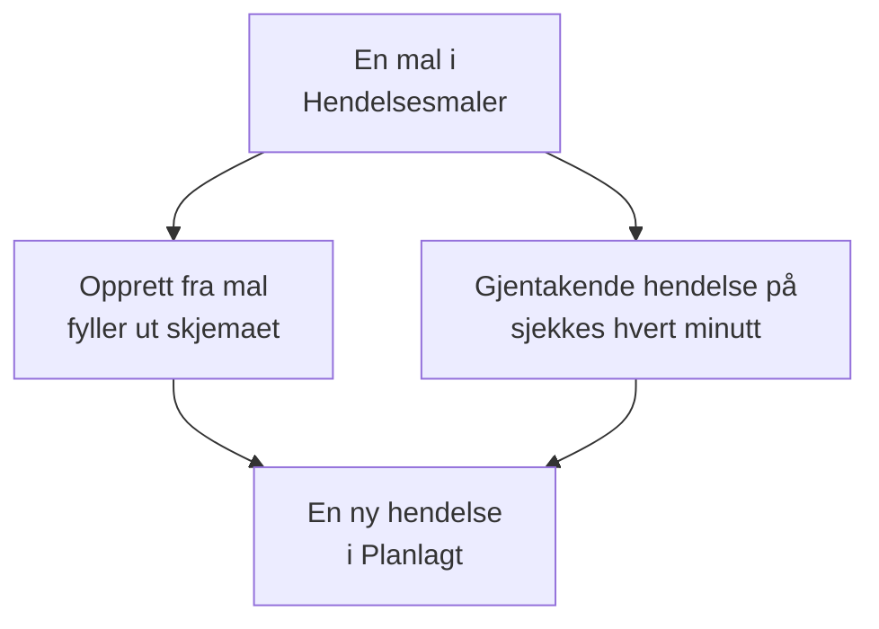

# Maler og gjentakende hendelser

En mal for planlagt vedlikehold lagrer en hendelse du ofte planlegger: tittelen og beskrivelsen, monitorene den setter på pause, statussidene den vises på, og hvem som får beskjed. Bruk en til å fylle ut skjemaet med ett klikk, eller gjør den gjentakende, slik at OneUptime planlegger hendelsen for deg hver uke, hver måned eller med et hvilket som helst intervall du velger.

:::cards
- [Opprett en mal](#opprett-en-mal): Trinnene i skjemaet, med et navn først og en tidsplan til slutt.
- [Bruk en mal](#bruk-en-mal): Fyll ut en ny hendelse fra den.
- [Gjentakende hendelser](#gjentakende-hendelser): La OneUptime planlegge hendelsen av seg selv.
- [Endre eller stopp en mal](#endre-eller-stopp-en-mal): Rediger den, sett tidsplanen på pause, eller slett den.
:::

## Slik fungerer det

En mal er et utgangspunkt. En hendelse som er opprettet fra den, er en kopi med egne verdier: endrer du malen senere, endres bare hendelsene som opprettes etter det.

## Før du begynner

- **Abonnementet ditt.** På OneUptime Cloud krever maler abonnementet **Growth** eller høyere.
- **Rollen din.** Å opprette en mal krever **Prosjekteier**, **Prosjektadministrator**, **Prosjektmedlem**, **Vedlikeholdsadministrator** eller **Vedlikeholdsmedlem**, eller en egendefinert rolle som kan opprette maler for planlagt vedlikehold.

## Opprett en mal

:::steps
### Åpne malene

Gå til **Planlagt vedlikehold → Innstillinger → Hendelsesmaler**. **Innstillinger** starter sammenslått i sidemenyen: utvid den først. Klikk på **Opprett Planlagt Vedlikehold Mal**.

### Gi malen et navn

Under **Malinformasjon** gir du den et **Malnavn** og en **Malbeskrivelse**, slik at teamet ditt vet når den skal brukes. Begge er påkrevd.

### Beskriv hendelsen

Under **Hendelse** fyller du ut **Tittel** og **Beskrivelse** som hver hendelse fra den starter med. **Eiere** og **Etiketter** venter under **Flere felt**.

### Velg hva den berører

Under **Berørte ressurser** velger du **Monitorer**, **Endre overvåkingsstatus til** for dem, eventuelle **Andre berørte ressurser**, statussidene under **Vis hendelse på disse statussidene** og **Varsler til abonnenter**.

### Bestem om den gjentas

Under **Gjentakende** lar du **Gjentakende hendelse** være av for en mal du bruker manuelt, eller slår den på og fyller ut tidsplanen. Klikk på **Neste** for å se gjennom oversikten, og opprett deretter malen.
:::

En mal spør om **Endre overvåkingsstatus til** selv når den ikke nevner noen monitorer: statusen gjelder også monitorene du legger til når du planlegger en hendelse fra den. Under **Andre berørte ressurser** tar en mal verter, Kubernetes-klynger, Docker-verter, Podman-verter og tjenester.

## Hva en mal fyller ut

| Del av hendelsen                                  | Opprett fra mal                      | En gjentakende hendelse         |
| ------------------------------------------------- | ------------------------------------ | ------------------------------- |
| **Tittel** og **Beskrivelse**                     | Utfylt, og du kan endre dem          | Kopiert                         |
| **Monitorer** og **Endre overvåkingsstatus til**  | Utfylt                               | Kopiert                         |
| **Andre berørte ressurser**                       | Utfylt                               | Kopiert                         |
| Statussidene og **Varsler til abonnenter**        | Utfylt                               | Kopiert                         |
| **Eiere** og **Etiketter**                        | Utfylt                               | Kopiert                         |
| **Begynner den** og **Slutter den**               | Neste hele time, i én time           | Beregnet ut fra tidsplanen      |

## Bruk en mal

:::steps
### Velg malen

På **Planlagt vedlikehold → Alle hendelser** klikker du på **Opprett fra mal** og velger en mal under **Velg mal for planlagt vedlikehold**.

### Sjekk skjemaet

Klikk på **Opprett fra mal**. Skjemaet åpnes med svarene fra malen allerede utfylt. Still inn vinduet, og endre det denne hendelsen trenger.

### Opprett hendelsen

Gå gjennom trinnene med **Neste**, og klikk deretter på **Opprett planlagt vedlikeholdshendelse** i gjennomgangen.
:::

Når prosjektet ikke har noen mal ennå, sier **Opprett fra mal** det og lenker til **Hendelsesmaler**.

## Gjentakende hendelser

En gjentakende mal oppretter hendelsen etter en tidsplan. Du angir når den første hendelsen opprettes, når den starter og når den slutter; hver senere hendelse holder de samme avstandene, ett intervall senere.

| Felt                                                   | Hva det betyr                                                                                       |
| ------------------------------------------------------ | --------------------------------------------------------------------------------------------------- |
| **Gjentakende hendelse**                               | Slår på tidsplanen.                                                                                 |
| **Første hendelse planlagt til**                       | Når OneUptime oppretter den første hendelsen, og dermed når abonnentene får vite at den er planlagt. |
| **Første hendelse starter**                            | Når den første hendelsen starter.                                                                   |
| **Første hendelse slutter**                            | Når den første hendelsen slutter.                                                                   |
| **Hvor ofte vil du at denne hendelsen skal gjenta seg?** | Et tall og en enhet: timer, dager, uker, måneder eller år.                                        |

For eksempel et ukentlig vindu der den første hendelsen opprettes en mandag for lørdagen etter:

| Hendelse     | Opprettet          | Starter            | Slutter            |
| ------------ | ------------------ | ------------------ | ------------------ |
| Den første   | `2030-06-03 09:00` | `2030-06-08 02:00` | `2030-06-08 04:00` |
| Den andre    | `2030-06-10 09:00` | `2030-06-15 02:00` | `2030-06-15 04:00` |

Sett **Første hendelse planlagt til** så langt før starten som du vil at kundene dine skal høre om arbeidet. Alle tre tidspunktene må ligge i fremtiden når du oppretter malen, hendelsen må opprettes før den starter og slutter, og den må starte før den slutter; skjemaet sier hvilken regel et tidspunkt bryter.

En jobb sjekker de gjentakende malene hvert minutt. Når det neste tidspunktet til en mal kommer, flytter den tidspunktet ett intervall frem og oppretter hendelsen. Mallisten viser det tidspunktet i kolonnen **Gjentakende hendelse**, og **Nei** for en mal som ikke gjentas. En hendelse som er opprettet fra tidsplanen, er som alle andre: reglene kjører, eierne legges til, og abonnentene får vite at den er planlagt.

## Endre eller stopp en mal

Åpne en mal fra listen for å se siden dens:

- **Maldetaljer for planlagt vedlikehold** viser hva nye hendelser starter med. **Rediger** går gjennom **Malinformasjon**, **Hendelse**, **Statussider** og **Gjentakende**.
- **Berørte ressurser** rommer **Monitorer**, deres **Endre overvåkingsstatus til** og **Andre berørte ressurser**, med sin egen **Rediger**.
- **Eiere** viser personene og teamene som eier hver hendelse som planlegges fra den.

Endringer gjelder hendelsene som opprettes etter at du har lagret dem; hendelser som allerede er opprettet, beholder sine egne verdier. For å stoppe en tidsplan slår du av **Gjentakende hendelse** under **Rediger**, eller sletter malen. En mal som er slått av, beholder tidsplanen sin: slår du den på igjen, fortsetter den ved tidsplanens neste tidspunkt og hopper over tidspunktene den var av. Sletter du en mal, blir hendelsene den har opprettet, værende.

## Feilsøking

:::details Når en gjentakende mal opprettes, står det at et tidspunkt må ligge i fremtiden
Alle tre første tidspunktene må ligge etter nå når du oppretter den. Flytt dem frem: tidsplanen fortsetter deretter fra den første hendelsen.
:::

:::details En gjentakende mal opprettet ingen hendelse
Sjekk at **Gjentakende hendelse** fortsatt er på, og se på tidspunktet i kolonnen **Gjentakende hendelse** i listen: hendelsen opprettes da, ikke ved starten. Jobben kjører hvert minutt, så gi den et minutt.
:::

:::details En hendelse fra en mal mangler en ressurs jeg valgte
En mal tar verter, Kubernetes-klynger, Docker-verter, Podman-verter og tjenester under **Andre berørte ressurser**. Legg til andre typer ressurser på selve hendelsen, med **Rediger** på kortet **Berørte ressurser**.
:::

## Neste steg

:::cards
- [Opprett vedlikeholdshendelser](/docs/scheduled-maintenance/creating-events): Skjemaet en mal fyller ut.
- [Vedlikeholdstilstander](/docs/scheduled-maintenance/states): Hvordan hver hendelse går videre når den er opprettet.
- [Vedlikeholdsregler og innstillinger](/docs/scheduled-maintenance/settings): Gi hver ny hendelse eiere og etiketter automatisk.
- [Planlagt vedlikehold – Oversikt](/docs/scheduled-maintenance/index): Hvor maler passer inn i resten av vedlikeholdet.
:::
