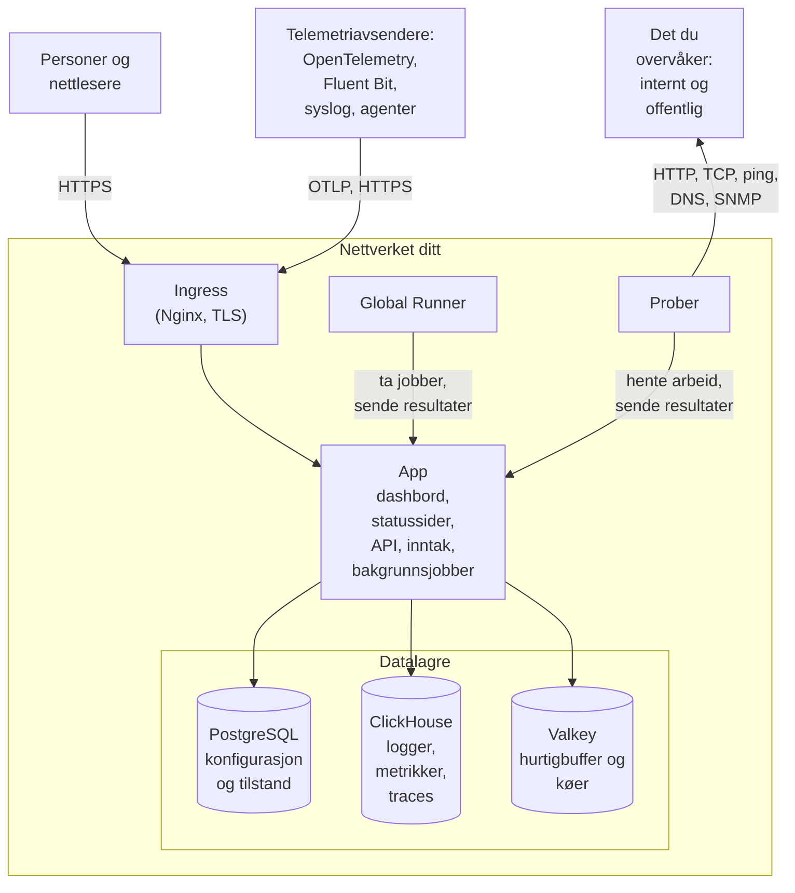

# Arkitektur

En selvhostet OneUptime-installasjon er en håndfull containere: én ingress som hver forespørsel kommer inn gjennom, ett app-image som gjør jobben, prober som kjører kontrollene til monitorene dine, og tre datalagre. Denne siden viser hvordan de henger sammen, hva hver del gjør, og hvilke tilkoblinger som krysser nettverket ditt.

## Hva dette viser

- Personer når OneUptime gjennom **ingress**, som avslutter TLS og sender hver forespørsel videre til appen: Dashboard, statussidene, API-et og hvert inntaksendepunkt som telemetri sendes til.
- **Appen** leser og skriver tilstanden sin i PostgreSQL, lagrer telemetri i ClickHouse og bruker Valkey (den BSD-lisensierte forken av Redis 7.2) som hurtigbuffer og til køene som bakgrunnsjobbene arbeider seg gjennom.
- **Prober** kan kjøre inne i klyngen din (anbefalt) og/eller andre steder i nettverket ditt. De kan overvåke:
  - Interne/private tjenester bak brannmuren din.
  - Eksterne/offentlige ressurser på internett.
- Proberesultater sendes til appen, legges i kø i Valkey og behandles av bakgrunnsjobbene inn i datalagrene dine. En probe et annet sted i nettverket ditt når appen gjennom ingress, på OneUptime-URL-en din.
- Telemetri (metrikker, traces, logger og mer) tas inn av den samme appen og lagres i ClickHouse.

> [!NOTE]
> Hvis du bruker ekstern PostgreSQL, Valkey (eller Redis) eller ClickHouse i stedet for de medfølgende, kobler appen seg til de eksterne endepunktene dine i stedet. Den logiske flyten forblir den samme.

## Komponentene

| Komponent | Docker Compose-tjeneste | Helm-chart | Hva den gjør |
| --- | --- | --- | --- |
| Ingress | `ingress` | `nginx` | Avslutter TLS, betjener vertsnavnet ditt og domenene til statussidene dine, og sender hver forespørsel videre til appen. |
| App | `app` | `app` | Dashboard, statussidene, API- og inntaksendepunktene og, med mindre du skiller dem ut, bakgrunnsjobbene. |
| Worker | En del av `app` | `worker` (av som standard) | Bakgrunnsjobbene i egne pods, slik at tung købehandling aldri konkurrerer med API-forespørsler. |
| Telemetry writer | En del av `app` | `telemetryWriter` (av som standard) | Et lag med fast størrelse som gjør hver ClickHouse-innsetting, slik at innsettingene holder seg begrenset uansett hvor langt workerne skalerer. |
| Probe | `probe-1` | `probes` | Kjører monitorkontroller og sender resultatene tilbake. Hver medfølgende probe er en global probe som alle prosjekter kan bruke. |
| Global Runner | `global-runner` | `globalRunner` | En [global Runner](/docs/runbooks/agents#globale-runnere): den kjører JavaScript-trinnene til alle prosjekter som ikke velger sin egen Runner, hvert i en sandkasse som bare når internett, og koderettingene til OneUptime AI i hvert koderepositorium som ikke velger noen. Den har sin egen nøkkel og ingenting annet fra serveren. Bash-, SSH- og kubectl-trinn kjører på [Runnere](/docs/runbooks/agents) som du installerer der de skal kjøre. |
| PostgreSQL | `postgres` | `postgresql`, eller `postgresOperator.cnpg` | Prosjekter, monitorer, hendelser, brukere og alle andre innstillinger og tilstander. |
| ClickHouse | `clickhouse` | `clickhouse`, eller `clickhouseOperator.altinity` | Logger, metrikker, traces, unntak, profiler og monitorlogger. |
| Valkey | `valkey` | `valkey` | Hurtigbufferen, jobbkøene og kortvarig tilstand som ventende push-kvitteringer. |

Alle rollene til appen er det samme imaget: Docker Compose kjører dem i én `app`-container, og Helm-chartet kan kjøre worker og telemetry writer som egne deployments. Hvordan du dimensjonerer hvert lag, står i [Dimensjonering og kapasitetsplanlegging](/docs/installation/sizing).

## Tilkoblinger ut av nettverket ditt

Fire tilkoblinger opprettes med mindre du endrer en innstilling:

- Én gang om dagen spør appen GitHubs API (`api.github.com`) om det har kommet en nyere utgivelse. Den leser også sikkerhetsmeldingene som OneUptime har publisert, slik at hovedadministratorene dine får beskjed når en av dem påvirker versjonen du kjører ([Oppdaterings- og sikkerhetskontroller](/docs/self-hosted/update-checks)). Du slår det av med `updateCheck.disabled: true` i Helm-chartet, eller med `DISABLE_UPDATE_CHECK=true` i `config.env` på Docker Compose.
- Én gang om dagen forteller appen `oneuptime.com` installasjonens adresse og hvilken versjon den kjører, slik at OneUptime vet hvilke installasjoner som fortsatt kjører en utgivelse med et sikkerhetsproblem. Det sendes ingenting om brukerne, prosjektene eller overvåkingsdataene dine. Du slår det av med `instanceCheckIn.disabled: true` i Helm-chartet, eller med `DISABLE_INSTANCE_CHECK_IN=true` i `config.env` på Docker Compose.
- Registrerer noen seg med «Varsle meg om sikkerhetsoppdateringer og nye utgivelser» avkrysset, slik den er fra starten, sendes personens navn og e-post, et eventuelt firma og telefonnummer, og installasjonens adresse og versjon til `oneuptime.com`. Fjern avkryssingen på et nettverk uten internettilgang.
- På Kubernetes faller prober tilbake på de offentlige resolverne `8.8.8.8` og `1.1.1.1` etter klyngens egen DNS. Sett `dnsConfig.nameservers` til `[]` for å holde alle oppslag på din egen DNS.

Alt annet kobler seg bare utover når du slår det på, og hver har en side som oppgir de nøyaktige adressene som må tillates:

| Utgående tilkobling | Brukes til | Les mer |
| --- | --- | --- |
| E-post (SMTP, eller API-et til SendGrid) | Varsler og invitasjoner | [SMTP](/docs/emails/smtp) |
| Twilio | SMS og telefonsamtaler | [Twilio-integrasjon](/docs/self-hosted/twilio-integration) |
| Push-reléet til OneUptime, eller Expo | Mobile push-varsler | [Push-varsler](/docs/self-hosted/push-notifications) |
| Slack og Microsoft Teams | Varsler og handlinger i arbeidsområdet | [Slack-integrasjon](/docs/self-hosted/slack-integration) |
| En LLM-leverandør, som OpenAI, Anthropic, Microsoft Foundry eller en modell du kjører selv | OneUptime AI | [LLM-leverandører](/docs/ai/llm-provider) |
| `oneuptime.com` | Aktivere en Enterprise-lisens på nett | [Enterprise Edition](/docs/self-hosted/enterprise) |

Tilkoblinger den andre veien – SendGrid som leverer innkommende e-post, og Slack og Microsoft Teams som ringer tilbake – krever at ingress kan nås fra internett. Hvilke private adresser appen og probene kan nå, bestemmer du: se [Tilgang til privat nettverk](/docs/self-hosted/private-network-access).

OneUptimes logo ligger inne i hver e-post som OneUptime sender, så den vises selv på et nettverk uten internettilgang, og når en e-post åpnes, blir ingen annen vert spurt om noe. En logo du laster opp selv, som din egen eller logoen til en statusside, ligger også inne i e-posten når den er en PNG, JPEG eller GIF på høyst 512 KB. Alle andre bilder du laster opp, vises fra OneUptime-URL-en din, som de som leser disse e-postene, må kunne nå.

## Neste steg

:::cards
- [Docker Compose](/docs/installation/docker-compose): Installer alle komponentene på én maskin.
- [Dimensjonering og kapasitetsplanlegging](/docs/installation/sizing): Hvor mye CPU, minne og disk hvert lag trenger.
- [Egne prober](/docs/probe/custom-probe): Kjør en probe inne i et annet nettverk.
- [Enterprise Edition](/docs/self-hosted/enterprise): Hva Enterprise-imagene legger til, og hvordan lisensiering fungerer.
:::
