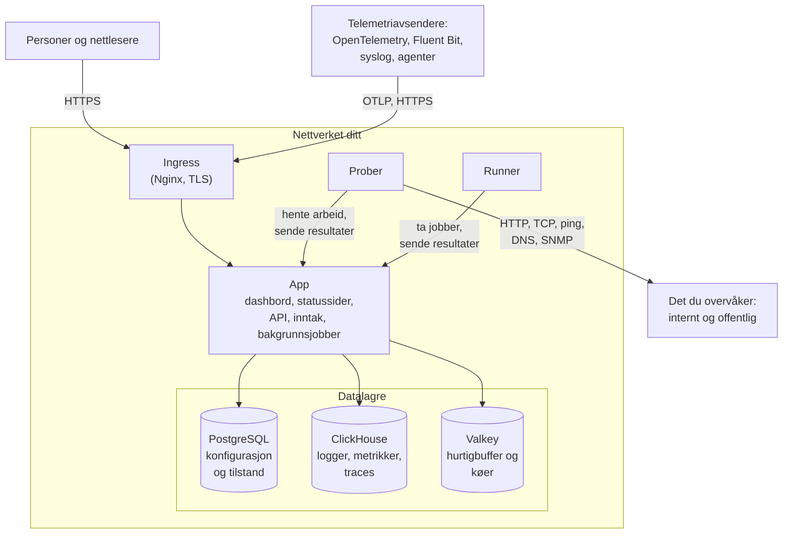

# Arkitektur

En selvhostet OneUptime-installasjon er en håndfull containere: én ingress som hver forespørsel kommer inn gjennom, ett app-image som gjør jobben, prober som kjører kontrollene til monitorene dine, og tre datalagre. Denne siden viser hvordan de henger sammen, hva hver del gjør, og hvilke tilkoblinger som krysser nettverket ditt.

## Hva dette viser

- Personer når OneUptime gjennom **ingress**, som avslutter TLS og sender hver forespørsel videre til appen: Dashboard, statussidene, API-et og hvert inntaksendepunkt som telemetri sendes til.
- **Appen** leser og skriver tilstanden sin i PostgreSQL, lagrer telemetri i ClickHouse og bruker Valkey (den BSD-lisensierte forken av Redis 7.2) som hurtigbuffer og til køene som bakgrunnsjobbene arbeider seg gjennom.
- **Prober** kan kjøre inne i klyngen din (anbefalt) og/eller andre steder i nettverket ditt. De kan overvåke:
  - Interne/private tjenester bak brannmuren din.
  - Eksterne/offentlige ressurser på internett.
- Proberesultater sendes til appen, legges i kø i Valkey og behandles av bakgrunnsjobbene inn i datalagrene dine. En probe et annet sted i nettverket ditt når appen gjennom ingress, på OneUptime-URL-en din.
- Telemetri (metrikker, traces, logger og mer) tas inn av den samme appen og lagres i ClickHouse.

> [!NOTE]
> Hvis du bruker ekstern PostgreSQL, Valkey (eller Redis) eller ClickHouse i stedet for de medfølgende, kobler appen seg til de eksterne endepunktene dine i stedet. Den logiske flyten forblir den samme.

## Komponentene

| Komponent | Docker Compose-tjeneste | Helm-chart | Hva den gjør |
| --- | --- | --- | --- |
| Ingress | `ingress` | `nginx` | Avslutter TLS, betjener vertsnavnet ditt og domenene til statussidene dine, og sender hver forespørsel videre til appen. |
| App | `app` | `app` | Dashboard, statussidene, API- og inntaksendepunktene og, med mindre du skiller dem ut, bakgrunnsjobbene. |
| Worker | En del av `app` | `worker` (av som standard) | Bakgrunnsjobbene i egne pods, slik at tung købehandling aldri konkurrerer med API-forespørsler. |
| Telemetry writer | En del av `app` | `telemetryWriter` (av som standard) | Et lag med fast størrelse som gjør hver ClickHouse-innsetting, slik at innsettingene holder seg begrenset uansett hvor langt workerne skalerer. |
| Probe | `probe-1` | `probes` | Kjører monitorkontroller og sender resultatene tilbake. Hver medfølgende probe er en global probe som alle prosjekter kan bruke. |
| Runner | `runner` | `runner` | Instansens egen Runner, som kan kjøre AI-koderettinger for alle prosjekter. Runbook-trinn kjører på [Runnere](/docs/runbooks/agents) som du installerer der de skal kjøre. |
| PostgreSQL | `postgres` | `postgresql`, eller `postgresOperator.cnpg` | Prosjekter, monitorer, hendelser, brukere og alle andre innstillinger og tilstander. |
| ClickHouse | `clickhouse` | `clickhouse`, eller `clickhouseOperator.altinity` | Logger, metrikker, traces, unntak, profiler og monitorlogger. |
| Valkey | `valkey` | `valkey` | Hurtigbufferen, jobbkøene og kortvarig tilstand som ventende push-kvitteringer. |

Alle rollene til appen er det samme imaget: Docker Compose kjører dem i én `app`-container, og Helm-chartet kan kjøre worker og telemetry writer som egne deployments. Hvordan du dimensjonerer hvert lag, står i [Dimensjonering og kapasitetsplanlegging](/docs/installation/sizing).

## Tilkoblinger ut av nettverket ditt

Appen kobler seg bare utover for det du slår på. Hver av disse er valgfri, og hver har en side som oppgir de nøyaktige adressene som må tillates:

| Utgående tilkobling | Brukes til | Les mer |
| --- | --- | --- |
| E-post (SMTP, eller API-et til SendGrid) | Varsler og invitasjoner | [SMTP](/docs/emails/smtp) |
| Twilio | SMS og telefonsamtaler | [Twilio-integrasjon](/docs/self-hosted/twilio-integration) |
| Push-reléet til OneUptime, eller Expo | Mobile push-varsler | [Push-varsler](/docs/self-hosted/push-notifications) |
| Slack og Microsoft Teams | Varsler og handlinger i arbeidsområdet | [Slack-integrasjon](/docs/self-hosted/slack-integration) |
| En LLM-leverandør, som OpenAI, Anthropic, Microsoft Foundry eller en modell du kjører selv | OneUptime AI | [LLM-leverandører](/docs/ai/llm-provider) |
| `oneuptime.com` | Aktivere en Enterprise-lisens på nett | [Enterprise Edition](/docs/self-hosted/enterprise) |

Tilkoblinger den andre veien – SendGrid som leverer innkommende e-post, og Slack og Microsoft Teams som ringer tilbake – krever at ingress kan nås fra internett. Hvilke private adresser appen og probene kan nå, bestemmer du: se [Tilgang til privat nettverk](/docs/self-hosted/private-network-access).

## Neste steg

:::cards
- [Docker Compose](/docs/installation/docker-compose): Installer alle komponentene på én maskin.
- [Dimensjonering og kapasitetsplanlegging](/docs/installation/sizing): Hvor mye CPU, minne og disk hvert lag trenger.
- [Egne prober](/docs/probe/custom-probe): Kjør en probe inne i et annet nettverk.
- [Enterprise Edition](/docs/self-hosted/enterprise): Hva Enterprise-imagene legger til, og hvordan lisensiering fungerer.
:::
