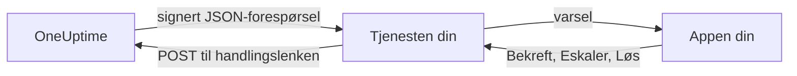

# Egendefinerte varslingskanaler

En egendefinert kanal sender vakttilkallinger til en tjeneste du selv drifter: bedriftens egen app, et personsøkersystem eller en gateway som kontrollerer hva som forlater nettverket ditt. Du legger den til én gang, for hele serveren, og alle kan tilkalles gjennom den uten å sette opp noe. I Admin Dashboard heter de **Custom Channels**.

> [!NOTE]
> Egendefinerte kanaler er en del av [OneUptime Enterprise Edition](/docs/self-hosted/enterprise) og krever en Enterprise-lisens som omfatter dem. Community Edition har ingen side **Custom Channels** og sender ingenting til en kanal. Se [Uten lisens](#uten-lisens).

:::cards
- [Legg til en kanal](#legg-til-en-kanal): Et navn, en URL og en signeringshemmelighet.
- [Hva tjenesten din mottar](#hva-tjenesten-din-mottar): Én signert JSON-forespørsel per person per tilkalling.
- [Handle på en tilkalling](#handle-på-en-tilkalling): Bekreft, eskaler eller løs fra din egen app.
- [Levering og nye forsøk](#levering-og-nye-forsøk): Hva som skjer når tjenesten din er nede.
- [Andre varsler](#andre-varsler): Varsler til eiere, notater og vakter, for dem som vil ha dem.
- [Uten lisens](#uten-lisens): Hva som stopper, og hva som beholdes.
:::

## Slik fungerer det



Når en vaktretningslinje tilkaller noen og vaktregelen deres bruker kanalen, sender OneUptime en forespørsel til kanalens URL. Den forteller hvem tilkallingen er til (navn og e-post) og hva den gjelder, og har med lenker som tjenesten din kaller når personen bekrefter, eskalerer eller løser den i appen din.

## Legg til en kanal

1. Åpne **Innstillinger** i Admin Dashboard, deretter **Custom Channels**, og velg **Add**.
2. Fyll ut i trinnet **Channel**:
   - **Navn**: det folk ser i varselmetodene og vaktreglene sine, for eksempel `CorpoApp`.
   - **Webhook URL**: hvor OneUptime sender hver tilkalling. Den kan ligge på det private nettverket ditt.
   - **Signing Secret**: OneUptime lager en for deg. Kopier den inn i tjenesten din, som kontrollerer hver forespørsel med den. Du kan se den igjen ved å redigere kanalen.
3. Lagre i trinnet **Delivery**, og velg deretter **Send test** for å sende tjenesten din en [testforespørsel](#testforespørsler).

I trinnet **Delivery** er **Page everyone through this channel** slått på. OneUptime legger da kanalen til i alles vaktregler i hvert prosjekt, og i reglene til alle som blir med i et prosjekt senere, og bruker den til å nå en vakthavende som ikke har noen regel for det som utløste tilkallingen. Slå det av for å la folk legge til kanalen i reglene sine selv.

Folk ser kanalen under **Brukerinnstillinger**, deretter **Varselmetoder**, deretter **Custom Channels**, med en knapp **Send test**, og velger den i vaktreglene sine som `Custom Channel: CorpoApp`. De setter ikke opp noe: Tjenesten din får vite hvem hver tilkalling er til.

For å slutte å sende uten å endre noens regler redigerer du kanalen og slår av **På**. Tilkallinger som ville ha gått til den, registreres i vaktloggen som ikke sendt. Sletter du en kanal, slettes alle vaktregler som bruker den.

## Hva tjenesten din mottar

Hver tilkalling er en `POST`-forespørsel med en JSON-body:

| Header | Hva den inneholder |
| --- | --- |
| `Content-Type` | `application/json` |
| `X-OneUptime-Event` | Hendelsestypen, for eksempel `on-call.incident.created` |
| `X-OneUptime-Signature` | `sha256=` og den heksadesimale HMAC-SHA256-en av den rå bodyen, laget med kanalens signeringshemmelighet |

```json title="An incident page"
{
  "version": 1,
  "event": "on-call.incident.created",
  "notificationId": "5f2c8a1e-6b1d-4c3a-9e7f-2a4b6c8d0e1f",
  "sentAt": "2026-10-27T03:14:15.000Z",
  "channel": { "id": "0b7e…", "name": "CorpoApp" },
  "title": "New Incident INC-42: API latency high",
  "message": "A new incident has been created: INC-42 (API latency high) in Agency A. Click to view details.",
  "project": { "id": "8d1f…", "name": "Agency A" },
  "team": { "id": "2c9a…", "name": "SRE" },
  "user": { "id": "4e6b…", "name": "Jane Tan", "email": "jane@example.com" },
  "recordType": "incident",
  "record": {
    "id": "9a3c…",
    "number": "INC-42",
    "title": "API latency high",
    "description": "p95 latency above 2 seconds for 5 minutes.",
    "severity": "Critical",
    "state": "Created",
    "url": "https://oneuptime.example.com/dashboard/8d1f…/incidents/9a3c…"
  },
  "onCallPolicy": { "id": "1d4e…", "name": "Primary" },
  "escalationRule": { "id": "7b2f…", "name": "Level 1" },
  "isPageAgain": false,
  "actions": {
    "acknowledge": "https://oneuptime.example.com/api/custom-notification-channel/page/5f2c…/acknowledge?token=…",
    "escalate": "https://oneuptime.example.com/api/custom-notification-channel/page/5f2c…/escalate?token=…",
    "resolve": "https://oneuptime.example.com/api/custom-notification-channel/page/5f2c…/resolve?token=…"
  }
}
```

| Felt | Hva det er |
| --- | --- |
| `version` | `1`. Denne versjonen får bare nye felt lagt til. |
| `event` | `on-call.incident.created`, `on-call.alert.created`, `on-call.incidentEpisode.created`, `on-call.alertEpisode.created`, `notification` for [andre varsler](#andre-varsler), eller `test` |
| `notificationId` | Én per person per tilkalling. Bruk den til å forkaste en forespørsel du allerede har behandlet. |
| `title`, `message` | Klare til å vises, slik et push-varsel ville vist dem |
| `user` | Hvem tilkallingen er til. Finn kontoen i appen din ut fra `email` eller `id`. |
| `team` | Teamet personen ble tilkalt gjennom, eller `null` når personen ble tilkalt direkte |
| `recordType`, `record` | Hva tilkallingen gjelder: en `incident`, `alert`, `incidentEpisode` eller `alertEpisode` |
| `onCallPolicy`, `escalationRule` | Retningslinjen og nivået som tilkalte personen |
| `isPageAgain` | `true` når posten ble bekreftet for en stund siden og fortsatt ikke er løst |
| `actions` | Lenkene tjenesten din kaller for å [handle på tilkallingen](#handle-på-en-tilkalling) |

En tilkalling til flere personer er én forespørsel per person, hver med lenkene til akkurat den personen, slik at OneUptime vet hvem som svarte. Tittelen, meldingen og beskrivelsen er til sammen begrenset til 16 384 tegn; en lengre beskrivelse blir kuttet og slutter med «… (truncated — see OneUptime for the full text)».

### Kontroller signaturen

Regn ut HMAC-en av forespørselens rå body før du parser den, og sammenlign den med headeren:

```javascript title="Node.js"
const crypto = require("crypto");

function isFromOneUptime(rawBody, signatureHeader, secret) {
  const expected =
    "sha256=" + crypto.createHmac("sha256", secret).update(rawBody).digest("hex");
  const received = String(signatureHeader || "");

  return (
    received.length === expected.length &&
    crypto.timingSafeEqual(Buffer.from(received), Buffer.from(expected))
  );
}
```

## Handle på en tilkalling

Når personen trykker på en knapp i appen din, sender tjenesten din en `POST`-forespørsel til den tilhørende lenken i `actions`. Det trengs ingen API-nøkkel: Hver lenke har med seg et token for akkurat den tilkallingen, gyldig i 7 dager, og handlingen registreres som utført av personen som ble tilkalt.

| Handling | Hva den gjør |
| --- | --- |
| `acknowledge` | Bekrefter personens tilkalling, og med den hendelsen, varselet eller episoden |
| `escalate` | Personen kan ikke ta den: tilkaller nå neste nivå i vaktretningslinjen og slutter å tilkalle personen |
| `resolve` | Løser hendelsen, varselet eller episoden, hvis personens egne tillatelser tillater det |

```bash title="Acknowledge a page"
curl -X POST "https://oneuptime.example.com/api/custom-notification-channel/page/5f2c…/acknowledge?token=…"
```

Svaret forteller hva som skjedde, med ord appen din kan vise som de er:

```json title="The answer"
{
  "action": "acknowledge",
  "result": "acknowledged",
  "message": "Acknowledged."
}
```

`result` er en av `acknowledged`, `alreadyAcknowledged`, `escalated`, `notEscalated`, `resolved` og `alreadyResolved`. En utløpt eller feil lenke avvises med en 4xx-status og en melding.

## Andre varsler

Tilkallinger er ikke de eneste varslene folk får: OneUptime forteller dem også når en hendelse de eier, endrer tilstand, når et notat blir publisert, når vakten deres begynner, og mer. Hver person velger hvor hvert av dem skal, under **Brukerinnstillinger > Varselinnstillinger**, som har en kolonne **Custom Channels** så lenge en kanal er slått på. Den er slått av for alle til de slår den på selv.

Et varsel går til hver kanal som er slått på, som én forespørsel per kanal, med `event` satt til `notification`:

```json title="A notification"
{
  "version": 1,
  "event": "notification",
  "notificationId": null,
  "sentAt": "2026-10-27T03:20:00.000Z",
  "channel": { "id": "0b7e…", "name": "CorpoApp" },
  "title": "Incident INC-42 acknowledged",
  "message": "Incident INC-42 (API latency high) was acknowledged in Agency A.",
  "project": { "id": "8d1f…", "name": "Agency A" },
  "team": null,
  "user": { "id": "4e6b…", "name": "Jane Tan", "email": "jane@example.com" },
  "recordType": null,
  "record": null,
  "onCallPolicy": null,
  "escalationRule": null,
  "isPageAgain": false,
  "actions": null,
  "notificationType": "Send incident state changed notification when I am the owner of the incident",
  "url": "https://oneuptime.example.com/dashboard/8d1f…/incidents/9a3c…"
}
```

`title` og `message` er det personens push-varsel ville sagt. `notificationType` navngir innstillingen det ble sendt for, og `url` lenker til det varselet gjelder, eller er `null`. Det er ingenting å handle på, så `actions` er `null`.

## Levering og nye forsøk

En forespørsel regnes som levert når tjenesten din svarer med en 2xx-status innen 10 sekunder. En forespørsel den ikke svarte på, eller svarte på med 408, 429 eller en 5xx-status, sendes på nytt etter 1 sekund og etter ytterligere 4 sekunder: tre forsøk i alt. Ved alle andre 4xx-statuser sendes den ikke på nytt.

Utfallet av hvert forsøk står i personens vaktlogg, med kanalens navn og statusen tjenesten din svarte med, aldri URL-en. En tilkalling som ikke blir levert, stopper ikke vaktretningslinjen: Hvis ingen bekrefter, eskalerer den som vanlig. Ha en e-post- eller SMS-regel lenger ned i reglene dine hvis tjenesten din er den eneste måten å nå folk på.

## Testforespørsler

**Send test**, på siden i Admin Dashboard eller i en persons varselmetoder, sender en forespørsel med `event` satt til `test`, personen som trykket, som `user`, og `notificationId`, `record` og `actions` satt til `null`. Bruk den til å prøve tjenesten din før en ekte tilkalling kommer.

## Uten lisens

Egendefinerte kanaler virker i Enterprise Editions prøveperiode på 14 dager og i fristen på 30 dager etter at en lisens har utløpt. Etter det, eller med en lisens som ikke omfatter dem:

- **Ingenting sendes til en egendefinert kanal.** En tilkalling som ville ha gått til en, registreres i personens vaktlogg som ikke sendt, og det samme gjør en test.
- **Kanaler tilbys ikke lenger.** De forsvinner fra folks varselmetoder, vaktregler og varselinnstillinger, og beredskapen og reserveløsningen slutter å telle dem med.
- **Siden er skrivebeskyttet.** Du kan se og slette kanaler, men ikke legge til eller endre dem, og ingen kan peke en regel eller en varselinnstilling mot en kanal.
- **Ingenting slettes.** Kanalene, og vaktreglene og innstillingene som bruker dem, beholdes.

Alt fortsetter så snart en lisens er aktivert, uten omstart. Folk som ble med i et prosjekt mens egendefinerte kanaler var stoppet, får ikke en kanal som tilkaller alle, i reglene sine: De kan legge den til selv.
